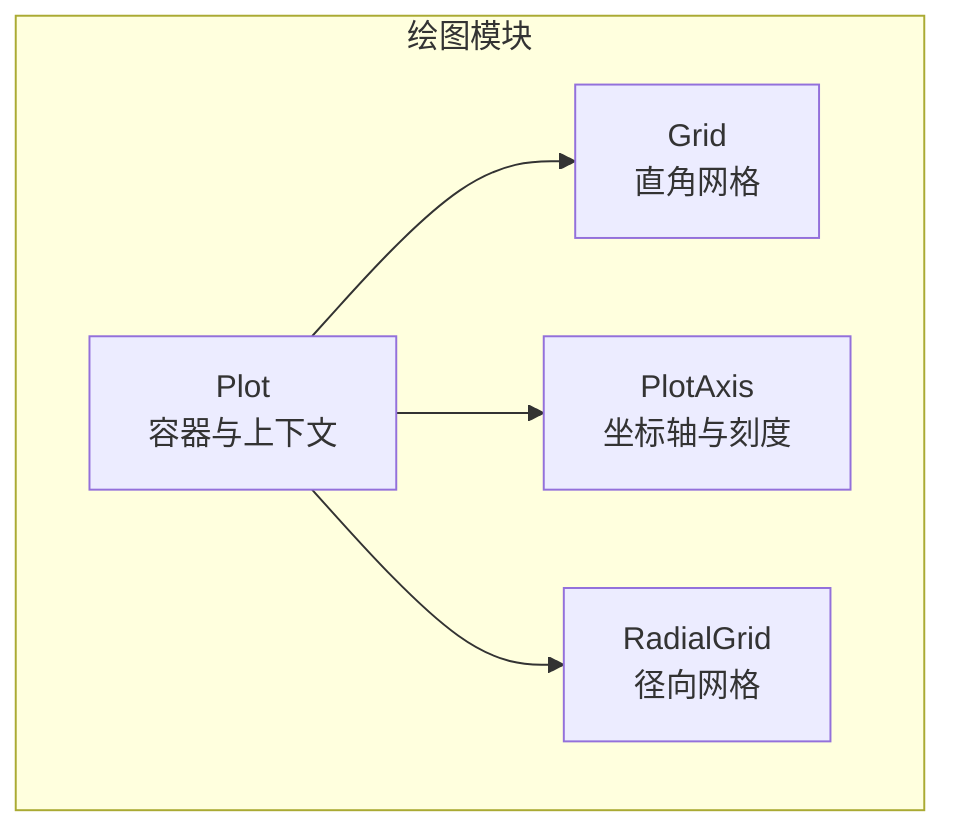
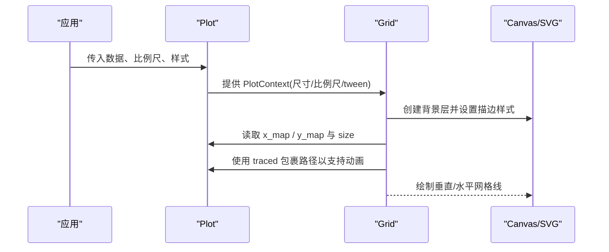
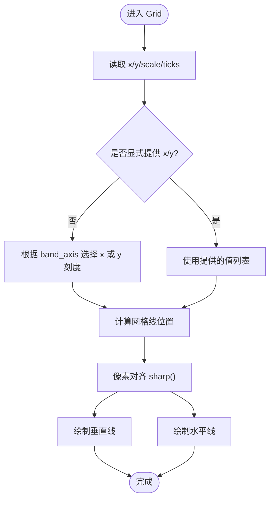
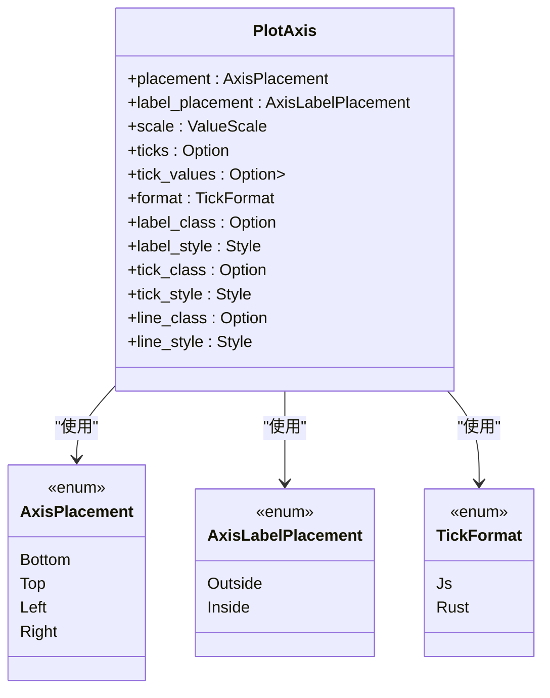
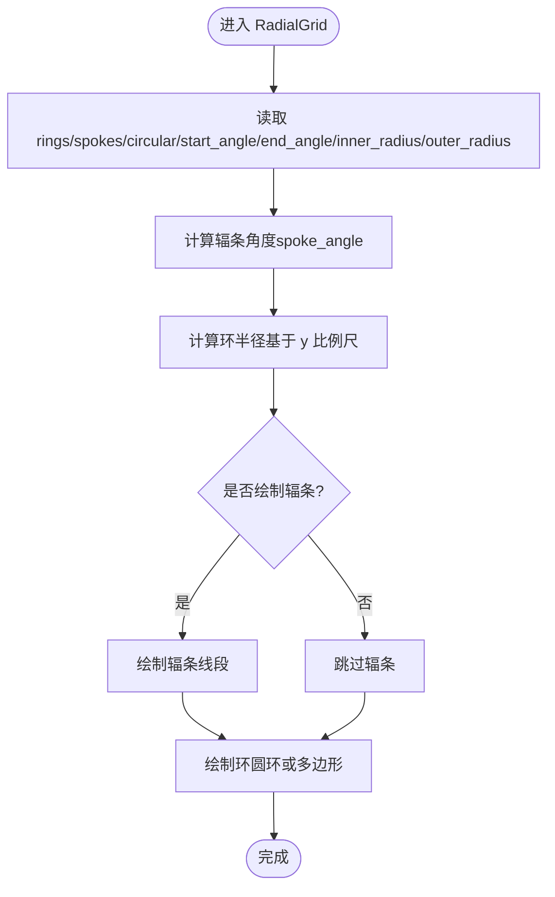
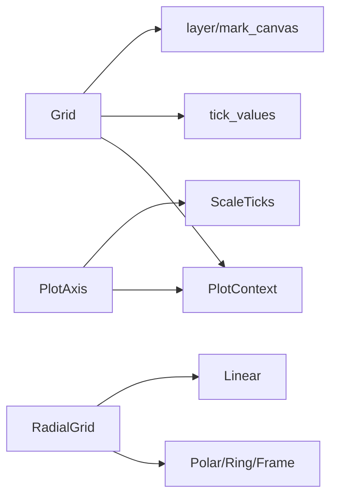

# 网格系统

<cite>
**本文引用的文件**   
- [grid.rs](file://crates/nsh-base/src/plot/grid.rs)
- [axis.rs](file://crates/nsh-base/src/plot/axis.rs)
- [mod.rs](file://crates/nsh-base/src/plot/mod.rs)
- [radial_line.rs](file://crates/nsh-base/src/plot/radial_line.rs)
</cite>

## 目录
1. [简介](#简介)
2. [项目结构](#项目结构)
3. [核心组件](#核心组件)
4. [架构总览](#架构总览)
5. [详细组件分析](#详细组件分析)
6. [依赖关系分析](#依赖关系分析)
7. [性能与响应式](#性能与响应式)
8. [故障排查](#故障排查)
9. [结论](#结论)
10. [附录：示例与最佳实践](#附录示例与最佳实践)

## 简介
本文件面向 NSH 图表网格系统，聚焦以下目标：
- 网格线类型：主网格、次网格（通过刻度生成策略实现）
- 样式配置：颜色、线型、透明度
- 坐标轴网格的自动生成与自定义网格线添加
- 网格与数据的对齐关系、响应式适配
- 网格在背景层的作用与性能考虑
- 提供实际代码示例路径，帮助构建专业数据可视化界面

NSH 的绘图模块以 Plot 为容器，Grid 负责绘制贯穿画布的网格线；PlotAxis 负责坐标轴刻度与标签；RadialGrid 提供雷达图场景下的同心环与辐条网格。所有网格均基于比例尺（线性、点、区间）计算位置，并与 Plot 的尺寸、缩放、动画状态联动。

## 项目结构
与网格系统直接相关的源码位于 nsh-base 的 plot 子模块：
- grid.rs：直角坐标系网格 Grid
- axis.rs：坐标轴 PlotAxis 与刻度生成 tick_values
- mod.rs：Plot 上下文、比例尺、动画与渲染管线
- radial_line.rs：径向网格 RadialGrid（雷达图）

图示来源
- [mod.rs:779-800](file://crates/nsh-base/src/plot/mod.rs#L779-L800)
- [grid.rs:1-98](file://crates/nsh-base/src/plot/grid.rs#L1-L98)
- [axis.rs:1-800](file://crates/nsh-base/src/plot/axis.rs#L1-L800)
- [radial_line.rs:762-800](file://crates/nsh-base/src/plot/radial_line.rs#L762-L800)

章节来源
- [mod.rs:1-128](file://crates/nsh-base/src/plot/mod.rs#L1-L128)

## 核心组件
- Grid：根据 x/y 值或自动刻度绘制垂直/水平网格线，支持继承 stroke-*、strokeWidth、strokeDasharray 等 SVG 描边属性，未设置时默认使用 currentColor。
- PlotAxis：沿 Plot 边缘绘制刻度与标签，支持“外/内”标签放置、左右上下四向布局，以及 y 双轴 scale="y2"。
- RadialGrid：雷达图的同心环与辐条网格，支持圆环或多边形环、起始/结束角度、内外半径等。

章节来源
- [grid.rs:7-39](file://crates/nsh-base/src/plot/grid.rs#L7-L39)
- [axis.rs:147-210](file://crates/nsh-base/src/plot/axis.rs#L147-L210)
- [radial_line.rs:762-797](file://crates/nsh-base/src/plot/radial_line.rs#L762-L797)

## 架构总览
网格系统的渲染流程围绕 Plot 上下文展开：
- Grid 从 PlotContext 获取尺寸、比例尺映射、动画 tween 信息
- 通过 mark_canvas 将网格绘制到背景层
- 使用 traced 处理线性轴的 domain 动画（x/y 平移/缩放），保证网格与数据同步移动
- 通过 pixel_ratio 进行像素级对齐，确保细线在高分屏上清晰

图示来源
- [grid.rs:40-97](file://crates/nsh-base/src/plot/grid.rs#L40-L97)
- [mod.rs:679-709](file://crates/nsh-base/src/plot/mod.rs#L679-L709)

## 详细组件分析

### Grid：直角坐标系网格
职责
- 根据 props.x / props.y 指定网格线位置，或根据比例尺刻度自动生成
- 当同时未提供 x/y 时，依据 band_axis 决定按 x 或 y 的刻度生成
- 使用 SVG 路径绘制整幅画布的网格线，并在设备像素边界对齐以保证锐利显示
- 继承父级的 stroke-*、strokeWidth、strokeDasharray，未设置时使用 currentColor

关键行为
- 自动刻度：调用 tick_values 获取刻度值，遵循 alignTicks 的对齐步长
- 像素对齐：sharp(v) = floor(v * ratio + 0.5) / ratio，确保 1px 线在高分屏不模糊
- 动画兼容：traced(x=true/false, y=Option<ValueScale>) 包裹路径，使网格随域动画平滑移动

样式配置
- 颜色：SVG paint 属性，如 stroke、currentColor
- 线型：strokeDasharray（虚线）、strokeWidth（线宽）
- 透明度：可通过 CSS 的 opacity 或 SVG paint 的 alpha 通道控制

图示来源
- [grid.rs:40-97](file://crates/nsh-base/src/plot/grid.rs#L40-L97)

章节来源
- [grid.rs:1-98](file://crates/nsh-base/src/plot/grid.rs#L1-L98)

### PlotAxis：坐标轴与刻度
职责
- 沿 Plot 边缘绘制刻度标记、轴线与标签文本
- 支持 placement（bottom/top/left/right）、label_placement（outside/inside）
- 支持 ValueScale::Y 与 Y2（双轴）
- 刻度生成：ticks 数量或 tick_values 精确值；format 可定制文本

刻度生成策略
- linear 比例尺：d3 的 nice values（1、2、5 × 10^n），约 ticks 个
- point/band 比例尺：按行均匀分布，默认每行一个刻度
- 对齐步长：alignTicks 开启时，y 与 y2 共享对齐步长，保证 Grid 与 Axis 一致

标签布局
- outside：标签在 Plot 外部，避免遮挡图形
- inside：标签在 Plot 内部，紧贴边缘，必要时调整 inset 防止溢出

图示来源
- [axis.rs:17-55](file://crates/nsh-base/src/plot/axis.rs#L17-L55)
- [axis.rs:147-210](file://crates/nsh-base/src/plot/axis.rs#L147-L210)
- [axis.rs:57-98](file://crates/nsh-base/src/plot/axis.rs#L57-L98)

章节来源
- [axis.rs:1-800](file://crates/nsh-base/src/plot/axis.rs#L1-L800)

### RadialGrid：径向网格（雷达图）
职责
- 绘制同心环（rings）与辐条（spokes）
- 支持 circular（圆环）或多边形环（按行角度连接）
- 支持 start_angle/end_angle 定义扇区范围
- inner_radius/outer_radius 定义环的内外半径

与 RadialLine 的关系
- RadialLine 的值映射到 inner/outer 半径之间
- RadialGrid 的 rings 与 RadialLine 的 y 比例尺对齐，形成一致的视觉参考

图示来源
- [radial_line.rs:32-47](file://crates/nsh-base/src/plot/radial_line.rs#L32-L47)
- [radial_line.rs:762-800](file://crates/nsh-base/src/plot/radial_line.rs#L762-L800)

章节来源
- [radial_line.rs:762-800](file://crates/nsh-base/src/plot/radial_line.rs#L762-L800)

## 依赖关系分析
- Grid 依赖：
  - PlotContext：获取 size、x_map、y_map_of、band_axis、traced
  - axis.tick_values：生成自动刻度
  - layer/mark_canvas：创建背景层并绘制
- PlotAxis 依赖：
  - PlotContext：获取 x_categories、y_categories、size、tween
  - ScaleTicks：计算刻度值与精度
- RadialGrid 依赖：
  - Polar/Ring/Frame：计算角度、半径与顶点
  - Linear：将 y 值映射到半径

图示来源
- [grid.rs:1-98](file://crates/nsh-base/src/plot/grid.rs#L1-L98)
- [axis.rs:726-800](file://crates/nsh-base/src/plot/axis.rs#L726-L800)
- [radial_line.rs:57-64](file://crates/nsh-base/src/plot/radial_line.rs#L57-L64)

章节来源
- [grid.rs:1-98](file://crates/nsh-base/src/plot/grid.rs#L1-L98)
- [axis.rs:726-800](file://crates/nsh-base/src/plot/axis.rs#L726-L800)
- [radial_line.rs:57-64](file://crates/nsh-base/src/plot/radial_line.rs#L57-L64)

## 性能与响应式
- 背景层绘制：Grid 使用 layer().child(mark_canvas(...)) 将网格置于背景层，减少与前景元素的层级交互开销。
- 像素对齐：sharp(v) 将坐标对齐到设备像素中心，避免 1px 线在高分屏出现半像素模糊。
- 动画兼容：traced 对 x/y 轴变换进行封装，网格在域动画期间保持与数据同步，无需额外重绘逻辑。
- 刻度计算缓存：ScaleTicks 与 label_texts 使用 Memo/Signal 缓存刻度与标签，避免频繁重算。
- 响应式适配：
  - 网格随 Plot.size 变化而重绘
  - 双轴对齐（align_ticks）确保 y 与 y2 共用步长，Grid 与 Axis 保持一致
  - 标签 outside/inside 与 inset 计算避免标签溢出

章节来源
- [grid.rs:40-97](file://crates/nsh-base/src/plot/grid.rs#L40-L97)
- [axis.rs:260-320](file://crates/nsh-base/src/plot/axis.rs#L260-L320)
- [mod.rs:249-260](file://crates/nsh-base/src/plot/mod.rs#L249-L260)

## 故障排查
- 网格线不显示
  - 检查是否设置了 stroke 或 currentColor；若未设置，可能不可见
  - 确认 Grid 是否在 Plot 内部，且 Plot 已具备有效尺寸
- 网格线模糊
  - 检查像素比与 sharp 对齐；确保未使用过小的 line_width
- 网格与刻度错位
  - 检查 align_ticks 与 ticks 配置；确保 Grid 与 Axis 使用相同的 scale 与 ticks
- 标签溢出
  - 调整 label_placement 为 outside，或增加 padding/margin
  - 检查 add_inset 计算的 top/bottom 是否足够容纳标签高度

章节来源
- [grid.rs:40-97](file://crates/nsh-base/src/plot/grid.rs#L40-L97)
- [axis.rs:310-320](file://crates/nsh-base/src/plot/axis.rs#L310-L320)

## 结论
NSH 网格系统通过 Grid、PlotAxis 与 RadialGrid 提供了完整的直角与径向网格能力。其设计强调：
- 与比例尺和 Plot 上下文深度集成，保证网格与数据对齐
- 支持丰富的样式配置（颜色、线型、透明度）
- 自动刻度与自定义网格线并存，兼顾易用性与灵活性
- 背景层绘制与像素对齐保障性能与清晰度
- 响应式与动画友好，适配多平台与高分屏

## 附录：示例与最佳实践
以下为创建专业数据可视化界面的步骤与要点（不展示具体代码内容，仅给出实现路径）：

- 基础折线图带网格
  - 在 Plot 中引入 Grid，设置 x/y 或留空以启用自动刻度
  - 使用 PlotAxis 在底部/左侧显示刻度与标签
  - 通过 CSS 类或 inline style 设置 stroke、strokeWidth、strokeDasharray 与 opacity
  - 参考路径：[grid.rs:40-97](file://crates/nsh-base/src/plot/grid.rs#L40-L97)、[axis.rs:227-460](file://crates/nsh-base/src/plot/axis.rs#L227-L460)

- 双轴图表网格对齐
  - 启用 align_ticks，确保 y 与 y2 刻度步长一致
  - Grid 不传 x/y，自动跟随对齐步长生成网格
  - 参考路径：[mod.rs:249-260](file://crates/nsh-base/src/plot/mod.rs#L249-L260)

- 雷达图网格
  - 使用 RadialGrid 设置 rings 与 spokes，配合 RadialLine 的 inner/outer radius
  - 根据需要设置 circular 与 start_angle/end_angle
  - 参考路径：[radial_line.rs:762-800](file://crates/nsh-base/src/plot/radial_line.rs#L762-L800)

- 性能优化建议
  - 将 Grid 置于背景层，避免与前景元素重叠
  - 合理设置 ticks 数量，避免过多刻度导致渲染压力
  - 使用 currentColor 与 CSS 统一样式，减少重复计算
  - 参考路径：[grid.rs:40-97](file://crates/nsh-base/src/plot/grid.rs#L40-L97)