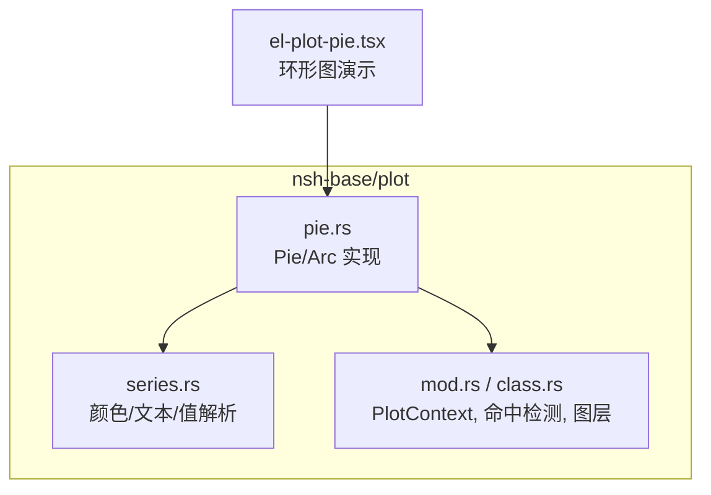
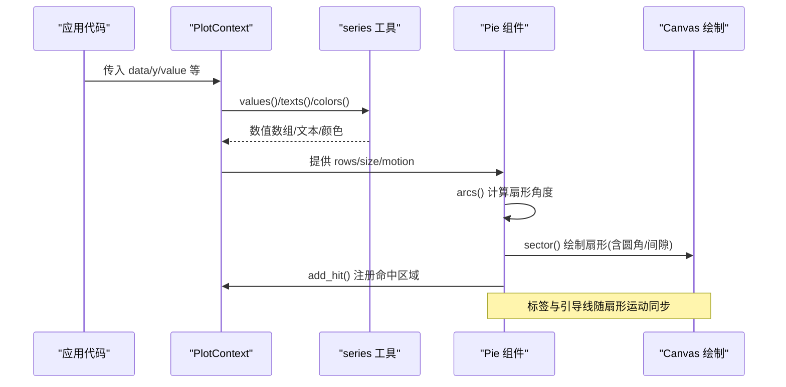
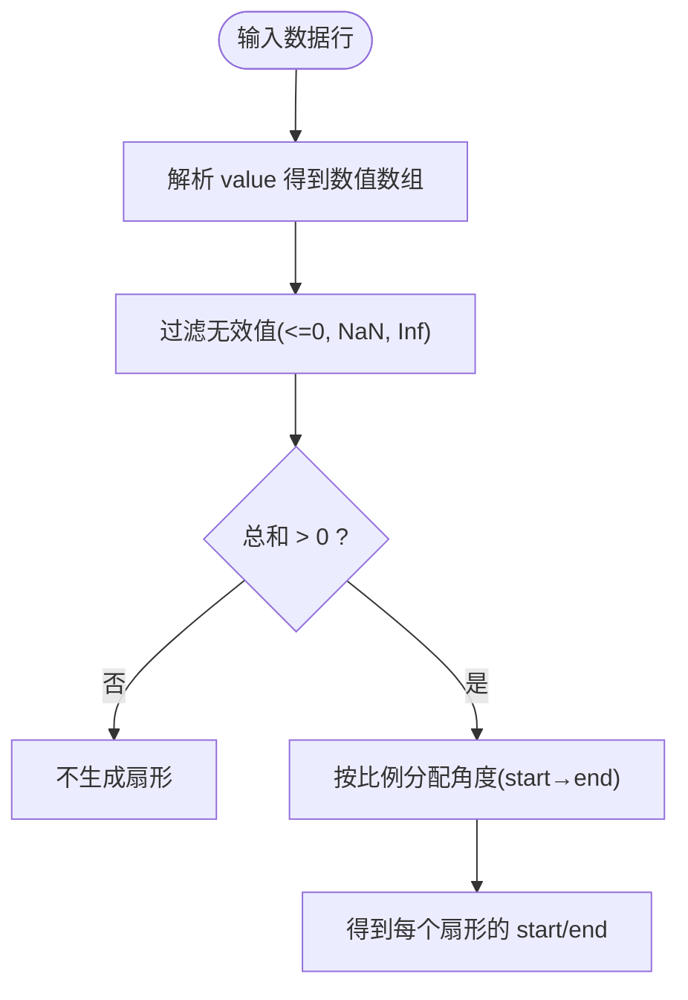
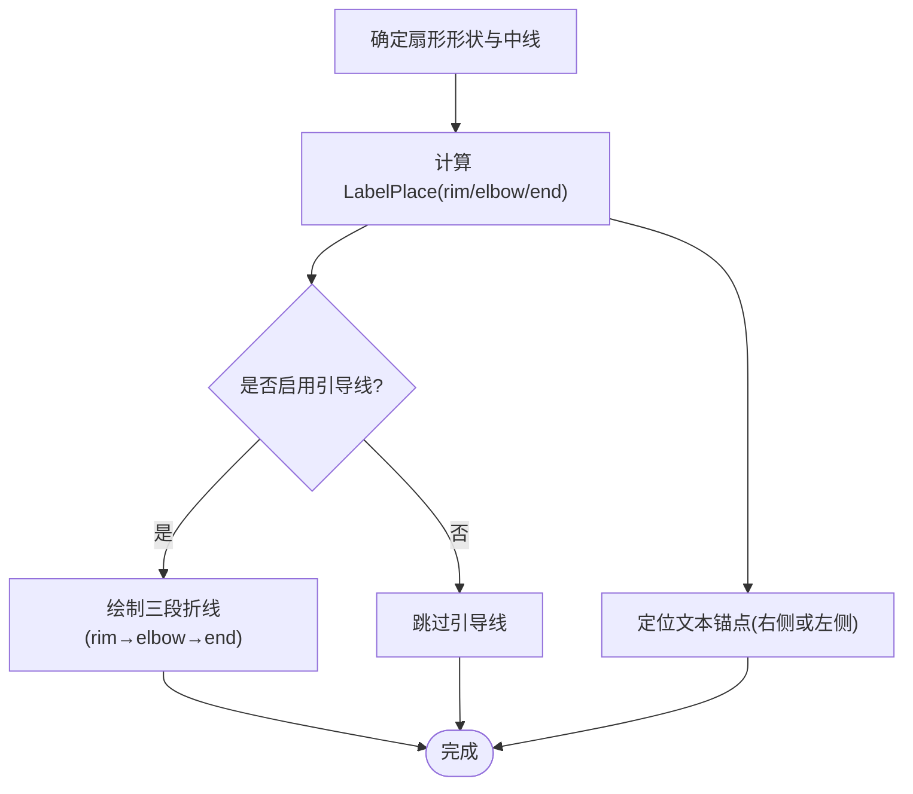
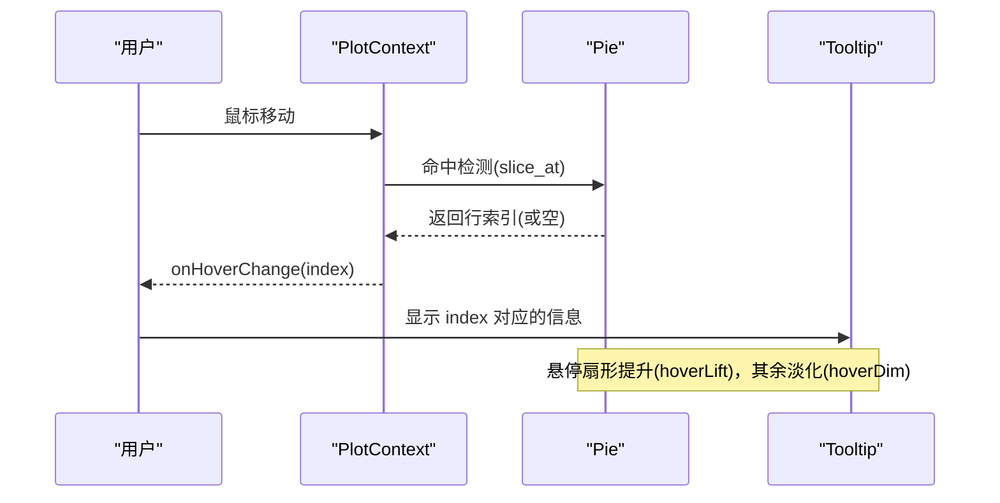
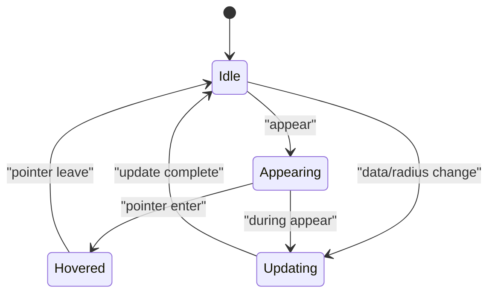
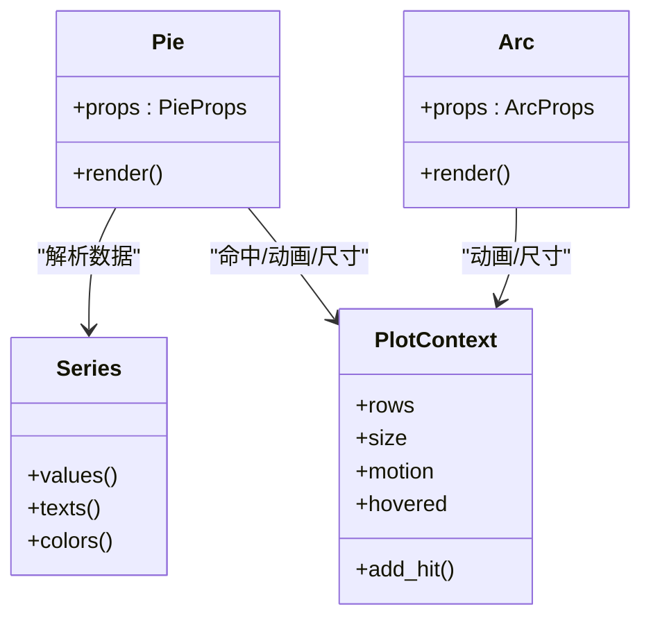

# 饼图 (Pie Chart)

<cite>
**本文引用的文件**   
- [crates/nsh-base/src/plot/pie.rs](file://crates/nsh-base/src/plot/pie.rs)
- [website/demos/el-plot-pie.tsx](file://website/demos/el-plot-pie.tsx)
</cite>

## 目录
1. [简介](#简介)
2. [项目结构](#项目结构)
3. [核心组件](#核心组件)
4. [架构总览](#架构总览)
5. [详细组件分析](#详细组件分析)
6. [依赖关系分析](#依赖关系分析)
7. [性能与动画特性](#性能与动画特性)
8. [故障排查指南](#故障排查指南)
9. [结论](#结论)
10. [附录：示例与用法](#附录示例与用法)

## 简介
本文件为 NSH 的饼图（Pie）组件提供完整技术文档。内容覆盖数据结构要求、扇形样式配置（颜色、边框、圆角）、标签与引导线、百分比计算与图例生成思路、交互能力（悬停展开、点击高亮、提示跟随）、动画效果（旋转进入、数值更新过渡、指针弹簧）、以及环形图变体支持。同时给出实际应用场景（市场份额、调查统计）的使用要点与参考实现路径。

## 项目结构
NSH 的图表子系统位于 `crates/nsh-base/src/plot`，其中饼图由 `pie.rs` 实现；网站演示在 `website/demos/el-plot-pie.tsx` 中展示了环形图、数据切换、悬停交互与图例布局等典型用法。

**图示来源**
- [crates/nsh-base/src/plot/pie.rs:1028-1127](file://crates/nsh-base/src/plot/pie.rs#L1028-L1127)
- [website/demos/el-plot-pie.tsx:97-147](file://website/demos/el-plot-pie.tsx#L97-L147)

**章节来源**
- [crates/nsh-base/src/plot/pie.rs:1-28](file://crates/nsh-base/src/plot/pie.rs#L1-L28)
- [website/demos/el-plot-pie.tsx:1-12](file://website/demos/el-plot-pie.tsx#L1-L12)

## 核心组件
- Pie：根据数据行生成多个扇形，支持环形（donut）和实心（pie），可配置起始/结束角度、扇区间隙、内外半径、圆角、颜色、标签与引导线、悬停提升与淡化等。
- Arc：独立圆弧/环段，常用于仪表盘刻度或作为饼图的背景环。
- SliceClass/Slice：切片类名枚举与切片角度范围数据结构。
- Ring/Radius/Shape/Pose/Motion：用于将逻辑半径与角度映射到画布坐标，并驱动动画插值。

关键属性（PieProps）摘要：
- value：每行的数值字段或函数，决定扇形占比。
- start_angle/end_angle：起始与结束弧度（12 点方向顺时针）。
- pad_angle：相邻扇区在边缘处的间隙（保持各半径处等宽）。
- inner_radius/outer_radius：内/外半径，支持点数或百分比。
- corner_radius：扇形圆角半径。
- slice_class/slice_style：每个扇形的 Tailwind 类名或样式。
- color：类别字段或函数，驱动 plot 的颜色比例尺。
- label/label_class/label_style：标签文本、类名与样式。
- label_line_class/label_line_style：引导线的类名与样式。
- label_gap：标签相对外缘的偏移。
- hover_lift/hover_dim：悬停时扇形向外“弹出”的距离与其他扇形的淡化程度。

**章节来源**
- [crates/nsh-base/src/plot/pie.rs:1028-1127](file://crates/nsh-base/src/plot/pie.rs#L1028-L1127)

## 架构总览
饼图渲染流程围绕 PlotContext 与 series 工具展开：解析数据值、计算扇形角度、构建 Ring 几何、绘制扇形与标签、注册命中区域以支持交互。Arc 复用扇形绘制逻辑，但无行级交互。

**图示来源**
- [crates/nsh-base/src/plot/pie.rs:1150-1313](file://crates/nsh-base/src/plot/pie.rs#L1150-L1313)
- [crates/nsh-base/src/plot/pie.rs:157-192](file://crates/nsh-base/src/plot/pie.rs#L157-L192)
- [crates/nsh-base/src/plot/pie.rs:736-817](file://crates/nsh-base/src/plot/pie.rs#L736-L817)

## 详细组件分析

### 数据结构与百分比计算
- 数据行通过 `value` 解析为数值数组；零值、非有限数或负值不参与扇形分配。
- 有效值的总和决定每个扇形的角度份额，按行顺序从 `start_angle` 到 `end_angle` 排列。
- 若所有值无效，则不生成任何扇形；可通过 Arc 显示一个淡色背景环以保持视觉完整性。

**图示来源**
- [crates/nsh-base/src/plot/pie.rs:169-192](file://crates/nsh-base/src/plot/pie.rs#L169-L192)

**章节来源**
- [crates/nsh-base/src/plot/pie.rs:157-192](file://crates/nsh-base/src/plot/pie.rs#L157-L192)

### 扇形样式配置（颜色、边框、阴影）
- 颜色：优先使用 `color` 字段经 plot 的比例尺生成的颜色；未设置时使用 `currentColor`；也可通过 `slice_style.fill` 或 Tailwind 的 `fill-*` 覆盖。
- 边框：默认无边框；可通过 `slice_style.stroke/strokeWidth` 或 Tailwind 的 `stroke-*` 设置。
- 阴影：当前实现未内置阴影；如需阴影，可在上层 View 或 CSS 层叠加阴影样式。
- 圆角：`cornerRadius` 控制扇形内外边缘的圆角，遵循 d3 的约束（不超过环厚度的一半，窄扇形自动缩小）。

**章节来源**
- [crates/nsh-base/src/plot/pie.rs:1063-1077](file://crates/nsh-base/src/plot/pie.rs#L1063-L1077)
- [crates/nsh-base/src/plot/pie.rs:985-999](file://crates/nsh-base/src/plot/pie.rs#L985-L999)

### 标签显示与引导线
- 标签文本：通过 `label` 指定字段或函数；空文本的行不显示标签。
- 位置：标签位于扇形外侧，沿扇形中线方向放置，先向外偏移 `label_gap`，再水平对齐到扇形一侧。
- 引导线：可选，通过 `label_line_class` 或 `label_line_style` 启用；仅当设置了类名或样式时绘制。
- 动画：标签与引导线跟随扇形的 appear/update 动画与悬停提升同步移动。

**图示来源**
- [crates/nsh-base/src/plot/pie.rs:1349-1395](file://crates/nsh-base/src/plot/pie.rs#L1349-L1395)
- [crates/nsh-base/src/plot/pie.rs:1479-1501](file://crates/nsh-base/src/plot/pie.rs#L1479-L1501)

**章节来源**
- [crates/nsh-base/src/plot/pie.rs:1262-1313](file://crates/nsh-base/src/plot/pie.rs#L1262-L1313)
- [crates/nsh-base/src/plot/pie.rs:1349-1395](file://crates/nsh-base/src/plot/pie.rs#L1349-L1395)
- [crates/nsh-base/src/plot/pie.rs:1479-1501](file://crates/nsh-base/src/plot/pie.rs#L1479-L1501)

### 图例生成
- 图例并非由 Pie 内部自动生成；应在外层 UI 中基于数据行与颜色比例尺手动构建。
- 常见做法：遍历数据行，使用 `color` 字段获取系列颜色，展示名称、数值与百分比。
- 百分比计算：百分比 = 该行数值 / 所有有效值之和；若总和为 0，则百分比为 0。

**章节来源**
- [website/demos/el-plot-pie.tsx:149-178](file://website/demos/el-plot-pie.tsx#L149-L178)

### 交互功能（悬停展开、点击高亮、提示）
- 悬停展开：`hoverLift` 使被悬停扇形向外“弹出”，其他扇形按 `hoverDim` 淡化。
- 点击高亮：Pie 本身不直接处理点击；可在 Plot 层监听 hover/change 事件，维护选中状态并在 UI 中高亮对应项。
- 提示跟随：Plot 会报告鼠标所在扇形的行索引，tooltip 可跟随指针显示该扇形的详情。

**图示来源**
- [crates/nsh-base/src/plot/pie.rs:1182-1193](file://crates/nsh-base/src/plot/pie.rs#L1182-L1193)
- [crates/nsh-base/src/plot/pie.rs:1315-1338](file://crates/nsh-base/src/plot/pie.rs#L1315-L1338)

**章节来源**
- [crates/nsh-base/src/plot/pie.rs:1182-1193](file://crates/nsh-base/src/plot/pie.rs#L1182-L1193)
- [crates/nsh-base/src/plot/pie.rs:1315-1338](file://crates/nsh-base/src/plot/pie.rs#L1315-L1338)

### 动画效果（旋转进入、扇形展开、数值更新过渡）
- 旋转进入（appear）：饼图整体从 `start_angle` 开始扫入，标签在出现后期渐显。
- 扇形展开（motion.update）：当值、半径或角度变化时，每个扇形从旧角度平滑过渡到新角度。
- 指针弹簧：悬停提升使用平台动画器的弹簧曲线，减少动效模式下退化为即时切换。

**图示来源**
- [crates/nsh-base/src/plot/pie.rs:423-455](file://crates/nsh-base/src/plot/pie.rs#L423-L455)
- [crates/nsh-base/src/plot/pie.rs:829-918](file://crates/nsh-base/src/plot/pie.rs#L829-L918)
- [crates/nsh-base/src/plot/pie.rs:1315-1338](file://crates/nsh-base/src/plot/pie.rs#L1315-L1338)

**章节来源**
- [crates/nsh-base/src/plot/pie.rs:423-455](file://crates/nsh-base/src/plot/pie.rs#L423-L455)
- [crates/nsh-base/src/plot/pie.rs:829-918](file://crates/nsh-base/src/plot/pie.rs#L829-L918)
- [crates/nsh-base/src/plot/pie.rs:1315-1338](file://crates/nsh-base/src/plot/pie.rs#L1315-L1338)

### 3D 效果与环形图变体
- 3D 效果：当前实现未提供原生 3D 投影或透视；如需伪 3D，可在上层视图叠加渐变/阴影模拟。
- 环形图（Donut）：通过设置 `innerRadius` 大于 0 即可；演示中使用 `"62%"` 形成中间空洞，并用 Arc 在数据为空时保留淡色环。

**章节来源**
- [crates/nsh-base/src/plot/pie.rs:1053-1062](file://crates/nsh-base/src/plot/pie.rs#L1053-L1062)
- [website/demos/el-plot-pie.tsx:119-132](file://website/demos/el-plot-pie.tsx#L119-L132)

## 依赖关系分析
- Pie 依赖 series 工具解析数值、文本与颜色。
- Pie 使用 PlotContext 提供尺寸、命中检测、动画时序与 hover 状态。
- Arc 复用扇形绘制逻辑，但不参与行级命中与交互。

**图示来源**
- [crates/nsh-base/src/plot/pie.rs:1150-1313](file://crates/nsh-base/src/plot/pie.rs#L1150-L1313)
- [crates/nsh-base/src/plot/pie.rs:1588-1625](file://crates/nsh-base/src/plot/pie.rs#L1588-L1625)

**章节来源**
- [crates/nsh-base/src/plot/pie.rs:1150-1313](file://crates/nsh-base/src/plot/pie.rs#L1150-L1313)
- [crates/nsh-base/src/plot/pie.rs:1588-1625](file://crates/nsh-base/src/plot/pie.rs#L1588-L1625)

## 性能与动画特性
- 采样与插值：动画采用分段线性插值，靠近起点密集采样以保证扫入流畅。
- 避免重绘：动画期间不触发 JS 帧回调，仅在必要时更新变量节点。
- 减少动效模式：在系统减少动效下，悬停提升与过渡退化为即时切换。
- 内存与对象：切片与轮廓使用轻量结构，避免频繁分配。

**章节来源**
- [crates/nsh-base/src/plot/pie.rs:618-661](file://crates/nsh-base/src/plot/pie.rs#L618-L661)
- [crates/nsh-base/src/plot/pie.rs:829-918](file://crates/nsh-base/src/plot/pie.rs#L829-L918)
- [crates/nsh-base/src/plot/pie.rs:1315-1338](file://crates/nsh-base/src/plot/pie.rs#L1315-L1338)

## 故障排查指南
- 没有扇形：检查 `value` 是否返回有效正数；若全部为 0/NaN/负数，不会生成扇形。
- 标签不显示：确认 `label` 非空且扇形角度足够大（小于半度不显示标签）。
- 引导线不可见：确保设置了 `label_line_class` 或 `label_line_style`。
- 悬停无效果：确认 `hoverLift > 0` 且 `hoverDim` 合理；检查 Plot 的 motion.pointer 是否启用。
- 环形图中心文字不居中：确保外层容器绝对定位并居中，透明度与 donut 开关联动。

**章节来源**
- [crates/nsh-base/src/plot/pie.rs:169-192](file://crates/nsh-base/src/plot/pie.rs#L169-L192)
- [crates/nsh-base/src/plot/pie.rs:1345-1347](file://crates/nsh-base/src/plot/pie.rs#L1345-L1347)
- [crates/nsh-base/src/plot/pie.rs:1472-1501](file://crates/nsh-base/src/plot/pie.rs#L1472-L1501)
- [website/demos/el-plot-pie.tsx:133-147](file://website/demos/el-plot-pie.tsx#L133-L147)

## 结论
NSH 的饼图组件提供了稳健的数据驱动扇形绘制、灵活的样式与标签系统、完善的交互与动画支持，并通过 Arc 支持环形图变体。对于 3D 效果，建议在上层视图进行视觉增强。结合 PlotContext 的命中检测与动画时序，可实现高性能、可访问性良好的可视化体验。

## 附录：示例与用法

### 市场份额场景
- 目标：展示不同地区/渠道的市场份额，悬停显示具体金额与百分比。
- 关键点：
  - 使用 `value` 指向收入字段。
  - 用 `color` 绑定系列颜色，配合 Tailwind 的 `fill-chart-*`。
  - 设置 `padAngle` 控制扇区间隙，`hoverLift` 与 `hoverDim` 增强对比。
  - 在外层构建图例，显示名称、金额与百分比。

参考实现路径：
- [website/demos/el-plot-pie.tsx:17-43](file://website/demos/el-plot-pie.tsx#L17-L43)
- [website/demos/el-plot-pie.tsx:97-147](file://website/demos/el-plot-pie.tsx#L97-L147)
- [website/demos/el-plot-pie.tsx:149-178](file://website/demos/el-plot-pie.tsx#L149-L178)

### 调查统计场景
- 目标：展示调查选项分布，支持切换维度（如地区/渠道），并保持动画连贯。
- 关键点：
  - 使用 `appearGeneration` 驱动每次数据切换时的重新扫入动画。
  - 动态计算百分比与总额，更新标题与图例。
  - 在数据为空时，用 Arc 显示淡色环，保持图表形态。

参考实现路径：
- [website/demos/el-plot-pie.tsx:46-60](file://website/demos/el-plot-pie.tsx#L46-L60)
- [website/demos/el-plot-pie.tsx:105-110](file://website/demos/el-plot-pie.tsx#L105-L110)
- [website/demos/el-plot-pie.tsx:119-122](file://website/demos/el-plot-pie.tsx#L119-L122)