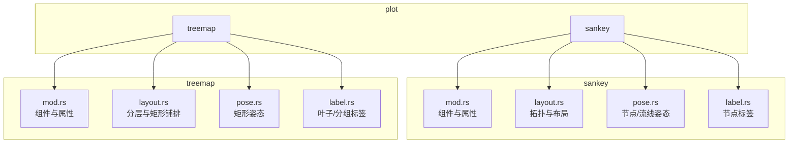
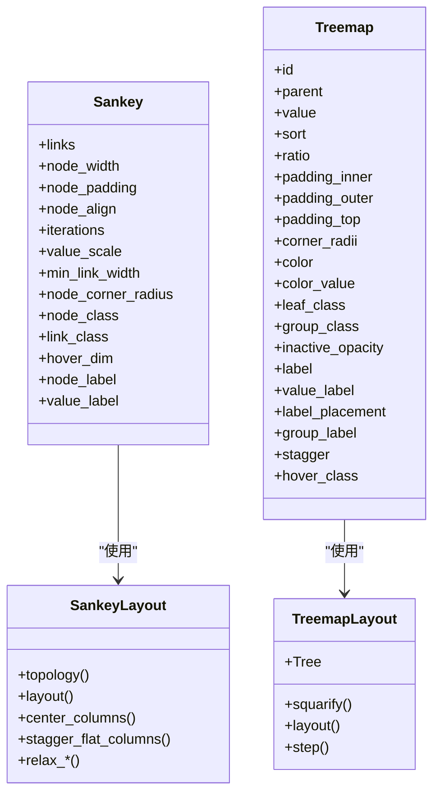
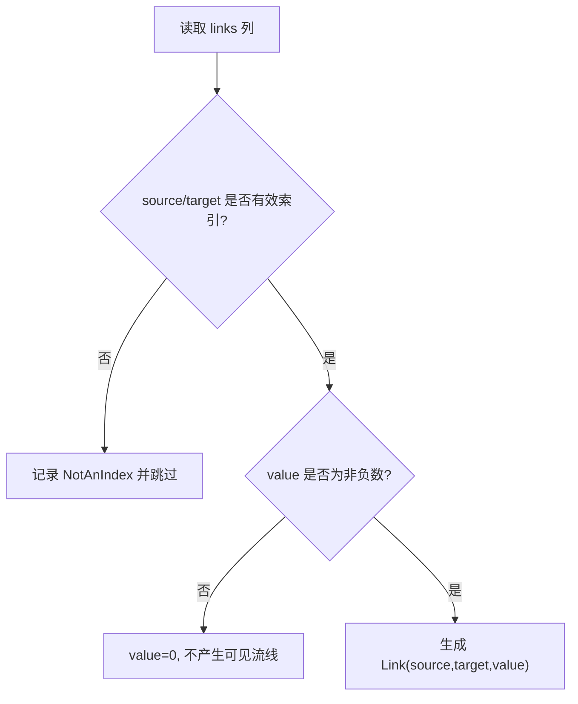
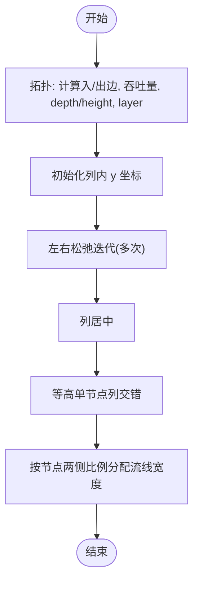
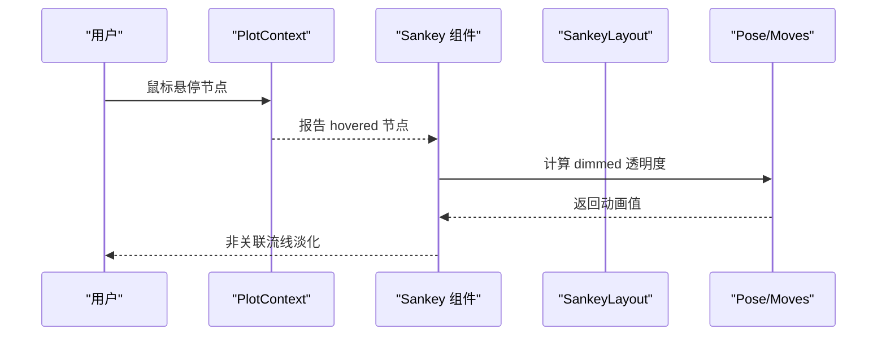
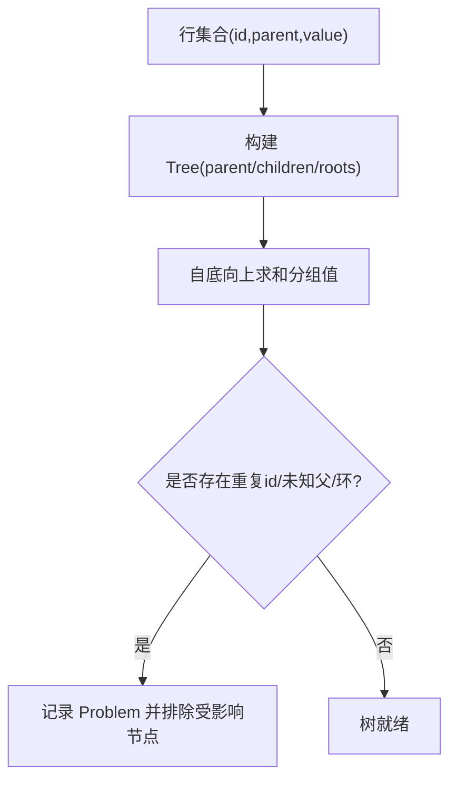
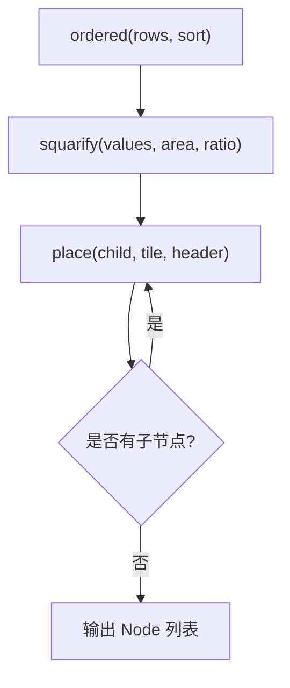
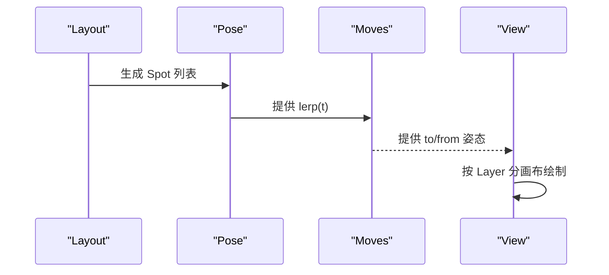
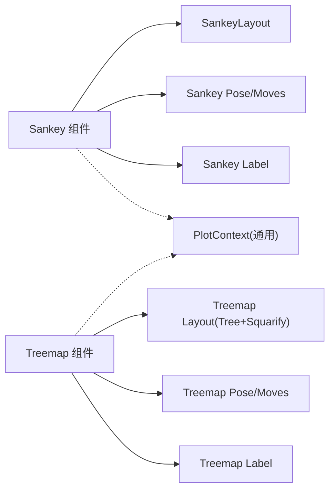

# 高级图表类型

<cite>
**本文引用的文件**   
- [sankey/mod.rs](file://crates/nsh-base/src/plot/sankey/mod.rs)
- [sankey/layout.rs](file://crates/nsh-base/src/plot/sankey/layout.rs)
- [sankey/pose.rs](file://crates/nsh-base/src/plot/sankey/pose.rs)
- [sankey/label.rs](file://crates/nsh-base/src/plot/sankey/label.rs)
- [treemap/mod.rs](file://crates/nsh-base/src/plot/treemap/mod.rs)
- [treemap/layout.rs](file://crates/nsh-base/src/plot/treemap/layout.rs)
- [treemap/pose.rs](file://crates/nsh-base/src/plot/treemap/pose.rs)
- [treemap/label.rs](file://crates/nsh-base/src/plot/treemap/label.rs)
</cite>

## 目录
1. [引言](#引言)
2. [项目结构](#项目结构)
3. [核心组件](#核心组件)
4. [架构总览](#架构总览)
5. [详细组件分析](#详细组件分析)
6. [依赖关系分析](#依赖关系分析)
7. [性能与优化](#性能与优化)
8. [故障排查](#故障排查)
9. [结论](#结论)
10. [附录：配置与交互速查](#附录配置与交互速查)

## 引言
本文面向 NSH 的高级图表类型，聚焦两类复杂可视化：桑基图（Sankey Diagram）与树形图（Treemap）。文档从数据模型、布局算法、渲染姿态、交互与动画、错误处理到性能优化进行系统化说明，并给出实际应用场景与组合使用模式。读者无需深入源码即可理解如何准备数据、配置选项、实现专业场景，并在需要时定位到具体实现文件。

## 项目结构
NSH 的图表能力集中在 `nsh-base` 的 `plot` 模块中。桑基图与树形图各自拥有独立的子模块，分别包含“主组件”“布局算法”“绘制姿态与过渡”“标签与悬停”等职责清晰的代码组织。

**图示来源**
- [sankey/mod.rs:1-31](file://crates/nsh-base/src/plot/sankey/mod.rs#L1-L31)
- [treemap/mod.rs:1-33](file://crates/nsh-base/src/plot/treemap/mod.rs#L1-L33)

**章节来源**
- [sankey/mod.rs:1-31](file://crates/nsh-base/src/plot/sankey/mod.rs#L1-L31)
- [treemap/mod.rs:1-33](file://crates/nsh-base/src/plot/treemap/mod.rs#L1-L33)

## 核心组件
- 桑基图（Sankey）
  - 数据：行作为节点，链接表示流向；每条链接由源行索引、目标行索引和流量值组成。
  - 布局：基于 d3-sankey 的拓扑计算与迭代松弛，支持多种对齐方式与数值缩放。
  - 渲染：每个节点与流线均为独立画布，支持背景渐变、圆角、悬停淡化与入场动画。
  - 交互：指针命中节点、键导航、悬停高亮关联流。
- 树形图（Treemap）
  - 数据：通过 id/parent 将行构建为树；叶子面积正比于 value，分组值为子叶之和。
  - 布局：d3 treemap + squarify 矩形铺排，支持排序、纵横比、内边距、外边距与顶部标题带。
  - 渲染：按层级与类别分画布绘制，支持圆角、颜色映射、分组标题带、叶子标签与悬停框。
  - 交互：指针命中叶子或分组、键盘在屏幕方向上跳转、悬停高亮与淡出非相关节点。

**章节来源**
- [sankey/mod.rs:202-301](file://crates/nsh-base/src/plot/sankey/mod.rs#L202-L301)
- [treemap/mod.rs:182-319](file://crates/nsh-base/src/plot/treemap/mod.rs#L182-L319)

## 架构总览
两类图表共享统一的 PlotContext 与通用机制（行数据、样式、动画、命中检测），但各自封装了专用布局与姿态系统。

**图示来源**
- [sankey/mod.rs:202-301](file://crates/nsh-base/src/plot/sankey/mod.rs#L202-L301)
- [treemap/mod.rs:182-319](file://crates/nsh-base/src/plot/treemap/mod.rs#L182-L319)
- [sankey/layout.rs:109-218](file://crates/nsh-base/src/plot/sankey/layout.rs#L109-L218)
- [treemap/layout.rs:158-380](file://crates/nsh-base/src/plot/treemap/layout.rs#L158-L380)

## 详细组件分析

### 桑基图（Sankey）

#### 数据格式与流向连接
- 节点：图表的行即节点，顺序对应行索引。
- 链接：每条链接包含 source、target、value，其中 source/target 是行的索引，value 为非负数表示流量大小。
- 输入校验：无效索引会记录警告并跳过该链接；非数字或负值视为零流量。

**图示来源**
- [sankey/mod.rs:103-127](file://crates/nsh-base/src/plot/sankey/mod.rs#L103-L127)

**章节来源**
- [sankey/mod.rs:65-147](file://crates/nsh-base/src/plot/sankey/mod.rs#L65-L147)

#### 节点布局与流向计算
- 拓扑阶段：计算节点的入/出边、吞吐量、深度/高度（最长路径）、层号（对齐策略决定）。
- 垂直布局：根据每列节点数量与 padding 初始化 y 坐标，随后多轮左右松弛以对齐流线。
- 列居中与错位：对拥挤列做列内居中；对连续等高的单节点列做轻微交错，使流线呈现自然曲线。
- 流线宽度：在每个节点两侧按流入/流出比例分配宽度，保证节点两侧被流线完全覆盖。

**图示来源**
- [sankey/layout.rs:143-218](file://crates/nsh-base/src/plot/sankey/layout.rs#L143-L218)
- [sankey/layout.rs:335-512](file://crates/nsh-base/src/plot/sankey/layout.rs#L335-L512)
- [sankey/layout.rs:738-781](file://crates/nsh-base/src/plot/sankey/layout.rs#L738-L781)

**章节来源**
- [sankey/layout.rs:10-121](file://crates/nsh-base/src/plot/sankey/layout.rs#L10-L121)
- [sankey/layout.rs:143-218](file://crates/nsh-base/src/plot/sankey/layout.rs#L143-L218)
- [sankey/layout.rs:335-512](file://crates/nsh-base/src/plot/sankey/layout.rs#L335-L512)
- [sankey/layout.rs:738-781](file://crates/nsh-base/src/plot/sankey/layout.rs#L738-L781)

#### 渲染姿态与动画
- 姿态 Pose：保存节点矩形与流线轮廓，支持新旧姿态之间的线性插值。
- 过渡 Moves：复用通用 Moves，节点从中间生长，新流线从零宽展开，旧元素平滑移动。
- 悬停淡化：未关联到悬停节点的流线透明度降低，配合 plot 的 fade 与 pointer spring。

**图示来源**
- [sankey/mod.rs:498-525](file://crates/nsh-base/src/plot/sankey/mod.rs#L498-L525)
- [sankey/pose.rs:58-157](file://crates/nsh-base/src/plot/sankey/pose.rs#L58-L157)

**章节来源**
- [sankey/pose.rs:17-157](file://crates/nsh-base/src/plot/sankey/pose.rs#L17-L157)
- [sankey/mod.rs:554-619](file://crates/nsh-base/src/plot/sankey/mod.rs#L554-L619)

#### 标签与样式
- 节点标签：名称与数值两行，位置随节点所在列自动选择（首列左侧、末列右侧、中间上方）。
- 数值标签：可自定义函数，传入节点行、吞吐量和索引。
- 样式：Tailwind 类名与内联样式分别作用于节点、流线及其背景（渐变）。

**章节来源**
- [sankey/label.rs:21-109](file://crates/nsh-base/src/plot/sankey/label.rs#L21-L109)
- [sankey/mod.rs:273-301](file://crates/nsh-base/src/plot/sankey/mod.rs#L273-L301)

#### 实际应用场景示例（描述性）
- 数据流分析：用行代表业务实体（如渠道、产品、地区），链接表示资金/订单/流量的转移，value 为金额或件数。通过 node_align 控制流向层次，value_scale 使用 sqrt 压缩极端值差异，min_link_width 确保小流量可见。
- 供应链可视化：上游供应商→工厂→分销商→零售终端，节点标签显示吞吐总量，流线背景渐变体现来源到目标的色彩过渡。

[本节为概念性说明，不直接分析具体文件]

### 树形图（Treemap）

#### 分层数据与树构建
- 行到树：通过 id 与 parent 字段将行构造成树；无父或父不存在则作为顶层节点。
- 值聚合：叶子 value 为正数才参与布局；分组 value 为其所有叶子之和。
- 问题检测：重复 id、未知父、环状祖先会被记录并告警，受影响节点不参与布局。

**图示来源**
- [treemap/layout.rs:46-156](file://crates/nsh-base/src/plot/treemap/layout.rs#L46-L156)

**章节来源**
- [treemap/layout.rs:13-44](file://crates/nsh-base/src/plot/treemap/layout.rs#L13-L44)
- [treemap/layout.rs:46-156](file://crates/nsh-base/src/plot/treemap/layout.rs#L46-L156)

#### 矩形布局算法（Squarified）
- 排序：可按 value 降序或保持数据顺序。
- 铺排：squarify 将父盒切分为若干矩形，尽量接近指定 ratio（默认黄金分割），避免细长条。
- 边距：支持 inner/outer/top 三类边距，按层级设置；顶部标题带在所有兄弟组一致显示或不显示。
- 递归：对每个分组递归调用铺排，得到 Node 列表（前序遍历），并维护 content 区域用于命中。

**图示来源**
- [treemap/layout.rs:353-476](file://crates/nsh-base/src/plot/treemap/layout.rs#L353-L476)
- [treemap/layout.rs:496-576](file://crates/nsh-base/src/plot/treemap/layout.rs#L496-L576)

**章节来源**
- [treemap/layout.rs:158-380](file://crates/nsh-base/src/plot/treemap/layout.rs#L158-L380)
- [treemap/layout.rs:496-576](file://crates/nsh-base/src/plot/treemap/layout.rs#L496-L576)

#### 渲染姿态与动画
- 姿态 Spot/TreemapPose：每个节点携带 id、矩形、颜色、类名、层级、根序号、前序区间与标题带高度。
- 过渡：按 id 匹配新旧节点，已存在节点矩形与颜色插值，新增节点从中心生长，消失节点收缩至自身。
- 分组与叶子分层绘制：按 group 与 depth 分类到不同画布，保证层级顺序正确。

**图示来源**
- [treemap/pose.rs:11-90](file://crates/nsh-base/src/plot/treemap/pose.rs#L11-L90)
- [treemap/mod.rs:510-550](file://crates/nsh-base/src/plot/treemap/mod.rs#L510-L550)

**章节来源**
- [treemap/pose.rs:11-90](file://crates/nsh-base/src/plot/treemap/pose.rs#L11-L90)
- [treemap/mod.rs:510-655](file://crates/nsh-base/src/plot/treemap/mod.rs#L510-L655)

#### 标签与悬停
- 叶子标签：名称与数值两行，支持居左或居中放置；数值整行显示，否则隐藏。
- 分组标签：在顶部标题带显示分组名称，若空间不足则整组不显示标题带。
- 悬停框：可选 hoverClass/hoverStyle，跟随当前选中节点尺寸与位置，支持按键滑动时的弹性移动。

**章节来源**
- [treemap/label.rs:14-83](file://crates/nsh-base/src/plot/treemap/label.rs#L14-L83)
- [treemap/label.rs:88-266](file://crates/nsh-base/src/plot/treemap/label.rs#L88-L266)
- [treemap/label.rs:285-345](file://crates/nsh-base/src/plot/treemap/label.rs#L285-L345)

#### 实际应用场景示例（描述性）
- 市场地图：id/parent 定义行业→子行业→公司，value 为市值或营收；ratio 控制矩形方正度，padding_top 显示分组名称带。
- 资源占用：父子进程或任务树，颜色映射 color_value 表示 CPU/内存占比，inactive_opacity 突出当前选中分支。

[本节为概念性说明，不直接分析具体文件]

## 依赖关系分析

**图示来源**
- [sankey/mod.rs:1-31](file://crates/nsh-base/src/plot/sankey/mod.rs#L1-L31)
- [treemap/mod.rs:1-33](file://crates/nsh-base/src/plot/treemap/mod.rs#L1-L33)

**章节来源**
- [sankey/mod.rs:1-31](file://crates/nsh-base/src/plot/sankey/mod.rs#L1-L31)
- [treemap/mod.rs:1-33](file://crates/nsh-base/src/plot/treemap/mod.rs#L1-L33)

## 性能与优化
- 布局计算缓存
  - 桑基图：仅在链接、选项或图表尺寸变化时重新运行布局；无效链接仅告警不重绘。
  - 树形图：树构建与布局结果缓存，仅在行数据、id/parent/value 或尺寸变化时更新。
- 渲染分层
  - 桑基图：每个节点与流线独立画布，便于单独样式与悬停淡化。
  - 树形图：按 group/depth/class 分画布，减少重绘范围。
- 动画与过渡
  - 两者均复用通用 Moves，节点/矩形按 id 匹配，新增元素从中心生长，旧元素收缩消失，避免闪烁。
- 数值缩放与最小宽度
  - 桑基图：value_scale 支持 sqrt 压缩大值差异；min_link_width 保证小流量可见。
- 边距与溢出
  - 树形图：inner/outer/top 边距按层级配置，避免边缘缝隙与标题带空间不足导致的布局异常。

**章节来源**
- [sankey/mod.rs:572-619](file://crates/nsh-base/src/plot/sankey/mod.rs#L572-L619)
- [treemap/mod.rs:445-491](file://crates/nsh-base/src/plot/treemap/mod.rs#L445-L491)
- [sankey/layout.rs:360-426](file://crates/nsh-base/src/plot/sankey/layout.rs#L360-L426)
- [treemap/layout.rs:496-576](file://crates/nsh-base/src/plot/treemap/layout.rs#L496-L576)

## 故障排查
- 桑基图常见问题
  - 链接引用了不存在的行索引：记录 NotAnIndex 并跳过该链接。
  - 链接形成环：布局拒绝并告警 CircularLink。
  - 节点缺失：链接指向的 row 超出范围，记录 MissingNode。
- 树形图常见问题
  - 重复 id：同一 id 出现多次，后续行无法命名父节点。
  - 未知父：parent 指向不存在的 id，该行成为顶层节点。
  - 环状祖先：某行是其自身的祖先，该行及其子树不参与布局。
- 调试建议
  - 检查 links 的 source/target 是否为有效行索引且 value≥0。
  - 检查 id/parent 是否唯一且无环；必要时打印 problems 列表。
  - 调整 min_link_width、node_padding、padding_inner/outer/top 改善视觉拥挤。

**章节来源**
- [sankey/mod.rs:601-614](file://crates/nsh-base/src/plot/sankey/mod.rs#L601-L614)
- [sankey/layout.rs:100-107](file://crates/nsh-base/src/plot/sankey/layout.rs#L100-L107)
- [treemap/mod.rs:393-408](file://crates/nsh-base/src/plot/treemap/mod.rs#L393-L408)
- [treemap/layout.rs:21-44](file://crates/nsh-base/src/plot/treemap/layout.rs#L21-L44)

## 结论
桑基图与树形图为 NSH 提供了强大的数据流与层次结构可视化能力。二者均以清晰的数据模型为基础，结合稳健的布局算法与高性能的渲染姿态系统，支持丰富的配置项与交互体验。通过合理的数据准备、参数调优与组合使用，可在数据流分析与层次结构展示等专业场景中发挥显著价值。

[本节为总结性内容，不直接分析具体文件]

## 附录：配置与交互速查

### 桑基图关键配置
- 流向与布局
  - links：{source, target, value}
  - node_align：left/right/center/justify
  - iterations：松弛迭代次数
  - value_scale：linear/sqrt
  - node_width/node_padding/min_link_width/node_corner_radius
- 样式与标签
  - node_class/node_style/link_class/link_style
  - link_background_class/link_background_style
  - node_label/value_label/node_label_class/node_label_style/value_label_class/value_label_style
- 交互
  - hover_dim：非关联流线淡化程度
  - 命中：指针命中节点，键导航到节点

**章节来源**
- [sankey/mod.rs:202-301](file://crates/nsh-base/src/plot/sankey/mod.rs#L202-L301)

### 树形图关键配置
- 分层与布局
  - id/parent/value：树结构与叶子面积
  - sort：value/data
  - ratio：squarify 纵横比
  - padding_inner/padding_outer/padding_top：层级边距与标题带
  - corner_radii：矩形圆角
- 颜色与样式
  - color/color_value：分类或数值映射
  - leaf_class/group_class/leaf_style/group_style
- 标签与交互
  - label/value_label/label_placement/label_class/label_style/value_label_class/value_label_style
  - group_label/group_label_class/group_label_style
  - inactive_opacity：悬停时非相关节点透明度
  - stagger：顶层节点入场错开
  - hover_class/hover_style：悬停框样式

**章节来源**
- [treemap/mod.rs:182-319](file://crates/nsh-base/src/plot/treemap/mod.rs#L182-L319)

### 与其他图表的组合使用模式
- 桑基图 + 柱状图/折线图
  - 桑基图展示流向，柱状图/折线图展示各节点吞吐量的时间序列，联动悬停与过滤。
- 树形图 + 饼图/雷达图
  - 树形图展示层级占比，饼图/雷达图展示选中叶子的多维指标对比。
- 组合交互
  - 通过 PlotContext 的 hovered 状态与 motion.update 动画，实现跨图表的联动高亮与过渡。

[本节为概念性说明，不直接分析具体文件]