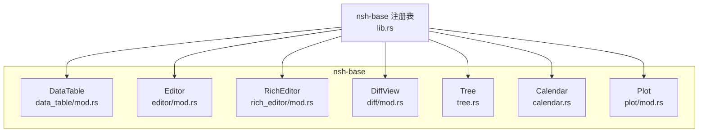
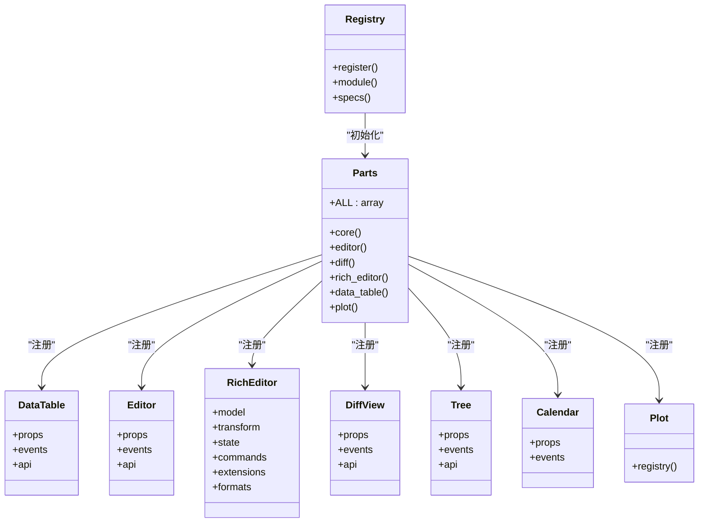
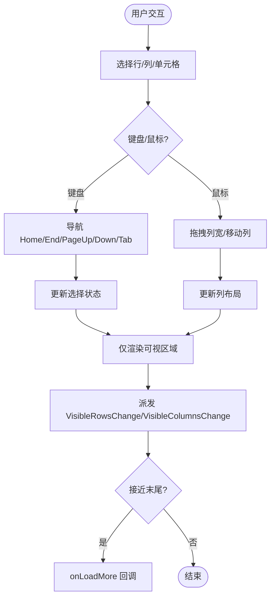
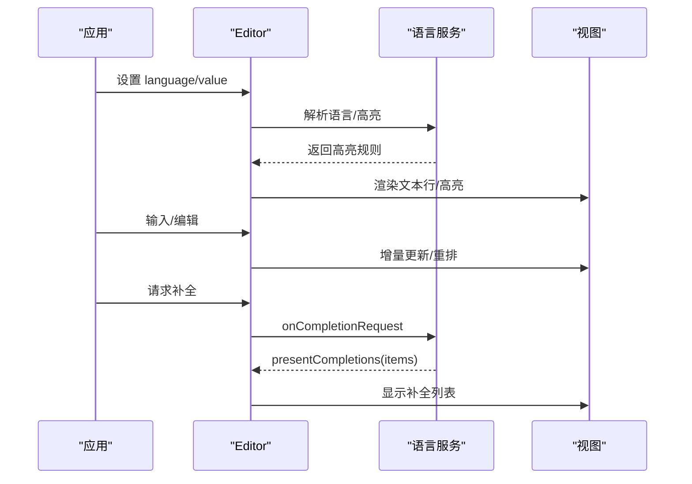
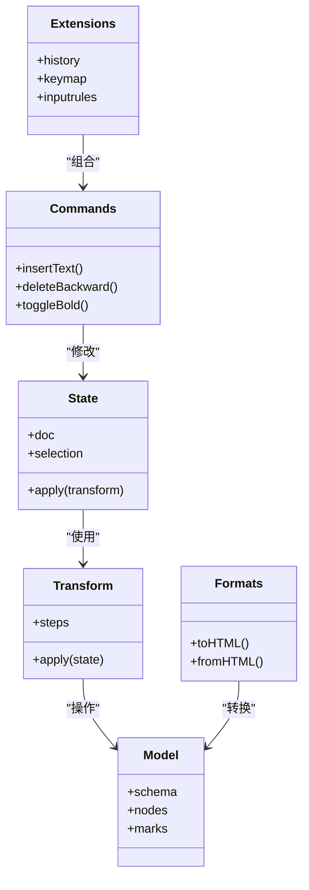
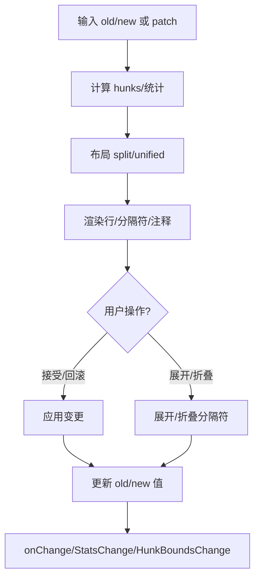
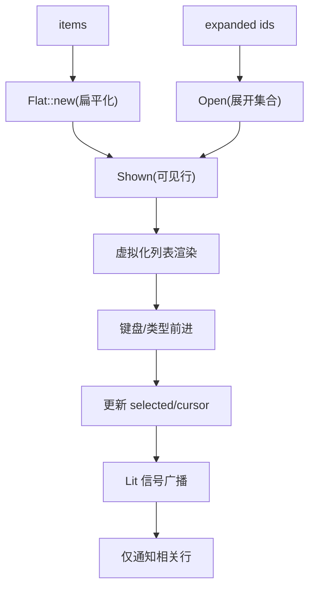
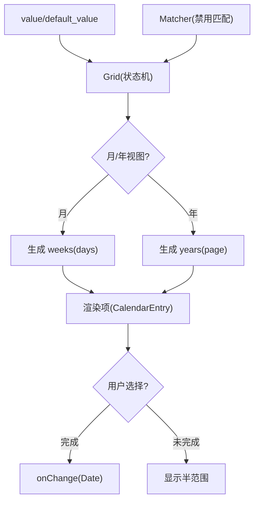
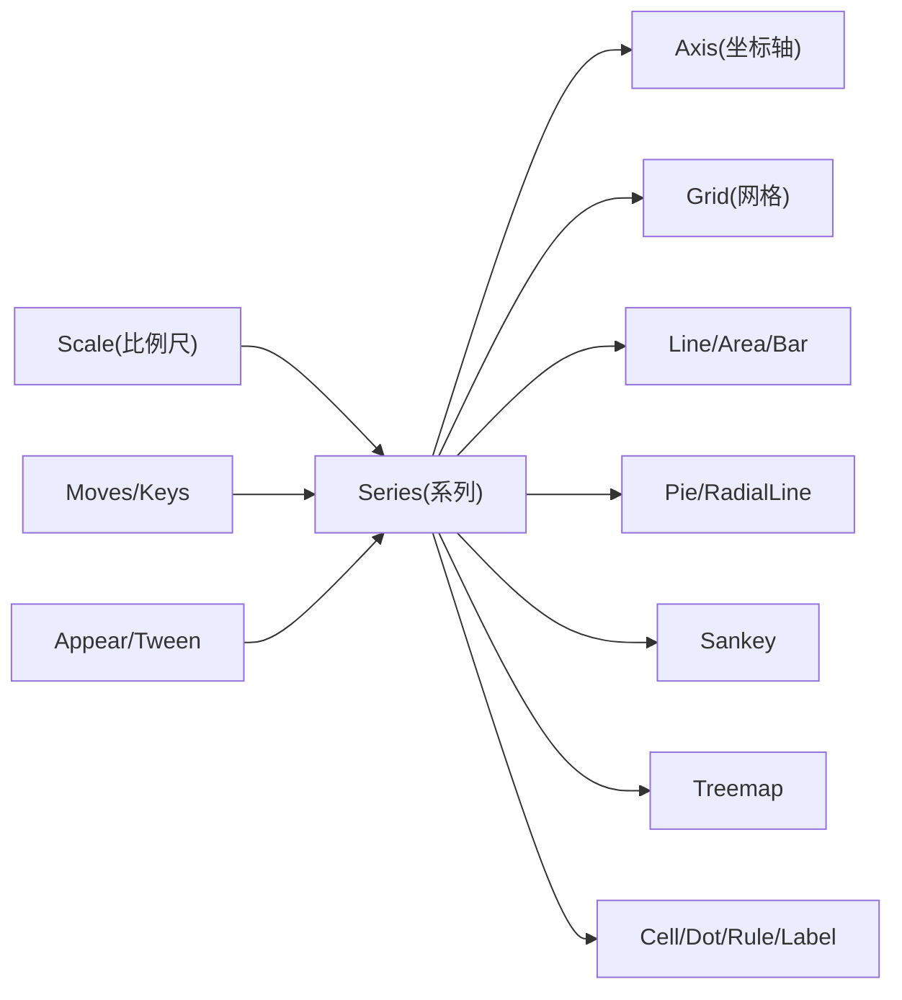
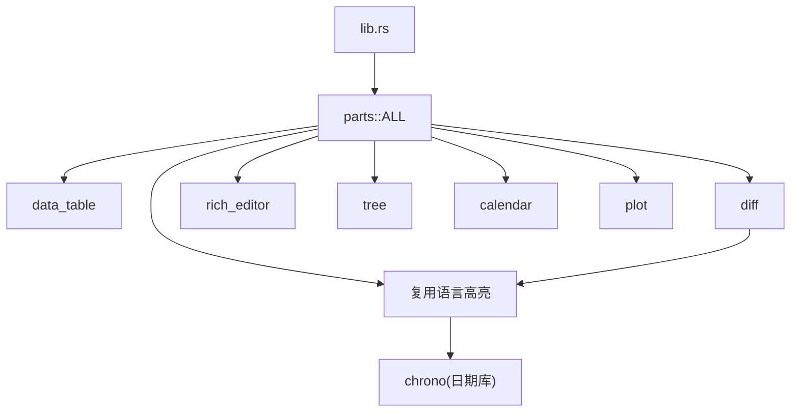

# 复合控件

<cite>
**本文引用的文件**   
- [lib.rs](file://crates/nsh-base/src/lib.rs)
- [data_table/mod.rs](file://crates/nsh-base/src/data_table/mod.rs)
- [editor/mod.rs](file://crates/nsh-base/src/editor/mod.rs)
- [rich_editor/mod.rs](file://crates/nsh-base/src/rich_editor/mod.rs)
- [diff/mod.rs](file://crates/nsh-base/src/diff/mod.rs)
- [tree.rs](file://crates/nsh-base/src/tree.rs)
- [calendar.rs](file://crates/nsh-base/src/calendar.rs)
- [plot/mod.rs](file://crates/nsh-base/src/plot/mod.rs)
</cite>

## 目录
1. [引言](#引言)
2. [项目结构](#项目结构)
3. [核心组件总览](#核心组件总览)
4. [架构总览](#架构总览)
5. [详细组件分析](#详细组件分析)
6. [依赖关系分析](#依赖关系分析)
7. [性能与大数据处理](#性能与大数据处理)
8. [自定义扩展与集成模式](#自定义扩展与集成模式)
9. [故障排查指南](#故障排查指南)
10. [结论](#结论)

## 引言
本文件面向 NSH 的复杂业务复合控件，覆盖数据表格 DataTable、代码编辑器 Editor、富文本编辑器 RichEditor、差异对比 DiffView、树形控件 Tree、日历 Calendar、图表 Plot。文档从数据模型、渲染引擎、交互逻辑、扩展机制四个维度展开，并给出性能优化策略、大数据集处理与内存管理建议，以及自定义扩展开发与集成模式。

## 项目结构
NSH 的基础 UI 能力集中在 nsh-base 包中，通过 feature 开关按需编译：
- data_table：高性能双向滚动、列固定/排序/拖拽、行/列/单元格选择、虚拟渲染
- editor：基于 rope 缓冲区的代码编辑器，支持语法高亮、折叠、搜索、诊断、补全
- rich_editor：无头内核（ProseMirror/Tiptap 风格），可插拔 schema、事务、扩展、格式适配
- diff：双文本或 patch 的差异视图，支持分栏/统一布局、词级高亮、变更操作
- tree：扁平化节点 + 可见行计算 + 虚拟化列表，键盘无障碍与类型前进
- calendar：月/年视图切换、禁用匹配器、受控值、终端兼容
- plot：图表子模块，包含坐标轴、网格、系列、动画等

**图示来源**
- [lib.rs:326-384](file://crates/nsh-base/src/lib.rs#L326-L384)

**章节来源**
- [lib.rs:19-103](file://crates/nsh-base/src/lib.rs#L19-L103)
- [lib.rs:326-384](file://crates/nsh-base/src/lib.rs#L326-L384)

## 核心组件总览
- DataTable：行列任意规模的双向滚动表格，仅渲染可视区域；支持列宽自适应、固定列、分组标题、排序、多选、复制、导出、上下文菜单、加载更多。
- Editor：自绘代码编辑器，rope 缓冲区、增量高亮、多光标、折叠、软换行、搜索替换、诊断标记、装饰、补全与定义跳转。
- RichEditor：无头文档内核，schema 定义结构，transform 描述可逆步骤，state 不可变状态机，commands/extensions/formats 提供行为与格式适配。
- DiffView：旧/新文本或 patch 的差异展示，支持 split/unified 布局、inline 粒度、指示器、上下文行、分隔符展开、变更接受/回滚、文件头与注释。
- Tree：树形层级结构，flat/open/shown 三层模型，虚拟化行渲染，键盘导航、类型前进、无障碍、展开收起动画。
- Calendar：单日期/范围选择，月/年视图，禁用匹配器，受控值，终端输出兼容。
- Plot：图表子系统，按图元组织（Axis/Grid/Line/Area/Bar/Pie/Sankey/Treemap/Cell/Dot/Rule/Label），配合 scale/tween/appear/moves 实现交互与动画。

**章节来源**
- [data_table/mod.rs:1-12](file://crates/nsh-base/src/data_table/mod.rs#L1-L12)
- [editor/mod.rs:1-11](file://crates/nsh-base/src/editor/mod.rs#L1-L11)
- [rich_editor/mod.rs:1-24](file://crates/nsh-base/src/rich_editor/mod.rs#L1-L24)
- [diff/mod.rs:1-5](file://crates/nsh-base/src/diff/mod.rs#L1-L5)
- [tree.rs:1-39](file://crates/nsh-base/src/tree.rs#L1-L39)
- [calendar.rs:1-60](file://crates/nsh-base/src/calendar.rs#L1-L60)
- [plot/mod.rs](file://crates/nsh-base/src/plot/mod.rs)

## 架构总览
所有复合控件通过 nsh-base 的 parts 注册表暴露给 JS 运行时，feature 控制是否编译进二进制。每个控件遵循“Props/Event/Api + 控制器 + 视图”的分层：
- Props/Event/Api：JS 侧 API 契约
- 控制器：维护内部状态、事件派发、命令执行
- 视图：根据可视区域进行渲染，避免全量 DOM/元素创建

**图示来源**
- [lib.rs:299-318](file://crates/nsh-base/src/lib.rs#L299-L318)
- [lib.rs:326-384](file://crates/nsh-base/src/lib.rs#L326-L384)

**章节来源**
- [lib.rs:299-318](file://crates/nsh-base/src/lib.rs#L299-L318)
- [lib.rs:326-384](file://crates/nsh-base/src/lib.rs#L326-L384)

## 详细组件分析

### DataTable 数据表格
- 数据模型
  - 列：DataTableColumn（键、标题、宽度/最小/最大、对齐、排序、固定、增长、自动适配、可调整/移动/可选、样式类）
  - 分组：DataTableColumnGroup（标签、跨列数）
  - 排序：DataTableSort（列键、方向）
  - 选择：DataTableSelection（行/列）、DataTableRange（起止索引）
  - 目标：DataTableTarget（行/列）
  - 事件载荷：DataTablePress、DataTableColumnPress、DataTableCellClass、DataTableContextMenu、DataTableColumnMove、DataTableCell、DataTableHeaderCell、DataTableDump
- 渲染引擎
  - 仅渲染可视区域的单元格，支持百万行/万列级别滚动
  - 列固定（左/右）、分组标题、自动列宽、行高/标题高、字体族/大小
  - 滚动条、回弹、空态、加载中视图
- 交互逻辑
  - 行/列/单元格选择，Shift/Control/Alt/Platform 修饰键
  - 键盘导航（箭头/Home/End/PageUp/PageDown/Tab），循环选择
  - 列拖拽调整宽度、拖拽移动列、排序按钮
  - 双击、右键菜单、复制选中内容、导出文本
  - 可见行/列变化回调，加载更多阈值触发
- 扩展机制
  - renderCell/renderHeaderCell 自定义单元格/标题
  - rowClasses/cellClasses 批量样式注入
  - classes/styles 部件级样式覆盖
- API
  - scroll_to_row/column、selection/select、visible_rows/columns、column_widths/set_column_width/fit_column、dump、copy、focus/blur、menu_target/clear_menu_target

**图示来源**
- [data_table/mod.rs:361-513](file://crates/nsh-base/src/data_table/mod.rs#L361-L513)
- [data_table/mod.rs:515-675](file://crates/nsh-base/src/data_table/mod.rs#L515-L675)

**章节来源**
- [data_table/mod.rs:25-359](file://crates/nsh-base/src/data_table/mod.rs#L25-L359)
- [data_table/mod.rs:361-513](file://crates/nsh-base/src/data_table/mod.rs#L361-L513)
- [data_table/mod.rs:515-675](file://crates/nsh-base/src/data_table/mod.rs#L515-L675)

### Editor 代码编辑器
- 数据模型
  - 文本：value/defaultValue（受控/非受控）
  - 语言：language（名称/扩展名/文件名）
  - 显示：line_numbers、soft_wrap、tab_size/hard_tabs、folding、auto_close/auto_indent、active_line、indent_guides、scroll_beyond_last_line、font_family/font_size/line_height
  - 功能：search、diagnostics、decorations、gutter_decorations_width、show_whitespaces、rulers、min_rows/max_rows、cursor_surrounding_lines、fold_ranges、highlighting、completion/completion_trigger_characters/inline_completion_delay
- 渲染引擎
  - 自绘文本行，rope 缓冲区，增量语法高亮，软换行，折叠，搜索匹配高亮
  - 行号与折叠标记，诊断与装饰标记，标尺线，空白字符可视化
- 交互逻辑
  - 完整编辑命令集（移动/选择/删除/插入/缩进/注释/复制粘贴/撤销重做/折叠/搜索/补全/定义跳转/代码动作）
  - 多光标、括号闭合、自动缩进、行内补全、补全列表
  - 悬停提示、右键菜单、文本点击定位
- 扩展机制
  - register_highlighter/register_language 注册语言与高亮器
  - decorations/diagnostics 外部语义信息注入
  - completion/inlineCompletionRequest 异步补全协议
- API
  - focus/blur、value/set_value/edit/insert、selections/set_selections、run(command)、replace/replace_all、fold/unfold/fold_recursive/fold_level/fold_range/set_folds、scroll_to_line、can_undo/can_redo、caret_bounds/range_bounds、scroll_offset/set_scroll_offset、visible_range、selected_text、offset_to_position/position_to_offset、reveal_position/go_to_line、show_completions/present_completions/hide_completions、present_inline_completion/hide_inline_completion、present_definition_link/hide_definition_link

**图示来源**
- [editor/mod.rs:73-205](file://crates/nsh-base/src/editor/mod.rs#L73-L205)
- [editor/mod.rs:207-502](file://crates/nsh-base/src/editor/mod.rs#L207-L502)
- [editor/mod.rs:504-794](file://crates/nsh-base/src/editor/mod.rs#L504-L794)

**章节来源**
- [editor/mod.rs:1-11](file://crates/nsh-base/src/editor/mod.rs#L1-L11)
- [editor/mod.rs:73-205](file://crates/nsh-base/src/editor/mod.rs#L73-L205)
- [editor/mod.rs:207-502](file://crates/nsh-base/src/editor/mod.rs#L207-L502)
- [editor/mod.rs:504-794](file://crates/nsh-base/src/editor/mod.rs#L504-L794)

### RichEditor 富文本编辑器
- 数据模型
  - model：文档结构由 Schema 定义
  - transform：可逆、可映射的步骤序列
  - state：不可变的编辑器状态，事务推进
  - commands：编辑命令集合
  - extensions：历史、快捷键、输入规则等可选行为
  - formats：与应用的格式适配器
- 渲染引擎
  - 无头内核，不依赖视图；原生视图负责渲染状态
  - 位置计数遵循 ProseMirror：UTF-16 码位、叶子节点边界
- 交互逻辑
  - 基于事务的状态机，保证一致性
  - 扩展层遵循 Tiptap 的命令语义与选项
- 扩展机制
  - 自定义 schema 节点/属性
  - 自定义 transform 步骤
  - 自定义 extension 行为与命令
  - 自定义 format 转换器

**图示来源**
- [rich_editor/mod.rs:1-35](file://crates/nsh-base/src/rich_editor/mod.rs#L1-L35)

**章节来源**
- [rich_editor/mod.rs:1-35](file://crates/nsh-base/src/rich_editor/mod.rs#L1-L35)

### DiffView 差异对比
- 数据模型
  - 布局：DiffLayout（split/unified）
  - 行内高亮：DiffInline（word-alt/word/char/none）
  - 指示器：DiffIndicators（bars/classic/none）
  - 变更块：DiffHunk（索引、旧/新起始与行数、文件索引）
  - 统计：DiffStats（新增/删除/变更数）
  - 分隔符：DiffSeparator（gap/lines/first/last/header）
  - 展开方式：DiffExpand（all/up/down）
  - 变更结果：DiffChange（old_value/new_value）
  - 行/范围：DiffLine、DiffLineRange
  - 注释：DiffAnnotation（id/side/line）
  - 文件：DiffFile（index/path/old_path/status/binary/added/deleted/hunks/first_hunk/collapsed）
- 渲染引擎
  - 两侧同步滚动，行高一致，软换行
  - 未变更行折叠为分隔符，支持展开
  - 语法高亮复用 Editor 的语言体系
- 交互逻辑
  - 变更接受/回滚（acceptHunk/revertHunk）
  - 行号点击、行选择、文件头折叠/展开
  - 变更统计、滚动位置、变更块位置
- 扩展机制
  - renderSeparator/renderHunkActions/renderAnnotation/renderAddAnnotation/renderFileHeader 自定义渲染
  - annotations 附加评论线程
- API
  - hunks/stats、go_to_hunk、revert_hunk/accept_hunk、expand/expand_all/collapse_all、selected_lines/set_selected_lines/selected_text、next_hunk/previous_hunk/current_hunk、files/scroll_to_file/collapse_file/expand_file/toggle_file、hunk_bounds、scroll_offset/set_scroll_offset

**图示来源**
- [diff/mod.rs:22-330](file://crates/nsh-base/src/diff/mod.rs#L22-L330)
- [diff/mod.rs:332-525](file://crates/nsh-base/src/diff/mod.rs#L332-L525)

**章节来源**
- [diff/mod.rs:1-5](file://crates/nsh-base/src/diff/mod.rs#L1-L5)
- [diff/mod.rs:22-330](file://crates/nsh-base/src/diff/mod.rs#L22-L330)
- [diff/mod.rs:332-525](file://crates/nsh-base/src/diff/mod.rs#L332-L525)

### Tree 树形控件
- 数据模型
  - TreeItem：id/label/children/disabled
  - TreeEntry：id/label/depth/folder/disabled（渲染用）
  - Flat：扁平化节点数组 + id 索引
  - Open：展开节点有序集合
  - Shown：当前可见行（跳过折叠子树）
- 渲染引擎
  - 虚拟化列表：仅渲染可视行，折叠子树不创建
  - 信号拆分 Lit：减少选择/焦点移动时的重渲染范围
- 交互逻辑
  - 键盘导航（Up/Down/Left/Right/Home/End/Return/Space/类型前进）
  - 展开/收起、选择、动作（onAction）
  - 无障碍：屏幕阅读器聚焦跟随
- 扩展机制
  - renderItem 自定义行渲染
  - item_class/item_style 行样式
  - reveal 展开收起动画
- API
  - focus、reveal_item

**图示来源**
- [tree.rs:76-177](file://crates/nsh-base/src/tree.rs#L76-L177)
- [tree.rs:179-279](file://crates/nsh-base/src/tree.rs#L179-L279)
- [tree.rs:298-428](file://crates/nsh-base/src/tree.rs#L298-L428)
- [tree.rs:430-551](file://crates/nsh-base/src/tree.rs#L430-L551)
- [tree.rs:553-680](file://crates/nsh-base/src/tree.rs#L553-L680)
- [tree.rs:682-800](file://crates/nsh-base/src/tree.rs#L682-L800)

**章节来源**
- [tree.rs:1-39](file://crates/nsh-base/src/tree.rs#L1-L39)
- [tree.rs:76-177](file://crates/nsh-base/src/tree.rs#L76-L177)
- [tree.rs:179-279](file://crates/nsh-base/src/tree.rs#L179-L279)
- [tree.rs:298-428](file://crates/nsh-base/src/tree.rs#L298-L428)
- [tree.rs:430-551](file://crates/nsh-base/src/tree.rs#L430-L551)
- [tree.rs:553-680](file://crates/nsh-base/src/tree.rs#L553-L680)
- [tree.rs:682-800](file://crates/nsh-base/src/tree.rs#L682-L800)

### Calendar 日历
- 数据模型
  - Date：Single/Range（ISO 字符串或 null）
  - CalendarValue：Uncontrolled/Controlled(Date)
  - Matcher：DayOfWeek/Interval/Range/Custom/Js（禁用匹配）
  - YearRange：[start, end)
  - CalendarEntry：kind/value/date/year/month/today/outside
- 渲染引擎
  - 月视图/年视图切换，多个月并排
  - 禁用匹配器在下一个 JS 回合调用一次，缓存答案
  - 终端模式：纯文本输出，保持布局
- 交互逻辑
  - 选择单日期或范围，完成才上报
  - 键盘导航（箭头/Home/End/PageUp/Down/Return/Space）
  - Previous/Next 翻页，月份/年份切换
- 扩展机制
  - renderItem 自定义项渲染
  - item_class/item_style 行/项样式
  - header/body/month/row 容器样式
- API
  - 通过 value/default_value 控制值，onChange 报告完成值

**图示来源**
- [calendar.rs:99-252](file://crates/nsh-base/src/calendar.rs#L99-L252)
- [calendar.rs:291-469](file://crates/nsh-base/src/calendar.rs#L291-L469)
- [calendar.rs:513-644](file://crates/nsh-base/src/calendar.rs#L513-L644)
- [calendar.rs:646-800](file://crates/nsh-base/src/calendar.rs#L646-L800)

**章节来源**
- [calendar.rs:1-60](file://crates/nsh-base/src/calendar.rs#L1-L60)
- [calendar.rs:99-252](file://crates/nsh-base/src/calendar.rs#L99-L252)
- [calendar.rs:291-469](file://crates/nsh-base/src/calendar.rs#L291-L469)
- [calendar.rs:513-644](file://crates/nsh-base/src/calendar.rs#L513-L644)
- [calendar.rs:646-800](file://crates/nsh-base/src/calendar.rs#L646-L800)

### Plot 图表
- 数据模型
  - 图元：Axis/Grid/Line/Area/Bar/Pie/RadialLine/Sankey/Treemap/Cell/Dot/Rule/Label
  - 比例尺：scale
  - 动画：appear/tween
  - 交互：moves/keys
- 渲染引擎
  - 模块化图元组合，支持多系列 series
  - 响应式布局与缩放
- 交互逻辑
  - 鼠标/触摸交互（hover、drag、zoom、pan）
  - 键盘可达性（部分图元）
- 扩展机制
  - 自定义图元与系列
  - 主题与样式覆盖

**图示来源**
- [plot/mod.rs](file://crates/nsh-base/src/plot/mod.rs)

**章节来源**
- [plot/mod.rs](file://crates/nsh-base/src/plot/mod.rs)

## 依赖关系分析
- 注册与导出
  - lib.rs 通过 parts::ALL 顺序注册各组件，feature 控制编译
  - registry_of(parts) 构建 Registry，注入 theme tokens 与 native values
- 组件间耦合
  - DiffView 复用 Editor 的语言高亮体系
  - Editor 与 RichEditor 均提供补全/定义等 LSP 风格交互
  - DataTable 与 Table 分离：DataTable 为动态大数据，Table 为静态语义表格
- 外部依赖
  - chrono 用于 Calendar 日期计算
  - ProseMirror/Tiptap 理念用于 RichEditor 内核

**图示来源**
- [lib.rs:326-384](file://crates/nsh-base/src/lib.rs#L326-L384)
- [calendar.rs:63-76](file://crates/nsh-base/src/calendar.rs#L63-L76)

**章节来源**
- [lib.rs:326-384](file://crates/nsh-base/src/lib.rs#L326-L384)
- [calendar.rs:63-76](file://crates/nsh-base/src/calendar.rs#L63-L76)

## 性能与大数据处理
- 虚拟化与只渲染可视区域
  - DataTable：仅渲染可视行列，支持百万行/万列
  - Tree：虚拟化列表，折叠子树不创建
  - Editor：仅渲染可视行，软换行与折叠减少绘制
  - DiffView：仅渲染可视行，分隔符折叠
- 增量更新
  - Editor：增量语法高亮、编辑命令合并
  - RichEditor：不可变状态 + 可逆步骤，避免全量重建
- 信号与细粒度通知
  - Tree：Lit 将选择/焦点信号拆分到多个槽，减少无关行重渲染
- 测量与布局优化
  - DataTable：列宽自适应与 auto_fit，字体族/大小用于文本测量
  - Calendar：禁用匹配器在下一 JS 回合调用一次，缓存结果
- 内存管理
  - Rope 缓冲区（Editor）高效拼接/切片
  - Rc/FxHashMap（Tree）降低重复计算与查找成本
  - 避免每行/每单元格的 JS 回调，优先使用 rowClasses/cellClasses 批量样式

**章节来源**
- [data_table/mod.rs:361-513](file://crates/nsh-base/src/data_table/mod.rs#L361-L513)
- [tree.rs:617-680](file://crates/nsh-base/src/tree.rs#L617-L680)
- [editor/mod.rs:1-11](file://crates/nsh-base/src/editor/mod.rs#L1-L11)
- [rich_editor/mod.rs:1-24](file://crates/nsh-base/src/rich_editor/mod.rs#L1-L24)
- [calendar.rs:338-352](file://crates/nsh-base/src/calendar.rs#L338-L352)

## 自定义扩展与集成模式
- 注册与启用
  - 通过 lib.rs 的 parts 注册组件，feature 控制是否编译
  - 在应用中通过 props/events/api 使用组件
- 编辑器扩展
  - register_highlighter/register_language：注册语言与高亮器
  - diagnostics/decorations：注入诊断与装饰
  - completion/inlineCompletionRequest：实现补全与行内补全
- 富文本扩展
  - 自定义 schema/transform/extension/format
  - 基于 ProseMirror/Tiptap 语义扩展命令与行为
- 表格扩展
  - renderCell/renderHeaderCell：自定义单元格/标题
  - rowClasses/cellClasses：批量样式注入
  - classes/styles：部件级样式覆盖
- 差异视图扩展
  - renderSeparator/renderHunkActions/renderAnnotation/renderAddAnnotation/renderFileHeader：自定义渲染
  - annotations：附加评论线程
- 树扩展
  - renderItem：自定义行渲染
  - item_class/item_style：行样式
  - reveal：展开收起动画
- 日历扩展
  - renderItem：自定义项渲染
  - item_class/item_style：项样式
  - header/body/month/row：容器样式
- 图表扩展
  - 自定义图元与系列
  - 主题与样式覆盖

**章节来源**
- [lib.rs:326-384](file://crates/nsh-base/src/lib.rs#L326-L384)
- [editor/mod.rs:42-62](file://crates/nsh-base/src/editor/mod.rs#L42-L62)
- [rich_editor/mod.rs:1-35](file://crates/nsh-base/src/rich_editor/mod.rs#L1-L35)
- [data_table/mod.rs:496-513](file://crates/nsh-base/src/data_table/mod.rs#L496-L513)
- [diff/mod.rs:295-330](file://crates/nsh-base/src/diff/mod.rs#L295-L330)
- [tree.rs:485-495](file://crates/nsh-base/src/tree.rs#L485-L495)
- [calendar.rs:627-644](file://crates/nsh-base/src/calendar.rs#L627-L644)

## 故障排查指南
- DataTable
  - 列宽异常：检查 auto_fit/width/min_width/max_width/grow 配置
  - 选择失效：确认 selectable/row_selectable/column_selectable/cell_selectable
  - 加载更多未触发：检查 has_more/loading/load_more_threshold
- Editor
  - 高亮不生效：确认 language 与 register_highlighter/register_language
  - 补全不出现：检查 completion/completion_trigger_characters/inline_completion_delay
  - 行号越界：API 方法会校验 line 范围并记录警告
- RichEditor
  - 状态不一致：检查 transform 步骤的可逆性与映射正确性
  - 格式转换失败：检查 formats 适配器的 toHTML/fromHTML
- DiffView
  - 变更未应用：确认 acceptHunk/revertHunk 调用与 onChange 同步
  - 分隔符展开异常：检查 expand/expand_all/collapse_all 参数
- Tree
  - 选择丢失：确认 expanded/selected 受控与非受控模式一致
  - 键盘导航异常：检查 disabled 与 typeahead 行为
- Calendar
  - 禁用日期不生效：检查 Matcher 类型与函数纯度
  - 值不完整：range 模式下需两次选择才上报

**章节来源**
- [data_table/mod.rs:515-675](file://crates/nsh-base/src/data_table/mod.rs#L515-L675)
- [editor/mod.rs:504-794](file://crates/nsh-base/src/editor/mod.rs#L504-L794)
- [rich_editor/mod.rs:1-35](file://crates/nsh-base/src/rich_editor/mod.rs#L1-L35)
- [diff/mod.rs:374-525](file://crates/nsh-base/src/diff/mod.rs#L374-L525)
- [tree.rs:527-551](file://crates/nsh-base/src/tree.rs#L527-L551)
- [calendar.rs:646-800](file://crates/nsh-base/src/calendar.rs#L646-L800)

## 结论
NSH 的复合控件以清晰的模型-控制器-视图分层、虚拟化与增量更新为核心，提供了高性能、可扩展、跨平台的一致体验。DataTable/Editor/RichEditor/DiffView/Tree/Calendar/Plot 覆盖了数据展示、编辑、对比、层级、时间、可视化等关键场景。通过 props/events/api 与扩展点，开发者可在不侵入内核的前提下定制行为与外观，并结合性能优化策略应对大数据与复杂交互。