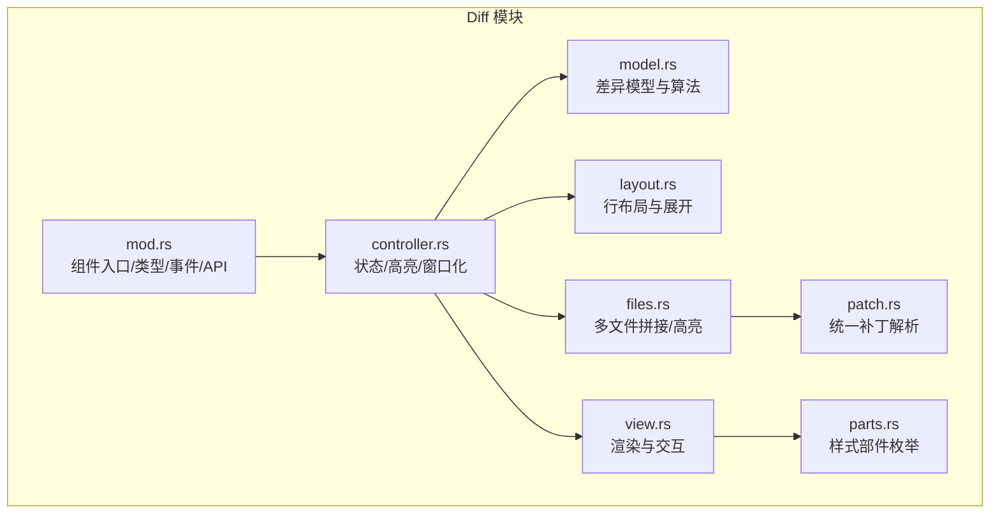
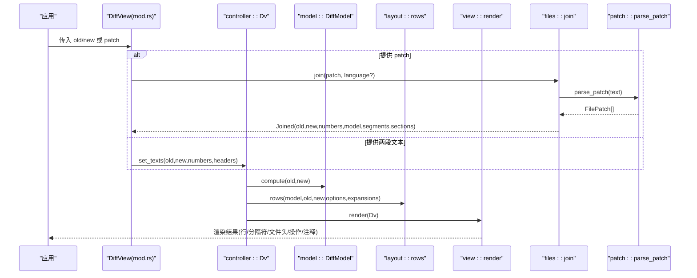
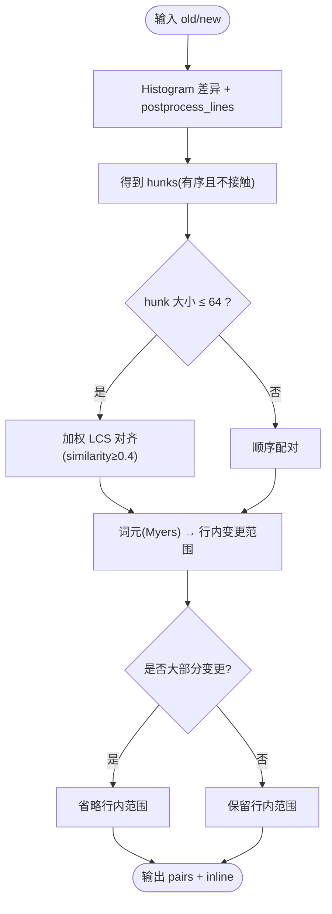
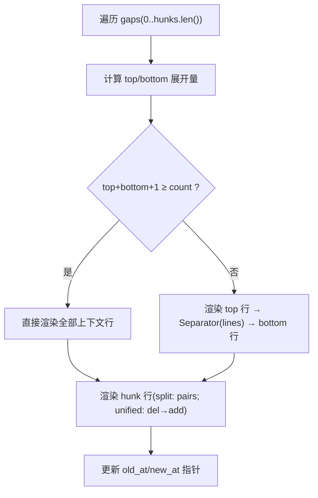
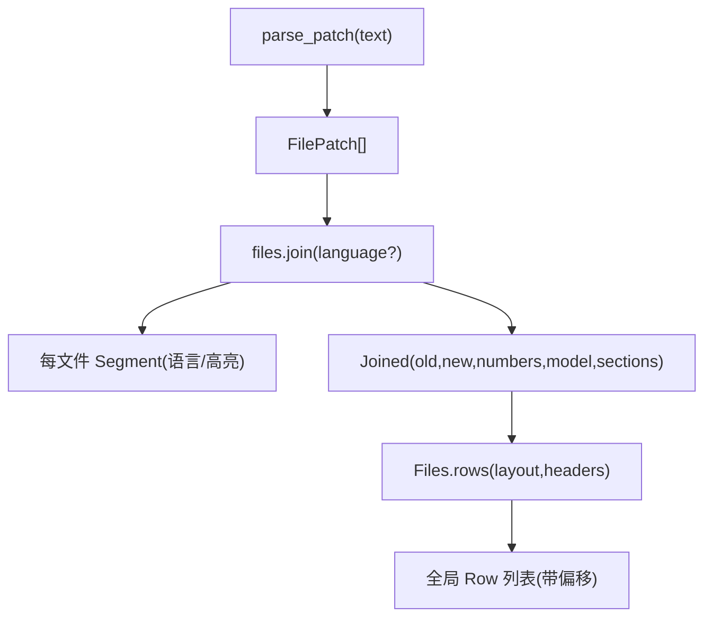
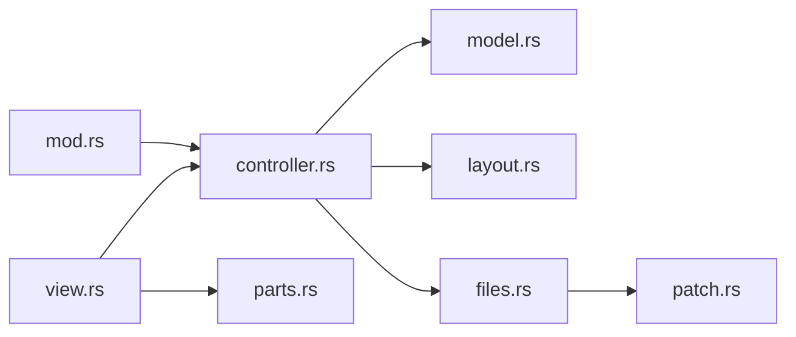

# 差异对比 (Diff Viewer)

<cite>
**本文引用的文件**   
- [mod.rs](file://crates/nsh-base/src/diff/mod.rs)
- [model.rs](file://crates/nsh-base/src/diff/model.rs)
- [layout.rs](file://crates/nsh-base/src/diff/layout.rs)
- [controller.rs](file://crates/nsh-base/src/diff/controller.rs)
- [view.rs](file://crates/nsh-base/src/diff/view.rs)
- [files.rs](file://crates/nsh-base/src/diff/files.rs)
- [patch.rs](file://crates/nsh-base/src/diff/patch.rs)
- [parts.rs](file://crates/nsh-base/src/diff/parts.rs)
- [diff.md](file://docs/dev/diff.md)
</cite>

## 目录
1. [简介](#简介)
2. [项目结构](#项目结构)
3. [核心组件](#核心组件)
4. [架构总览](#架构总览)
5. [详细组件分析](#详细组件分析)
6. [依赖关系分析](#依赖关系分析)
7. [性能与可扩展性](#性能与可扩展性)
8. [故障排查指南](#故障排查指南)
9. [结论](#结论)
10. [附录：使用示例与配置](#附录使用示例与配置)

## 简介
本组件提供代码审查风格的文本差异对比视图，支持并排（split）与统一（unified）两种布局；行内高亮变更词元；将未变更的上下文折叠为可展开的分隔符；按编辑器语法进行着色。输入可以是两段文本（oldValue/newValue），也可以是统一的补丁（git diff / diff -u）。组件对外暴露丰富的属性、事件与 API，用于双向对比、合并冲突处理、文件路径映射、高性能渲染与大文件增量更新。

## 项目结构
Diff 模块采用分层组织：模型层负责差异计算，布局层负责行生成，控制器协调状态与高亮，视图层负责渲染与交互，文件与补丁解析负责多文件与补丁数据流，部件系统提供样式定制点。



图表来源
- [mod.rs:1-15](file://crates/nsh-base/src/diff/mod.rs#L1-L15)
- [controller.rs:1-32](file://crates/nsh-base/src/diff/controller.rs#L1-L32)
- [files.rs:1-21](file://crates/nsh-base/src/diff/files.rs#L1-L21)
- [patch.rs:1-7](file://crates/nsh-base/src/diff/patch.rs#L1-L7)
- [parts.rs:1-4](file://crates/nsh-base/src/diff/parts.rs#L1-L4)

章节来源
- [mod.rs:1-15](file://crates/nsh-base/src/diff/mod.rs#L1-L15)
- [diff.md:1-23](file://docs/dev/diff.md#L1-L23)

## 核心组件
- DiffViewProps/DiffViewEvent/DiffViewApi：组件属性、事件与外部方法（跳转、接受/回退变更、展开/折叠、滚动、选区等）。
- DiffModel：行级差异（histogram + git 缩进启发式）、配对（align）、行内差异（word/char/WordAlt）。
- layout::rows：生成 Row（Line/Separator/File），管理上下文行与折叠分隔符。
- controller::Dv/State：维护两侧文本、Rope、行号、高亮器、几何与可见行窗口、选择与导航。
- view：垂直滚动容器、两侧边栏与内容、分隔符、文件头、变更操作、注释与添加控件。
- files：多文件补丁拼接、每文件独立高亮、文件头与折叠。
- patch：统一补丁解析（git diff / diff -u），含重命名/复制/二进制/模式变更。
- parts：Tailwind 类与内联样式的部件枚举（行、指示器、分隔符、文件头等）。

章节来源
- [mod.rs:22-330](file://crates/nsh-base/src/diff/mod.rs#L22-L330)
- [mod.rs:332-524](file://crates/nsh-base/src/diff/mod.rs#L332-L524)
- [model.rs:60-104](file://crates/nsh-base/src/diff/model.rs#L60-L104)
- [layout.rs:11-95](file://crates/nsh-base/src/diff/layout.rs#L11-L95)
- [controller.rs:39-195](file://crates/nsh-base/src/diff/controller.rs#L39-L195)
- [view.rs:83-152](file://crates/nsh-base/src/diff/view.rs#L83-L152)
- [files.rs:47-92](file://crates/nsh-base/src/diff/files.rs#L47-L92)
- [patch.rs:8-59](file://crates/nsh-base/src/diff/patch.rs#L8-L59)
- [parts.rs:52-102](file://crates/nsh-base/src/diff/parts.rs#L52-L102)

## 架构总览
Diff 组件以“模型-布局-控制器-视图”分层协作：
- 模型层计算 hunks 与配对，提供行内差异范围。
- 布局层根据模型与选项生成行序列，支持 split/unified 与折叠。
- 控制器驱动高亮、几何测量、可见行窗口、滚动与交互。
- 视图层渲染侧栏、文本、分隔符、文件头、操作按钮与注释。
- 文件与补丁层将多文件或补丁转换为统一的两段文本与编号，保持索引一致。



图表来源
- [mod.rs:249-330](file://crates/nsh-base/src/diff/mod.rs#L249-L330)
- [controller.rs:226-265](file://crates/nsh-base/src/diff/controller.rs#L226-L265)
- [model.rs:78-104](file://crates/nsh-base/src/diff/model.rs#L78-L104)
- [layout.rs:167-248](file://crates/nsh-base/src/diff/layout.rs#L167-L248)
- [files.rs:197-279](file://crates/nsh-base/src/diff/files.rs#L197-L279)
- [patch.rs:61-155](file://crates/nsh-base/src/diff/patch.rs#L61-L155)

## 详细组件分析

### 差异模型与算法（model.rs）
- 行级差异：基于 imara-diff 的直方图算法，随后执行 git 缩进启发式后处理，得到不重叠且有序的 hunks。
- 行配对：在 hunk 内对相似行进行对齐（加权最长公共子序列），阈值 SIMILAR=0.4；超过 PAIR_CAP=64 的行直接顺序配对。
- 行内差异：对成对行的词元（word/char/WordAlt）做 Myers 差异，WordAlt 会合并相距一个字符的词元；若一行大部分被修改（>70%）则省略行内范围。
- 接受/回退：splice 精确替换指定行区间，保留换行符语义（包括末尾无换行）。



图表来源
- [model.rs:78-104](file://crates/nsh-base/src/diff/model.rs#L78-L104)
- [model.rs:128-183](file://crates/nsh-base/src/diff/model.rs#L128-L183)
- [model.rs:185-242](file://crates/nsh-base/src/diff/model.rs#L185-L242)
- [model.rs:287-297](file://crates/nsh-base/src/diff/model.rs#L287-L297)

章节来源
- [model.rs:60-104](file://crates/nsh-base/src/diff/model.rs#L60-L104)
- [model.rs:128-242](file://crates/nsh-base/src/diff/model.rs#L128-L242)
- [model.rs:287-297](file://crates/nsh-base/src/diff/model.rs#L287-L297)

### 布局与折叠（layout.rs）
- 行类型：Context/Added/Deleted/Modified，以及 Separator（折叠上下文或补丁 hunk 头）和 File（多文件头）。
- 上下文行：每个 hunk 两侧显示 context_lines（默认 3），hunk 之间用 Separator 折叠；首尾 gap 分别仅向上/向下展开。
- 展开策略：Expansions 记录每个 gap 从顶部/底部展开的行数；当隐藏行数≤1 时直接全量展示。
- 补丁头：当存在 headers 时，所有行都显示，并在对应位置插入 Separator(header)。



图表来源
- [layout.rs:167-248](file://crates/nsh-base/src/diff/layout.rs#L167-L248)
- [layout.rs:108-157](file://crates/nsh-base/src/diff/layout.rs#L108-L157)

章节来源
- [layout.rs:11-95](file://crates/nsh-base/src/diff/layout.rs#L11-L95)
- [layout.rs:167-248](file://crates/nsh-base/src/diff/layout.rs#L167-L248)

### 控制器与渲染管线（controller.rs + view.rs）
- Side：维护 text/Rope/starts/highlighter/columns/numbers/segments，提供 tokens() 与 number()。
- State：持有 model/rows/expansions/geometry/inline缓存/pairs缓存/annotations/Files 等，负责 relayout/measure_rows/place。
- Dv：封装 props、信号（rev/hl_rev/scroll_y/viewport/geo/selection/hover/nav）、滚动同步、可见行窗口、导航与事件上报。
- view：构建垂直滚动容器，split/unified 两种列布局；gutter（行号/指示器/选择）、content（可选择的文本区域）、separators、文件头、hunk_actions、annotations、add_annotation。

```mermaid
classDiagram
class Dv {
+st : State
+props : DiffViewProps
+rev : Signal
+hl_rev : Signal
+scroll_y : Signal
+viewport : Signal
+geo : Signal
+selection : Signal
+hover : Signal
+nav : Cell
+rows_window : RowWindow
+new(props,cx)
+emit(event)
+go_to_hunk(index)
+revert_hunk(index)
+accept_hunk(index)
+expand(gap,direction,lines)
+expand_all()
+collapse_all()
+next_hunk()
+previous_hunk()
+current_hunk()
+files()
+scroll_to_file(path)
+set_file_collapsed(path,flag)
+hunk_bounds()
+scroll_offset()
+set_scroll_offset(offset)
}
class State {
+old : Side
+new : Side
+model : DiffModel
+rows : Vec<Row>
+expansions : Expansions
+headers : Vec<Header>
+patch : bool
+font : Font
+column : Points
+syntax : Syntax
+inline : HashMap<(old,new),Changed>
+pairs : HashMap<hunk,Vec<Pair>>
+geometry : Geometry
+split : bool
+text_box : Points
+wrap_columns : Option<usize>
+row_lines : Vec<u32>
+annotations : Vec<DiffAnnotation>
+placed : Vec<Option<(row,top)>>
+annotation_heights : Map
+files : Files
+action_rows : bool
+relayout(props)
+measure_rows()
+place()
+cells(row,inline)
}
class Side {
+text : String
+rope : Rope
+starts : Vec<usize>
+highlighter : Option<Highlighter>
+columns : usize
+numbers : Vec<(lineNo,lineNum)>
+segments : Vec<Segment>
+tokens(line)
+number(line)
}
Dv --> State : "持有"
State --> Side : "两侧"
State --> DiffModel : "差异模型"
State --> Files : "多文件"
```

图表来源
- [controller.rs:39-195](file://crates/nsh-base/src/diff/controller.rs#L39-L195)
- [controller.rs:717-792](file://crates/nsh-base/src/diff/controller.rs#L717-L792)
- [view.rs:83-152](file://crates/nsh-base/src/diff/view.rs#L83-L152)

章节来源
- [controller.rs:39-195](file://crates/nsh-base/src/diff/controller.rs#L39-L195)
- [controller.rs:717-792](file://crates/nsh-base/src/diff/controller.rs#L717-L792)
- [view.rs:83-152](file://crates/nsh-base/src/diff/view.rs#L83-L152)

### 多文件与补丁（files.rs + patch.rs）
- patch.parse_patch：解析 git diff / diff -u，支持 rename/copy/binary/mode，错误包含行号。
- files.join：将多个文件的 texts() 拼接为两个大文本，同时维护 numbering（文件内行号）、hunks 偏移、segments（每文件独立高亮）、FileSection 与 DiffFile 信息。
- Files：管理折叠状态、生成带文件头的行、将全局 hunk 坐标定位到文件内坐标。



图表来源
- [patch.rs:61-155](file://crates/nsh-base/src/diff/patch.rs#L61-L155)
- [files.rs:197-279](file://crates/nsh-base/src/diff/files.rs#L197-L279)
- [files.rs:301-447](file://crates/nsh-base/src/diff/files.rs#L301-L447)

章节来源
- [patch.rs:61-155](file://crates/nsh-base/src/diff/patch.rs#L61-L155)
- [files.rs:197-279](file://crates/nsh-base/src/diff/files.rs#L197-L279)
- [files.rs:301-447](file://crates/nsh-base/src/diff/files.rs#L301-L447)

### 样式部件（parts.rs）
- 通过 DiffViewPart 枚举暴露 side/gutter/line_number/content/line/line_added/line_deleted/filler/word_added/word_deleted/indicator_added/indicator_deleted/separator/hunk_actions/line_selected/annotation/add_annotation/file_header 等部件，配合 Tailwind 类与内联样式覆盖默认主题色（新增绿、删除红）。

章节来源
- [parts.rs:52-102](file://crates/nsh-base/src/diff/parts.rs#L52-L102)

## 依赖关系分析
- 组件入口 mod.rs 导出 Props/Events/API 与枚举类型，组合 controller::Dv 作为内部状态机。
- controller 依赖 model（差异）、layout（行）、files（多文件）、geometry（几何）、editor.highlight（语法高亮）。
- files 依赖 patch 解析统一补丁，并将结果注入 controller 的 State。
- view 依赖 controller 提供的可见行与单元格数据，并通过 parts 应用样式。



图表来源
- [mod.rs:1-15](file://crates/nsh-base/src/diff/mod.rs#L1-L15)
- [controller.rs:1-32](file://crates/nsh-base/src/diff/controller.rs#L1-L32)
- [files.rs:1-21](file://crates/nsh-base/src/diff/files.rs#L1-L21)
- [patch.rs:1-7](file://crates/nsh-base/src/diff/patch.rs#L1-L7)
- [view.rs:1-23](file://crates/nsh-base/src/diff/view.rs#L1-L23)
- [parts.rs:1-4](file://crates/nsh-base/src/diff/parts.rs#L1-L4)

章节来源
- [mod.rs:1-15](file://crates/nsh-base/src/diff/mod.rs#L1-L15)
- [controller.rs:1-32](file://crates/nsh-base/src/diff/controller.rs#L1-L32)
- [files.rs:1-21](file://crates/nsh-base/src/diff/files.rs#L1-L21)
- [patch.rs:1-7](file://crates/nsh-base/src/diff/patch.rs#L1-L7)
- [view.rs:1-23](file://crates/nsh-base/src/diff/view.rs#L1-L23)
- [parts.rs:1-4](file://crates/nsh-base/src/diff/parts.rs#L1-L4)

## 性能与可扩展性
- 大文件优化
  - 行级差异使用 Histogram 算法，避免 Myers 在重复 token 上的退化。
  - 行配对限制规模（PAIR_CAP=64），超大 hunk 退化为顺序配对。
  - 行内差异跳过超长行（INLINE_MAX_LEN=10000）与几乎整行变更的情况。
  - 布局只生成可见行及其缓冲，折叠分隔符 O(1) 成本。
  - 高亮工作分片与猜测（GUESS_CONTEXT/GUESS_DISTANCE/LOOKAHEAD/SLICE），跨线程调度。
  - 多文件每段独立高亮，避免状态污染。
- 增量更新
  - 通过 rev/hl_rev/geo 信号触发最小化重算；visible_rows 仅渲染可视区域。
  - 滚动与视口变化触发 schedule_highlight 与 scrolled_to，按需推进高亮。
- 自定义对比算法集成
  - 当前实现固定使用 imara-diff 的 Histogram/Myers；如需替换，可在 model.rs 中替换 Diff::compute 与 postprocess_* 调用，并保持 Hunk/Pair/inline 接口不变。
- 可视化选项
  - layout: split/unified
  - inline: WordAlt/Word/Char/None
  - indicators: Bars/Classic/None
  - soft_wrap: 启用软换行，按列宽折行
  - background: 行背景着色开关
  - line_numbers: 行号显示开关
  - expand_all: 展开所有上下文
  - render_separator/render_hunk_actions/render_annotation/render_add_annotation/render_file_header: 自定义渲染回调

章节来源
- [model.rs:49-58](file://crates/nsh-base/src/diff/model.rs#L49-L58)
- [model.rs:185-242](file://crates/nsh-base/src/diff/model.rs#L185-L242)
- [layout.rs:1-8](file://crates/nsh-base/src/diff/layout.rs#L1-L8)
- [controller.rs:267-290](file://crates/nsh-base/src/diff/controller.rs#L267-L290)
- [files.rs:111-160](file://crates/nsh-base/src/diff/files.rs#L111-L160)
- [mod.rs:249-330](file://crates/nsh-base/src/diff/mod.rs#L249-L330)

## 故障排查指南
- 补丁解析失败
  - 现象：无法识别统一补丁格式，日志告警。
  - 排查：确认补丁为 git diff / diff -u 格式；检查 @@ 头部与行计数是否匹配；注意 \ No newline at end of file 标记。
  - 参考：[patch.rs:61-155](file://crates/nsh-base/src/diff/patch.rs#L61-L155)
- 二进制文件
  - 现象：binary=true，无行可应用。
  - 处理：不显示行，仅显示文件头与状态。
  - 参考：[patch.rs:307-340](file://crates/nsh-base/src/diff/patch.rs#L307-L340)
- 行号错位
  - 现象：文件头或 hunk 头导致行号不一致。
  - 排查：确认 numbering 与 header_at 偏移；检查 files::join 中的 numbers 与 headers 构造。
  - 参考：[files.rs:210-279](file://crates/nsh-base/src/diff/files.rs#L210-L279)
- 高亮未生效
  - 现象：文本无色或颜色异常。
  - 排查：确认 syntax.ready()；检查 Segment 的 highlighter 创建；确认语言推断（language 或 path）。
  - 参考：[controller.rs:267-290](file://crates/nsh-base/src/diff/controller.rs#L267-L290)，[files.rs:71-92](file://crates/nsh-base/src/diff/files.rs#L71-L92)
- 滚动与视口不同步
  - 现象：onScroll 未触发或值异常。
  - 排查：确保 onScroll 设置 scroll_y 与 viewport；检查 report_scroll/report_hunk_bounds 效应。
  - 参考：[view.rs:105-116](file://crates/nsh-base/src/diff/view.rs#L105-L116)

章节来源
- [patch.rs:61-155](file://crates/nsh-base/src/diff/patch.rs#L61-L155)
- [patch.rs:307-340](file://crates/nsh-base/src/diff/patch.rs#L307-L340)
- [files.rs:210-279](file://crates/nsh-base/src/diff/files.rs#L210-L279)
- [controller.rs:267-290](file://crates/nsh-base/src/diff/controller.rs#L267-L290)
- [files.rs:71-92](file://crates/nsh-base/src/diff/files.rs#L71-L92)
- [view.rs:105-116](file://crates/nsh-base/src/diff/view.rs#L105-L116)

## 结论
Diff 组件以稳健的差异算法与高效的布局/渲染管线，提供面向代码审查的双向对比能力。其设计在多文件与补丁场景下仍保持清晰的索引映射与独立的语法高亮；通过折叠、软换行、行内差异与丰富的样式部件，兼顾可读性与可定制性。结合控制器的事件与 API，可轻松集成到文件对比、代码审查、合并冲突解决等实际场景中。

## 附录：使用示例与配置

### 基本用法（两段文本对比）
- 属性要点
  - old_value/new_value：待对比的两段文本
  - layout：split | unified
  - inline：WordAlt | Word | Char | None
  - indicators：Bars | Classic | None
  - context_lines：上下文行数（默认 3）
  - soft_wrap：软换行
  - background：行背景着色
  - line_numbers：显示行号
  - render_separator/render_hunk_actions/render_annotation/render_add_annotation/render_file_header：自定义渲染回调
- 事件
  - onChange：接受/回退变更后返回新的 old/new
  - onStatsChange：统计（added/deleted/hunks）
  - onLineSelectionChange：行号选区变化
  - onScroll/onHunkBoundsChange：滚动与变更位置
- API（ref）
  - go_to_hunk/revert_hunk/accept_hunk
  - expand/expand_all/collapse_all
  - next_hunk/previous_hunk/current_hunk
  - files/scroll_to_file/toggle_file/collapse_file/expand_file
  - hunk_bounds/scroll_offset/set_scroll_offset

章节来源
- [mod.rs:249-330](file://crates/nsh-base/src/diff/mod.rs#L249-L330)
- [mod.rs:332-524](file://crates/nsh-base/src/diff/mod.rs#L332-L524)

### 多文件补丁对比
- 输入 patch：统一补丁字符串
- 自动行为
  - 解析出多个 FilePatch，按文件顺序拼接为两段文本
  - 每文件独立高亮，文件头显示路径/状态/增减行数
  - 支持重命名/复制/二进制/模式变更
- 常用 API
  - files()/scroll_to_file()/toggle_file()

章节来源
- [files.rs:197-279](file://crates/nsh-base/src/diff/files.rs#L197-L279)
- [files.rs:301-447](file://crates/nsh-base/src/diff/files.rs#L301-L447)
- [patch.rs:61-155](file://crates/nsh-base/src/diff/patch.rs#L61-L155)

### 高级功能与最佳实践
- 语义化差异检测
  - 行配对使用相似度（前缀/后缀 + 词元 Dice），提升“移动/重命名”的可读性
  - 行内差异支持 WordAlt（相邻词元合并），更适合短语级变更
- 忽略空白/大小写敏感
  - 当前实现比较原始文本（\r 视为内容），未内置忽略空白/大小写开关
  - 建议在输入预处理阶段归一化（如 trim/normalize_case），再传入组件
- 性能建议
  - 大文件优先使用 split 布局与 Word/None 行内模式
  - 合理设置 context_lines，避免过多上下文
  - 启用 soft_wrap 时关注列宽与字体度量
- 可视化定制
  - 通过 parts 覆盖 line_added/line_deleted/word_added/word_deleted/separator/hunk_actions/file_header 等样式
  - 使用 render_hunk_actions 实现“Accept/Revert”等操作按钮

章节来源
- [model.rs:371-463](file://crates/nsh-base/src/diff/model.rs#L371-L463)
- [model.rs:474-538](file://crates/nsh-base/src/diff/model.rs#L474-L538)
- [parts.rs:52-102](file://crates/nsh-base/src/diff/parts.rs#L52-L102)
- [diff.md:164-196](file://docs/dev/diff.md#L164-L196)