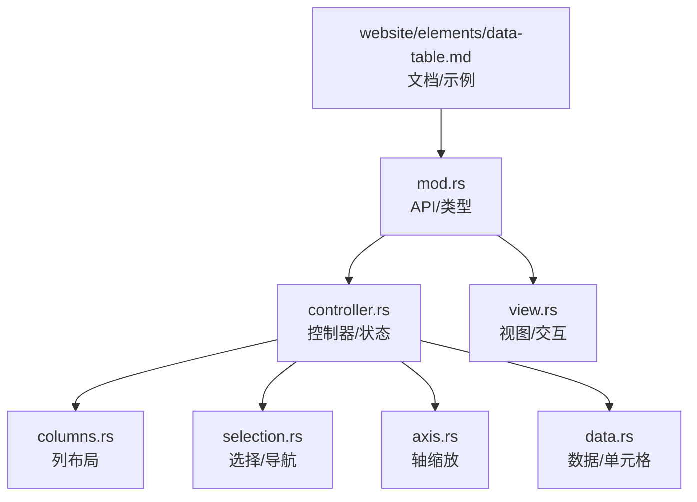
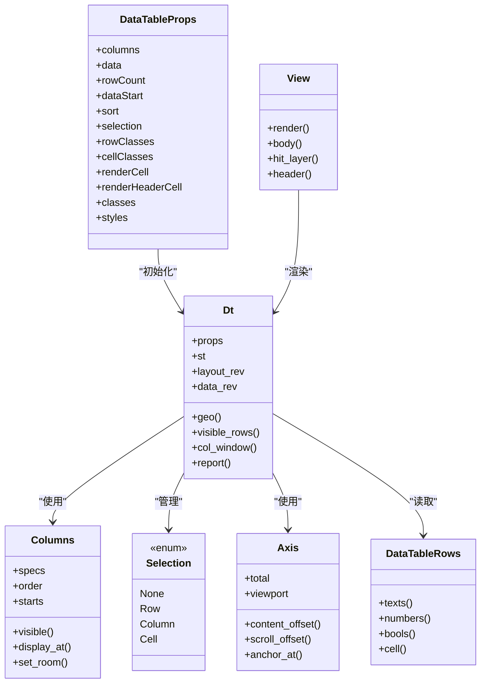
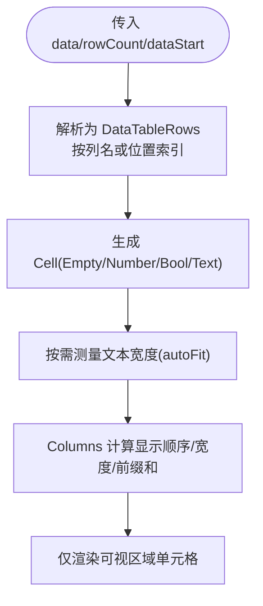
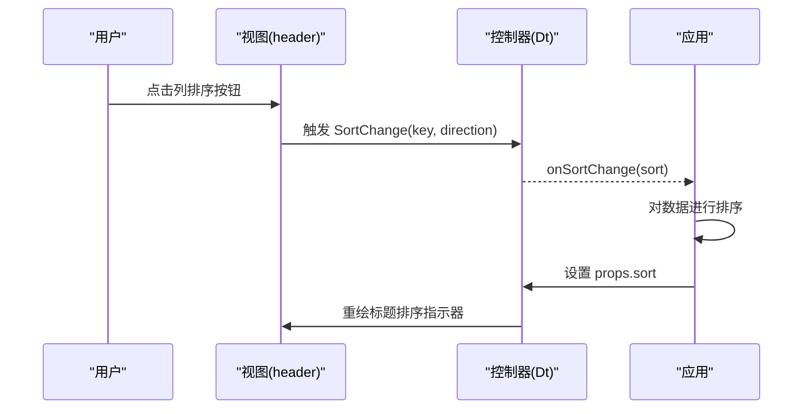
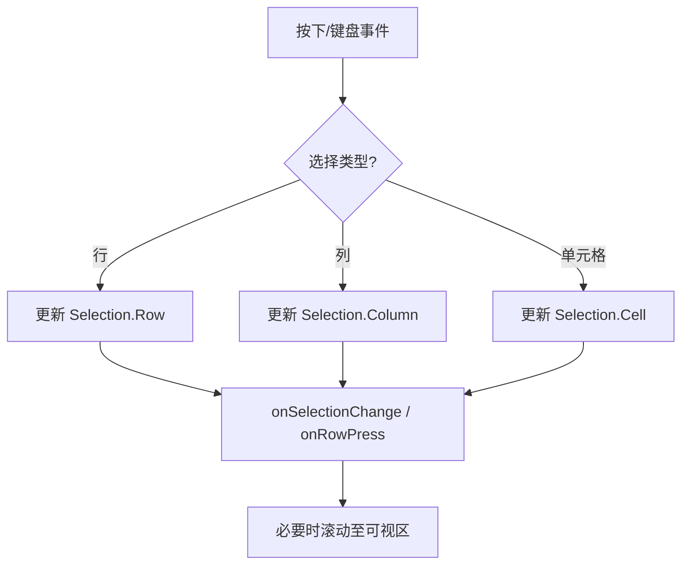
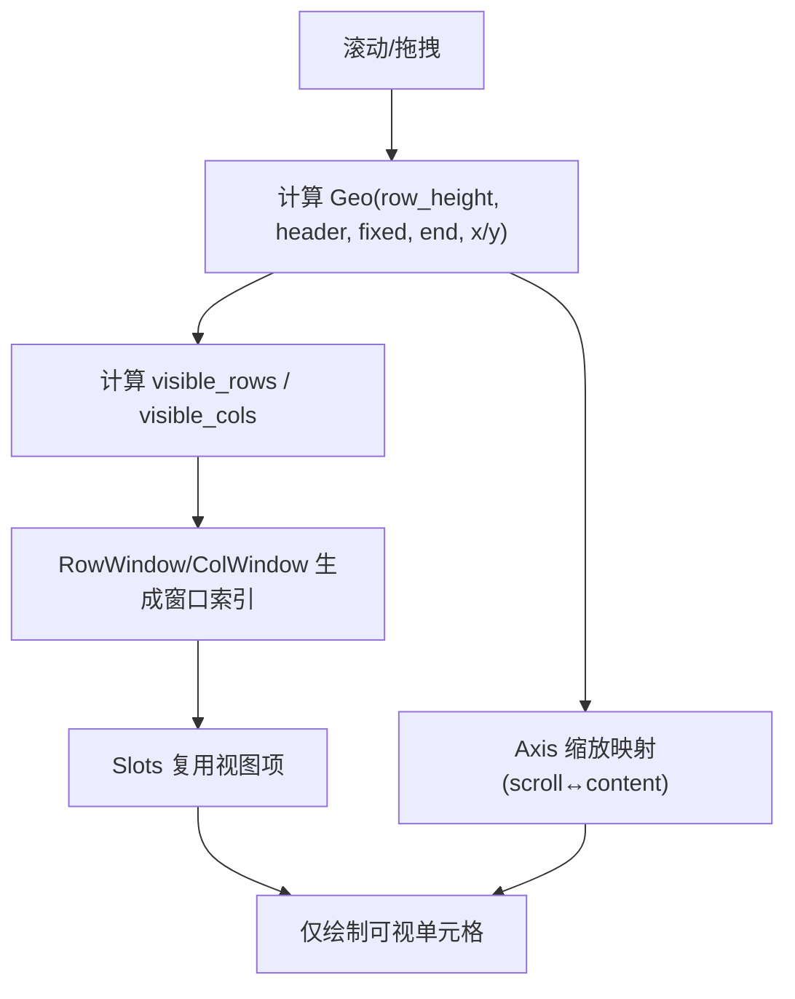
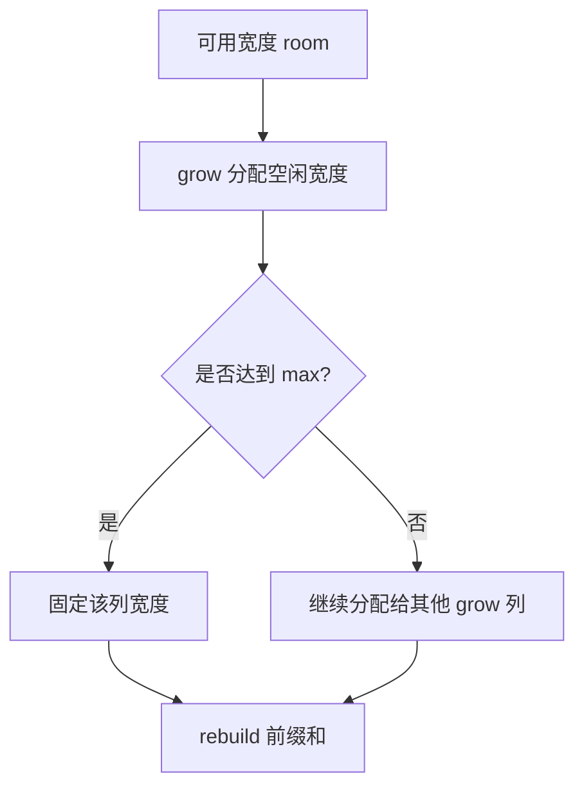
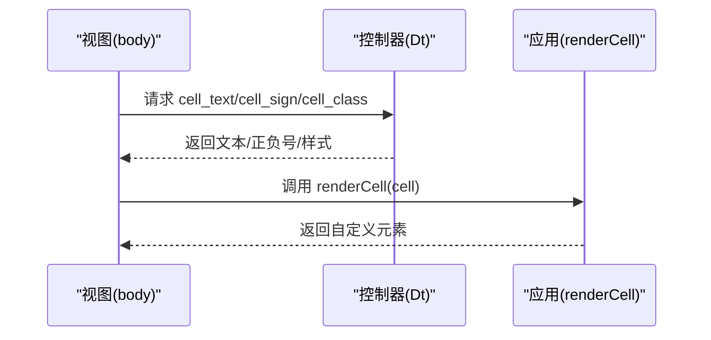
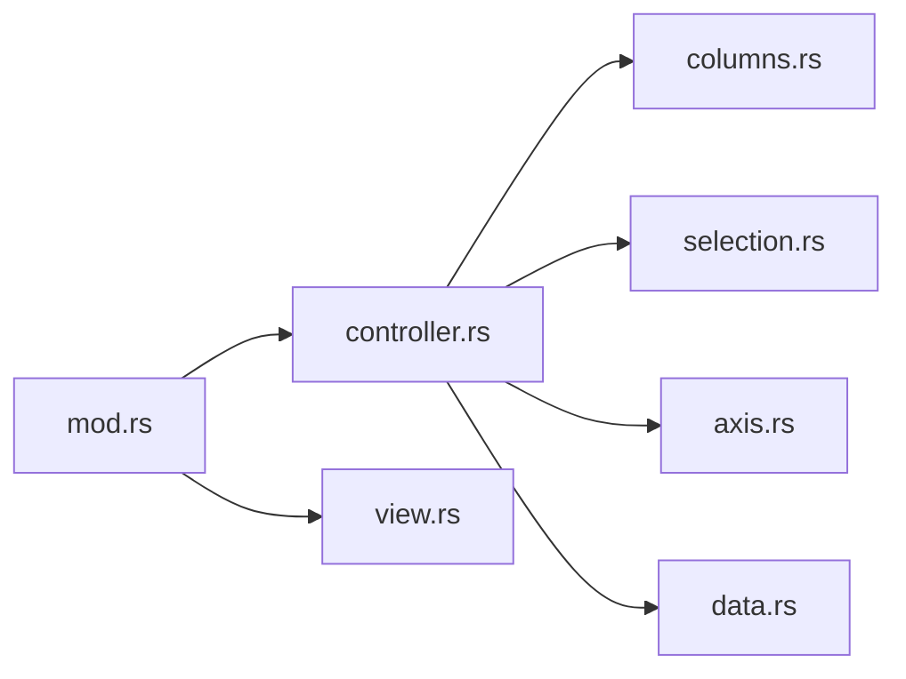

# 数据表格 (DataTable)

<cite>
**本文引用的文件**   
- [crates/nsh-base/src/data_table/mod.rs](file://crates/nsh-base/src/data_table/mod.rs)
- [crates/nsh-base/src/data_table/controller.rs](file://crates/nsh-base/src/data_table/controller.rs)
- [crates/nsh-base/src/data_table/view.rs](file://crates/nsh-base/src/data_table/view.rs)
- [crates/nsh-base/src/data_table/columns.rs](file://crates/nsh-base/src/data_table/columns.rs)
- [crates/nsh-base/src/data_table/selection.rs](file://crates/nsh-base/src/data_table/selection.rs)
- [crates/nsh-base/src/data_table/axis.rs](file://crates/nsh-base/src/data_table/axis.rs)
- [crates/nsh-base/src/data_table/data.rs](file://crates/nsh-base/src/data_table/data.rs)
- [website/elements/data-table.md](file://website/elements/data-table.md)
</cite>

## 目录
1. [简介](#简介)
2. [项目结构](#项目结构)
3. [核心组件](#核心组件)
4. [架构总览](#架构总览)
5. [详细组件分析](#详细组件分析)
6. [依赖关系分析](#依赖关系分析)
7. [性能与内存优化](#性能与内存优化)
8. [故障排查指南](#故障排查指南)
9. [结论](#结论)
10. [附录：常用场景与最佳实践](#附录常用场景与最佳实践)

## 简介
本文件为 NSH 的 DataTable 组件提供系统化文档，覆盖数据模型、列定义、排序与筛选、虚拟滚动与大数据集优化、选择模式（行/列/单元格）、行操作、单元格编辑、自定义渲染器（列/单元格/行）、响应式布局、主题定制与国际化支持。内容基于源码与官方文档整理，并辅以架构图、类图、时序图和流程图帮助理解实现细节。

## 项目结构
DataTable 位于 crates/nsh-base/src/data_table/，采用分层模块化组织：
- 对外 API 与类型定义：mod.rs
- 控制器与状态机：controller.rs
- 视图层与交互分发：view.rs
- 列布局与宽度计算：columns.rs
- 选择与键盘导航：selection.rs
- 超大内容轴缩放：axis.rs
- 数据行与单元格存储：data.rs
- 用户文档与示例：website/elements/data-table.md

图表来源
- [crates/nsh-base/src/data_table/mod.rs:1-24](file://crates/nsh-base/src/data_table/mod.rs#L1-L24)
- [crates/nsh-base/src/data_table/controller.rs:1-28](file://crates/nsh-base/src/data_table/controller.rs#L1-L28)
- [crates/nsh-base/src/data_table/view.rs:1-23](file://crates/nsh-base/src/data_table/view.rs#L1-L23)
- [crates/nsh-base/src/data_table/columns.rs:1-17](file://crates/nsh-base/src/data_table/columns.rs#L1-L17)
- [crates/nsh-base/src/data_table/selection.rs:1-10](file://crates/nsh-base/src/data_table/selection.rs#L1-L10)
- [crates/nsh-base/src/data_table/axis.rs:1-20](file://crates/nsh-base/src/data_table/axis.rs#L1-L20)
- [crates/nsh-base/src/data_table/data.rs:1-11](file://crates/nsh-base/src/data_table/data.rs#L1-L11)
- [website/elements/data-table.md:1-18](file://website/elements/data-table.md#L1-L18)

章节来源
- [crates/nsh-base/src/data_table/mod.rs:1-24](file://crates/nsh-base/src/data_table/mod.rs#L1-L24)
- [website/elements/data-table.md:1-18](file://website/elements/data-table.md#L1-L18)

## 核心组件
- DataTableProps：组件属性集合，包含 columns、data、rowCount、dataStart、sort、selection、rowClasses、cellClasses、renderCell、renderHeaderCell、classes/styles 等。
- DataTableColumn：列定义，含 key/title/width/min_width/max_width/grow/auto_fit/align/sortable/fixed/resizable/movable/selectable/cell_class/header_class/positive_class/negative_class。
- DataTableRows：Rust 侧高效行存储，按列名或位置索引，支持 texts/numbers/bools 构造。
- Columns：列布局引擎，维护显示顺序、固定列、前缀和、可见范围、宽度增长与自适应。
- Selection/Nav：选择状态与键盘导航逻辑，支持行/列/单元格三种选择模式及循环导航。
- Axis：超大内容轴缩放，保证百万级行/列的滚动体验与精确性。
- Dt（控制器）：整合 props、state、信号、窗口化、事件处理、测量与导出。
- View：三层视图（body/hit_layer/header），插槽复用（Slots），桌面水平条同步。

章节来源
- [crates/nsh-base/src/data_table/mod.rs:95-169](file://crates/nsh-base/src/data_table/mod.rs#L95-L169)
- [crates/nsh-base/src/data_table/mod.rs:378-513](file://crates/nsh-base/src/data_table/mod.rs#L378-L513)
- [crates/nsh-base/src/data_table/data.rs:74-110](file://crates/nsh-base/src/data_table/data.rs#L74-L110)
- [crates/nsh-base/src/data_table/columns.rs:44-71](file://crates/nsh-base/src/data_table/columns.rs#L44-L71)
- [crates/nsh-base/src/data_table/selection.rs:12-20](file://crates/nsh-base/src/data_table/selection.rs#L12-L20)
- [crates/nsh-base/src/data_table/axis.rs:26-33](file://crates/nsh-base/src/data_table/axis.rs#L26-L33)
- [crates/nsh-base/src/data_table/controller.rs:115-163](file://crates/nsh-base/src/data_table/controller.rs#L115-L163)
- [crates/nsh-base/src/data_table/view.rs:198-254](file://crates/nsh-base/src/data_table/view.rs#L198-L254)

## 架构总览
DataTable 由“控制器 + 视图 + 子模块”构成：
- 控制器（Dt）订阅 props 变化，维护 State（Columns、Selection、Geo 等），驱动布局与数据刷新，暴露 ref API。
- 视图（View）构建三层结构：body（仅渲染可视区域单元格）、hit_layer（接收指针/滚轮/右键菜单）、header（分组标题与列标题）。
- 子模块各司其职：columns 负责列布局与可见范围；selection 负责选择与键盘移动；axis 负责超大内容缩放；data 负责行列数据的原生存储与转换。

图表来源
- [crates/nsh-base/src/data_table/mod.rs:378-513](file://crates/nsh-base/src/data_table/mod.rs#L378-L513)
- [crates/nsh-base/src/data_table/controller.rs:115-163](file://crates/nsh-base/src/data_table/controller.rs#L115-L163)
- [crates/nsh-base/src/data_table/columns.rs:44-71](file://crates/nsh-base/src/data_table/columns.rs#L44-L71)
- [crates/nsh-base/src/data_table/selection.rs:12-20](file://crates/nsh-base/src/data_table/selection.rs#L12-L20)
- [crates/nsh-base/src/data_table/axis.rs:26-33](file://crates/nsh-base/src/data_table/axis.rs#L26-L33)
- [crates/nsh-base/src/data_table/data.rs:74-110](file://crates/nsh-base/src/data_table/data.rs#L74-L110)
- [crates/nsh-base/src/data_table/view.rs:198-254](file://crates/nsh-base/src/data_table/view.rs#L198-L254)

## 详细组件分析

### 数据模型与列定义
- 行数据：支持对象数组（字段名对应列 key）或纯数组（按列位置）。Rust 侧通过 DataTableRows::new/texts/numbers/bools 以列为单位填充，避免逐行 JS 桥接开销。
- 列定义：key 唯一标识，title 默认等于 key；width/min_width/max_width/grow/auto_fit 控制宽度策略；align 控制对齐；sortable/fixed/resizable/movable/selectable 控制交互；cell_class/header_class/positive_class/negative_class 控制样式。
- 分组标题：groups 支持多级分组标签，span 累加到列数或下级分组数量。

图表来源
- [crates/nsh-base/src/data_table/data.rs:230-300](file://crates/nsh-base/src/data_table/data.rs#L230-L300)
- [crates/nsh-base/src/data_table/columns.rs:146-155](file://crates/nsh-base/src/data_table/columns.rs#L146-L155)
- [crates/nsh-base/src/data_table/columns.rs:331-341](file://crates/nsh-base/src/data_table/columns.rs#L331-L341)

章节来源
- [crates/nsh-base/src/data_table/mod.rs:95-169](file://crates/nsh-base/src/data_table/mod.rs#L95-L169)
- [crates/nsh-base/src/data_table/data.rs:74-110](file://crates/nsh-base/src/data_table/data.rs#L74-L110)
- [website/elements/data-table.md:69-97](file://website/elements/data-table.md#L69-L97)

### 排序与筛选
- 排序：列 sortable=true 时显示排序按钮；点击触发 onSortChange，返回下一个排序方向（未排序→升序→降序→未排序）。应用需自行排序数据并设置 sort。
- 筛选：组件未内置筛选逻辑，可通过 onVisibleRowsChange 获取可视范围，结合外部筛选后更新 data/dataStart/rowCount。

图表来源
- [crates/nsh-base/src/data_table/mod.rs:547-551](file://crates/nsh-base/src/data_table/mod.rs#L547-L551)
- [website/elements/data-table.md:224-242](file://website/elements/data-table.md#L224-L242)

章节来源
- [crates/nsh-base/src/data_table/mod.rs:547-551](file://crates/nsh-base/src/data_table/mod.rs#L547-L551)
- [website/elements/data-table.md:224-242](file://website/elements/data-table.md#L224-L242)

### 选择模式与行操作
- 选择模式：rowSelectable/columnSelectable/cellSelectable 控制可选择的维度；selectOnModifierPress 控制修饰键行为；selection 受控时可从应用侧设置。
- 行操作：onRowPress/onColumnPress/onDoublePress/onContextMenu 提供丰富的交互回调；Enter/Return 激活选中行（onRowActivate）。
- 键盘导航：箭头键/Tab/Shift+Tab/PageUp/PageDown/Home/End/Escape/Copy 快捷键，loopSelection 控制是否循环。

图表来源
- [crates/nsh-base/src/data_table/selection.rs:12-46](file://crates/nsh-base/src/data_table/selection.rs#L12-L46)
- [crates/nsh-base/src/data_table/controller.rs:777-800](file://crates/nsh-base/src/data_table/controller.rs#L777-L800)
- [website/elements/data-table.md:149-204](file://website/elements/data-table.md#L149-L204)

章节来源
- [crates/nsh-base/src/data_table/selection.rs:12-46](file://crates/nsh-base/src/data_table/selection.rs#L12-L46)
- [crates/nsh-base/src/data_table/controller.rs:777-800](file://crates/nsh-base/src/data_table/controller.rs#L777-L800)
- [website/elements/data-table.md:149-204](file://website/elements/data-table.md#L149-L204)

### 虚拟滚动与大数据集优化
- 行窗口：RowWindow 维护可视行及其前后缓冲，Slots 复用视图实例，滚动不创建/销毁视图。
- 列窗口：仅渲染滚动区域的列，固定列与右侧固定列分别处理。
- 超大内容轴：Axis 在超过 MAX_EXTENT 时对内容进行缩放映射，保持滚动条比例与精确定位，并提供 Anchor 机制使触摸/滚轮输入自然。

图表来源
- [crates/nsh-base/src/data_table/controller.rs:679-716](file://crates/nsh-base/src/data_table/controller.rs#L679-L716)
- [crates/nsh-base/src/data_table/view.rs:775-800](file://crates/nsh-base/src/data_table/view.rs#L775-L800)
- [crates/nsh-base/src/data_table/axis.rs:23-33](file://crates/nsh-base/src/data_table/axis.rs#L23-L33)

章节来源
- [crates/nsh-base/src/data_table/controller.rs:679-716](file://crates/nsh-base/src/data_table/controller.rs#L679-L716)
- [crates/nsh-base/src/data_table/view.rs:775-800](file://crates/nsh-base/src/data_table/view.rs#L775-L800)
- [crates/nsh-base/src/data_table/axis.rs:23-33](file://crates/nsh-base/src/data_table/axis.rs#L23-L33)

### 列宽与自适应
- grow：按比例分配空闲宽度，达到 max 后停止增长，剩余空间继续分配。
- autoFit：首次有文本时自动测量并设置 base width，后续数据不再改变列宽。
- setWidth/setBase：用户拖拽或 API 设置宽度后，列不再参与 grow。

图表来源
- [crates/nsh-base/src/data_table/columns.rs:343-383](file://crates/nsh-base/src/data_table/columns.rs#L343-L383)
- [crates/nsh-base/src/data_table/columns.rs:297-309](file://crates/nsh-base/src/data_table/columns.rs#L297-L309)

章节来源
- [crates/nsh-base/src/data_table/columns.rs:343-383](file://crates/nsh-base/src/data_table/columns.rs#L343-L383)
- [crates/nsh-base/src/data_table/columns.rs:297-309](file://crates/nsh-base/src/data_table/columns.rs#L297-L309)

### 自定义渲染器（列/单元格/行）
- renderCell：为可视单元格提供自定义渲染，参数包含 row/column/key/text/selected；内部视图可处理 onPress 等事件。
- renderHeaderCell：自定义列标题渲染，参数包含 column/key/title/sort/selected。
- 行样式：rowClasses 按 data 中的行索引提供样式，无需每行调用 JS。
- 单元格样式：cellClasses 按数据行与列索引提供样式，优先级高于列 cellClass。

图表来源
- [crates/nsh-base/src/data_table/controller.rs:491-558](file://crates/nsh-base/src/data_table/controller.rs#L491-L558)
- [crates/nsh-base/src/data_table/view.rs:112-195](file://crates/nsh-base/src/data_table/view.rs#L112-L195)
- [website/elements/data-table.md:298-329](file://website/elements/data-table.md#L298-L329)

章节来源
- [crates/nsh-base/src/data_table/controller.rs:491-558](file://crates/nsh-base/src/data_table/controller.rs#L491-L558)
- [crates/nsh-base/src/data_table/view.rs:112-195](file://crates/nsh-base/src/data_table/view.rs#L112-L195)
- [website/elements/data-table.md:298-329](file://website/elements/data-table.md#L298-L329)

### 响应式布局与主题定制
- 响应式：columns 的 grow 随容器宽度变化；horizontalScrollbar 在桌面端独立条与表内横向滚动条联动；bounces 控制回弹。
- 主题：classes/styles 按部分（root/header/headerCell/cell/row/resizeHandle/sortIndicator/fixedEdge 等）定制外观；stripe 奇偶行着色；fixedEdge 分隔线。

章节来源
- [website/elements/data-table.md:252-277](file://website/elements/data-table.md#L252-L277)
- [website/elements/data-table.md:351-404](file://website/elements/data-table.md#L351-L404)

### 国际化支持
- 组件本身不包含翻译字符串；排序按钮、空态/加载态文案由应用通过 renderHeaderCell/empty/loadingView 提供。
- 无障碍标签 accessibilityLabel 可由应用设置，便于屏幕阅读器识别。

章节来源
- [crates/nsh-base/src/data_table/mod.rs:455-456](file://crates/nsh-base/src/data_table/mod.rs#L455-L456)
- [website/elements/data-table.md:203-204](file://website/elements/data-table.md#L203-L204)

## 依赖关系分析
- mod.rs 暴露 DataTableProps/Event/Api 与列/选择/排序等公共类型。
- controller.rs 依赖 columns/selection/axis/data 完成布局、选择、滚动与数据访问。
- view.rs 依赖 controller 提供的 geo/window 信息，组合 body/hit_layer/header。
- columns.rs 依赖 ColumnFixed 与 Spec 进行布局计算。
- selection.rs 提供 Selectable/Selection/Nav 供 controller 使用。
- axis.rs 提供 Axis/Anchor 用于超大内容缩放。
- data.rs 提供 DataTableRows 与 Cell 类型。

图表来源
- [crates/nsh-base/src/data_table/mod.rs:6-12](file://crates/nsh-base/src/data_table/mod.rs#L6-L12)
- [crates/nsh-base/src/data_table/controller.rs:19-27](file://crates/nsh-base/src/data_table/controller.rs#L19-L27)
- [crates/nsh-base/src/data_table/view.rs:31-37](file://crates/nsh-base/src/data_table/view.rs#L31-L37)

章节来源
- [crates/nsh-base/src/data_table/mod.rs:6-12](file://crates/nsh-base/src/data_table/mod.rs#L6-L12)
- [crates/nsh-base/src/data_table/controller.rs:19-27](file://crates/nsh-base/src/data_table/controller.rs#L19-L27)
- [crates/nsh-base/src/data_table/view.rs:31-37](file://crates/nsh-base/src/data_table/view.rs#L31-L37)

## 性能与内存优化
- 虚拟滚动：仅渲染可视区域，Slots 复用视图实例，滚动帧无视图创建/销毁。
- 列布局优化：前缀和与分区查找 O(log n)，百万列也能快速定位。
- 超大内容缩放：Axis 将超大规模内容映射到有限 extent，保持滚动条比例与精确滚动。
- 数据桥接优化：DataTableRows 一次性批量读取 JS 行数据，减少跨语言调用次数。
- 增量更新：visible_rows/visible_columns 变更才触发 onVisibleRowsChange/onVisibleColumnsChange，应用可按页加载。

章节来源
- [crates/nsh-base/src/data_table/view.rs:775-800](file://crates/nsh-base/src/data_table/view.rs#L775-L800)
- [crates/nsh-base/src/data_table/columns.rs:280-295](file://crates/nsh-base/src/data_table/columns.rs#L280-L295)
- [crates/nsh-base/src/data_table/axis.rs:23-33](file://crates/nsh-base/src/data_table/axis.rs#L23-L33)
- [crates/nsh-base/src/data_table/data.rs:230-300](file://crates/nsh-base/src/data_table/data.rs#L230-L300)
- [crates/nsh-base/src/data_table/controller.rs:727-767](file://crates/nsh-base/src/data_table/controller.rs#L727-L767)

## 故障排查指南
- 列宽异常：检查 min_width/max_width/grow/auto_fit 配置；确认 setColumnWidth/fitColumn 是否被调用。
- 排序无效：确保 onSortChange 中更新了 sort 并重新排序数据。
- 选择失效：核对 rowSelectable/columnSelectable/cellSelectable 与 selectable 列开关；确认 loopSelection 与键盘绑定。
- 滚动卡顿：确认 renderCell 避免重型计算；使用 onVisibleRowsChange 分页加载；避免频繁全量更新 data。
- 固定列错位：检查 fixed 配置与 end_left 计算；确认 fixedEdge 样式未被覆盖。

章节来源
- [crates/nsh-base/src/data_table/columns.rs:297-309](file://crates/nsh-base/src/data_table/columns.rs#L297-L309)
- [crates/nsh-base/src/data_table/mod.rs:547-551](file://crates/nsh-base/src/data_table/mod.rs#L547-L551)
- [crates/nsh-base/src/data_table/selection.rs:12-46](file://crates/nsh-base/src/data_table/selection.rs#L12-L46)
- [crates/nsh-base/src/data_table/view.rs:746-773](file://crates/nsh-base/src/data_table/view.rs#L746-L773)

## 结论
DataTable 提供了高性能的双向虚拟滚动表格，具备灵活的列定义、排序、选择、自定义渲染与主题能力。通过 Rows/Columns/Axis/Sets 的组合，既保证了百万级数据下的流畅体验，又为应用提供了充分的扩展点。建议结合 onVisibleRowsChange 进行分页加载，使用 grow/autoFit 合理分配列宽，并通过 classes/styles 统一主题风格。

## 附录：常用场景与最佳实践
- 百万行分页加载：使用 rowCount/dataStart/data 配合 onVisibleRowsChange 动态加载当前视口附近的数据。
- 实时行情表：使用 positiveClass/negativeClass 原生标记涨跌颜色，仅格式化可视行。
- 复杂单元格：使用 renderCell 渲染按钮/徽章等控件，注意事件冒泡与 hover 行为。
- 列自适应：对未知内容列启用 autoFit，并为数值列设置 align="end"。
- 主题定制：通过 classes/styles 定制 root/header/cell/row/resizeHandle/sortIndicator/fixedEdge 等部分。
- 国际化：通过 renderHeaderCell/empty/loadingView 提供本地化文案，accessibilityLabel 设置无障碍名称。

章节来源
- [website/elements/data-table.md:115-148](file://website/elements/data-table.md#L115-L148)
- [website/elements/data-table.md:279-297](file://website/elements/data-table.md#L279-L297)
- [website/elements/data-table.md:298-329](file://website/elements/data-table.md#L298-L329)
- [website/elements/data-table.md:351-404](file://website/elements/data-table.md#L351-L404)