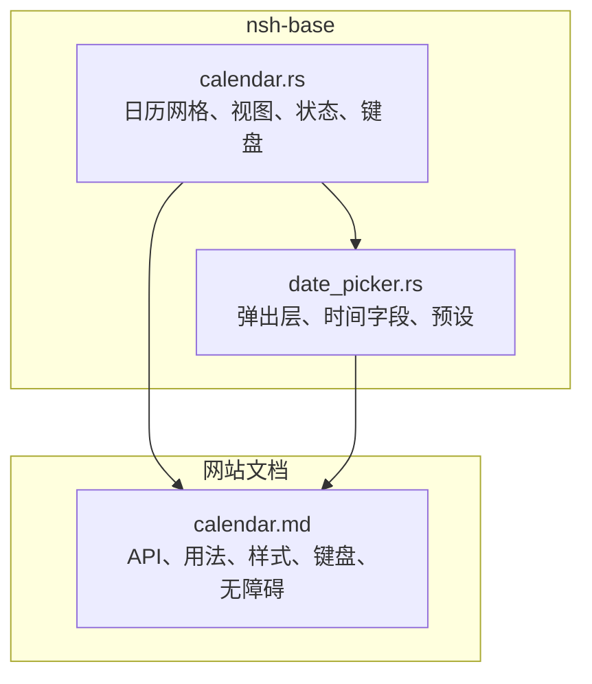
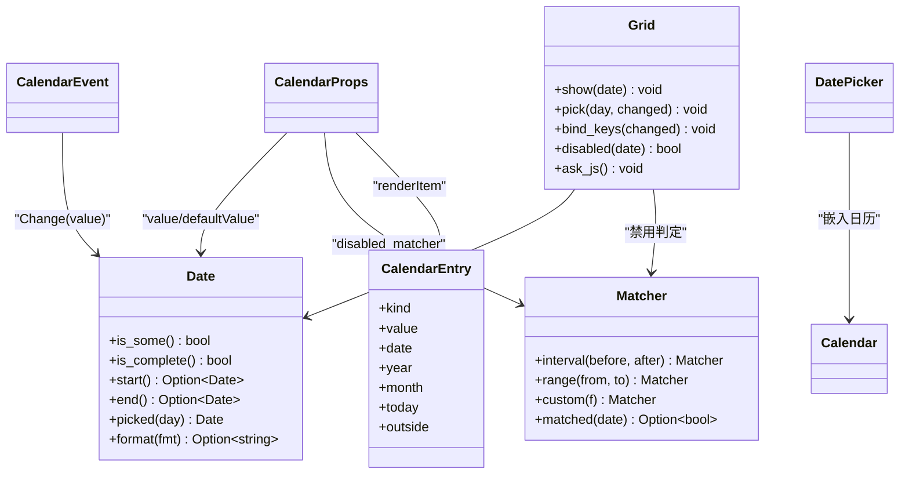
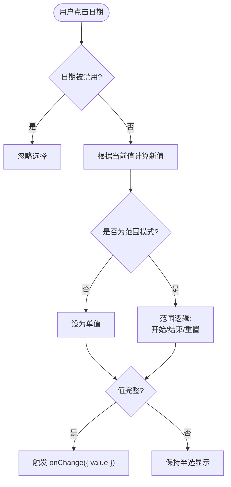
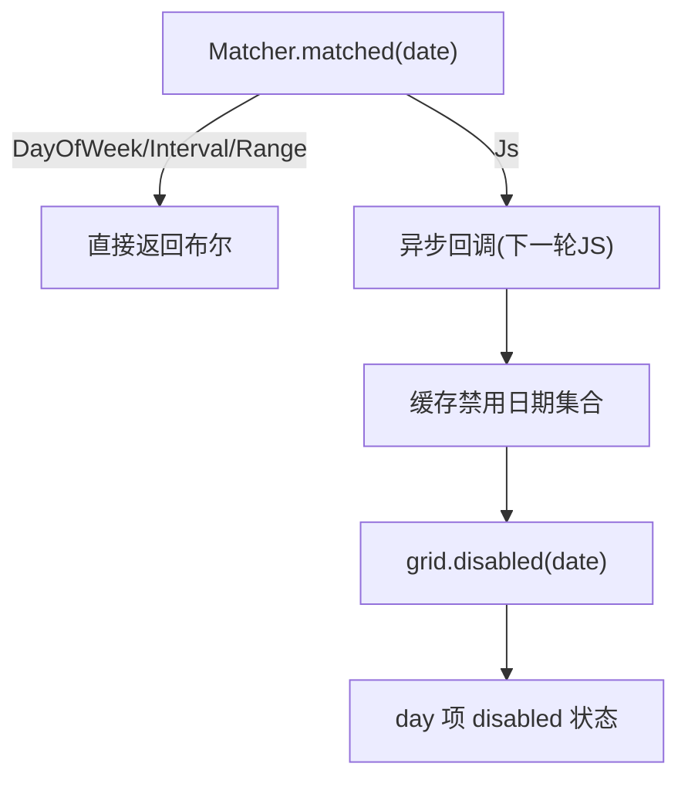
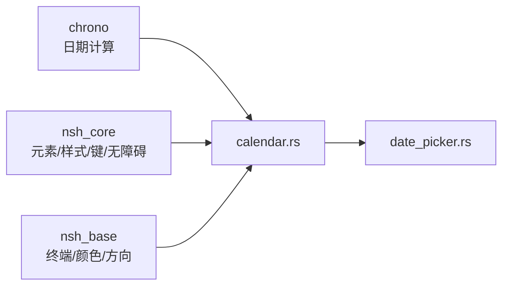
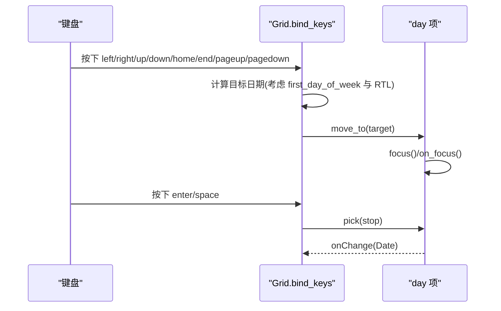

# 日历控件 (Calendar)

<cite>
**本文引用的文件**   
- [calendar.rs](file://crates/nsh-base/src/calendar.rs)
- [date_picker.rs](file://crates/nsh-base/src/date_picker.rs)
- [calendar.md](file://website/elements/calendar.md)
</cite>

## 目录
1. [简介](#简介)
2. [项目结构](#项目结构)
3. [核心组件](#核心组件)
4. [架构总览](#架构总览)
5. [详细组件分析](#详细组件分析)
6. [依赖关系分析](#依赖关系分析)
7. [性能与渲染特性](#性能与渲染特性)
8. [手势与交互支持](#手势与交互支持)
9. [本地化与国际化](#本地化与国际化)
10. [无障碍与键盘导航](#无障碍与键盘导航)
11. [自定义样式指南](#自定义样式指南)
12. [应用场景示例](#应用场景示例)
13. [故障排查](#故障排查)
14. [结论](#结论)

## 简介
本文件为 NSH 的 Calendar 日历控件提供完整技术文档。内容覆盖日期计算逻辑、周月视图切换、禁用日期匹配、选择模式（单选、范围选择）、事件标记与数据属性、键盘导航、无障碍访问、以及通过 DatePicker 组合出的日程安排与预订系统示例。同时说明当前仓库中关于滑动切换月份与缩放调整视图的支持现状，并给出扩展建议。

## 项目结构
Calendar 的核心实现位于 nsh-base 的 Rust 组件库中，并通过 website 文档进行对外说明；DatePicker 在其之上封装弹出层、时间字段与预设按钮，形成完整的日期输入体验。



图表来源
- [calendar.rs:1-100](file://crates/nsh-base/src/calendar.rs#L1-L100)
- [date_picker.rs:1-60](file://crates/nsh-base/src/date_picker.rs#L1-L60)
- [calendar.md:1-20](file://website/elements/calendar.md#L1-L20)

章节来源
- [calendar.rs:1-100](file://crates/nsh-base/src/calendar.rs#L1-L100)
- [date_picker.rs:1-60](file://crates/nsh-base/src/date_picker.rs#L1-L60)
- [calendar.md:1-20](file://website/elements/calendar.md#L1-L20)

## 核心组件
- Date：日历值模型，支持单选与范围两种形态，并提供格式化、形状转换、选择计算等能力。
- Matcher：禁用日期匹配器，支持按星期、区间、范围或 JS 函数判断。
- YearRange：年份视图翻页范围。
- CalendarEntry：每个可绘制项的数据描述，包含类型、数值、日期、年月、是否今天、是否跨月等。
- Grid：内部状态机，管理显示值、视图模式、页码、焦点、禁用状态、JS 异步禁用结果等。
- CalendarProps / CalendarEvent：组件属性与事件。
- DatePicker：在 Calendar 之上封装弹出层、时间字段、预设按钮、打开关闭生命周期。

章节来源
- [calendar.rs:99-203](file://crates/nsh-base/src/calendar.rs#L99-L203)
- [calendar.rs:291-469](file://crates/nsh-base/src/calendar.rs#L291-L469)
- [calendar.rs:471-511](file://crates/nsh-base/src/calendar.rs#L471-L511)
- [calendar.rs:513-572](file://crates/nsh-base/src/calendar.rs#L513-L572)
- [calendar.rs:713-775](file://crates/nsh-base/src/calendar.rs#L713-L775)
- [calendar.rs:574-653](file://crates/nsh-base/src/calendar.rs#L574-L653)
- [date_picker.rs:44-134](file://crates/nsh-base/src/date_picker.rs#L44-L134)
- [date_picker.rs:319-516](file://crates/nsh-base/src/date_picker.rs#L319-L516)

## 架构总览
Calendar 采用“无外观”设计：行为由内部 Grid 管理，外观完全由应用通过 itemClass、itemStyle、renderItem 等定制。DatePicker 将 Calendar 作为子组件嵌入弹出层或底部表单，并叠加时间字段与预设按钮。



图表来源
- [calendar.rs:99-203](file://crates/nsh-base/src/calendar.rs#L99-L203)
- [calendar.rs:291-469](file://crates/nsh-base/src/calendar.rs#L291-L469)
- [calendar.rs:513-572](file://crates/nsh-base/src/calendar.rs#L513-L572)
- [calendar.rs:713-775](file://crates/nsh-base/src/calendar.rs#L713-L775)
- [calendar.rs:574-653](file://crates/nsh-base/src/calendar.rs#L574-L653)
- [date_picker.rs:319-516](file://crates/nsh-base/src/date_picker.rs#L319-L516)

## 详细组件分析

### 日期计算与选择模式
- 单选：点击某天即选中该日期；onChange 仅报告完整值。
- 范围选择：第一次点击开始范围，第二次点击结束范围；若再次点击早于起始日，则从新日期重新开始范围；半选状态会持续显示直到完成。
- 值形状：当 range=true 时，Date::Single 会被转换为 Date::Range(start, None) 以维持一致的 UI 语义。



图表来源
- [calendar.rs:194-203](file://crates/nsh-base/src/calendar.rs#L194-L203)
- [calendar.rs:930-941](file://crates/nsh-base/src/calendar.rs#L930-L941)
- [calendar.rs:1730-1769](file://crates/nsh-base/src/calendar.rs#L1730-L1769)

章节来源
- [calendar.rs:194-203](file://crates/nsh-base/src/calendar.rs#L194-L203)
- [calendar.rs:930-941](file://crates/nsh-base/src/calendar.rs#L930-L941)
- [calendar.md:111-126](file://website/elements/calendar.md#L111-L126)

### 周月视图切换与年视图翻页
- 视图模式：Day（月视图）、Month（年中的月份）、Year（年份翻页）。
- 月视图：numberOfMonths 控制并列显示的月份数；Previous/Next 按月翻页；firstDayOfWeek 决定每周起始日。
- 月份视图：12 个月分三列排列，点击某月回到月视图。
- 年份视图：每页 20 年，每行 5 个；Previous/Next 按页翻页；点击某年回到月视图。
- 多月份标题：当 numberOfMonths > 1 时，头部显示各月标题而非切换按钮。

```mermaid
sequenceDiagram
participant U as "用户"
participant V as "Grid.view"
participant P as "Grid.page/year_page"
U->>V : 点击 MonthToggle/YearToggle
V-->>P : 切换到 Month/Year 视图
U->>P : 点击 Previous/Next
P-->>P : 月视图按月偏移; 年视图按页偏移
U->>V : 点击月份/年份项
V-->>P : 设置目标年月
V-->>V : 返回 Day 视图
```

图表来源
- [calendar.rs:655-661](file://crates/nsh-base/src/calendar.rs#L655-L661)
- [calendar.rs:1104-1179](file://crates/nsh-base/src/calendar.rs#L1104-L1179)
- [calendar.rs:1410-1480](file://crates/nsh-base/src/calendar.rs#L1410-L1480)
- [calendar.rs:1482-1536](file://crates/nsh-base/src/calendar.rs#L1482-L1536)
- [calendar.rs:1577-1644](file://crates/nsh-base/src/calendar.rs#L1577-L1644)

章节来源
- [calendar.rs:655-661](file://crates/nsh-base/src/calendar.rs#L655-L661)
- [calendar.rs:1104-1179](file://crates/nsh-base/src/calendar.rs#L1104-L1179)
- [calendar.rs:1410-1480](file://crates/nsh-base/src/calendar.rs#L1410-L1480)
- [calendar.rs:1482-1536](file://crates/nsh-base/src/calendar.rs#L1482-L1536)
- [calendar.rs:1577-1644](file://crates/nsh-base/src/calendar.rs#L1577-L1644)
- [calendar.md:127-144](file://website/elements/calendar.md#L127-L144)

### 禁用日期与事件标记
- 禁用匹配器：支持按星期、区间、范围或 JS 函数；JS 函数在下一个 JS 轮询中被调用一次，答案缓存到内存集合，翻页只问未问过的日期。
- 事件标记：通过 Marks 计算 selected/start/end/middle；对 day 项投射 data-range-start、data-range-end、data-range-middle、data-today、data-outside 数据属性，供 Tailwind 样式使用。



图表来源
- [calendar.rs:291-469](file://crates/nsh-base/src/calendar.rs#L291-L469)
- [calendar.rs:868-928](file://crates/nsh-base/src/calendar.rs#L868-L928)
- [calendar.rs:1730-1769](file://crates/nsh-base/src/calendar.rs#L1730-L1769)
- [calendar.rs:1850-1865](file://crates/nsh-base/src/calendar.rs#L1850-L1865)

章节来源
- [calendar.rs:291-469](file://crates/nsh-base/src/calendar.rs#L291-L469)
- [calendar.rs:868-928](file://crates/nsh-base/src/calendar.rs#L868-L928)
- [calendar.rs:1730-1769](file://crates/nsh-base/src/calendar.rs#L1730-L1769)
- [calendar.rs:1850-1865](file://crates/nsh-base/src/calendar.rs#L1850-L1865)
- [calendar.md:146-160](file://website/elements/calendar.md#L146-L160)

### 本地化与国际化
- 首周起始日：firstDayOfWeek 支持 0（周日）到 6（周六），默认 0；文档指出用户区域偏好可通过 localeSettings().firstDayOfWeek % 7 获取。
- 名称文本：weekday、month 名称由 renderItem 自定义；默认显示数字，便于应用注入本地化文案。
- 时间格式：DatePicker 的 display_format 默认 "%Y/%m/%d"，带时间精度时会追加时间部分。

章节来源
- [calendar.md:127-131](file://website/elements/calendar.md#L127-L131)
- [calendar.md:202-204](file://website/elements/calendar.md#L202-L204)
- [date_picker.rs:538-545](file://crates/nsh-base/src/date_picker.rs#L538-L545)

### DatePicker 集成
- 弹出层：桌面端在触发器旁弹出，移动端为底部表单；支持 backdrop、Escape、外部点击关闭。
- 时间字段：timePrecision 开启后，日历下方出现时间编辑区；桌面端选择日期后保持弹出，移动端点击日期即选择并关闭。
- 预设按钮：presets 提供常用日期快捷选择。
- 清理按钮：cleanable 提供清空值的能力。

章节来源
- [date_picker.rs:1-27](file://crates/nsh-base/src/date_picker.rs#L1-L27)
- [date_picker.rs:563-557](file://crates/nsh-base/src/date_picker.rs#L563-L557)
- [date_picker.rs:714-745](file://crates/nsh-base/src/date_picker.rs#L714-L745)
- [date_picker.rs:747-800](file://crates/nsh-base/src/date_picker.rs#L747-L800)

## 依赖关系分析
- chrono：用于日期计算（NaiveDate、Days、Months、Datelike）。
- nsh_core：元素、样式、键绑定、无障碍角色、信号系统等基础能力。
- nsh_base：终端布局、颜色、方向辅助等通用 UI 能力。
- DatePicker 依赖 Calendar 的内部 Config 与 Grid，复用其所有日历相关属性。



图表来源
- [calendar.rs:61-76](file://crates/nsh-base/src/calendar.rs#L61-L76)
- [date_picker.rs:28-42](file://crates/nsh-base/src/date_picker.rs#L28-L42)

章节来源
- [calendar.rs:61-76](file://crates/nsh-base/src/calendar.rs#L61-L76)
- [date_picker.rs:28-42](file://crates/nsh-base/src/date_picker.rs#L28-L42)

## 性能与渲染特性
- 渲染优化：每个 item 的绘制只基于 CalendarEntry 数据，不随选中、焦点、范围变化而重绘；days 的 key 包含 page 与 date，保证翻页时已显示项保留绘制结果。
- 列表与网格：WEEKS=6，CELLS=WEEKS*7，固定网格大小避免频繁创建销毁节点。
- 终端适配：终端模式下使用 Cell 宽度与间距常量，减少复杂布局开销。
- 禁用状态缓存：JS 函数的禁用答案缓存到 HashSet，翻页只询问未问过的日期。

章节来源
- [calendar.rs:77-97](file://crates/nsh-base/src/calendar.rs#L77-L97)
- [calendar.rs:1351-1408](file://crates/nsh-base/src/calendar.rs#L1351-L1408)
- [calendar.rs:1646-1705](file://crates/nsh-base/src/calendar.rs#L1646-L1705)
- [calendar.rs:879-928](file://crates/nsh-base/src/calendar.rs#L879-L928)

## 手势与交互支持
- 鼠标/触控：Previous/Next、MonthToggle/YearToggle、月份/年份项均支持 on_press。
- 键盘导航：详见“无障碍与键盘导航”。
- 滑动切换月份：当前代码未实现水平滑动切换月份的 gesture 处理；如需支持，可在外层容器添加滑动手势监听，并在回调中调用 grid.page 更新（向前加 Months(1)，向后减 Months(1)）。
- 缩放调整视图：当前代码未实现缩放调整月份数量或视图密度的 gesture 处理；如需支持，可在外层监听缩放手势，动态修改 numberOfMonths 或 month 的行高/列宽。

章节来源
- [calendar.rs:1410-1480](file://crates/nsh-base/src/calendar.rs#L1410-L1480)
- [calendar.rs:1482-1536](file://crates/nsh-base/src/calendar.rs#L1482-L1536)
- [calendar.rs:1577-1644](file://crates/nsh-base/src/calendar.rs#L1577-L1644)

## 本地化与国际化
- 首周起始日：通过 firstDayOfWeek 配置；文档提示可从 localeSettings().firstDayOfWeek % 7 获取用户偏好。
- 名称文本：weekday、month 名称由 renderItem 自定义；默认显示数字，便于应用注入本地化文案。
- 时间格式：DatePicker 的 display_format 默认 "%Y/%m/%d"，带时间精度时会追加时间部分。

章节来源
- [calendar.md:127-131](file://website/elements/calendar.md#L127-L131)
- [calendar.md:202-204](file://website/elements/calendar.md#L202-L204)
- [date_picker.rs:538-545](file://crates/nsh-base/src/date_picker.rs#L538-L545)

## 无障碍与键盘导航
- 角色与标签：
  - 每天为 Button，标签为其 ISO 日期；选中时 accessible_state.selected=true；禁用时 accessible_state.disabled=true。
  - Previous/Next 为 Button，标签来自 previous_accessibility_label/next_accessibility_label。
  - 月份/年份项为 Button；月份标题为 Header；工作日列为 ColumnHeader。
- 键盘操作：
  - Tab 进入日历，焦点落在选中日、今日或首个可见日；跳过禁用日。
  - 左右键移动一天；上下键移动一周；Home/End 移动到周首/周末；PageUp/PageDown 移动一月；Shift+PageUp/Shift+PageDown 移动一年。
  - Enter/Space 选择日期。
  - RTL 布局下左右方向反转，上下方向保持周方向。
  - 到达边界时自动翻页。



图表来源
- [calendar.rs:1015-1101](file://crates/nsh-base/src/calendar.rs#L1015-L1101)
- [calendar.rs:1828-1907](file://crates/nsh-base/src/calendar.rs#L1828-L1907)
- [calendar.md:244-262](file://website/elements/calendar.md#L244-L262)

章节来源
- [calendar.rs:1015-1101](file://crates/nsh-base/src/calendar.rs#L1015-L1101)
- [calendar.rs:1828-1907](file://crates/nsh-base/src/calendar.rs#L1828-L1907)
- [calendar.md:244-262](file://website/elements/calendar.md#L244-L262)

## 自定义样式指南
- 根与分区：
  - 根：class/style
  - 头部：header_class/header_style
  - 主体：body_class/body_style
  - 月份：month_class/month_style
  - 行：row_class/row_style
  - 项：item_class/item_style
- 项的状态类：
  - selected: 选中（单选日期、范围中的每一天、当前视图的切换按钮）
  - disabled: 不可用（禁用日期、箭头在特定视图下的禁用）
  - focus-visible: 键盘焦点
  - data-range-start/data-range-end/data-range-middle：范围起止与中间
  - data-today/data-outside：今天与跨月填充日
- renderItem：
  - 接收 CalendarEntry，不包含状态；状态通过 itemClass 的伪类与 data-* 属性驱动样式。
  - 默认显示数字；Previous/Next 默认显示‹/›；weekday 显示数字 0-6。
- 终端模式：
  - 使用 Cell 宽度与间距常量；today 加粗，outside 变淡；选中范围通过 painter 着色。

章节来源
- [calendar.md:161-204](file://website/elements/calendar.md#L161-L204)
- [calendar.md:206-243](file://website/elements/calendar.md#L206-L243)
- [calendar.rs:1351-1408](file://crates/nsh-base/src/calendar.rs#L1351-L1408)
- [calendar.rs:1866-1877](file://crates/nsh-base/src/calendar.rs#L1866-L1877)

## 应用场景示例

### 日程安排（Rust 示例路径）
- 使用 calendar() 构建独立日历，设置 disabled_matcher 排除周末，自定义 renderItem 渲染月份与工作日名称，通过 onChange 同步到应用状态。
- 参考路径：[calendar.rs:22-58](file://website/elements/calendar.md#L22-L58)

### 预订系统（TypeScript 示例路径）
- 使用 <Calendar /> 组件，启用 range 以选择入住/退房日期，结合 Tailwind 的 group-selected 与 data-range-* 变量实现范围高亮。
- 参考路径：[calendar.md:61-104](file://website/elements/calendar.md#L61-L104)

### 带时间的日期选择（DatePicker）
- 使用 DatePicker 包裹 trigger，启用 timePrecision 以编辑时间；桌面端选择日期后保持弹出，移动端点击日期即选择并关闭。
- 参考路径：[date_picker.rs:563-557](file://crates/nsh-base/src/date_picker.rs#L563-L557)

章节来源
- [calendar.md:22-58](file://website/elements/calendar.md#L22-L58)
- [calendar.md:61-104](file://website/elements/calendar.md#L61-L104)
- [date_picker.rs:563-557](file://crates/nsh-base/src/date_picker.rs#L563-L557)

## 故障排查
- 值未更新：
  - 检查是否使用受控 value；若使用 defaultValue，需确保 onChange 中更新 value。
  - 参考：[calendar.rs:1920-1960](file://crates/nsh-base/src/calendar.rs#L1920-L1960)
- 范围选择异常：
  - 确认 range=true；半选状态不会触发 onChange，只有完成范围才会触发。
  - 参考：[calendar.rs:194-203](file://crates/nsh-base/src/calendar.rs#L194-L203)
- 禁用日期无效：
  - 若使用 JS 函数匹配器，确保函数纯且稳定；翻页只问未问过的日期，答案缓存。
  - 参考：[calendar.rs:879-928](file://crates/nsh-base/src/calendar.rs#L879-L928)
- 键盘导航异常：
  - 检查 firstDayOfWeek 与 RTL 布局；确认焦点落在非禁用日。
  - 参考：[calendar.rs:1015-1101](file://crates/nsh-base/src/calendar.rs#L1015-L1101)

章节来源
- [calendar.rs:1920-1960](file://crates/nsh-base/src/calendar.rs#L1920-L1960)
- [calendar.rs:194-203](file://crates/nsh-base/src/calendar.rs#L194-L203)
- [calendar.rs:879-928](file://crates/nsh-base/src/calendar.rs#L879-L928)
- [calendar.rs:1015-1101](file://crates/nsh-base/src/calendar.rs#L1015-L1101)

## 结论
NSH 的 Calendar 提供了健壮的日期选择能力，涵盖单选、范围选择、禁用日期匹配、丰富的数据属性与样式钩子、完善的键盘导航与无障碍支持。DatePicker 在此基础上提供弹出层、时间字段与预设按钮，适合日程安排与预订系统等场景。当前仓库未内置滑动切换月份与缩放调整视图的手势处理，但可通过外层手势监听与状态联动轻松扩展。