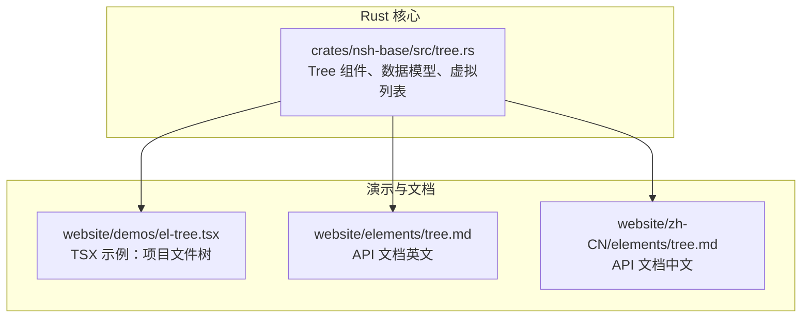
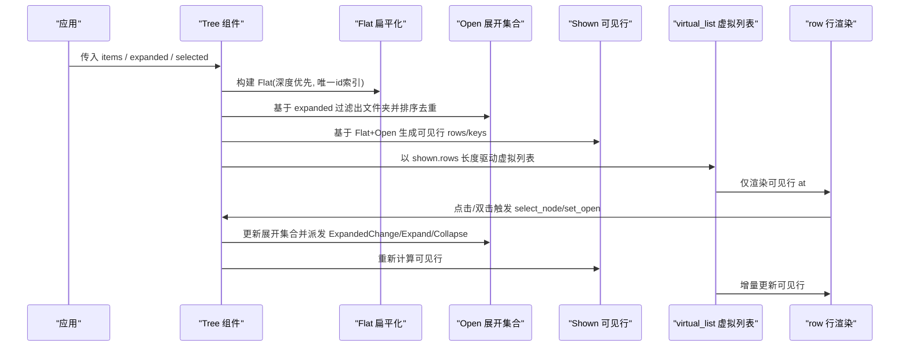
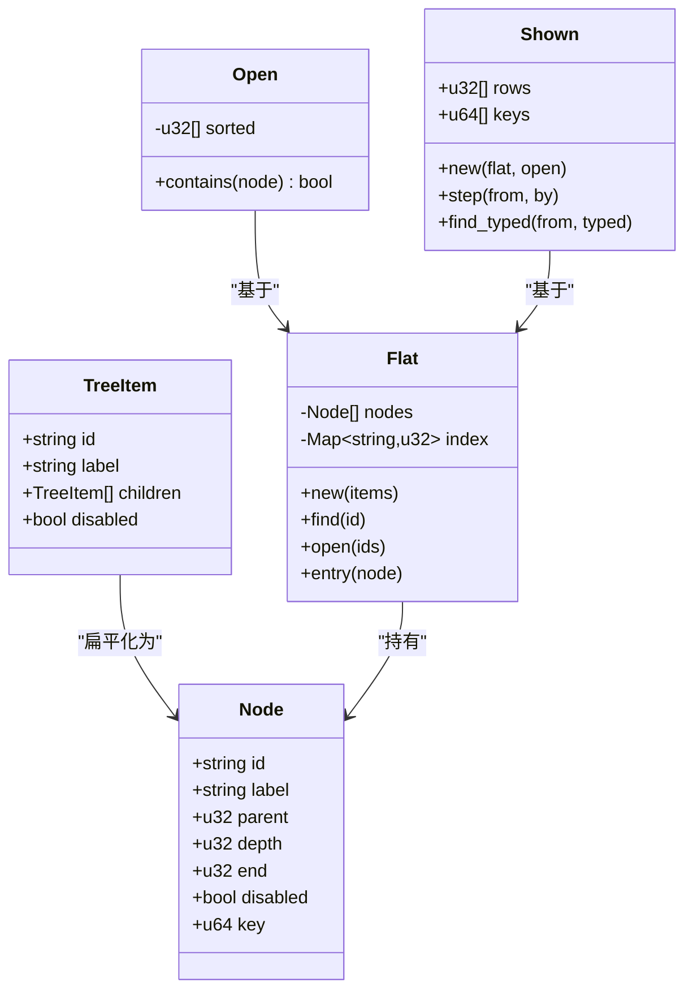
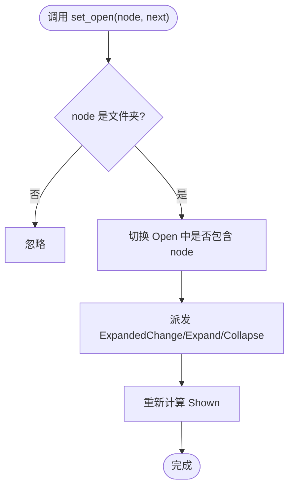
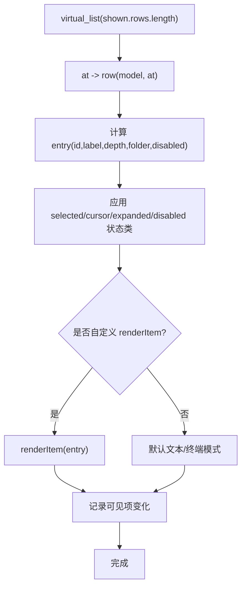
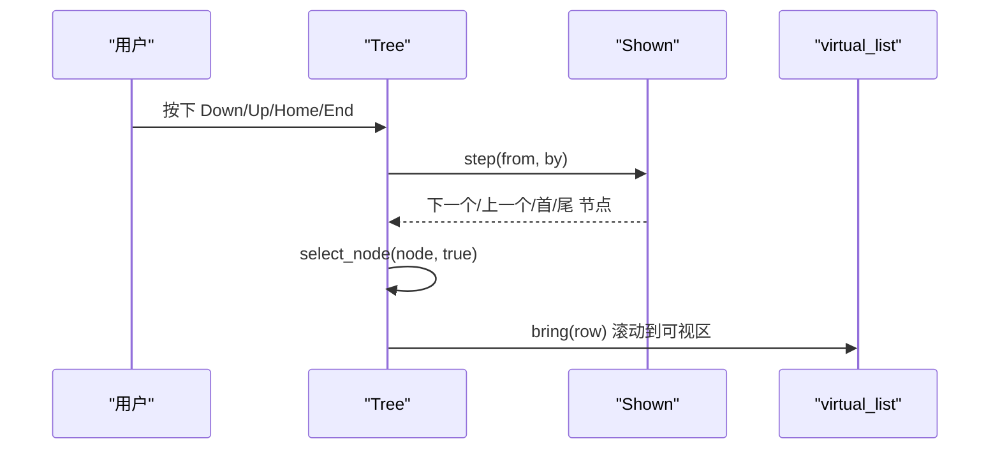
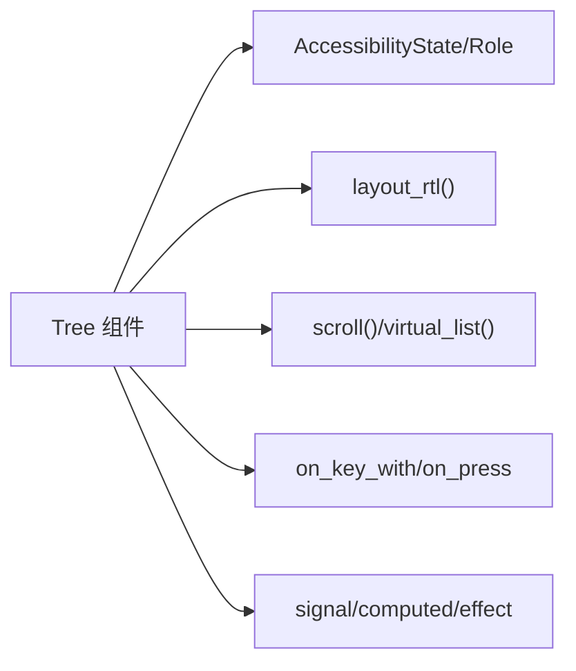

# 树形控件 (Tree)

<cite>
**本文引用的文件**   
- [tree.rs](file://crates/nsh-base/src/tree.rs)
- [el-tree.tsx](file://website/demos/el-tree.tsx)
- [tree.md（英文文档）](file://website/elements/tree.md)
- [tree.md（中文文档）](file://website/zh-CN/elements/tree.md)
</cite>

## 目录
1. [简介](#简介)
2. [项目结构](#项目结构)
3. [核心组件](#核心组件)
4. [架构总览](#架构总览)
5. [详细组件分析](#详细组件分析)
6. [依赖关系分析](#依赖关系分析)
7. [性能与大数据优化](#性能与大数据优化)
8. [交互与辅助功能](#交互与辅助功能)
9. [自定义节点渲染器开发指南](#自定义节点渲染器开发指南)
10. [典型应用场景示例](#典型应用场景示例)
11. [故障排查](#故障排查)
12. [结论](#结论)

## 简介
本文件为 NSH 的 Tree 树形控件提供系统化、可操作的文档。内容覆盖：
- 层级数据结构与扁平化模型
- 节点展开/收起逻辑与可见行计算
- 虚拟滚动实现与性能优化
- 选择、键盘导航、类型搜索等交互
- 自定义节点渲染器（图标、状态指示器、操作按钮）
- 大数据集策略（懒加载、分页加载、内存管理）
- 无障碍与屏幕阅读器支持
- 实际示例：文件系统浏览器、组织架构视图

## 项目结构
Tree 的核心实现在 Rust 侧，演示在 TypeScript 侧。

**图表来源**
- [tree.rs:1-1368](file://crates/nsh-base/src/tree.rs#L1-L1368)
- [el-tree.tsx:1-135](file://website/demos/el-tree.tsx#L1-L135)
- [tree.md（英文文档）:1-245](file://website/elements/tree.md#L1-L245)
- [tree.md（中文文档）:1-220](file://website/zh-CN/elements/tree.md#L1-L220)

**章节来源**
- [tree.rs:1-1368](file://crates/nsh-base/src/tree.rs#L1-L1368)
- [el-tree.tsx:1-135](file://website/demos/el-tree.tsx#L1-L135)
- [tree.md（英文文档）:1-245](file://website/elements/tree.md#L1-L245)
- [tree.md（中文文档）:1-220](file://website/zh-CN/elements/tree.md#L1-L220)

## 核心组件
Tree 由“数据模型 + 视图层 + 交互控制”三部分构成：
- 数据模型：TreeItem（用户输入）、Flat（扁平化索引）、Open（已展开集合）、Shown（当前可见行）
- 视图层：virtual_list 虚拟列表 + row 行渲染（支持 renderItem 自定义）
- 交互控制：键盘事件、点击/双击、revealItem API、类型搜索

关键概念：
- TreeItem：应用提供的树节点数据，包含 id、label、children、disabled
- TreeEntry：渲染时传给 renderItem 的只读快照，包含 id、label、depth、folder、disabled
- Flat：深度优先遍历 items 生成的一维数组，附带 parent、end、key 等元信息
- Open：已展开节点的有序集合，使用二分查找判断是否展开
- Shown：根据 Flat 和 Open 生成的“可见行”序列，用于虚拟列表渲染

**章节来源**
- [tree.rs:76-126](file://crates/nsh-base/src/tree.rs#L76-L126)
- [tree.rs:149-279](file://crates/nsh-base/src/tree.rs#L149-L279)
- [tree.rs:298-428](file://crates/nsh-base/src/tree.rs#L298-L428)
- [tree.rs:430-495](file://crates/nsh-base/src/tree.rs#L430-L495)

## 架构总览
Tree 的整体流程如下：

**图表来源**
- [tree.rs:704-1083](file://crates/nsh-base/src/tree.rs#L704-L1083)
- [tree.rs:1085-1173](file://crates/nsh-base/src/tree.rs#L1085-L1173)

## 详细组件分析

### 数据模型与复杂度
- Flat::new(items)：O(N) 深度优先遍历，N 为节点总数；维护 index 哈希表 O(1) 查找
- Flat::open(ids)：对 ids 过滤文件夹、排序去重，时间复杂度 O(K log K)，K 为展开 id 数量
- Shown::new(flat, open)：线性扫描 flat.nodes，跳过被折叠的子树，时间复杂度 O(M)，M 为顶层节点数
- Shown::step/from/to：基于 rows 的二分查找或顺序扫描，平均 O(log M) 或 O(M)
- Shown::find_typed：按首字符前缀匹配，最坏 O(M)

**图表来源**
- [tree.rs:76-126](file://crates/nsh-base/src/tree.rs#L76-L126)
- [tree.rs:149-279](file://crates/nsh-base/src/tree.rs#L149-L279)
- [tree.rs:298-428](file://crates/nsh-base/src/tree.rs#L298-L428)

**章节来源**
- [tree.rs:179-279](file://crates/nsh-base/src/tree.rs#L179-L279)
- [tree.rs:340-428](file://crates/nsh-base/src/tree.rs#L340-L428)

### 展开/收起与可见行计算
- set_open(node, next)：若 node 是文件夹且 enabled，则更新 Open 并派发 ExpandedChange/Expand/Collapse
- revealItem(id)：向上找到所有未展开的祖先，依次展开（从外到内），然后滚动目标行进入视野
- Shown::new：遍历 Flat.nodes，遇到展开节点才继续其子树，否则跳到 end，从而“跳过整棵子树”

**图表来源**
- [tree.rs:795-825](file://crates/nsh-base/src/tree.rs#L795-L825)
- [tree.rs:340-360](file://crates/nsh-base/src/tree.rs#L340-L360)

**章节来源**
- [tree.rs:795-825](file://crates/nsh-base/src/tree.rs#L795-L825)
- [tree.rs:340-360](file://crates/nsh-base/src/tree.rs#L340-L360)

### 虚拟滚动与渲染
- virtual_list：以 shown.rows 的长度驱动，仅创建可见行
- viewability：设置 item_visible_threshold=0.995，确保行完全可见时才视为“可见”
- on_viewable_items_change：记录当前可见区间，用于 revealItem 后精准滚动
- row：每行读取 entry、selected、cursor、expanded、disabled 等状态，通过 CSS 类名表达状态（selected:、aria-expanded:、focus:、focus-visible:、disabled:）

**图表来源**
- [tree.rs:1030-1050](file://crates/nsh-base/src/tree.rs#L1030-L1050)
- [tree.rs:1085-1173](file://crates/nsh-base/src/tree.rs#L1085-L1173)

**章节来源**
- [tree.rs:1030-1050](file://crates/nsh-base/src/tree.rs#L1030-L1050)
- [tree.rs:1085-1173](file://crates/nsh-base/src/tree.rs#L1085-L1173)

### 选择与键盘导航
- 选择：select_node(node, by_key) 更新 Selected，并在需要时 bring(row) 滚动到可视区
- 方向键：Step::Next/Previous/First/Last 在 Shown::step 中循环遍历可见行，跳过 disabled 节点
- 左右键：Right 展开/进入第一个可用子；Left 收起/回到父节点
- Home/End：跳转到第一/最后一行
- Return/Space：文件夹展开/收起；叶子执行 Action
- 类型搜索：listbox::bind_typeahead 聚合按键，Shown::find_typed 按标签前缀跳转

**图表来源**
- [tree.rs:842-946](file://crates/nsh-base/src/tree.rs#L842-L946)
- [tree.rs:376-428](file://crates/nsh-base/src/tree.rs#L376-L428)

**章节来源**
- [tree.rs:842-946](file://crates/nsh-base/src/tree.rs#L842-L946)
- [tree.rs:376-428](file://crates/nsh-base/src/tree.rs#L376-L428)

### 右键菜单与拖拽排序
- 右键菜单：Tree 本身不内置右键菜单，可通过外层容器监听右键事件并弹出菜单；Tree 提供 ref.revealItem 定位节点
- 拖拽排序：Tree 未内置拖拽排序能力；可在外层容器处理拖拽事件，修改 items 数据源后 Tree 自动重排

说明：以上为通用集成建议，非 Tree 内部实现。

[本节为通用集成指导，不涉及具体源码]

## 依赖关系分析
Tree 依赖以下基础能力：
- 可访问性：AccessibilityRole::Tree/TreeItem、accessibility_state、set_accessibility_focus
- 布局与方向：layout_rtl() 决定左右键互换
- 滚动与列表：scroll()、virtual_list()、viewability
- 键盘与事件：on_key_with、on_press、clicks 计数
- 信号与响应式：signal/computed/effect/stored/batch

**图表来源**
- [tree.rs:45-60](file://crates/nsh-base/src/tree.rs#L45-L60)
- [tree.rs:917-946](file://crates/nsh-base/src/tree.rs#L917-L946)
- [tree.rs:1051-1083](file://crates/nsh-base/src/tree.rs#L1051-L1083)

**章节来源**
- [tree.rs:45-60](file://crates/nsh-base/src/tree.rs#L45-L60)
- [tree.rs:917-946](file://crates/nsh-base/src/tree.rs#L917-L946)
- [tree.rs:1051-1083](file://crates/nsh-base/src/tree.rs#L1051-L1083)

## 性能与大数据优化
Tree 已经通过以下机制优化大数据集：
- 扁平化一次：items 变更时一次性 Flat::new，避免重复遍历
- 展开集合独立：Open 仅存储展开节点，展开成本与展开数量相关，而非全部节点
- 可见行裁剪：Shown::new 跳过折叠子树，virtual_list 仅渲染可见行
- 信号细粒度：Lit 将选中/光标状态分散到 LIT=32 个信号，减少无关行重绘
- 动画优化：reveal 仅在开启且无减弱动态效果时启用原生弹簧动画

针对超大数据集的扩展策略：
- 懒加载：在 renderItem 中按需请求子节点数据，再合并到 items；或使用受控 expanded 属性，只在必要时展开
- 分页加载：结合外部分页器，先加载根节点，展开后再加载子节点；保持 id 稳定以便 Flat 索引
- 内存管理：
  - 避免在 renderItem 中创建重型对象；复用图标、样式
  - 及时释放不再需要的缓存（如展开后的子节点缓存）
  - 使用受控 expanded/selected，避免大量状态同时存在
- 搜索优化：
  - 使用前端搜索索引（如按 label 建立倒排索引）
  - 结合 Shown::find_typed 的首字母前缀匹配，减少全量扫描

[本节为通用性能建议，不涉及具体源码]

## 交互与辅助功能
- 键盘导航：遵循 WAI-ARIA 树视图模式，支持 Tab/Shift+Tab、上下左右、Home/End、Return/Space、类型搜索
- 屏幕阅读器：
  - 树角色 tree，行角色 treeitem
  - 每个行带有 level（depth+1）、expanded、selected、disabled
  - 当树获得焦点或按键移动选中项时，将屏幕阅读器焦点移动到对应行
- 无障碍标签：accessibilityLabel 命名树；每行 label 来自 entry.label

**章节来源**
- [tree.md（英文文档）:207-214](file://website/elements/tree.md#L207-L214)
- [tree.md（中文文档）:189-194](file://website/zh-CN/elements/tree.md#L189-L194)
- [tree.rs:1051-1083](file://crates/nsh-base/src/tree.rs#L1051-L1083)
- [tree.rs:1128-1173](file://crates/nsh-base/src/tree.rs#L1128-L1173)

## 自定义节点渲染器开发指南
Tree 允许通过 renderItem 自定义每一行的外观与行为：
- 输入：TreeEntry（id、label、depth、folder、disabled）
- 输出：任意元素（图标、标签、缩进、状态指示器、操作按钮）
- 状态类：
  - 行级：selected:、aria-expanded:、focus:、focus-visible:、disabled:、hover:、active:
  - 内容级（需在 itemClass 中使用 group）：group-selected:、group-aria-expanded:、group-focus:、group-focus-visible:、group-disabled:

推荐实践：
- 图标：根据 folder 显示展开箭头，根据 disabled 显示灰度
- 状态指示器：根据 selected/folder 显示徽标或颜色
- 操作按钮：在 renderItem 中添加按钮，绑定点击事件（如打开文件、编辑、删除）
- 缩进：使用 paddingLeft = base + depth * indent

参考示例路径：
- TSX 示例：[el-tree.tsx:108-127](file://website/demos/el-tree.tsx#L108-L127)
- 文档示例：[tree.md（英文文档）:41-52](file://website/elements/tree.md#L41-L52)、[tree.md（中文文档）:36-47](file://website/zh-CN/elements/tree.md#L36-L47)

**章节来源**
- [el-tree.tsx:108-127](file://website/demos/el-tree.tsx#L108-L127)
- [tree.md（英文文档）:41-52](file://website/elements/tree.md#L41-L52)
- [tree.md（中文文档）:36-47](file://website/zh-CN/elements/tree.md#L36-L47)
- [tree.rs:1149-1171](file://crates/nsh-base/src/tree.rs#L1149-L1171)

## 典型应用场景示例

### 文件系统浏览器
- 数据：TreeItem[] 表示文件和文件夹，禁用 target 等目录
- 交互：点击文件夹展开/收起；双击文件或按 Return 打开文件（onAction）
- 展示：使用 renderItem 显示文件大小、图标、缩进
- 控制：受控 expanded/selected，配合 revealItem 定位文件

参考路径：
- [el-tree.tsx:9-60](file://website/demos/el-tree.tsx#L9-L60)
- [el-tree.tsx:108-127](file://website/demos/el-tree.tsx#L108-L127)

**章节来源**
- [el-tree.tsx:9-60](file://website/demos/el-tree.tsx#L9-L60)
- [el-tree.tsx:108-127](file://website/demos/el-tree.tsx#L108-L127)

### 组织架构视图
- 数据：TreeItem[] 表示部门/员工层级
- 交互：展开部门查看成员；选中员工查看详情
- 展示：根据 depth 缩进，folder 显示组织图标，叶子显示头像占位
- 扩展：在 renderItem 中加入状态指示器（在线/离线）、操作按钮（发消息、查看资料）

[本节为场景设计建议，不涉及具体源码]

## 故障排查
常见问题与建议：
- 重复 id：Flat::new 会记录警告，只有第一个 id 生效；请确保 id 全局唯一
- 展开无效：确认 node 是文件夹且 enabled；对叶子或 disabled 节点不会展开
- 滚动不到目标：revealItem 会尝试展开祖先并滚动；若应用未跟随 expanded 变化，可能无法立即滚动
- 键盘不可用：确保 Tree 获得焦点；桌面端点击会聚焦树；移动端需轻点
- 无障碍播报异常：检查 accessibilityLabel 与每行 label；确认 role 与 state 正确

**章节来源**
- [tree.rs:181-199](file://crates/nsh-base/src/tree.rs#L181-L199)
- [tree.rs:795-825](file://crates/nsh-base/src/tree.rs#L795-L825)
- [tree.rs:978-1014](file://crates/nsh-base/src/tree.rs#L978-L1014)
- [tree.rs:1051-1083](file://crates/nsh-base/src/tree.rs#L1051-L1083)

## 结论
NSH 的 Tree 组件提供了高性能、可访问、可扩展的树形控件实现。通过 Flat/Open/Shown 三层模型与 virtual_list 虚拟滚动，Tree 能高效渲染大规模数据；通过受控 expanded/selected 与丰富的键盘/触摸交互，满足复杂业务需求；通过 renderItem 与状态类，开发者可以灵活定制节点外观与行为。对于超大数据集，建议结合懒加载、分页加载与内存管理策略，以获得更优的性能体验。