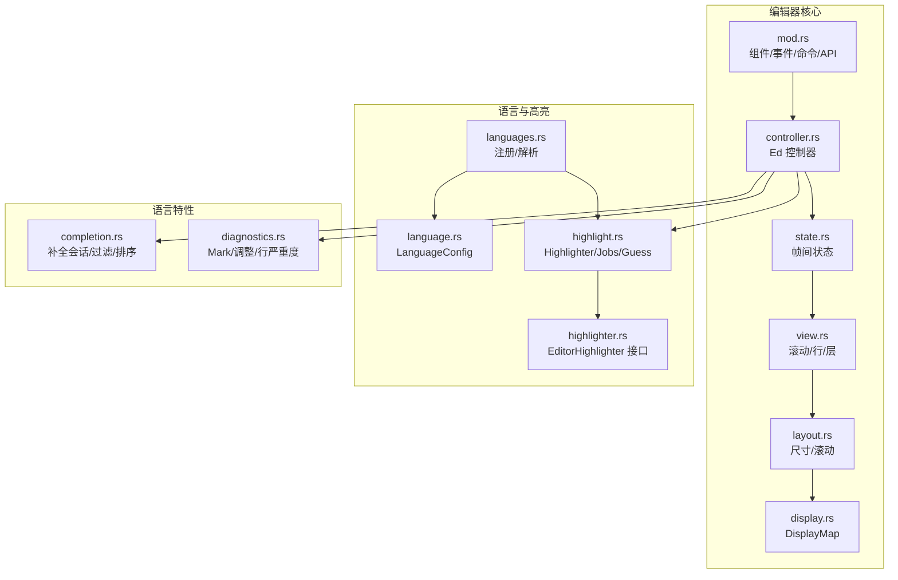
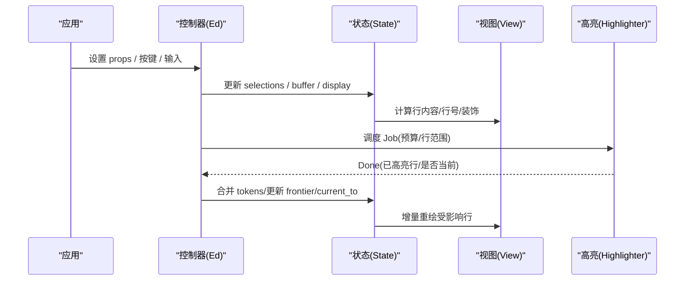
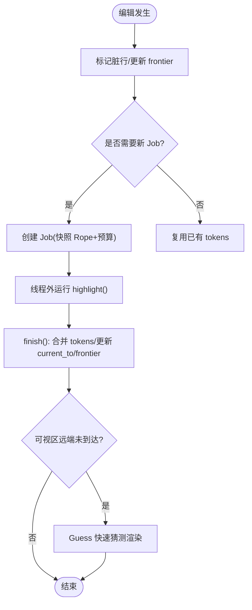
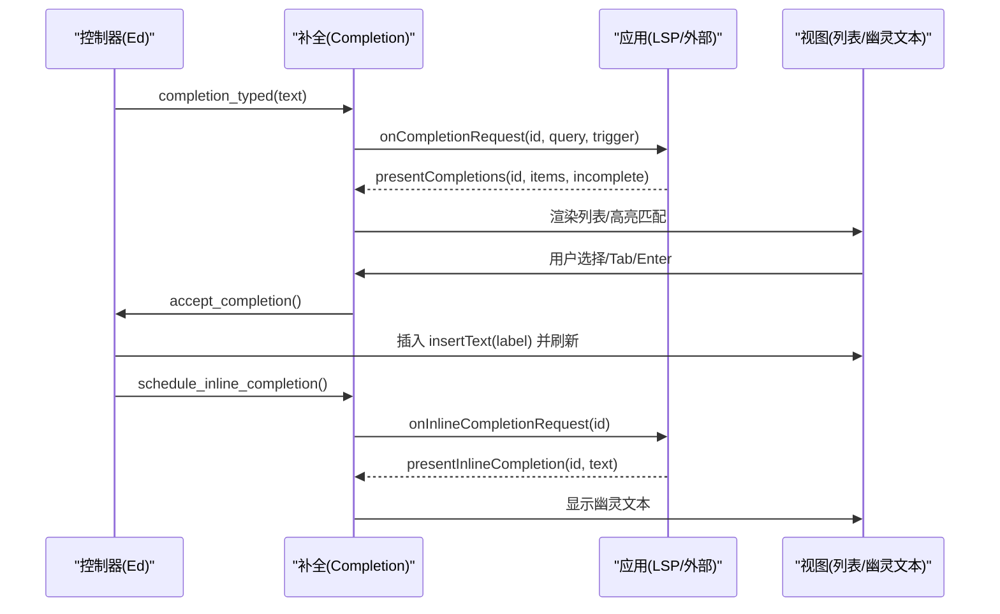
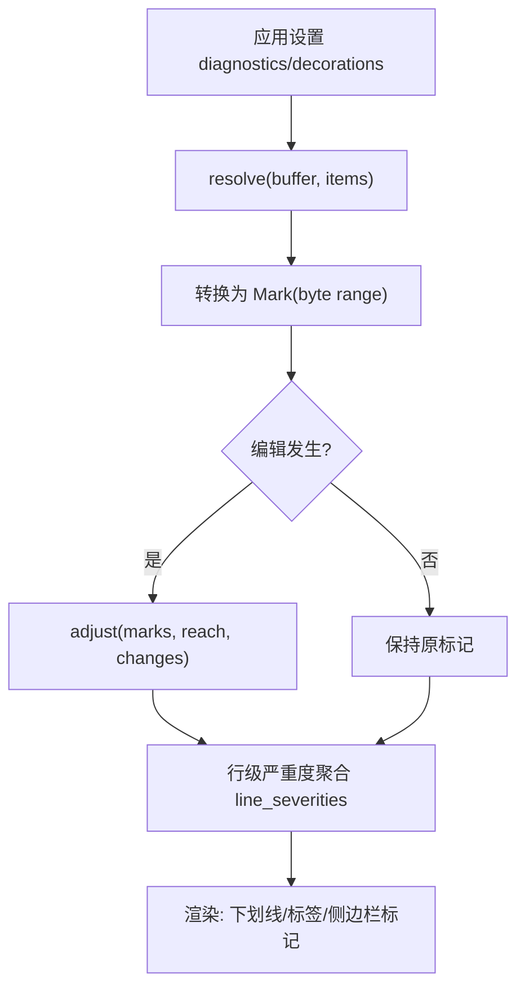
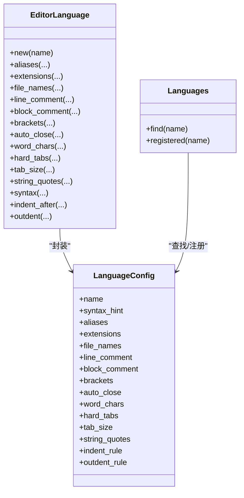
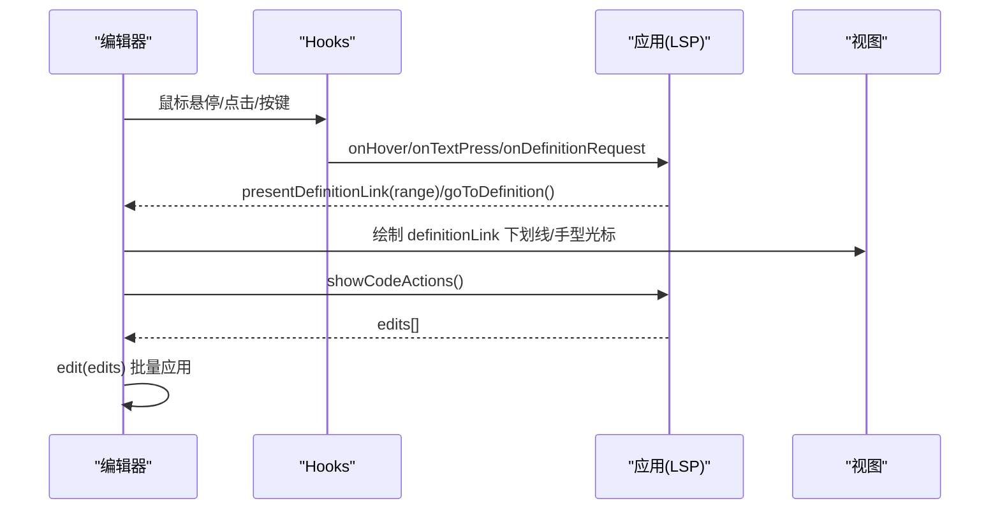
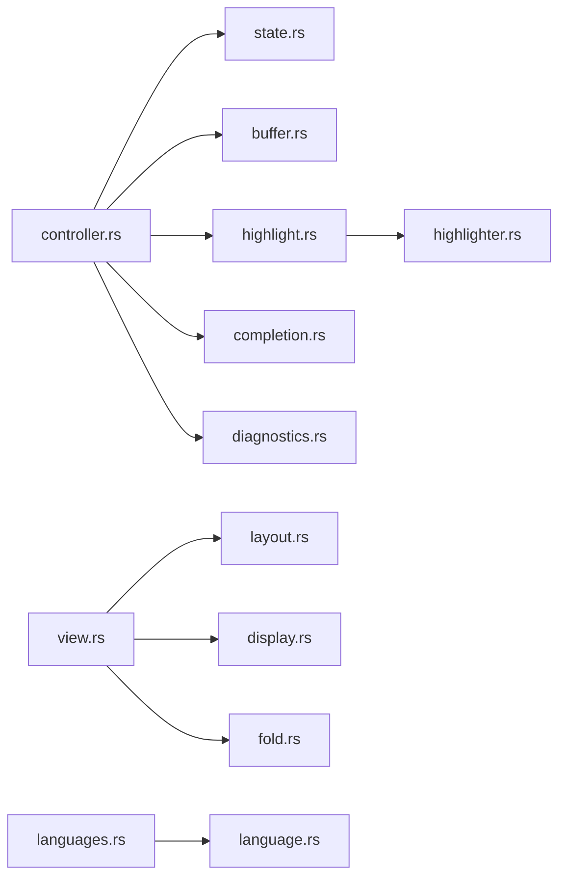

# 代码编辑器

<cite>
**本文引用的文件**   
- [editor.md](file://docs/dev/editor.md)
- [mod.rs](file://crates/nsh-base/src/editor/mod.rs)
- [highlight.rs](file://crates/nsh-base/src/editor/highlight.rs)
- [completion.rs](file://crates/nsh-base/src/editor/completion.rs)
- [diagnostics.rs](file://crates/nsh-base/src/editor/diagnostics.rs)
- [language.rs](file://crates/nsh-base/src/editor/language.rs)
- [languages.rs](file://crates/nsh-base/src/editor/languages.rs)
</cite>

## 目录
1. [简介](#简介)
2. [项目结构](#项目结构)
3. [核心组件](#核心组件)
4. [架构总览](#架构总览)
5. [详细组件分析](#详细组件分析)
6. [依赖关系分析](#依赖关系分析)
7. [性能与优化](#性能与优化)
8. [故障排查指南](#故障排查指南)
9. [结论](#结论)
10. [附录](#附录)

## 简介
本文件为 NSH 代码编辑器（Editor）的权威技术文档，聚焦以下目标：
- 语法高亮系统：增量解析、线程外执行、猜测渲染、状态持久化。
- 智能补全引擎：会话管理、模糊匹配、排序策略、内联补全。
- 错误诊断机制：范围映射、编辑后保持、行级严重度聚合。
- 语言支持架构：语言配置、注册机制、高亮器接口与扩展点。
- 光标与选择、撤销重做栈：位置模型、多光标、选择历史、分组撤销。
- LSP 集成：悬停、定义跳转、代码动作、补全/内联补全回调契约。
- 性能优化：虚拟滚动、增量渲染、内存管理与渲染预算。
- 主题与快捷键：部件样式、默认键位、扩展点使用示例。

## 项目结构
编辑器位于 crates/nsh-base/src/editor，采用“按职责分模块”的组织方式：
- 组件与 API：mod.rs 暴露 EditorProps、EditorEvent、EditorCommand、EditorApi 等对外能力。
- 文本与模型：buffer.rs、types.rs、state.rs、controller.rs 负责 Rope 文本、选择、显示映射、控制器与帧间状态。
- 交互与命令：commands.rs、movement.rs、select.rs、keymap.rs、touch.rs 处理输入、移动、选择与触摸。
- 语言特性：completion.rs、definition.rs、hooks.rs 提供补全、定义跳转、悬停等语言功能钩子。
- 高亮与语言：highlight.rs、highlighter.rs、language.rs、languages.rs、app_highlight.rs 实现高亮管线与语言注册。
- 视图与布局：view.rs、layout.rs、display.rs、fold.rs、fold_set.rs 负责渲染、滚动、软换行与折叠。
- 搜索与诊断：search.rs、diagnostics.rs 实现查找替换与诊断/装饰标记。

图表来源
- [mod.rs:66-205](file://crates/nsh-base/src/editor/mod.rs#L66-L205)
- [highlight.rs:186-258](file://crates/nsh-base/src/editor/highlight.rs#L186-L258)
- [completion.rs:444-518](file://crates/nsh-base/src/editor/completion.rs#L444-L518)
- [diagnostics.rs:13-21](file://crates/nsh-base/src/editor/diagnostics.rs#L13-L21)
- [language.rs:15-49](file://crates/nsh-base/src/editor/language.rs#L15-L49)
- [languages.rs:17-39](file://crates/nsh-base/src/editor/languages.rs#L17-L39)

章节来源
- [editor.md:11-40](file://docs/dev/editor.md#L11-L40)

## 核心组件
- 组件与属性：EditorProps 提供受控/非受控文本、语言、自动闭合、缩进、折叠、软换行、诊断、装饰、补全开关、触发字符、内联补全延迟等。
- 事件：EditorEvent 覆盖变更、选择变化、焦点、搜索、上下文菜单、悬停、文本按下、查找、折叠、补全请求/接受、内联补全请求、定义请求、代码动作请求。
- 命令：EditorCommand 包含移动、选择、删除、注释、复制粘贴、折叠、排序、大小写转换、查找、补全、定义跳转、代码动作等。
- API：EditorApi 暴露 focus/blur、value/set_value、edit/insert、selections/set_selections、run、replace/replaceAll、折叠、滚动、可见范围、坐标转换、revealPosition/goToLine、补全/内联补全、定义链接等。

章节来源
- [mod.rs:66-205](file://crates/nsh-base/src/editor/mod.rs#L66-L205)
- [mod.rs:207-277](file://crates/nsh-base/src/editor/mod.rs#L207-L277)
- [mod.rs:305-502](file://crates/nsh-base/src/editor/mod.rs#L305-L502)
- [mod.rs:504-779](file://crates/nsh-base/src/editor/mod.rs#L504-L779)

## 架构总览
编辑器以“控制器-状态-视图”分层组织：
- 控制器 Ed：订阅 props、按键、输入、剪贴板、滚动；调度高亮；维护撤销分组。
- 状态 State：持有 Buffer、Selections、DisplayMap、Highlighter、Marks、Matches；计算每行内容、行号、折叠、诊断、装饰。
- 视图 View：垂直滚动 + 水平滚动（无软换行时），行窗口化渲染，前景装饰层（选区、括号匹配、诊断、占位符、光标、输入法）。

图表来源
- [editor.md:42-119](file://docs/dev/editor.md#L42-L119)
- [highlight.rs:449-550](file://crates/nsh-base/src/editor/highlight.rs#L449-L550)

## 详细组件分析

### 语法高亮系统
- 管线设计：统一 Highlighter 抽象，内置 syntect 逐行高亮与应用自定义高亮器（EditorHighlighter）。
- 任务调度：Job 在阻塞线程运行（WASM 上同步），按 SLICE 预算切分工作；Guess 对远端可视区域进行快速猜测渲染。
- 增量与状态：每 16 行保存 syntect 状态；编辑仅从最近保存状态恢复解析，直到遇到与之前一致的行尾状态即停止。
- 颜色保持：LineEdit 保留被编辑行部分 token，避免闪烁；未知行先猜测再逐步对齐。
- 平台差异：原生 Oniguruma 更快；Web 需预加载语法资源。

图表来源
- [highlight.rs:186-258](file://crates/nsh-base/src/editor/highlight.rs#L186-L258)
- [highlight.rs:331-447](file://crates/nsh-base/src/editor/highlight.rs#L331-L447)
- [highlight.rs:449-550](file://crates/nsh-base/src/editor/highlight.rs#L449-L550)
- [highlight.rs:558-624](file://crates/nsh-base/src/editor/highlight.rs#L558-L624)

章节来源
- [editor.md:247-303](file://docs/dev/editor.md#L247-L303)
- [highlight.rs:1-26](file://crates/nsh-base/src/editor/highlight.rs#L1-L26)
- [highlight.rs:54-75](file://crates/nsh-base/src/editor/highlight.rs#L54-L75)
- [highlight.rs:260-329](file://crates/nsh-base/src/editor/highlight.rs#L260-L329)

### 智能补全引擎
- 会话模型：Session 记录 queryStart、trigger、version；当光标离开词或编辑越界则关闭。
- 触发：typing、character（completionTriggerCharacters）、invoked（showCompletions）。
- 过滤与排序：fuzzy 子序列匹配，优先前缀匹配、最少间隔、大小写敏感、sortText/label 排序。
- 列表 UI：Overlay 锚定查询起始位置，最多 10 行，右侧展示 documentation；键盘 Up/Down/PageUp/PageDown/Enter/Tab/Escape。
- 内联补全：打字暂停 inlineCompletionDelay 后请求，Tab 插入，Esc/编辑/移动/打开列表清除。

图表来源
- [completion.rs:444-518](file://crates/nsh-base/src/editor/completion.rs#L444-L518)
- [completion.rs:618-700](file://crates/nsh-base/src/editor/completion.rs#L618-L700)
- [completion.rs:770-800](file://crates/nsh-base/src/editor/completion.rs#L770-L800)

章节来源
- [editor.md:175-207](file://docs/dev/editor.md#L175-L207)
- [completion.rs:256-385](file://crates/nsh-base/src/editor/completion.rs#L256-L385)
- [completion.rs:444-518](file://crates/nsh-base/src/editor/completion.rs#L444-L518)

### 错误诊断机制
- 范围解析：resolve 将 EditorRange（UTF-16 列）映射到字节范围，缓存 ASCII 行加速。
- 编辑后保持：adjust 根据 Change 列表移动/收缩 Mark，保证标记跟随文本。
- 行严重度：line_severities 通过二分查找聚合每行最严重级别，用于侧边栏指示。
- 装饰与语义高亮：decorations 与 diagnostic tags 通过二进制搜索定位行内 span，叠加 token 着色。

图表来源
- [diagnostics.rs:23-77](file://crates/nsh-base/src/editor/diagnostics.rs#L23-L77)
- [diagnostics.rs:79-110](file://crates/nsh-base/src/editor/diagnostics.rs#L79-L110)
- [diagnostics.rs:167-212](file://crates/nsh-base/src/editor/diagnostics.rs#L167-L212)

章节来源
- [editor.md:319-363](file://docs/dev/editor.md#L319-L363)
- [diagnostics.rs:1-5](file://crates/nsh-base/src/editor/diagnostics.rs#L1-L5)

### 语言支持架构
- LanguageConfig：定义名称、别名、扩展名、文件名、注释、括号、自动闭合、词字符、硬 Tab、缩进宽度、字符串引号、缩进/反缩进规则。
- 内置语言表：Rust/JS/TS/TSX/Python/Go/C/C++/Java/Kotlin/Swift/Ruby/PHP/Lua/Shell/PowerShell/SQL/HTML/XML/Vue/Svelte/CSS/SCSS/SASS/Less/Markdown/YAML/TOML/Dockerfile/Makefile/Dart/Scala/Elixir/Haskell/Zig/GraphQL/Diff/Perl/R/Julia/Erlang/Clojure/OCaml/F#/Nix 等。
- 注册机制：register_language 添加 EditorLanguage；register_highlighter 绑定高亮器工厂；resolve 优先应用注册，其次内置。

图表来源
- [language.rs:15-49](file://crates/nsh-base/src/editor/language.rs#L15-L49)
- [languages.rs:17-39](file://crates/nsh-base/src/editor/languages.rs#L17-L39)
- [languages.rs:188-244](file://crates/nsh-base/src/editor/languages.rs#L188-L244)

章节来源
- [editor.md:71-76](file://docs/dev/editor.md#L71-L76)
- [language.rs:1-8](file://crates/nsh-base/src/editor/language.rs#L1-L8)
- [languages.rs:1-5](file://crates/nsh-base/src/editor/languages.rs#L1-L5)

### 光标管理、选择处理与撤销重做栈
- 偏移模型：内部使用 UTF-8 字节偏移；JS/LSP 使用 UTF-16 列，在边界转换。
- 编辑与撤销：Buffer::edit 接收一次命令的多个不重叠编辑；撤销分组基于连续输入/删除合并，移动/按下/设置选择会结束分组；最多 1000 步。
- 选择：多选择列表，主选择为最新；命令在所有选择上执行；选择历史最多 100 项，expand/shrink 在无语法树情况下按词/字符串/括号/行/全文扩展。
- 控制与非控制文本：value 作为可撤销编辑替换差异部分；defaultValue 为非受控初始值。

章节来源
- [editor.md:44-76](file://docs/dev/editor.md#L44-L76)

### LSP 集成指南
- 悬停：onHover/onHoverEnd 携带位置、词范围、指针与词框、修饰键与诊断；鼠标停留 HOVER_DELAY 触发。
- 定义跳转：onDefinitionRequest（hover/press/key），presentDefinitionLink 下划线，hideDefinitionLink 隐藏；F12 触发 key。
- 代码动作：showCodeActions（Mod+.）报告 onCodeActionRequest，应用弹出菜单，edits 通过 edit 批量应用。
- 补全/内联补全：onCompletionRequest/presentCompletions；onInlineCompletionRequest/presentInlineCompletion。

图表来源
- [editor.md:209-239](file://docs/dev/editor.md#L209-L239)
- [mod.rs:766-779](file://crates/nsh-base/src/editor/mod.rs#L766-L779)

章节来源
- [editor.md:209-239](file://docs/dev/editor.md#L209-L239)

## 依赖关系分析
- 组件耦合：
  - controller.rs 协调 state.rs、buffer.rs、highlight.rs、completion.rs、diagnostics.rs。
  - view.rs 依赖 layout.rs、display.rs、fold.rs/fold_set.rs 进行渲染。
  - languages.rs 与 language.rs 共同决定语言与高亮策略。
- 外部依赖：
  - syntect（可选 feature highlight）用于内置语法高亮。
  - ropey::Rope 作为高效文本容器。
  - nsh_core 提供全局注册、阻塞线程、信号与时间工具。

图表来源
- [mod.rs:13-40](file://crates/nsh-base/src/editor/mod.rs#L13-L40)
- [highlight.rs:27-35](file://crates/nsh-base/src/editor/highlight.rs#L27-L35)
- [languages.rs:11-15](file://crates/nsh-base/src/editor/languages.rs#L11-L15)

章节来源
- [editor.md:42-119](file://docs/dev/editor.md#L42-L119)

## 性能与优化
- 增量渲染：DisplayMap 仅重排受影响的行；Highlighter 仅重算脏行；Decoration/Diagnostic 行内查找使用二分搜索。
- 虚拟滚动：RowWindow 仅创建视野内行及其周边；终端模式行高度固定为 Cell。
- 渲染预算：Job 按 SLICE 切分工作，WASM 上 4ms，原生 25ms；Guess 快速填充远端可视区。
- 内存管理：tokens 按行存储；已知/猜测/保留标记减少重复解析；撤销步数上限 1000，搜索匹配上限 10000。
- 字体测量：drawn_font 考虑用户缩放；行宽累加但不应用连字/字距，提升布局速度。

章节来源
- [editor.md:78-119](file://docs/dev/editor.md#L78-L119)
- [editor.md:247-303](file://docs/dev/editor.md#L247-L303)
- [editor.md:448-455](file://docs/dev/editor.md#L448-L455)

## 故障排查指南
- 高亮不生效：
  - 检查 highlighting 是否为 false；确认语言已注册且 resolve 返回正确 Syntax。
  - Web 环境需预加载语法资源（load_async）。
- 补全列表不出现：
  - 确认 completion=true；检查 completion_trigger_characters；确保 presentCompletions 的 id 与最后一次请求一致。
- 诊断标记错位：
  - 检查 EditorRange 的 UTF-16 列是否正确；确认 adjust 后的 Mark 范围有效。
- 长文件卡顿：
  - 启用 Guess；限制 visible_rows；避免频繁重置 Highlighter；合理设置 inlineCompletionDelay。

章节来源
- [highlight.rs:290-329](file://crates/nsh-base/src/editor/highlight.rs#L290-L329)
- [completion.rs:618-700](file://crates/nsh-base/src/editor/completion.rs#L618-L700)
- [diagnostics.rs:79-110](file://crates/nsh-base/src/editor/diagnostics.rs#L79-L110)

## 结论
NSH 代码编辑器以清晰的控制器-状态-视图分层、高效的 Rope 文本与 DisplayMap、线程外增量高亮、健壮的补全与会话管理、稳定的诊断标记与语言注册体系，提供了高性能、可扩展的代码编辑体验。通过 LSP 钩子与装饰/语义高亮扩展点，应用可灵活接入外部语言服务与自定义主题。

## 附录

### 自定义主题开发
- 部件样式：EditorPart 提供 root、gutter、lineNumber、activeLine、content、line、activeLine、selection、caret、composition、searchMatch、matchingBracket、indentGuide、foldPlaceholder、placeholder、diagnosticError/Warning/Info/Hint、unnecessaryText/deprecatedText、whitespace、ruler、selectionHandle、completionMenu/Item/Detail/Kind/Documentation/Match/Inline、definitionLink 等。
- 优先级：classes 之后 styles 覆盖；主题令牌驱动默认外观。

章节来源
- [editor.md:385-425](file://docs/dev/editor.md#L385-L425)

### 快捷键配置
- 默认键位：macOS/Apple 与 Windows/Linux 两套约定，兼容 VS Code 常用键（cmd+f3/f12/mod+. 等）。
- 扩展点：EditorCommand.run 允许应用调用无默认键的命令（全部折叠、排序、大小写转换、段落移动、粘贴等）。

章节来源
- [editor.md:137-153](file://docs/dev/editor.md#L137-L153)
- [mod.rs:305-502](file://crates/nsh-base/src/editor/mod.rs#L305-L502)

### 扩展点使用示例
- 注册语言：
  - 使用 EditorLanguage::new("MyLang").extensions(&["ml"]).syntax("mylang").build() 并通过 register_language 注册。
- 注册高亮器：
  - 实现 EditorHighlighter，通过 register_highlighter("MyLang", || Box::new(MyHighlighter)) 绑定。
- 语义高亮：
  - 通过 decorations.token 指定 Token 类型，配合 highlighting=false 让应用完全接管着色。

章节来源
- [languages.rs:17-39](file://crates/nsh-base/src/editor/languages.rs#L17-L39)
- [languages.rs:188-244](file://crates/nsh-base/src/editor/languages.rs#L188-L244)
- [editor.md:357-363](file://docs/dev/editor.md#L357-L363)