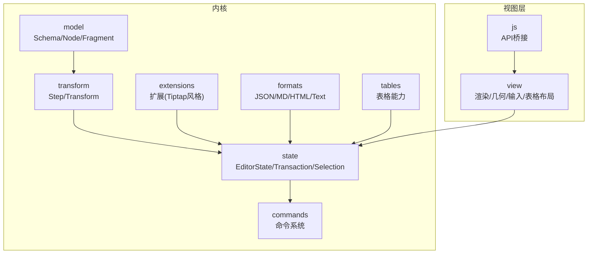
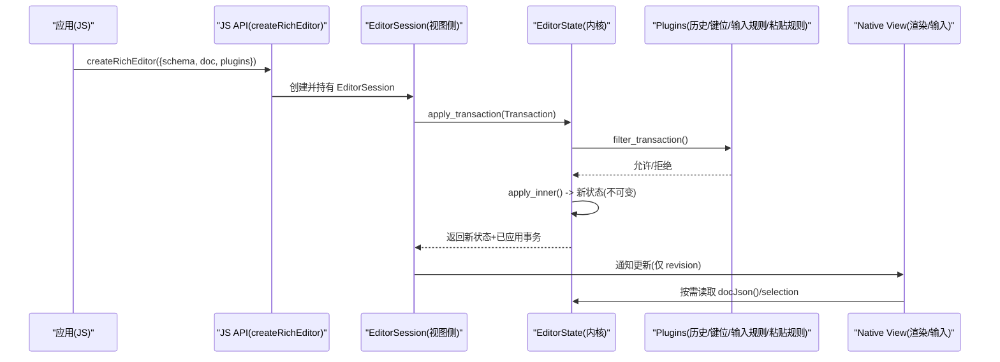
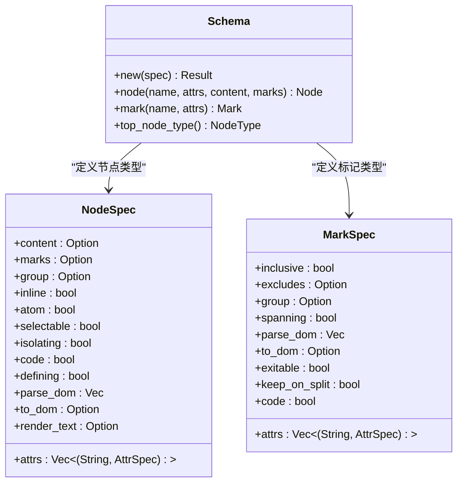
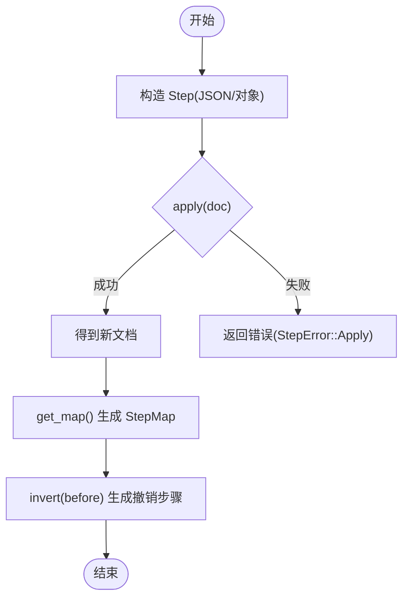
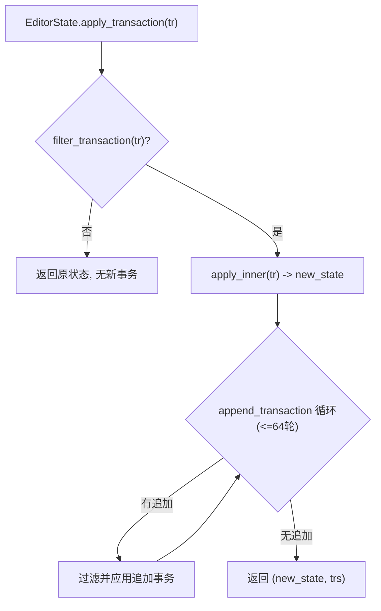
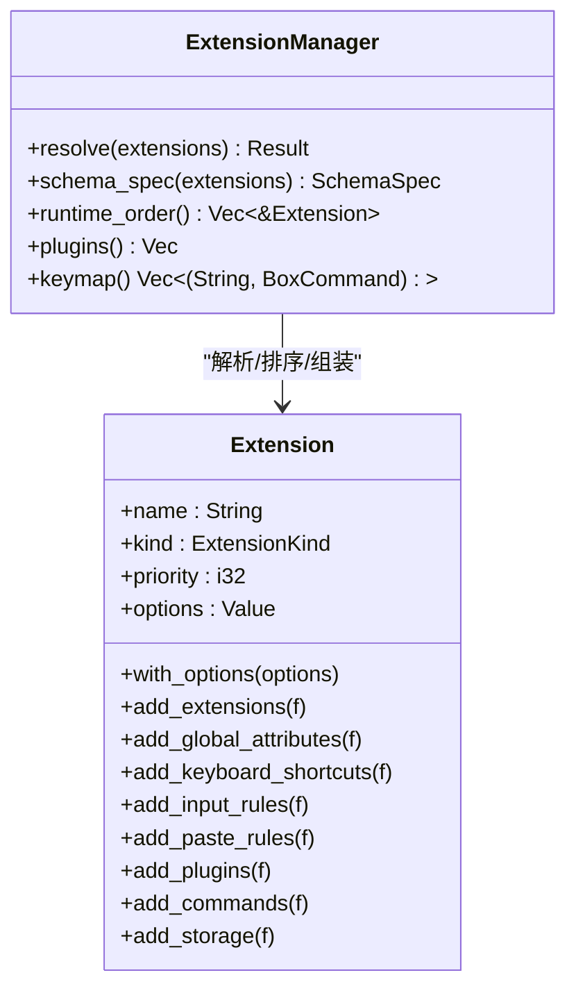
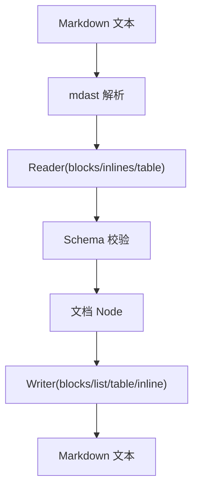
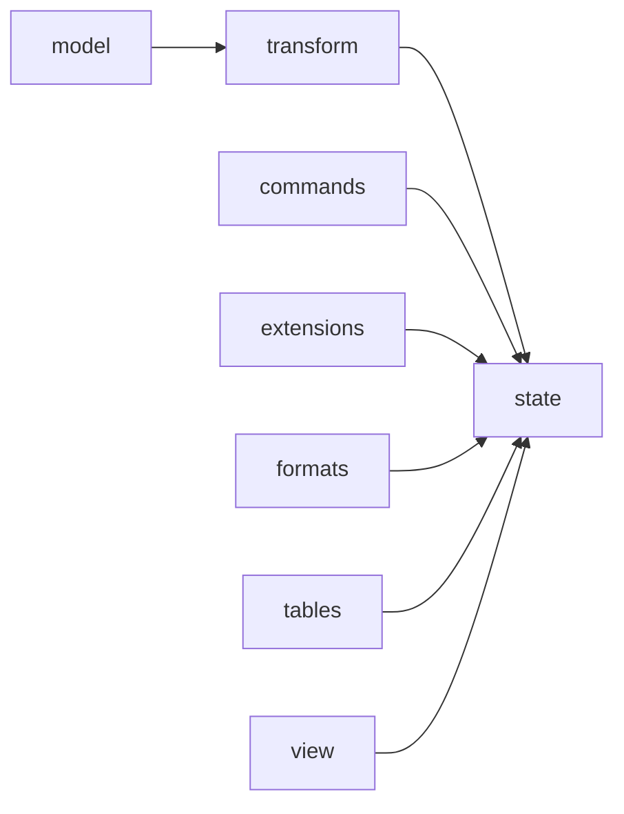

# 富文本编辑器

<cite>
**本文引用的文件**   
- [rich_editor/mod.rs](file://crates/nsh-base/src/rich_editor/mod.rs)
- [docs/dev/rich-editor.md](file://docs/dev/rich-editor.md)
- [model/schema.rs](file://crates/nsh-base/src/rich_editor/model/schema.rs)
- [transform/step.rs](file://crates/nsh-base/src/rich_editor/transform/step.rs)
- [state/editor_state.rs](file://crates/nsh-base/src/rich_editor/state/editor_state.rs)
- [extensions/extension.rs](file://crates/nsh-base/src/rich_editor/extensions/extension.rs)
- [formats/markdown.rs](file://crates/nsh-base/src/rich_editor/formats/markdown.rs)
</cite>

## 目录
1. [简介](#简介)
2. [项目结构](#项目结构)
3. [核心组件](#核心组件)
4. [架构总览](#架构总览)
5. [详细组件分析](#详细组件分析)
6. [依赖关系分析](#依赖关系分析)
7. [性能考虑](#性能考虑)
8. [故障排查指南](#故障排查指南)
9. [结论](#结论)
10. [附录](#附录)

## 简介
本文件为 NSH 的富文本编辑器（RichEditor）提供全面文档。该编辑器内核基于 ProseMirror 架构，采用“文档模型 + 变换步骤 + 不可变状态 + 命令系统”的设计；扩展层遵循 Tiptap 的语义与命名，以“扩展（Extension）”为单位统一注入节点、标记、命令、快捷键、输入规则、粘贴规则和插件。视图层是头部的（headless），由平台原生视图负责渲染与输入事件到事务的转换。

## 项目结构
富文本编辑器的核心位于 crates/nsh-base/src/rich_editor，按职责划分为以下模块：
- model：Schema、Node、Fragment、Mark、Slice、ResolvedPos 等文档模型
- transform：Step、Transform、StepMap、Mapping 等变更抽象
- state：EditorState、Transaction、Selection、Plugin 等状态与插件机制
- commands：命令系统与基础命令
- extensions：Tiptap 风格的扩展体系（starter kit、history、keymap、input_rules、markdown 等）
- tables：表格能力（TableMap、CellSelection、fix_tables、table_editing 等）
- formats：JSON、Markdown、HTML、纯文本等序列化/反序列化适配器
- view：原生视图（渲染、选择、几何、键盘、触摸、表格布局、会话控制器等）
- js：JS API 桥接（createRichEditor、RichEditorSession、命令与插件数据化）

图表来源
- [rich_editor/mod.rs:1-35](file://crates/nsh-base/src/rich_editor/mod.rs#L1-L35)
- [docs/dev/rich-editor.md:16-26](file://docs/dev/rich-editor.md#L16-L26)

章节来源
- [rich_editor/mod.rs:1-35](file://crates/nsh-base/src/rich_editor/mod.rs#L1-L35)
- [docs/dev/rich-editor.md:16-26](file://docs/dev/rich-editor.md#L16-L26)

## 核心组件
- 文档模型（model）
  - Schema：定义节点类型、标记类型、内容表达式、属性校验、HTML 解析/序列化映射
  - Node/Fragment/Mark/Slice/ResolvedPos：不可变文档结构与位置
- 变换（transform）
  - Step：原子、可逆、可映射的变更单元（替换、标记增删、属性变更等）
  - Transform：收集步骤、维护映射与中间文档快照
- 状态（state）
  - EditorState：不可变快照，包含 schema、doc、selection、stored_marks、plugins 及其状态
  - Transaction：一次用户动作对应的事务，携带 origin（user/input/paste/drop/remote/history/plugin/API）
  - Selection：文本、节点、全部、自定义（如表格单元格）
- 命令（commands）
  - 命令工厂与注册表，支持链式组合（chain）、首匹配（first）
- 扩展（extensions）
  - Extension：统一注入 schema、命令、快捷键、输入/粘贴规则、插件、存储
  - ExtensionManager：解析扩展列表、构建 schema、合并 keymap、组装 plugins
- 格式（formats）
  - JSON、Markdown（含 GFM 任务列表、表格）、HTML、纯文本
- 表格（tables）
  - TableMap、CellSelection、fix_tables、table_editing、命令与 Tiptap 节点规范
- 视图（view）
  - 渲染、几何、键盘/触摸、表格布局、滚动与懒加载、气泡菜单、内容层

章节来源
- [docs/dev/rich-editor.md:16-26](file://docs/dev/rich-editor.md#L16-L26)
- [docs/dev/rich-editor.md:28-91](file://docs/dev/rich-editor.md#L28-L91)
- [docs/dev/rich-editor.md:93-120](file://docs/dev/rich-editor.md#L93-L120)
- [docs/dev/rich-editor.md:121-285](file://docs/dev/rich-editor.md#L121-L285)
- [docs/dev/rich-editor.md:286-410](file://docs/dev/rich-editor.md#L286-L410)
- [docs/dev/rich-editor.md:411-518](file://docs/dev/rich-editor.md#L411-L518)

## 架构总览
下图展示从 JS API 到内核再到视图的数据流与调用顺序。

图表来源
- [docs/dev/rich-editor.md:121-134](file://docs/dev/rich-editor.md#L121-L134)
- [state/editor_state.rs:210-268](file://crates/nsh-base/src/rich_editor/state/editor_state.rs#L210-L268)

## 详细组件分析

### 文档模型与 Schema
- SchemaSpec/NodeSpec/MarkSpec：声明节点与标记的类型、属性、内容表达式、组、是否 inline/atom/selectable/isolating/code/defining 等
- 内容表达式编译为 ContentMatch 自动机，用于快速校验节点内容合法性
- HTML 解析/序列化通过 parseDOM/toDOM 与 DomParser/DomSerializer 对接
- 属性校验 AttrType（string/number/boolean/any）与默认值填充

图表来源
- [model/schema.rs:125-262](file://crates/nsh-base/src/rich_editor/model/schema.rs#L125-L262)
- [model/schema.rs:490-560](file://crates/nsh-base/src/rich_editor/model/schema.rs#L490-L560)

章节来源
- [model/schema.rs:1-124](file://crates/nsh-base/src/rich_editor/model/schema.rs#L1-L124)
- [model/schema.rs:490-560](file://crates/nsh-base/src/rich_editor/model/schema.rs#L490-L560)
- [model/schema.rs:562-619](file://crates/nsh-base/src/rich_editor/model/schema.rs#L562-L619)

### 变换与步骤（Step/Transform）
- Step 是原子、可逆、可映射的变更，支持 replace/replaceAround/addMark/removeMark/addNodeMark/removeNodeMark/attr/docAttr 等
- StepRegistry 管理 stepType 到构造函数的映射，支持自定义步骤类型
- Transform 聚合多个步骤，维护映射与中间文档快照

图表来源
- [transform/step.rs:48-72](file://crates/nsh-base/src/rich_editor/transform/step.rs#L48-L72)
- [transform/step.rs:117-217](file://crates/nsh-base/src/rich_editor/transform/step.rs#L117-L217)

章节来源
- [transform/step.rs:1-47](file://crates/nsh-base/src/rich_editor/transform/step.rs#L1-L47)
- [transform/step.rs:48-72](file://crates/nsh-base/src/rich_editor/transform/step.rs#L48-L72)
- [transform/step.rs:117-217](file://crates/nsh-base/src/rich_editor/transform/step.rs#L117-L217)

### 编辑器状态与事务（EditorState/Transaction）
- EditorState 是不可变的快照，包含 schema、doc、selection、stored_marks、plugins 及其状态、revision
- apply_transaction 流程：filter_transaction -> apply_inner -> append_transaction 多轮收敛（最多 64 轮）
- 插件可通过 filter/append 钩子参与或拦截事务

图表来源
- [state/editor_state.rs:210-268](file://crates/nsh-base/src/rich_editor/state/editor_state.rs#L210-L268)

章节来源
- [state/editor_state.rs:17-84](file://crates/nsh-base/src/rich_editor/state/editor_state.rs#L17-L84)
- [state/editor_state.rs:114-148](file://crates/nsh-base/src/rich_editor/state/editor_state.rs#L114-L148)
- [state/editor_state.rs:210-311](file://crates/nsh-base/src/rich_editor/state/editor_state.rs#L210-L311)

### 扩展机制（Extensions/Tiptap 层）
- Extension：name/kind/priority/options/top_node，以及 node/mark/spec、global_attributes、keyboard_shortcuts、input_rules、paste_rules、plugins、commands、storage
- ExtensionManager：resolve（扁平化、优先级排序、去重）、schema_spec（构建 SchemaSpec）、runtime_order（运行时顺序）、plugins/keymap/input_rules/paste_rules 组装
- 内置 starter_kit 提供段落、标题、引用、代码块、列表、图片、常用标记等

图表来源
- [extensions/extension.rs:126-156](file://crates/nsh-base/src/rich_editor/extensions/extension.rs#L126-L156)
- [extensions/extension.rs:489-540](file://crates/nsh-base/src/rich_editor/extensions/extension.rs#L489-L540)
- [extensions/extension.rs:550-723](file://crates/nsh-base/src/rich_editor/extensions/extension.rs#L550-L723)

章节来源
- [extensions/extension.rs:1-17](file://crates/nsh-base/src/rich_editor/extensions/extension.rs#L1-L17)
- [extensions/extension.rs:126-156](file://crates/nsh-base/src/rich_editor/extensions/extension.rs#L126-L156)
- [extensions/extension.rs:489-723](file://crates/nsh-base/src/rich_editor/extensions/extension.rs#L489-L723)

### 内容序列化/反序列化（Formats）
- MarkdownFormat：CommonMark + GFM（删除线、表格、任务列表），支持名称映射（MarkdownNames），深度限制防止栈溢出
- 表格：GFM 管道表与 HTML <table> 双向适配；无法用 GFM 表达时回退为 HTML
- JSON/HTML/纯文本：通过 DocFormat 接口统一

图表来源
- [formats/markdown.rs:171-225](file://crates/nsh-base/src/rich_editor/formats/markdown.rs#L171-L225)
- [formats/markdown.rs:227-410](file://crates/nsh-base/src/rich_editor/formats/markdown.rs#L227-L410)
- [formats/markdown.rs:586-800](file://crates/nsh-base/src/rich_editor/formats/markdown.rs#L586-L800)

章节来源
- [formats/markdown.rs:1-12](file://crates/nsh-base/src/rich_editor/formats/markdown.rs#L1-L12)
- [formats/markdown.rs:171-225](file://crates/nsh-base/src/rich_editor/formats/markdown.rs#L171-L225)
- [formats/markdown.rs:227-410](file://crates/nsh-base/src/rich_editor/formats/markdown.rs#L227-L410)
- [formats/markdown.rs:586-800](file://crates/nsh-base/src/rich_editor/formats/markdown.rs#L586-L800)

### 协作编辑、实时同步与冲突解决
- 设计预留：Step 可序列化、可映射、可 rebase；Transaction 支持 Remote 来源；历史跳过远程变更并在其上映射本地变更
- 协作扩展（prosemirror-collab 中央权威或 CRDT 绑定）将作为视图之后的扩展接入

章节来源
- [docs/dev/rich-editor.md:520-533](file://docs/dev/rich-editor.md#L520-L533)

### 常见用例实现模式
- Markdown 支持：使用 MarkdownFormat 与 MarkdownNames 映射 schema 类型名；粘贴/复制走 clipboard 的 slice_to_text/slice_from_text
- 公式编辑：通过扩展的 node 类型与 node view 渲染数学块；在 editable_content_slot 中嵌入编辑器内容
- 文件拖放：桌面端通过 host 的 onFileDrop 接收文件；粘贴图像字节或 file: URL 交由应用处理

章节来源
- [docs/dev/rich-editor.md:93-120](file://docs/dev/rich-editor.md#L93-L120)
- [docs/dev/rich-editor.md:121-285](file://docs/dev/rich-editor.md#L121-L285)

## 依赖关系分析
- 内核模块间耦合低：model 不依赖 transform/state；transform 不依赖 state；state 依赖 model/transform
- 扩展层对内核的依赖集中在 schema 与命令注册表；运行时通过 ExtensionManager 组装 plugins/keymap/input/paste
- 视图层订阅 EditorState 的 revision，按需读取 docJson/selection，避免频繁跨线程传递大对象

图表来源
- [rich_editor/mod.rs:26-34](file://crates/nsh-base/src/rich_editor/mod.rs#L26-L34)

章节来源
- [rich_editor/mod.rs:26-34](file://crates/nsh-base/src/rich_editor/mod.rs#L26-L34)

## 性能考虑
- 增量更新：EditorState 不可变且廉价克隆；视图仅订阅 revision，按需读取文档
- 懒加载：长文档（>300 顶级块）仅挂载可视区域附近块，间隔 16 个块步进，未挂载块的几何在滚动后计算
- 渲染优化：内联装饰与附件（node view）复用 props 状态，layout_rev 批量提升布局；表格控件与选区独立监听自身 table 的修订号
- 输入路径非阻塞：粘贴 JS hook 排队异步执行，Rust 钩子始终看到当前状态；IME 组合期间保持同一状态，提交为单个事务

章节来源
- [docs/dev/rich-editor.md:121-176](file://docs/dev/rich-editor.md#L121-L176)
- [docs/dev/rich-editor.md:177-285](file://docs/dev/rich-editor.md#L177-L285)

## 故障排查指南
- 事务被拒绝：检查插件 filter_transaction 逻辑；确认 origin 与元数据是否符合预期
- 无限追加事务：避免两个插件互相 append_transaction；超过 64 轮会报错 AppendLoop
- 文档无效：apply_inner 会对新文档执行 check；确保节点内容与标记符合 schema
- 位置越界：查询 coordsAtPos/posAtCoords 等几何方法时，位置必须在 0..=doc.content.size 范围内
- 重复插件键：EditorState.create 会拒绝重复 PluginKey；reconfigure 保留已有插件状态

章节来源
- [state/editor_state.rs:210-268](file://crates/nsh-base/src/rich_editor/state/editor_state.rs#L210-L268)
- [state/editor_state.rs:278-311](file://crates/nsh-base/src/rich_editor/state/editor_state.rs#L278-L311)
- [docs/dev/rich-editor.md:370-383](file://docs/dev/rich-editor.md#L370-L383)

## 结论
NSH 的富文本编辑器以 ProseMirror 内核为基础，结合 Tiptap 扩展语义，提供了可扩展、可测试、跨平台的富文本编辑能力。其不可变状态、原子步骤与插件机制保证了变更的可追溯性与可协作性；视图层通过 revision 驱动与懒加载策略实现高效渲染。通过扩展机制，开发者可以便捷地添加自定义节点、标记、命令与交互行为，并借助 Markdown/HTML/JSON 等格式完成导入导出。

## 附录
- 术语
  - 节点（Node）：文档中的结构化元素（段落、标题、列表项、表格单元格等）
  - 标记（Mark）：覆盖在文本上的样式或语义（粗体、斜体、链接等）
  - 步骤（Step）：最小变更单元，可逆、可映射
  - 事务（Transaction）：一次用户动作对应的变更集合
  - 插件（Plugin）：扩展编辑器行为的钩子集合
  - 扩展（Extension）：Tiptap 风格的统一注入单元（schema/命令/规则/插件）