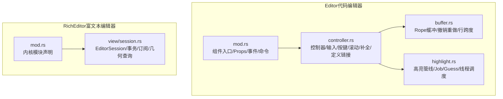
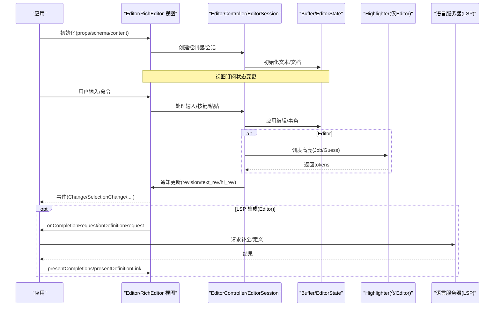
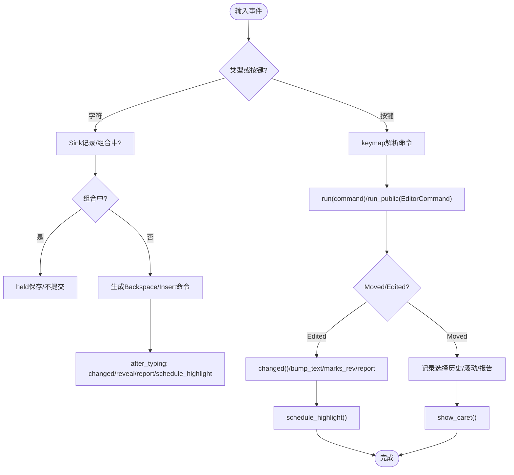
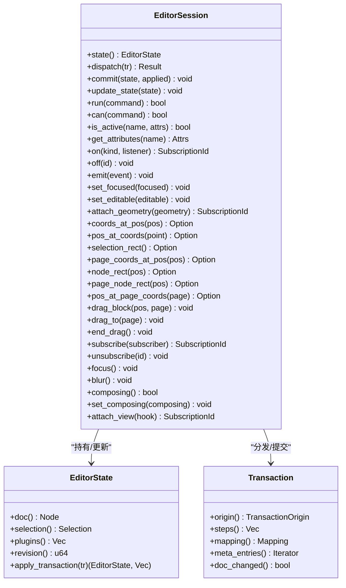
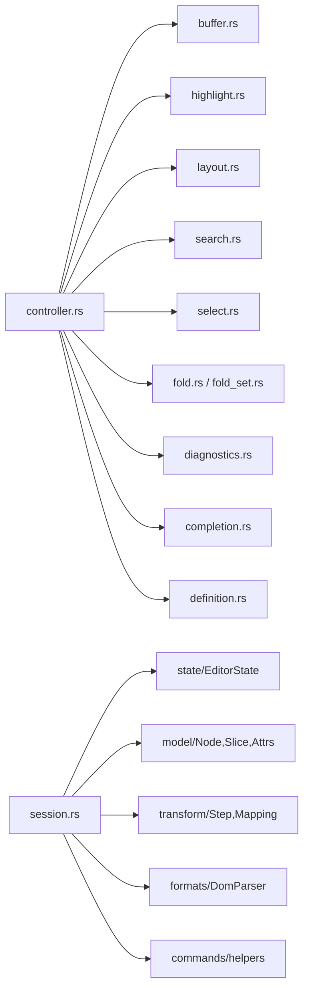

# 编辑器组件

<cite>
**本文引用的文件**   
- [editor.md](file://docs/dev/editor.md)
- [rich-editor.md](file://docs/dev/rich-editor.md)
- [mod.rs（Editor）](file://crates/nsh-base/src/editor/mod.rs)
- [controller.rs（Editor）](file://crates/nsh-base/src/editor/controller.rs)
- [buffer.rs（Editor）](file://crates/nsh-base/src/editor/buffer.rs)
- [highlight.rs（Editor）](file://crates/nsh-base/src/editor/highlight.rs)
- [mod.rs（RichEditor）](file://crates/nsh-base/src/rich_editor/mod.rs)
- [session.rs（RichEditor）](file://crates/nsh-base/src/rich_editor/view/session.rs)
</cite>

## 目录
1. [简介](#简介)
2. [项目结构](#项目结构)
3. [核心组件](#核心组件)
4. [架构总览](#架构总览)
5. [详细组件分析](#详细组件分析)
6. [依赖关系分析](#依赖关系分析)
7. [性能优化策略](#性能优化策略)
8. [故障排查指南](#故障排查指南)
9. [结论](#结论)
10. [附录：LSP与语法高亮扩展](#附录lsp与语法高亮扩展)

## 简介
本文件为 NSH 的编辑器组件提供全面文档，重点覆盖两类组件：
- Editor（代码编辑器）：支持语法高亮、智能补全、错误诊断、代码折叠、软换行、查找替换、多光标等。
- RichEditor（富文本编辑器）：基于 ProseMirror/Tiptap 架构，提供块级元素、内联格式、扩展机制、表格、粘贴/复制、撤销重做、节点视图等。

文档同时涵盖光标管理、选择处理、撤销重做栈实现、语言服务器协议（LSP）集成指导与自定义语法高亮开发，并给出增量渲染、懒加载与内存池管理等性能优化建议。

## 项目结构
NSH 编辑器相关代码主要位于 crates/nsh-base/src/editor 与 crates/nsh-base/src/rich_editor；设计说明位于 docs/dev/editor.md 与 docs/dev/rich-editor.md。

图表来源
- [mod.rs（Editor）:1-794](file://crates/nsh-base/src/editor/mod.rs#L1-L794)
- [controller.rs（Editor）:1-800](file://crates/nsh-base/src/editor/controller.rs#L1-L800)
- [buffer.rs（Editor）:1-800](file://crates/nsh-base/src/editor/buffer.rs#L1-L800)
- [highlight.rs（Editor）:1-800](file://crates/nsh-base/src/editor/highlight.rs#L1-L800)
- [mod.rs（RichEditor）:1-35](file://crates/nsh-base/src/rich_editor/mod.rs#L1-L35)
- [session.rs（RichEditor）:1-800](file://crates/nsh-base/src/rich_editor/view/session.rs#L1-L800)

章节来源
- [editor.md:1-455](file://docs/dev/editor.md#L1-L455)
- [rich-editor.md:1-533](file://docs/dev/rich-editor.md#L1-L533)

## 核心组件
- Editor（代码编辑器）
  - 组件接口：EditorProps、EditorEvent、EditorCommand、EditorApi（ref方法）。
  - 模型与状态：Buffer（rope）、DisplayMap（显示行）、Selections、Highlighter、FoldSet、Diagnostics/Decorations。
  - 交互：键盘映射、输入法（sink）、触摸选择、拖拽滚动、自动聚焦与滚动到可见区域。
  - 语言特性：补全会话、定义跳转、代码动作、悬停提示。
- RichEditor（富文本编辑器）
  - 内核：Schema/Node/Fragment/Mark/Slice/ResolvedPos；Step/Transform/Mapping；EditorState/Transaction/Selection；Commands/Plugins。
  - 视图层：EditorSession（共享会话）、NodeViews、Geometry 查询、粘贴/复制、IME 组合、气泡菜单、内容层。
  - 扩展：Tiptap 风格 ExtensionManager、内置扩展（starter kit）、Link/CharacterCount/Suggestion、Tables。

章节来源
- [mod.rs（Editor）:66-205](file://crates/nsh-base/src/editor/mod.rs#L66-L205)
- [mod.rs（Editor）:207-502](file://crates/nsh-base/src/editor/mod.rs#L207-L502)
- [mod.rs（Editor）:504-794](file://crates/nsh-base/src/editor/mod.rs#L504-L794)
- [mod.rs（RichEditor）:1-35](file://crates/nsh-base/src/rich_editor/mod.rs#L1-L35)

## 架构总览
Editor 与 RichEditor 采用“模型-视图-控制器”分离：
- Editor：自绘文本行，维护 Rope 文本、显示映射、高亮管线、搜索与装饰；通过 controller 协调输入、按键、补全、定义链接等。
- RichEditor：无头内核（ProseMirror/Tiptap），由 EditorSession 统一分发事务，视图订阅状态变更并渲染；JS 通过 SessionJs 桥接。

图表来源
- [controller.rs（Editor）:1-800](file://crates/nsh-base/src/editor/controller.rs#L1-L800)
- [highlight.rs（Editor）:1-800](file://crates/nsh-base/src/editor/highlight.rs#L1-L800)
- [session.rs（RichEditor）:1-800](file://crates/nsh-base/src/rich_editor/view/session.rs#L1-L800)

## 详细组件分析

### Editor（代码编辑器）
- 组件与数据
  - Props：value/default_value、language、soft_wrap、folding、diagnostics/decorations、completion、inline_completion_delay 等。
  - 事件：Change、SelectionChange、SearchChange、ContextMenu、Hover/HoverEnd、TextPress、FindWithSelection、FoldChange、CompletionRequest/Accept、InlineCompletionRequest、DefinitionRequest、CodeActionRequest。
  - 命令：移动/选择、删除/插入、缩进/注释、排序/大小写转换、折叠/展开、查找/替换、补全/定义/代码动作等。
  - API：focus/blur、value/set_value、edit/insert、selections/set_selections、run、replace/replace_all、fold/unfold/fold_all、scroll_to_line、reveal_position/go_to_line、show_completions/present_completions/present_inline_completion、present_definition_link/hide_definition_link 等。
- 模型与状态
  - Buffer：Rope 文本、撤销/重做（最多1000步）、LineSpan（受影响的行跨度）、UTF-16 位置转换。
  - DisplayMap：软换行、制表符宽度、折叠显示行。
  - Selections：主选区、历史、扩展/收缩、块选择。
  - Highlighter：按行 tokens、Job/Guess 异步解析、前沿 frontier、猜测距离 GUESS_DISTANCE=500、前瞻 LOOKAHEAD=1000。
  - Diagnostics/Decorations：标记范围、行号/概览尺标记、二进制搜索定位。
- 交互与控制
  - 输入法 sink：保持最近输入文本，组合中保留 held，超过 SINK_LIMIT=256 字节清空。
  - 按键绑定：平台差异（Apple/其他）、VS Code 兼容键、Escape 行为、Tab/Shift+Tab 等。
  - 滚动与布局：cursorSurroundingLines、scrollBeyondLastLine、minRows/maxRows、边缘拖拽滚动。
  - 补全与会话：typing/triggerCharacters/invoked，过滤匹配、列表 overlay、ghost text、inline completion。
  - 定义与代码动作：hover/press/key 触发，underline 定义链接，F12/Mod+. 打开动作菜单。

图表来源
- [controller.rs（Editor）:402-466](file://crates/nsh-base/src/editor/controller.rs#L402-L466)
- [controller.rs（Editor）:470-528](file://crates/nsh-base/src/editor/controller.rs#L470-L528)
- [controller.rs（Editor）:701-800](file://crates/nsh-base/src/editor/controller.rs#L701-L800)

章节来源
- [mod.rs（Editor）:66-205](file://crates/nsh-base/src/editor/mod.rs#L66-L205)
- [mod.rs（Editor）:207-502](file://crates/nsh-base/src/editor/mod.rs#L207-L502)
- [mod.rs（Editor）:504-794](file://crates/nsh-base/src/editor/mod.rs#L504-L794)
- [controller.rs（Editor）:1-800](file://crates/nsh-base/src/editor/controller.rs#L1-L800)
- [buffer.rs（Editor）:1-800](file://crates/nsh-base/src/editor/buffer.rs#L1-L800)
- [highlight.rs（Editor）:1-800](file://crates/nsh-base/src/editor/highlight.rs#L1-L800)
- [editor.md:42-455](file://docs/dev/editor.md#L42-L455)

### RichEditor（富文本编辑器）
- 内核与数据结构
  - Schema/Node/Fragment/Mark/Slice/ResolvedPos：文档结构与内容表达式。
  - Step/Transform/Mapping：可逆、可映射的步骤集合，支持合并与序列化。
  - EditorState/Transaction/Selection：不可变状态、事务（origin: user/input/paste/drop/remote/history/plugin/api）、多种选择（文本/节点/全部/自定义）。
  - Commands/Plugins：命令工厂、插件钩子（init_state/apply_state/filter_transaction/append_transaction/events/decorations/view lifecycle）。
- 视图与交互
  - EditorSession：共享会话，dispatch/update_state/commit/run/can/is_active/get_attributes，订阅者模式，事件发布（update/selectionUpdate/transaction/focus/blur/delete）。
  - NodeViews：按类型注册节点视图，editable_content_slot、select/deselect、handle_event、destroy。
  - Geometry：coords_at_pos/pos_at_coords/selection_rect/node_rect/page_coords_at_pos/pos_at_page_coords，支持页面坐标与滚动偏移。
  - 输入与 IME：sink 在 caret 处，组合中显示 composition，提交后作为正常事务；粘贴队列（drain_pastes）避免 JS 阻塞输入路径。
  - 气泡菜单与内容层：bubbleMenu/contentLayer 插槽，用于浮动工具栏与覆盖层。
- 扩展与内置能力
  - ExtensionManager：优先级排序、命令注册、键位合并、插件链（input rules/paste rules/keymap）。
  - Starter Kit：document/paragraph/text/heading/blockquote/lists/task_list/code_block/hard_break/hr/image 及 marks（bold/italic/strike/code/underline/link/highlight/subscript/superscript/text_style/text_align）。
  - Link/CharacterCount/Suggestion：自动链接、字数限制、@mention 建议。
  - Tables：TableMap/CellSelection/fix_tables/table_editing/commands，支持列宽/行高调整、拖拽移动行列、选择矩形。

图表来源
- [session.rs（RichEditor）:295-800](file://crates/nsh-base/src/rich_editor/view/session.rs#L295-L800)

章节来源
- [rich-editor.md:16-533](file://docs/dev/rich-editor.md#L16-L533)
- [mod.rs（RichEditor）:1-35](file://crates/nsh-base/src/rich_editor/mod.rs#L1-L35)
- [session.rs（RichEditor）:1-800](file://crates/nsh-base/src/rich_editor/view/session.rs#L1-L800)

## 依赖关系分析
- Editor 内部依赖
  - controller 依赖 buffer（文本与撤销）、highlight（高亮管线）、layout（布局与滚动）、search（查找替换）、select（选择历史）、fold/fold_set（折叠）、diagnostics（诊断与装饰）、completion/definition（语言特性）。
  - highlight 依赖 syntax（Token 与调色板）、syntect（可选 feature）与应用高亮器接口。
- RichEditor 内部依赖
  - session 依赖 state（EditorState/Transaction）、model（Node/Slice/Attrs）、transform（Mapping/Step）、formats（DomParser/序列化）、commands（命令与 Tiptap helpers）。
  - view 依赖 node_view（节点视图）、geometry（几何查询）、controller（输入与 IME）。

图表来源
- [controller.rs（Editor）:1-800](file://crates/nsh-base/src/editor/controller.rs#L1-L800)
- [highlight.rs（Editor）:1-800](file://crates/nsh-base/src/editor/highlight.rs#L1-L800)
- [session.rs（RichEditor）:1-800](file://crates/nsh-base/src/rich_editor/view/session.rs#L1-L800)

章节来源
- [editor.md:1-455](file://docs/dev/editor.md#L1-L455)
- [rich-editor.md:16-533](file://docs/dev/rich-editor.md#L16-L533)

## 性能优化策略
- 增量渲染与虚拟滚动
  - Editor：仅渲染可视行及其周边（RowWindow），每行一个 Text；软换行与折叠影响显示行计算。
  - RichEditor：长文档（>300 顶级块）只挂载视口附近块，使用占位高度估算未挂载块尺寸。
- 高亮管线与异步解析
  - Editor：Job 切片时间 SLICE（非 wasm 25ms，wasm 4ms），frontier 推进，Guess 对远端行快速着色；WASM 上无线程，Job 就地运行。
  - 内置 syntect 高亮缓存状态（每16行），编辑时从最近状态恢复，减少重复解析。
- 撤销重做与合并
  - Editor：连续打字/删除合并为一步，最多1000步；单步最多10000 edits；word_break 打断合并。
- 输入与 IME
  - Editor：sink 最大256字节，组合中不提交；RichEditor：粘贴队列 drain_pastes，避免 JS 阻塞输入路径。
- 内存与对象复用
  - Rope 分块存储，避免整段拷贝；EditorSession 使用 Arc<Mutex<Inner>> 共享状态；NodeViews 按类型缓存。
- 布局与滚动
  - Editor：边缘拖拽滚动（edge_speed），cursorSurroundingLines 控制滚动边距；RichEditor：contentSizeChange 节流至每帧一次。

章节来源
- [editor.md:78-120](file://docs/dev/editor.md#L78-L120)
- [editor.md:247-304](file://docs/dev/editor.md#L247-L304)
- [highlight.rs（Editor）:54-76](file://crates/nsh-base/src/editor/highlight.rs#L54-L76)
- [highlight.rs（Editor）:306-329](file://crates/nsh-base/src/editor/highlight.rs#L306-L329)
- [buffer.rs（Editor）:22-26](file://crates/nsh-base/src/editor/buffer.rs#L22-L26)
- [controller.rs（Editor）:27-33](file://crates/nsh-base/src/editor/controller.rs#L27-L33)
- [rich-editor.md:159-176](file://docs/dev/rich-editor.md#L159-L176)

## 故障排查指南
- 高亮闪烁或延迟
  - 检查 highlighting 开关与语言注册；确认 Job 预算与 frontier；在 WASM 上注意 load_async 时序。
  - 参考：[highlight.rs（Editor）:306-329](file://crates/nsh-base/src/editor/highlight.rs#L306-L329)、[editor.md:247-304](file://docs/dev/editor.md#L247-L304)
- 撤销重做异常
  - 检查 EditKind 与 word_break；确认 MAX_UNDO_STEPS/MAX_EDITS_PER_STEP；验证 before/after selections 一致性。
  - 参考：[buffer.rs（Editor）:597-634](file://crates/nsh-base/src/editor/buffer.rs#L597-L634)
- 输入法组合问题
  - Editor：确认 sink.composing 与 held 逻辑；RichEditor：确认 composition 元数据与 revision 不变。
  - 参考：[controller.rs（Editor）:741-800](file://crates/nsh-base/src/editor/controller.rs#L741-L800)、[rich-editor.md:177-195](file://docs/dev/rich-editor.md#L177-L195)
- 粘贴失败或顺序错乱
  - RichEditor：检查 paste 队列与 JS 钩子；确保状态一致重试；HTML/Text 双通道解析。
  - 参考：[rich-editor.md:200-213](file://docs/dev/rich-editor.md#L200-L213)、[session.rs（RichEditor）:431-479](file://crates/nsh-base/src/rich_editor/view/session.rs#L431-L479)
- 表格操作异常
  - 检查 TableMap 问题（碰撞/缺失单元格/跨度过长/列宽不一致）；使用 fixTables 命令修复。
  - 参考：[rich-editor.md:460-518](file://docs/dev/rich-editor.md#L460-L518)

章节来源
- [highlight.rs（Editor）:306-329](file://crates/nsh-base/src/editor/highlight.rs#L306-L329)
- [buffer.rs（Editor）:597-634](file://crates/nsh-base/src/editor/buffer.rs#L597-L634)
- [controller.rs（Editor）:741-800](file://crates/nsh-base/src/editor/controller.rs#L741-L800)
- [rich-editor.md:177-195](file://docs/dev/rich-editor.md#L177-L195)
- [rich-editor.md:200-213](file://docs/dev/rich-editor.md#L200-L213)
- [session.rs（RichEditor）:431-479](file://crates/nsh-base/src/rich_editor/view/session.rs#L431-L479)
- [rich-editor.md:460-518](file://docs/dev/rich-editor.md#L460-L518)

## 结论
Editor 与 RichEditor 分别面向代码与富文本场景，前者强调高性能文本编辑与语言特性集成，后者强调结构化文档与可扩展生态。两者均通过清晰的模型-视图-控制器分层、增量渲染与异步任务调度保障性能，并通过丰富的 API 与扩展点满足复杂业务需求。

## 附录：LSP与语法高亮扩展
- LSP 集成（Editor）
  - 补全：onCompletionRequest → presentCompletions；支持 triggerCharacters、incomplete、inline completion。
  - 定义与代码动作：onDefinitionRequest（hover/press/key）→ presentDefinitionLink；showCodeActions（Mod+.）→ onCodeActionRequest。
  - 悬停与诊断：onHover/onHoverEnd 携带诊断信息；diagnostics 以 Mark 形式持久化并随编辑迁移。
  - 参考：[editor.md:175-246](file://docs/dev/editor.md#L175-L246)、[editor.md:319-364](file://docs/dev/editor.md#L319-L364)
- 自定义语法高亮
  - 应用高亮器：实现 EditorHighlighter（Send + Sync），通过 register_highlighter 绑定语言名；支持 tree-sitter InputEdit places。
  - Token 映射：EditorToken::from_scope 将 scope/capture 映射到 palette；decorations.token 可覆盖内置高亮。
  - 参考：[editor.md:286-304](file://docs/dev/editor.md#L286-L304)、[highlight.rs（Editor）:174-184](file://crates/nsh-base/src/editor/highlight.rs#L174-L184)

章节来源
- [editor.md:175-246](file://docs/dev/editor.md#L175-L246)
- [editor.md:286-304](file://docs/dev/editor.md#L286-L304)
- [editor.md:319-364](file://docs/dev/editor.md#L319-L364)
- [highlight.rs（Editor）:174-184](file://crates/nsh-base/src/editor/highlight.rs#L174-L184)