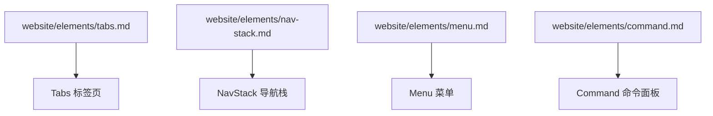
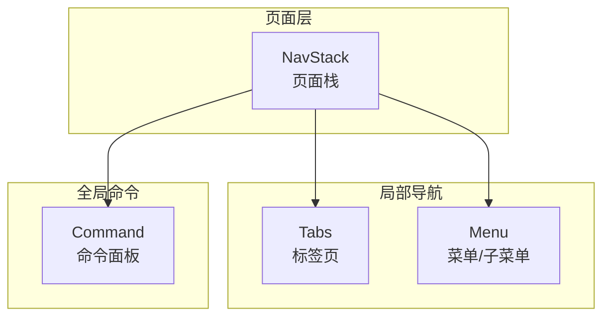
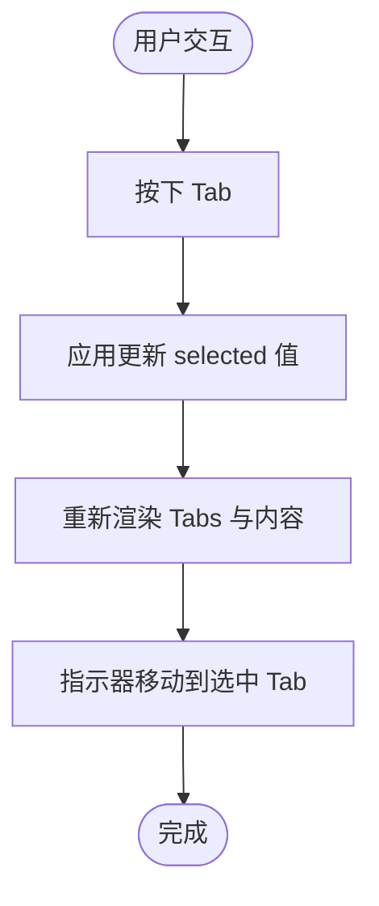
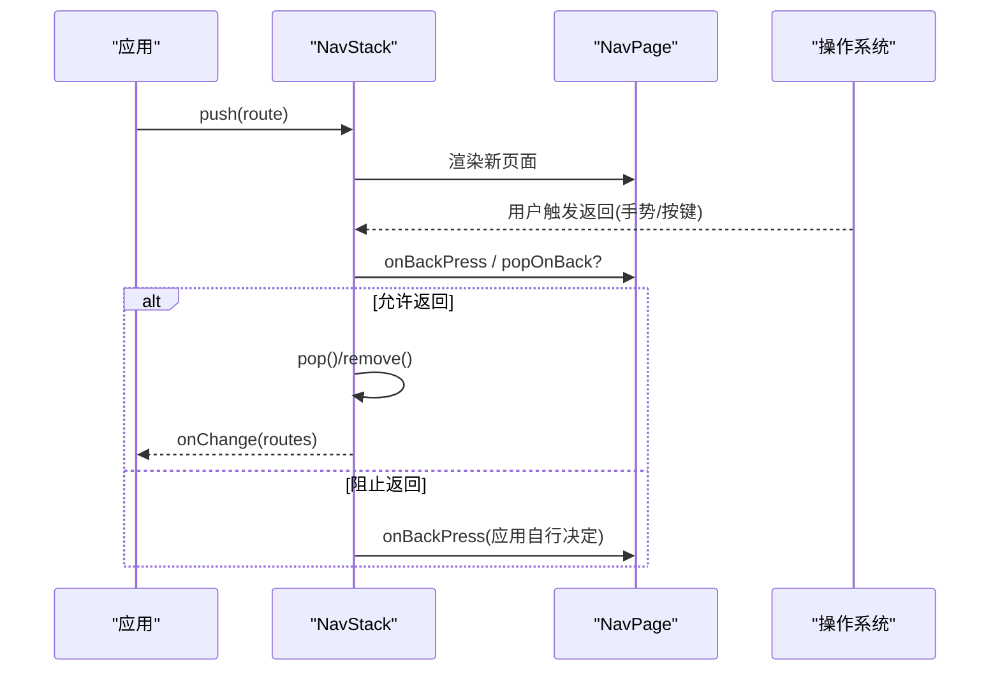
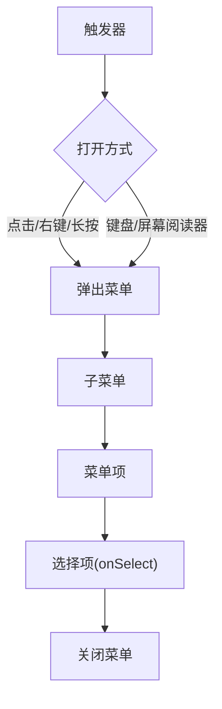
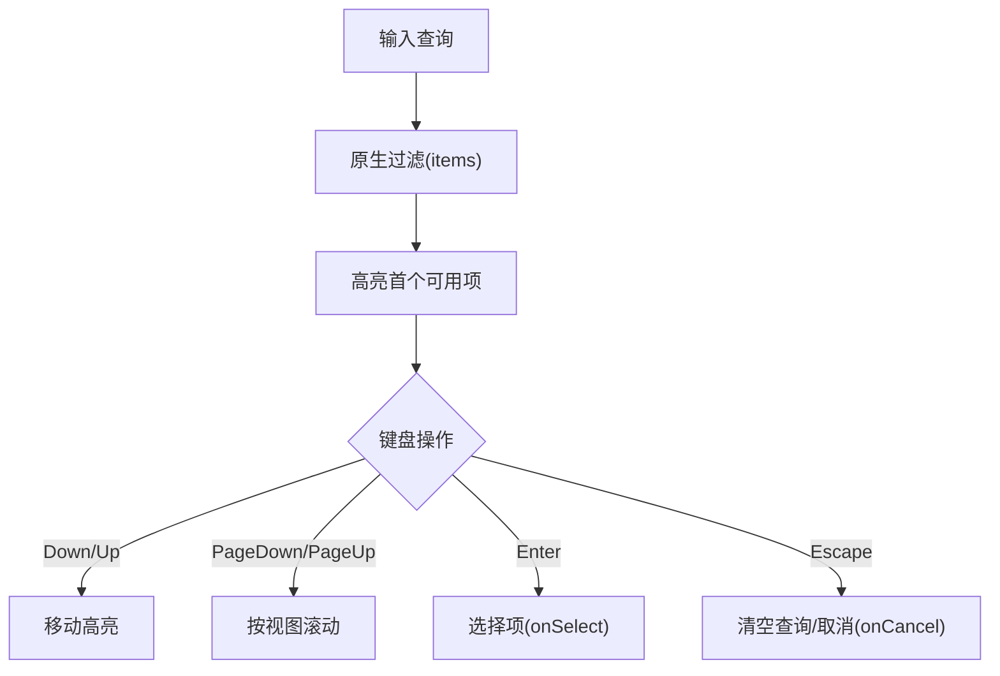
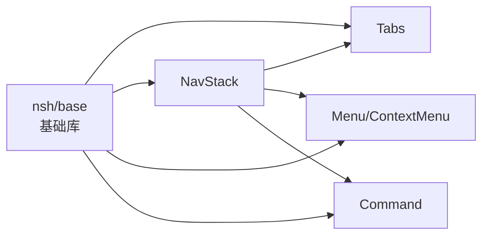

# 导航控件

<cite>
**本文引用的文件**   
- [website/elements/tabs.md](file://website/elements/tabs.md)
- [website/elements/nav-stack.md](file://website/elements/nav-stack.md)
- [website/elements/menu.md](file://website/elements/menu.md)
- [website/elements/command.md](file://website/elements/command.md)
</cite>

## 目录
1. [简介](#简介)
2. [项目结构](#项目结构)
3. [核心组件](#核心组件)
4. [架构总览](#架构总览)
5. [详细组件分析](#详细组件分析)
6. [依赖分析](#依赖分析)
7. [性能考虑](#性能考虑)
8. [故障排查指南](#故障排查指南)
9. [结论](#结论)
10. [附录](#附录)

## 简介
本文件为 NSH 的导航相关控件提供系统化文档，覆盖以下能力：
- Tabs（标签页）：用于在同一页面内切换不同分区。
- Navigation（导航栈 NavStack）：原生风格的页面栈，支持返回手势、预测式返回与平台适配。
- Menu（菜单）：跨设备一致的菜单体系，桌面端弹出、移动端底部抽屉，支持子菜单与系统菜单。
- Command（命令面板）：键盘优先的命令搜索面板，支持分组、虚拟列表与无障碍。

文档同时说明页面路由、状态保持、动画过渡、用户引导机制、键盘导航、无障碍访问以及多平台导航模式适配，并给出复杂应用导航架构设计与最佳实践。

## 项目结构
本仓库中导航控件的用户文档位于 website/elements 目录下，分别对应各控件的详细 API、交互行为与平台差异说明。

图表来源
- [website/elements/tabs.md:1-253](file://website/elements/tabs.md#L1-L253)
- [website/elements/nav-stack.md:1-403](file://website/elements/nav-stack.md#L1-L403)
- [website/elements/menu.md:1-572](file://website/elements/menu.md#L1-L572)
- [website/elements/command.md:1-267](file://website/elements/command.md#L1-L267)

章节来源
- [website/elements/tabs.md:1-253](file://website/elements/tabs.md#L1-L253)
- [website/elements/nav-stack.md:1-403](file://website/elements/nav-stack.md#L1-L403)
- [website/elements/menu.md:1-572](file://website/elements/menu.md#L1-L572)
- [website/elements/command.md:1-267](file://website/elements/command.md#L1-L267)

## 核心组件
- Tabs（标签页）
  - 职责：管理一组 Tab 的选择状态与指示器；键盘遵循 WAI-ARIA Tabs 模式；支持水平/垂直方向与无障碍标注。
  - 关键特性：选中态样式、禁用态、指示器跟随、无障碍角色与朗读、键盘导航（左右上下/Home/End/Space/Return）。
- NavStack（导航栈）
  - 职责：维护页面栈（routes），处理 push/pop/replace/setRoutes/remove 等操作；在 iOS/Android 使用系统头与返回手势，在桌面/网页显示自定义 header。
  - 关键特性：页面状态保持、离开页面拦截（popOnBack/onBackPress）、动画与着色器过渡、横竖屏方向控制、平台差异。
- Menu（菜单）
  - 职责：统一菜单模型，桌面端弹出、移动端底部抽屉；支持子菜单、检查项、单选组、长列表虚拟化；提供系统菜单入口（MenuButton）与上下文菜单（ContextMenu）。
  - 关键特性：打开/关闭状态、定位与边距、进入/退出动画、键盘与屏幕阅读器、平台系统菜单与上下文菜单。
- Command（命令面板）
  - 职责：命令搜索面板，原生过滤与虚拟列表；支持分组、快捷键提示、无障碍列表框；可嵌入对话框或作为内联菜单。
  - 关键特性：受控查询、过滤开关、加载态、空态、渲染回调、焦点与高亮控制。

章节来源
- [website/elements/tabs.md:10-159](file://website/elements/tabs.md#L10-L159)
- [website/elements/nav-stack.md:152-259](file://website/elements/nav-stack.md#L152-L259)
- [website/elements/menu.md:10-124](file://website/elements/menu.md#L10-L124)
- [website/elements/command.md:10-17](file://website/elements/command.md#L10-L17)

## 架构总览
NSH 导航体系以“页面栈 + 局部导航 + 全局命令”分层组织：
- 页面级：NavStack 负责页面路由与生命周期，保证被覆盖页面的状态保持。
- 局部级：Tabs 在同一页面内切换内容区块；Menu 提供操作入口与上下文动作。
- 全局级：Command 提供跨页面的命令检索与执行。

图表来源
- [website/elements/nav-stack.md:152-259](file://website/elements/nav-stack.md#L152-L259)
- [website/elements/tabs.md:10-159](file://website/elements/tabs.md#L10-L159)
- [website/elements/menu.md:10-124](file://website/elements/menu.md#L10-L124)
- [website/elements/command.md:10-17](file://website/elements/command.md#L10-L17)

## 详细组件分析

### Tabs（标签页）
- 数据流与状态
  - 选择状态由应用维护；Tab 通过 selected 表达选中态，onPress 通知应用更新值。
  - 指示器跟随选中标签，无需应用布局事件。
- 键盘与无障碍
  - 遵循 WAI-ARIA Tabs 模式；支持 orientation 指定箭头键方向；Home/End/Space/Return 等键位。
  - 无障碍角色 tab/tablist，支持 disabled 朗读与 orientation 属性。
- 平台差异
  - 移动端点击触发；桌面/网页点击+键盘；指示器动画原生实现。

图表来源
- [website/elements/tabs.md:107-148](file://website/elements/tabs.md#L107-L148)
- [website/elements/tabs.md:163-189](file://website/elements/tabs.md#L163-L189)
- [website/elements/tabs.md:223-244](file://website/elements/tabs.md#L223-L244)

章节来源
- [website/elements/tabs.md:10-159](file://website/elements/tabs.md#L10-L159)
- [website/elements/tabs.md:163-189](file://website/elements/tabs.md#L163-L189)
- [website/elements/tabs.md:207-244](file://website/elements/tabs.md#L207-L244)
- [website/elements/tabs.md:246-253](file://website/elements/tabs.md#L246-L253)

### NavStack（导航栈）
- 路由与状态保持
  - routes 数组表示从底到顶的页面；push/pop/replace/setRoutes/remove 变更路由。
  - TSX 中 child 函数为每个 route 渲染页面；Rust 中以 children 形式声明页面，配合 each 渲染并保持状态。
  - 被覆盖的页面保持其状态（信号、滚动位置、输入等）。
- 离开页面与拦截
  - popOnBack/onBackPress 允许拦截返回；需在主线程及时响应，避免阻塞。
  - onDismiss 用于同步删除路由（TSX 自动移除，Rust 需在回调中截断）。
- 动画与过渡
  - animation 支持 default/slide/fade/none；transitionShader 支持自定义 WGSL 着色器过渡。
- 平台适配
  - iOS/Android：系统头、返回按钮、滑动返回、预测式返回。
  - 桌面/网页：自定义 header，Esc/Alt+Left/鼠标后退键返回。
  - 横竖屏：supportedOrientations 控制页面旋转策略。

图表来源
- [website/elements/nav-stack.md:152-170](file://website/elements/nav-stack.md#L152-L170)
- [website/elements/nav-stack.md:172-206](file://website/elements/nav-stack.md#L172-L206)
- [website/elements/nav-stack.md:220-259](file://website/elements/nav-stack.md#L220-L259)
- [website/elements/nav-stack.md:314-388](file://website/elements/nav-stack.md#L314-L388)

章节来源
- [website/elements/nav-stack.md:152-259](file://website/elements/nav-stack.md#L152-L259)
- [website/elements/nav-stack.md:314-388](file://website/elements/nav-stack.md#L314-L388)
- [website/elements/nav-stack.md:390-403](file://website/elements/nav-stack.md#L390-L403)

### Menu（菜单）
- 呈现模式
  - 桌面/常规宽度 iPad：弹出菜单；子菜单级联。
  - 手机/紧凑宽度 iPad：底部抽屉；子菜单以“返回行”展示。
- 交互与键盘
  - 打开方式：触发器点击、右键、长按、Shift+F10/Menu 键、屏幕阅读器。
  - 键盘：Up/Down/Home/End/PageUp/PageDown、字母前缀匹配、子菜单 Right/Left/Escape。
- 检查项与单选
  - checked 与 role="menuitemradio" 支持设置与分组选择；indicatorClass/indicatorStyle 定制勾选标记。
- 长列表
  - MenuList 虚拟化渲染，按视口生成行，支持键盘遍历与滚动。
- 系统菜单与上下文菜单
  - MenuButton：调用系统菜单（iOS/Android/桌面）。
  - ContextMenu：系统上下文菜单（iOS/Android）或应用绘制菜单（桌面/网页）。

图表来源
- [website/elements/menu.md:10-37](file://website/elements/menu.md#L10-L37)
- [website/elements/menu.md:167-259](file://website/elements/menu.md#L167-L259)
- [website/elements/menu.md:326-354](file://website/elements/menu.md#L326-L354)
- [website/elements/menu.md:356-418](file://website/elements/menu.md#L356-L418)
- [website/elements/menu.md:420-459](file://website/elements/menu.md#L420-L459)

章节来源
- [website/elements/menu.md:10-124](file://website/elements/menu.md#L10-L124)
- [website/elements/menu.md:167-259](file://website/elements/menu.md#L167-L259)
- [website/elements/menu.md:326-354](file://website/elements/menu.md#L326-L354)
- [website/elements/menu.md:356-418](file://website/elements/menu.md#L356-L418)
- [website/elements/menu.md:420-459](file://website/elements/menu.md#L420-L459)

### Command（命令面板）
- 功能要点
  - 原生过滤与虚拟列表；支持分组、分隔符、空态、加载态。
  - 受控 query 与 filterable 开关；renderItem/renderGroup 自定义渲染。
  - 无障碍：列表框角色、选项行、搜索字段命名。
- 键盘交互
  - 类型过滤、上下翻页、Enter 选择、Escape 清空/取消、Home/End 跳转。
- 集成方式
  - 对话框内嵌：绑定快捷键 mod+k，Escape 清空后关闭对话框。
  - 应用自搜索：filterable=false，服务端结果直接设为 items。

图表来源
- [website/elements/command.md:10-17](file://website/elements/command.md#L10-L17)
- [website/elements/command.md:106-124](file://website/elements/command.md#L106-L124)
- [website/elements/command.md:126-178](file://website/elements/command.md#L126-L178)
- [website/elements/command.md:196-234](file://website/elements/command.md#L196-L234)
- [website/elements/command.md:248-267](file://website/elements/command.md#L248-L267)

章节来源
- [website/elements/command.md:10-17](file://website/elements/command.md#L10-L17)
- [website/elements/command.md:106-178](file://website/elements/command.md#L106-L178)
- [website/elements/command.md:196-234](file://website/elements/command.md#L196-L234)
- [website/elements/command.md:248-267](file://website/elements/command.md#L248-L267)

## 依赖分析
- 组件耦合
  - NavStack 是页面级容器，Tabs/Menu/Command 可在任意页面内使用。
  - Menu 与 ContextMenu 共享同一套菜单模型，便于在不同平台呈现一致语义。
  - Command 可与 Dialog 组合，形成全局命令入口。
- 外部依赖
  - 所有控件来自 nsh/base（Rust 侧 crate），并在 TSX 侧通过 nsh/base 暴露。
  - 平台差异由底层宿主（iOS/Android/桌面/网页）实现，API 保持一致。

图表来源
- [website/elements/tabs.md:107-113](file://website/elements/tabs.md#L107-L113)
- [website/elements/nav-stack.md:147-150](file://website/elements/nav-stack.md#L147-L150)
- [website/elements/menu.md:104-107](file://website/elements/menu.md#L104-L107)
- [website/elements/command.md:100-104](file://website/elements/command.md#L100-L104)

章节来源
- [website/elements/tabs.md:107-113](file://website/elements/tabs.md#L107-L113)
- [website/elements/nav-stack.md:147-150](file://website/elements/nav-stack.md#L147-L150)
- [website/elements/menu.md:104-107](file://website/elements/menu.md#L104-L107)
- [website/elements/command.md:100-104](file://website/elements/command.md#L100-L104)

## 性能考虑
- 虚拟列表
  - MenuList 与 Command 的行渲染均基于视口虚拟化，减少 DOM/视图创建开销。
- 原生过滤
  - Command 的过滤在原生层执行，避免 JS/Rust 主线程阻塞。
- 动画优化
  - Tabs 指示器、NavStack 过渡与 Menu 弹出/收起动画尽量使用原生能力；必要时使用 transitionShader 自定义着色器过渡。
- 状态保持
  - NavStack 保留被覆盖页面状态，避免重复初始化与数据重取。

[本节为通用指导，不直接分析具体文件]

## 故障排查指南
- NavStack 返回拦截
  - 问题：用户在未保存表单时意外返回。
  - 解决：尽早将 popOnBack 设为 false，并在 onBackPress 中提示确认；注意主线程不可等待异步代码。
  - 参考路径：[website/elements/nav-stack.md:314-388](file://website/elements/nav-stack.md#L314-L388)
- Menu 键盘行为异常
  - 问题：字母前缀匹配无效或焦点丢失。
  - 解决：确保触发器可聚焦；检查是否在菜单内有文本字段导致焦点转移；确认 open 受控时的 onOpenChange 逻辑。
  - 参考路径：[website/elements/menu.md:26-37](file://website/elements/menu.md#L26-L37), [website/elements/menu.md:282-324](file://website/elements/menu.md#L282-L324)
- Command 无结果或高亮错乱
  - 问题：filterable=false 时未正确渲染结果；高亮未随查询变化。
  - 解决：确保 renderItem 仅渲染可见行；使用 highlight(id) 与 matchedCount() 调试；检查 loading 与 empty 状态。
  - 参考路径：[website/elements/command.md:126-178](file://website/elements/command.md#L126-L178), [website/elements/command.md:220-234](file://website/elements/command.md#L220-L234)

章节来源
- [website/elements/nav-stack.md:314-388](file://website/elements/nav-stack.md#L314-L388)
- [website/elements/menu.md:26-37](file://website/elements/menu.md#L26-L37)
- [website/elements/menu.md:282-324](file://website/elements/menu.md#L282-L324)
- [website/elements/command.md:126-178](file://website/elements/command.md#L126-L178)
- [website/elements/command.md:220-234](file://website/elements/command.md#L220-L234)

## 结论
NSH 的导航体系以 NavStack 为核心，结合 Tabs、Menu 与 Command 构建出跨平台、可访问、高性能的导航体验。通过统一的 API 与平台适配层，开发者可以在不同设备上获得一致的行为与外观。建议采用“页面栈 + 局部导航 + 全局命令”的分层架构，并结合虚拟列表、原生过滤与状态保持提升性能与用户体验。

[本节为总结性内容，不直接分析具体文件]

## 附录
- 无障碍与键盘导航要点
  - Tabs：tab/tablist 角色，orientation 支持，WAI-ARIA 键盘模式。
  - Menu：菜单/菜单项角色，检查项/单选组，屏幕阅读器朗读顺序。
  - Command：listbox 角色，option 行，搜索字段命名与占位提示。
  - 参考路径：
    - [website/elements/tabs.md:207-244](file://website/elements/tabs.md#L207-L244)
    - [website/elements/menu.md:565-572](file://website/elements/menu.md#L565-L572)
    - [website/elements/command.md:236-246](file://website/elements/command.md#L236-L246)

章节来源
- [website/elements/tabs.md:207-244](file://website/elements/tabs.md#L207-L244)
- [website/elements/menu.md:565-572](file://website/elements/menu.md#L565-L572)
- [website/elements/command.md:236-246](file://website/elements/command.md#L236-L246)