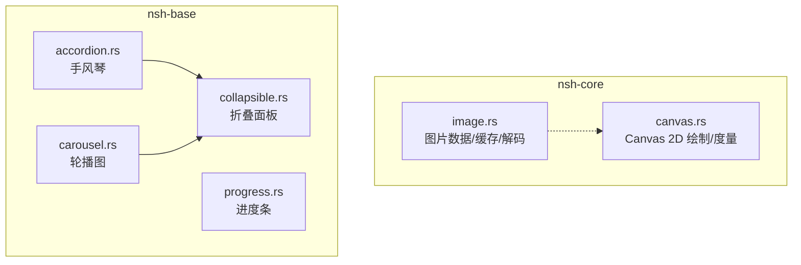
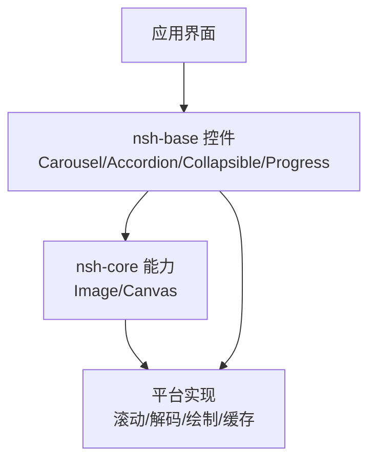
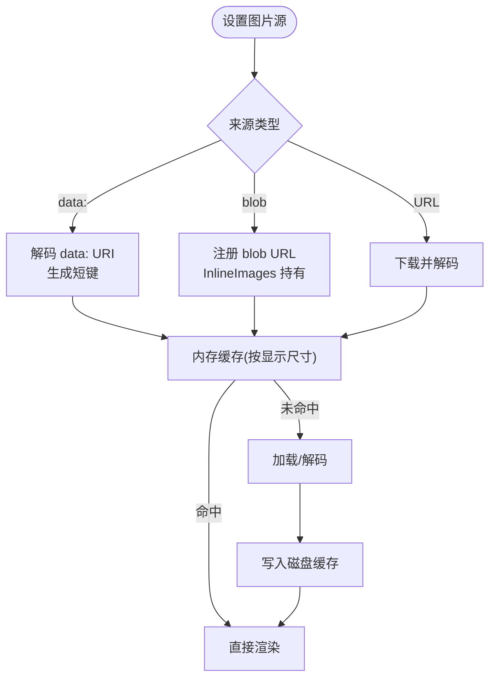
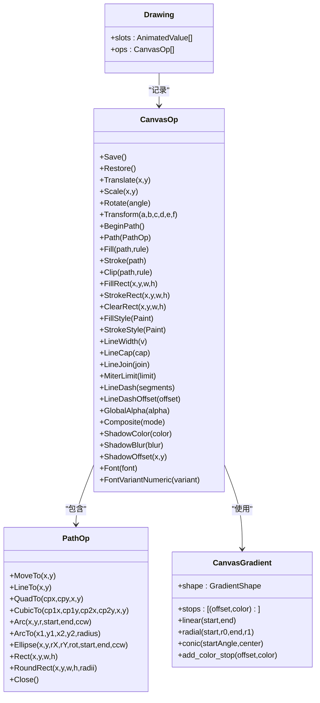
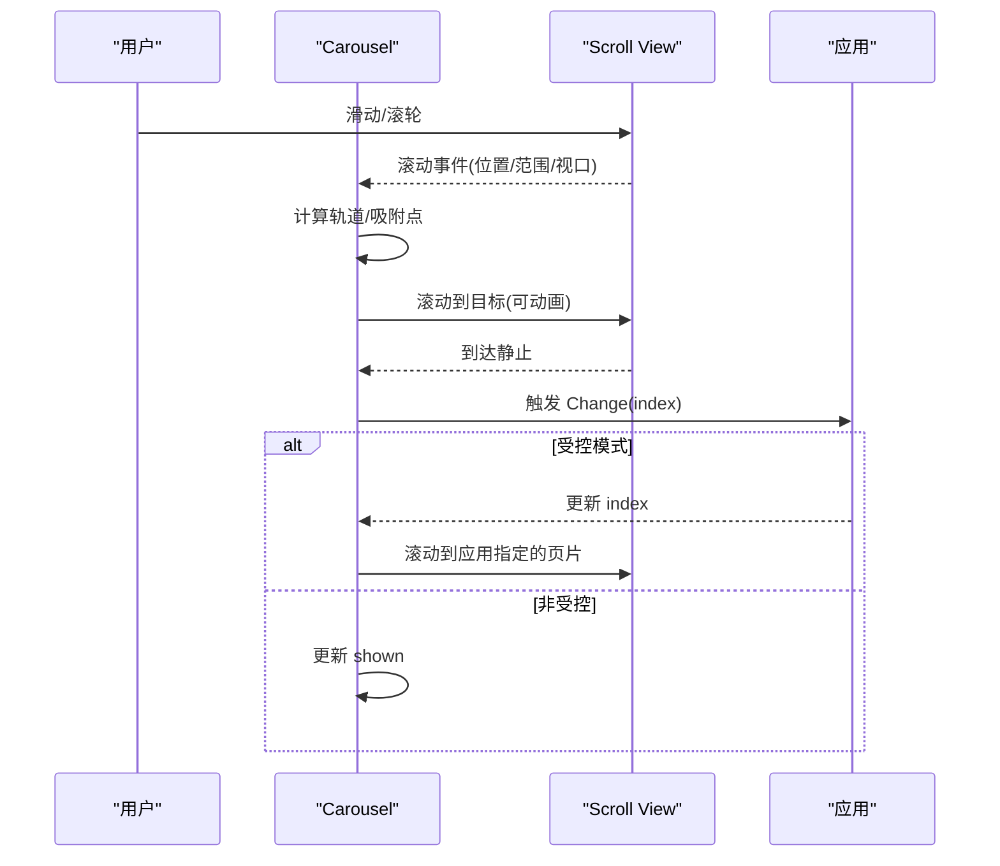
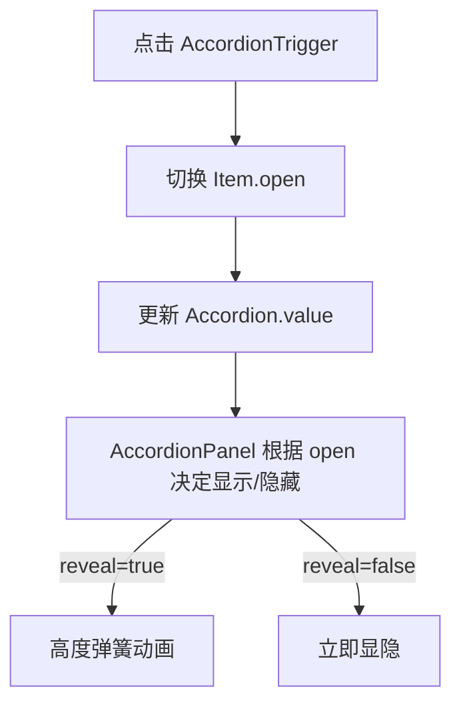
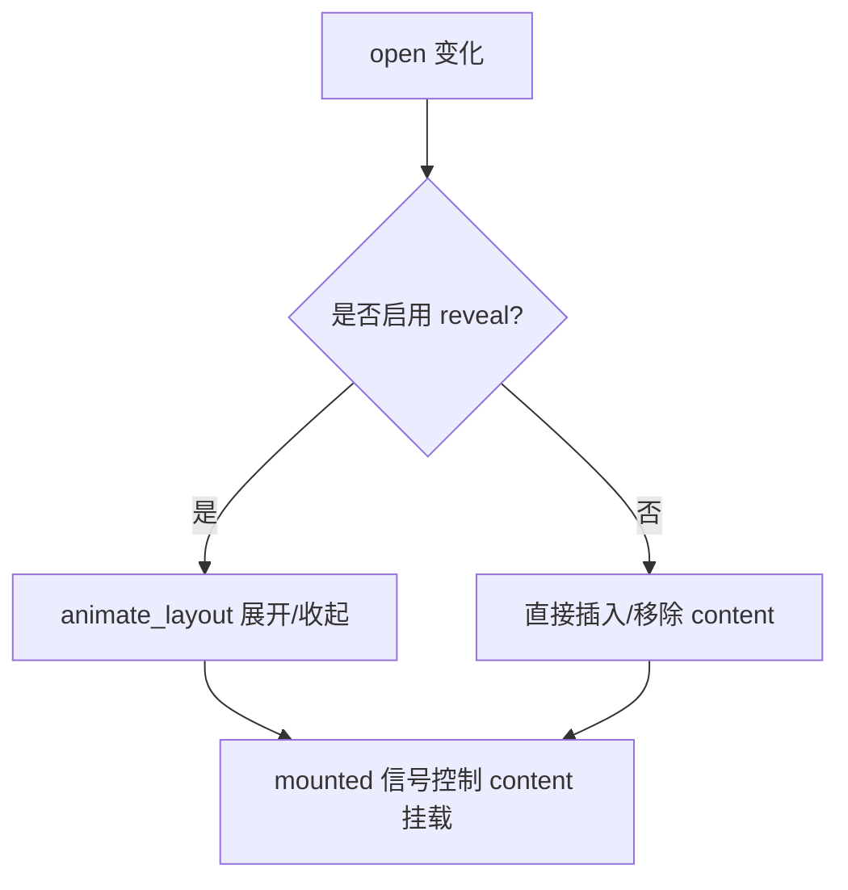
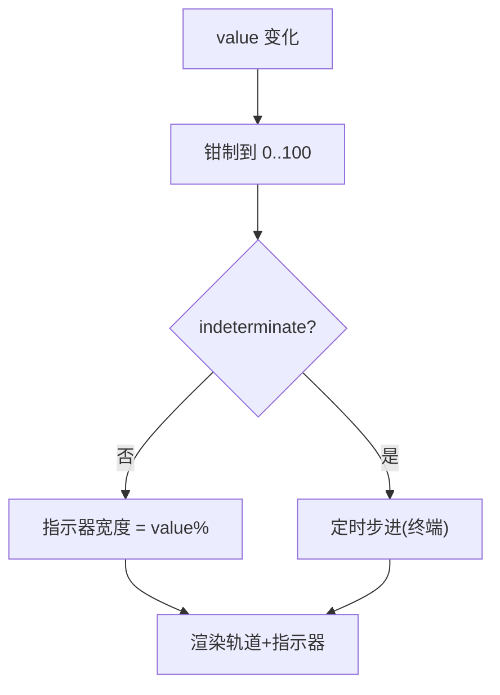
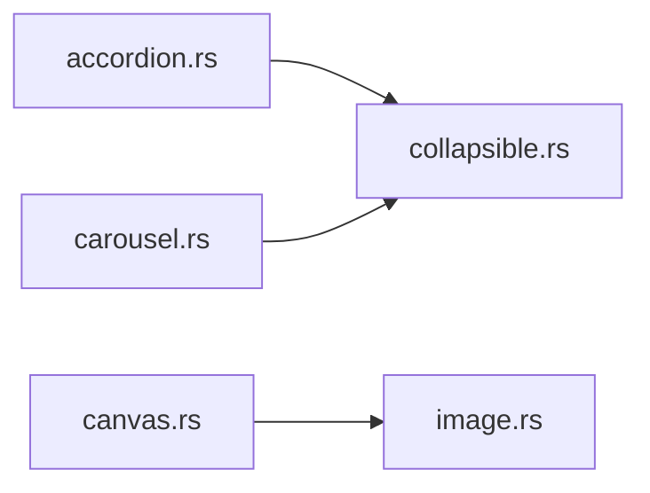

# 展示控件

<cite>
**本文引用的文件**   
- [accordion.rs](file://crates/nsh-base/src/accordion.rs)
- [carousel.rs](file://crates/nsh-base/src/carousel.rs)
- [collapsible.rs](file://crates/nsh-base/src/collapsible.rs)
- [progress.rs](file://crates/nsh-base/src/progress.rs)
- [image.rs](file://crates/nsh-core/src/image.rs)
- [canvas.rs](file://crates/nsh-core/src/canvas.rs)
</cite>

## 目录
1. [简介](#简介)
2. [项目结构](#项目结构)
3. [核心组件](#核心组件)
4. [架构总览](#架构总览)
5. [详细组件分析](#详细组件分析)
6. [依赖关系分析](#依赖关系分析)
7. [性能与优化](#性能与优化)
8. [故障排查指南](#故障排查指南)
9. [结论](#结论)
10. [附录](#附录)

## 简介
本文件面向 NSH 的展示类控件，覆盖 Image（图片）、Video（视频）、Canvas（画布）、Progress（进度条）、Carousel（轮播图）、Accordion（手风琴）、Collapsible（折叠面板）等。文档聚焦：
- 媒体加载优化、渲染性能、缓存策略与格式支持
- 动画效果、交互反馈与响应式适配
- 多媒体内容展示的最佳实践与性能优化技巧

说明：
- 图片与画布在 nsh-core 提供底层能力；基础 UI 控件在 nsh-base 实现。
- 视频相关能力由平台与宿主层提供，本文以通用最佳实践与集成要点为主。

## 项目结构
- nsh-core
  - image.rs：图片数据、内联 data/blob 源、内存与磁盘缓存、解码管线、密度解析等
  - canvas.rs：Canvas 2D 操作记录、绘制原语、文本度量、渐变、路径、命中检测等
- nsh-base
  - accordion.rs：手风琴（分组展开/收起）
  - collapsible.rs：折叠面板（可展开区域）
  - carousel.rs：轮播图（原生滚动、吸附、无缝循环）
  - progress.rs：线性进度条（确定/不确定模式）

图表来源
- [image.rs:1-45](file://crates/nsh-core/src/image.rs#L1-L45)
- [canvas.rs:1-30](file://crates/nsh-core/src/canvas.rs#L1-L30)
- [accordion.rs:1-25](file://crates/nsh-base/src/accordion.rs#L1-L25)
- [collapsible.rs:1-25](file://crates/nsh-base/src/collapsible.rs#L1-L25)
- [carousel.rs:1-25](file://crates/nsh-base/src/carousel.rs#L1-L25)
- [progress.rs:1-15](file://crates/nsh-base/src/progress.rs#L1-L15)

章节来源
- [image.rs:1-45](file://crates/nsh-core/src/image.rs#L1-L45)
- [canvas.rs:1-30](file://crates/nsh-core/src/canvas.rs#L1-L30)
- [accordion.rs:1-25](file://crates/nsh-base/src/accordion.rs#L1-L25)
- [collapsible.rs:1-25](file://crates/nsh-base/src/collapsible.rs#L1-L25)
- [carousel.rs:1-25](file://crates/nsh-base/src/carousel.rs#L1-L25)
- [progress.rs:1-15](file://crates/nsh-base/src/progress.rs#L1-L15)

## 核心组件
- Image（图片）
  - 支持 data: URI、blob URL、远程资源；内存与磁盘两级缓存；按显示尺寸与预算回收
  - 自动解析像素密度（如 logo@2x.png），RGBA 像素缓冲直出或转 PNG
- Canvas（画布）
  - 将 JS 绘制的 2D 上下文调用记录为不可变操作序列，平台侧原生回放
  - 支持路径、渐变、阴影、字体度量、合成模式等
- Carousel（轮播图）
  - 基于原生滚动视图，滑动/滚轮/触控板驱动，吸附到页片起点
  - 支持无缝循环、键盘导航、焦点管理、无障碍
- Accordion（手风琴）
  - 多组标题/面板，单选或多选展开，配合 Collapsible 的展开动画
- Collapsible（折叠面板）
  - 可裁剪高度的展开/收起，支持弹簧动画与“保持挂载”
- Progress（进度条）
  - 确定/不确定两种模式，终端下特殊渲染，无障碍值语义

章节来源
- [image.rs:1-45](file://crates/nsh-core/src/image.rs#L1-L45)
- [canvas.rs:1-30](file://crates/nsh-core/src/canvas.rs#L1-L30)
- [carousel.rs:1-25](file://crates/nsh-base/src/carousel.rs#L1-L25)
- [accordion.rs:1-25](file://crates/nsh-base/src/accordion.rs#L1-L25)
- [collapsible.rs:1-25](file://crates/nsh-base/src/collapsible.rs#L1-L25)
- [progress.rs:1-15](file://crates/nsh-base/src/progress.rs#L1-L15)

## 架构总览
展示控件整体分层：
- 应用层：使用 Carousel/Accordion/Collapsible/Progress 等组合构建界面
- 基础控件层：nsh-base 提供可复用 UI 行为（展开/收起、滚动吸附、进度指示）
- 核心能力层：nsh-core 提供图片解码/缓存、Canvas 绘制回放等高性能能力
- 平台层：各平台实现滚动、解码、绘制、缓存策略

图表来源
- [carousel.rs:1-25](file://crates/nsh-base/src/carousel.rs#L1-L25)
- [accordion.rs:1-25](file://crates/nsh-base/src/accordion.rs#L1-L25)
- [collapsible.rs:1-25](file://crates/nsh-base/src/collapsible.rs#L1-L25)
- [progress.rs:1-15](file://crates/nsh-base/src/progress.rs#L1-L15)
- [image.rs:1-45](file://crates/nsh-core/src/image.rs#L1-L45)
- [canvas.rs:1-30](file://crates/nsh-core/src/canvas.rs#L1-L30)

## 详细组件分析

### 图片（Image）
- 数据与来源
  - 内存图像数据 ImageData：共享字节、可选 RGBA 像素缓冲
  - data: URI 解码与短键映射，避免长 URI 占用缓存
  - blob URL 与 InlineImages 生命周期绑定
- 缓存策略
  - 内存缓存 MemoryCache + 预算 Budget/Lease，按显示尺寸缓存
  - 磁盘缓存 DiskCache（非 WASM），按策略与格式持久化
- 解码与格式
  - 支持 base64/percent-encoded data: URI
  - RGBA 像素缓冲优先直出，否则按需编码为 PNG
  - 密度解析 density()，文件名含 @Nx 时自动识别
- 性能要点
  - 一次解码、多次重用；按视口与可见性回收
  - 短键减少哈希开销；InlineImages 弱引用释放内存

图表来源
- [image.rs:1-45](file://crates/nsh-core/src/image.rs#L1-L45)
- [image.rs:258-333](file://crates/nsh-core/src/image.rs#L258-L333)
- [image.rs:335-385](file://crates/nsh-core/src/image.rs#L335-L385)
- [image.rs:387-396](file://crates/nsh-core/src/image.rs#L387-L396)

章节来源
- [image.rs:1-45](file://crates/nsh-core/src/image.rs#L1-L45)
- [image.rs:258-333](file://crates/nsh-core/src/image.rs#L258-L333)
- [image.rs:335-385](file://crates/nsh-core/src/image.rs#L335-L385)
- [image.rs:387-396](file://crates/nsh-core/src/image.rs#L387-L396)

### 画布（Canvas）
- 绘制模型
  - JS 侧通过 2D 上下文记录操作，Rust 侧解析为不可变操作列表
  - 平台侧原生回放，避免 JS 参与每帧重绘
- 关键能力
  - 路径 PathOp、填充/描边/裁剪、渐变 GradientShape、阴影、字体 CanvasFont
  - 文本度量 measure_line/line_metrics，对齐与基线控制
  - 合成模式 Composite、变换矩阵、虚线等
- 性能要点
  - 数字支持动画槽 Num::Slot，UI 线程读取，无需 JS 回调
  - 增量损坏检测 damage 与命中 hit 辅助优化

图表来源
- [canvas.rs:29-48](file://crates/nsh-core/src/canvas.rs#L29-L48)
- [canvas.rs:56-130](file://crates/nsh-core/src/canvas.rs#L56-L130)
- [canvas.rs:171-325](file://crates/nsh-core/src/canvas.rs#L171-L325)
- [canvas.rs:686-800](file://crates/nsh-core/src/canvas.rs#L686-L800)

章节来源
- [canvas.rs:1-30](file://crates/nsh-core/src/canvas.rs#L1-L30)
- [canvas.rs:29-48](file://crates/nsh-core/src/canvas.rs#L29-L48)
- [canvas.rs:56-130](file://crates/nsh-core/src/canvas.rs#L56-L130)
- [canvas.rs:171-325](file://crates/nsh-core/src/canvas.rs#L171-L325)
- [canvas.rs:686-800](file://crates/nsh-core/src/canvas.rs#L686-L800)

### 轮播图（Carousel）
- 交互与布局
  - 原生滚动视图承载内容，手指/滚轮/触控板驱动，吸附到页片起点
  - 计算每个页片的 frame，动态生成 snap 点；支持多页片同屏、间隙、预览
- 无缝循环
  - 跑道 runway 与周期 period，跨周期平移；居中后回中无动画
- 受控与非受控
  - 支持应用传入 index（受控），内部维护 own/pending/shown
  - 用户拖拽后的“待确认”状态，等待应用响应后回弹或确认
- 键盘与无障碍
  - 方向键/Home/End 导航；焦点进入/离开事件；屏幕阅读器友好

图表来源
- [carousel.rs:1-25](file://crates/nsh-base/src/carousel.rs#L1-L25)
- [carousel.rs:106-139](file://crates/nsh-base/src/carousel.rs#L106-L139)
- [carousel.rs:270-409](file://crates/nsh-base/src/carousel.rs#L270-L409)
- [carousel.rs:558-713](file://crates/nsh-base/src/carousel.rs#L558-L713)

章节来源
- [carousel.rs:1-25](file://crates/nsh-base/src/carousel.rs#L1-L25)
- [carousel.rs:106-139](file://crates/nsh-base/src/carousel.rs#L106-L139)
- [carousel.rs:270-409](file://crates/nsh-base/src/carousel.rs#L270-L409)
- [carousel.rs:558-713](file://crates/nsh-base/src/carousel.rs#L558-L713)

### 手风琴（Accordion）
- 结构与状态
  - Accordion 持有 value（已展开项的值集合）、multiple（是否多选）、disabled
  - AccordionItem 通过 context 获取 open/disabled/toggle
- 交互与动画
  - AccordionTrigger 按钮角色，支持 expanded 状态样式与无障碍标签
  - AccordionPanel 支持 reveal 展开动画（高度弹簧），keep_mounted 保持子树挂载
- 终端适配
  - 终端下使用 disclosure 符号与分隔符

图表来源
- [accordion.rs:43-96](file://crates/nsh-base/src/accordion.rs#L43-L96)
- [accordion.rs:119-156](file://crates/nsh-base/src/accordion.rs#L119-L156)
- [accordion.rs:181-239](file://crates/nsh-base/src/accordion.rs#L181-L239)
- [accordion.rs:241-319](file://crates/nsh-base/src/accordion.rs#L241-L319)

章节来源
- [accordion.rs:43-96](file://crates/nsh-base/src/accordion.rs#L43-L96)
- [accordion.rs:119-156](file://crates/nsh-base/src/accordion.rs#L119-L156)
- [accordion.rs:181-239](file://crates/nsh-base/src/accordion.rs#L181-L239)
- [accordion.rs:241-319](file://crates/nsh-base/src/accordion.rs#L241-L319)

### 折叠面板（Collapsible）
- 行为
  - open 控制内容是否在树中；reveal 启用裁剪高度展开/收起
  - follow_open 负责动画期间保持 mounted，直到区域闭合
- 动画
  - 默认弹簧（180ms，临界阻尼），可通过 reveal_spring 自定义
  - 尊重系统“减少动效”设置

图表来源
- [collapsible.rs:26-59](file://crates/nsh-base/src/collapsible.rs#L26-L59)
- [collapsible.rs:72-100](file://crates/nsh-base/src/collapsible.rs#L72-L100)
- [collapsible.rs:102-150](file://crates/nsh-base/src/collapsible.rs#L102-L150)

章节来源
- [collapsible.rs:26-59](file://crates/nsh-base/src/collapsible.rs#L26-L59)
- [collapsible.rs:72-100](file://crates/nsh-base/src/collapsible.rs#L72-L100)
- [collapsible.rs:102-150](file://crates/nsh-base/src/collapsible.rs#L102-L150)

### 进度条（Progress）
- 模式
  - 确定模式：value 百分比映射到指示器宽度
  - 不确定模式：移动片段表示进行中
- 终端适配
  - 终端下用字符绘制进度条，不确定模式下周期性步进
- 无障碍
  - role=progressbar，min/max/now 语义值

图表来源
- [progress.rs:12-44](file://crates/nsh-base/src/progress.rs#L12-L44)
- [progress.rs:61-100](file://crates/nsh-base/src/progress.rs#L61-L100)
- [progress.rs:102-135](file://crates/nsh-base/src/progress.rs#L102-L135)

章节来源
- [progress.rs:12-44](file://crates/nsh-base/src/progress.rs#L12-L44)
- [progress.rs:61-100](file://crates/nsh-base/src/progress.rs#L61-L100)
- [progress.rs:102-135](file://crates/nsh-base/src/progress.rs#L102-L135)

### 视频（Video）
- 能力边界
  - 视频播放与编解码由平台/宿主层提供；NSH 上层通过宿主 API 暴露
- 最佳实践
  - 预加载策略：根据可视性与优先级选择 preload
  - 自适应码率：网络波动时切换清晰度
  - 懒加载：进入视口再初始化播放器实例
  - 后台行为：最小化/暂停策略，省电与带宽节省
  - 无障碍：字幕、音轨切换、描述音轨

[本节为概念性指导，不直接分析具体源码文件]

## 依赖关系分析
- Carousel 依赖 Collapsible 的展开逻辑（用于分页指示器等联动）
- Accordion 依赖 Collapsible 的 follow_open 进行面板动画
- Image 与 Canvas 解耦：Canvas 通过 CanvasImage 引用图片资源，图片由 image.rs 提供解码与缓存

图表来源
- [accordion.rs:14-23](file://crates/nsh-base/src/accordion.rs#L14-L23)
- [carousel.rs:1-25](file://crates/nsh-base/src/carousel.rs#L1-L25)
- [canvas.rs:670-684](file://crates/nsh-core/src/canvas.rs#L670-L684)
- [image.rs:1-45](file://crates/nsh-core/src/image.rs#L1-L45)

章节来源
- [accordion.rs:14-23](file://crates/nsh-base/src/accordion.rs#L14-L23)
- [carousel.rs:1-25](file://crates/nsh-base/src/carousel.rs#L1-L25)
- [canvas.rs:670-684](file://crates/nsh-core/src/canvas.rs#L670-L684)
- [image.rs:1-45](file://crates/nsh-core/src/image.rs#L1-L45)

## 性能与优化
- 图片
  - 使用 data: 短键与 blob URL 降低缓存键长度
  - 按显示尺寸缓存，避免重复解码；利用内存预算与租约机制回收
  - RGBA 像素缓冲直出，减少中间编码开销
  - 合理命名带密度的文件名（@2x/@3x）
- Canvas
  - 尽量复用 Drawing 与操作序列，减少重建
  - 使用 Num::Slot 驱动动画，避免 JS 回调重绘
  - 局部更新与损坏检测，避免全量重绘
- Carousel
  - 使用原生滚动与吸附，减少 JS 计算
  - 控制页片数量与尺寸，避免超大内容导致布局抖动
  - 合理使用 keep_mounted 与 lazy mount，降低首屏压力
- Accordion/Collapsible
  - 仅在必要时启用 reveal 动画；对复杂内容谨慎使用 keep_mounted
  - 遵循“减少动效”设置，提升可访问性与性能
- Progress
  - 不确定模式在终端下使用低开销定时器；避免高频刷新
- 通用
  - 懒加载与视口检测：仅当元素进入视口时加载媒体
  - 预取与预解码：对即将出现的媒体提前准备
  - 节流/防抖：对频繁变化的 value（如滚动、缩放）做节流

[本节为通用指导，不直接分析具体源码文件]

## 故障排查指南
- 图片无法显示
  - 检查 data: URI 是否有效、base64/百分号编码是否正确
  - 确认 blob URL 未被撤销且仍被核心持有
  - 查看内存/磁盘缓存命中率与预算限制
- Canvas 绘制异常
  - 检查路径闭合、变换顺序、合成模式
  - 确认字体解析与度量结果是否符合预期
  - 观察损坏区域是否过大导致重绘过多
- Carousel 吸附不准
  - 检查页片尺寸与 gap 是否一致，轨道计算是否就绪
  - 关注受控模式下应用返回的 index 是否与当前滚动一致
- Accordion/Collapsible 动画卡顿
  - 评估 keep_mounted 的内容复杂度；必要时禁用 reveal
  - 检查 reduce_motion 设置与系统偏好
- Progress 显示异常
  - 确认 value 范围与 indeterminate 标志
  - 终端下检查颜色与字符渲染

章节来源
- [image.rs:258-333](file://crates/nsh-core/src/image.rs#L258-L333)
- [image.rs:335-385](file://crates/nsh-core/src/image.rs#L335-L385)
- [canvas.rs:686-800](file://crates/nsh-core/src/canvas.rs#L686-L800)
- [carousel.rs:558-713](file://crates/nsh-base/src/carousel.rs#L558-L713)
- [accordion.rs:241-319](file://crates/nsh-base/src/accordion.rs#L241-L319)
- [collapsible.rs:102-150](file://crates/nsh-base/src/collapsible.rs#L102-L150)
- [progress.rs:61-135](file://crates/nsh-base/src/progress.rs#L61-L135)

## 结论
NSH 的展示控件在 nsh-core 与 nsh-base 之间形成清晰分层：核心能力专注高性能媒体与绘制，基础控件封装常用交互与动画。通过图片缓存、Canvas 原生回放、原生滚动与吸附、以及可配置的展开动画，系统在性能与体验之间取得平衡。结合本文最佳实践与优化建议，可在不同平台上稳定地呈现高质量的多媒体内容。

[本节为总结性内容，不直接分析具体源码文件]

## 附录
- 术语
  - 受控/非受控：由外部 state 控制还是内部 state 管理
  - 吸附：滚动停止时自动对齐到预设位置
  - 无损循环：视觉上无缝衔接的循环滚动
- 参考
  - 图片与资产：见仓库 docs/images-and-assets.md（若存在）
  - 性能报告：见仓库 docs/performance-report.md（若存在）

[本节为补充信息，不直接分析具体源码文件]