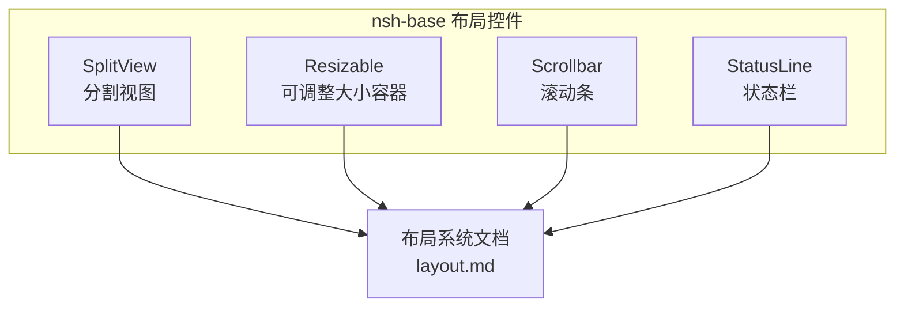
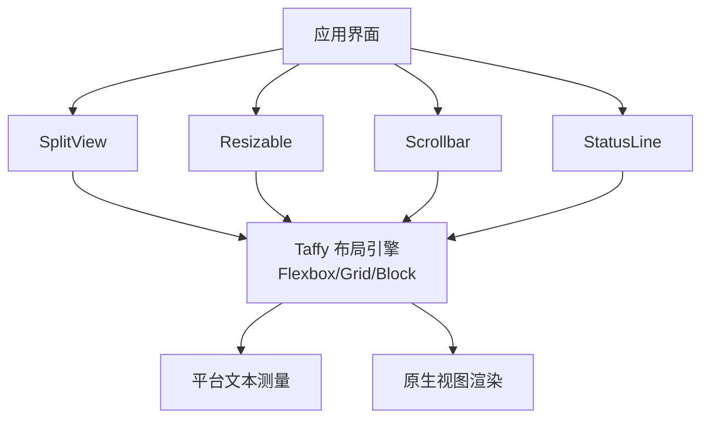
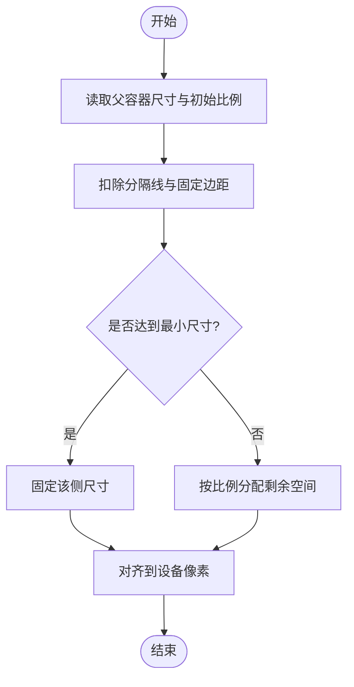
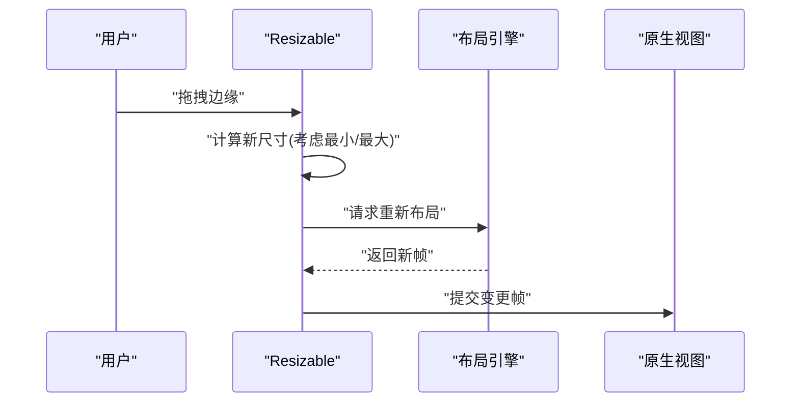
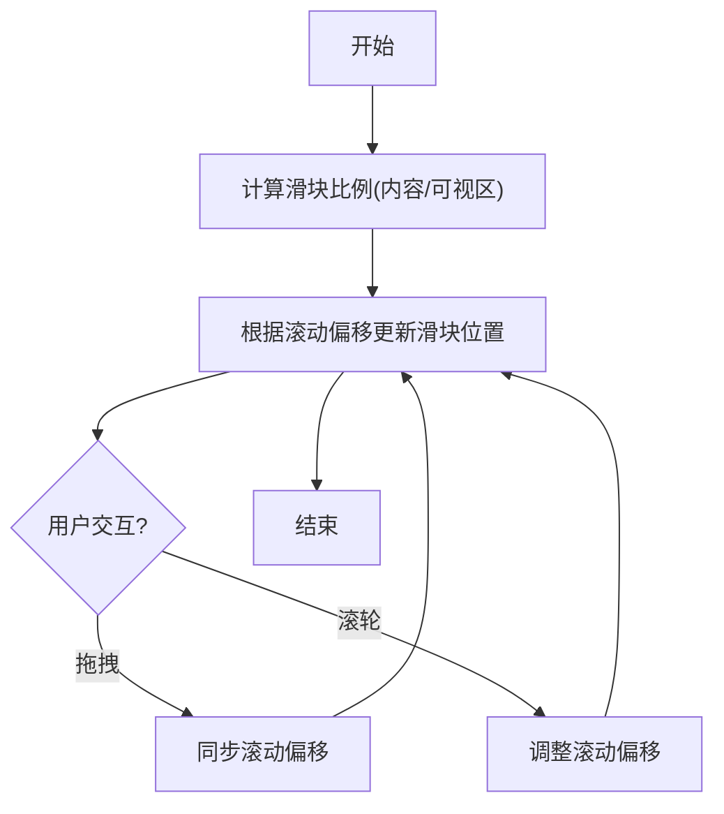
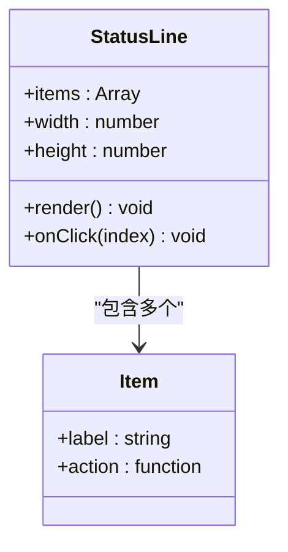
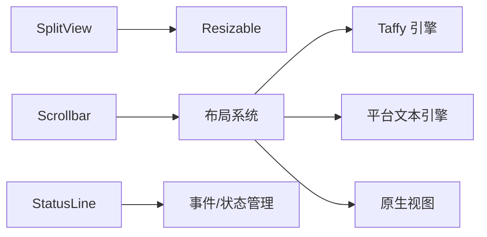

# 布局控件

<cite>
**本文引用的文件**   
- [split_view.rs](file://crates/nsh-base/src/split_view.rs)
- [resizable.rs](file://crates/nsh-base/src/resizable.rs)
- [scrollbar.rs](file://crates/nsh-base/src/scrollbar.rs)
- [status_line.rs](file://crates/nsh-base/src/status_line.rs)
- [layout.md](file://website/docs/layout.md)
</cite>

## 目录
1. [简介](#简介)
2. [项目结构](#项目结构)
3. [核心组件](#核心组件)
4. [架构总览](#架构总览)
5. [详细组件分析](#详细组件分析)
6. [依赖关系分析](#依赖关系分析)
7. [性能考量](#性能考量)
8. [故障排查指南](#故障排查指南)
9. [结论](#结论)
10. [附录](#附录)

## 简介
本章节聚焦 NSH 的布局相关控件：SplitView（分割视图）、Resizable（可调整大小容器）、Scrollbar（滚动条）、StatusLine（状态栏）。文档从布局算法、尺寸计算、自适应行为与性能优化入手，结合响应式设计模式、触摸手势支持与多平台适配策略，给出复杂布局场景的解决方案与最佳实践。NSH 的布局系统基于 Taffy（Rust 实现的 Flexbox/Grid/Block 布局），在核心层运行，仅将变更帧下发到原生视图；文本测量由平台文本引擎在同一线程完成，避免阻塞主线程。

## 项目结构
与布局控件直接相关的实现位于 nsh-base 的 UI 组件目录中，分别对应 SplitView、Resizable、Scrollbar、StatusLine。网站文档 layout.md 提供了布局系统的通用规范（Flexbox、Grid、尺寸、绝对定位、onLayout 测量、安全区域、RTL 等），是理解这些控件行为的基础。

图表来源
- [split_view.rs:1-200](file://crates/nsh-base/src/split_view.rs#L1-L200)
- [resizable.rs:1-200](file://crates/nsh-base/src/resizable.rs#L1-L200)
- [scrollbar.rs:1-200](file://crates/nsh-base/src/scrollbar.rs#L1-L200)
- [status_line.rs:1-200](file://crates/nsh-base/src/status_line.rs#L1-L200)
- [layout.md:1-295](file://website/docs/layout.md#L1-L295)

章节来源
- [layout.md:1-295](file://website/docs/layout.md#L1-L295)

## 核心组件
- SplitView：用于将父容器划分为两个或多个面板，支持拖拽分隔线调整比例，具备最小尺寸约束与弹性分配能力。
- Resizable：提供可交互的尺寸调整能力（宽度/高度或双向），支持拖拽与触摸手势，内部通过布局属性与 onLayout 反馈驱动更新。
- Scrollbar：可视化的滚动指示器，与滚动内容联动，支持主题化样式与平台差异处理。
- StatusLine：应用级状态展示条，通常置于窗口底部，承载信息、操作提示与轻量交互。

章节来源
- [split_view.rs:1-200](file://crates/nsh-base/src/split_view.rs#L1-L200)
- [resizable.rs:1-200](file://crates/nsh-base/src/resizable.rs#L1-L200)
- [scrollbar.rs:1-200](file://crates/nsh-base/src/scrollbar.rs#L1-L200)
- [status_line.rs:1-200](file://crates/nsh-base/src/status_line.rs#L1-L200)

## 架构总览
以下图展示了布局控件与 NSH 布局系统之间的关系：控件通过 Flexbox/Grid 进行子元素排布，使用 onLayout 获取实际帧以驱动交互逻辑（如拖拽分隔线、滚动条位置同步），并通过主题与平台 API 渲染最终界面。

图表来源
- [layout.md:1-295](file://website/docs/layout.md#L1-L295)
- [split_view.rs:1-200](file://crates/nsh-base/src/split_view.rs#L1-L200)
- [resizable.rs:1-200](file://crates/nsh-base/src/resizable.rs#L1-L200)
- [scrollbar.rs:1-200](file://crates/nsh-base/src/scrollbar.rs#L1-L200)
- [status_line.rs:1-200](file://crates/nsh-base/src/status_line.rs#L1-L200)

## 详细组件分析

### SplitView（分割视图）
- 布局算法
  - 使用 Flexbox 主轴方向（水平或垂直）划分面板，分隔线作为独立节点参与布局。
  - 面板尺寸由初始比例、最小尺寸约束与剩余空间按比例分配决定。
  - 当某一侧达到最小尺寸时，另一侧继续增长；若两侧均达到最小值，则按 flex 规则共享剩余空间。
- 尺寸计算
  - 输入：父容器尺寸、各面板初始比例、最小尺寸、分隔线宽度。
  - 输出：每个面板的 Bounds（原点与宽高）。
  - 关键步骤：先扣除分隔线与固定边距，再对可变部分进行比例分配，最后对齐到设备像素边界。
- 自适应行为
  - 支持横竖屏切换与窗口缩放；根据可用空间自动调整分隔线位置。
  - 与 Safe Area 配合，确保在移动端不被系统 UI 遮挡。
- 交互与手势
  - 鼠标拖拽分隔线实时更新面板比例；触摸设备上支持手指拖拽。
  - 拖拽过程中禁用子元素滚动以避免冲突。
- 性能优化
  - 仅在拖拽事件触发时重新计算布局，避免每帧全量重排。
  - 使用 onLayout 回调精确获取变化帧，减少无效渲染。
- 复杂场景建议
  - 多级嵌套 SplitView：为每一级设置合理的最小尺寸，防止极端缩放导致不可用。
  - 与列表/编辑器组合：在拖拽期间暂停子组件的高频更新（如虚拟列表滚动）。

图表来源
- [split_view.rs:1-200](file://crates/nsh-base/src/split_view.rs#L1-L200)
- [layout.md:97-124](file://website/docs/layout.md#L97-L124)

章节来源
- [split_view.rs:1-200](file://crates/nsh-base/src/split_view.rs#L1-L200)
- [layout.md:97-124](file://website/docs/layout.md#L97-L124)

### Resizable（可调整大小容器）
- 布局算法
  - 通过监听拖拽/触摸事件改变容器的 width/height 或 flexBasis，并触发布局重新计算。
  - 支持双向调整（宽+高）与单轴调整（仅宽或仅高）。
- 尺寸计算
  - 输入：当前尺寸、拖拽增量、最小/最大尺寸限制。
  - 输出：新的 Bounds，并确保不超出父容器范围。
- 自适应行为
  - 在窄屏下自动切换为堆叠布局（flex-direction: column），提升可用性。
  - 与 Safe Area 和导航栈头部协调，避免被系统 UI 遮挡。
- 交互与手势
  - 支持鼠标拖拽边缘与触摸手势；在拖拽开始时捕获指针，拖拽结束时释放。
  - 防抖与节流：对高频 resize 事件进行节流，降低布局压力。
- 性能优化
  - 使用 requestAnimationFrame 或平台等效机制合并多次更新。
  - 仅在必要路径上启用动画，避免不必要的重绘。
- 复杂场景建议
  - 与 SplitView 组合：外层 SplitView 控制大区块，内层 Resizable 微调细节区域。
  - 与滚动容器组合：在调整尺寸时暂停滚动内容的频繁重排。

图表来源
- [resizable.rs:1-200](file://crates/nsh-base/src/resizable.rs#L1-L200)
- [layout.md:212-245](file://website/docs/layout.md#L212-L245)

章节来源
- [resizable.rs:1-200](file://crates/nsh-base/src/resizable.rs#L1-L200)
- [layout.md:212-245](file://website/docs/layout.md#L212-L245)

### Scrollbar（滚动条）
- 布局算法
  - 滚动条作为覆盖层或侧边栏，根据滚动内容与可视区域的比例计算滑块长度与位置。
  - 与滚动容器联动：滚动偏移变化时更新滑块位置，拖动滑块时反向更新滚动偏移。
- 尺寸计算
  - 输入：内容总高度、可视区域高度、滚动偏移。
  - 输出：滑块高度与 top 偏移，保证视觉比例一致。
- 自适应行为
  - 在桌面端默认显示，移动端可隐藏或改为手势滚动。
  - 支持 RTL 布局下的镜像显示。
- 交互与手势
  - 支持鼠标滚轮、点击轨道跳转、拖拽滑块；移动端支持触摸滑动。
  - 与页面滚动冲突检测：当滚动条激活时阻止父容器滚动。
- 性能优化
  - 使用增量更新与节流，避免每次滚动都完整重绘。
  - 在长列表中优先更新可见区域的滚动条状态。
- 复杂场景建议
  - 与虚拟列表组合：仅维护可见项的滚动状态，减少内存占用。
  - 与 SplitView 组合：在面板切换时重置滚动条状态，避免残留位置。

图表来源
- [scrollbar.rs:1-200](file://crates/nsh-base/src/scrollbar.rs#L1-L200)
- [layout.md:247-259](file://website/docs/layout.md#L247-L259)

章节来源
- [scrollbar.rs:1-200](file://crates/nsh-base/src/scrollbar.rs#L1-L200)
- [layout.md:247-259](file://website/docs/layout.md#L247-L259)

### StatusLine（状态栏）
- 布局算法
  - 通常采用 Flexbox 横向排列，左侧显示状态信息，右侧放置操作按钮。
  - 高度固定或自适应内容，支持在窄屏下换行或折叠。
- 尺寸计算
  - 输入：父容器宽度、内容数量与字体大小。
  - 输出：每项的宽度与间距，确保整体不溢出。
- 自适应行为
  - 在移动端可能隐藏次要信息，仅保留关键状态。
  - 与 Safe Area 配合，避免被系统 UI 遮挡。
- 交互与手势
  - 支持点击按钮触发动作；长按显示更多选项。
  - 在 RTL 环境下自动镜像布局。
- 性能优化
  - 静态内容缓存绘制结果，减少重复计算。
  - 仅在状态变化时更新局部区域。
- 复杂场景建议
  - 与 Dock/Tabs 组合：在不同标签页切换时动态更新状态内容。
  - 与 Toast/Popover 组合：在状态栏附近弹出提示，注意层级与遮挡关系。

图表来源
- [status_line.rs:1-200](file://crates/nsh-base/src/status_line.rs#L1-L200)
- [layout.md:15-68](file://website/docs/layout.md#L15-L68)

章节来源
- [status_line.rs:1-200](file://crates/nsh-base/src/status_line.rs#L1-L200)
- [layout.md:15-68](file://website/docs/layout.md#L15-L68)

## 依赖关系分析
- 组件耦合
  - SplitView 与 Resizable 存在潜在耦合：SplitView 的面板内部可使用 Resizable 进行微调。
  - Scrollbar 与滚动容器强耦合，需与布局系统紧密协作。
  - StatusLine 与其他组件弱耦合，主要通过事件总线或状态管理通信。
- 外部依赖
  - 布局系统依赖 Taffy（Flexbox/Grid/Block）。
  - 文本测量依赖平台文本引擎。
  - 渲染依赖原生视图层。
- 循环依赖
  - 应避免 SplitView 与 Resizable 之间的相互引用，建议使用事件或回调解耦。

图表来源
- [split_view.rs:1-200](file://crates/nsh-base/src/split_view.rs#L1-L200)
- [resizable.rs:1-200](file://crates/nsh-base/src/resizable.rs#L1-L200)
- [scrollbar.rs:1-200](file://crates/nsh-base/src/scrollbar.rs#L1-L200)
- [status_line.rs:1-200](file://crates/nsh-base/src/status_line.rs#L1-L200)
- [layout.md:1-295](file://website/docs/layout.md#L1-L295)

章节来源
- [split_view.rs:1-200](file://crates/nsh-base/src/split_view.rs#L1-L200)
- [resizable.rs:1-200](file://crates/nsh-base/src/resizable.rs#L1-L200)
- [scrollbar.rs:1-200](file://crates/nsh-base/src/scrollbar.rs#L1-L200)
- [status_line.rs:1-200](file://crates/nsh-base/src/status_line.rs#L1-L200)
- [layout.md:1-295](file://website/docs/layout.md#L1-L295)

## 性能考量
- 布局频率控制
  - 仅在交互触发时重新计算布局（如拖拽分隔线、调整尺寸）。
  - 使用节流/防抖合并高频事件，减少布局抖动。
- 渲染优化
  - 只发送变更帧到原生视图，避免整树重绘。
  - 对静态区域使用缓存绘制结果。
- 文本测量
  - 利用平台文本引擎在同一线程完成测量，避免阻塞主线程。
- 内存管理
  - 长列表与滚动内容采用虚拟化技术，仅维护可见项。
  - 及时释放不再使用的资源（如图标、图片）。

[本节为通用指导，无需具体文件引用]

## 故障排查指南
- 分隔线无法拖拽
  - 检查是否启用了子元素的滚动或手势冲突。
  - 确认父容器尺寸有效且未被隐藏。
- 滚动条位置不正确
  - 核对内容高度与可视区域高度计算是否正确。
  - 检查 RTL 布局下的镜像逻辑。
- 状态栏内容溢出
  - 调整 Flex 布局的 wrap 或缩小字体/间距。
  - 在窄屏下隐藏次要信息。
- 布局闪烁或卡顿
  - 减少 onLayout 回调中的昂贵计算。
  - 使用 requestAnimationFrame 或平台等效机制合并更新。

章节来源
- [split_view.rs:1-200](file://crates/nsh-base/src/split_view.rs#L1-L200)
- [scrollbar.rs:1-200](file://crates/nsh-base/src/scrollbar.rs#L1-L200)
- [status_line.rs:1-200](file://crates/nsh-base/src/status_line.rs#L1-L200)
- [layout.md:212-245](file://website/docs/layout.md#L212-L245)

## 结论
NSH 的布局控件围绕 Flexbox/Grid 构建，结合 onLayout 与平台文本引擎，实现了高效、灵活的界面排布。SplitView、Resizable、Scrollbar、StatusLine 各自承担特定职责，并通过统一布局系统与主题体系协同工作。在实际项目中，应注重交互事件的节流、布局计算的增量更新以及多平台适配（Safe Area、RTL、横竖屏），以获得稳定流畅的用户体验。

[本节为总结性内容，无需具体文件引用]

## 附录
- 响应式设计模式
  - 使用 Tailwind 断点（sm/md/lg）与 portrait/landscape 快速切换布局。
  - 在 onLayout 中根据窗口尺寸动态调整 flexDirection 或 grid 模板。
- 触摸手势支持
  - 统一封装拖拽、滑动、长按等手势，提供跨平台一致的交互体验。
- 多平台适配策略
  - 桌面端：强调键盘快捷键与精确鼠标交互。
  - 移动端：强调触摸手势与安全区域适配。
  - Web 端：注意浏览器兼容性与性能差异。

[本节为概念性内容，无需具体文件引用]