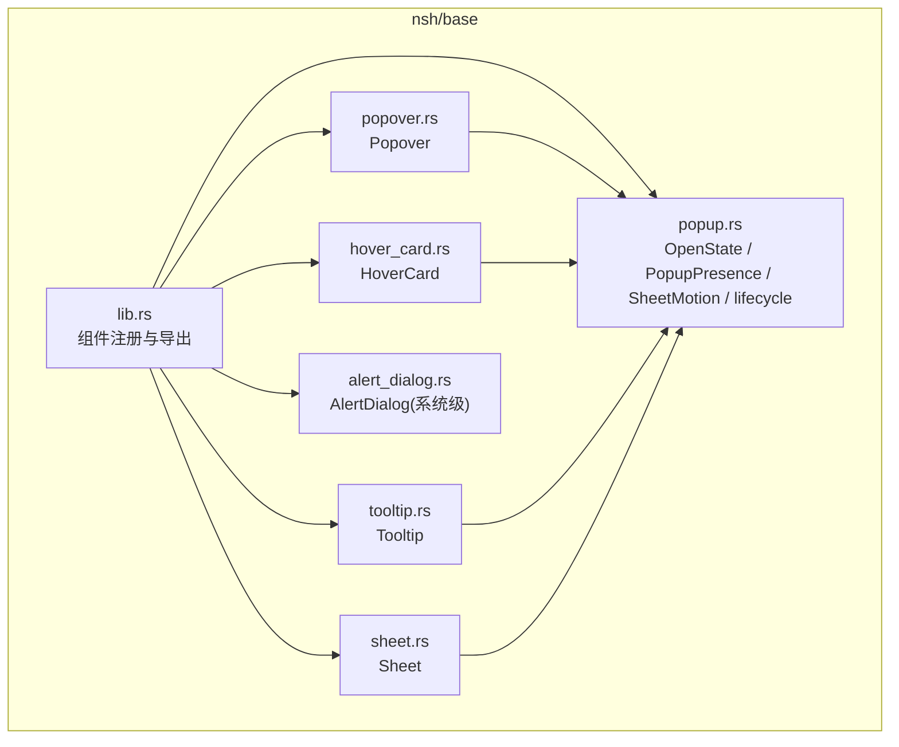
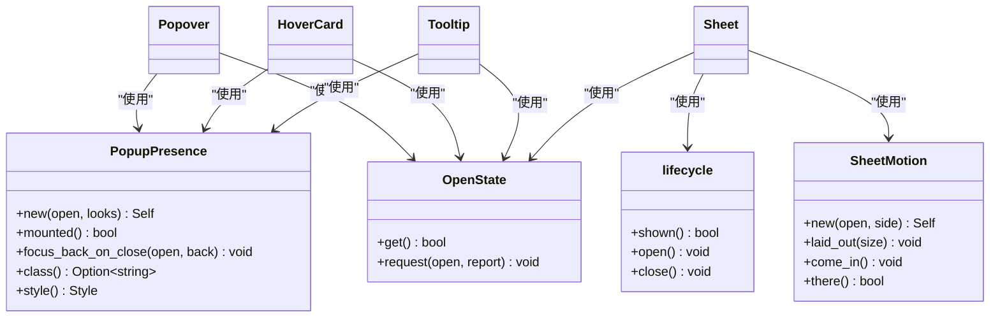
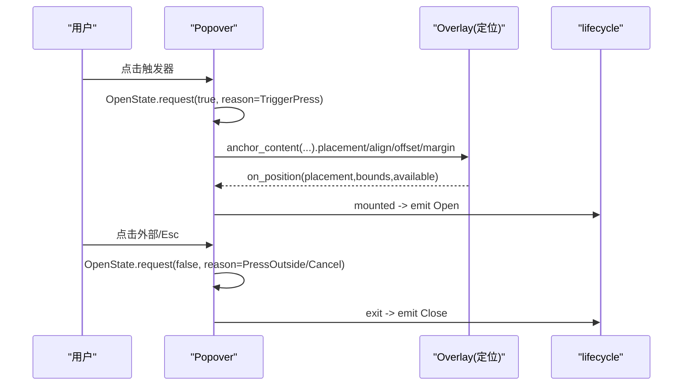
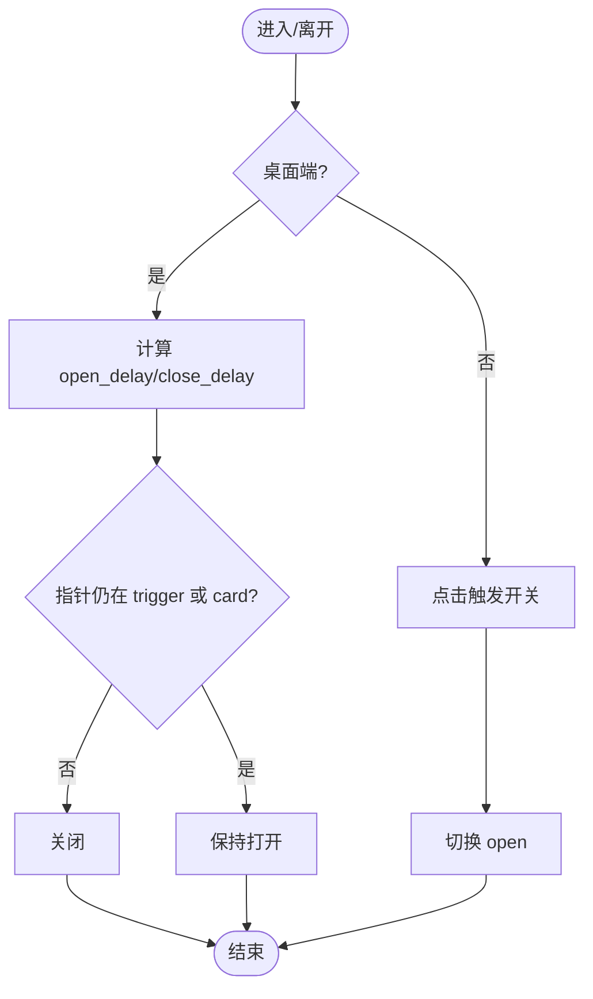
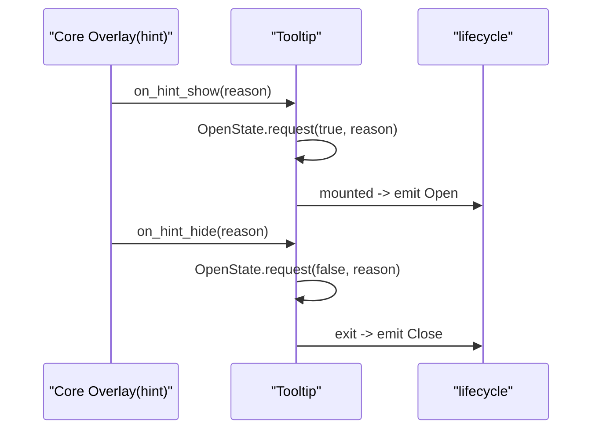
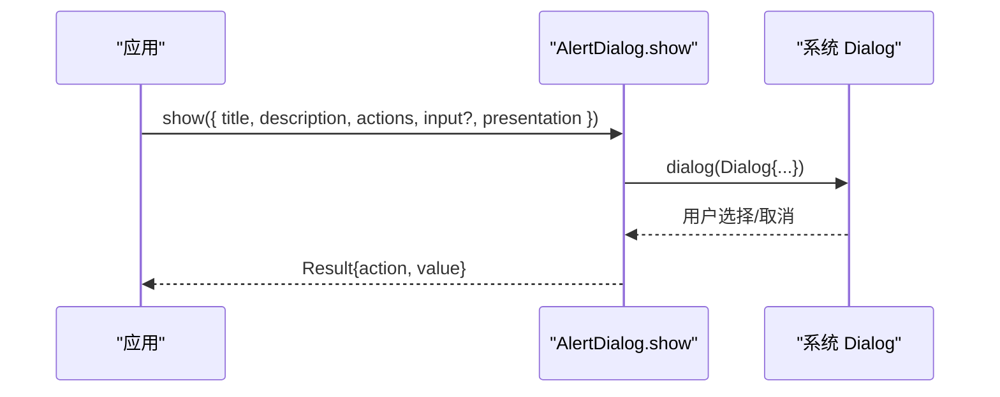
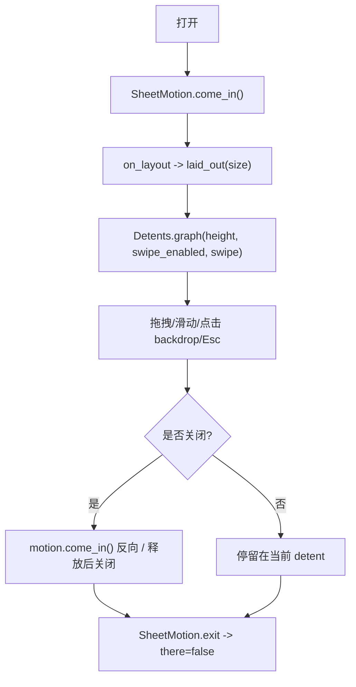
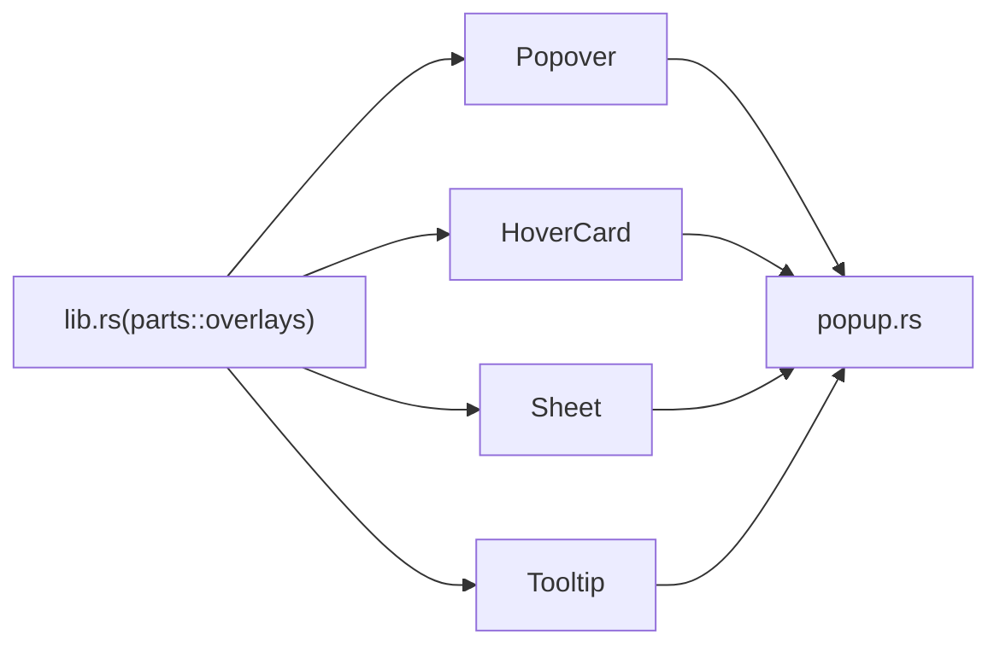

# 浮层控件

<cite>
**本文引用的文件**   
- [lib.rs](file://crates/nsh-base/src/lib.rs)
- [popup.rs](file://crates/nsh-base/src/popup.rs)
- [popover.rs](file://crates/nsh-base/src/popover.rs)
- [hover_card.rs](file://crates/nsh-base/src/hover_card.rs)
- [tooltip.rs](file://crates/nsh-base/src/tooltip.rs)
- [alert_dialog.rs](file://crates/nsh-base/src/alert_dialog.rs)
- [sheet.rs](file://crates/nsh-base/src/sheet.rs)
</cite>

## 目录
1. [简介](#简介)
2. [项目结构](#项目结构)
3. [核心组件](#核心组件)
4. [架构总览](#架构总览)
5. [详细组件分析](#详细组件分析)
6. [依赖关系分析](#依赖关系分析)
7. [性能与可访问性](#性能与可访问性)
8. [故障排查指南](#故障排查指南)
9. [结论](#结论)
10. [附录：API 速查](#附录api-速查)

## 简介
本文件系统性梳理 NSH 的浮层相关控件，包括 Popover（弹出框）、HoverCard（悬停卡片）、Tooltip（工具提示）、AlertDialog（警告对话框）、Sheet（面板），以及 Toast（提示消息）与 Popup（弹窗）在 nsh/base 中的组织方式。文档覆盖以下主题：
- 生命周期管理：打开、关闭、进入/退出动画、挂载与卸载时机
- 定位算法：基于触发元素的锚点、边距、对齐、安全区域与溢出回退
- 焦点管理与模态行为：键盘导航、屏幕阅读器支持、焦点回归
- 动画效果：PopupPresence 的状态样式、SheetMotion 的入场/出场与拖拽
- 交互模式：模态与非模态、点击外部关闭、Esc/返回键关闭、手势与滑动
- 组合使用与体验优化：多浮层叠加、优先级、可访问性与无障碍标签

## 项目结构
nsh/base 将浮层能力抽象为共享基础设施与具体组件两层：
- 共享基础设施（popup.rs）：统一的状态机、生命周期、定位与动画基础
- 具体组件（popover.rs、hover_card.rs、tooltip.rs、alert_dialog.rs、sheet.rs）：基于基础设施实现各自交互语义
- 注册与导出（lib.rs）：将组件与模块注册到运行时，供 JS/TSX 使用

图表来源
- [lib.rs:392-443](file://crates/nsh-base/src/lib.rs#L392-L443)
- [popup.rs:1-10](file://crates/nsh-base/src/popup.rs#L1-L10)

章节来源
- [lib.rs:19-103](file://crates/nsh-base/src/lib.rs#L19-L103)
- [lib.rs:392-443](file://crates/nsh-base/src/lib.rs#L392-L443)

## 核心组件
- Popover：锚定触发器的弹出框，支持 placement/align/offset/margin、点击外部关闭、Esc/返回键关闭、位置回调 Position
- HoverCard：鼠标悬停预览卡片，支持 open_delay/close_delay、指针进出逻辑、位置回调 Position
- Tooltip：元素提示气泡，支持延迟、禁用、终端模式显示、位置回调
- AlertDialog：系统级警告/操作表，支持 actions、input、presentation(alert/actionSheet)、close_on_escape/backdrop_press
- Sheet：边缘面板，支持 backdrop、侧边、detents（停靠点）、grabber、footer、拖拽与滑动关闭、键盘避让
- Toast/ToastStack：提示消息栈（由 lib.rs 暴露，具体实现在 toast 模块）

章节来源
- [popover.rs:10-92](file://crates/nsh-base/src/popover.rs#L10-L92)
- [hover_card.rs:22-103](file://crates/nsh-base/src/hover_card.rs#L22-L103)
- [tooltip.rs:26-92](file://crates/nsh-base/src/tooltip.rs#L26-L92)
- [alert_dialog.rs:14-148](file://crates/nsh-base/src/alert_dialog.rs#L14-L148)
- [sheet.rs:29-138](file://crates/nsh-base/src/sheet.rs#L29-L138)

## 架构总览
浮层体系以 popup.rs 为核心，提供：
- OpenState：受控/非受控打开状态，统一 onOpenChange 原因
- lifecycle：统一的“已显示/已隐藏”生命周期钩子
- PopupPresence：状态样式（starting/ending/open）、过渡等待、焦点回归
- SheetMotion：面板入场/出场动画、拖拽、停靠点、键盘避让
- DropdownFrame/Cover/Presence：下拉列表通用框架（Select/Combobox/DatePicker 复用）

图表来源
- [popup.rs:61-128](file://crates/nsh-base/src/popup.rs#L61-L128)
- [popup.rs:130-169](file://crates/nsh-base/src/popup.rs#L130-L169)
- [popup.rs:285-467](file://crates/nsh-base/src/popup.rs#L285-L467)
- [popup.rs:496-715](file://crates/nsh-base/src/popup.rs#L496-L715)

## 详细组件分析

### Popover（弹出框）
- 打开/关闭：触发器点击切换；点击外部或 Esc/返回键尝试关闭；移动端透明遮罩拦截点击
- 定位：overlay.anchor_content + placement/align/offset/margin；Position 事件报告最终 placement/bounds/available
- 焦点：桌面端记录焦点来源，关闭时焦点回到触发器（非点击外部关闭场景）
- 动画：通过 PopupPresence 的 starting/ending 类与内联样式驱动过渡

图表来源
- [popover.rs:105-238](file://crates/nsh-base/src/popover.rs#L105-L238)
- [popup.rs:130-169](file://crates/nsh-base/src/popup.rs#L130-L169)

章节来源
- [popover.rs:10-92](file://crates/nsh-base/src/popover.rs#L10-L92)
- [popover.rs:105-238](file://crates/nsh-base/src/popover.rs#L105-L238)

### HoverCard（悬停卡片）
- 打开/关闭：桌面端根据 open_delay/close_delay 控制；移动端通过点击触发；Escape/点击外部立即关闭
- 指针追踪：同时跟踪 trigger 与 card 的 hover 状态，确保移动过程中保持打开
- 定位：同 Popover，使用 overlay.anchor_content 与 placement/align/offset/margin
- 无独立焦点：不接管键盘焦点，避免误用

图表来源
- [hover_card.rs:148-292](file://crates/nsh-base/src/hover_card.rs#L148-L292)

章节来源
- [hover_card.rs:22-103](file://crates/nsh-base/src/hover_card.rs#L22-L103)
- [hover_card.rs:148-292](file://crates/nsh-base/src/hover_card.rs#L148-L292)

### Tooltip（工具提示）
- 显示时机：桌面端跟随指针与焦点；终端模式下直接显示在状态行；支持 delay 与 disabled
- 定位：使用 core 的 hint overlay，placement/align/offset/margin 与 PointerEvents::None
- 生命周期：on_hint_show/on_hint_hide 驱动 Open/Close 事件
- 可访问性：遵循 WAI-ARIA tooltip 模式，Esc 隐藏

图表来源
- [tooltip.rs:132-188](file://crates/nsh-base/src/tooltip.rs#L132-L188)
- [tooltip.rs:190-227](file://crates/nsh-base/src/tooltip.rs#L190-L227)

章节来源
- [tooltip.rs:26-92](file://crates/nsh-base/src/tooltip.rs#L26-L92)
- [tooltip.rs:132-188](file://crates/nsh-base/src/tooltip.rs#L132-L188)

### AlertDialog（警告对话框）
- 调用方式：异步 show(options)，返回 { action, value }
- 选项：title/description/actions/input/presentation(close_on_escape/close_on_backdrop_press)
- 输入框：可选文本输入，required/select_text_on_focus/default_value/placeholder
- 呈现：alert（居中）或 actionSheet（底部面板）

图表来源
- [alert_dialog.rs:150-158](file://crates/nsh-base/src/alert_dialog.rs#L150-L158)
- [alert_dialog.rs:252-296](file://crates/nsh-base/src/alert_dialog.rs#L252-L296)

章节来源
- [alert_dialog.rs:14-148](file://crates/nsh-base/src/alert_dialog.rs#L14-L148)
- [alert_dialog.rs:150-158](file://crates/nsh-base/src/alert_dialog.rs#L150-L158)
- [alert_dialog.rs:252-296](file://crates/nsh-base/src/alert_dialog.rs#L252-L296)

### Sheet（面板）
- 外观与布局：backdrop + panel，支持 side（top/left/right/bottom）、keyboard_lift、safe_area
- 动画：SheetMotion 控制入场/出场、拖拽、停靠点 detents、grabber、footer 联动
- 交互：点击 backdrop、Esc/返回键、滑动关闭（底部 sheet）；detents 支持弹簧吸附与 flick
- 可访问性：作为模态对话框，支持 accessibility_label、Tab 循环、焦点回归

图表来源
- [sheet.rs:208-419](file://crates/nsh-base/src/sheet.rs#L208-L419)
- [sheet.rs:421-800](file://crates/nsh-base/src/sheet.rs#L421-L800)
- [popup.rs:496-715](file://crates/nsh-base/src/popup.rs#L496-L715)

章节来源
- [sheet.rs:29-138](file://crates/nsh-base/src/sheet.rs#L29-L138)
- [sheet.rs:208-419](file://crates/nsh-base/src/sheet.rs#L208-L419)
- [sheet.rs:421-800](file://crates/nsh-base/src/sheet.rs#L421-L800)

## 依赖关系分析
- 组件对基础设施的依赖：
  - Popover/HoverCard/Tooltip 均依赖 OpenState 与 PopupPresence
  - Sheet 依赖 OpenState 与 SheetMotion
  - 所有浮层均通过 core 的 overlay 进行定位与事件分发
- 注册与导出：
  - overlays 部分注册 Popover/HoverCard/Sheet/Tooltip
  - menu/toast 等其它浮层类型分别注册于对应 parts

图表来源
- [lib.rs:436-443](file://crates/nsh-base/src/lib.rs#L436-L443)
- [popup.rs:1-10](file://crates/nsh-base/src/popup.rs#L1-L10)

章节来源
- [lib.rs:392-443](file://crates/nsh-base/src/lib.rs#L392-L443)

## 性能与可访问性
- 性能
  - PopupPresence 使用 request_animation_frame 与超时兜底保证首帧到达，避免无渲染表面导致阻塞
  - SheetMotion 使用原生动画值（AnimatedValue/AnimatedNode）与 Spring，减少 JS 桥接开销
  - lifecycle 使用 flips 与 after_answer 保证生命周期回调在正确时机触发，避免重复渲染
- 可访问性
  - Popover/HoverCard 设置 expanded/has_popup 无障碍状态
  - Sheet 作为模态对话框，配合 accessibility_label 与 Tab 循环
  - Tooltip 遵循 WAI-ARIA tooltip 模式，Esc 隐藏
  - AlertDialog 映射系统 DialogButtonStyle（Default/Cancel/Destructive）

章节来源
- [popover.rs:169-181](file://crates/nsh-base/src/popover.rs#L169-L181)
- [hover_card.rs:215-230](file://crates/nsh-base/src/hover_card.rs#L215-L230)
- [tooltip.rs:111-131](file://crates/nsh-base/src/tooltip.rs#L111-L131)
- [sheet.rs:393-418](file://crates/nsh-base/src/sheet.rs#L393-L418)
- [alert_dialog.rs:117-137](file://crates/nsh-base/src/alert_dialog.rs#L117-L137)

## 故障排查指南
- 浮层未显示或闪烁
  - 检查是否在非可见表面（如不在窗口中）导致首帧超时；确认 PopupPresence 的 first frame 机制
  - 若设置了 ending 样式但无 transition_time，可能提前卸载；检查组件是否提供了正确的过渡类
- 定位异常
  - 检查 placement/align/offset/margin 配置；关注 Position 事件返回的 available 空间
  - 在滚动容器中，确保触发器与浮层在同一根视图层级（overlay 会脱离父容器裁剪）
- 焦点丢失或无法回归
  - 桌面端需调用 note_focus_origin 并设置 focus_back_on_close；点击外部关闭时不应回归触发器
- Sheet 拖拽/滑动问题
  - 确认 close_on_swipe 与 detents 配置；检查 keyboard_lift 与 bottom_panel_max_height 导致的尺寸变化
  - 若 detents 动态变化，确保 laid_out 被调用以更新 away 距离
- AlertDialog 报错
  - 缺少 actions 或在 actionSheet 模式下传入 input 会抛出错误；检查 options 校验逻辑

章节来源
- [popup.rs:189-194](file://crates/nsh-base/src/popup.rs#L189-L194)
- [popup.rs:339-383](file://crates/nsh-base/src/popup.rs#L339-L383)
- [popover.rs:137-154](file://crates/nsh-base/src/popover.rs#L137-L154)
- [sheet.rs:275-318](file://crates/nsh-base/src/sheet.rs#L275-L318)
- [alert_dialog.rs:252-296](file://crates/nsh-base/src/alert_dialog.rs#L252-L296)

## 结论
NSH 的浮层体系以 popup.rs 为基础，统一了状态、生命周期、定位与动画，使 Popover、HoverCard、Tooltip、Sheet 等组件具备一致的行为模型。AlertDialog 则走系统路径，保证平台一致性。通过合理的 props 配置与事件处理，开发者可实现从轻量提示到复杂面板的全套浮层交互，并在可访问性与性能上获得良好保障。

## 附录：API 速查
- PopoverProps
  - open/default_open/placement/align/offset/margin
  - close_on_escape/close_on_press_outside
  - popup_class/popup_style/popup_starting_class/popup_starting_style/popup_ending_class/popup_ending_style
  - trigger/children
- HoverCardProps
  - open/default_open/open_delay/close_delay/placement/align/offset/margin
  - popup_* 系列样式属性
  - trigger/children
- TooltipProps
  - open/default_open/placement/align/offset/margin
  - delay/disabled
  - starting_class/starting_style/ending_class/ending_style
  - children
- AlertDialogOptions
  - title/description/actions/input/presentation
  - close_on_escape/close_on_backdrop_press
- SheetProps
  - open/default_open/side
  - close_on_escape/close_on_backdrop_press/close_on_swipe
  - detents/detent/default_detent/grabber/grabber_class/grabber_style/grabber_accessibility_label
  - footer/footer_class/footer_style
  - popup_class/popup_style/backdrop_class/backdrop_style/accessibility_label
  - children

章节来源
- [popover.rs:10-70](file://crates/nsh-base/src/popover.rs#L10-L70)
- [hover_card.rs:22-84](file://crates/nsh-base/src/hover_card.rs#L22-L84)
- [tooltip.rs:26-77](file://crates/nsh-base/src/tooltip.rs#L26-L77)
- [alert_dialog.rs:14-148](file://crates/nsh-base/src/alert_dialog.rs#L14-L148)
- [sheet.rs:29-117](file://crates/nsh-base/src/sheet.rs#L29-L117)