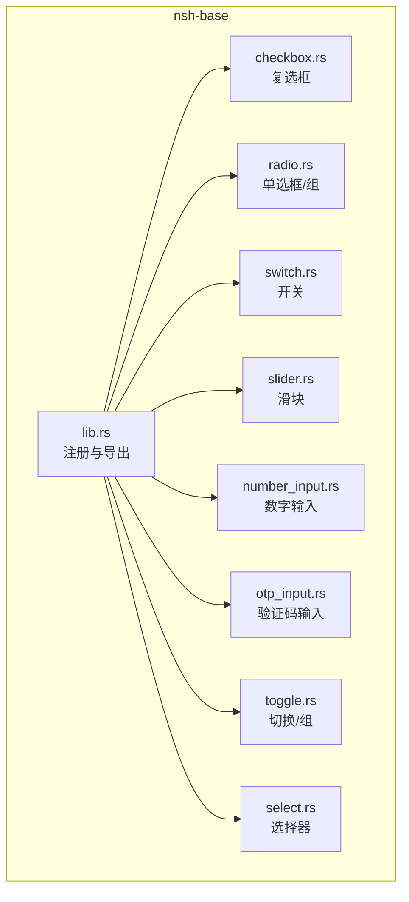
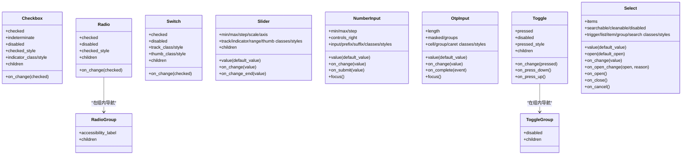
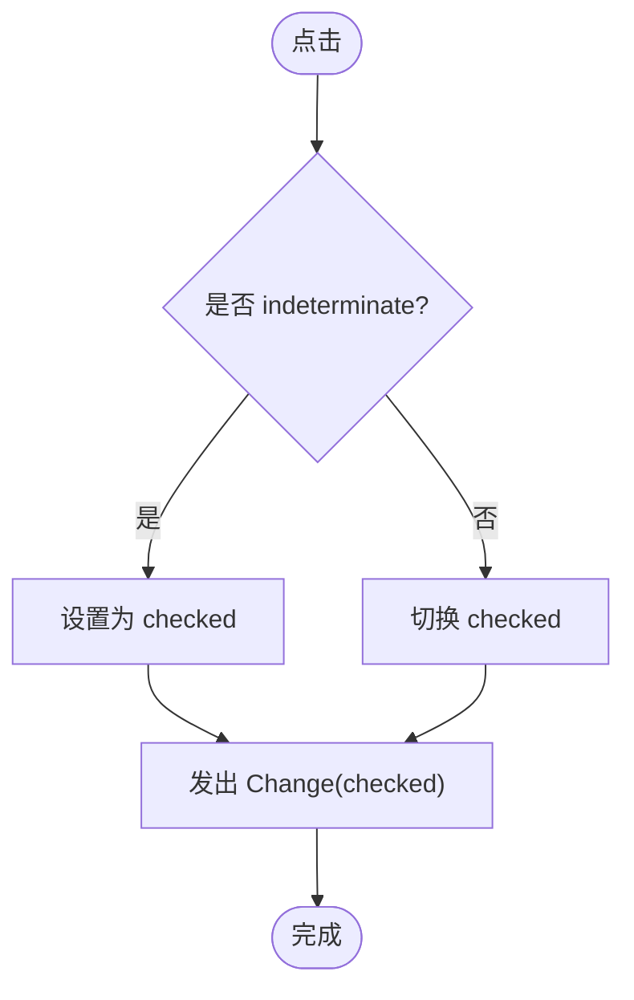
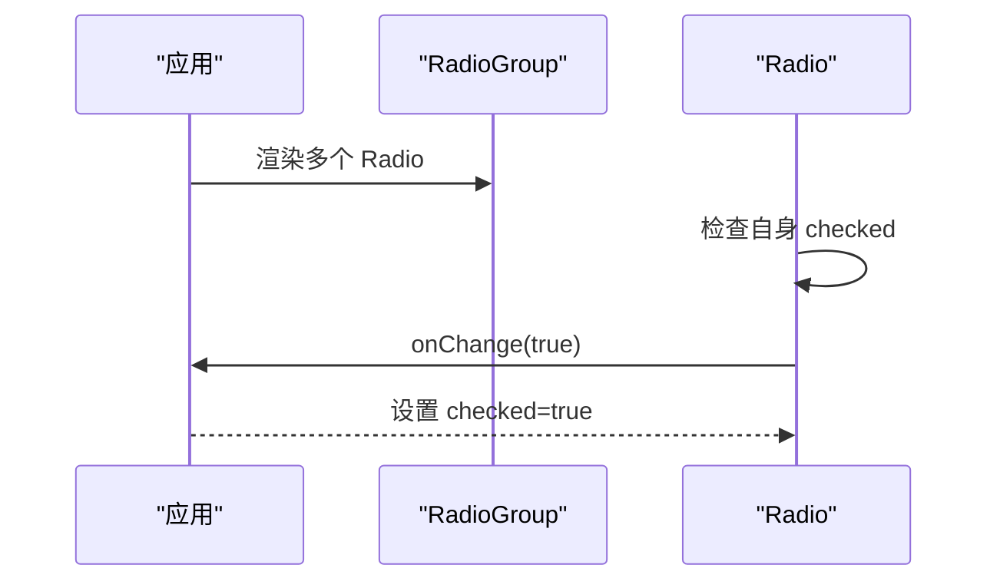
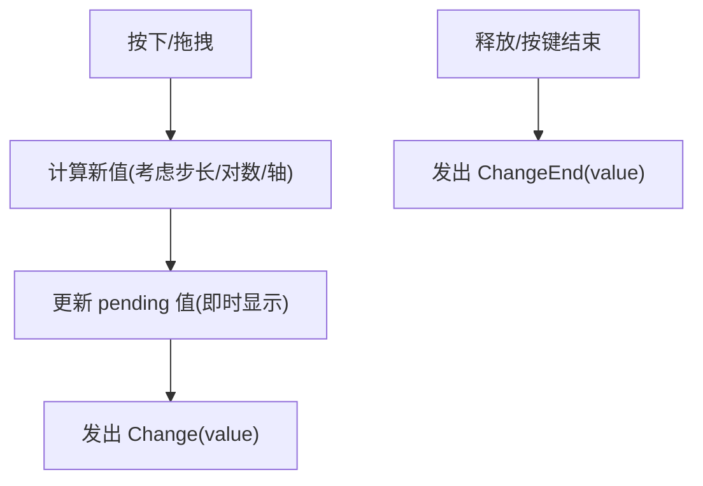
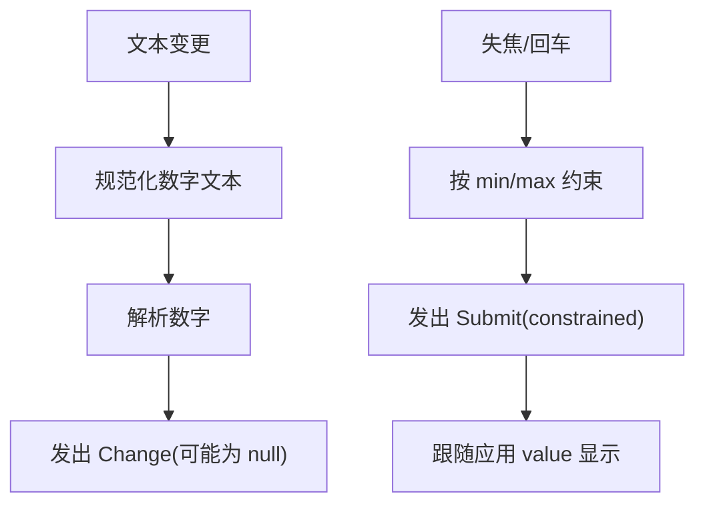
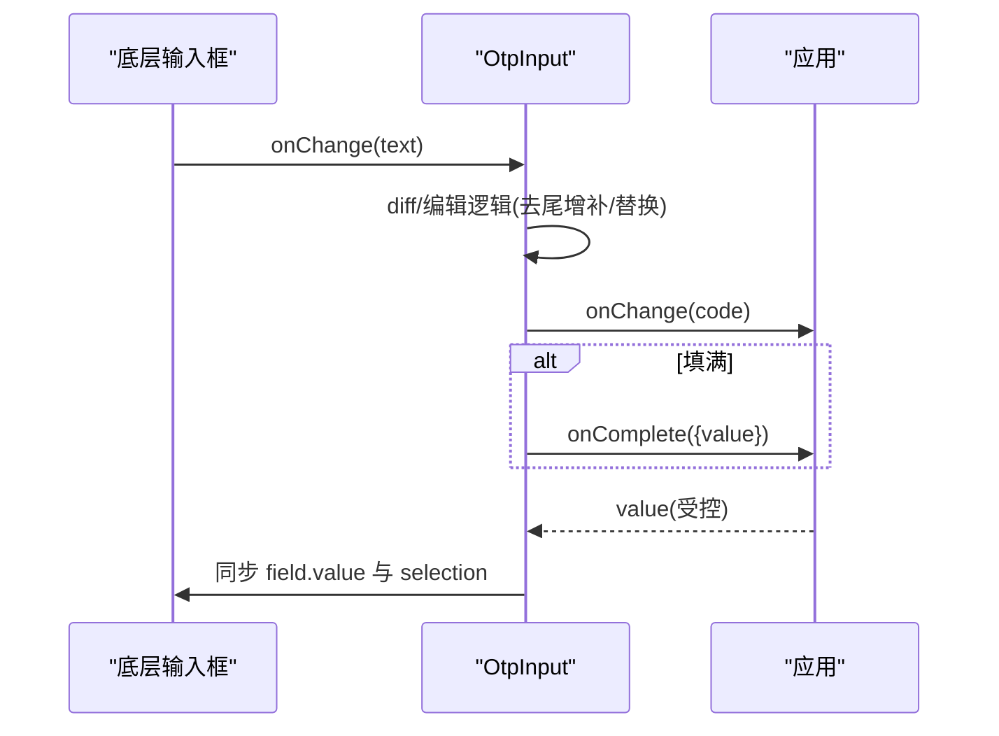
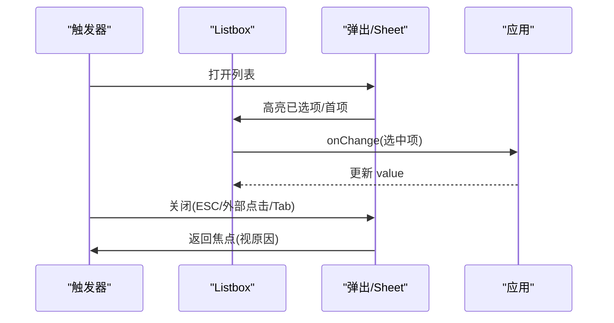
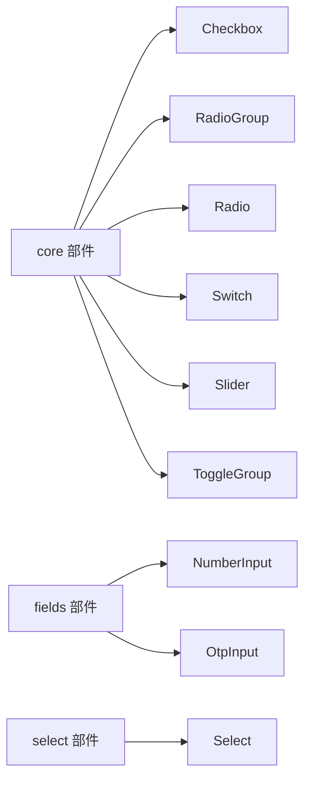

# 表单控件

<cite>
**本文引用的文件**   
- [lib.rs](file://crates/nsh-base/src/lib.rs)
- [checkbox.rs](file://crates/nsh-base/src/checkbox.rs)
- [radio.rs](file://crates/nsh-base/src/radio.rs)
- [switch.rs](file://crates/nsh-base/src/switch.rs)
- [slider.rs](file://crates/nsh-base/src/slider.rs)
- [number_input.rs](file://crates/nsh-base/src/number_input.rs)
- [otp_input.rs](file://crates/nsh-base/src/otp_input.rs)
- [toggle.rs](file://crates/nsh-base/src/toggle.rs)
- [select.rs](file://crates/nsh-base/src/select.rs)
</cite>

## 目录
1. [简介](#简介)
2. [项目结构](#项目结构)
3. [核心组件](#核心组件)
4. [架构总览](#架构总览)
5. [详细组件分析](#详细组件分析)
6. [依赖关系分析](#依赖关系分析)
7. [性能与可访问性](#性能与可访问性)
8. [故障排查指南](#故障排查指南)
9. [结论](#结论)
10. [附录：最佳实践清单](#附录最佳实践清单)

## 简介
本文件为 NSH 的表单控件提供系统化文档，覆盖 Input（输入框）、Checkbox（复选框）、Select（选择器）、Radio（单选框）、Switch（开关）、Slider（滑块）、NumberInput（数字输入）、OTPInput（验证码输入）、Toggle（切换）等。内容聚焦于数据绑定、验证规则、格式化选项、交互行为、表单状态管理、错误处理与用户反馈机制，并给出布局模式、键盘导航与移动端适配的最佳实践。

## 项目结构
NSH 的基础 UI 能力由 Rust 实现，JS 侧通过生成的声明暴露给应用。表单控件集中在 nsh-base 包中，按功能拆分到独立模块；同时通过 parts 注册表将组件暴露给运行时。

图表来源
- [lib.rs:19-103](file://crates/nsh-base/src/lib.rs#L19-L103)
- [lib.rs:392-422](file://crates/nsh-base/src/lib.rs#L392-L422)
- [lib.rs:445-514](file://crates/nsh-base/src/lib.rs#L445-L514)

章节来源
- [lib.rs:1-18](file://crates/nsh-base/src/lib.rs#L1-L18)
- [lib.rs:299-318](file://crates/nsh-base/src/lib.rs#L299-L318)
- [lib.rs:320-384](file://crates/nsh-base/src/lib.rs#L320-L384)

## 核心组件
本节概述各表单控件的职责、属性、事件与平台差异。

- Input（输入框）
  - 角色：原生文本输入（平台 UITextField/EditText 等），由核心层提供。
  - 数据绑定：受控/非受控均可，支持 placeholder、keyboardType、autoCorrect 等。
  - 验证与格式化：由上层业务或 NumberInput/OtpInput 等专用控件承担。
  - 交互：焦点、提交、变更、禁用、只读等。
  - 可访问性：role、label、value、actions 等。

- Checkbox（复选框）
  - 三态：checked / unchecked / indeterminate。
  - 数据绑定：checked 由应用控制，indeterminate 优先于 checked。
  - 交互：点击切换；disabled 时仅样式生效。
  - 可访问性：role=checkbox，mixed 语义，invalid 标记无效。

- Radio/RadioGroup（单选框/组）
  - 单选互斥，组内通过 roving 焦点管理。
  - 数据绑定：每个 Radio 的 checked 由应用维护，onChange 上报选中。
  - 键盘：方向键在组内移动焦点并按下选中项。

- Switch（开关）
  - 二元状态 on/off，即时生效。
  - 数据绑定：checked 由应用控制，onChange 上报翻转。
  - 可访问性：role=switch，active 状态用于按下反馈。

- Slider（滑块）
  - 值类型：单值或范围（双拇指）。
  - 刻度：线性或对数；step 步进；min/max 边界。
  - 交互：拖拽、轨道点击、键盘（WAI-ARIA 键位）、屏幕阅读器操作。
  - 事件：Change（拖动中多次触发）、ChangeEnd（结束一次触发）。

- NumberInput（数字输入）
  - 数值编辑：支持 min/max/step、readonly、controls_right。
  - 交互：按钮步进、键盘 Up/Down/PageUp/PageDown、Enter 提交。
  - 事件：Change、Submit、Focus、Blur；API 提供 focus()。
  - 可访问性：role=spinbutton，increment/decrement 动作。

- OTPInput（验证码输入）
  - 固定长度数字输入，支持分组、掩码、自动填充。
  - 交互：粘贴、系统自动填充、退格删除末位、光标闪烁。
  - 事件：Change、Complete（填满时）、Focus、Blur；API 提供 focus()。
  - 可访问性：隐藏单元格，单一透明输入框承载无障碍语义。

- Toggle/ToggleGroup（切换/组）
  - 按钮式 on/off，常用于工具栏。
  - 组内键盘导航：左右上下移动焦点不触发按下，Space/Return 触发。
  - 事件：Change、PressDown、PressUp。

- Select（选择器）
  - 从列表中选择一项，支持搜索、分组、清空。
  - 数据绑定：value（string|null）、open 状态可控。
  - 交互：类型ahead、键盘导航、Escape/Back 关闭、Tab 移出关闭。
  - 事件：Change、OpenChange、Open、Close、Cancel。

章节来源
- [lib.rs:108-110](file://crates/nsh-base/src/lib.rs#L108-L110)
- [checkbox.rs:8-64](file://crates/nsh-base/src/checkbox.rs#L8-L64)
- [radio.rs:16-44](file://crates/nsh-base/src/radio.rs#L16-L44)
- [switch.rs:11-53](file://crates/nsh-base/src/switch.rs#L11-L53)
- [slider.rs:158-233](file://crates/nsh-base/src/slider.rs#L158-L233)
- [number_input.rs:15-93](file://crates/nsh-base/src/number_input.rs#L15-L93)
- [otp_input.rs:57-108](file://crates/nsh-base/src/otp_input.rs#L57-L108)
- [toggle.rs:11-40](file://crates/nsh-base/src/toggle.rs#L11-L40)
- [select.rs:209-362](file://crates/nsh-base/src/select.rs#L209-L362)

## 架构总览
表单控件遵循“无外观”原则：行为与可访问性由组件负责，外观由应用通过 Tailwind 类名和 inline style 定制。通用能力包括：
- 受控与非受控两种数据绑定模式
- 统一的 disabled/focus/active 状态类
- 可访问性 role/state/value/actions
- 终端（TTY）下的特殊渲染分支

图表来源
- [checkbox.rs:8-64](file://crates/nsh-base/src/checkbox.rs#L8-L64)
- [radio.rs:16-44](file://crates/nsh-base/src/radio.rs#L16-L44)
- [radio.rs:118-149](file://crates/nsh-base/src/radio.rs#L118-L149)
- [switch.rs:11-53](file://crates/nsh-base/src/switch.rs#L11-L53)
- [slider.rs:158-233](file://crates/nsh-base/src/slider.rs#L158-L233)
- [number_input.rs:15-93](file://crates/nsh-base/src/number_input.rs#L15-L93)
- [otp_input.rs:57-108](file://crates/nsh-base/src/otp_input.rs#L57-L108)
- [toggle.rs:11-40](file://crates/nsh-base/src/toggle.rs#L11-L40)
- [toggle.rs:97-141](file://crates/nsh-base/src/toggle.rs#L97-L141)
- [select.rs:209-362](file://crates/nsh-base/src/select.rs#L209-L362)

## 详细组件分析

### Checkbox（复选框）
- 数据绑定
  - checked：布尔值，应用拥有。
  - indeterminate：优先于 checked，表示“部分选中”。
- 验证与格式化
  - invalid：无效状态，供无障碍读取；外观由应用定义。
- 交互行为
  - 点击切换；indeterminate 时点击变为 checked。
  - disabled 时不可交互，仅样式生效。
- 可访问性
  - role=checkbox，mixed/true/false 状态，describedBy 支持错误说明。
- 终端适配
  - 使用终端专属标记显示勾选、未勾选、半选。

图表来源
- [checkbox.rs:91-137](file://crates/nsh-base/src/checkbox.rs#L91-L137)

章节来源
- [checkbox.rs:8-64](file://crates/nsh-base/src/checkbox.rs#L8-L64)
- [checkbox.rs:91-137](file://crates/nsh-base/src/checkbox.rs#L91-L137)

### Radio/RadioGroup（单选框/组）
- 数据绑定
  - 每个 Radio 的 checked 由应用维护；RadioGroup 不持有值。
- 交互行为
  - 点击未选中的 Radio 会请求选中；已选中的 Radio 再次点击不变。
  - 组内键盘导航：方向键移动焦点并按下目标项。
- 可访问性
  - role=radiogroup 与 radio；selected/checked 双重语义兼容不同辅助技术。

图表来源
- [radio.rs:77-116](file://crates/nsh-base/src/radio.rs#L77-L116)
- [radio.rs:143-149](file://crates/nsh-base/src/radio.rs#L143-L149)

章节来源
- [radio.rs:16-44](file://crates/nsh-base/src/radio.rs#L16-L44)
- [radio.rs:77-116](file://crates/nsh-base/src/radio.rs#L77-L116)
- [radio.rs:118-149](file://crates/nsh-base/src/radio.rs#L118-L149)

### Switch（开关）
- 数据绑定
  - checked：布尔值，应用拥有。
- 交互行为
  - 点击翻转 checked；active 状态用于按下反馈。
- 可访问性
  - role=switch，checked 状态同步。

章节来源
- [switch.rs:11-53](file://crates/nsh-base/src/switch.rs#L11-L53)
- [switch.rs:81-120](file://crates/nsh-base/src/switch.rs#L81-L120)

### Slider（滑块）
- 数据绑定
  - value/default_value：单值或范围；min/max/step/scale/axis。
- 交互行为
  - 拖拽、轨道点击、键盘（WAI-ARIA 键位）、屏幕阅读器增量/减量。
  - 拖动中频繁触发 Change，结束时触发 ChangeEnd。
- 可访问性
  - Adjustable 角色，最小/最大/当前值与文本描述。

图表来源
- [slider.rs:335-397](file://crates/nsh-base/src/slider.rs#L335-L397)
- [slider.rs:438-529](file://crates/nsh-base/src/slider.rs#L438-L529)

章节来源
- [slider.rs:158-233](file://crates/nsh-base/src/slider.rs#L158-L233)
- [slider.rs:335-397](file://crates/nsh-base/src/slider.rs#L335-L397)
- [slider.rs:438-529](file://crates/nsh-base/src/slider.rs#L438-L529)
- [slider.rs:568-763](file://crates/nsh-base/src/slider.rs#L568-L763)

### NumberInput（数字输入）
- 数据绑定
  - value/default_value：可选数字；null 表示空字段。
  - min/max/step：边界与步进；controls_right 控制按钮位置。
- 交互行为
  - 按钮步进、键盘 Up/Down/PageUp/PageDown、Enter 提交。
  - 失焦或 Enter 时对超出边界的值进行 clamp 并报告。
- API
  - focus()：将焦点移入输入框（禁用时忽略）。
- 可访问性
  - role=spinbutton，increment/decrement 动作，value 包含 min/max/now/text。

图表来源
- [number_input.rs:168-360](file://crates/nsh-base/src/number_input.rs#L168-L360)
- [number_input.rs:375-461](file://crates/nsh-base/src/number_input.rs#L375-L461)

章节来源
- [number_input.rs:15-93](file://crates/nsh-base/src/number_input.rs#L15-L93)
- [number_input.rs:115-131](file://crates/nsh-base/src/number_input.rs#L115-L131)
- [number_input.rs:168-360](file://crates/nsh-base/src/number_input.rs#L168-L360)
- [number_input.rs:375-461](file://crates/nsh-base/src/number_input.rs#L375-L461)

### OTPInput（验证码输入）
- 数据绑定
  - length：固定位数；value/default_value：代码字符串。
  - masked：掩码显示；groups：分组数量。
- 交互行为
  - 仅接受数字（含全角数字映射）；粘贴/自动填充一次性替换前 length 个字符。
  - 光标位于最后一个填入位置的下一格；支持闪烁光标。
  - 填满后触发 Complete。
- API
  - focus()：聚焦底层输入框。
- 可访问性
  - 单元格隐藏，单一透明输入框承载 label/value/selection。

图表来源
- [otp_input.rs:240-358](file://crates/nsh-base/src/otp_input.rs#L240-L358)
- [otp_input.rs:414-473](file://crates/nsh-base/src/otp_input.rs#L414-L473)

章节来源
- [otp_input.rs:57-108](file://crates/nsh-base/src/otp_input.rs#L57-L108)
- [otp_input.rs:135-147](file://crates/nsh-base/src/otp_input.rs#L135-L147)
- [otp_input.rs:240-358](file://crates/nsh-base/src/otp_input.rs#L240-L358)
- [otp_input.rs:414-473](file://crates/nsh-base/src/otp_input.rs#L414-L473)

### Toggle/ToggleGroup（切换/组）
- 数据绑定
  - pressed：布尔值，应用拥有。
- 交互行为
  - 点击翻转 pressed；PressDown/PressUp 提供按下反馈。
  - 组内键盘导航：方向键移动焦点不触发按下，Space/Return 触发。
- 可访问性
  - role=button，aria-pressed 状态。

章节来源
- [toggle.rs:11-40](file://crates/nsh-base/src/toggle.rs#L11-L40)
- [toggle.rs:72-95](file://crates/nsh-base/src/toggle.rs#L72-L95)
- [toggle.rs:97-141](file://crates/nsh-base/src/toggle.rs#L97-L141)

### Select（选择器）
- 数据绑定
  - items：列表项（value/title/disabled/group）。
  - value/default_value：string|null；open/default_open：打开状态。
  - searchable/cleanable/disabled：搜索、清空、禁用。
- 交互行为
  - 类型ahead（字母与数字）；键盘导航（上下、Home/End、PageUp/Down）。
  - Escape/Back/点击外部关闭；Tab/Shift+Tab 离开时关闭并转移焦点。
  - 桌面端弹出列表，移动端底部 Sheet。
- 事件
  - Change(value)、OpenChange(open, reason)、Open、Close、Cancel。

图表来源
- [select.rs:473-762](file://crates/nsh-base/src/select.rs#L473-L762)
- [select.rs:801-877](file://crates/nsh-base/src/select.rs#L801-L877)

章节来源
- [select.rs:62-81](file://crates/nsh-base/src/select.rs#L62-L81)
- [select.rs:149-207](file://crates/nsh-base/src/select.rs#L149-L207)
- [select.rs:209-362](file://crates/nsh-base/src/select.rs#L209-L362)
- [select.rs:473-762](file://crates/nsh-base/src/select.rs#L473-L762)
- [select.rs:801-877](file://crates/nsh-base/src/select.rs#L801-L877)

## 依赖关系分析
- 组件注册
  - core 部件注册基础控件（Button、Link、Checkbox、Radio、Slider、Switch、Toggle、Tabs、Progress 等）。
  - fields 部件注册 NumberInput 与 OtpInput。
  - select 部件注册 Select。
- 共享能力
  - 终端渲染：is_terminal 分支统一处理 TTY 下的展示。
  - 可访问性：AccessibilityState/Role/Value/Actions 在各控件中一致实现。
  - 键盘导航：roving（Radio/Toggle 组）、listbox（Select 列表）、keys（Slider/NumberInput 步进）。

图表来源
- [lib.rs:392-422](file://crates/nsh-base/src/lib.rs#L392-L422)
- [lib.rs:445-514](file://crates/nsh-base/src/lib.rs#L445-L514)

章节来源
- [lib.rs:320-384](file://crates/nsh-base/src/lib.rs#L320-L384)
- [lib.rs:392-422](file://crates/nsh-base/src/lib.rs#L392-L422)
- [lib.rs:445-514](file://crates/nsh-base/src/lib.rs#L445-L514)

## 性能与可访问性
- 性能
  - Slider 在拖拽中使用 pending 值即时更新视觉，避免等待应用响应导致的卡顿。
  - OtpInput 使用原生动画驱动光标闪烁，减少引擎唤醒开销。
  - Select 的类型ahead与键盘绑定复用，避免重复绑定。
- 可访问性
  - 所有控件均暴露 role/state/value/actions，确保屏幕阅读器可用。
  - Checkbox/Radio/Switch/Toggle 明确表达选中/按下状态。
  - Slider/NumberInput 暴露最小/最大/当前值与文本描述。
  - Select 的 trigger 作为 combobox，携带 expanded/has_popup 状态。

[本节为通用指导，无需具体文件引用]

## 故障排查指南
- 数字输入异常
  - 现象：输入负号但键盘类型为小数。
  - 排查：当 min>=0 时使用 Decimal 键盘；否则使用 NumbersAndPunctuation。
  - 参考：[number_input.rs:427-431](file://crates/nsh-base/src/number_input.rs#L427-L431)
- 滑块拖动不流畅
  - 现象：拖动中值不实时更新。
  - 排查：确认应用正确处理 Change 并在需要时保持 pending 值直到 ChangeEnd。
  - 参考：[slider.rs:480-529](file://crates/nsh-base/src/slider.rs#L480-L529)
- 验证码输入错位
  - 现象：粘贴后光标位置不正确。
  - 排查：确保 selection 始终置于末尾；必要时异步回写 field.value。
  - 参考：[otp_input.rs:454-471](file://crates/nsh-base/src/otp_input.rs#L454-L471)
- 选择器焦点丢失
  - 现象：关闭后焦点未回到触发器。
  - 排查：根据关闭原因（外部点击/Tab）决定是否返回焦点。
  - 参考：[select.rs:645-653](file://crates/nsh-base/src/select.rs#L645-L653)

章节来源
- [number_input.rs:427-431](file://crates/nsh-base/src/number_input.rs#L427-L431)
- [slider.rs:480-529](file://crates/nsh-base/src/slider.rs#L480-L529)
- [otp_input.rs:454-471](file://crates/nsh-base/src/otp_input.rs#L454-L471)
- [select.rs:645-653](file://crates/nsh-base/src/select.rs#L645-L653)

## 结论
NSH 的表单控件以“行为与外观分离”为核心设计，提供一致的受控/非受控绑定、完善的可访问性与跨平台交互。通过组合这些控件，可以构建健壮、易用且可定制的表单界面。建议结合本文件的最佳实践，统一状态管理、错误提示与键盘导航策略，以获得一致的用户体验。

[本节为总结，无需具体文件引用]

## 附录：最佳实践清单
- 表单状态管理
  - 优先使用受控模式，集中管理 value/open 等状态；仅在简单场景使用非受控。
  - 对复杂表单，使用表单库或自定义 store 聚合校验结果与提交状态。
- 验证与错误反馈
  - 使用 invalid 属性与 accessibility_described_by 关联错误信息。
  - 在失焦或提交时执行最终校验（如 NumberInput 的 commit）。
- 键盘导航
  - 为 Radio/Toggle 使用组容器，确保方向键导航。
  - 为 Select 提供 searchable 与清晰的 placeholder，提升键盘可用性。
- 移动端适配
  - 使用 NumberInput 的 controls_right 与 suffix/prefix 适配货币/单位。
  - 使用 OtpInput 的 groups 与 masked 提升安全与可读性。
- 可访问性
  - 为所有控件提供 accessibility_label。
  - 为 Slider/NumberInput 提供合适的 min/max/step，便于屏幕阅读器播报。
- 性能优化
  - 在高频交互（如 Slider 拖动）中尽量减少昂贵计算，延迟到 ChangeEnd。
  - 避免在 onChange 中进行阻塞操作，必要时使用防抖/节流。

[本节为通用指导，无需具体文件引用]