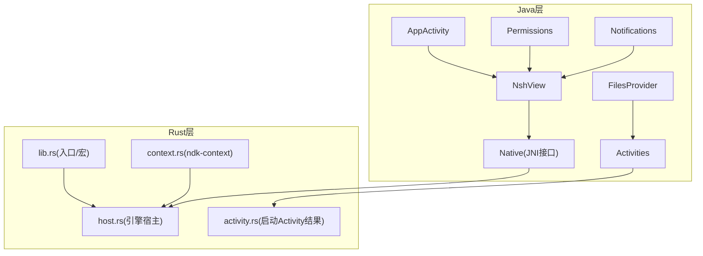
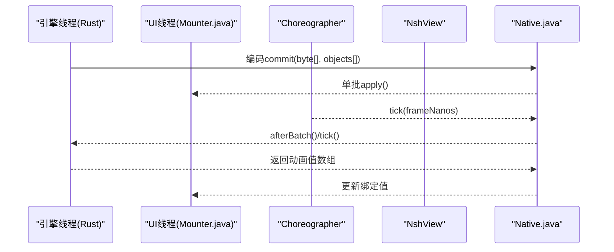
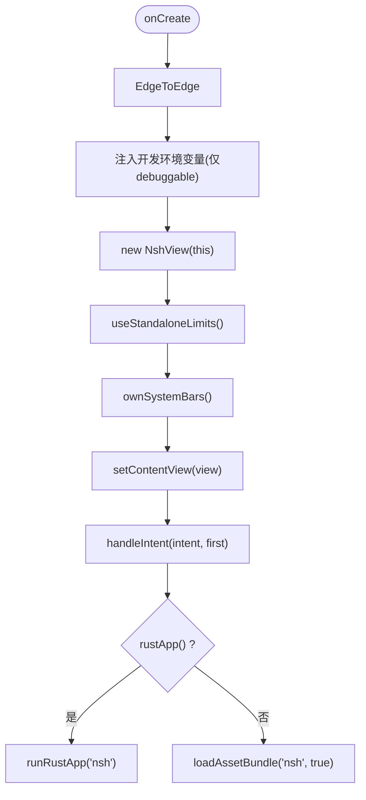
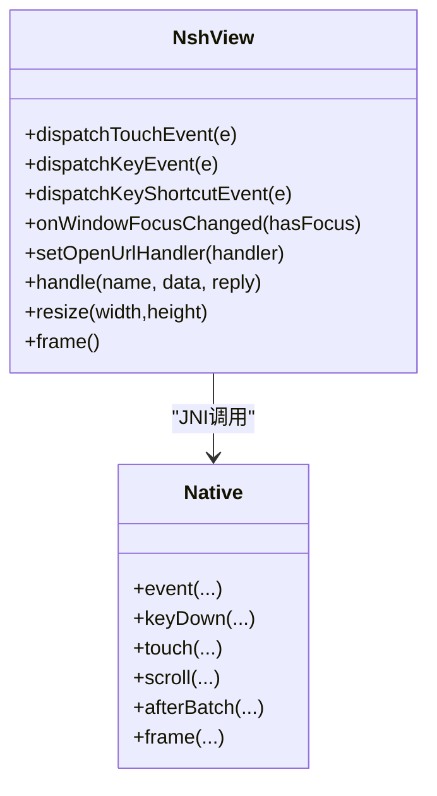
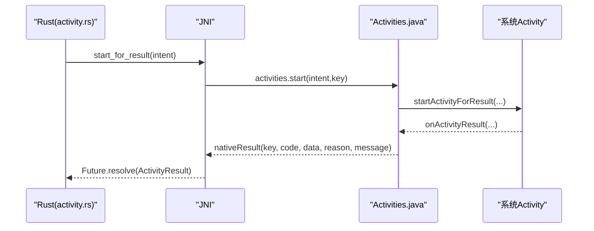
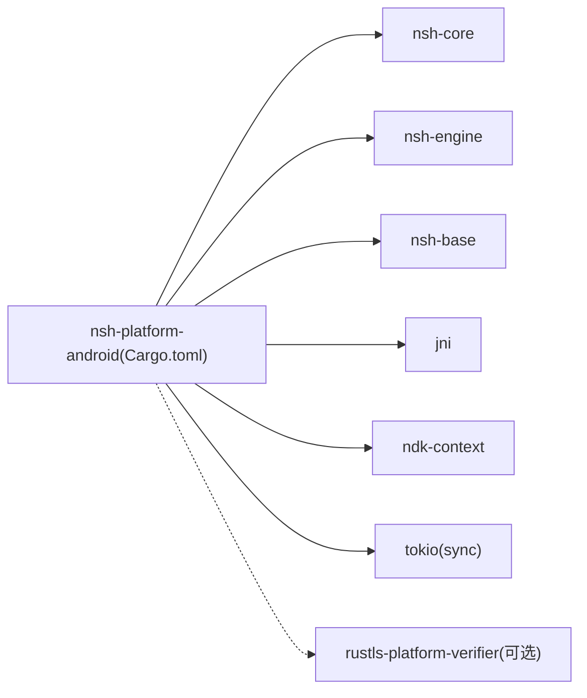

# Android平台

<cite>
**本文引用的文件**   
- [crates/nsh-platform-android/Cargo.toml](file://crates/nsh-platform-android/Cargo.toml)
- [crates/nsh-platform-android/src/lib.rs](file://crates/nsh-platform-android/src/lib.rs)
- [crates/nsh-platform-android/src/activity.rs](file://crates/nsh-platform-android/src/activity.rs)
- [crates/nsh-platform-android/src/context.rs](file://crates/nsh-platform-android/src/context.rs)
- [crates/nsh-platform-android/src/host.rs](file://crates/nsh-platform-android/src/host.rs)
- [crates/nsh-platform-android/java/com/longbridge/nsh/Native.java](file://crates/nsh-platform-android/java/com/longbridge/nsh/Native.java)
- [crates/nsh-platform-android/java/com/longbridge/nsh/AppActivity.java](file://crates/nsh-platform-android/java/com/longbridge/nsh/AppActivity.java)
- [crates/nsh-platform-android/java/com/longbridge/nsh/NshView.java](file://crates/nsh-platform-android/java/com/longbridge/nsh/NshView.java)
- [crates/nsh-platform-android/java/com/longbridge/nsh/Permissions.java](file://crates/nsh-platform-android/java/com/longbridge/nsh/Permissions.java)
- [crates/nsh-platform-android/java/com/longbridge/nsh/Notifications.java](file://crates/nsh-platform-android/java/com/longbridge/nsh/Notifications.java)
- [crates/nsh-platform-android/java/com/longbridge/nsh/Activities.java](file://crates/nsh-platform-android/java/com/longbridge/nsh/Activities.java)
- [crates/nsh-platform-android/java/com/longbridge/nsh/FilesProvider.java](file://crates/nsh-platform-android/java/com/longbridge/nsh/FilesProvider.java)
</cite>

## 目录
1. [简介](#简介)
2. [项目结构](#项目结构)
3. [核心组件](#核心组件)
4. [架构总览](#架构总览)
5. [详细组件分析](#详细组件分析)
6. [依赖关系分析](#依赖关系分析)
7. [性能与内存优化](#性能与内存优化)
8. [构建、签名与发布](#构建签名与发布)
9. [调试与诊断](#调试与诊断)
10. [无障碍、多语言与RTL适配](#无障碍多语言与rtl适配)
11. [故障排查](#故障排查)
12. [结论](#结论)

## 简介
本文件面向在Android平台上集成NSH的开发者，系统性说明：
- Views系统集成与渲染管线（Rust引擎线程 + Java UI线程）
- Activity生命周期管理与系统栏/状态栏处理
- Context上下文初始化与ndk-context桥接
- Java互操作（JNI事件、回调、权限、通知、文件选择器、剪贴板、系统服务）
- Gradle配置、APK构建流程、签名与发布
- 性能优化策略、内存管理、多进程架构
- 调试技巧、Logcat使用与性能分析工具
- Material Design适配、多屏幕支持与RTL语言支持

## 项目结构
Android平台相关代码主要位于 crates/nsh-platform-android，包含：
- Rust侧：JNI入口、引擎宿主、动画、文本布局、权限、通知、文件选择器等
- Java侧：NshView、AppActivity、Native JNI接口、权限与通知封装、文件提供者等

图表来源
- [crates/nsh-platform-android/java/com/longbridge/nsh/AppActivity.java:1-91](file://crates/nsh-platform-android/java/com/longbridge/nsh/AppActivity.java#L1-L91)
- [crates/nsh-platform-android/java/com/longbridge/nsh/NshView.java:1-200](file://crates/nsh-platform-android/java/com/longbridge/nsh/NshView.java#L1-L200)
- [crates/nsh-platform-android/java/com/longbridge/nsh/Native.java:1-120](file://crates/nsh-platform-android/java/com/longbridge/nsh/Native.java#L1-L120)
- [crates/nsh-platform-android/src/lib.rs:1-60](file://crates/nsh-platform-android/src/lib.rs#L1-L60)
- [crates/nsh-platform-android/src/host.rs:1-115](file://crates/nsh-platform-android/src/host.rs#L1-L115)
- [crates/nsh-platform-android/src/activity.rs:1-110](file://crates/nsh-platform-android/src/activity.rs#L1-L110)
- [crates/nsh-platform-android/src/context.rs:1-63](file://crates/nsh-platform-android/src/context.rs#L1-L63)

章节来源
- [crates/nsh-platform-android/Cargo.toml:1-83](file://crates/nsh-platform-android/Cargo.toml#L1-L83)
- [crates/nsh-platform-android/src/lib.rs:1-187](file://crates/nsh-platform-android/src/lib.rs#L1-L187)

## 核心组件
- AppActivity：打包应用的入口Activity，负责加载NshView、处理Intent分享/通知/URL Scheme、后退键、系统栏适配。
- NshView：承载NSH应用的核心View，负责输入分发、键盘/触摸、滚动、动画帧驱动、与Native交互。
- Native：JNI方法集合，定义事件类型与所有跨语言调用。
- host.rs：Rust侧引擎宿主，持有Engine实例、环境、缓存、字体、主题、访问控制、主机通道等。
- activity.rs：从Rust侧发起带结果的Activity启动，通过Activities.java桥接到前台Activity并等待结果。
- context.rs：设置ndk-context，为音频、传感器、密钥库等第三方Rust crate提供Application Context。
- Permissions.java / Notifications.java：运行时权限与通知权限的统一封装。
- Activities.java / FilesProvider.java：统一启动Activity与通过FileProvider共享临时输出文件。

章节来源
- [crates/nsh-platform-android/java/com/longbridge/nsh/AppActivity.java:1-91](file://crates/nsh-platform-android/java/com/longbridge/nsh/AppActivity.java#L1-L91)
- [crates/nsh-platform-android/java/com/longbridge/nsh/NshView.java:1-200](file://crates/nsh-platform-android/java/com/longbridge/nsh/NshView.java#L1-L200)
- [crates/nsh-platform-android/java/com/longbridge/nsh/Native.java:1-120](file://crates/nsh-platform-android/java/com/longbridge/nsh/Native.java#L1-L120)
- [crates/nsh-platform-android/src/host.rs:1-115](file://crates/nsh-platform-android/src/host.rs#L1-L115)
- [crates/nsh-platform-android/src/activity.rs:1-110](file://crates/nsh-platform-android/src/activity.rs#L1-L110)
- [crates/nsh-platform-android/src/context.rs:1-63](file://crates/nsh-platform-android/src/context.rs#L1-L63)
- [crates/nsh-platform-android/java/com/longbridge/nsh/Permissions.java:19-29](file://crates/nsh-platform-android/java/com/longbridge/nsh/Permissions.java#L19-L29)
- [crates/nsh-platform-android/java/com/longbridge/nsh/Notifications.java:57-78](file://crates/nsh-platform-android/java/com/longbridge/nsh/Notifications.java#L57-L78)
- [crates/nsh-platform-android/java/com/longbridge/nsh/Activities.java:17-35](file://crates/nsh-platform-android/java/com/longbridge/nsh/Activities.java#L17-L35)
- [crates/nsh-platform-android/java/com/longbridge/nsh/FilesProvider.java:23-23](file://crates/nsh-platform-android/java/com/longbridge/nsh/FilesProvider.java#L23-L23)

## 架构总览
NSH在Android上的运行模型采用“双线程+单批提交”：
- 引擎线程：执行JS与布局，使用StaticLayout进行文本排版，将每次commit编码为一个byte[]（含字符串和布局对象数组），通过单次JNI调用交给UI线程。
- UI线程：Mounter.java应用mount批次；原生动画（nsh-core animation图）在UI线程由Choreographer驱动，变化值以紧凑数组回传。
- 可编辑视图的选择范围在UI线程维护，与SelectableView.java协作。

图表来源
- [crates/nsh-platform-android/src/lib.rs:1-16](file://crates/nsh-platform-android/src/lib.rs#L1-L16)
- [crates/nsh-platform-android/java/com/longbridge/nsh/Native.java:367-373](file://crates/nsh-platform-android/java/com/longbridge/nsh/Native.java#L367-L373)

章节来源
- [crates/nsh-platform-android/src/lib.rs:1-16](file://crates/nsh-platform-android/src/lib.rs#L1-L16)

## 详细组件分析

### AppActivity：Activity生命周期与系统栏
- onCreate中完成Edge-to-Edge、开发模式环境变量注入、创建NshView、设置独立限制、接管系统栏、设置内容视图、处理Intent（分享/通知/URL Scheme）。
- onNewIntent处理通知点击或URL打开。
- onBackPressed优先交由NshView处理，未消费则回退系统行为。
- onDestroy清理ShareReceiver与NshView。

图表来源
- [crates/nsh-platform-android/java/com/longbridge/nsh/AppActivity.java:16-37](file://crates/nsh-platform-android/java/com/longbridge/nsh/AppActivity.java#L16-L37)
- [crates/nsh-platform-android/java/com/longbridge/nsh/AppActivity.java:57-75](file://crates/nsh-platform-android/java/com/longbridge/nsh/AppActivity.java#L57-L75)
- [crates/nsh-platform-android/java/com/longbridge/nsh/AppActivity.java:77-89](file://crates/nsh-platform-android/java/com/longbridge/nsh/AppActivity.java#L77-L89)

章节来源
- [crates/nsh-platform-android/java/com/longbridge/nsh/AppActivity.java:1-91](file://crates/nsh-platform-android/java/com/longbridge/nsh/AppActivity.java#L1-L91)

### NshView：Views系统集成与输入分发
- 继承FrameLayout，作为NSH应用的容器。
- 分发触摸与键盘事件，支持快捷键、原始键、捕获规则、Tab遍历。
- 窗口焦点变化时重置按键状态，保证后台恢复后一致性。
- 提供HostHandler/OpenUrlHandler扩展点，供宿主拦截应用内调用与URL打开。
- 与Native交互，传递事件、动画帧、滚动、手势、Canvas图像等。

图表来源
- [crates/nsh-platform-android/java/com/longbridge/nsh/NshView.java:110-159](file://crates/nsh-platform-android/java/com/longbridge/nsh/NshView.java#L110-L159)
- [crates/nsh-platform-android/java/com/longbridge/nsh/Native.java:287-373](file://crates/nsh-platform-android/java/com/longbridge/nsh/Native.java#L287-L373)

章节来源
- [crates/nsh-platform-android/java/com/longbridge/nsh/NshView.java:1-200](file://crates/nsh-platform-android/java/com/longbridge/nsh/NshView.java#L1-L200)

### Native/JNI：事件与能力边界
- 集中定义事件类型常量（PRESS、TOUCH、KEY_PRESS、CLIPBOARD、NOTIFICATION、OPEN_URL等）。
- 暴露create/destroy/load/runRust/setLimits/setGranted等API，用于引擎生命周期、能力与限制控制。
- 提供图片缓存、字体注册、Webview媒体权限、信任存储、包验证与运行等能力。

章节来源
- [crates/nsh-platform-android/java/com/longbridge/nsh/Native.java:11-110](file://crates/nsh-platform-android/java/com/longbridge/nsh/Native.java#L11-L110)
- [crates/nsh-platform-android/java/com/longbridge/nsh/Native.java:120-220](file://crates/nsh-platform-android/java/com/longbridge/nsh/Native.java#L120-L220)

### host.rs：引擎宿主与环境
- Host结构体持有NshView引用、密度、追踪开关、Engine、Environment、动画队列、主线程任务、能力与限制、内容裁剪、Tokio运行时、支持目录、存储目录、访问控制、主题覆盖、URL Scheme、字体、内联图片、缓存选项、磁盘缓存、主机通道、原生组件、键盘映射、开发会话、测试模型等。
- 提供设置能力、限制、内容裁剪、主题、字体、加载应用等方法。

章节来源
- [crates/nsh-platform-android/src/host.rs:1-115](file://crates/nsh-platform-android/src/host.rs#L1-L115)
- [crates/nsh-platform-android/src/host.rs:117-200](file://crates/nsh-platform-android/src/host.rs#L117-L200)

### activity.rs：带结果的Activity启动
- start_for_result：从Rust侧发起Intent启动，通过Activities.java在前台Activity上启动，并通过oneshot通道等待结果。
- can_start：检查是否有已安装的Activity能处理Intent。
- output_file：生成临时输出文件（如相机拍照），通过FilesProvider暴露content URI。
- 错误类型ActivityError：NotStarted/NoActivity/NotFound/Failed。

图表来源
- [crates/nsh-platform-android/src/activity.rs:108-140](file://crates/nsh-platform-android/src/activity.rs#L108-L140)
- [crates/nsh-platform-android/src/activity.rs:244-274](file://crates/nsh-platform-android/src/activity.rs#L244-L274)
- [crates/nsh-platform-android/java/com/longbridge/nsh/Activities.java:17-35](file://crates/nsh-platform-android/java/com/longbridge/nsh/Activities.java#L17-L35)

章节来源
- [crates/nsh-platform-android/src/activity.rs:1-110](file://crates/nsh-platform-android/src/activity.rs#L1-L110)
- [crates/nsh-platform-android/src/activity.rs:176-212](file://crates/nsh-platform-android/src/activity.rs#L176-L212)
- [crates/nsh-platform-android/src/activity.rs:244-274](file://crates/nsh-platform-android/src/activity.rs#L244-L274)

### context.rs：ndk-context初始化
- application_context：从NshView获取Application Context。
- init：一次性设置ndk-context，传入JavaVM指针与应用Context，供音频、传感器、密钥库等第三方Rust crate使用。

章节来源
- [crates/nsh-platform-android/src/context.rs:1-63](file://crates/nsh-platform-android/src/context.rs#L1-L63)

### 权限与通知
- Permissions.java：统一管理运行时权限请求，通过保留Fragment接收onRequestPermissionsResult，避免Activity销毁导致丢失。
- Notifications.java：封装通知权限（Android 13+ POST_NOTIFICATIONS），根据是否声明与用户选择返回granted/denied/default状态，必要时触发权限提示。

章节来源
- [crates/nsh-platform-android/java/com/longbridge/nsh/Permissions.java:19-29](file://crates/nsh-platform-android/java/com/longbridge/nsh/Permissions.java#L19-L29)
- [crates/nsh-platform-android/java/com/longbridge/nsh/Notifications.java:57-78](file://crates/nsh-platform-android/java/com/longbridge/nsh/Notifications.java#L57-L78)
- [crates/nsh-platform-android/java/com/longbridge/nsh/Notifications.java:214-239](file://crates/nsh-platform-android/java/com/longbridge/nsh/Notifications.java#L214-L239)
- [crates/nsh-platform-android/java/com/longbridge/nsh/Notifications.java:313-326](file://crates/nsh-platform-android/java/com/longbridge/nsh/Notifications.java#L313-L326)

### 文件选择器与文件共享
- Activities.java：统一从前台Activity启动系统或第三方Activity，并转发结果到Rust侧。
- FilesProvider.java：通过manifest grantUriPermissions，安全地对外暴露应用内部文件或缓存文件，供其他Activity写入（如相机输出）。

章节来源
- [crates/nsh-platform-android/java/com/longbridge/nsh/Activities.java:17-35](file://crates/nsh-platform-android/java/com/longbridge/nsh/Activities.java#L17-L35)
- [crates/nsh-platform-android/java/com/longbridge/nsh/FilesProvider.java:23-23](file://crates/nsh-platform-android/java/com/longbridge/nsh/FilesProvider.java#L23-L23)

## 依赖关系分析
- Cargo特性：默认启用js/shader/editor/emoji-picker/highlight/math/plot/rich-editor/term/zlib/crypto/websocket/updater/svg等，可按需裁剪。
- Android目标依赖：tokio(sync)、jni、ndk-context、rustls-platform-verifier（可选）、nsh-core/engine/base等。

图表来源
- [crates/nsh-platform-android/Cargo.toml:19-59](file://crates/nsh-platform-android/Cargo.toml#L19-L59)
- [crates/nsh-platform-android/Cargo.toml:64-83](file://crates/nsh-platform-android/Cargo.toml#L64-L83)

章节来源
- [crates/nsh-platform-android/Cargo.toml:1-83](file://crates/nsh-platform-android/Cargo.toml#L1-L83)

## 性能与内存优化
- 渲染批处理：每次commit编码为单一byte[]与对象数组，通过一次JNI调用批量应用到UI线程，减少跨线程开销。
- 原生动画：在UI线程由Choreographer驱动，变化值以紧凑数组返回，降低GC压力。
- 内容裁剪：可通过setContentCulling控制滚动视图仅渲染视口附近内容，提升列表性能。
- VM限制：setLimits可限制内存、栈大小、加载时间、调用时间与最大节点数；setStandaloneLimits可解除限制使应用独立运行。
- 缓存策略：setCache可配置缓存位置（系统/自定义/无）与图片缓存上限；imageCacheLookup/imageCacheComplete实现磁盘级图片缓存。
- 字体与主题：registerFont与setThemeOverrides按需注册字体与主题覆盖，避免重复加载。

章节来源
- [crates/nsh-platform-android/src/lib.rs:1-16](file://crates/nsh-platform-android/src/lib.rs#L1-L16)
- [crates/nsh-platform-android/java/com/longbridge/nsh/Native.java:131-147](file://crates/nsh-platform-android/java/com/longbridge/nsh/Native.java#L131-L147)
- [crates/nsh-platform-android/java/com/longbridge/nsh/Native.java:149-162](file://crates/nsh-platform-android/java/com/longbridge/nsh/Native.java#L149-L162)
- [crates/nsh-platform-android/java/com/longbridge/nsh/Native.java:168-171](file://crates/nsh-platform-android/java/com/longbridge/nsh/Native.java#L168-L171)
- [crates/nsh-platform-android/src/host.rs:151-188](file://crates/nsh-platform-android/src/host.rs#L151-L188)

## 构建、签名与发布
- APK构建：通过nsh package --target android生成APK；若为Rust应用（nsh.json root），则通过main!宏导出Java_com_longbridge_nsh_Native_runRust并由AppActivity调用。
- 资源与资产：NshView.loadAssetBundle("nsh", true)加载assets中的JS bundle；也可通过runPackage运行签名包。
- 签名与发布：结合平台签名工具对APK签名；如需自更新，启用updater特性并在AppActivity中加载更新的签名包。
- Manifest元数据：rustApp()通过读取com.longbridge.nsh.RUST判断是否为Rust应用。

章节来源
- [crates/nsh-platform-android/src/lib.rs:171-186](file://crates/nsh-platform-android/src/lib.rs#L171-L186)
- [crates/nsh-platform-android/java/com/longbridge/nsh/AppActivity.java:39-48](file://crates/nsh-platform-android/java/com/longbridge/nsh/AppActivity.java#L39-L48)
- [crates/nsh-platform-android/java/com/longbridge/nsh/AppActivity.java:34-36](file://crates/nsh-platform-android/java/com/longbridge/nsh/AppActivity.java#L34-L36)

## 调试与诊断
- 开发模式：AppActivity在debuggable模式下接受dev服务器环境变量；可通过connectDevServer连接nsh dev。
- Log日志：JNI_OnLoad中初始化logger，便于查看Rust与Java侧日志。
- 性能追踪：NshView构造时可开启trace参数记录每帧耗时；engine trace开关由host.rs控制。
- 测试与代理：nsh test --target android下，host.rs可接入nsh-testing agent，收集批次与错误信息。

章节来源
- [crates/nsh-platform-android/java/com/longbridge/nsh/AppActivity.java:21-27](file://crates/nsh-platform-android/java/com/longbridge/nsh/AppActivity.java#L21-L27)
- [crates/nsh-platform-android/java/com/longbridge/nsh/Native.java:196-198](file://crates/nsh-platform-android/java/com/longbridge/nsh/Native.java#L196-L198)
- [crates/nsh-platform-android/src/lib.rs:161-169](file://crates/nsh-platform-android/src/lib.rs#L161-L169)
- [crates/nsh-platform-android/src/host.rs:109-115](file://crates/nsh-platform-android/src/host.rs#L109-L115)

## 无障碍、多语言与RTL适配
- 无障碍：A11y.java/A11yChanges.java提供无障碍变更监听与动作响应，配合NshView的事件分发。
- 多语言与区域：Native.environment传递locale、timeZone、languages、regional等信息，供引擎设置Intl默认语言与格式区域。
- RTL支持：environment返回值中包含right-to-left标记，UI层据此调整布局方向。
- 系统栏与Edge-to-Edge：AppActivity.onConfigurationChanged中重新应用系统栏，确保横竖屏与输入法变化时布局正确。

章节来源
- [crates/nsh-platform-android/java/com/longbridge/nsh/Native.java:275-285](file://crates/nsh-platform-android/java/com/longbridge/nsh/Native.java#L275-L285)
- [crates/nsh-platform-android/java/com/longbridge/nsh/AppActivity.java:50-55](file://crates/nsh-platform-android/java/com/longbridge/nsh/AppActivity.java#L50-L55)

## 故障排查
- 无法启动Activity：检查Activities.java是否能从前台Activity启动，确认intent有可处理的Activity；若失败，activity.rs返回NotFound或Failed。
- 权限未授予：Permissions.state返回undeclared/granted/denied；对于通知权限，Notifications会根据Android版本与Manifest声明决定是否需要提示。
- 文件输出失败：output_file需要可写的cache目录与有效的FilesProvider；否则返回Failed。
- 引擎崩溃或异常：查看Logger输出与dev服务器日志；必要时开启trace定位渲染瓶颈。

章节来源
- [crates/nsh-platform-android/src/activity.rs:74-98](file://crates/nsh-platform-android/src/activity.rs#L74-L98)
- [crates/nsh-platform-android/java/com/longbridge/nsh/Notifications.java:223-239](file://crates/nsh-platform-android/java/com/longbridge/nsh/Notifications.java#L223-L239)
- [crates/nsh-platform-android/src/activity.rs:176-212](file://crates/nsh-platform-android/src/activity.rs#L176-L212)

## 结论
NSH在Android平台通过严谨的双线程模型与JNI桥接，实现了高性能渲染与丰富的系统能力集成。借助AppActivity与NshView的生命周期管理、Permissions与Notifications的统一封装、以及灵活的构建与调试工具链，开发者可在Android设备上快速交付高质量的多端应用。建议在生产环境中合理配置VM限制、缓存策略与内容裁剪，并结合Logcat与dev服务器进行持续的性能监控与问题定位。