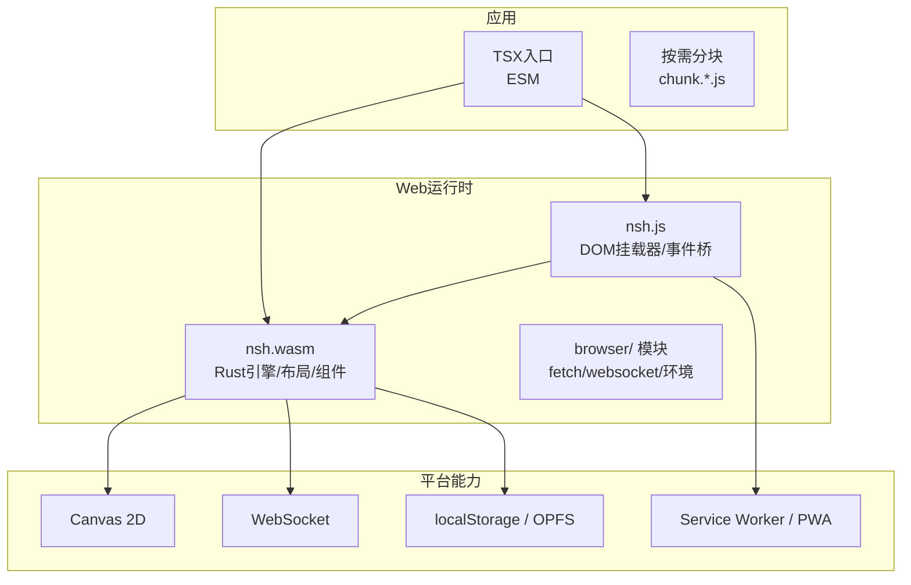
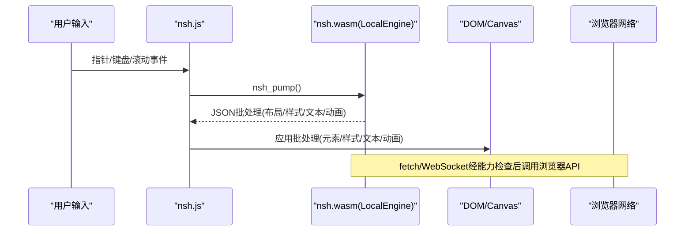
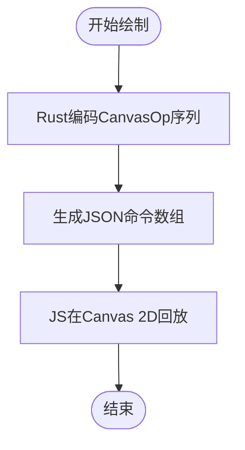
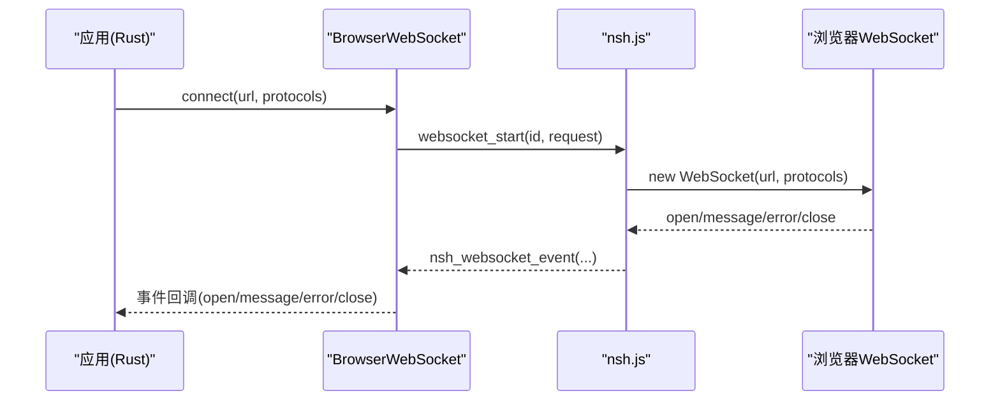
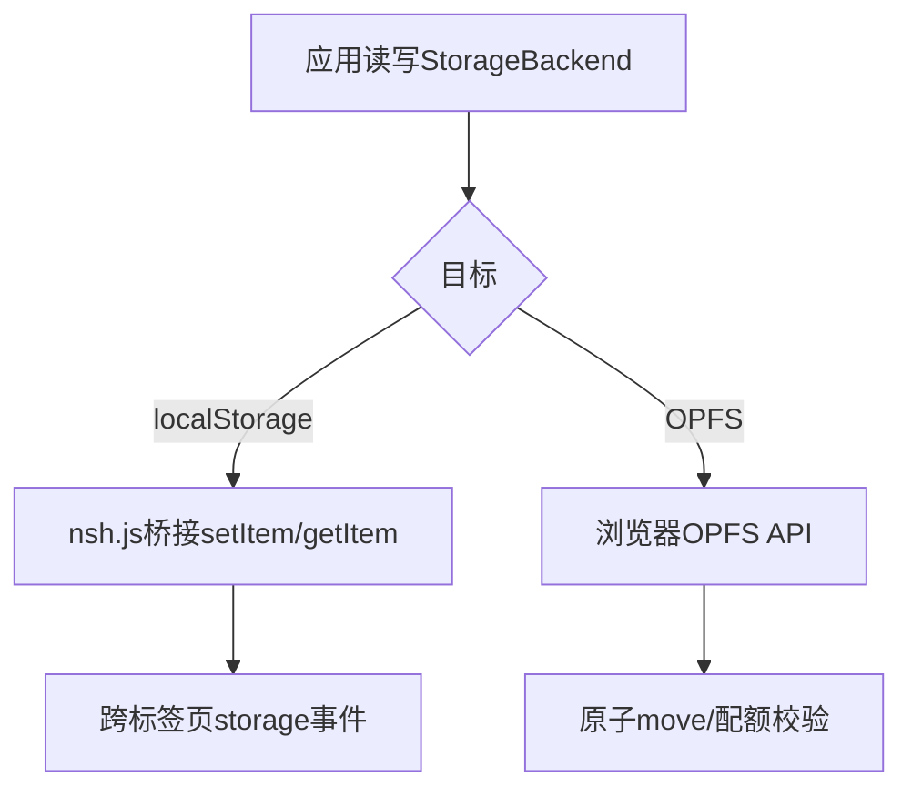
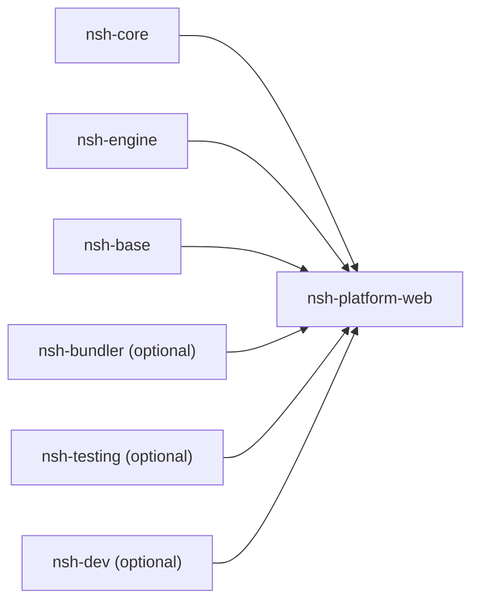

# Web平台

<cite>
**本文引用的文件**   
- [crates/nsh-platform-web/src/lib.rs](file://crates/nsh-platform-web/src/lib.rs)
- [crates/nsh-platform-web/Cargo.toml](file://crates/nsh-platform-web/Cargo.toml)
- [crates/nsh-platform-web/src/canvas.rs](file://crates/nsh-platform-web/src/canvas.rs)
- [crates/nsh-platform-web/src/websocket.rs](file://crates/nsh-platform-web/src/websocket.rs)
- [crates/nsh-platform-web/src/storage.rs](file://crates/nsh-platform-web/src/storage.rs)
- [docs/dev/web.md](file://docs/dev/web.md)
- [website/docs/web.md](file://website/docs/web.md)
</cite>

## 目录
1. [简介](#简介)
2. [项目结构](#项目结构)
3. [核心组件](#核心组件)
4. [架构总览](#架构总览)
5. [详细组件分析](#详细组件分析)
6. [依赖关系分析](#依赖关系分析)
7. [性能与体积优化](#性能与体积优化)
8. [构建、打包与部署](#构建打包与部署)
9. [调试与兼容性](#调试与兼容性)
10. [SEO、无障碍与移动端适配](#seo无障碍与移动端适配)
11. [故障排查](#故障排查)
12. [结论](#结论)

## 简介
本文件面向NSH的Web平台支持，系统性说明WebAssembly运行时、浏览器API封装与DOM渲染管线，并覆盖Canvas绘制、WebSocket通信、本地存储、Service Worker与PWA、Webpack/Vite集成要点、CDN部署与静态资源优化。同时给出Bundle体积控制、懒加载与缓存策略、跨域问题处理、调试技巧以及SEO、无障碍和移动端适配的最佳实践。

## 项目结构
NSH在Web端的实现位于`crates/nsh-platform-web`，提供：
- Wasm后端：将组件更新转为DOM批处理，布局由核心计算，样式转CSS，文本按行绘制。
- 标准模块与网络栈：基于浏览器fetch/WebSocket/URL等API，能力检查在Rust侧完成。
- 开发宿主与测试：热更新、真实浏览器回归测试、Headless测试协议。
- 文档与用户指南：开发者文档与网站文档分别位于`docs/dev/web.md`与`website/docs/web.md`。

图表来源
- [crates/nsh-platform-web/src/lib.rs:1-28](file://crates/nsh-platform-web/src/lib.rs#L1-L28)
- [website/docs/web.md:11-36](file://website/docs/web.md#L11-L36)

章节来源
- [crates/nsh-platform-web/src/lib.rs:1-28](file://crates/nsh-platform-web/src/lib.rs#L1-L28)
- [website/docs/web.md:11-36](file://website/docs/web.md#L11-L36)

## 核心组件
- 运行模型：页面JS驱动Wasm主线程上的`LocalEngine`，每帧或定时器到期时泵入引擎，产出JSON批处理，再由`nsh.js`应用到DOM。
- 渲染管线：视图绝对定位到Taffy计算的帧；样式在Rust侧生成CSS类；文本使用浏览器度量并按行绘制；动画在`requestAnimationFrame`上推进。
- 标准模块：zlib/crypto同步哈希压缩走Rust实现；buffer/path为JS；熵来自浏览器`crypto.getRandomValues`。
- 文件系统：通过Origin Private File System（OPFS）桥接，路径规范化、配额限制、原子move等。
- WebSocket：基于浏览器WebSocket，带队列暂停、消息大小上限、错误语义对齐。
- 本地存储：基于`localStorage`，按应用前缀隔离，跨标签页变更同步。

章节来源
- [crates/nsh-platform-web/src/lib.rs:1-28](file://crates/nsh-platform-web/src/lib.rs#L1-L28)
- [crates/nsh-platform-web/src/lib.rs:435-450](file://crates/nsh-platform-web/src/lib.rs#L435-L450)
- [crates/nsh-platform-web/src/websocket.rs:1-165](file://crates/nsh-platform-web/src/websocket.rs#L1-L165)
- [crates/nsh-platform-web/src/storage.rs:1-131](file://crates/nsh-platform-web/src/storage.rs#L1-L131)

## 架构总览
Web端采用“浏览器JS引擎 + Wasm Rust引擎”的双引擎模式：TSX在浏览器引擎执行，Rust负责引擎、响应式图、核心与基础组件、布局与DOM后端。

图表来源
- [website/docs/web.md:17-36](file://website/docs/web.md#L17-L36)
- [crates/nsh-platform-web/src/lib.rs:435-450](file://crates/nsh-platform-web/src/lib.rs#L435-L450)

## 详细组件分析

### Canvas渲染
- 设计：Rust将绘图指令编码为JSON数组，JS在Canvas 2D上下文上回放。
- 特性：路径、渐变、阴影、字体、合成模式、虚线、图像绘制等均映射到对应Canvas API。
- 性能：避免每帧解析重复样式，关键属性以占位符形式延迟求值。

图表来源
- [crates/nsh-platform-web/src/canvas.rs:1-344](file://crates/nsh-platform-web/src/canvas.rs#L1-L344)

章节来源
- [crates/nsh-platform-web/src/canvas.rs:1-344](file://crates/nsh-platform-web/src/canvas.rs#L1-L344)

### WebSocket通信
- 连接建立：通过浏览器WebSocket构造，不支持自定义握手头；连接ID与回调表在Rust侧维护。
- 背压与顺序：浏览器WS无流控，当应用未消费时，JS侧排队事件并按序投递。
- 生命周期：open/message/error/close事件统一上报，关闭码与原因透传。
- 安全与限制：单条消息上限8MiB，超限即报错并关闭。

图表来源
- [crates/nsh-platform-web/src/websocket.rs:25-93](file://crates/nsh-platform-web/src/websocket.rs#L25-L93)
- [crates/nsh-platform-web/src/websocket.rs:106-165](file://crates/nsh-platform-web/src/websocket.rs#L106-L165)

章节来源
- [crates/nsh-platform-web/src/websocket.rs:1-165](file://crates/nsh-platform-web/src/websocket.rs#L1-L165)

### 本地存储与持久化
- localStorage：按应用前缀隔离键空间，跨标签页变更通过`storage`事件同步。
- OPFS：通过Player Origin Private File System桥接，支持原子move、配额与权限检查。
- 错误处理：被拒绝写入或不可读时返回空数据，不中断应用启动。

图表来源
- [crates/nsh-platform-web/src/storage.rs:1-131](file://crates/nsh-platform-web/src/storage.rs#L1-L131)
- [docs/dev/web.md:452-463](file://docs/dev/web.md#L452-L463)

章节来源
- [crates/nsh-platform-web/src/storage.rs:1-131](file://crates/nsh-platform-web/src/storage.rs#L1-L131)
- [docs/dev/web.md:452-463](file://docs/dev/web.md#L452-L463)

### Service Worker与PWA
- 清单与图标：发布产物包含`manifest.webmanifest`与应用图标，支持安装。
- 离线与缓存：建议对静态资源设置长缓存与immutable，HTML与清单保持no-cache以便快速更新。
- 预取与增量：首屏最小化，后续资源按需加载；可结合SW做资源版本化与回退策略。

章节来源
- [website/docs/web.md:147-163](file://website/docs/web.md#L147-L163)
- [website/docs/web.md:214-227](file://website/docs/web.md#L214-L227)

### 浏览器API封装与DOM操作
- fetch：经引擎能力检查后调用浏览器fetch，相对URL基于页面base解析，CORS/重定向/凭据遵循浏览器策略。
- URL与环境：页面报告idiom/locale/timeZone/reduceMotion/safeArea/keyboard等，Rust侧用于布局与行为分支。
- DOM挂载：批处理项逐项应用，边框与阴影使用叠加层，避免内容位移；样式以CSS类为主，减少重排。

章节来源
- [docs/dev/web.md:675-703](file://docs/dev/web.md#L675-L703)
- [crates/nsh-platform-web/src/lib.rs:503-655](file://crates/nsh-platform-web/src/lib.rs#L503-L655)

## 依赖关系分析
- 特性开关：`browser`启用完整UI与标准模块；`linkable`用于为每个应用裁剪运行时；`compiler`加入Playground编译能力；`dev`启用开发宿主与测试代理。
- 外部库：可选启用flate2/brotli/zstd/sha2/md-5/hmac等用于标准模块；url用于URL处理；nsh-testing/nsh-dev用于开发与测试。

图表来源
- [crates/nsh-platform-web/Cargo.toml:15-43](file://crates/nsh-platform-web/Cargo.toml#L15-L43)
- [crates/nsh-platform-web/Cargo.toml:48-65](file://crates/nsh-platform-web/Cargo.toml#L48-L65)

章节来源
- [crates/nsh-platform-web/Cargo.toml:15-43](file://crates/nsh-platform-web/Cargo.toml#L15-L43)
- [crates/nsh-platform-web/Cargo.toml:48-65](file://crates/nsh-platform-web/Cargo.toml#L48-L65)

## 性能与体积优化
- 运行时体积：发布包仅链接应用首次屏幕所需的组件与标准模块；语法高亮数据按需加载。
- 压缩与传输：优先Brotli，其次Gzip；Wasm以`application/wasm`发送以启用流式编译。
- 懒加载与分块：TSX应用支持`import()`分块，首屏最小化，后续按需下载；字体随chunk预取。
- 样式与动画：样式以CSS类为主，减少内联样式；动画在Rust侧推进，隐藏标签页用定时器兜底。
- 内存与GC：弱引用桥接JS回调，定期回收；字符串/对象跨边界一次拷贝，避免频繁分配。

章节来源
- [website/docs/web.md:193-227](file://website/docs/web.md#L193-L227)
- [website/docs/web.md:488-514](file://website/docs/web.md#L488-L514)
- [docs/dev/web.md:277-327](file://docs/dev/web.md#L277-L327)
- [docs/dev/web.md:549-614](file://docs/dev/web.md#L549-L614)

## 构建、打包与部署
- 构建与产物：`cargo xtask web`生成播放器、Wasm与演示；`nsh package --target web`输出静态站点，文件名含内容摘要，便于CDN永久缓存。
- CDN部署：静态资源`public, max-age=31536000, immutable`；HTML与清单`no-cache`；开启预压缩与正确MIME类型。
- 子路径部署：通过`web.base`配置站点根路径，所有资源URL相对该基址解析。
- 嵌入与Host：可通过`createPlayer`嵌入页面；通过`host.call/post`暴露宿主能力；跨源iframe需注册`hostPlayerFrame`。

章节来源
- [website/docs/web.md:132-192](file://website/docs/web.md#L132-L192)
- [website/docs/web.md:214-245](file://website/docs/web.md#L214-L245)
- [website/docs/web.md:330-389](file://website/docs/web.md#L330-L389)

## 调试与兼容性
- 开发宿主：`nsh run --target web`启动开发服务器，页面通过WebSocket与服务器通信，支持热更新与错误覆盖显示。
- 真实浏览器测试：Playwright多引擎回归测试，覆盖生命周期、交互、状态样式、滚动与输入。
- 浏览器兼容：最低Safari 16.4/Chrome 97/Firefox 108；现代API如OffscreenCanvas；不提供polyfill。
- 跨域与CSP：严格CSP下需允许`script-src 'self' 'wasm-unsafe-eval'`与`img-src 'self' blob: data:`；CDN需返回CORS头。

章节来源
- [docs/dev/web.md:55-146](file://docs/dev/web.md#L55-L146)
- [website/docs/web.md:193-200](file://website/docs/web.md#L193-L200)
- [website/docs/web.md:253-276](file://website/docs/web.md#L253-L276)

## SEO、无障碍与移动端适配
- SEO：视图映射为语义化HTML元素；每页独立标题与描述；支持Open Graph/Twitter卡片与结构化数据。
- 无障碍：ARIA角色与属性映射；焦点管理、朗读区、键盘导航；对话框与遮罩可访问性一致。
- 移动端：触摸手势、滚动视图、软键盘遮挡、安全区域适配；横竖屏与缩放正确处理。

章节来源
- [website/docs/web.md:516-570](file://website/docs/web.md#L516-L570)
- [website/docs/web.md:38-49](file://website/docs/web.md#L38-L49)
- [website/docs/web.md:453-476](file://website/docs/web.md#L453-L476)

## 故障排查
- 白屏或无法启动：检查浏览器控制台错误、CSP限制、Wasm MIME类型、CDN CORS头；确认导入映射与模块路径。
- WebSocket失败：确认服务端CORS与协议；注意浏览器WS不支持自定义握手头；关注消息大小上限。
- 本地存储异常：检查隐私模式/第三方Cookie限制；确认配额未被耗尽；跨标签页变更是否触发。
- 性能瓶颈：统计首屏与分块体积；确认字体与语法数据按需加载；避免每帧创建大量样式规则。

章节来源
- [docs/dev/web.md:65-146](file://docs/dev/web.md#L65-L146)
- [crates/nsh-platform-web/src/websocket.rs:106-165](file://crates/nsh-platform-web/src/websocket.rs#L106-L165)
- [crates/nsh-platform-web/src/storage.rs:1-131](file://crates/nsh-platform-web/src/storage.rs#L1-L131)

## 结论
NSH的Web平台以浏览器JS引擎与Wasm Rust引擎协同工作，提供一致的组件、样式与交互体验。通过按需分块、内容寻址与预压缩，配合严格的CSP与能力检查，可在任意静态主机或CDN稳定部署。Canvas、WebSocket与本地存储等Web能力均经过严谨封装与测试，满足生产级应用的性能与可靠性要求。结合SEO、无障碍与移动端最佳实践，可为用户提供高质量的多端体验。