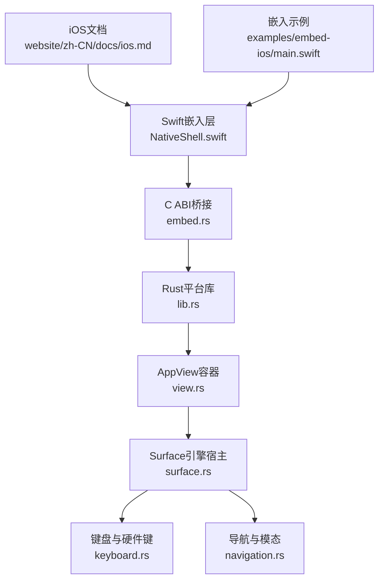
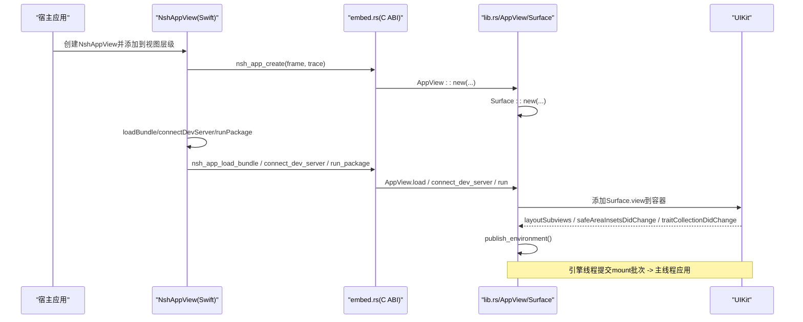
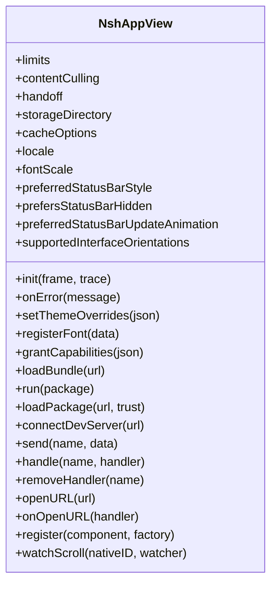
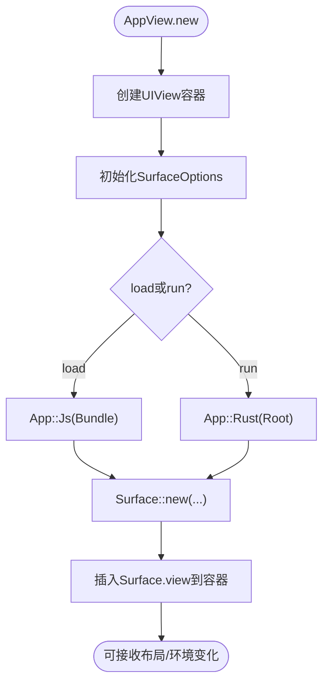
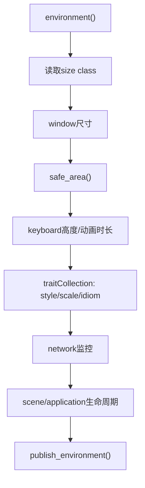
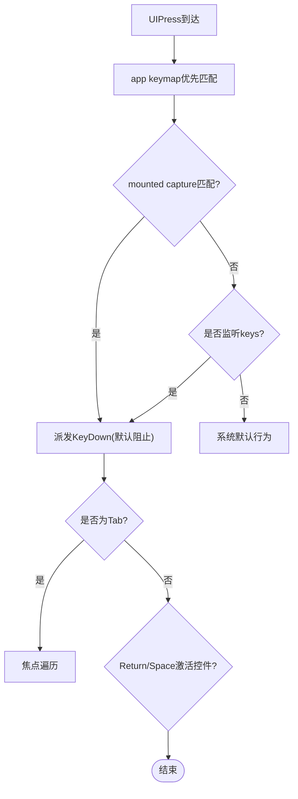
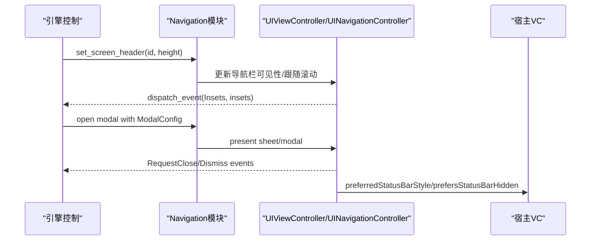
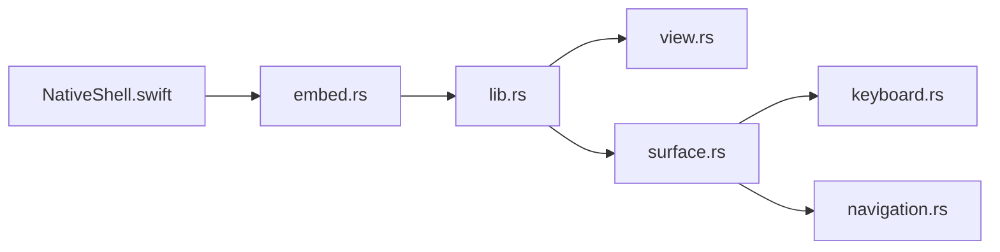
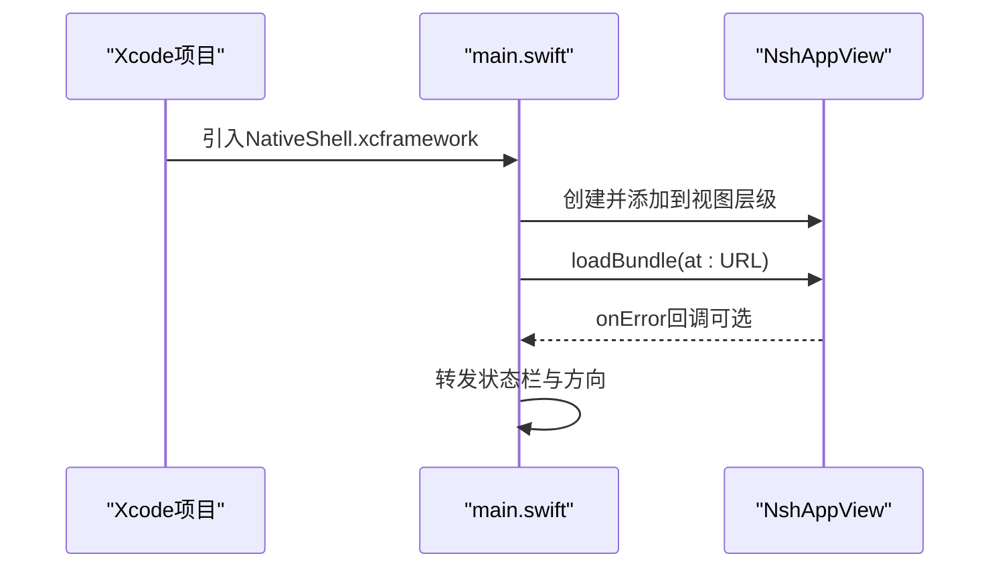

# iOS平台

<cite>
**本文引用的文件**   
- [website/zh-CN/docs/ios.md](file://website/zh-CN/docs/ios.md)
- [crates/nsh-platform-ios/src/lib.rs](file://crates/nsh-platform-ios/src/lib.rs)
- [crates/nsh-platform-ios/src/embed.rs](file://crates/nsh-platform-ios/src/embed.rs)
- [crates/nsh-platform-ios/swift/NativeShell.swift](file://crates/nsh-platform-ios/swift/NativeShell.swift)
- [examples/embed-ios/main.swift](file://examples/embed-ios/main.swift)
- [crates/nsh-platform-ios/src/view.rs](file://crates/nsh-platform-ios/src/view.rs)
- [crates/nsh-platform-ios/src/surface.rs](file://crates/nsh-platform-ios/src/surface.rs)
- [crates/nsh-platform-ios/src/keyboard.rs](file://crates/nsh-platform-ios/src/keyboard.rs)
- [crates/nsh-platform-ios/src/navigation.rs](file://crates/nsh-platform-ios/src/navigation.rs)
</cite>

## 目录
1. [简介](#简介)
2. [项目结构](#项目结构)
3. [核心组件](#核心组件)
4. [架构总览](#架构总览)
5. [详细组件分析](#详细组件分析)
6. [依赖关系分析](#依赖关系分析)
7. [性能与内存优化](#性能与内存优化)
8. [调试与测试指南](#调试与测试指南)
9. [Swift集成与Xcode配置](#swift集成与xcode配置)
10. [结论](#结论)
11. [附录：API与能力速查](#附录api与能力速查)

## 简介
本文件面向在iOS平台上使用NSH的开发者，系统性说明UIKit集成、AppView组件、Surface渲染系统、原生API访问、手势与键盘、导航控制器、Tab Bar、系统菜单与状态栏控制等。文档同时覆盖Swift集成示例、Xcode项目配置、构建流程与部署，以及性能优化、内存管理、电池优化、调试技巧、模拟器与真机测试、与SwiftUI互操作、Catalyst支持与iPad适配最佳实践。

## 项目结构
iOS平台相关代码主要位于以下位置：
- Swift嵌入层：`crates/nsh-platform-ios/swift/NativeShell.swift`
- C ABI桥接（供Swift私有导入）：`crates/nsh-platform-ios/src/embed.rs`
- Rust平台实现入口与导出：`crates/nsh-platform-ios/src/lib.rs`
- App视图容器与生命周期：`crates/nsh-platform-ios/src/view.rs`
- Surface引擎宿主与环境：`crates/nsh-platform-ios/src/surface.rs`
- 键盘与硬件键处理：`crates/nsh-platform-ios/src/keyboard.rs`
- 导航与模态：`crates/nsh-platform-ios/src/navigation.rs`
- 官方iOS文档与示例：`website/zh-CN/docs/ios.md`、`examples/embed-ios/main.swift`

**图表来源**
- [crates/nsh-platform-ios/swift/NativeShell.swift:1-120](file://crates/nsh-platform-ios/swift/NativeShell.swift#L1-L120)
- [crates/nsh-platform-ios/src/embed.rs:1-120](file://crates/nsh-platform-ios/src/embed.rs#L1-L120)
- [crates/nsh-platform-ios/src/lib.rs:1-120](file://crates/nsh-platform-ios/src/lib.rs#L1-L120)
- [crates/nsh-platform-ios/src/view.rs:1-120](file://crates/nsh-platform-ios/src/view.rs#L1-L120)
- [crates/nsh-platform-ios/src/surface.rs:1-120](file://crates/nsh-platform-ios/src/surface.rs#L1-L120)
- [crates/nsh-platform-ios/src/keyboard.rs:1-120](file://crates/nsh-platform-ios/src/keyboard.rs#L1-L120)
- [crates/nsh-platform-ios/src/navigation.rs:1-120](file://crates/nsh-platform-ios/src/navigation.rs#L1-L120)
- [website/zh-CN/docs/ios.md:1-120](file://website/zh-CN/docs/ios.md#L1-L120)
- [examples/embed-ios/main.swift:1-120](file://examples/embed-ios/main.swift#L1-L120)

**章节来源**
- [website/zh-CN/docs/ios.md:1-120](file://website/zh-CN/docs/ios.md#L1-L120)
- [crates/nsh-platform-ios/src/lib.rs:1-120](file://crates/nsh-platform-ios/src/lib.rs#L1-L120)

## 核心组件
- NshAppView（Swift）：UIView子类，封装应用加载、限制、主题覆盖、字体注册、缓存策略、签名包运行、开发服务器连接、事件通道、滚动监听等。
- AppView（Rust）：UIKit容器，负责创建Surface、挂载JS或Rust根组件、错误回调、热更新、DevSession。
- Surface（Rust）：引擎宿主，维护Engine、Mounter、环境（窗口尺寸、安全区域、键盘高度、颜色方案、设备类型、网络、音频、语音、通知等），并订阅系统通知。
- Keyboard（Rust）：将UIKit UIPress映射为KeyEvent，处理修饰键、Tab遍历、捕获规则、焦点恢复。
- Navigation（Rust）：UINavigationController栈、UIViewController模态、Sheet detents、状态栏与方向转发。

**章节来源**
- [crates/nsh-platform-ios/swift/NativeShell.swift:116-373](file://crates/nsh-platform-ios/swift/NativeShell.swift#L116-L373)
- [crates/nsh-platform-ios/src/view.rs:16-120](file://crates/nsh-platform-ios/src/view.rs#L16-L120)
- [crates/nsh-platform-ios/src/surface.rs:129-168](file://crates/nsh-platform-ios/src/surface.rs#L129-L168)
- [crates/nsh-platform-ios/src/keyboard.rs:1-120](file://crates/nsh-platform-ios/src/keyboard.rs#L1-L120)
- [crates/nsh-platform-ios/src/navigation.rs:1-120](file://crates/nsh-platform-ios/src/navigation.rs#L1-L120)

## 架构总览
iOS平台的运行时由Swift嵌入层通过C ABI调用Rust平台库，Rust侧以AppView作为容器，内部启动Surface驱动引擎，Surface负责环境感知、挂载批处理、与UIKit交互。键盘、导航、系统菜单、状态栏等原生能力由对应模块提供。

**图表来源**
- [crates/nsh-platform-ios/swift/NativeShell.swift:121-145](file://crates/nsh-platform-ios/swift/NativeShell.swift#L121-L145)
- [crates/nsh-platform-ios/src/embed.rs:92-160](file://crates/nsh-platform-ios/src/embed.rs#L92-L160)
- [crates/nsh-platform-ios/src/view.rs:328-368](file://crates/nsh-platform-ios/src/view.rs#L328-L368)
- [crates/nsh-platform-ios/src/surface.rs:170-208](file://crates/nsh-platform-ios/src/surface.rs#L170-L208)

**章节来源**
- [crates/nsh-platform-ios/src/lib.rs:1-120](file://crates/nsh-platform-ios/src/lib.rs#L1-L120)
- [crates/nsh-platform-ios/src/embed.rs:1-120](file://crates/nsh-platform-ios/src/embed.rs#L1-L120)
- [crates/nsh-platform-ios/src/view.rs:328-368](file://crates/nsh-platform-ios/src/view.rs#L328-L368)
- [crates/nsh-platform-ios/src/surface.rs:170-208](file://crates/nsh-platform-ios/src/surface.rs#L170-L208)

## 详细组件分析

### NshAppView（Swift嵌入层）
职责：
- 创建/销毁底层AppView，附加UIView内容视图。
- 暴露onError、limits、contentCulling、handoff、storageDirectory、cacheOptions、locale、fontScale、setThemeOverrides、registerFont、grantCapabilities、loadBundle、run、loadPackage、connectDevServer。
- 状态栏样式与方向转发给宿主ViewController。
- 事件通道：send、handle、removeHandler、openURL、onOpenURL。
- 原生组件注册：register(component:_:)。
- 滚动监听：watchScroll + NshScrollHandle。

关键行为：
- limits、cacheOptions、storageDirectory等从下一次加载生效。
- bundle.nshc仅能从应用包内加载；外部路径应使用bundle.js或签名包。
- onOpenURL返回true表示宿主已处理，否则交由系统UIApplication.open。

**图表来源**
- [crates/nsh-platform-ios/swift/NativeShell.swift:116-373](file://crates/nsh-platform-ios/swift/NativeShell.swift#L116-L373)
- [crates/nsh-platform-ios/swift/NativeShell.swift:609-767](file://crates/nsh-platform-ios/swift/NativeShell.swift#L609-L767)

**章节来源**
- [crates/nsh-platform-ios/swift/NativeShell.swift:116-373](file://crates/nsh-platform-ios/swift/NativeShell.swift#L116-L373)
- [crates/nsh-platform-ios/swift/NativeShell.swift:609-767](file://crates/nsh-platform-ios/swift/NativeShell.swift#L609-L767)

### AppView（Rust容器）
职责：
- 创建UIView容器，设置自适应大小。
- 运行JS Bundle或Rust根组件。
- 管理HostChannel（params、send、handle）。
- 配置limits、cache、storage、theme overrides、fonts、contentCulling、handoff。
- Dev模式连接开发服务器，热更新失败回调。

**图表来源**
- [crates/nsh-platform-ios/src/view.rs:54-120](file://crates/nsh-platform-ios/src/view.rs#L54-L120)
- [crates/nsh-platform-ios/src/view.rs:328-368](file://crates/nsh-platform-ios/src/view.rs#L328-L368)

**章节来源**
- [crates/nsh-platform-ios/src/view.rs:54-120](file://crates/nsh-platform-ios/src/view.rs#L54-L120)
- [crates/nsh-platform-ios/src/view.rs:328-368](file://crates/nsh-platform-ios/src/view.rs#L328-L368)

### Surface（引擎宿主与环境）
职责：
- 持有Engine与Mounter，提交mount批次到主线程。
- 发布Environment（窗口尺寸、安全区域、键盘高度、颜色方案、设备类型、网络、音频、语音、通知、webview请求等）。
- 订阅系统通知（时区、网络、区域设置、生命周期、键盘、无障碍）。
- 支持contentCulling、host environment/tokens/fonts、test model。

**图表来源**
- [crates/nsh-platform-ios/src/surface.rs:439-549](file://crates/nsh-platform-ios/src/surface.rs#L439-L549)
- [crates/nsh-platform-ios/src/surface.rs:551-704](file://crates/nsh-platform-ios/src/surface.rs#L551-L704)

**章节来源**
- [crates/nsh-platform-ios/src/surface.rs:439-549](file://crates/nsh-platform-ios/src/surface.rs#L439-L549)
- [crates/nsh-platform-ios/src/surface.rs:551-704](file://crates/nsh-platform-ios/src/surface.rs#L551-L704)

### 键盘与硬件键（Keyboard）
职责：
- 将UIPress转换为KeyEvent（key、code、modifiers、repeat=false）。
- 处理修饰键跟踪、Tab/Shift+Tab焦点遍历、捕获规则、Return/Space激活控件。
- 无焦点时Surface root接管按键，Tab遍历首尾项。
- 失焦/取消/停用清理按键状态，不伪造KeyUp。

**图表来源**
- [crates/nsh-platform-ios/src/keyboard.rs:238-300](file://crates/nsh-platform-ios/src/keyboard.rs#L238-L300)
- [crates/nsh-platform-ios/src/keyboard.rs:603-718](file://crates/nsh-platform-ios/src/keyboard.rs#L603-L718)

**章节来源**
- [crates/nsh-platform-ios/src/keyboard.rs:238-300](file://crates/nsh-platform-ios/src/keyboard.rs#L238-L300)
- [crates/nsh-platform-ios/src/keyboard.rs:603-718](file://crates/nsh-platform-ios/src/keyboard.rs#L603-L718)

### 导航与模态（Navigation）
职责：
- UINavigationController栈：屏幕header高度、安全区域insets、跟随滚动、隐藏/显示导航栏。
- UIViewController模态：支持swipe关闭、Escape关闭、detents（medium/large/custom）、orientation继承。
- 状态栏样式与方向转发给宿主。

**图表来源**
- [crates/nsh-platform-ios/src/navigation.rs:141-275](file://crates/nsh-platform-ios/src/navigation.rs#L141-L275)
- [crates/nsh-platform-ios/src/navigation.rs:318-521](file://crates/nsh-platform-ios/src/navigation.rs#L318-L521)

**章节来源**
- [crates/nsh-platform-ios/src/navigation.rs:141-275](file://crates/nsh-platform-ios/src/navigation.rs#L141-L275)
- [crates/nsh-platform-ios/src/navigation.rs:318-521](file://crates/nsh-platform-ios/src/navigation.rs#L318-L521)

## 依赖关系分析
- Swift层依赖C ABI（embed.rs）提供的nsh_*函数族。
- embed.rs依赖AppView、SurfaceOptions、Bundle、TrustStore等。
- lib.rs导出AppView、Surface、Components、ApplicationEvent等公共接口。
- surface.rs依赖UIKit通知中心、Engine、Mounter、CoreTextEngine等。
- keyboard.rs依赖input、native_view、target等。
- navigation.rs依赖mount、native_view、EngineControl等。

**图表来源**
- [crates/nsh-platform-ios/src/lib.rs:121-223](file://crates/nsh-platform-ios/src/lib.rs#L121-L223)
- [crates/nsh-platform-ios/src/embed.rs:19-28](file://crates/nsh-platform-ios/src/embed.rs#L19-L28)
- [crates/nsh-platform-ios/src/surface.rs:11-44](file://crates/nsh-platform-ios/src/surface.rs#L11-L44)

**章节来源**
- [crates/nsh-platform-ios/src/lib.rs:121-223](file://crates/nsh-platform-ios/src/lib.rs#L121-L223)
- [crates/nsh-platform-ios/src/embed.rs:19-28](file://crates/nsh-platform-ios/src/embed.rs#L19-L28)

## 性能与内存优化
- VM限制：通过NshLimits设置memoryMB、stackKB、loadBudget、callBudget、maxNodes，避免JS堆溢出与长时间调用。
- contentCulling：滚动视图仅创建视口附近内容，降低内存占用；需要整页截图时可暂时关闭。
- 缓存策略：NshCacheOptions控制图片缓存位置与大小，减少重复下载与离线加载成本。
- 字体注册：按需注册字体，避免重复加载；首次布局即生效。
- 主题覆盖：setThemeOverrides即时生效，避免多次重排。
- 环境发布：仅在环境变化时publish_environment，减少引擎重算。
- 电池优化：合理使用后台模式、网络监控、语音识别与音频播放能力开关。

**章节来源**
- [crates/nsh-platform-ios/swift/NativeShell.swift:75-103](file://crates/nsh-platform-ios/swift/NativeShell.swift#L75-L103)
- [crates/nsh-platform-ios/swift/NativeShell.swift:181-189](file://crates/nsh-platform-ios/swift/NativeShell.swift#L181-L189)
- [crates/nsh-platform-ios/src/surface.rs:439-549](file://crates/nsh-platform-ios/src/surface.rs#L439-L549)

## 调试与测试指南
- 日志：统一日志子系统，Xcode控制台、“控制台”应用、log stream均可查看。
- 开发服务器：NativeShellDev.xcframework支持ws://连接，保存即热重载。
- 模拟器：xcodebuild -downloadPlatform iOS安装运行时；nsh run --target ios选择模拟器。
- 真机：nsh run --target ios --device "iPhone 16 Pro"；局域网地址用于dev服务器。
- 打包：nsh package --target ios-simulator --run生成.app；--target ios生成.ipa并签名。
- 测试：nsh test crates/nsh-platform-ios/tests/keyboard --target ios/catalyst进行硬件键盘回归测试。

**章节来源**
- [website/zh-CN/docs/ios.md:15-33](file://website/zh-CN/docs/ios.md#L15-L33)
- [website/zh-CN/docs/ios.md:76-89](file://website/zh-CN/docs/ios.md#L76-L89)
- [website/zh-CN/docs/ios.md:500-519](file://website/zh-CN/docs/ios.md#L500-L519)
- [crates/nsh-platform-ios/src/lib.rs:39-55](file://crates/nsh-platform-ios/src/lib.rs#L39-L55)

## Swift集成与Xcode配置
- 加入Xcode项目：拖入NativeShell.xcframework（开发用NativeShellDev.xcframework），静态框架选“Do Not Embed”，动态框架选“Embed & Sign”。
- Info.plist：设置CADisableMinimumFrameDurationOnPhone=YES以启用ProMotion 120Hz。
- 随应用附带bundle：nsh build App.tsx --release --out MyApp/nsh，将nsh文件夹作为folder reference加入资源。
- 显示应用：创建NshAppView，约束到父视图，loadBundle(at:)加载bundle.nshc。
- 状态栏与方向：在宿主ViewController中转发NshAppView.preferredStatusBarStyle等属性。
- 示例：examples/embed-ios/main.swift展示完整嵌入流程，包括原生组件注册、事件通道、签名包验证与品牌主题覆盖。

**图表来源**
- [website/zh-CN/docs/ios.md:200-275](file://website/zh-CN/docs/ios.md#L200-L275)
- [examples/embed-ios/main.swift:37-107](file://examples/embed-ios/main.swift#L37-L107)

**章节来源**
- [website/zh-CN/docs/ios.md:200-275](file://website/zh-CN/docs/ios.md#L200-L275)
- [examples/embed-ios/main.swift:37-107](file://examples/embed-ios/main.swift#L37-L107)

## 结论
NSH在iOS平台通过Swift嵌入层与Rust平台库协作，提供完整的UIKit集成、Surface渲染系统、原生API访问与丰富的移动端特性。开发者可通过NshAppView快速嵌入TSX或Rust应用，利用VM限制、缓存策略与contentCulling优化性能，借助键盘、导航、系统菜单与状态栏控制提升用户体验。结合Xcode配置、开发服务器与签名包机制，可实现高效的开发与部署流程。

## 附录：API与能力速查
- NshAppView关键成员：onError、limits、contentCulling、handoff、storageDirectory、cacheOptions、locale、fontScale、setThemeOverrides、registerFont、grantCapabilities、loadBundle、run、loadPackage、connectDevServer、preferredStatusBarStyle、prefersStatusBarHidden、preferredStatusBarUpdateAnimation、supportedInterfaceOrientations、send、handle、removeHandler、openURL、onOpenURL、register、watchScroll。
- NshLimits字段：memoryMB、stackKB、loadBudget、callBudget、maxNodes。
- 能力授予：grantCapabilities(JSON)，与nsh.json声明共同决定权限。
- 签名包：NshTrust.addRoot、updateRevocations、openPackage；NshPackage.info。

**章节来源**
- [crates/nsh-platform-ios/swift/NativeShell.swift:116-373](file://crates/nsh-platform-ios/swift/NativeShell.swift#L116-L373)
- [crates/nsh-platform-ios/swift/NativeShell.swift:375-466](file://crates/nsh-platform-ios/swift/NativeShell.swift#L375-L466)
- [website/zh-CN/docs/ios.md:431-499](file://website/zh-CN/docs/ios.md#L431-L499)