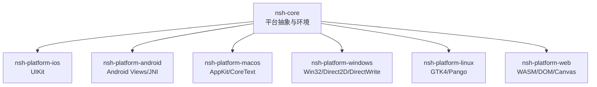
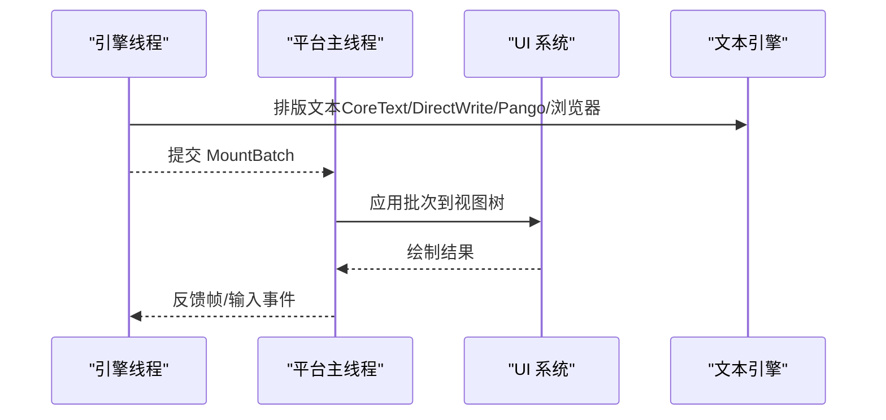
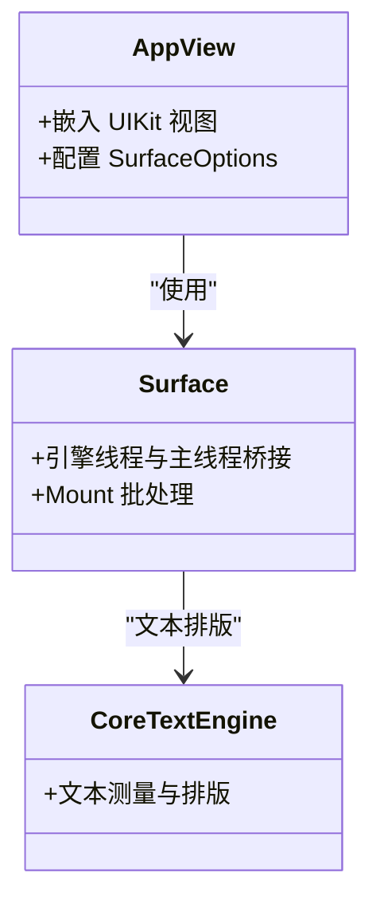
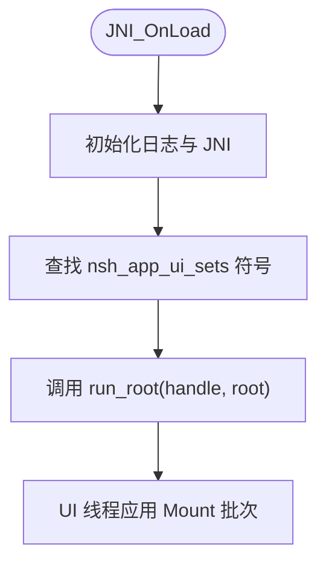
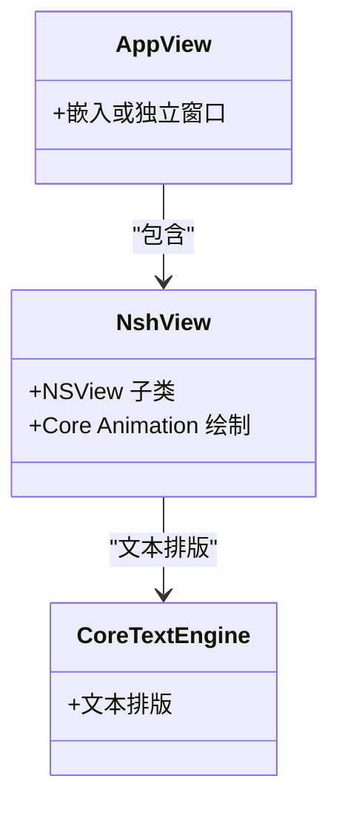
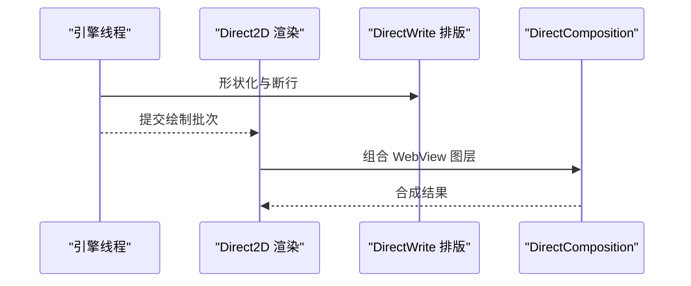
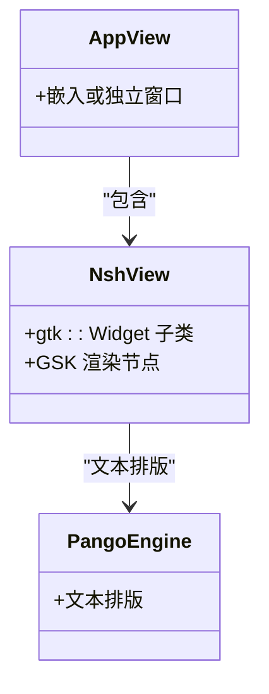
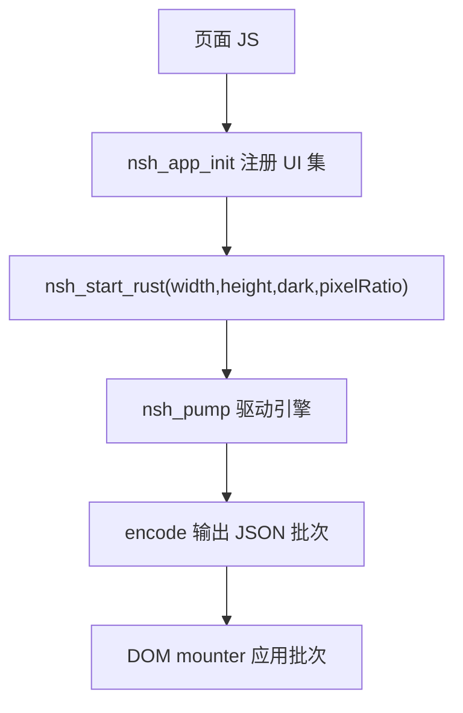
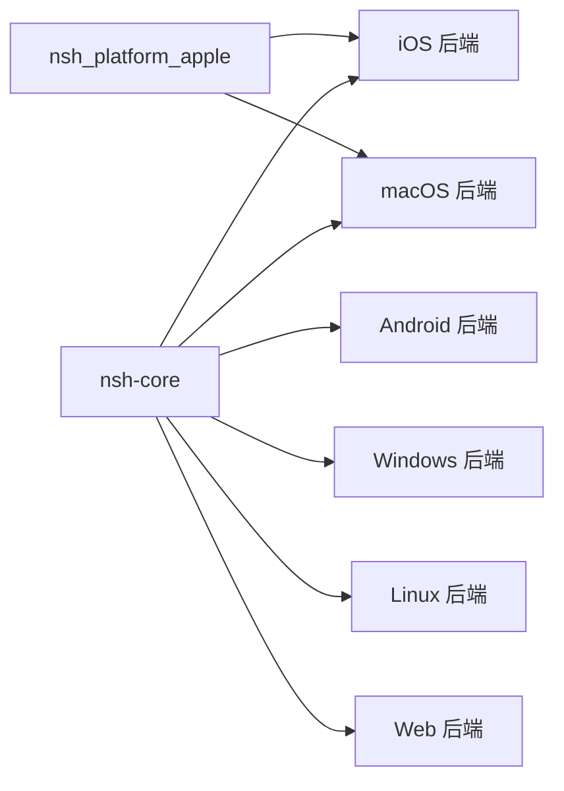
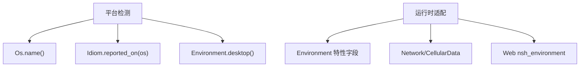

# 平台特定功能

<cite>
**本文引用的文件**   
- [nsh-platform-ios/src/lib.rs](file://crates/nsh-platform-ios/src/lib.rs)
- [nsh-platform-android/src/lib.rs](file://crates/nsh-platform-android/src/lib.rs)
- [nsh-platform-macos/src/lib.rs](file://crates/nsh-platform-macos/src/lib.rs)
- [nsh-platform-windows/src/lib.rs](file://crates/nsh-platform-windows/src/lib.rs)
- [nsh-platform-linux/src/lib.rs](file://crates/nsh-platform-linux/src/lib.rs)
- [nsh-platform-web/src/lib.rs](file://crates/nsh-platform-web/src/lib.rs)
- [nsh-core/src/platform.rs](file://crates/nsh-core/src/platform.rs)
</cite>

## 目录
1. [简介](#简介)
2. [项目结构](#项目结构)
3. [核心组件](#核心组件)
4. [架构总览](#架构总览)
5. [详细组件分析](#详细组件分析)
6. [依赖关系分析](#依赖关系分析)
7. [性能与限制](#性能与限制)
8. [调试与部署打包](#调试与部署打包)
9. [平台差异处理模式与兼容性](#平台差异处理模式与兼容性)
10. [结论](#结论)

## 简介
本文件面向 NSH 的多平台支持，系统性梳理 iOS、Android、macOS、Windows、Linux、Web 六大平台的独特能力与 API 边界。文档聚焦以下方面：
- 各平台 UI 系统集成（iOS UIKit、Android Views、macOS AppKit、Windows Win32/DirectX、Linux GTK4、Web HTML/CSS）
- 平台检测、条件编译与运行时适配
- 渲染管线、文本排版、动画与输入事件在各平台的实现差异
- 性能特点、限制与优化策略
- 调试技巧、部署流程与打包指南
- 平台差异的处理模式与兼容性建议

## 项目结构
NSH 的平台后端以“每个平台一个 crate”的方式组织，统一通过 nsh-core 暴露的抽象与数据模型进行对接。关键目录与职责如下：
- crates/nsh-platform-ios：iOS 平台后端，基于 UIKit
- crates/nsh-platform-android：Android 平台后端，基于 Android Views 与 JNI
- crates/nsh-platform-macos：macOS 平台后端，基于 AppKit/CoreText
- crates/nsh-platform-windows：Windows 平台后端，基于 Win32/Direct2D/DirectWrite
- crates/nsh-platform-linux：Linux 平台后端，基于 GTK4/Pango
- crates/nsh-platform-web：WebAssembly 后端，基于浏览器 DOM/Canvas/WebGL
- crates/nsh-core：跨平台核心类型与环境信息定义，如 Os、Idiom、Environment、Network 等

**图示来源**
- [nsh-core/src/platform.rs:100-147](file://crates/nsh-core/src/platform.rs#L100-L147)
- [nsh-platform-ios/src/lib.rs:1-119](file://crates/nsh-platform-ios/src/lib.rs#L1-L119)
- [nsh-platform-android/src/lib.rs:1-43](file://crates/nsh-platform-android/src/lib.rs#L1-L43)
- [nsh-platform-macos/src/lib.rs:1-22](file://crates/nsh-platform-macos/src/lib.rs#L1-L22)
- [nsh-platform-windows/src/lib.rs:1-22](file://crates/nsh-platform-windows/src/lib.rs#L1-L22)
- [nsh-platform-linux/src/lib.rs:1-16](file://crates/nsh-platform-linux/src/lib.rs#L1-L16)
- [nsh-platform-web/src/lib.rs:1-28](file://crates/nsh-platform-web/src/lib.rs#L1-L28)

**章节来源**
- [nsh-core/src/platform.rs:100-147](file://crates/nsh-core/src/platform.rs#L100-L147)
- [nsh-platform-ios/src/lib.rs:1-119](file://crates/nsh-platform-ios/src/lib.rs#L1-L119)
- [nsh-platform-android/src/lib.rs:1-43](file://crates/nsh-platform-android/src/lib.rs#L1-L43)
- [nsh-platform-macos/src/lib.rs:1-22](file://crates/nsh-platform-macos/src/lib.rs#L1-L22)
- [nsh-platform-windows/src/lib.rs:1-22](file://crates/nsh-platform-windows/src/lib.rs#L1-L22)
- [nsh-platform-linux/src/lib.rs:1-16](file://crates/nsh-platform-linux/src/lib.rs#L1-L16)
- [nsh-platform-web/src/lib.rs:1-28](file://crates/nsh-platform-web/src/lib.rs#L1-L28)

## 核心组件
- 平台抽象与环境
  - Os：操作系统枚举（ios/android/macos/windows/linux/web），提供 is_desktop、is_catalyst 等方法
  - Idiom：设备形态（phone/pad/mac/tv/desktop/terminal），并提供 reported_on、desktop_on 等判断
  - Environment：表面环境（窗口尺寸、安全区域、键盘高度、像素比、颜色方案、网络状态、特性开关等）
  - Network/CellularData：网络类型与蜂窝数据权限
- 平台后端公共接口
  - set_ui_sets / set_components：注册 UI 集与原生组件
  - run_app / AppView：启动应用或嵌入视图
  - 文本引擎：CoreTextEngine（macOS/iOS）、DWriteTextEngine（Windows）、Pango（Linux）、WebTextEngine（Web）
  - 原生组件注册：Components/ComponentFactory/NativeComponent

**章节来源**
- [nsh-core/src/platform.rs:100-147](file://crates/nsh-core/src/platform.rs#L100-L147)
- [nsh-core/src/platform.rs:417-620](file://crates/nsh-core/src/platform.rs#L417-L620)
- [nsh-platform-ios/src/lib.rs:121-222](file://crates/nsh-platform-ios/src/lib.rs#L121-L222)
- [nsh-platform-macos/src/lib.rs:72-90](file://crates/nsh-platform-macos/src/lib.rs#L72-L90)
- [nsh-platform-windows/src/lib.rs:78-101](file://crates/nsh-platform-windows/src/lib.rs#L78-L101)
- [nsh-platform-linux/src/lib.rs:69-85](file://crates/nsh-platform-linux/src/lib.rs#L69-L85)
- [nsh-platform-web/src/lib.rs:112-142](file://crates/nsh-platform-web/src/lib.rs#L112-L142)

## 架构总览
NSH 采用“引擎线程 + 平台主线程”的双线程模型：
- 引擎线程：运行 JS/TS 与布局计算，生成 MountBatch
- 平台主线程：将批次应用到具体 UI 系统（UIKit/AppKit/GTK/Win32/DOM）
- 文本排版在引擎线程完成（CoreText/DirectWrite/Pango/浏览器字体测量），主线程仅绘制

**图示来源**
- [nsh-platform-ios/src/lib.rs:1-119](file://crates/nsh-platform-ios/src/lib.rs#L1-L119)
- [nsh-platform-macos/src/lib.rs:1-22](file://crates/nsh-platform-macos/src/lib.rs#L1-L22)
- [nsh-platform-windows/src/lib.rs:1-22](file://crates/nsh-platform-windows/src/lib.rs#L1-L22)
- [nsh-platform-linux/src/lib.rs:1-16](file://crates/nsh-platform-linux/src/lib.rs#L1-L16)
- [nsh-platform-web/src/lib.rs:1-28](file://crates/nsh-platform-web/src/lib.rs#L1-L28)

## 详细组件分析

### iOS（UIKit）
- 集成要点
  - AppView 作为 UIView 嵌入任意 UIKit 层级；run_app 创建独立窗口
  - 硬件键盘：focusable 视图成为 first responder，UIPress 映射为 on_key_down/on_key_up，Tab/Shift+Tab 焦点遍历
  - 共享音频/通知/语音：复用 nsh_platform_apple 模块
  - 开发模式：dev 特性下支持 dev server 与合成输入
- 关键导出
  - set_ui_sets、set_components、run_app、AppView、SurfaceOptions、CoreTextEngine、preferred_status_bar_style 等

**图示来源**
- [nsh-platform-ios/src/lib.rs:1-119](file://crates/nsh-platform-ios/src/lib.rs#L1-L119)
- [nsh-platform-ios/src/lib.rs:121-222](file://crates/nsh-platform-ios/src/lib.rs#L121-L222)

**章节来源**
- [nsh-platform-ios/src/lib.rs:1-119](file://crates/nsh-platform-ios/src/lib.rs#L1-L119)
- [nsh-platform-ios/src/lib.rs:121-222](file://crates/nsh-platform-ios/src/lib.rs#L121-L222)

### Android（Views + JNI）
- 集成要点
  - libnsh.so 由 Java 运行时加载；引擎线程运行 JS/布局，UI 线程通过 JNI 应用 Mount
  - 原生动画在 UI 线程运行，Choreographer 驱动
  - 选择模型在 UI 线程维护（SelectableView.java）
- 关键宏与入口
  - components!、ui_sets!、root!、main! 宏用于导出符号并启动应用
  - JNI_OnLoad 初始化日志与 JNI 环境

**图示来源**
- [nsh-platform-android/src/lib.rs:146-187](file://crates/nsh-platform-android/src/lib.rs#L146-L187)
- [nsh-platform-android/src/lib.rs:53-79](file://crates/nsh-platform-android/src/lib.rs#L53-L79)

**章节来源**
- [nsh-platform-android/src/lib.rs:1-43](file://crates/nsh-platform-android/src/lib.rs#L1-L43)
- [nsh-platform-android/src/lib.rs:53-79](file://crates/nsh-platform-android/src/lib.rs#L53-L79)
- [nsh-platform-android/src/lib.rs:146-187](file://crates/nsh-platform-android/src/lib.rs#L146-L187)

### macOS（AppKit + CoreText）
- 集成要点
  - NshView 为 NSView 子类，Core Animation 绘制背景/阴影/图像，文本与 Canvas 绘制进入内容层
  - 引擎线程排版文本，主线程绘制；动画由 Display Link 驱动
  - 桌面输入：根视图接管鼠标/滚轮/键盘，滚动视图自管偏移
- 关键导出
  - AppView、run_app、set_components、set_ui_sets、CoreTextEngine、Appearance/Locale 等

**图示来源**
- [nsh-platform-macos/src/lib.rs:1-22](file://crates/nsh-platform-macos/src/lib.rs#L1-L22)
- [nsh-platform-macos/src/lib.rs:72-90](file://crates/nsh-platform-macos/src/lib.rs#L72-L90)

**章节来源**
- [nsh-platform-macos/src/lib.rs:1-22](file://crates/nsh-platform-macos/src/lib.rs#L1-L22)
- [nsh-platform-macos/src/lib.rs:72-90](file://crates/nsh-platform-macos/src/lib.rs#L72-L90)

### Windows（Win32 + Direct2D/DirectWrite）
- 集成要点
  - 每 surface 一个 Win32 窗口，Direct2D 绘制整棵树，DirectWrite 排版文本
  - 引擎线程排版，主线程绘制；动画由 DwmFlush 驱动的帧计时器驱动
  - WebView 通过 DirectComposition 组合到图层之间
- 关键导出
  - AppView、run_app、set_components、set_ui_sets、DWriteTextEngine、Placement 等

**图示来源**
- [nsh-platform-windows/src/lib.rs:1-22](file://crates/nsh-platform-windows/src/lib.rs#L1-L22)
- [nsh-platform-windows/src/lib.rs:78-101](file://crates/nsh-platform-windows/src/lib.rs#L78-L101)

**章节来源**
- [nsh-platform-windows/src/lib.rs:1-22](file://crates/nsh-platform-windows/src/lib.rs#L1-L22)
- [nsh-platform-windows/src/lib.rs:78-101](file://crates/nsh-platform-windows/src/lib.rs#L78-L101)

### Linux（GTK4 + Pango）
- 集成要点
  - NshView 为 gtk::Widget 子类，GSK 渲染节点绘制背景/边框/阴影/字形/图像
  - 引擎线程排版（Pango），主线程绘制；动画由根视图帧时钟驱动
  - 可选 GStreamer 声音支持（sound 特性）
- 关键导出
  - AppView、run_app、set_components、set_ui_sets、gtk4、Locale/Appearance 等

**图示来源**
- [nsh-platform-linux/src/lib.rs:1-16](file://crates/nsh-platform-linux/src/lib.rs#L1-L16)
- [nsh-platform-linux/src/lib.rs:69-85](file://crates/nsh-platform-linux/src/lib.rs#L69-L85)

**章节来源**
- [nsh-platform-linux/src/lib.rs:1-16](file://crates/nsh-platform-linux/src/lib.rs#L1-L16)
- [nsh-platform-linux/src/lib.rs:69-85](file://crates/nsh-platform-linux/src/lib.rs#L69-L85)

### Web（WASM + DOM/Canvas）
- 集成要点
  - TSX 在浏览器 JS 引擎运行，Rust 引擎在主线程；每次 commit 编码为 JSON 批次，DOM mounter 应用
  - 文本使用浏览器字体测量，动画在 requestAnimationFrame 上运行
  - fetch/WebSocket/Storage/Filesystem 等通过浏览器 API 桥接
- 关键宏与入口
  - ui_sets!、ui_set!、rust_app! 宏用于注册 UI 集与 Rust 根组件
  - nsh_environment、nsh_start_rust、nsh_pump 等 C ABI 函数

**图示来源**
- [nsh-platform-web/src/lib.rs:1-28](file://crates/nsh-platform-web/src/lib.rs#L1-L28)
- [nsh-platform-web/src/lib.rs:280-334](file://crates/nsh-platform-web/src/lib.rs#L280-L334)
- [nsh-platform-web/src/lib.rs:657-676](file://crates/nsh-platform-web/src/lib.rs#L657-L676)

**章节来源**
- [nsh-platform-web/src/lib.rs:1-28](file://crates/nsh-platform-web/src/lib.rs#L1-L28)
- [nsh-platform-web/src/lib.rs:280-334](file://crates/nsh-platform-web/src/lib.rs#L280-L334)
- [nsh-platform-web/src/lib.rs:657-676](file://crates/nsh-platform-web/src/lib.rs#L657-L676)

## 依赖关系分析
- 平台后端均依赖 nsh-core 提供的 Os、Idiom、Environment、Network 等类型
- iOS/macOS 共享 nsh_platform_apple 的音频/通知/语音能力
- Web 后端通过浏览器 API 桥接网络、存储、文件系统、WebSocket
- Android 通过 JNI 与 Java 层交互，导出符号供宿主库发现

**图示来源**
- [nsh-core/src/platform.rs:100-147](file://crates/nsh-core/src/platform.rs#L100-L147)
- [nsh-platform-ios/src/lib.rs:96-99](file://crates/nsh-platform-ios/src/lib.rs#L96-L99)
- [nsh-platform-macos/src/lib.rs:57-59](file://crates/nsh-platform-macos/src/lib.rs#L57-L59)

**章节来源**
- [nsh-core/src/platform.rs:100-147](file://crates/nsh-core/src/platform.rs#L100-L147)
- [nsh-platform-ios/src/lib.rs:96-99](file://crates/nsh-platform-ios/src/lib.rs#L96-L99)
- [nsh-platform-macos/src/lib.rs:57-59](file://crates/nsh-platform-macos/src/lib.rs#L57-L59)

## 性能与限制
- 渲染与排版
  - iOS/macOS：CoreText 在引擎线程排版，主线程绘制；Core Animation 负责复杂图形
  - Windows：Direct2D/DirectWrite 分离排版与绘制；WebView 通过 DirectComposition 合成
  - Linux：Pango 排版，GSK 渲染节点绘制；动画由根视图帧时钟驱动
  - Web：浏览器字体测量与 Canvas/WebGL 渲染；requestAnimationFrame 驱动动画
- 输入与焦点
  - iOS：硬件键盘映射为 DOM key/code，Tab/Shift+Tab 焦点遍历
  - macOS/Linux：根视图接管鼠标/滚轮/键盘，滚动视图自管偏移
  - Windows：消息循环驱动输入；WebView 合成影响输入路径
  - Web：DOM 事件模型，键盘快捷键匹配在引擎外缓存 Keymap
- 特性可用性
  - Environment 字段控制 canvas_render、share、auth_session、web_views、shaders 等特性开关
  - 某些平台默认关闭部分能力（如 Android 剪贴板图片、无 GPU 时 shaders=false）

[本节为通用性能讨论，不直接分析具体文件]

## 调试与部署打包
- 调试
  - iOS：Xcode Simulator 支持硬件键盘回归测试；dev 特性启用 dev server 与合成输入
  - Android：logcat 查看日志；JNI 异常会被记录并清理以便后续调用
  - macOS/Linux/Windows：dev 特性启用 dev server；可结合平台工具链（Instruments、gdb、Visual Studio）
  - Web：浏览器开发者工具；nsh.js 与 WASM 模块联动
- 打包与发布
  - iOS：构建 iOS 应用包；可通过 Swift 模块嵌入 NSH
  - Android：构建 libnsh.so 与 APK；Java 层加载库并调用 run_root
  - macOS：构建 .app；AppKit 窗口与菜单
  - Windows：构建 .exe/.dll；Win32 窗口与 Direct2D 渲染
  - Linux：构建可执行文件；GTK4 窗口与 Pango 文本
  - Web：nsh package --target web 生成静态资源；浏览器加载 WASM 与 JS

[本节为通用指导，不直接分析具体文件]

## 平台差异处理模式与兼容性
- 平台检测
  - 使用 Os.name() 获取字符串标识（ios/android/macos/windows/linux/web）
  - 使用 Idiom.reported_on(os) 获取应用可见的设备形态（phone/pad/mac/tv/desktop/terminal）
  - 使用 Environment.desktop() 判断是否适用桌面行为
- 条件编译
  - 各平台 crate 使用 #[cfg(target_os = "...")] 或 #[cfg(windows)] 隔离平台代码
  - iOS/macOS 共享 nsh_platform_apple 模块
- 运行时适配
  - Environment 字段提供特性开关（canvas_render、share、auth_session、web_views、shaders 等）
  - Network/CellularData 提供网络与蜂窝数据权限信息
  - Web 后端通过 nsh_environment 接收页面环境（idiom/locale/safeArea/network 等）

**图示来源**
- [nsh-core/src/platform.rs:100-147](file://crates/nsh-core/src/platform.rs#L100-L147)
- [nsh-core/src/platform.rs:417-620](file://crates/nsh-core/src/platform.rs#L417-L620)
- [nsh-platform-web/src/lib.rs:503-655](file://crates/nsh-platform-web/src/lib.rs#L503-L655)

**章节来源**
- [nsh-core/src/platform.rs:100-147](file://crates/nsh-core/src/platform.rs#L100-L147)
- [nsh-core/src/platform.rs:417-620](file://crates/nsh-core/src/platform.rs#L417-L620)
- [nsh-platform-web/src/lib.rs:503-655](file://crates/nsh-platform-web/src/lib.rs#L503-L655)

## 结论
NSH 通过统一的平台抽象与多后端实现，覆盖 iOS、Android、macOS、Windows、Linux、Web 六大平台。各平台在 UI 系统集成、文本排版、动画与输入事件上存在差异，但通过 nsh-core 的环境与特性字段保持一致的 API 语义。建议在应用中优先使用 Os/Idiom/Environment 进行平台检测与特性判断，并结合各平台后端的最佳实践进行性能优化与调试。