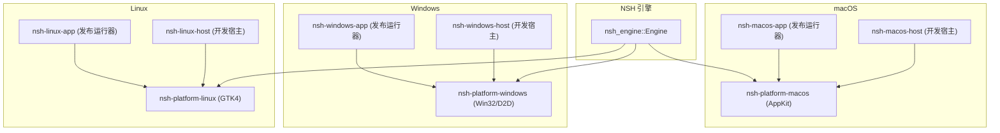
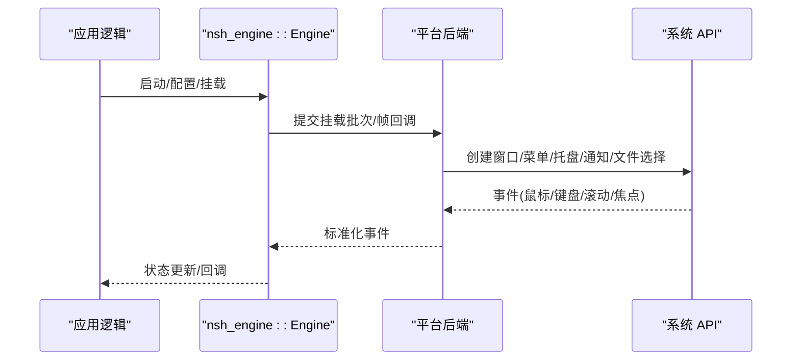
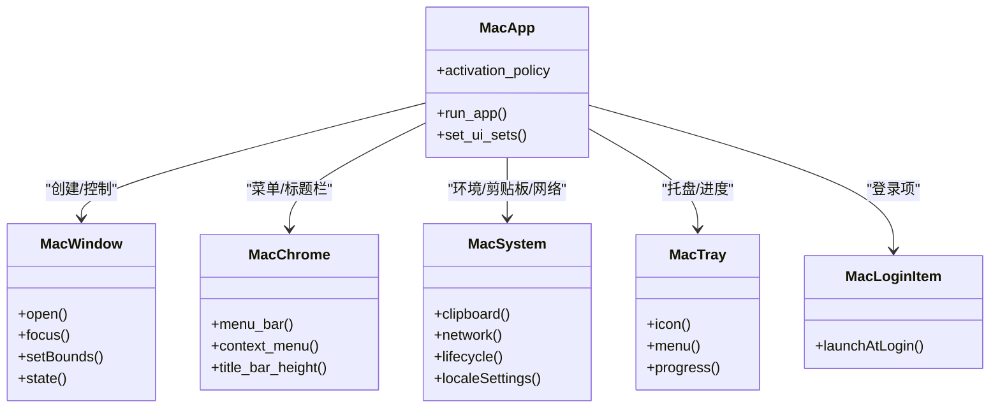
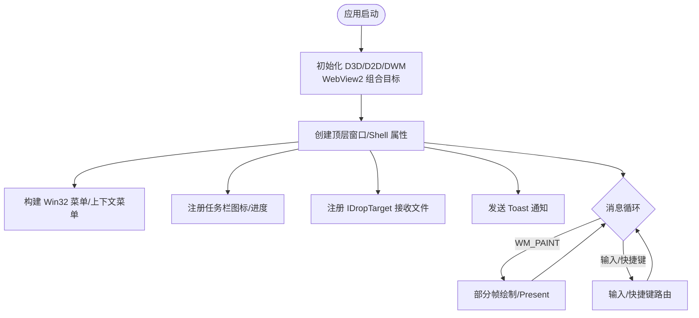
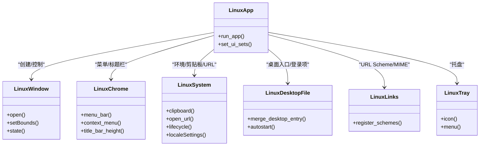
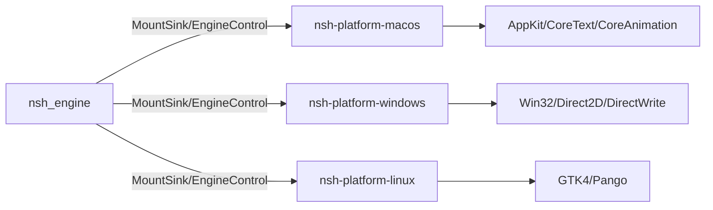

# 桌面平台

<cite>
**本文引用的文件**   
- [platforms.md](file://docs/dev/platforms.md)
- [macos.md](file://docs/dev/macos.md)
- [windows.md](file://docs/dev/windows.md)
- [linux.md](file://docs/dev/linux.md)
- [lib.rs](file://crates/nsh-platform-macos/src/lib.rs)
- [app.rs](file://crates/nsh-platform-macos/src/app.rs)
- [window.rs](file://crates/nsh-platform-macos/src/window.rs)
- [system.rs](file://crates/nsh-platform-macos/src/system.rs)
- [chrome.rs](file://crates/nsh-platform-macos/src/chrome.rs)
- [tray.rs](file://crates/nsh-platform-macos/src/tray.rs)
- [login_item.rs](file://crates/nsh-platform-macos/src/login_item.rs)
- [lib.rs](file://crates/nsh-platform-windows/src/lib.rs)
- [app.rs](file://crates/nsh-platform-windows/src/app.rs)
- [shell.rs](file://crates/nsh-platform-windows/src/shell.rs)
- [system.rs](file://crates/nsh-platform-windows/src/system.rs)
- [notifications.rs](file://crates/nsh-platform-windows/src/notifications.rs)
- [tray.rs](file://crates/nsh-platform-windows/src/tray.rs)
- [login_item.rs](file://crates/nsh-platform-windows/src/login_item.rs)
- [lib.rs](file://crates/nsh-platform-linux/src/lib.rs)
- [app.rs](file://crates/nsh-platform-linux/src/app.rs)
- [window.rs](file://crates/nsh-platform-linux/src/window.rs)
- [system.rs](file://crates/nsh-platform-linux/src/system.rs)
- [desktop_file.rs](file://crates/nsh-platform-linux/src/desktop_file.rs)
- [links.rs](file://crates/nsh-platform-linux/src/links.rs)
- [tray.rs](file://crates/nsh-platform-linux/src/tray.rs)
</cite>

## 目录
1. [简介](#简介)
2. [项目结构](#项目结构)
3. [核心组件](#核心组件)
4. [架构总览](#架构总览)
5. [详细组件分析](#详细组件分析)
6. [依赖关系分析](#依赖关系分析)
7. [性能与多显示器](#性能与多显示器)
8. [打包、签名与自动更新](#打包签名与自动更新)
9. [故障排查指南](#故障排查指南)
10. [结论](#结论)

## 简介
本文件面向 NSH 的桌面端（macOS、Windows、Linux），系统性说明各平台的原生窗口管理、事件处理与系统集成，覆盖 AppKit/Win32/GTK4 集成、菜单栏与任务栏/Dock 集成、文件系统访问、通知中心、主题与桌面环境适配等。同时给出跨平台打包格式、代码签名与自动更新的实践建议，以及窗口管理与多显示器支持的最佳实践。

## 项目结构
NSH 为每个桌面平台提供独立的后端 crate：
- macOS：AppKit + CoreAnimation/CoreText，开发宿主与发布运行器分离
- Windows：Win32 + Direct2D/DirectWrite，WebView2 组合渲染
- Linux：GTK4 + Pango，可选 WebKitGTK 6.0

图表来源
- [platforms.md:11-26](file://docs/dev/platforms.md#L11-L26)
- [macos.md:1-9](file://docs/dev/macos.md#L1-L9)
- [windows.md:1-8](file://docs/dev/windows.md#L1-L8)
- [linux.md:1-7](file://docs/dev/linux.md#L1-L7)

章节来源
- [platforms.md:11-26](file://docs/dev/platforms.md#L11-L26)
- [macos.md:1-9](file://docs/dev/macos.md#L1-L9)
- [windows.md:1-8](file://docs/dev/windows.md#L1-L8)
- [linux.md:1-7](file://docs/dev/linux.md#L1-L7)

## 核心组件
- 引擎与挂载管线
  - 引擎在独立线程运行，通过 MountSink 提交挂载批次；主线程按序应用，避免阻塞 UI。
  - 文本排版在引擎线程完成，主线程仅绘制。
- 窗口模型 v2
  - 主窗口不可见，真正显示的是应用声明的 `<Window>`。
- 输入与键盘
  - 统一的命中测试、指针/触摸/滚轮/键盘路由；各平台保留系统菜单、对话框、输入法等优先权。
- 导航与弹窗
  - 栈式页面、Dialog/Alert 在各平台以原生或自绘方式呈现。
- 媒体与 Web
  - 视频使用平台媒体框架；Web 视图使用 WKWebView / WebView2 / WebKitGTK。

章节来源
- [macos.md:105-298](file://docs/dev/macos.md#L105-L298)
- [windows.md:65-181](file://docs/dev/windows.md#L65-L181)
- [linux.md:51-88](file://docs/dev/linux.md#L51-L88)

## 架构总览
下图展示“引擎 → 平台后端 → 系统 API”的调用链，以及关键子系统（窗口、菜单/任务栏、文件系统、通知）。

图表来源
- [macos.md:105-298](file://docs/dev/macos.md#L105-L298)
- [windows.md:65-181](file://docs/dev/windows.md#L65-L181)
- [linux.md:51-88](file://docs/dev/linux.md#L51-L88)

## 详细组件分析

### macOS（AppKit）
- 窗口与标题栏
  - 隐藏标题栏时由 AppView 叠加控件；窗口拖拽、缩放、全屏、层级与任务栏行为由 chrome 与 window_state 模块实现。
- 菜单栏与 Dock
  - 应用菜单替换系统主菜单；Dock 图标弹跳、进度条、重开窗口等行为由 system/chrome/tray 协作。
- 文件系统与面板
  - 打开/保存面板作为工作表或独立窗口；文件拖放、URL scheme 与本地文件范围限制。
- 通知中心
  - 原生 Alert/Panel 与通知能力；日志统一接入系统日志。
- 登录项
  - 通过 ServiceManagement 注册/注销登录项。

图表来源
- [app.rs](file://crates/nsh-platform-macos/src/app.rs)
- [window.rs](file://crates/nsh-platform-macos/src/window.rs)
- [chrome.rs](file://crates/nsh-platform-macos/src/chrome.rs)
- [system.rs](file://crates/nsh-platform-macos/src/system.rs)
- [tray.rs](file://crates/nsh-platform-macos/src/tray.rs)
- [login_item.rs](file://crates/nsh-platform-macos/src/login_item.rs)

章节来源
- [macos.md:105-298](file://docs/dev/macos.md#L105-L298)
- [macos.md:321-329](file://docs/dev/macos.md#L321-L329)
- [macos.md:344-381](file://docs/dev/macos.md#L344-L381)
- [macos.md:727-759](file://docs/dev/macos.md#L727-L759)
- [macos.md:761-778](file://docs/dev/macos.md#L761-L778)

### Windows（Win32 + Direct2D）
- 窗口与标题栏
  - 自定义标题栏与窗口按钮；隐藏标题栏时仍保持系统移动/缩放语义；全屏切换与任务栏标签。
- 任务栏与通知
  - 任务栏图标、进度、提示；Toast 通知使用系统 API。
- 注册表与登录项
  - 通过 HKCU\...\Run 设置开机启动；安装程序卸载时清理。
- 文件系统与拖放
  - OLE IDropTarget 实现本地文件拖放；路径转 file URL。
- Web 视图与合成
  - WebView2 通过 DirectComposition 合成到 NSH 绘制层之间。

图表来源
- [app.rs](file://crates/nsh-platform-windows/src/app.rs)
- [shell.rs](file://crates/nsh-platform-windows/src/shell.rs)
- [system.rs](file://crates/nsh-platform-windows/src/system.rs)
- [notifications.rs](file://crates/nsh-platform-windows/src/notifications.rs)
- [tray.rs](file://crates/nsh-platform-windows/src/tray.rs)
- [login_item.rs](file://crates/nsh-platform-windows/src/login_item.rs)

章节来源
- [windows.md:65-181](file://docs/dev/windows.md#L65-L181)
- [windows.md:182-210](file://docs/dev/windows.md#L182-L210)
- [windows.md:211-313](file://docs/dev/windows.md#L211-L313)
- [windows.md:570-589](file://docs/dev/windows.md#L570-L589)

### Linux（GTK4）
- 窗口与标题栏
  - 客户端装饰或服务器端装饰；隐藏标题栏时在 AppView 上叠加控件；窗口大小/位置由 WM 控制。
- 菜单栏与主题
  - gio::Menu 应用菜单；菜单样式由应用设计令牌驱动；跟随 XDG 外观门户。
- 桌面集成
  - 桌面入口与 MIME/URL Scheme 合并；XDG autostart 登录项。
- 文件系统与拖放
  - GtkDropTarget 接收文件列表；绝对路径转为 file URL。
- 通知与剪贴板
  - 通知通过系统总线；剪贴板异步读取。

图表来源
- [app.rs](file://crates/nsh-platform-linux/src/app.rs)
- [window.rs](file://crates/nsh-platform-linux/src/window.rs)
- [system.rs](file://crates/nsh-platform-linux/src/system.rs)
- [desktop_file.rs](file://crates/nsh-platform-linux/src/desktop_file.rs)
- [links.rs](file://crates/nsh-platform-linux/src/links.rs)
- [tray.rs](file://crates/nsh-platform-linux/src/tray.rs)

章节来源
- [linux.md:51-118](file://docs/dev/linux.md#L51-L118)
- [linux.md:120-133](file://docs/dev/linux.md#L120-L133)
- [linux.md:134-228](file://docs/dev/linux.md#L134-L228)

## 依赖关系分析
- 平台后端均依赖 nsh_engine 提供的 Engine/LocalEngine、MountSink、EngineControl 等扩展点。
- 文本引擎 TextEngine 在各平台分别用 CoreText/DirectWrite/Pango 实现。
- 各平台通过 Environment 暴露 platform/os/idiom 等运行时信息，供上层条件分支。

图表来源
- [platforms.md:11-26](file://docs/dev/platforms.md#L11-L26)
- [macos.md:105-298](file://docs/dev/macos.md#L105-L298)
- [windows.md:65-181](file://docs/dev/windows.md#L65-L181)
- [linux.md:51-88](file://docs/dev/linux.md#L51-L88)

章节来源
- [platforms.md:11-26](file://docs/dev/platforms.md#L11-L26)

## 性能与多显示器
- 帧率与计时
  - macOS：基于 display link 的帧回调与 deadline 机制；Windows：DwmFlush 驱动的 ticker；Linux：GTK frame clock。
  - 三者均提供 --fps 监控，记录 tick/drain/paint/present 等阶段耗时。
- 部分帧与增量绘制
  - Windows 使用 Direct2D 部分帧与 Present1 矩形呈现；macOS 使用 content layer 与可见性裁剪；Linux 使用 snapshot 与纹理回读。
- 多显示器
  - macOS：NSScreen.screens 枚举显示器，屏幕变化时更新像素比与帧率范围；窗口可指定 display/index/secondary。
  - Windows：每监视器 DPI 感知，DWM 组合；任务栏/通知/WebView2 栅格化比例随窗口 DPI。
  - Linux：GDK 监视器枚举；XDG 外观门户与字体缩放影响布局。

章节来源
- [macos.md:231-256](file://docs/dev/macos.md#L231-L256)
- [macos.md:321-329](file://docs/dev/macos.md#L321-L329)
- [windows.md:140-164](file://docs/dev/windows.md#L140-L164)
- [windows.md:361-458](file://docs/dev/windows.md#L361-L458)
- [linux.md:74-85](file://docs/dev/linux.md#L74-L85)
- [linux.md:317-339](file://docs/dev/linux.md#L317-L339)

## 打包、签名与自动更新
- 打包格式
  - macOS：DMG（需 Developer ID 签名与 notarize）
  - Windows：MSI（Inno Setup 等安装包工具）
  - Linux：DEB/RPM（依赖 GTK4/Pango，可选 WebKitGTK 6.0）
- 代码签名
  - macOS：ad hoc 签名用于开发；分发需 Developer ID 并 notarize
  - Windows：安装包签名（signtool）
  - Linux：仓库签名（GPG）
- 自动更新
  - 通过 nsh-updater 与 CLI updater 流程进行 OTA/版本检查与下载；各平台宿主负责重启与替换。

章节来源
- [macos.md:629-650](file://docs/dev/macos.md#L629-L650)
- [windows.md:513-514](file://docs/dev/windows.md#L513-L514)
- [linux.md:374-375](file://docs/dev/linux.md#L374-L375)

## 故障排查指南
- 截图与测试
  - macOS：composited 截图优先，fallback 到 cacheDisplayInRect；锁屏/后台测试路径不同
  - Windows：PrintWindow(PW_RENDERFULLCONTENT) 捕获组合内容；测试指针隔离
  - Linux：GtkWidgetPaintable 离屏渲染；Xvfb 下比较 NGL/Vulkan 渲染差异
- 键盘与输入法
  - macOS：本地事件监听器拦截键，区分 IME 组合与原始键；修饰键 flagsChanged 同步
  - Windows：WH_GETMESSAGE 钩子抑制 TranslateMessage；逻辑 key/code 映射
  - Linux：X11 使用 XTestFakeKeyEvent；Wayland 走 widget signals
- 常见问题定位
  - 窗口未显示：确认窗口模型 v2 与首次帧后 show
  - 菜单不显示：隐藏标题栏时菜单需通过 Menu.popup 打开
  - 托盘无图标：确认激活策略与包内资源
  - Web 视图白屏：WebView2 Runtime/WebKitGTK 缺失或权限不足

章节来源
- [macos.md:554-627](file://docs/dev/macos.md#L554-L627)
- [windows.md:314-359](file://docs/dev/windows.md#L314-L359)
- [linux.md:230-315](file://docs/dev/linux.md#L230-L315)
- [linux.md:384-450](file://docs/dev/linux.md#L384-L450)

## 结论
NSH 的桌面端通过统一的引擎与挂载协议，将 AppKit、Win32/Direct2D 与 GTK4 三种原生后端对齐到一致的窗口模型、输入与渲染管线。开发者可在跨平台 API 之上获得接近原生的窗口、菜单、托盘、通知与系统集成体验；同时借助 --fps 与平台测试工具进行性能优化与问题定位。打包与签名遵循各平台规范，自动更新由 nsh-updater 统一管理。