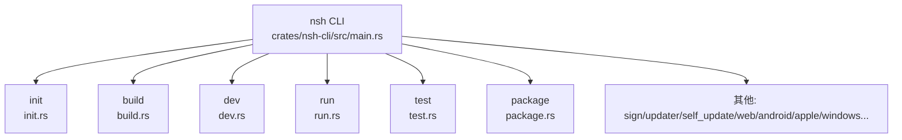
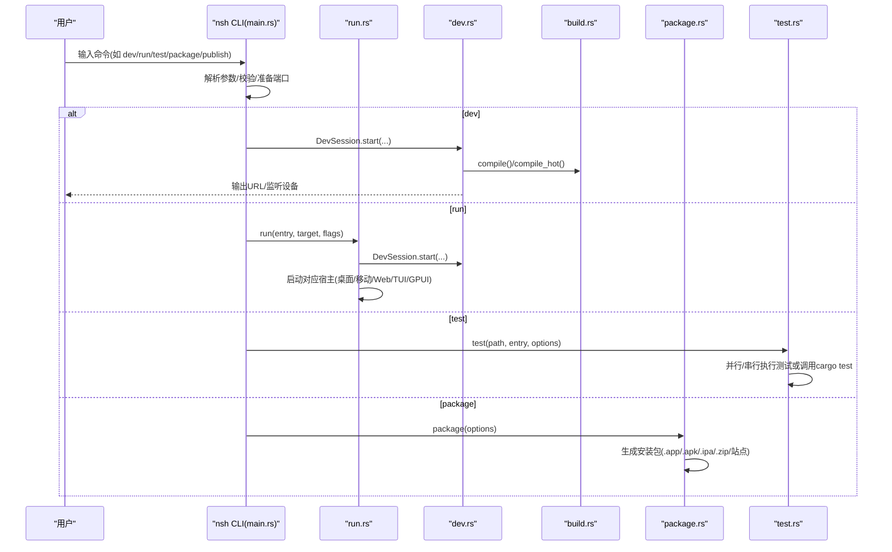
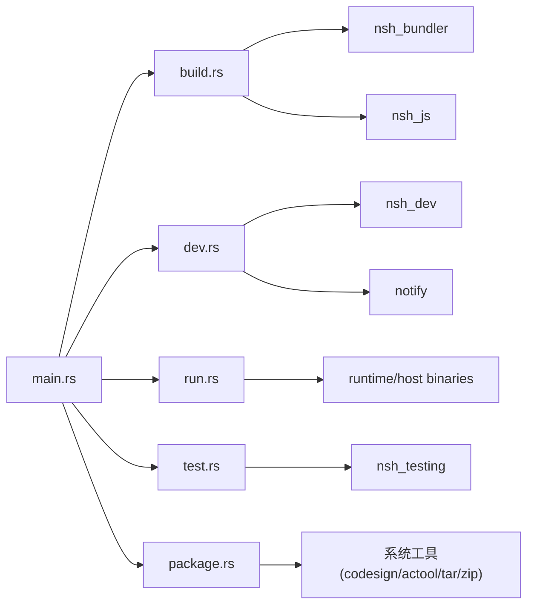

# CLI工具详解

<cite>
**本文引用的文件**   
- [main.rs](file://crates/nsh-cli/src/main.rs)
- [Cargo.toml](file://crates/nsh-cli/Cargo.toml)
- [init.rs](file://crates/nsh-cli/src/init.rs)
- [build.rs](file://crates/nsh-cli/src/build.rs)
- [dev.rs](file://crates/nsh-cli/src/dev.rs)
- [run.rs](file://crates/nsh-cli/src/run.rs)
- [test.rs](file://crates/nsh-cli/src/test.rs)
- [package.rs](file://crates/nsh-cli/src/package.rs)
</cite>

## 目录
1. [简介](#简介)
2. [项目结构](#项目结构)
3. [核心组件](#核心组件)
4. [架构总览](#架构总览)
5. [详细命令说明](#详细命令说明)
6. [依赖关系分析](#依赖关系分析)
7. [性能与构建优化](#性能与构建优化)
8. [故障排查与调试](#故障排查与调试)
9. [CI/CD集成指南](#cicd集成指南)
10. [结论](#结论)

## 简介
本文件为 NSH 命令行工具的权威使用文档，覆盖以下核心命令：init（项目初始化）、build（构建应用）、check（类型检查）、dev（开发服务器）、run（运行应用）、test（测试）、package（打包）、publish（发布）以及签名、更新、模块管理等辅助命令。文档提供每个命令的参数选项、环境变量、执行流程、错误处理、跨平台注意事项、最佳实践与 CI/CD 集成建议。

## 项目结构
NSH CLI 由 Rust 实现，入口位于 crates/nsh-cli/src/main.rs，通过 clap 解析子命令并分发到对应模块：
- init.rs：项目模板生成与类型声明写入
- build.rs：JS/TSX 打包与字节码编译
- dev.rs：开发服务器与热重载
- run.rs：多目标运行器（桌面、移动端、Web、TUI、GPUI）
- test.rs：无头测试与平台宿主测试
- package.rs：跨平台打包（iOS、Android、macOS、Linux、Windows、Web）
- Cargo.toml：二进制名 nsh 及依赖声明

图表来源
- [main.rs:90-105](file://crates/nsh-cli/src/main.rs#L90-L105)
- [main.rs:985-1258](file://crates/nsh-cli/src/main.rs#L985-L1258)

章节来源
- [main.rs:1-42](file://crates/nsh-cli/src/main.rs#L1-L42)
- [Cargo.toml:15-17](file://crates/nsh-cli/Cargo.toml#L15-L17)

## 核心组件
- 命令解析与全局参数
  - 全局参数 --verbose/-v 可通过环境变量 NSH_VERBOSE 控制
  - 所有命令统一入口 main() 负责日志初始化、错误上报与退出码
- 命令分发
  - dispatch(command) 将子命令路由到具体实现模块
- 应用发现与Rust根应用支持
  - 自动识别 nsh.json "root" 的 Rust 应用，并在需要时调用 cargo check/test/build
- 开发会话与端口管理
  - dev_port::Session 保证同一应用的开发端口复用与释放
- 运行时与目标选择
  - run::Target 枚举决定运行宿主（macos/linux/windows/gpui/tui/ios/android/web/catalyst）

章节来源
- [main.rs:90-105](file://crates/nsh-cli/src/main.rs#L90-L105)
- [main.rs:732-759](file://crates/nsh-cli/src/main.rs#L732-L759)
- [main.rs:780-983](file://crates/nsh-cli/src/main.rs#L780-L983)
- [run.rs:16-77](file://crates/nsh-cli/src/run.rs#L16-L77)

## 架构总览
下图展示从 CLI 到各命令模块的执行路径，以及与构建、开发、运行、打包、测试等子系统交互关系。

图表来源
- [main.rs:985-1258](file://crates/nsh-cli/src/main.rs#L985-L1258)
- [dev.rs:57-105](file://crates/nsh-cli/src/dev.rs#L57-L105)
- [run.rs:170-360](file://crates/nsh-cli/src/run.rs#L170-L360)
- [test.rs:59-241](file://crates/nsh-cli/src/test.rs#L59-L241)
- [package.rs:787-800](file://crates/nsh-cli/src/package.rs#L787-L800)

## 详细命令说明

### 通用参数与环境变量
- 全局参数
  - --verbose/-v：开启详细日志；等价于设置环境变量 NSH_VERBOSE=1
- 常见路径参数
  - entry：应用入口或目录（默认当前目录），多数命令支持
  - out：输出目录（默认 .nsh/out）
- 常用环境变量
  - NSH_VERBOSE：是否详细日志
  - NSH_TSC：指定 tsc 可执行文件（用于 check）
  - NSH_KEYSTORE_PASSWORD：Android keystore 密码
  - NSH_PLAY_CREDENTIALS：Google Play 服务账号密钥路径

章节来源
- [main.rs:90-105](file://crates/nsh-cli/src/main.rs#L90-L105)
- [main.rs:231-246](file://crates/nsh-cli/src/main.rs#L231-L246)
- [main.rs:637-645](file://crates/nsh-cli/src/main.rs#L637-L645)
- [main.rs:580-597](file://crates/nsh-cli/src/main.rs#L580-L597)

### init（项目初始化）
功能
- 根据模板创建 TSX、Rust 或混合（TSX + Rust nshm）应用
- 生成 nsh.json、tsconfig.json、.gitignore 与编辑器类型声明
- 可选 --nsh-source 指向本地仓库以使用源码依赖

参数
- dir：目标目录（默认当前目录）
- --name：显示名称（默认取目录名）
- --template：ts | rust | mixed（终端交互式选择）
- --nsh-source：指向包含 crates/nsh-core 的本地仓库路径（仅 rust/mixed）

示例
- nsh init my-app --template ts
- nsh init my-rust-app --template rust
- nsh init my-mixed-app --template mixed --nsh-source ../nsh

注意
- Rust/mixed 模板要求空目录（避免冲突）
- 自动生成 .nsh/types 供编辑器使用

章节来源
- [main.rs:107-127](file://crates/nsh-cli/src/main.rs#L107-L127)
- [init.rs:46-97](file://crates/nsh-cli/src/init.rs#L46-L97)
- [init.rs:97-260](file://crates/nsh-cli/src/init.rs#L97-L260)
- [init.rs:372-424](file://crates/nsh-cli/src/init.rs#L372-L424)

### build（构建应用）
功能
- 将 TSX/JS 应用打包并编译为 QuickJS 字节码
- 支持 split 模式拆分动态导入为 chunk 文件（Web 发布常用）
- release 模式进行压缩与剥离调试信息

参数
- entry：入口或目录（默认当前目录）
- -o/--out：输出目录（默认 .nsh/out）
- --release：最小化与剥离调试信息
- --split：拆分 import() 为独立 chunk

输出
- bundle.js / bundle.nshc / bundle.js.map
- 若启用 split：Screen.js / Screen.nshc 等
- app.json（应用元数据）、capabilities.json（能力声明）

示例
- nsh build --release
- nsh build --split --out dist

章节来源
- [main.rs:128-145](file://crates/nsh-cli/src/main.rs#L128-L145)
- [build.rs:339-431](file://crates/nsh-cli/src/build.rs#L339-L431)

### check（类型检查）
功能
- 使用 TypeScript 原生编译器（TypeScript 7）进行类型检查
- 对 Rust 根应用先执行 cargo check，再对 TSX 部分做类型检查

参数
- entry：入口或目录（默认当前目录）
- --tsc：自定义 tsc 路径（环境变量 NSH_TSC）
- --：传递给 tsc 的其他参数

示例
- nsh check
- nsh check --tsc ./node_modules/.bin/tsc -- --noEmit

章节来源
- [main.rs:231-246](file://crates/nsh-cli/src/main.rs#L231-L246)
- [main.rs:1005-1005](file://crates/nsh-cli/src/main.rs#L1005-L1005)

### dev（开发服务器）
功能
- 启动开发服务器，支持热重载（HMR）
- 可选择 server-only 模式仅提供服务，不启动宿主
- 支持跨设备访问（局域网 IP 打印）

参数
- entry：入口或目录（默认当前目录）
- --port：端口号（默认自动分配或上次使用的端口）
- --release：生产模式构建
- --limits：嵌入型 VM 限制（memory/stack/load/call/nodes）
- --target：运行目标（macos/linux/windows/gpui/tui/ios/android/web/catalyst）
- --device：iOS 模拟器或 Android 设备序列号
- --server-only：仅启动服务（不可与 --target/--device 同时使用）

示例
- nsh dev
- nsh dev --target web
- nsh dev --server-only
- nsh dev --target ios --device "iPhone 16 Plus"

行为
- 首次构建后持续监听源文件变更，增量重建
- 自动检测 Rust 代码变化并重启会话
- 打印本地与局域网访问地址

章节来源
- [main.rs:247-280](file://crates/nsh-cli/src/main.rs#L247-L280)
- [main.rs:1037-1074](file://crates/nsh-cli/src/main.rs#L1037-L1074)
- [dev.rs:57-105](file://crates/nsh-cli/src/dev.rs#L57-L105)
- [dev.rs:158-217](file://crates/nsh-cli/src/dev.rs#L158-L217)
- [dev.rs:473-506](file://crates/nsh-cli/src/dev.rs#L473-L506)

### run（运行应用）
功能
- 在本地宿主中运行应用（桌面、移动、Web、TUI、GPUI）
- 支持窗口大小、显示器、后台运行、FPS 监控、逐 commit 追踪等

参数
- entry：入口或目录（默认当前目录）
- --port：开发服务器端口
- --release：生产模式
- --limits：VM 限制
- --trace：逐 commit 计时
- --fps：性能监控（macos/linux/windows/ios/tui）
- --target：目标宿主
- --device：iOS 模拟器或 Android 设备
- --points-per-cell：TUI 单元格尺寸（WIDTHxHEIGHT）
- --name：应用名（仅 macos 且非 Rust 根）
- --window-size：初始窗口尺寸（WxH）
- --display：显示器编号（仅 macos）
- --background：后台运行（不抢占焦点）

示例
- nsh run
- nsh run --target linux
- nsh run --target windows --window-size 1280x720
- nsh run --target tui --points-per-cell 8x16
- nsh run --target ios --device "iPhone 16 Plus"

章节来源
- [main.rs:285-353](file://crates/nsh-cli/src/main.rs#L285-L353)
- [main.rs:1126-1164](file://crates/nsh-cli/src/main.rs#L1126-L1164)
- [run.rs:170-360](file://crates/nsh-cli/src/run.rs#L170-L360)
- [run.rs:602-699](file://crates/nsh-cli/src/run.rs#L602-L699)

### test（测试）
功能
- 无头运行 *.test.tsx/*.test.ts 测试文件，每个测试一个引擎实例
- 对 Rust 根应用先执行 cargo test
- 支持并行执行、Junit 报告、性能监控、目标宿主运行

参数
- path：测试文件或目录（默认当前目录），或应用入口（标准输入步骤）
- --filter：过滤测试名（也作用于 cargo test）
- --release：发布模式构建与测试
- --trace：打印挂载批次与提交时间
- --fps：性能监控（macos/linux/windows/ios/tui）
- --junit FILE：输出 JUnit XML 报告
- -j/--jobs：并发测试数（默认 CPU 核数）
- --target：目标宿主（macos/linux/windows/gpui/tui/web/ios/android）
- --browser：浏览器可执行路径（需配合 --target web）
- --web-host：Web 页面 host 模块（无头模式）
- --device：iOS 模拟器或 Android 设备
- --display：显示器编号（特定目标）
- --foreground：前台运行（特定目标）

示例
- nsh test
- nsh test App.test.tsx
- nsh test --target web --browser chromium
- nsh test --release --junit results.xml

章节来源
- [main.rs:146-230](file://crates/nsh-cli/src/main.rs#L146-L230)
- [main.rs:1006-1036](file://crates/nsh-cli/src/main.rs#L1006-L1036)
- [test.rs:59-241](file://crates/nsh-cli/src/test.rs#L59-L241)
- [test.rs:243-297](file://crates/nsh-cli/src/test.rs#L243-L297)
- [test.rs:681-742](file://crates/nsh-cli/src/test.rs#L681-L742)

### package（打包）
功能
- 基于预构建运行时打包可安装应用（无需 Rust）
- 支持 iOS、Android、macOS、Linux、Windows、Web
- 支持签名、配置清单、图标、ABIs、产物格式、资产 URL 等

参数（PackageArgs）
- entry：入口或目录（默认当前目录）
- --target：打包目标（ios|ios-simulator|android|linux|macos|windows|web）
- -o/--out：输出目录（默认 .nsh/out）
- --name：显示名称
- --id：Bundle ID（com.example.app）
- --app-version：版本号
- --build：构建号
- --icon：应用图标（正方形 PNG）
- --sign：代码签名身份（iOS/macOS）
- --profile：描述文件（iOS，可为多个扩展分别指定）
- --keystore/--key_alias/--keystore-password：Android 签名
- --abi：Android ABIs（arm64-v8a, armeabi-v7a 等）
- --format：Android 产物格式（apk|aab）
- --arch：macOS 处理器（arm64|x86_64|universal）
- --run：打包后运行/安装
- --device：iOS 模拟器或 Android 设备
- --asset-url：Web 静态资源 CDN 前缀

示例
- nsh package --target macos --sign "Developer ID Application: ..."
- nsh package --target android --format aab --abi arm64-v8a
- nsh package --target web --asset-url https://cdn.example.com/app/

章节来源
- [main.rs:281-284](file://crates/nsh-cli/src/main.rs#L281-L284)
- [main.rs:600-676](file://crates/nsh-cli/src/main.rs#L600-L676)
- [main.rs:1075-1125](file://crates/nsh-cli/src/main.rs#L1075-L1125)
- [package.rs:29-92](file://crates/nsh-cli/src/package.rs#L29-L92)
- [package.rs:174-308](file://crates/nsh-cli/src/package.rs#L174-L308)

### publish（发布与签名）
功能
- 对应用或已有包进行签名并生成 .nshpkg
- 支持上传至商店（App Store Connect TestFlight、Google Play Internal Testing）
- 支持 source map 输出位置、strip-debug、min_runtime 等

参数
- entry：应用目录或 .nshpkg（重新签名）
- --key：发布密钥（.secret）
- --cert：证书（nsh certify 生成）
- -o/--out：输出包路径
- --id/--app-version/--build：应用标识与版本
- --source-map：source map 输出位置（package|external|none）
- --strip-debug：剥离行列表以减小体积
- --min-runtime：最低运行时版本

子命令
- publish ios：上传 IPA 到 TestFlight
- publish android：上传 AAB 到 Google Play 内部测试轨道

示例
- nsh publish --key key.secret --cert key.cert
- nsh publish ios app.ipa --issuer-id ... --private-key ...
- nsh publish android app.aab --draft

章节来源
- [main.rs:479-526](file://crates/nsh-cli/src/main.rs#L479-L526)
- [main.rs:573-597](file://crates/nsh-cli/src/main.rs#L573-L597)
- [main.rs:1213-1243](file://crates/nsh-cli/src/main.rs#L1213-L1243)

### 其他命令（摘要）
- keygen：生成签名密钥对（.secret/.pub）
- update：升级 nsh CLI（stable/nightly）
- add/remove/upgrade：管理 nshm（NSH 模块）
- component list/add/remove：管理运行时组件
- update-manifest：生成更新清单（latest.json）
- certify：签发发布密钥证书
- verify/revoke/symbolicate：验证包、撤销列表、符号化堆栈

章节来源
- [main.rs:354-570](file://crates/nsh-cli/src/main.rs#L354-L570)
- [main.rs:1165-1258](file://crates/nsh-cli/src/main.rs#L1165-L1258)

## 依赖关系分析
- 命令层（main.rs）
  - 依赖 clap 解析参数，anyhow 处理错误，ui/logger 输出
  - 通过 run::Target 与 runtime::Platform 协调不同宿主
- 构建层（build.rs）
  - 依赖 nsh_bundler 进行打包，nsh_js 编译字节码
- 开发层（dev.rs）
  - 依赖 nsh_dev 提供 DevServer，notify 监听文件变更
- 运行层（run.rs）
  - 启动各平台宿主进程，处理 Windows JobObject 生命周期
- 测试层（test.rs）
  - 依赖 nsh_testing 执行测试，cargo 子进程执行 Rust 测试
- 打包层（package.rs）
  - 调用系统工具（codesign、actool、tar、zip 等）完成打包

图表来源
- [main.rs:985-1258](file://crates/nsh-cli/src/main.rs#L985-L1258)
- [build.rs:247-305](file://crates/nsh-cli/src/build.rs#L247-L305)
- [dev.rs:473-506](file://crates/nsh-cli/src/dev.rs#L473-L506)
- [run.rs:701-733](file://crates/nsh-cli/src/run.rs#L701-L733)
- [test.rs:455-506](file://crates/nsh-cli/src/test.rs#L455-L506)
- [package.rs:1-8](file://crates/nsh-cli/src/package.rs#L1-L8)

章节来源
- [Cargo.toml:19-57](file://crates/nsh-cli/Cargo.toml#L19-L57)

## 性能与构建优化
- 构建优化
  - 使用 --release 进行压缩与剥离调试信息
  - Web 发布建议使用 --split 拆分动态导入，减少首屏体积
- 开发体验
  - dev 模式默认启用 HMR；Rust 代码变化会触发会话重启
  - 使用 --trace 查看每 commit 耗时，--fps 查看性能指标
- 测试优化
  - 合理设置 -j/--jobs 提升并行度；有 --target 或 --trace 时单文件顺序执行
  - 使用 --release 模拟发布环境下的性能与体积

章节来源
- [build.rs:222-231](file://crates/nsh-cli/src/build.rs#L222-L231)
- [dev.rs:23-25](file://crates/nsh-cli/src/dev.rs#L23-L25)
- [dev.rs:257-328](file://crates/nsh-cli/src/dev.rs#L257-L328)
- [test.rs:208-216](file://crates/nsh-cli/src/test.rs#L208-L216)

## 故障排查与调试
常见问题
- 端口占用
  - dev 启动失败提示端口被占用；停止占用进程或更换 --port
- 目标不支持的参数
  - run 的 --name/--display/--window-size/--background 仅在特定目标有效
- 仅 Rust 应用
  - Rust 根应用（nsh.json "root"）不支持 --limits（无 JS VM）
- Android/iOS 签名与描述文件
  - 确保 keystore/password、provisioning profile 正确；iOS 可能需要多个 profile（含扩展）
- 网络访问
  - dev 的 --server-only 可与其它机器连接；--target web/ios/android 会开放网络接口

调试技巧
- 使用 --verbose 获取更详细日志
- 使用 --trace 查看挂载批次与提交时间
- 使用 --fps 查看帧率、CPU/GPU/内存
- 使用 symbolicate 将堆栈映射回源码位置

章节来源
- [dev.rs:496-505](file://crates/nsh-cli/src/dev.rs#L496-L505)
- [run.rs:114-146](file://crates/nsh-cli/src/run.rs#L114-L146)
- [main.rs:768-778](file://crates/nsh-cli/src/main.rs#L768-L778)
- [main.rs:527-535](file://crates/nsh-cli/src/main.rs#L527-L535)

## CI/CD集成指南
推荐流水线步骤
- 安装依赖
  - 安装 Rust 工具链与 Node/TypeScript（如需自定义 tsc）
  - 安装平台工具（Xcode CLI、Android SDK、codesign 等）
- 类型检查与构建
  - nsh check
  - nsh build --release
- 测试
  - nsh test --release --junit results.xml
  - 针对特定目标：nsh test --target web --browser chromium
- 打包
  - macOS：nsh package --target macos --sign "..."
  - iOS：nsh package --target ios --sign "..." --profile "..."
  - Android：nsh package --target android --format aab --keystore ...
  - Linux/Windows：nsh package --target linux/windows
  - Web：nsh package --target web --asset-url https://cdn.example.com/app/
- 发布
  - nsh publish --key ... --cert ...
  - 上传商店：nsh publish ios/android

自动化脚本建议
- 缓存依赖（~/.cargo、~/.nsh/nshms、Android SDK、Xcode artifacts）
- 并行执行测试（合理设置 jobs）
- 产物归档（.app/.ipa/.aab/.zip/site）
- 结果上报（JUnit XML）

章节来源
- [test.rs:219-241](file://crates/nsh-cli/src/test.rs#L219-L241)
- [package.rs:787-800](file://crates/nsh-cli/src/package.rs#L787-L800)
- [main.rs:1075-1125](file://crates/nsh-cli/src/main.rs#L1075-L1125)
- [main.rs:1213-1243](file://crates/nsh-cli/src/main.rs#L1213-L1243)

## 结论
NSH CLI 提供了从项目初始化、构建、开发、运行、测试到打包与发布的完整工作流，支持多平台与多宿主，具备完善的类型检查、热重载、性能监控与 CI/CD 集成能力。遵循本文的命令用法、参数与环境变量说明，结合最佳实践与故障排查建议，可高效地在跨平台场景下开发与交付 NSH 应用。