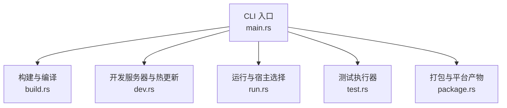
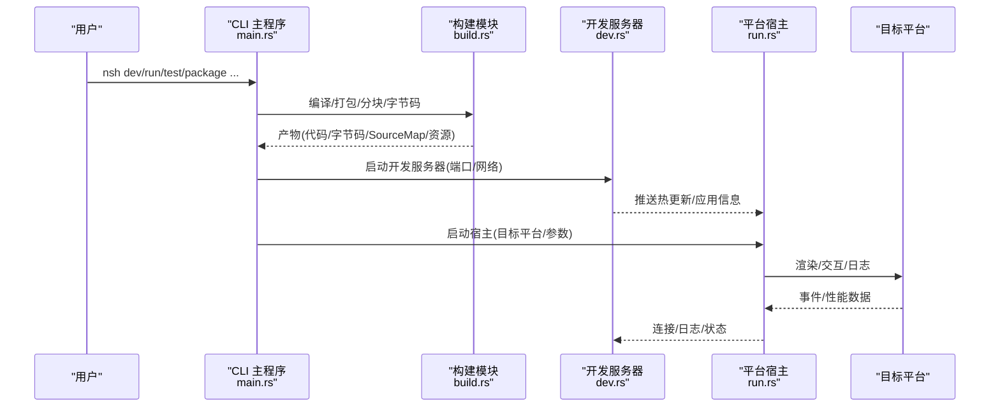
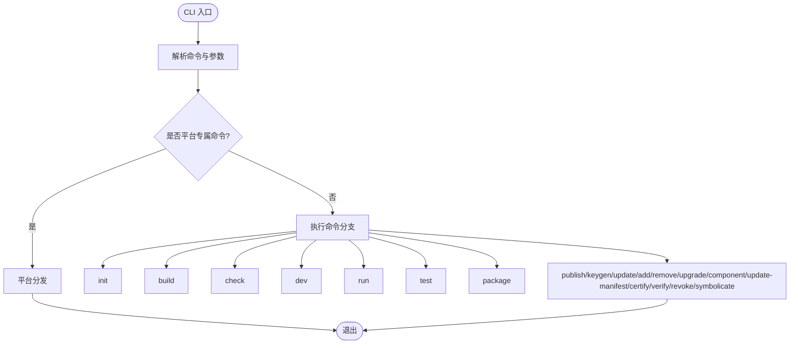
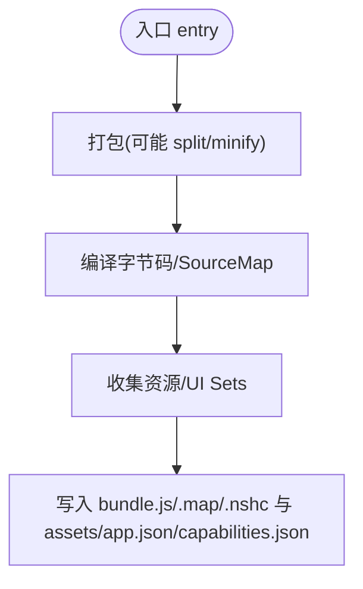
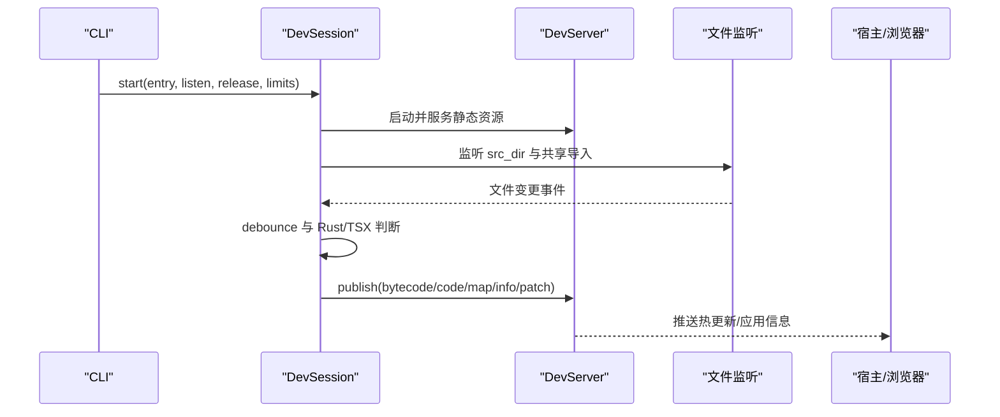
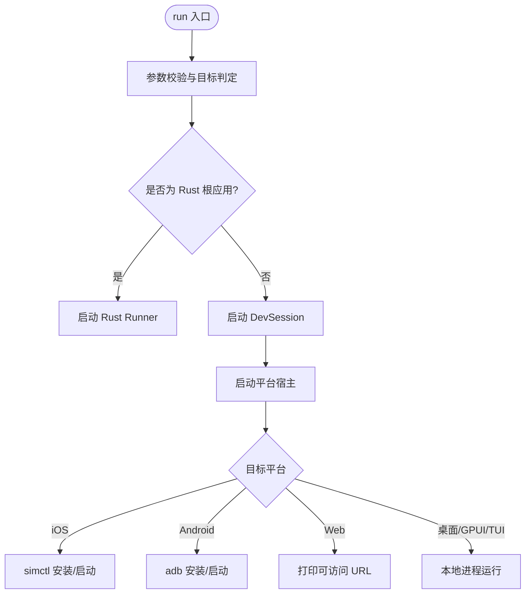
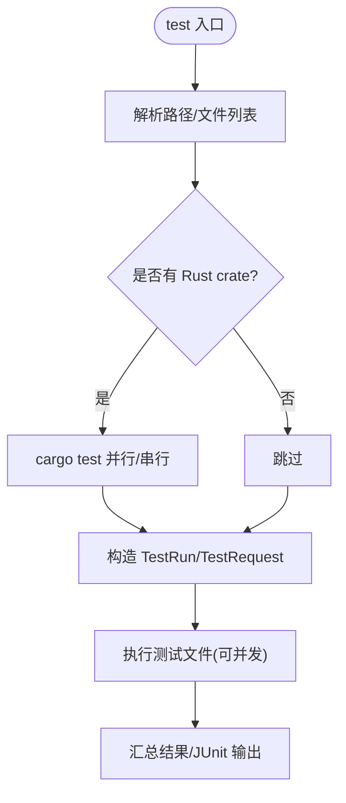
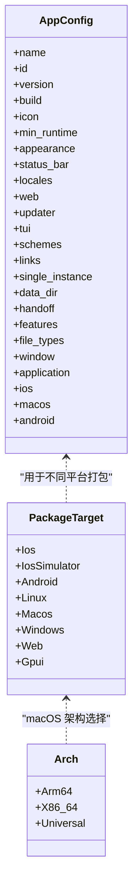
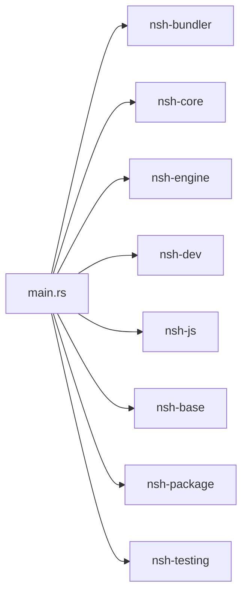

# 开发工具链

<cite>
**本文引用的文件**   
- [README.md](file://README.md)
- [main.rs](file://crates/nsh-cli/src/main.rs)
- [Cargo.toml](file://crates/nsh-cli/Cargo.toml)
- [build.rs](file://crates/nsh-cli/src/build.rs)
- [dev.rs](file://crates/nsh-cli/src/dev.rs)
- [run.rs](file://crates/nsh-cli/src/run.rs)
- [test.rs](file://crates/nsh-cli/src/test.rs)
- [package.rs](file://crates/nsh-cli/src/package.rs)
</cite>

## 目录
1. [简介](#简介)
2. [项目结构](#项目结构)
3. [核心组件](#核心组件)
4. [架构总览](#架构总览)
5. [详细组件分析](#详细组件分析)
6. [依赖关系分析](#依赖关系分析)
7. [性能与优化](#性能与优化)
8. [故障排除指南](#故障排除指南)
9. [结论](#结论)
10. [附录](#附录)

## 简介
本指南面向 NSH 开发工具链的使用者，系统说明 CLI 命令、构建与打包流程、开发服务器与热重载、调试与测试、平台目标与优化选项、CI/CD 集成以及插件扩展机制。NSH 提供统一的跨平台 UI 框架与工具链，支持 iOS、Android、macOS、Windows、Linux、Web、GPUI 与终端（TUI）等目标，通过单一 `nsh` CLI 完成初始化、构建、运行、测试、打包与发布。

## 项目结构
NSH 的 CLI 位于 `crates/nsh-cli`，入口为 `src/main.rs`，按功能拆分为多个模块：
- 命令解析与分发：`main.rs`
- 构建与编译：`build.rs`
- 开发服务器与热更新：`dev.rs`
- 运行与宿主选择：`run.rs`
- 测试执行器：`test.rs`
- 打包与平台产物：`package.rs`

**图示来源**
- [main.rs:90-105](file://crates/nsh-cli/src/main.rs#L90-L105)
- [build.rs:199-305](file://crates/nsh-cli/src/build.rs#L199-L305)
- [dev.rs:57-105](file://crates/nsh-cli/src/dev.rs#L57-L105)
- [run.rs:17-77](file://crates/nsh-cli/src/run.rs#L17-L77)
- [test.rs:59-74](file://crates/nsh-cli/src/test.rs#L59-L74)
- [package.rs:29-54](file://crates/nsh-cli/src/package.rs#L29-L54)

**章节来源**
- [README.md:1-60](file://README.md#L1-L60)
- [main.rs:90-105](file://crates/nsh-cli/src/main.rs#L90-L105)

## 核心组件
- CLI 命令集：包含 init、build、check、dev、run、package、publish、test、keygen、update、add/remove/upgrade、component、update-manifest、certify、verify、revoke、symbolicate 等。
- 构建子系统：负责 TSX/JS 源码打包、按需分块、压缩、生成 QuickJS 字节码与 Source Map，并输出应用清单与资源。
- 开发服务器：监听端口，提供静态资源、页面与 WebSocket 热更新；支持局域网访问与多设备连接。
- 运行子系统：根据目标平台启动对应宿主（AppKit/GTK/Win32/GPUI/TUI/Web/iOS/Android），传递 VM 限制、性能监控与窗口参数。
- 测试子系统：无头执行 `.test.tsx/.test.ts`，可选在真实平台宿主中运行，支持并发、过滤、Junit 报告与性能追踪。
- 打包子系统：针对各平台生成安装包或站点，处理签名、配置、图标、权限、URL Scheme、Handoff、数据目录等。

**章节来源**
- [main.rs:107-571](file://crates/nsh-cli/src/main.rs#L107-L571)
- [build.rs:199-431](file://crates/nsh-cli/src/build.rs#L199-L431)
- [dev.rs:57-156](file://crates/nsh-cli/src/dev.rs#L57-L156)
- [run.rs:17-166](file://crates/nsh-cli/src/run.rs#L17-L166)
- [test.rs:59-241](file://crates/nsh-cli/src/test.rs#L59-L241)
- [package.rs:29-308](file://crates/nsh-cli/src/package.rs#L29-L308)

## 架构总览
下图展示从 CLI 到构建、开发服务器、宿主与平台的整体交互。

**图示来源**
- [main.rs:732-759](file://crates/nsh-cli/src/main.rs#L732-L759)
- [build.rs:247-305](file://crates/nsh-cli/src/build.rs#L247-L305)
- [dev.rs:473-506](file://crates/nsh-cli/src/dev.rs#L473-L506)
- [run.rs:170-359](file://crates/nsh-cli/src/run.rs#L170-L359)

## 详细组件分析

### CLI 命令与参数
- 全局参数：`--verbose` 控制详细日志与环境变量 `NSH_VERBOSE`。
- 常用命令：
  - `init`：创建 TSX/Rust/Mixed 模板，支持本地源码引用。
  - `build`：打包与编译，支持 release/split。
  - `check`：TypeScript 类型检查，支持自定义 tsc 与额外参数。
  - `dev`：开发服务器 + 热重载，支持 release、limits、target、device、server-only。
  - `run`：在宿主中运行，支持 trace/fps/target/device/window-size/display/background 等。
  - `test`：无头测试，支持 filter/release/trace/fps/junit/jobs/target/browser/web-host/device/display/foreground。
  - `package`：跨平台打包，支持 target/out/name/id/version/build/icon/sign/profile/keystore/abi/format/arch/run/device/asset-url。
  - 其他：publish、keygen、update、add/remove/upgrade、component、update-manifest、certify、verify、revoke、symbolicate。

**图示来源**
- [main.rs:90-105](file://crates/nsh-cli/src/main.rs#L90-L105)
- [main.rs:732-759](file://crates/nsh-cli/src/main.rs#L732-L759)

**章节来源**
- [main.rs:90-105](file://crates/nsh-cli/src/main.rs#L90-L105)
- [main.rs:107-571](file://crates/nsh-cli/src/main.rs#L107-L571)

### 构建系统（build）
- 功能要点：
  - 打包 TSX/JS 源码，支持 minify、development、split 模式。
  - 生成 QuickJS 字节码与 Source Map。
  - 收集应用资源与 UI Sets，输出 app.json 与 capabilities.json。
  - Rust 根应用（`nsh.json` `"root"`）不生成 bundle，直接由 runner 挂载根目录。
- 关键函数：
  - `compile` / `compile_split` / `compile_release` / `compile_hot`
  - `build`：将产物写入 `.nsh/out`，包括 bundle.js、bundle.nshc、chunk 文件与 assets。
- 复杂度与性能：
  - 打包阶段时间主要取决于模块图规模与 split 粒度；release 模式启用压缩与去调试信息。
  - Hot 构建缓存上次构建结果以计算增量补丁。

**图示来源**
- [build.rs:247-305](file://crates/nsh-cli/src/build.rs#L247-L305)
- [build.rs:339-431](file://crates/nsh-cli/src/build.rs#L339-L431)

**章节来源**
- [build.rs:199-431](file://crates/nsh-cli/src/build.rs#L199-L431)

### 开发服务器与热重载（dev）
- 功能要点：
  - 启动 DevServer，监听本地或局域网地址，提供静态资源与 Web 页面。
  - 监听源文件变更，合并事件（debounce），区分 TSX 与 Rust 变更。
  - 首次构建后持续推送热补丁；Rust 变更触发会话重启。
  - 支持 limits（VM 限制）、capabilities、window/application 配置下发。
- 关键行为：
  - `start`：初始化服务器、安装命令、服务 web 页面、发布首个构建。
  - `watch`：递归监听 src_dir 与共享导入目录，过滤 .git 嵌套 checkout。
  - `rebuild`：release 走全量构建，否则走 hot 构建并计算 patch。
  - LAN IP 发现：Unix 使用 getifaddrs，Windows 使用 GetAdaptersAddresses。

**图示来源**
- [dev.rs:57-105](file://crates/nsh-cli/src/dev.rs#L57-L105)
- [dev.rs:159-237](file://crates/nsh-cli/src/dev.rs#L159-L237)
- [dev.rs:257-328](file://crates/nsh-cli/src/dev.rs#L257-L328)
- [dev.rs:473-506](file://crates/nsh-cli/src/dev.rs#L473-L506)

**章节来源**
- [dev.rs:57-156](file://crates/nsh-cli/src/dev.rs#L57-L156)
- [dev.rs:159-237](file://crates/nsh-cli/src/dev.rs#L159-L237)
- [dev.rs:257-328](file://crates/nsh-cli/src/dev.rs#L257-L328)
- [dev.rs:473-506](file://crates/nsh-cli/src/dev.rs#L473-L506)

### 运行与宿主选择（run）
- 目标平台枚举：Catalyst、Ios、Android、Linux、Macos、Windows、Web、Gpui、Tui。
- 默认宿主：macOS→AppKit，Linux→GTK，Windows→Win32，其他→Web。
- 运行流程：
  - 校验参数（如 --fps/--points-per-cell 的目标限制）。
  - 对 Rust 根应用走专用 runner；非 Rust 则启动 DevSession 并启动对应宿主进程。
  - 传递 dev-server URL、trace/fps、app-id、window-size/display/background 等参数。
  - iOS 通过 simctl 安装/启动；Android 通过 adb 安装/启动；Web 打印可访问 URL。
- TUI 模式：在终端内运行，记录日志到文件，支持 FPS 与逐 commit 追踪。

**图示来源**
- [run.rs:17-77](file://crates/nsh-cli/src/run.rs#L17-L77)
- [run.rs:170-359](file://crates/nsh-cli/src/run.rs#L170-L359)
- [run.rs:367-378](file://crates/nsh-cli/src/run.rs#L367-L378)
- [run.rs:386-534](file://crates/nsh-cli/src/run.rs#L386-L534)
- [run.rs:602-699](file://crates/nsh-cli/src/run.rs#L602-L699)

**章节来源**
- [run.rs:17-166](file://crates/nsh-cli/src/run.rs#L17-L166)
- [run.rs:170-359](file://crates/nsh-cli/src/run.rs#L170-L359)
- [run.rs:367-378](file://crates/nsh-cli/src/run.rs#L367-L378)
- [run.rs:386-534](file://crates/nsh-cli/src/run.rs#L386-L534)
- [run.rs:602-699](file://crates/nsh-cli/src/run.rs#L602-L699)

### 测试执行器（test）
- 功能要点：
  - 无头执行 `.test.tsx/.test.ts`，每个测试在独立引擎上运行。
  - 支持 Rust crate 的 `cargo test` 集成，结果统一统计。
  - 可在真实平台宿主中运行（--target），或在 headless 模式下运行。
  - 支持并发（jobs）、过滤（filter）、trace、fps、JUnit 报告。
- 关键流程：
  - 解析路径与文件列表，必要时调用 cargo_test。
  - 构造 TestRun/TestRequest，调用 nsh-testing 执行。
  - 汇总结果，输出 JUnit XML 与控制台摘要。

**图示来源**
- [test.rs:59-74](file://crates/nsh-cli/src/test.rs#L59-L74)
- [test.rs:159-241](file://crates/nsh-cli/src/test.rs#L159-L241)
- [test.rs:243-297](file://crates/nsh-cli/src/test.rs#L243-L297)
- [test.rs:455-506](file://crates/nsh-cli/src/test.rs#L455-L506)
- [test.rs:681-742](file://crates/nsh-cli/src/test.rs#L681-L742)

**章节来源**
- [test.rs:59-241](file://crates/nsh-cli/src/test.rs#L59-L241)
- [test.rs:243-297](file://crates/nsh-cli/src/test.rs#L243-L297)
- [test.rs:455-506](file://crates/nsh-cli/src/test.rs#L455-L506)
- [test.rs:681-742](file://crates/nsh-cli/src/test.rs#L681-L742)

### 打包与平台产物（package）
- 目标平台：iOS、iOS Simulator、Android、Linux、macOS、Windows、Web。
- 配置模型：AppConfig 读取 `nsh.json`，包含 name/id/version/build/icon/min_runtime/appearance/status_bar/locales/tailwind/theme/resolve/rust/root/web/updater/tui/schemes/links/single_instance/data_dir/handoff/features/file_types/window/application/ios/macos/android 等。
- 平台特性：
  - iOS/macOS：签名、provisioning profile、Info.plist、entitlements、Handoff、URL Scheme。
  - Android：APK/AAB、ABI、permissions、manifest placeholders、queries/application elements、launch screen。
  - Linux/Windows：runner 目录结构、.desktop、嵌入图标。
  - Web：静态站点、base href、history、connect-src 白名单。
- 辅助函数：app_json/desktop_app_json/window_json/application_json 等用于生成运行时配置。

**图示来源**
- [package.rs:29-54](file://crates/nsh-cli/src/package.rs#L29-L54)
- [package.rs:94-130](file://crates/nsh-cli/src/package.rs#L94-L130)
- [package.rs:174-308](file://crates/nsh-cli/src/package.rs#L174-L308)

**章节来源**
- [package.rs:29-308](file://crates/nsh-cli/src/package.rs#L29-L308)
- [package.rs:610-664](file://crates/nsh-cli/src/package.rs#L610-L664)

## 依赖关系分析
CLI 依赖的核心库与能力：
- nsh-bundler：打包、分块、HotBundle。
- nsh-core：元素注册表、能力声明、WebSocket、Updater。
- nsh-engine：引擎相关（脚本、缓存、符号化等）。
- nsh-dev：开发服务器协议与客户端事件。
- nsh-js：QuickJS 编译、字节码版本、zlib/crypto。
- nsh-base：基础 UI 组件与编辑器能力。
- nsh-package：打包逻辑。
- nsh-testing：测试运行器与报告。
- 其他：clap、notify、log、ring、serde、tungstenite、zip、brotli、flate2、tar、sha2、base64、image、wasmparser、url 等。

**图示来源**
- [Cargo.toml:19-57](file://crates/nsh-cli/Cargo.toml#L19-L57)

**章节来源**
- [Cargo.toml:1-80](file://crates/nsh-cli/Cargo.toml#L1-L80)

## 性能与优化
- 构建优化：
  - `--release` 启用 minify 与 strip debug info，减少包体与提升运行效率。
  - `--split` 将 import() 动态加载内容拆分为 chunk，提高首屏加载速度。
- 运行期优化：
  - `--trace` 打印每 commit 耗时，便于定位渲染瓶颈。
  - `--fps` 显示帧率、commit 成本、CPU/GPU/内存读数（部分平台）。
  - TUI 下显示 FPS/idle、frame p95、apply/draw/flush 时间与字节数。
- 测试优化：
  - `--jobs` 控制并发测试数量；在有 host 或 trace 时自动串行。
  - `--release` 在测试中使用 release 构建，模拟生产环境性能。

[本节为通用指导，无需具体文件分析]

## 故障排除指南
- 端口占用：
  - 开发服务器启动失败提示端口被占用，需停止占用进程或更换 `--port`。
- 平台工具缺失：
  - iOS：需要 Xcode 与模拟器；Android：需要 SDK 与设备/模拟器。
  - macOS/Linux/Windows：确保对应宿主依赖已安装。
- 日志与错误：
  - 使用 `-v` 查看更详细的日志；TUI 模式将诊断写入日志文件。
  - 使用 `nsh symbolicate` 将堆栈映射回源代码位置。
- 签名与证书：
  - iOS/macOS 需要签名身份与 provisioning profile；Android 需要 keystore 与 alias/password。
  - 使用 `nsh keygen`、`nsh certify`、`nsh verify`、`nsh revoke` 管理密钥与撤销列表。

**章节来源**
- [dev.rs:496-505](file://crates/nsh-cli/src/dev.rs#L496-L505)
- [run.rs:185-197](file://crates/nsh-cli/src/run.rs#L185-L197)
- [test.rs:681-742](file://crates/nsh-cli/src/test.rs#L681-L742)
- [main.rs:527-571](file://crates/nsh-cli/src/main.rs#L527-L571)

## 结论
NSH 的开发工具链以 `nsh` CLI 为核心，覆盖从项目初始化、构建、运行、测试到打包发布的完整生命周期。其模块化设计使构建、开发服务器、宿主与平台适配相互解耦，便于扩展与定制。通过 release 优化、split 分块、trace/fps 性能观测与完善的 CI/CD 支持，开发者可在多平台上高效迭代与交付高质量应用。

[本节为总结性内容，无需具体文件分析]

## 附录

### CI/CD 集成建议
- 自动化构建与测试：
  - 使用 `nsh build` 预构建应用；示例工作流中通过 `./target/debug/nsh build "$entry"` 构建示例。
  - 使用 `nsh test` 在无头或真实平台宿主中执行测试，支持 `--target` 与 `--junit` 输出。
- 打包与发布：
  - 使用 `nsh package` 生成各平台安装包；结合 `nsh publish` 上传至商店或生成签名包。
  - 使用 `nsh update-manifest` 生成更新清单与差分包。

**章节来源**
- [README.md:234-237](file://README.md#L234-L237)

### 插件系统与扩展机制
- UI Sets 与原生模块：
  - CLI 暴露 `own_sets()` 与 `ui_sets()`，将 `nsh/base` 与应用自身的 SetDescription 注入构建与宿主。
  - 构建过程收集 UI Sets 的资源与原生模块使用信息，供宿主按需服务。
- 扩展点：
  - 通过新增 CLI 子命令与模块（如 `android.rs`、`apple.rs`、`web.rs`）扩展平台能力。
  - 利用 `nsh-bundler` 的插件接口（如 classes/jsx/props/plugin）扩展打包流程。
  - 通过 `nsh add/remove/upgrade` 管理 nshm 模块，实现组件与能力的复用。

**章节来源**
- [main.rs:53-88](file://crates/nsh-cli/src/main.rs#L53-L88)
- [build.rs:124-167](file://crates/nsh-cli/src/build.rs#L124-L167)
- [main.rs:369-413](file://crates/nsh-cli/src/main.rs#L369-L413)