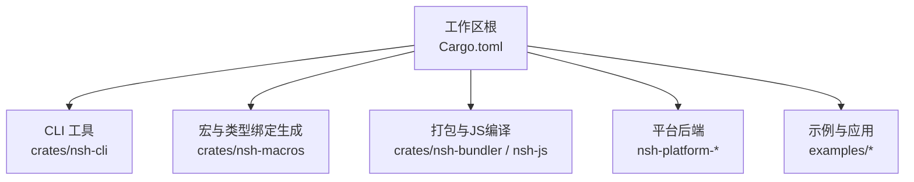
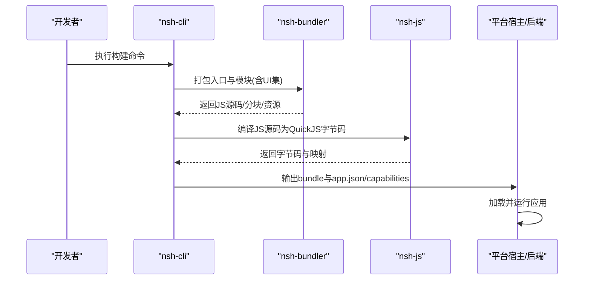
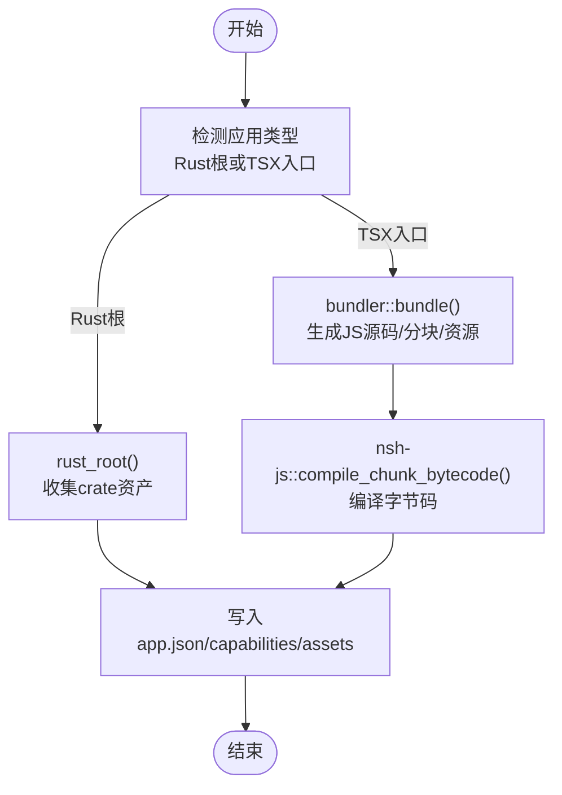
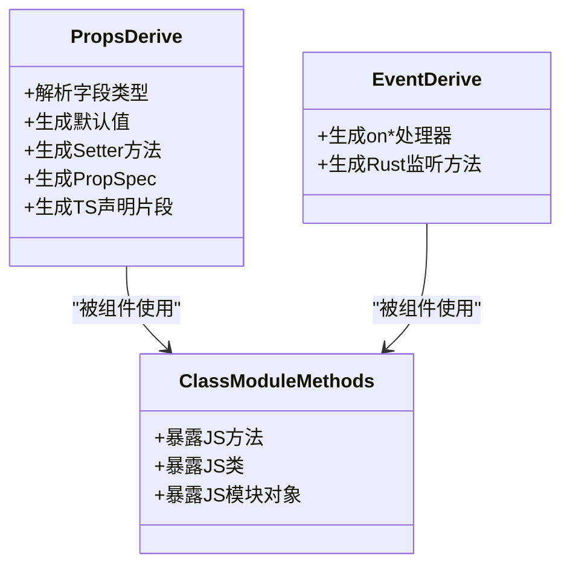
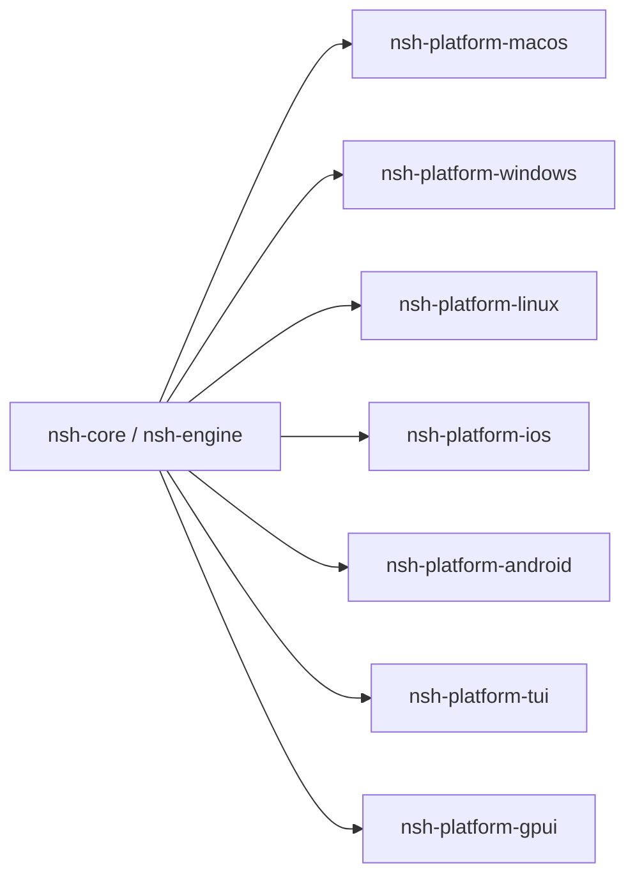
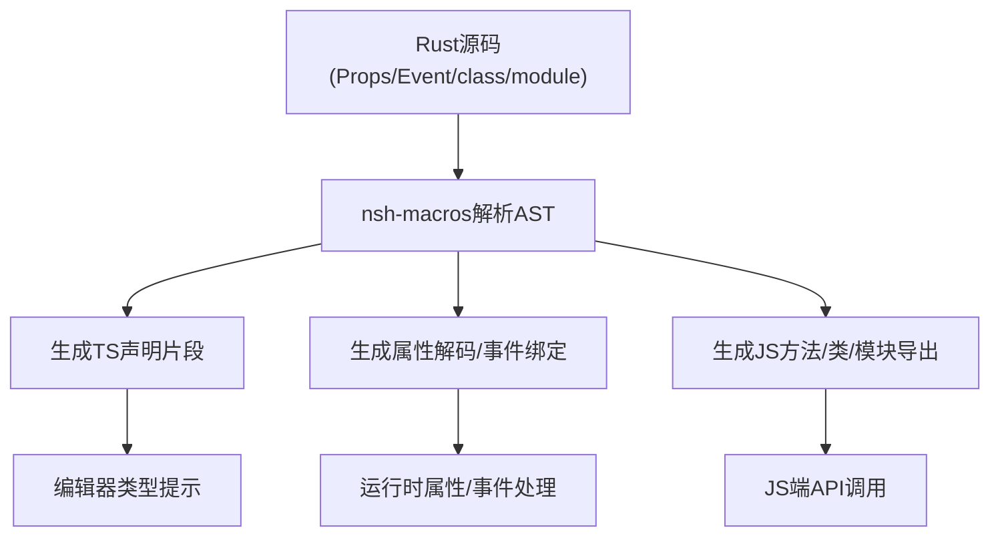
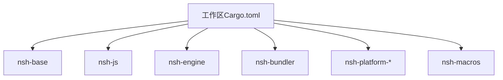

# Rust原生组件构建

<cite>
**本文引用的文件**   
- [README.md](file://README.md)
- [Cargo.toml](file://Cargo.toml)
- [nsh-cli/Cargo.toml](file://crates/nsh-cli/Cargo.toml)
- [nsh-cli/src/build.rs](file://crates/nsh-cli/src/build.rs)
- [nsh-macros/Cargo.toml](file://crates/nsh-macros/Cargo.toml)
- [nsh-macros/src/lib.rs](file://crates/nsh-macros/src/lib.rs)
</cite>

## 目录
1. [简介](#简介)
2. [项目结构](#项目结构)
3. [核心组件](#核心组件)
4. [架构总览](#架构总览)
5. [详细组件分析](#详细组件分析)
6. [依赖分析](#依赖分析)
7. [性能考虑](#性能考虑)
8. [故障排查指南](#故障排查指南)
9. [结论](#结论)
10. [附录](#附录)

## 简介
本技术文档聚焦于 NSH 项目中 Rust 原生组件的构建过程，说明 Rust 代码如何与 NSH 构建系统集成，涵盖 Cargo 工作区集成、特征标志管理、平台特定编译、动态库/宿主集成、宏展开、类型绑定生成与 API 暴露机制。同时提供自定义 Rust 组件的开发指南（生命周期、内存安全、错误处理）以及跨平台编译配置与常见问题解决方案。

NSH 支持在 iOS、Android、macOS、Windows、Linux、GPUI、终端和 Web 等平台统一编写 UI 与逻辑，Rust 侧通过 CLI、Bundler、JS 运行时与平台后端协作完成构建与运行。

**章节来源**
- [README.md:1-60](file://README.md#L1-L60)

## 项目结构
仓库采用 Cargo 工作区组织，核心构建入口为 `crates/xtask`（默认成员），CLI 工具位于 `crates/nsh-cli`，宏扩展与类型绑定生成位于 `crates/nsh-macros`，打包与 JS 编译由 `nsh-bundler` 与 `nsh-js` 配合完成，平台相关实现分布在 `nsh-platform-*` 等 crate 中。

**图表来源**
- [Cargo.toml:1-8](file://Cargo.toml#L1-L8)

**章节来源**
- [Cargo.toml:1-8](file://Cargo.toml#L1-L8)

## 核心组件
- CLI 构建管线：负责解析应用入口、调用 Bundler 进行打包、将 JS 源码编译为 QuickJS 字节码、输出 bundle 与资源清单。
- 宏系统：提供 Props、Event、class/module/methods 等派生宏，自动生成 TS 声明、属性解码、事件监听器与 JS 方法绑定。
- 平台与宿主：各平台后端提供 AppView 或宿主集成点，加载并运行 NSH 引擎与渲染层。
- 打包与运行时：Bundler 产出 JS 源码与分块，nsh-js 将其编译为字节码供运行时执行。

**章节来源**
- [nsh-cli/Cargo.toml:1-30](file://crates/nsh-cli/Cargo.toml#L1-L30)
- [nsh-macros/Cargo.toml:1-20](file://crates/nsh-macros/Cargo.toml#L1-L20)

## 架构总览
下图展示从 CLI 到 Bundler、JS 编译、平台后端的整体流程，以及 Rust 宏在组件开发中的作用。

**图表来源**
- [nsh-cli/src/build.rs:247-305](file://crates/nsh-cli/src/build.rs#L247-L305)
- [nsh-cli/src/build.rs:339-430](file://crates/nsh-cli/src/build.rs#L339-L430)

## 详细组件分析

### CLI 构建管线（nsh-cli）
CLI 负责：
- 识别 Rust 应用根（`nsh.json` `"root"`）与 TSX 入口。
- 调用 Bundler 生成 JS 源码、分块与资源列表。
- 使用 nsh-js 将源码编译为 QuickJS 字节码。
- 输出 `bundle.js`、`bundle.nshc`、源映射、`app.json`、`capabilities.json` 与静态资源。

关键流程：
- `compile_with`：组合打包、编译与分块处理。
- `build`：写入产物与清单，区分 Rust 根与 TSX 应用。
- `rust_root`：Rust 应用不产生 bundle，仅注册资产并由宿主挂载根。

**图表来源**
- [nsh-cli/src/build.rs:79-96](file://crates/nsh-cli/src/build.rs#L79-L96)
- [nsh-cli/src/build.rs:247-305](file://crates/nsh-cli/src/build.rs#L247-L305)
- [nsh-cli/src/build.rs:339-430](file://crates/nsh-cli/src/build.rs#L339-L430)

**章节来源**
- [nsh-cli/src/build.rs:79-96](file://crates/nsh-cli/src/build.rs#L79-L96)
- [nsh-cli/src/build.rs:247-305](file://crates/nsh-cli/src/build.rs#L247-L305)
- [nsh-cli/src/build.rs:339-430](file://crates/nsh-cli/src/build.rs#L339-L430)

### 宏系统与类型绑定生成（nsh-macros）
宏系统提供：
- `#[derive(Props)]`：生成组件属性解码、默认值、槽位与子节点处理，并生成 TypeScript 声明。
- `#[derive(Event)]`：生成事件处理器与 Rust 侧监听方法。
- `#[methods]`：将函数暴露为 JS 对象方法。
- `#[module]`：将单元结构的函数暴露为 JS 模块对象。
- `#[class]`：将结构体及其 impl 暴露为 JS 类。
- `asset!`/`assets!`：编译期读取 crate 的 assets 目录。
- `#[native_module(...)]`/`#[native_components(...)]`：注册 UI 集与平台原生组件。

宏生成的关键点：
- 驼峰命名转换与 TS 类型推导。
- 属性解码与校验（包括 `Option`、`Slot`、`Renderer`、`Children`、`Items`）。
- 生成隐藏宏以桥接组件与 props 定义。
- 文档注释抽取用于 TS 声明。

**图表来源**
- [nsh-macros/src/lib.rs:1-35](file://crates/nsh-macros/src/lib.rs#L1-L35)
- [nsh-macros/src/lib.rs:406-412](file://crates/nsh-macros/src/lib.rs#L406-L412)
- [nsh-macros/src/lib.rs:414-800](file://crates/nsh-macros/src/lib.rs#L414-L800)

**章节来源**
- [nsh-macros/src/lib.rs:1-35](file://crates/nsh-macros/src/lib.rs#L1-L35)
- [nsh-macros/src/lib.rs:406-412](file://crates/nsh-macros/src/lib.rs#L406-L412)
- [nsh-macros/src/lib.rs:414-800](file://crates/nsh-macros/src/lib.rs#L414-L800)

### 平台特定编译与动态库生成
- 平台后端 crate（如 `nsh-platform-macos`、`nsh-platform-windows`、`nsh-platform-linux`、`nsh-platform-ios`、`nsh-platform-android`）提供平台特定的视图与宿主集成。
- 通过 Cargo 目标条件编译（`cfg(target_os = "...")`）与特性开关控制平台功能。
- Apple 平台通过 `objc2-*` 绑定精确启用所需框架，减少链接开销与启动时间。
- Windows 平台通过 `windows-sys` 与 `webview2-com` 提供窗口、图形与 WebView 能力。
- Linux 平台基于 GTK 4 与 Pango，可选 WebKitGTK 作为 webview。

**图表来源**
- [Cargo.toml:48-55](file://Cargo.toml#L48-L55)
- [Cargo.toml:173-235](file://Cargo.toml#L173-L235)
- [Cargo.toml:276-613](file://Cargo.toml#L276-L613)

**章节来源**
- [Cargo.toml:48-55](file://Cargo.toml#L48-L55)
- [Cargo.toml:173-235](file://Cargo.toml#L173-L235)
- [Cargo.toml:276-613](file://Cargo.toml#L276-L613)

### 宏展开过程、类型绑定生成与API暴露机制
- 宏在编译期解析 Rust 代码结构，生成 TS 声明片段与运行时所需的解码/绑定代码。
- Props 宏根据字段类型与属性注解生成属性规范（名称、TS 类型、可选性、解码器）。
- 事件宏生成 JS 回调参数名与 Rust 监听方法。
- class/module/methods 宏将 Rust 函数与结构体暴露给 JS，支持可见性与参数命名。
- 文档注释被提取并转换为 TS 文档，确保编辑器提示与类型推断准确。

**图表来源**
- [nsh-macros/src/lib.rs:1-35](file://crates/nsh-macros/src/lib.rs#L1-L35)
- [nsh-macros/src/lib.rs:406-412](file://crates/nsh-macros/src/lib.rs#L406-L412)
- [nsh-macros/src/lib.rs:414-800](file://crates/nsh-macros/src/lib.rs#L414-L800)

**章节来源**
- [nsh-macros/src/lib.rs:1-35](file://crates/nsh-macros/src/lib.rs#L1-L35)
- [nsh-macros/src/lib.rs:406-412](file://crates/nsh-macros/src/lib.rs#L406-L412)
- [nsh-macros/src/lib.rs:414-800](file://crates/nsh-macros/src/lib.rs#L414-L800)

## 依赖分析
工作区依赖关系与特性开关：
- 工作区统一版本与 lint 规则，避免多 crate 间不一致。
- `nsh-base`、`nsh-js`、`nsh-engine`、`nsh-bundler` 等 crate 通过 workspace 依赖引入，按需启用特性。
- Apple 绑定按功能开启，减少不必要的框架链接。
- Windows/Linux/GTK/WebKit 等依赖按平台启用。

**图表来源**
- [Cargo.toml:28-57](file://Cargo.toml#L28-L57)
- [Cargo.toml:276-613](file://Cargo.toml#L276-L613)

**章节来源**
- [Cargo.toml:28-57](file://Cargo.toml#L28-L57)
- [Cargo.toml:276-613](file://Cargo.toml#L276-L613)

## 性能考虑
- 发布构建启用 LTO 与单 codegen unit，优化最终二进制体积与性能。
- 对热点包（如 quickjs-jit-sys、taffy、syntect、regex 相关）在 dev 配置中提升优化级别，缩短交互延迟。
- Web 运行时使用专门 profile 优化体积（opt-level z、strip、panic abort）。
- Apple 绑定仅启用必要功能，减少 dyld 加载时间与启动开销。

**章节来源**
- [Cargo.toml:615-678](file://Cargo.toml#L615-L678)

## 故障排查指南
- 构建失败时，CLI 会将 Bundler 与 JS 错误转换为统一的 BuildError，便于终端与设备屏幕显示。
- 若 Rust 应用根未正确识别，需检查 `nsh.json` 的 `root` 配置与资产路径。
- 若 TSX 应用缺少依赖或资源，确认 Bundler 输出的 `app.json` 与 `capabilities.json` 是否包含所需声明。
- 平台相关编译问题通常与目标条件编译或外部依赖缺失有关，检查 Cargo 目标与平台工具链。

**章节来源**
- [nsh-cli/src/build.rs:12-35](file://crates/nsh-cli/src/build.rs#L12-L35)
- [nsh-cli/src/build.rs:339-430](file://crates/nsh-cli/src/build.rs#L339-L430)

## 结论
NSH 的 Rust 原生组件构建体系以 Cargo 工作区为核心，CLI 协调 Bundler 与 JS 编译器完成打包与字节码生成，宏系统提供强大的类型绑定与 API 暴露能力，平台后端按目标环境提供具体实现。通过精细的特性开关与平台绑定，系统在跨平台兼容性与性能之间取得平衡。遵循本文的开发指南与配置建议，可高效构建稳定、安全的 Rust 原生组件。

## 附录
- 自定义 Rust 组件开发要点：
  - 使用 `#[derive(Props)]` 定义组件属性，合理设置默认值与可选性。
  - 使用 `#[derive(Event)]` 暴露事件，并在 Rust 侧提供监听方法。
  - 使用 `#[class]`/`#[module]`/`#[methods]` 暴露 JS API，注意可见性与参数命名。
  - 使用 `asset!`/`assets!` 管理静态资源，确保路径与命名一致。
  - 生命周期与内存安全：遵循 Rust 所有权与借用规则，避免在异步回调中持有长生命周期引用；使用 `Prop<T>` 管理响应式状态。
  - 错误处理：在宏生成的解码与 JS 交互处妥善处理错误，向上抛出清晰错误信息。