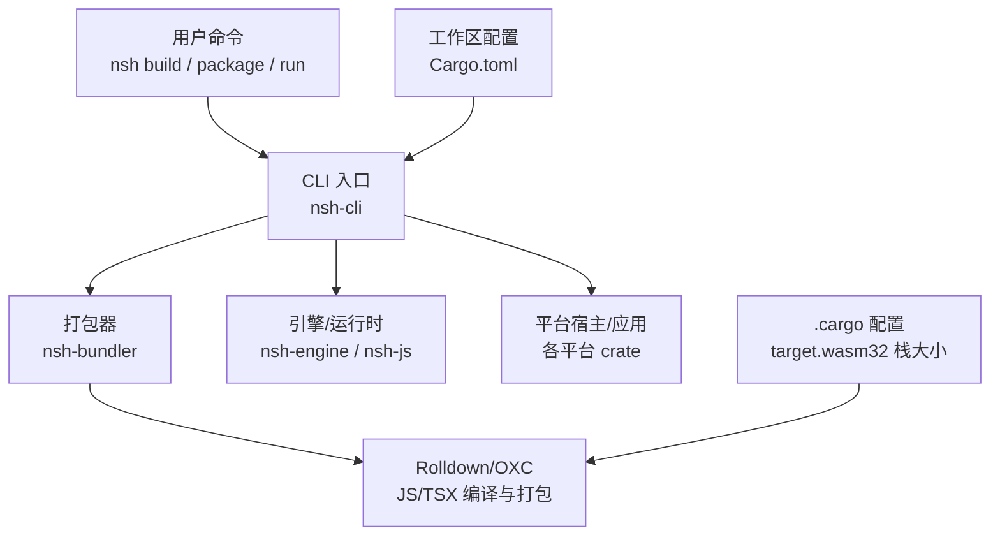
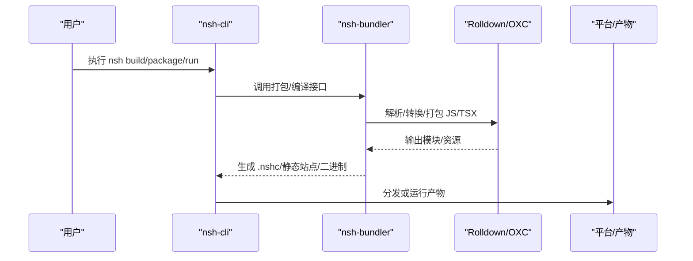
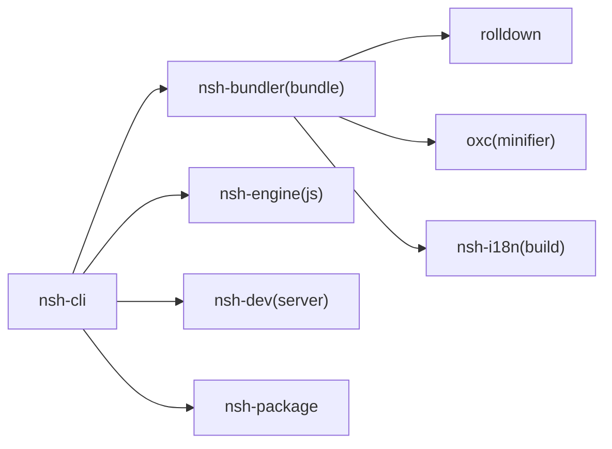

# 构建性能优化

<cite>
**本文引用的文件**   
- [README.md](file://README.md)
- [Cargo.toml](file://Cargo.toml)
- [.cargo/config.toml](file://.cargo/config.toml)
- [crates/nsh-bundler/Cargo.toml](file://crates/nsh-bundler/Cargo.toml)
- [crates/nsh-cli/Cargo.toml](file://crates/nsh-cli/Cargo.toml)
</cite>

## 目录
1. [简介](#简介)
2. [项目结构](#项目结构)
3. [核心组件](#核心组件)
4. [架构总览](#架构总览)
5. [详细组件分析](#详细组件分析)
6. [依赖关系分析](#依赖关系分析)
7. [性能考虑](#性能考虑)
8. [故障排查指南](#故障排查指南)
9. [结论](#结论)
10. [附录](#附录)

## 简介
本指南面向 NSH 项目的构建系统，聚焦于提升构建速度与最终产物体积的平衡。内容涵盖增量构建、并行编译、代码分割、资源压缩与内存使用优化，并给出针对不同规模项目的策略与最佳实践。同时提供性能监控与分析方法，帮助定位构建瓶颈。

NSH 是一个跨平台原生 UI 框架，支持 iOS、Android、macOS、Windows、Linux、Web 与终端等目标；CLI 负责构建、打包与运行，Bundler 基于 Rolldown 与 OXC 进行 JS/TSX 编译与打包，Rust 工作区通过 Cargo profile 控制优化级别与 LTO。

## 项目结构
仓库采用 Rust workspace 组织多 crate，CLI 与 Bundler 是构建链路的关键入口：
- nsh-cli：命令行工具，集成 bundler、engine、dev server、package 等能力
- nsh-bundler：JS/TSX 编译与打包（rolldown + oxc），可选 bundle 特性启用完整打包管线
- Cargo workspace：统一版本、依赖与工作区 lint；release/web profile 控制优化与体积

图表来源
- [crates/nsh-cli/Cargo.toml:15-30](file://crates/nsh-cli/Cargo.toml#L15-L30)
- [crates/nsh-bundler/Cargo.toml:15-35](file://crates/nsh-bundler/Cargo.toml#L15-L35)
- [Cargo.toml:615-678](file://Cargo.toml#L615-L678)
- [.cargo/config.toml:10-15](file://.cargo/config.toml#L10-L15)

章节来源
- [README.md:1-60](file://README.md#L1-L60)
- [Cargo.toml:1-21](file://Cargo.toml#L1-L21)

## 核心组件
- CLI（nsh-cli）
  - 暴露 nsh 命令，组合 bundler、engine、dev server、package 等功能
  - 依赖 nsh-bundler（bundle 特性）、nsh-engine、nsh-dev、nsh-package 等
- Bundler（nsh-bundler）
  - 基于 rolldown 与 oxc 的 JS/TSX 编译与打包
  - 通过 feature bundle 启用完整打包管线（包含 sourcemap、minifier、i18n、图片/SVG 处理等）
- 工作区与 Profile
  - release 开启 fat LTO、单 codegen unit，利于体积与运行期性能
  - web profile 继承 release 并进一步 opt-level=z、strip、panic=abort，针对 WASM 体积优化
  - dev 包级 opt-level 对热点库（quickjs-jit-sys、taffy、syntect、regex、image 等）提升开发体验

章节来源
- [crates/nsh-cli/Cargo.toml:15-30](file://crates/nsh-cli/Cargo.toml#L15-L30)
- [crates/nsh-bundler/Cargo.toml:15-35](file://crates/nsh-bundler/Cargo.toml#L15-L35)
- [Cargo.toml:615-678](file://Cargo.toml#L615-L678)

## 架构总览
下图展示从 CLI 到 Bundler 再到 Rolldown/OXC 的构建流程，以及 Web 目标下的特殊优化路径。

图表来源
- [crates/nsh-cli/Cargo.toml:15-30](file://crates/nsh-cli/Cargo.toml#L15-L30)
- [crates/nsh-bundler/Cargo.toml:15-35](file://crates/nsh-bundler/Cargo.toml#L15-L35)

## 详细组件分析

### CLI 构建管线与并行性
- CLI 聚合 bundler、engine、dev server、package 等子任务，适合在 CI 中拆分步骤以利用并行
- 建议将“类型检查/声明生成”、“JS 打包”、“Rust 编译”、“签名/归档”分阶段执行，避免串行阻塞

优化要点
- 在 CI 中并行化独立阶段（lint/test/build/package）
- 复用缓存（Cargo、Rolldown、TypeScript 声明）减少重复工作

章节来源
- [crates/nsh-cli/Cargo.toml:15-30](file://crates/nsh-cli/Cargo.toml#L15-L30)

### Bundler 特性与代码分割
- nsh-bundler 默认启用 bundle 特性，内部依赖 rolldown、oxc/minifier、sourcemap、i18n、图片/SVG 处理等
- 关闭 bundle 仅保留 compile_module，适用于 WebAssembly 场景或最小化依赖

优化要点
- 按需启用 bundle 特性，减少不必要的依赖与编译时间
- 合理划分路由/页面为独立 chunk，结合懒加载降低首屏体积
- 使用 sourcemap 辅助定位慢点与冗余代码

章节来源
- [crates/nsh-bundler/Cargo.toml:15-35](file://crates/nsh-bundler/Cargo.toml#L15-L35)

### Rust 编译优化与增量构建
- release profile：opt-level=3、fat LTO、codegen-units=1，最大化优化但增加首次构建时间
- web profile：继承 release，opt-level=z、strip=true、panic=abort，显著减小 WASM 体积
- dev 包级 opt-level：对 quickjs-jit-sys、taffy、syntect、regex、image 等热点库提升交互速度

优化要点
- 本地开发使用 cargo 增量构建（默认开启）+ 必要的 dev 包级优化
- 发布构建使用 release/web profile；必要时开启远程缓存（如 sccache/ccache）
- 控制 LTO 粒度：fat LTO 体积更小但更慢，可按需选择 thin 或 off（权衡体积与构建时长）

章节来源
- [Cargo.toml:615-678](file://Cargo.toml#L615-L678)

### Web 目标栈大小与稳定性
- target.wasm32-unknown-unknown 设置 link-arg=-zstack-size=8388608，避免 QuickJS 递归与深层组件树导致栈溢出
- 同时启用自定义 getrandom_backend，适配浏览器 Web Crypto

优化要点
- 保持该栈大小配置，避免深度递归导致的崩溃
- 对大型 TSX 树进行组件拆分与懒加载，降低单次渲染压力

章节来源
- [.cargo/config.toml:10-15](file://.cargo/config.toml#L10-L15)

## 依赖关系分析
- nsh-cli 依赖 nsh-bundler（bundle 特性）、nsh-engine、nsh-dev、nsh-package 等
- nsh-bundler 依赖 rolldown、oxc、string_wizard、imagesize、resvg、ttf-parser、tokio 等（受 bundle 特性控制）
- 工作区 Cargo.toml 统一管理依赖版本与 workspace.lints

图表来源
- [crates/nsh-cli/Cargo.toml:19-31](file://crates/nsh-cli/Cargo.toml#L19-L31)
- [crates/nsh-bundler/Cargo.toml:41-64](file://crates/nsh-bundler/Cargo.toml#L41-L64)

章节来源
- [crates/nsh-cli/Cargo.toml:19-31](file://crates/nsh-cli/Cargo.toml#L19-L31)
- [crates/nsh-bundler/Cargo.toml:41-64](file://crates/nsh-bundler/Cargo.toml#L41-L64)
- [Cargo.toml:28-57](file://Cargo.toml#L28-L57)

## 性能考虑

### 增量构建
- 启用 Cargo 增量构建（默认）
- 在 CI 中缓存 .cargo/registry、target 目录与 Rolldown 缓存
- 将类型检查、声明生成与打包分离，避免全量重算

### 并行编译
- 使用多线程编译（默认）；CI 可并行化不同 crate 或阶段
- 对重型依赖（如 resvg、image、syntect）尽量复用构建结果

### 代码分割
- 按路由/功能模块拆分 chunk，配合懒加载
- 公共依赖提取为共享 chunk，减少重复
- 对第三方大库按需引入，避免全量打包

### 资源压缩
- 图片：优先使用现代格式（WebP/AVIF），按需缩放至显示尺寸
- SVG：内联小图标，外部引用大图；确保无多余节点
- JS/CSS：启用 minify（oxc/minifier），生产环境开启 strip/panic=abort（web profile）

### 内存使用优化
- 控制一次性加载的资源总量，避免超大图片/字体
- 对长列表/富文本区域使用虚拟滚动与增量渲染
- 避免深层递归与巨型 AST，必要时拆分组件或模块

### 构建速度与体积权衡
- release：fat LTO + codegen-units=1 体积最优但构建慢
- web：opt-level=z + strip + panic=abort 显著减小 WASM 体积
- dev：对热点库单独 opt-level=3 提升交互体验

## 故障排查指南
- 首次构建极慢
  - 检查是否启用了 fat LTO；必要时切换为 thin/off 评估影响
  - 确认未误开不必要的 bundle 特性
- Web 构建体积过大
  - 确认已使用 web profile（opt-level=z、strip、panic=abort）
  - 检查是否引入了未使用的第三方库或全量语言数据
- 运行期栈溢出（WASM）
  - 确认已设置 wasm32 栈大小（8MB）
  - 拆分组件树，避免过深递归
- 构建内存不足
  - 限制并行度（例如 CI 中减少 jobs）
  - 清理旧缓存后重试，避免脏状态

章节来源
- [Cargo.toml:615-678](file://Cargo.toml#L615-L678)
- [.cargo/config.toml:10-15](file://.cargo/config.toml#L10-L15)

## 结论
通过合理配置 CLI/Bundler 特性、利用 Cargo profile 与 web 专属优化、实施代码分割与资源压缩，并结合增量构建与并行编译，可在保证功能与稳定性的前提下显著提升构建速度与产物质量。建议在 CI 中固化这些优化策略，并通过指标对比持续验证收益。

## 附录

### 针对不同规模项目的优化策略
- 小型项目（单体应用）
  - 直接使用 release/web profile
  - 启用 bundle 特性，按需拆分少量 chunk
- 中型项目（多模块/多页面）
  - 按路由/功能拆分 chunk，启用懒加载
  - 在 CI 中并行化 lint/test/build/package
- 大型项目（多仓库/多平台）
  - 使用远程构建缓存（Cargo、Rolldown）
  - 精细化控制 bundle 特性与依赖图，剔除无用分支
  - 定期审计依赖体积与热路径，持续优化

### 性能监控与分析工具
- 构建耗时分析
  - 使用 cargo build --timings 分析阶段耗时
  - 在 CI 中收集并可视化时序报告
- 产物体积分析
  - 使用 gzip/brotli 测量传输体积
  - 借助浏览器 DevTools 或 Node 侧工具分析 chunk 构成
- 运行期性能
  - 使用浏览器 Performance/Timeline 与 FPS 指标
  - 对长列表/富文本区域进行采样与回归测试