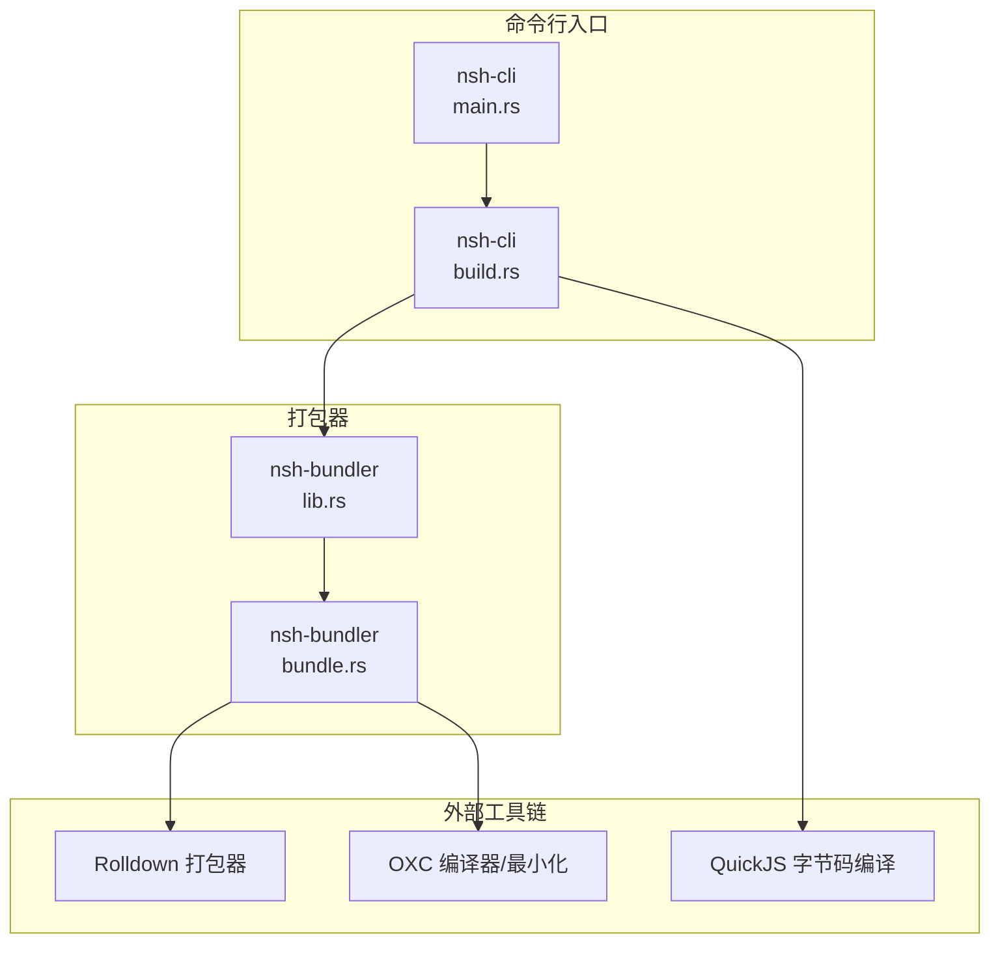
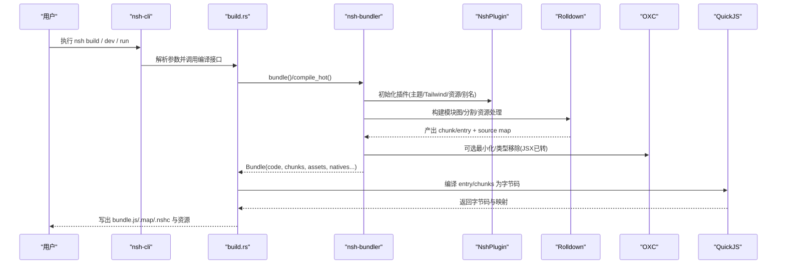
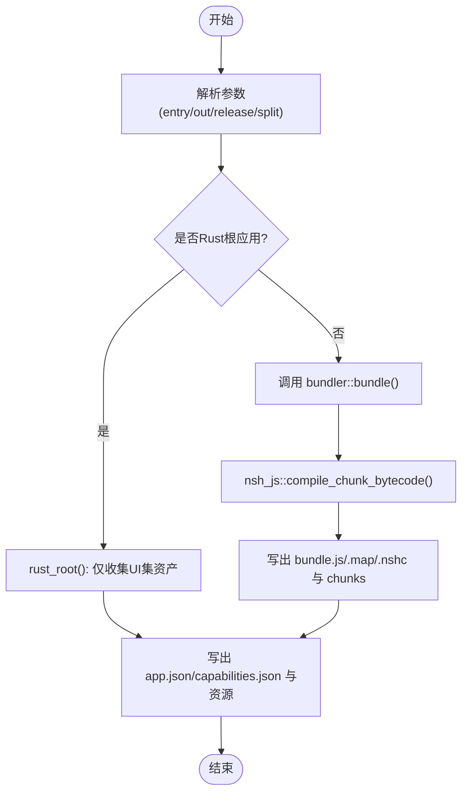
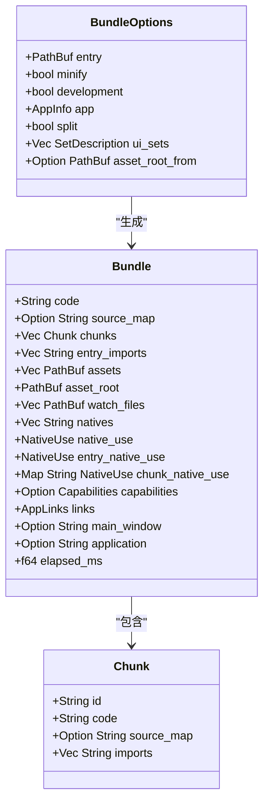
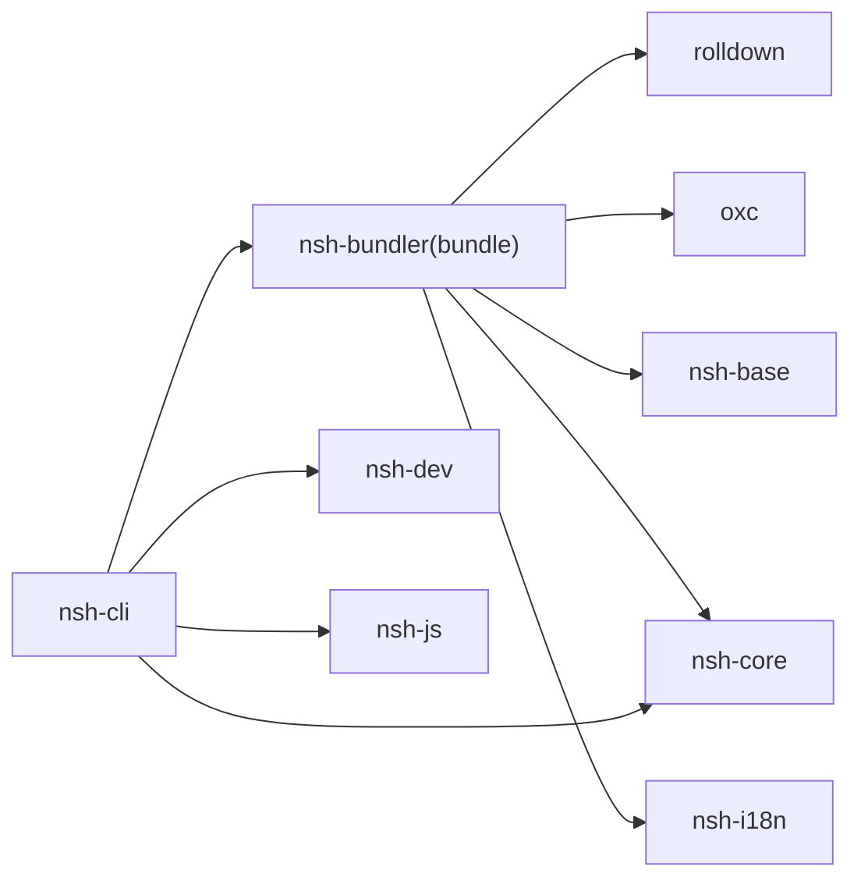

# 构建流程详解

<cite>
**本文引用的文件**   
- [Cargo.toml](file://Cargo.toml)
- [nsh-bundler/Cargo.toml](file://crates/nsh-bundler/Cargo.toml)
- [nsh-cli/Cargo.toml](file://crates/nsh-cli/Cargo.toml)
- [nsh-bundler/src/lib.rs](file://crates/nsh-bundler/src/lib.rs)
- [nsh-bundler/src/bundle.rs](file://crates/nsh-bundler/src/bundle.rs)
- [nsh-cli/src/main.rs](file://crates/nsh-cli/src/main.rs)
- [nsh-cli/src/build.rs](file://crates/nsh-cli/src/build.rs)
</cite>

## 目录
1. [简介](#简介)
2. [项目结构](#项目结构)
3. [核心组件](#核心组件)
4. [架构总览](#架构总览)
5. [详细组件分析](#详细组件分析)
6. [依赖关系分析](#依赖关系分析)
7. [性能与优化](#性能与优化)
8. [故障排查](#故障排查)
9. [结论](#结论)
10. [附录](#附录)

## 简介
本文件面向 NSH 的构建系统，系统性梳理从源代码到可执行/可分发产物的完整构建管道。重点覆盖：
- TypeScript/JSX 编译、类型移除与 JSX 转换
- 基于 Rolldown 的代码分割与资源处理
- 压缩优化与 Source Map 生成
- QuickJS 字节码编译与产物组织
- 增量构建、并行化与缓存策略
- 可扩展点与自定义钩子（插件）

## 项目结构
NSH 的构建由 CLI 驱动，核心打包逻辑位于 bundler 库；CLI 负责命令解析、参数装配、产物落盘与错误呈现。

图表来源
- [nsh-cli/src/main.rs:107-145](file://crates/nsh-cli/src/main.rs#L107-L145)
- [nsh-cli/src/build.rs:201-305](file://crates/nsh-cli/src/build.rs#L201-L305)
- [nsh-bundler/src/lib.rs:1-40](file://crates/nsh-bundler/src/lib.rs#L1-L40)
- [nsh-bundler/src/bundle.rs:611-780](file://crates/nsh-bundler/src/bundle.rs#L611-L780)

章节来源
- [Cargo.toml:1-10](file://Cargo.toml#L1-L10)
- [nsh-cli/Cargo.toml:1-30](file://crates/nsh-cli/Cargo.toml#L1-L30)
- [nsh-bundler/Cargo.toml:1-20](file://crates/nsh-bundler/Cargo.toml#L1-L20)

## 核心组件
- nsh-cli：提供 build/dev/run/test 等命令，负责参数解析、UI 集注册、调用 bundler 并输出产物。
- nsh-bundler：纯 Rust 实现的 JS 打包器，集成 OXC 进行 TS/JSX 编译与最小化，使用 Rolldown 完成模块图构建、代码分割与资源处理。
- 运行时与字节码：将 ES 模块编译为 QuickJS 字节码，供宿主运行。

关键职责边界
- CLI 不直接实现打包算法，仅编排流程与输出。
- Bundler 暴露 compile_module（单模块编译）和 bundle（完整打包）两类能力。
- 产物包括 JS 源码、Source Map、QuickJS 字节码、静态资源与元数据（app.json/capabilities.json）。

章节来源
- [nsh-cli/src/main.rs:107-145](file://crates/nsh-cli/src/main.rs#L107-L145)
- [nsh-bundler/src/lib.rs:1-40](file://crates/nsh-bundler/src/lib.rs#L1-L40)
- [nsh-bundler/src/lib.rs:42-63](file://crates/nsh-bundler/src/lib.rs#L42-L63)

## 架构总览
下图展示“源代码 → 打包 → 字节码 → 产物”的主路径。

图表来源
- [nsh-cli/src/main.rs:107-145](file://crates/nsh-cli/src/main.rs#L107-L145)
- [nsh-cli/src/build.rs:201-305](file://crates/nsh-cli/src/build.rs#L201-L305)
- [nsh-bundler/src/bundle.rs:611-780](file://crates/nsh-bundler/src/bundle.rs#L611-L780)

## 详细组件分析

### 命令行与构建编排（nsh-cli）
- 命令定义：build/dev/run/test 等子命令在 main.rs 中声明，包含 release/split/target 等选项。
- 构建入口：build.rs 提供 compile/compile_split/compile_release/compile_hot 等封装，统一调用 bundler 并写入产物。
- 产物组织：
  - 非拆分：bundle.js、bundle.js.map、bundle.nshc
  - 拆分：每个 chunk 对应 .js/.map/.nshc
  - 资源：按 asset:/ 路径复制到 out/assets
  - 元数据：app.json、capabilities.json

图表来源
- [nsh-cli/src/main.rs:107-145](file://crates/nsh-cli/src/main.rs#L107-L145)
- [nsh-cli/src/build.rs:201-305](file://crates/nsh-cli/src/build.rs#L201-L305)
- [nsh-cli/src/build.rs:339-431](file://crates/nsh-cli/src/build.rs#L339-L431)

章节来源
- [nsh-cli/src/main.rs:107-145](file://crates/nsh-cli/src/main.rs#L107-L145)
- [nsh-cli/src/build.rs:201-305](file://crates/nsh-cli/src/build.rs#L201-L305)
- [nsh-cli/src/build.rs:339-431](file://crates/nsh-cli/src/build.rs#L339-L431)

### 打包器核心（nsh-bundler）
- 单模块编译：compile_module 对单个 TS/TSX/JS 模块进行类型移除与 JSX 转换，保留 native 模块导入，便于无 Node 环境的宿主直接运行。
- 完整打包：bundle/bundle_async 基于 Rolldown 构建模块图，支持：
  - 代码分割（split）
  - 资源处理（图片/SVG/字体等）
  - Tailwind/主题/国际化配置注入
  - Source Map（隐藏模式）
  - 原生模块清单与使用统计（native_use）
- 错误模型：BundleError 同时提供带 ANSI 的颜色版与纯文本版，适配终端与设备错误屏。

图表来源
- [nsh-bundler/src/bundle.rs:18-61](file://crates/nsh-bundler/src/bundle.rs#L18-L61)
- [nsh-bundler/src/bundle.rs:105-183](file://crates/nsh-bundler/src/bundle.rs#L105-L183)

章节来源
- [nsh-bundler/src/lib.rs:1-40](file://crates/nsh-bundler/src/lib.rs#L1-L40)
- [nsh-bundler/src/lib.rs:42-63](file://crates/nsh-bundler/src/lib.rs#L42-L63)
- [nsh-bundler/src/bundle.rs:611-780](file://crates/nsh-bundler/src/bundle.rs#L611-L780)

### TypeScript/JSX 编译与类型移除
- 编译管线：通过 OXC 完成 TS/JSX 编译，移除类型注解，保留 import 语句（仅 native 模块在运行时解析）。
- 枚举与常量：枚举会被转换为对象形式，const enum 也会以对象形式保留反向映射。
- 错误帧：编译错误会剥离 ANSI 颜色，保证在设备上可读。

章节来源
- [nsh-bundler/src/lib.rs:42-63](file://crates/nsh-bundler/src/lib.rs#L42-L63)
- [nsh-bundler/src/lib.rs:65-117](file://crates/nsh-bundler/src/lib.rs#L65-L117)

### 代码分割与资源处理
- 分割策略：启用 split 时，动态 import 被拆分为独立 chunk，entry 固定命名，chunk 文件名稳定（打包器可加哈希）。
- 资源处理：图片/SVG/字体等资源被收集并按 asset:/ 路径引用，最终复制到 out/assets。
- 依赖追踪：entry_dependencies 计算静态依赖闭包，用于预加载或运行时按需加载。

章节来源
- [nsh-bundler/src/bundle.rs:675-780](file://crates/nsh-bundler/src/bundle.rs#L675-L780)
- [nsh-bundler/src/bundle.rs:782-795](file://crates/nsh-bundler/src/bundle.rs#L782-L795)

### 压缩优化与 Source Map
- 压缩：release 模式下启用 Rolldown 的最小化；OXC 也参与最小化（feature 控制）。
- Source Map：构建阶段使用 Hidden 模式，避免污染代码；产物侧可选择内嵌或外置。
- 体积优化：web 目标 profile.web 开启 z 级别优化与 strip。

章节来源
- [nsh-bundler/src/bundle.rs:661-686](file://crates/nsh-bundler/src/bundle.rs#L661-L686)
- [Cargo.toml:671-678](file://Cargo.toml#L671-L678)
- [nsh-bundler/Cargo.toml:15-35](file://crates/nsh-bundler/Cargo.toml#L15-L35)

### QuickJS 字节码编译与产物组织
- 编译：CLI 将 bundle 与各 chunk 的源码交给 nsh_js 编译为字节码（.nshc），并携带 Source Map。
- 输出：
  - bundle.js / bundle.js.map / bundle.nshc
  - 每个 chunk 对应 .js/.map/.nshc
  - 资源复制到 out/assets
  - 元数据 app.json、capabilities.json

章节来源
- [nsh-cli/src/build.rs:201-305](file://crates/nsh-cli/src/build.rs#L201-L305)
- [nsh-cli/src/build.rs:339-431](file://crates/nsh-cli/src/build.rs#L339-L431)

## 依赖关系分析
- 工作区与默认成员：workspace 默认成员为 xtask，但 CLI 作为二进制入口被显式声明。
- 依赖耦合：
  - nsh-cli 依赖 nsh-bundler（bundle 特性）、nsh-js、nsh-core、nsh-dev 等。
  - nsh-bundler 依赖 rolldown、oxc、nsh-core、nsh-base、nsh-i18n 等。
- 平台与特性：
  - bundler 的 bundle 特性打开打包、资源、i18n、minifier 等能力。
  - web 目标使用 profile.web 优化体积。

图表来源
- [nsh-cli/Cargo.toml:19-31](file://crates/nsh-cli/Cargo.toml#L19-L31)
- [nsh-bundler/Cargo.toml:15-64](file://crates/nsh-bundler/Cargo.toml#L15-L64)
- [Cargo.toml:267-270](file://Cargo.toml#L267-L270)

章节来源
- [Cargo.toml:1-10](file://Cargo.toml#L1-L10)
- [nsh-cli/Cargo.toml:19-31](file://crates/nsh-cli/Cargo.toml#L19-L31)
- [nsh-bundler/Cargo.toml:15-64](file://crates/nsh-bundler/Cargo.toml#L15-L64)

## 性能与优化
- 增量构建
  - 开发模式：bundle_hot 提供热更新脚本，结合 watch_files 监听变更，减少重复编译。
  - Rolldown 内部缓存：利用其增量构建能力，仅重算受影响模块。
- 并行处理
  - Rolldown 与 OXC 均具备多核并行能力；CLI 测试用例展示了分阶段耗时测量。
- 缓存机制
  - 资源与类型声明：nsh-bundler 维护 watch_files 与 types 声明，避免重复读取。
  - Web 目标：profile.web 针对体积优化，strip 与 z 级压缩降低下载体积。
- 建议
  - 合理拆分：对大型页面使用 split，减少首屏体积。
  - 控制资源大小：SVG/图片尽量矢量或压缩，避免大位图。
  - 关闭不必要的特性：仅在需要的 crate 上启用 features，减少编译时间。

章节来源
- [nsh-cli/src/build.rs:307-331](file://crates/nsh-cli/src/build.rs#L307-L331)
- [nsh-bundler/src/bundle.rs:611-780](file://crates/nsh-bundler/src/bundle.rs#L611-L780)
- [Cargo.toml:671-678](file://Cargo.toml#L671-L678)

## 故障排查
- 常见错误
  - 入口未找到：bundle 会报告 entry not found。
  - 无 entry chunk：当打包未产出入口块时报错。
  - 权限/能力未授予：capabilities 校验失败会告警或拒绝。
- 诊断手段
  - 查看 BundleError 的 colored/plain 双格式输出。
  - 检查 watch_files 与 assets 列表，确认资源路径正确。
  - 使用 --verbose 与日志 target=nsh::build 定位问题。
- 恢复步骤
  - 修正 nsh.json 中的 capabilities/schemes/window/application 字段。
  - 确保资源路径与 asset_root 一致。
  - 清理临时目录后重试构建。

章节来源
- [nsh-bundler/src/bundle.rs:620-640](file://crates/nsh-bundler/src/bundle.rs#L620-L640)
- [nsh-bundler/src/bundle.rs:705-712](file://crates/nsh-bundler/src/bundle.rs#L705-L712)
- [nsh-bundler/src/bundle.rs:185-248](file://crates/nsh-bundler/src/bundle.rs#L185-L248)

## 结论
NSH 的构建系统以 Rust 为核心，将 TS/JSX 编译、模块打包、资源处理与字节码生成整合为一条高效流水线。通过 Rolldown 与 OXC 的组合，既保证了开发体验（热更新、清晰错误），又兼顾发布体积与运行性能。CLI 层提供了清晰的扩展点与可观测性，便于在生产环境中调优与排障。

## 附录
- 可扩展点与自定义钩子
  - NshPlugin：在 bundler 中注册，可拦截模块解析、资源处理、Tailwind/主题注入等。
  - resolve.alias/conditions：通过 nsh.json 的 resolve 字段配置别名与导出条件。
  - 能力与链接：capabilities/schemes/window/application 在构建期校验并注入元数据。
- 最佳实践
  - 使用 split 拆分路由/重型模块。
  - 将 UI 组件与业务逻辑解耦，减少 bundle 体积。
  - 在 CI 中启用 release 构建与 size 监控。

章节来源
- [nsh-bundler/src/bundle.rs:283-418](file://crates/nsh-bundler/src/bundle.rs#L283-L418)
- [nsh-bundler/src/bundle.rs:420-579](file://crates/nsh-bundler/src/bundle.rs#L420-L579)