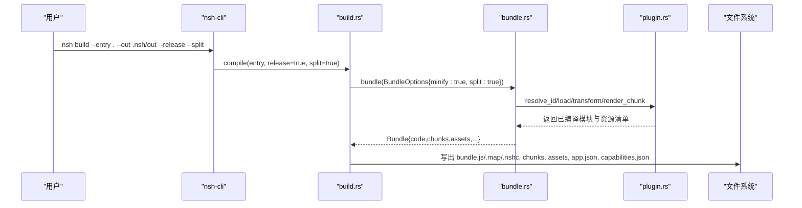
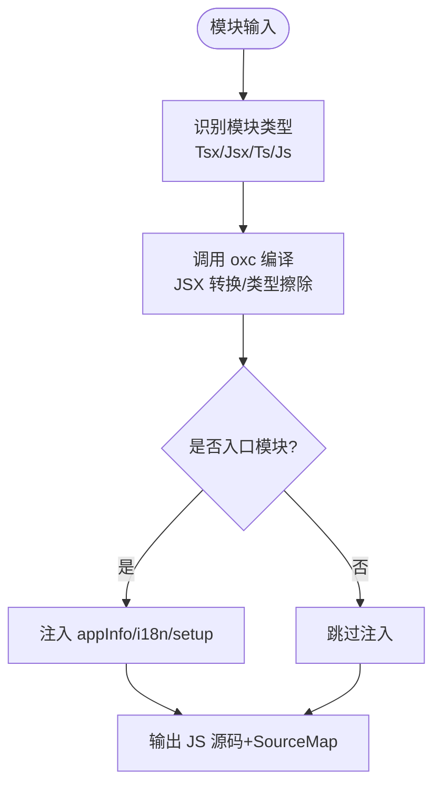
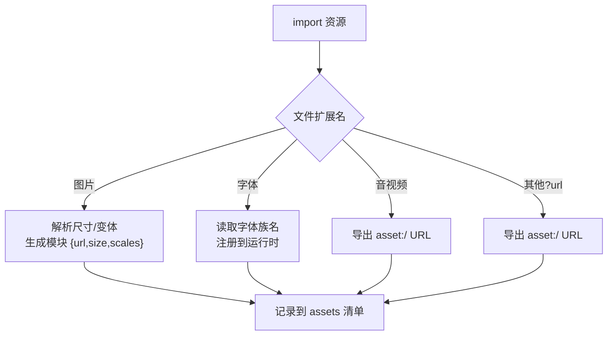
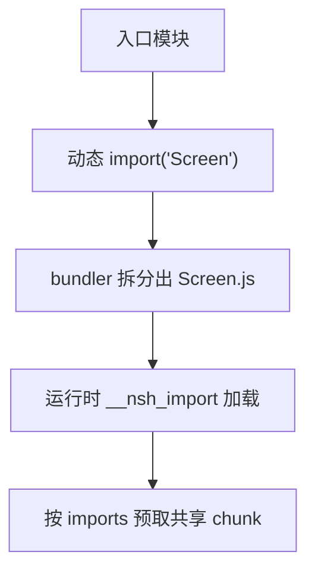
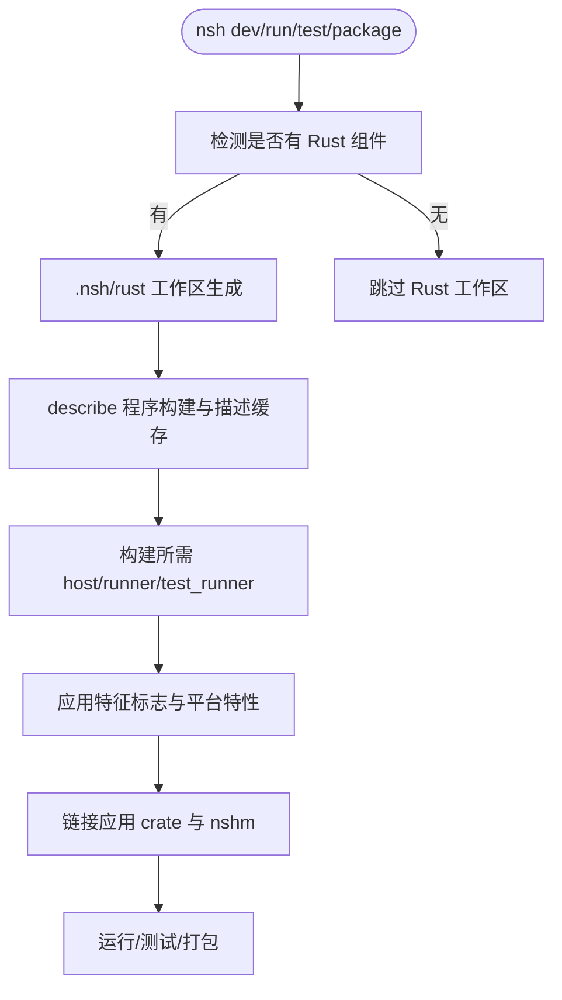
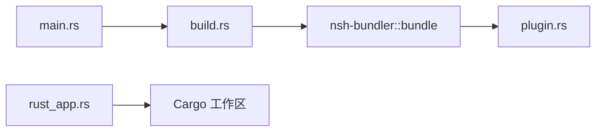

# 构建系统配置

<cite>
**本文引用的文件**   
- [crates/nsh-bundler/src/lib.rs](file://crates/nsh-bundler/src/lib.rs)
- [crates/nsh-bundler/src/bundle.rs](file://crates/nsh-bundler/src/bundle.rs)
- [crates/nsh-bundler/src/plugin.rs](file://crates/nsh-bundler/src/plugin.rs)
- [crates/nsh-cli/src/main.rs](file://crates/nsh-cli/src/main.rs)
- [crates/nsh-cli/src/build.rs](file://crates/nsh-cli/src/build.rs)
- [crates/nsh-cli/src/rust_app.rs](file://crates/nsh-cli/src/rust_app.rs)
- [examples/counter/nsh.json](file://examples/counter/nsh.json)
- [examples/gallery/nsh.json](file://examples/gallery/nsh.json)
</cite>

## 目录
1. [简介](#简介)
2. [项目结构](#项目结构)
3. [核心组件](#核心组件)
4. [架构总览](#架构总览)
5. [详细组件分析](#详细组件分析)
6. [依赖关系分析](#依赖关系分析)
7. [性能与优化](#性能与优化)
8. [故障排查](#故障排查)
9. [结论](#结论)
10. [附录：nsh.json 配置参考](#附录nshjson-配置参考)

## 简介
本指南面向 NSH 的构建系统，覆盖从 TypeScript/JSX 编译、资源处理、代码分割、压缩到 Rust 原生组件集成的完整流程。重点说明 nsh.json 的配置项如何影响构建行为，解释 CLI 命令如何驱动 bundler 与 Cargo，并给出增量构建、并行编译与内存优化的实践建议。同时提供自定义构建扩展点的实现思路，帮助你在不侵入核心代码的前提下扩展打包与运行流程。

## 项目结构
NSH 的构建系统由 CLI 与 Bundler 两大核心组成：
- CLI（nsh-cli）负责解析命令行参数、读取 nsh.json、协调 Rust 工程描述与打包流程。
- Bundler（nsh-bundler）基于 Rolldown 完成 TS/TSX/JS 编译、JSX 转换、资源处理、插件化扩展、代码分割与压缩。

```mermaid
graph TB
subgraph "CLI"
CLI["nsh-cli<br/>main.rs / build.rs"]
RustApp["Rust 应用集成<br/>rust_app.rs"]
end
subgraph "Bundler"
Bundle["bundle.rs<br/>rolldown 打包"]
Plugin["plugin.rs<br/>NshPlugin 钩子"]
Lib["lib.rs<br/>compile_module / 导出"]
end
subgraph "应用"
App["App.tsx / tsconfig.json"]
Config["nsh.json"]
end
App --> Config
CLI --> Bundle
CLI --> RustApp
Bundle --> Plugin
Plugin --> Lib
```

图表来源
- [crates/nsh-cli/src/main.rs:90-145](file://crates/nsh-cli/src/main.rs#L90-L145)
- [crates/nsh-cli/src/build.rs:247-305](file://crates/nsh-cli/src/build.rs#L247-L305)
- [crates/nsh-bundler/src/bundle.rs:611-780](file://crates/nsh-bundler/src/bundle.rs#L611-L780)
- [crates/nsh-bundler/src/plugin.rs:466-749](file://crates/nsh-bundler/src/plugin.rs#L466-L749)
- [crates/nsh-bundler/src/lib.rs:42-63](file://crates/nsh-bundler/src/lib.rs#L42-L63)

章节来源
- [crates/nsh-cli/src/main.rs:90-145](file://crates/nsh-cli/src/main.rs#L90-L145)
- [crates/nsh-bundler/src/lib.rs:1-40](file://crates/nsh-bundler/src/lib.rs#L1-L40)

## 核心组件
- CLI 入口与命令分发：定义 Build/Test/Run/Dev/Package/Publish 等子命令，解析 entry、out、release、split、target、device 等参数，并将任务委派给具体模块。
- 构建编排（build.rs）：调用 bundler 生成 JS 源码与字节码，输出 bundle.js、bundle.nshc、source map、chunks 与 assets，并写入 app.json/capabilities.json。
- Bundler（bundle.rs + plugin.rs）：基于 Rolldown 的 ES Module 打包器；通过 NshPlugin 注入 JSX 编译、资源加载、Tailwind/theme/i18n/appInfo 注入、动态导入分块重写等逻辑。
- Rust 应用集成（rust_app.rs）：为包含 Rust 组件的应用生成 .nsh/rust 工作区，协调 describe、host、runner、test runner 的构建，支持特征标志、平台特定编译与 iOS/macOS/Linux/Windows/GPUI/Web 目标。

章节来源
- [crates/nsh-cli/src/main.rs:90-145](file://crates/nsh-cli/src/main.rs#L90-L145)
- [crates/nsh-cli/src/build.rs:199-305](file://crates/nsh-cli/src/build.rs#L199-L305)
- [crates/nsh-bundler/src/bundle.rs:18-61](file://crates/nsh-bundler/src/bundle.rs#L18-L61)
- [crates/nsh-bundler/src/plugin.rs:23-53](file://crates/nsh-bundler/src/plugin.rs#L23-L53)
- [crates/nsh-cli/src/rust_app.rs:1-53](file://crates/nsh-cli/src/rust_app.rs#L1-L53)

## 架构总览
下图展示一次典型构建的生命周期：CLI 解析参数 → 读取 nsh.json → 调用 bundler 打包 → 插件执行 JSX 编译与资源处理 → 可选代码分割 → 压缩与字节码编译 → 输出产物。



图表来源
- [crates/nsh-cli/src/main.rs:128-145](file://crates/nsh-cli/src/main.rs#L128-L145)
- [crates/nsh-cli/src/build.rs:247-305](file://crates/nsh-cli/src/build.rs#L247-L305)
- [crates/nsh-bundler/src/bundle.rs:611-780](file://crates/nsh-bundler/src/bundle.rs#L611-L780)
- [crates/nsh-bundler/src/plugin.rs:466-749](file://crates/nsh-bundler/src/plugin.rs#L466-L749)

## 详细组件分析

### TypeScript 编译与 JSX 转换
- 单模块编译：lib.rs 暴露 compile_module，将 TSX/JSX/TS/JS 转换为运行时可执行的 ES 模块，移除类型声明，保留对 nsh 原生模块的 import。
- 插件转换：plugin.rs 的 transform 钩子根据模块类型（Tsx/Jsx/Ts/Js）调用 oxc 编译器进行 JSX 转换与类型擦除，并在入口模块前注入 appInfo/i18n/setup 初始化代码。
- 错误信息：strip ANSI 颜色，便于在设备错误屏显示。



图表来源
- [crates/nsh-bundler/src/lib.rs:42-63](file://crates/nsh-bundler/src/lib.rs#L42-L63)
- [crates/nsh-bundler/src/plugin.rs:693-749](file://crates/nsh-bundler/src/plugin.rs#L693-L749)

章节来源
- [crates/nsh-bundler/src/lib.rs:42-63](file://crates/nsh-bundler/src/lib.rs#L42-L63)
- [crates/nsh-bundler/src/plugin.rs:693-749](file://crates/nsh-bundler/src/plugin.rs#L693-L749)

### 资源处理
- 图片：自动解析尺寸与多倍图变体（@2x/@3x），生成包含 url、size、scales 的模块；SVG 会提取自然尺寸并提示浏览器专属特性差异。
- 字体：读取字体族名并注册到运行时，避免首帧闪烁。
- 音视频：以 asset:/ URL 形式导出，供 Sound/AudioPlayer/Video 使用。
- 任意文件：通过 ?url 后缀获取其 asset:/ URL。



图表来源
- [crates/nsh-bundler/src/plugin.rs:89-105](file://crates/nsh-bundler/src/plugin.rs#L89-L105)
- [crates/nsh-bundler/src/plugin.rs:622-691](file://crates/nsh-bundler/src/plugin.rs#L622-L691)

章节来源
- [crates/nsh-bundler/src/plugin.rs:89-105](file://crates/nsh-bundler/src/plugin.rs#L89-L105)
- [crates/nsh-bundler/src/plugin.rs:622-691](file://crates/nsh-bundler/src/plugin.rs#L622-L691)

### 代码分割与动态导入
- 启用 split 后，动态 import() 被改写为运行时 chunk 加载函数，每个 chunk 独立文件，并按静态依赖关系列出 imports。
- 入口文件名固定为 ENTRY_CHUNK，chunk 命名采用 [name].js，便于打包器后续加哈希。



图表来源
- [crates/nsh-bundler/src/bundle.rs:675-684](file://crates/nsh-bundler/src/bundle.rs#L675-L684)
- [crates/nsh-bundler/src/plugin.rs:480-503](file://crates/nsh-bundler/src/plugin.rs#L480-L503)

章节来源
- [crates/nsh-bundler/src/bundle.rs:675-684](file://crates/nsh-bundler/src/bundle.rs#L675-L684)
- [crates/nsh-bundler/src/plugin.rs:480-503](file://crates/nsh-bundler/src/plugin.rs#L480-L503)

### 压缩优化与 Source Map
- minify：release 模式下启用 Rolldown 压缩，剥离调试信息。
- Source Map：隐藏式生成，用于堆栈反解；CLI 构建时输出 .map 文件。
- 字节码：最终 JS 源码经 nsh_js 编译为 QuickJS 字节码（.nshc）。

章节来源
- [crates/nsh-bundler/src/bundle.rs:661-686](file://crates/nsh-bundler/src/bundle.rs#L661-L686)
- [crates/nsh-cli/src/build.rs:247-305](file://crates/nsh-cli/src/build.rs#L247-L305)

### nsh.json 配置项概览
nsh.json 控制应用元数据、能力声明、主题与 Tailwind、国际化、URL Scheme、窗口与应用生命周期、解析别名、iOS 链接等。以下字段在构建期被读取或校验：
- 基础元数据：name、id、version、build、icon、appearance、schemes、theme、locales、capabilities、window、application、tailwind、resolve、ios.frameworks、ios.linkerFlags 等。
- 构建期影响：
  - capabilities：决定运行时权限，构建期输出 capabilities.json。
  - schemes/links：决定 URL Scheme 与 deep link 能力。
  - window/application：作为 app.json 的一部分传递给宿主。
  - tailwind/theme/appearance/statusBar：注入主题与 UI 设置。
  - locales：打包 i18n 资源。
  - resolve.conditions/alias：影响 npm 包条件解析与模块别名。
  - ios.*：影响 iOS 目标构建时的框架与链接参数。

示例参考
- [examples/counter/nsh.json](file://examples/counter/nsh.json)
- [examples/gallery/nsh.json](file://examples/gallery/nsh.json)

章节来源
- [crates/nsh-bundler/src/bundle.rs:185-281](file://crates/nsh-bundler/src/bundle.rs#L185-L281)
- [crates/nsh-bundler/src/bundle.rs:420-579](file://crates/nsh-bundler/src/bundle.rs#L420-L579)
- [crates/nsh-cli/src/rust_app.rs:358-392](file://crates/nsh-cli/src/rust_app.rs#L358-L392)

### Rust 原生组件构建流程
- 工作区生成：CLI 在 .nsh/rust 下生成工作区，包含 describe、各平台 host/runner、test runner 等程序，统一链接应用的 Rust 组件。
- 描述阶段：先构建 describe 程序，收集 UI set 描述（导出、TS 声明、re-exports、资产），缓存至 description.json，直到 Rust 代码变化再重建。
- 特征标志与平台：
  - 通过 RUNNER_FEATURES 控制发布 runner 的特征集合，不同平台默认开启不同功能（如 Linux 的 net/sound，Windows 的 media/webview）。
  - webview 特性在 Linux/Windows 上按需开启，若检测到应用可能创建 WebView，则开发 runner 也会开启以避免占位符。
- 依赖来源：支持 crates.io、本地 path、Git checkout，并保证所有 crate 指向同一份 nsh 核心，避免类型不一致。



图表来源
- [crates/nsh-cli/src/rust_app.rs:1-53](file://crates/nsh-cli/src/rust_app.rs#L1-L53)
- [crates/nsh-cli/src/rust_app.rs:123-222](file://crates/nsh-cli/src/rust_app.rs#L123-L222)
- [crates/nsh-cli/src/rust_app.rs:259-282](file://crates/nsh-cli/src/rust_app.rs#L259-L282)

章节来源
- [crates/nsh-cli/src/rust_app.rs:1-53](file://crates/nsh-cli/src/rust_app.rs#L1-L53)
- [crates/nsh-cli/src/rust_app.rs:123-222](file://crates/nsh-cli/src/rust_app.rs#L123-L222)
- [crates/nsh-cli/src/rust_app.rs:259-282](file://crates/nsh-cli/src/rust_app.rs#L259-L282)

### 自定义构建流程与扩展点
- 插件钩子：NshPlugin 实现了 Rolldown 的 resolve_id、load、transform、render_chunk 钩子，可在这些钩子中扩展模块解析、资源处理、代码重写等逻辑。
- 虚拟模块：APP_MODULE/I18N_MODULE 作为虚拟模块注入 appInfo 与 i18n 初始化，适合扩展运行时上下文。
- 构建选项：BundleOptions 暴露 entry/minify/development/split/ui_sets/app/asset_root_from，便于外部编排构建流程。
- CLI 扩展：可通过新增子命令或扩展现有命令的参数来接入新的构建阶段（例如增加自定义压缩器或资源处理器）。

章节来源
- [crates/nsh-bundler/src/plugin.rs:466-749](file://crates/nsh-bundler/src/plugin.rs#L466-L749)
- [crates/nsh-bundler/src/bundle.rs:18-61](file://crates/nsh-bundler/src/bundle.rs#L18-L61)

## 依赖关系分析
- CLI 依赖 bundler 提供的 bundle 接口与类型（BundleOptions、Bundle、Chunk 等）。
- Bundler 依赖 Rolldown 进行 ES Module 打包，并通过 NshPlugin 注入 NSH 特有逻辑。
- Rust 应用集成与 bundler 解耦：Rust 侧只负责生成工作区与协调 Cargo 构建，JS 侧负责 TS/JSX 编译与打包。



图表来源
- [crates/nsh-cli/src/main.rs:90-145](file://crates/nsh-cli/src/main.rs#L90-L145)
- [crates/nsh-cli/src/build.rs:247-305](file://crates/nsh-cli/src/build.rs#L247-L305)
- [crates/nsh-bundler/src/bundle.rs:611-780](file://crates/nsh-bundler/src/bundle.rs#L611-L780)
- [crates/nsh-bundler/src/plugin.rs:466-749](file://crates/nsh-bundler/src/plugin.rs#L466-L749)
- [crates/nsh-cli/src/rust_app.rs:1-53](file://crates/nsh-cli/src/rust_app.rs#L1-L53)

章节来源
- [crates/nsh-cli/src/main.rs:90-145](file://crates/nsh-cli/src/main.rs#L90-L145)
- [crates/nsh-cli/src/build.rs:247-305](file://crates/nsh-cli/src/build.rs#L247-L305)
- [crates/nsh-bundler/src/bundle.rs:611-780](file://crates/nsh-bundler/src/bundle.rs#L611-L780)
- [crates/nsh-bundler/src/plugin.rs:466-749](file://crates/nsh-bundler/src/plugin.rs#L466-L749)
- [crates/nsh-cli/src/rust_app.rs:1-53](file://crates/nsh-cli/src/rust_app.rs#L1-L53)

## 性能与优化
- 增量构建
  - 利用 bundler 的 watch_files 与热更新：dev 模式通过 bundle_hot 生成热脚本，仅更新变更模块。
  - Rust 描述缓存：.nsh/rust/description.json 仅在 Rust 代码变化时重建，减少 describe 程序的频繁构建。
- 并行编译
  - Rolldown 内部并发处理模块解析与转换；CI 可使用 cargo 的并行特性（-j）加速 Rust 构建。
  - nsh test 支持 -j 指定并行测试数，充分利用多核。
- 内存优化
  - 合理拆分代码：split 模式将动态导入拆分为独立 chunk，降低主包体积与初始加载内存。
  - 关闭不必要的特性：通过 RUNNER_FEATURES 精确控制发布 runner 的功能，减少二进制体积与编译时间。
  - 资源优化：使用合适分辨率的图片与 SVG，避免过大的位图；字体按需加载。

章节来源
- [crates/nsh-bundler/src/bundle.rs:797-800](file://crates/nsh-bundler/src/bundle.rs#L797-L800)
- [crates/nsh-cli/src/build.rs:307-331](file://crates/nsh-cli/src/build.rs#L307-L331)
- [crates/nsh-cli/src/rust_app.rs:123-222](file://crates/nsh-cli/src/rust_app.rs#L123-L222)

## 故障排查
- 构建失败常见原因
  - 资源路径越界：插件拒绝引用应用目录外的文件，需将资源移入应用目录或使用相对路径。
  - 未知类名警告：Tailwind 类名检查会在构建期输出未知类警告，需修正类名或扩展主题。
  - 能力声明无效：capabilities 中未知键会被忽略并告警，需核对版本兼容性。
  - 模块解析错误：nsh 不支持 Node 内置模块（events/assert/util/fs 等），需替换为 nsh 提供的 API。
- 诊断建议
  - 使用 -v/--verbose 查看详细日志。
  - 检查 .nsh/out 下的 bundle.js.map 与 source map 定位问题。
  - 对于 Rust 应用，确认 .nsh/rust/description.json 是否存在且最新。

章节来源
- [crates/nsh-bundler/src/plugin.rs:378-385](file://crates/nsh-bundler/src/plugin.rs#L378-L385)
- [crates/nsh-bundler/src/plugin.rs:542-587](file://crates/nsh-bundler/src/plugin.rs#L542-L587)
- [crates/nsh-bundler/src/bundle.rs:570-579](file://crates/nsh-bundler/src/bundle.rs#L570-L579)

## 结论
NSH 的构建系统以 CLI 为入口，结合 Rolldown 与自研 NshPlugin，实现了 TS/JSX 编译、资源处理、代码分割与压缩的一体化流程。nsh.json 提供了丰富的构建期配置，涵盖能力声明、主题、国际化、URL Scheme、解析别名与平台相关设置。Rust 原生组件通过 .nsh/rust 工作区与 Cargo 深度集成，支持特征标志与平台特定编译。通过合理使用 split、watch、特征裁剪与资源优化，可获得更快的构建速度与更小的产物体积。

## 附录：nsh.json 配置参考
- 基础元数据
  - name：应用显示名称
  - id：应用标识（包名）
  - version：版本号
  - build：构建号
  - icon：图标路径
  - appearance：light/dark/system
  - schemes：URL Scheme 列表
  - theme：主题 JSON 文件或路径
  - locales：语言标签数组
  - capabilities：能力声明（网络、文件、进程、webview、状态栏、剪贴板、openUrl、picker、share、speech、notifications、audio、windows、application、homeDir 等）
  - window：主窗口启动选项
  - application：应用生命周期选项
  - tailwind：Tailwind 主题配置
  - resolve：conditions（npm 包条件）、alias（模块别名）
  - ios.frameworks：iOS 框架列表
  - ios.linkerFlags：iOS 链接器标志

- 构建期行为
  - capabilities 决定运行时权限，构建期输出 capabilities.json
  - schemes/links 决定 URL Scheme 与 deep link 能力
  - window/application 作为 app.json 的一部分传递给宿主
  - tailwind/theme/appearance/statusBar 注入主题与 UI 设置
  - locales 打包 i18n 资源
  - resolve.conditions/alias 影响 npm 包条件解析与模块别名
  - ios.* 影响 iOS 目标构建时的框架与链接参数

章节来源
- [examples/counter/nsh.json](file://examples/counter/nsh.json)
- [examples/gallery/nsh.json](file://examples/gallery/nsh.json)
- [crates/nsh-bundler/src/bundle.rs:185-281](file://crates/nsh-bundler/src/bundle.rs#L185-L281)
- [crates/nsh-bundler/src/bundle.rs:420-579](file://crates/nsh-bundler/src/bundle.rs#L420-L579)
- [crates/nsh-cli/src/rust_app.rs:358-392](file://crates/nsh-cli/src/rust_app.rs#L358-L392)