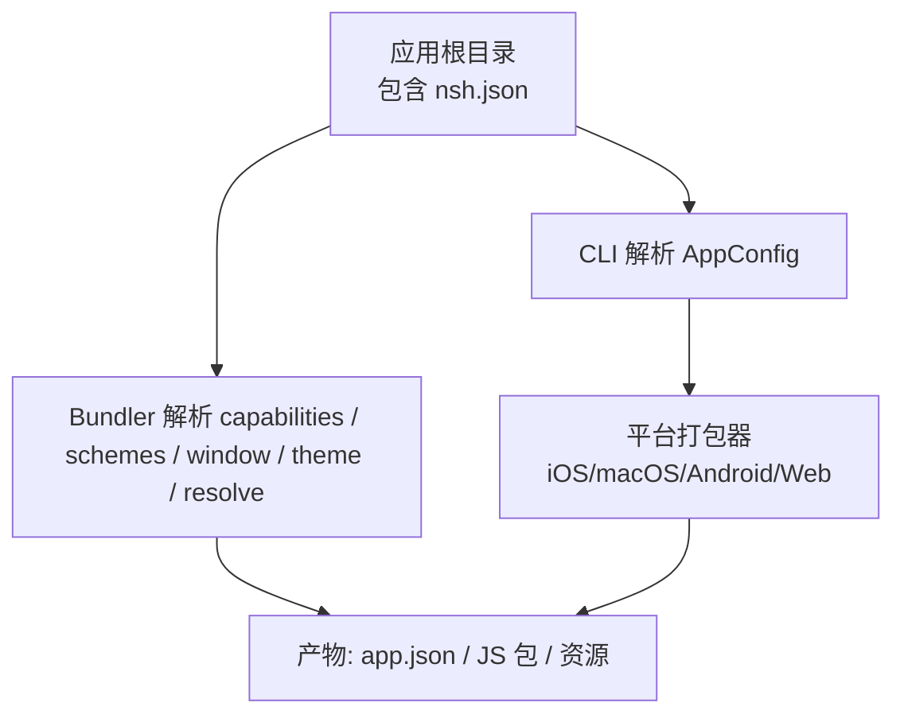
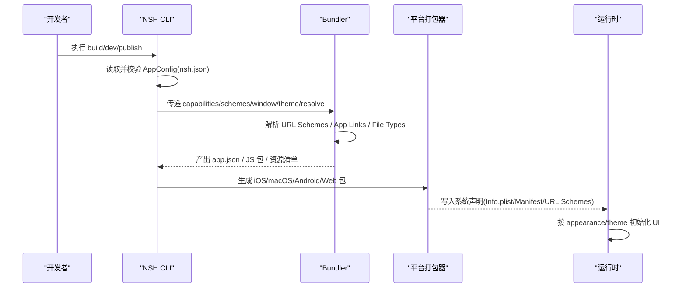
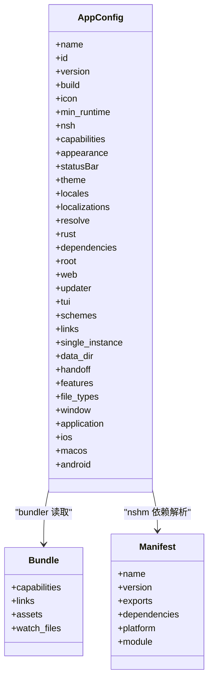

# 配置文件详解

<cite>
**本文引用的文件**   
- [examples/counter/nsh.json](file://examples/counter/nsh.json)
- [examples/gallery/nsh.json](file://examples/gallery/nsh.json)
- [crates/nsh-cli/src/package.rs](file://crates/nsh-cli/src/package.rs)
- [crates/nsh-bundler/src/bundle.rs](file://crates/nsh-bundler/src/bundle.rs)
- [crates/nsh-cli/src/nshm/manifest.rs](file://crates/nsh-cli/src/nshm/manifest.rs)
</cite>

## 目录
1. [简介](#简介)
2. [项目结构](#项目结构)
3. [核心组件](#核心组件)
4. [架构总览](#架构总览)
5. [详细组件分析](#详细组件分析)
6. [依赖关系分析](#依赖关系分析)
7. [性能与体积考量](#性能与体积考量)
8. [故障排查指南](#故障排查指南)
9. [结论](#结论)
10. [附录：配置项参考表](#附录配置项参考表)

## 简介
本文件为 nsh.json 应用配置文件的权威参考文档。内容覆盖：
- 所有配置字段的作用、默认值、有效范围与平台差异
- 应用元数据、目标平台设置、依赖管理、插件与构建选项、输出格式定制
- 不同场景下的配置示例（开发环境、生产环境、多平台构建）
- 配置项之间的依赖关系与验证规则
- 最佳实践与常见错误修复建议

nsh.json 是 NSH 应用的根级配置，被 CLI、打包器、平台打包器与运行时共同读取。未知键会被忽略并告警，以保证向前兼容；对能力等关键配置进行严格校验，确保运行安全。

## 项目结构
nsh.json 位于应用根目录，CLI 与 bundler 在构建流程中多次读取它，以生成 app.json、注入主题、解析 URL Scheme、权限与窗口启动参数等。

图示来源
- [crates/nsh-cli/src/package.rs:170-308](file://crates/nsh-cli/src/package.rs#L170-L308)
- [crates/nsh-bundler/src/bundle.rs:185-281](file://crates/nsh-bundler/src/bundle.rs#L185-L281)

章节来源
- [crates/nsh-cli/src/package.rs:170-308](file://crates/nsh-cli/src/package.rs#L170-L308)
- [crates/nsh-bundler/src/bundle.rs:185-281](file://crates/nsh-bundler/src/bundle.rs#L185-L281)

## 核心组件
本节聚焦 nsh.json 的核心语义与生命周期影响点：
- 应用元数据：name、id、version、build、icon、min_runtime、nsh
- 外观与主题：appearance、theme、statusBar
- 能力与权限：capabilities（network/fs/process/webview/openUrl/picker/share/speech/notifications/audio/windows/application/homeDir 等）
- 链接与协议：schemes、links、fileTypes
- 窗口与应用生命周期：window、application
- 构建与模块解析：resolve、tailwind、rust、root、dependencies
- 平台相关：web、updater、tui、ios/macos/android
- 行为开关：singleInstance、dataDir、handoff、features

章节来源
- [crates/nsh-cli/src/package.rs:170-308](file://crates/nsh-cli/src/package.rs#L170-L308)

## 架构总览
下图展示 nsh.json 在构建与运行时的关键路径：

图示来源
- [crates/nsh-cli/src/package.rs:170-308](file://crates/nsh-cli/src/package.rs#L170-L308)
- [crates/nsh-bundler/src/bundle.rs:185-281](file://crates/nsh-bundler/src/bundle.rs#L185-L281)

## 详细组件分析

### 应用元数据
- name: 显示名称
- id: 应用标识符（Bundle ID），如 com.example.app
- version: 用户可见版本（语义化版本）
- build: 内部构建号
- icon: 图标路径或按平台/目标的映射
- min_runtime: 签名包最低运行时版本
- nsh: 声明该应用面向的 NSH 版本范围（用于 CLI 版本检查）

说明
- 这些字段由 CLI 解析并在打包时写入平台清单或运行时配置。
- 若未提供，部分字段有默认值或由平台推导。

章节来源
- [crates/nsh-cli/src/package.rs:170-308](file://crates/nsh-cli/src/package.rs#L170-L308)

### 外观与主题
- appearance: 初始外观 light/dark/system
- theme: 主题 JSON 路径或对象（CSS 变量形式）
- statusBar: 状态栏默认行为（平台相关）

说明
- bundler 会校验 theme 并注入到产物；appearance 影响启动屏与窗口主题。
- 运行时可动态切换主题，但启动阶段受 appearance 控制。

章节来源
- [crates/nsh-cli/src/package.rs:200-211](file://crates/nsh-cli/src/package.rs#L200-L211)
- [crates/nsh-bundler/src/bundle.rs:800-816](file://crates/nsh-bundler/src/bundle.rs#L800-L816)

### 能力与权限（capabilities）
capabilities 是安全边界，决定应用能访问的系统能力。bundler 将其转换为 Capabilities 对象，未知键将被丢弃并告警。

常用子项
- network.hosts / network.sockets: 允许的网络主机与 socket
- fs.read / fs.write: 文件系统读写白名单
- process.exit / process.execute / process.env: 进程控制与命令白名单、环境变量
- webview.hosts: WebView 可加载的主机
- openUrl.schemes: 允许打开的外部协议
- picker / share / speech / notifications / audio: 布尔开关
- windows.kinds: 允许的窗口类型集合
- application / homeDir: 应用级能力开关

注意
- 未声明 host 能力而调用 host.call/post 会在构建期给出警告。
- 能力不足会导致运行时拒绝访问。

章节来源
- [crates/nsh-bundler/src/bundle.rs:185-211](file://crates/nsh-bundler/src/bundle.rs#L185-L211)
- [crates/nsh-bundler/src/bundle.rs:818-835](file://crates/nsh-bundler/src/bundle.rs#L818-L835)
- [crates/nsh-cli/src/package.rs:194-200](file://crates/nsh-cli/src/package.rs#L194-L200)

### 链接与协议（schemes、links、fileTypes）
- schemes: 自定义 URL Scheme 列表（如 myapp://...）
- links: Web 链接规则（Universal Links/App Links）
- fileTypes: 应用支持的文件类型（自动注册 file: Scheme）

bundler 会将 fileTypes 对应的 file: Scheme 加入 schemes，并生成 AppLinks。

章节来源
- [crates/nsh-bundler/src/bundle.rs:213-248](file://crates/nsh-bundler/src/bundle.rs#L213-L248)
- [crates/nsh-cli/src/package.rs:240-253](file://crates/nsh-cli/src/package.rs#L240-L253)

### 窗口与应用生命周期（window、application）
- window: 主窗口启动参数（尺寸、标题、titleBar 等）
- application: 应用退出模式（platform/lastWindowClosed/explicit）

bundler 会校验 window 与 application 的结构，并将合法配置序列化后交给运行时。

章节来源
- [crates/nsh-bundler/src/bundle.rs:250-281](file://crates/nsh-bundler/src/bundle.rs#L250-L281)
- [crates/nsh-cli/src/package.rs:289-297](file://crates/nsh-cli/src/package.rs#L289-L297)

### 构建与模块解析（resolve、tailwind、rust、root、dependencies）
- resolve.conditions / resolve.alias: npm 导出条件与别名替换
- tailwind: Tailwind 相关配置（由 bundler 处理）
- rust/root: Rust 应用入口与原生模块配置
- dependencies: nshm 依赖（名称、版本、exports、platform 等）

bundler 根据 resolve.alias 与 nshm exports 调整模块解析策略，并决定是否启用 browser 条件。

章节来源
- [crates/nsh-bundler/src/bundle.rs:283-379](file://crates/nsh-bundler/src/bundle.rs#L283-L379)
- [crates/nsh-cli/src/nshm/manifest.rs:40-182](file://crates/nsh-cli/src/nshm/manifest.rs#L40-L182)

### 平台相关（web、updater、tui、ios/macos/android）
- web: Web 包的页面增强配置
- updater: OTA 更新源与策略
- tui: 终端布局选项
- ios/macos/android: 各平台清单与特性开关（如 launchScreen、permissions、queries、application 片段等）

章节来源
- [crates/nsh-cli/src/package.rs:232-308](file://crates/nsh-cli/src/package.rs#L232-L308)

### 行为开关（singleInstance、dataDir、handoff、features）
- singleInstance: 单实例运行（Windows/Linux）
- dataDir: 自定义数据目录（支持 ${homeDir} 占位）
- handoff: Handoff 能力（iOS/macOS）
- features: 强制包含的 native features（即使 bundle 未静态使用）

章节来源
- [crates/nsh-cli/src/package.rs:254-281](file://crates/nsh-cli/src/package.rs#L254-L281)

## 依赖关系分析
- AppConfig 是 nsh.json 的顶层模型，其他子系统通过 CLI 与 bundler 消费其字段。
- bundler 从 nsh.json 提取 capabilities/schemes/window/theme/resolve 等，并生成运行时可用的 app.json 与 JS 包。
- nshm manifest 负责解析依赖的 nsh.json（含 exports/platform 等），并与 Cargo.toml 交叉校验。

图示来源
- [crates/nsh-cli/src/package.rs:170-308](file://crates/nsh-cli/src/package.rs#L170-L308)
- [crates/nsh-bundler/src/bundle.rs:877-898](file://crates/nsh-bundler/src/bundle.rs#L877-L898)
- [crates/nsh-cli/src/nshm/manifest.rs:40-182](file://crates/nsh-cli/src/nshm/manifest.rs#L40-L182)

章节来源
- [crates/nsh-cli/src/package.rs:170-308](file://crates/nsh-cli/src/package.rs#L170-L308)
- [crates/nsh-bundler/src/bundle.rs:877-898](file://crates/nsh-bundler/src/bundle.rs#L877-L898)
- [crates/nsh-cli/src/nshm/manifest.rs:40-182](file://crates/nsh-cli/src/nshm/manifest.rs#L40-L182)

## 性能与体积考量
- 仅声明必要的 capabilities，避免无谓的能力开启导致运行时开销与安全面扩大。
- 合理设置 resolve.alias 与 conditions，减少不必要的浏览器 polyfill 或 Node 模块引入。
- 按需启用 features，避免打包未使用的原生功能。
- 使用 theme 与 appearance 预置主题，减少运行时样式计算。

[本节为通用指导，不直接分析具体文件]

## 故障排查指南
常见问题与解决思路
- 构建期告警“未知键”：升级 NSH 或修正拼写；未知键会被忽略但不报错。
- 调用 host.call/post 被拒绝：在 capabilities.host 中声明所需函数或前缀。
- URL Scheme 未生效：确认 schemes 已声明；若使用 fileTypes，会自动追加 file: Scheme。
- window 或 application 无效：检查结构是否符合运行时期望；bundler 会过滤非法配置。
- nshm 依赖解析失败：检查 exports 路径是否相对且存在；platform 必须配合 Rust crate。
- 版本不匹配：nsh 字段要求当前 CLI 满足 semver 约束；升级 CLI 或调整 nsh 版本范围。

章节来源
- [crates/nsh-bundler/src/bundle.rs:185-211](file://crates/nsh-bundler/src/bundle.rs#L185-L211)
- [crates/nsh-bundler/src/bundle.rs:818-835](file://crates/nsh-bundler/src/bundle.rs#L818-L835)
- [crates/nsh-cli/src/nshm/manifest.rs:142-182](file://crates/nsh-cli/src/nshm/manifest.rs#L142-L182)
- [crates/nsh-cli/src/nshm/manifest.rs:185-196](file://crates/nsh-cli/src/nshm/manifest.rs#L185-L196)

## 结论
nsh.json 是 NSH 应用构建与运行的核心契约。通过精确声明元数据、能力、链接、窗口与平台配置，可以在保证安全的前提下获得一致的多端体验。遵循本文的最佳实践与排错建议，可显著降低构建失败与运行时异常的概率。

[本节为总结性内容，不直接分析具体文件]

## 附录：配置项参考表

- 应用元数据
  - name: 显示名称；可选
  - id: 应用标识符；可选
  - version: 用户可见版本；可选
  - build: 构建号；可选
  - icon: 图标路径或平台映射；可选
  - min_runtime: 最低运行时版本；可选
  - nsh: NSH 版本范围；可选

- 外观与主题
  - appearance: light/dark/system；可选
  - theme: 主题 JSON 路径或对象；可选
  - statusBar: 状态栏默认行为；可选

- 能力与权限
  - capabilities.network.hosts / sockets
  - capabilities.fs.read / write
  - capabilities.process.exit / execute / env
  - capabilities.webview.hosts
  - capabilities.openUrl.schemes
  - capabilities.picker / share / speech / notifications / audio
  - capabilities.windows.kinds
  - capabilities.application / homeDir

- 链接与协议
  - schemes: 自定义 URL Scheme 列表
  - links: Web 链接规则
  - fileTypes: 文件类型声明（自动注册 file: Scheme）

- 窗口与应用生命周期
  - window: 主窗口启动参数
  - application: 退出模式

- 构建与模块解析
  - resolve.conditions / alias
  - tailwind
  - rust / root
  - dependencies

- 平台相关
  - web
  - updater
  - tui
  - ios / macos / android

- 行为开关
  - singleInstance
  - dataDir
  - handoff
  - features

章节来源
- [crates/nsh-cli/src/package.rs:170-308](file://crates/nsh-cli/src/package.rs#L170-L308)
- [crates/nsh-bundler/src/bundle.rs:185-281](file://crates/nsh-bundler/src/bundle.rs#L185-L281)

## 配置示例

- 最小可用配置（示例：Counter）
  - 适用场景：快速原型或最小示例
  - 关键字段：name、id

  参考文件
  - [examples/counter/nsh.json:1-5](file://examples/counter/nsh.json#L1-L5)

- 完整能力与链接配置（示例：Gallery）
  - 适用场景：演示应用，启用网络、文件、进程、WebView、剪贴板、分享、语音、通知、音频、多种窗口类型、应用与 Home 目录能力
  - 关键字段：schemes、icon、appearance、window.title/titleBar.style/titleBar.height、theme、capabilities.*、openUrl.schemes

  参考文件
  - [examples/gallery/nsh.json:1-83](file://examples/gallery/nsh.json#L1-L83)

- 开发环境建议
  - 保持 capabilities 最小化，仅在需要时开启
  - 使用 appearance 与 theme 预置主题，提升开发体验
  - 使用 resolve.alias 指向本地调试模块

- 生产环境建议
  - 明确声明 min_runtime 与 nsh 版本范围
  - 关闭不必要的能力与 features
  - 使用稳定的 version/build 与 icon

- 多平台构建建议
  - 使用 platform 字段区分 nshm 的平台实现
  - 针对 iOS/macOS/Android 分别配置 launchScreen、permissions、queries 等
  - 统一 schemes 与 links，确保跨平台链接一致性

[本节为示例与指导，不直接分析具体文件]