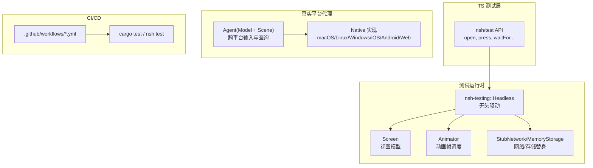
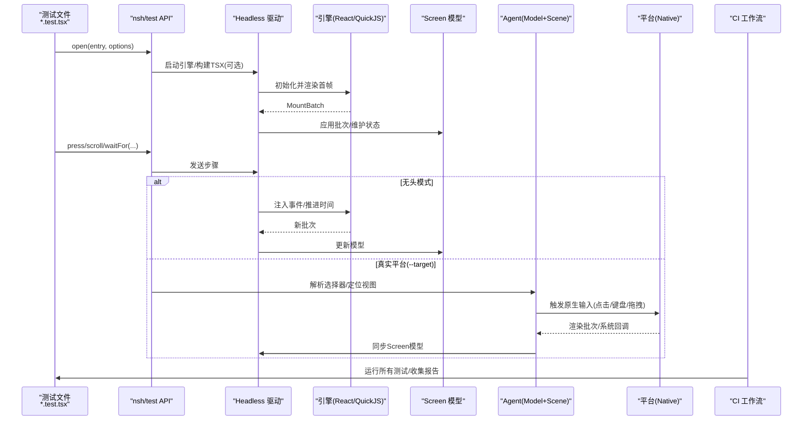
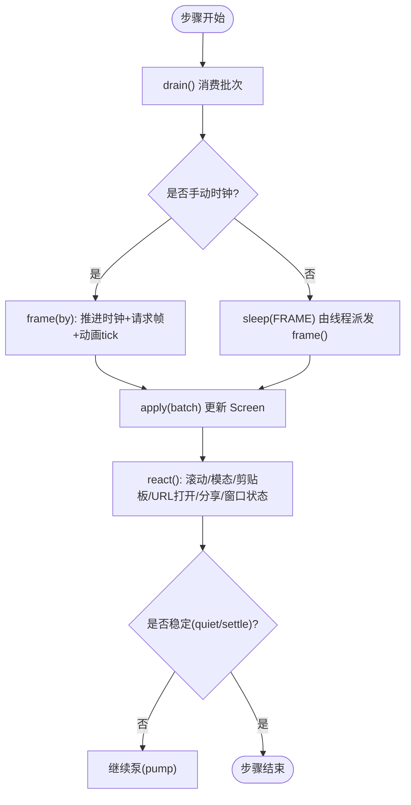
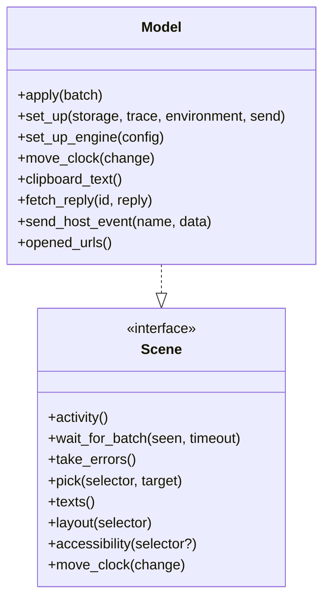
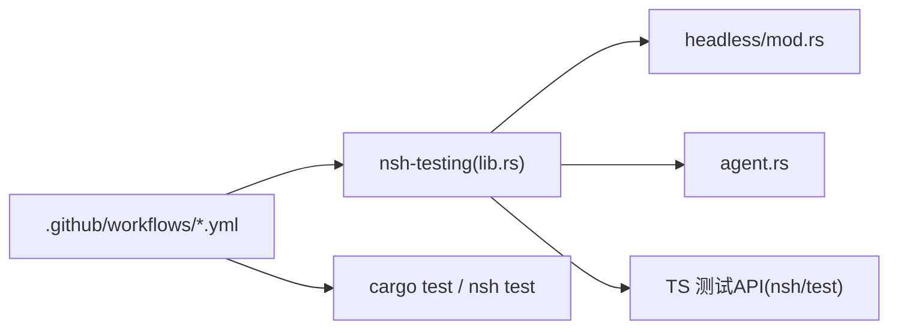

# 测试框架和策略

<cite>
**本文引用的文件**   
- [testing-and-trace.md](file://website/docs/testing-and-trace.md)
- [lib.rs](file://crates/nsh-testing/src/lib.rs)
- [agent.rs](file://crates/nsh-testing/src/agent.rs)
- [headless/mod.rs](file://crates/nsh-testing/src/headless/mod.rs)
- [compat.yml](file://.github/workflows/compat.yml)
- [core.yml](file://.github/workflows/core.yml)
- [examples.yml](file://.github/workflows/examples.yml)
- [gpui.yml](file://.github/workflows/gpui.yml)
- [linux.yml](file://.github/workflows/linux.yml)
- [tui.yml](file://.github/workflows/tui.yml)
- [windows.yml](file://.github/workflows/windows.yml)
</cite>

## 目录
1. [简介](#简介)
2. [项目结构](#项目结构)
3. [核心组件](#核心组件)
4. [架构总览](#架构总览)
5. [详细组件分析](#详细组件分析)
6. [依赖关系分析](#依赖关系分析)
7. [性能与基准](#性能与基准)
8. [故障排查指南](#故障排查指南)
9. [结论](#结论)
10. [附录](#附录)

## 简介
本指南面向 NSH 应用的全面测试实践，覆盖单元测试、集成测试与端到端测试的编写与执行；说明无头浏览器（Headless）测试配置、模拟用户交互、截图比较与性能基准；给出移动端与桌面端的测试策略（模拟器/设备适配与平台特性）；总结测试数据管理、异步处理与错误场景覆盖的最佳实践；并给出在 CI/CD 中的自动化测试配置与报告生成方法。

NSH 提供两类测试运行方式：
- Rust 侧：使用 nsh-testing 驱动 Headless 引擎，配合 cargo test 运行应用根组件或 TSX 入口（需 bundle 特性）。
- TypeScript 侧：使用 nsh test 命令运行 *.test.tsx/*.test.ts，每个测试文件拥有独立引擎实例，支持网络存根、手动时钟、选择器驱动的 UI 操作与断言。

## 项目结构
围绕测试的关键代码位于 crates/nsh-testing，文档与示例参考 website/docs/testing-and-trace.md，CI 工作流位于 .github/workflows。

图示来源
- [headless/mod.rs:1-120](file://crates/nsh-testing/src/headless/mod.rs#L1-L120)
- [lib.rs:1-110](file://crates/nsh-testing/src/lib.rs#L1-L110)
- [agent.rs:1-120](file://crates/nsh-testing/src/agent.rs#L1-L120)

章节来源
- [testing-and-trace.md:1-120](file://website/docs/testing-and-trace.md#L1-L120)
- [lib.rs:1-110](file://crates/nsh-testing/src/lib.rs#L1-L110)

## 核心组件
- Headless 驱动：启动引擎、维护屏幕模型、驱动用户步骤（点击、输入、滚动、等待等），并提供手动时钟、网络/存储替身、对话框/选择器等能力。
- Agent 与 Model：在真实平台（--target）上，将测试步骤映射到平台原生输入，同时保持与 Headless 一致的 Screen 模型，保证选择器行为一致。
- TS 测试 API：nsh/test 暴露 open、press、waitFor、screenshot、clock.runFor 等 API，用于编写可读性强的端到端用例。
- CI 集成：通过 GitHub Actions 在不同目标（gpui、linux、windows、tui、web、ios、android）上运行测试。

章节来源
- [headless/mod.rs:1-120](file://crates/nsh-testing/src/headless/mod.rs#L1-L120)
- [agent.rs:1-120](file://crates/nsh-testing/src/agent.rs#L1-L120)
- [testing-and-trace.md:92-180](file://website/docs/testing-and-trace.md#L92-L180)

## 架构总览
下图展示从 TS 测试到 Headless 引擎，再到真实平台代理与 CI 的整体流程。

图示来源
- [headless/mod.rs:150-240](file://crates/nsh-testing/src/headless/mod.rs#L150-L240)
- [agent.rs:112-180](file://crates/nsh-testing/src/agent.rs#L112-L180)
- [testing-and-trace.md:613-703](file://website/docs/testing-and-trace.md#L613-L703)

## 详细组件分析

### Headless 驱动（无头测试）
- 职责：启动引擎、按 60Hz 驱动帧、维护 Screen 模型、提供用户步骤（press/type/scroll/back/waitFor 等）、控制手动时钟、网络/存储替身、对话框/选择器/分享/语音/音频等。
- 关键行为：
  - 帧循环与空闲检测：在系统时钟下等待 QUIET 后判定“稳定”，在手动时钟下按帧推进直到引擎 idle。
  - 手动时钟：runFor/fastForward/setSystemTime 精确控制定时器与动画，waitFor/waitUntil 在等待期间逐步推进时钟。
  - 网络/存储：StubNetwork/RecordingNetwork 与 MemoryStorage 隔离外部依赖。
  - 截图：在无头模式下返回 PNG 字节数组（图形目标）或 TUI Cell JSON（终端目标）。

图示来源
- [headless/mod.rs:646-700](file://crates/nsh-testing/src/headless/mod.rs#L646-L700)
- [headless/mod.rs:1430-1523](file://crates/nsh-testing/src/headless/mod.rs#L1430-L1523)

章节来源
- [headless/mod.rs:1-120](file://crates/nsh-testing/src/headless/mod.rs#L1-L120)
- [headless/mod.rs:646-700](file://crates/nsh-testing/src/headless/mod.rs#L646-L700)
- [headless/mod.rs:1430-1523](file://crates/nsh-testing/src/headless/mod.rs#L1430-L1523)

### Agent 与 Model（真实平台代理）
- 职责：在 --target 模式下，将测试步骤映射为平台原生输入（点击、长按、键盘、拖拽、滚动），并保持与 Headless 一致的 Screen 模型，确保选择器语义一致。
- 关键点：
  - Model 持有 Screen、Setup（storage、环境引脚、剪贴板、trace、manual clock、host channel、opened URLs、live network 开关）。
  - Scene trait 抽象查询与动作（pick/texts/layout/accessibility/move_clock 等），Model 实现该接口。
  - 静默判定：QUIET=100ms，SETTLE=2s，POLL=20ms，FRAME_LOOK=2ms。

图示来源
- [agent.rs:112-180](file://crates/nsh-testing/src/agent.rs#L112-L180)
- [agent.rs:430-573](file://crates/nsh-testing/src/agent.rs#L430-L573)

章节来源
- [agent.rs:1-120](file://crates/nsh-testing/src/agent.rs#L1-L120)
- [agent.rs:112-180](file://crates/nsh-testing/src/agent.rs#L112-L180)
- [agent.rs:430-573](file://crates/nsh-testing/src/agent.rs#L430-L573)

### TS 测试 API（nsh/test）
- 常用 API：open、describe/test/beforeEach、press/longPress/clear/type/submit/scroll/hover/rightClick/paste、keyboard.press/down/up、drag/dragAndHold/drop、wait/waitFor/waitUntil、screenshot、clock.runFor/fastForward/setSystemTime、setViewport/setColorScheme/setLifecycle/wake/setNetworkState/setLocaleSettings、window/windowId/window.state 等。
- 选择器：id:/label:/text:/role:/view: 以及正则、嵌套 >>、nth=。
- 断言：expect 提供 Jest 风格匹配器（toBe/toEqual/toMatchObject/toContain/toThrow/rejects/resolves 等）。
- 网络存根：network 路由表，支持 status/headers/body/error/delay；requests() 记录请求序列。
- 主机模块与 URL 打开：host.params/handlers/send、modules 替换原生模块导出、openedUrls/failOpenUrls。

章节来源
- [testing-and-trace.md:92-180](file://website/docs/testing-and-trace.md#L92-L180)
- [testing-and-trace.md:394-529](file://website/docs/testing-and-trace.md#L394-L529)
- [testing-and-trace.md:581-612](file://website/docs/testing-and-trace.md#L581-L612)
- [testing-and-trace.md:272-341](file://website/docs/testing-and-trace.md#L272-L341)

### 截图比较与视觉回归
- 无头模式：app.screenshot(path?) 返回 PNG 字节数组（图形目标）或 TUI Cell JSON（终端目标），可保存到 path。
- 真实平台：app.screenshot/app.window(id).screenshot 取窗体内容 PNG。
- 建议：对关键界面做基线截图对比；对 TUI 使用 Cell JSON 进行结构化断言。

章节来源
- [testing-and-trace.md:482-490](file://website/docs/testing-and-trace.md#L482-L490)
- [testing-and-trace.md:673-680](file://website/docs/testing-and-trace.md#L673-L680)

### 移动端与桌面端测试策略
- 桌面端（macOS/Linux/Windows/GPUI/Web）：
  - 使用 --target 在真实窗口中运行，步骤映射为鼠标/键盘/滚轮/快捷键。
  - 支持 windowIds()/window(id).state()/pressClose()/screenshot()。
- iOS/Android：
  - 使用 --target ios/android 在模拟器/设备上运行，步骤映射为触摸与软键盘。
  - setColorScheme 切换深色模式；viewport 填充设备屏幕；back 对应系统返回。
- 通用：
  - setViewport 模拟旋转/窗口缩放；setLocaleSettings/locale/colorScheme/reducedMotion/safeArea 模拟环境与可达性。

章节来源
- [testing-and-trace.md:613-703](file://website/docs/testing-and-trace.md#L613-L703)

### 性能基准与追踪
- --trace：打印每次挂载批次的操作明细与耗时，便于测量首帧、点击、滚动帧成本。
- 手动时钟：让动画/定时器在测试时间内快速推进，避免真实等待。
- perf monitor：EngineConfig/perf monitor 可开启引擎性能监控。

章节来源
- [testing-and-trace.md:720-800](file://website/docs/testing-and-trace.md#L720-L800)
- [headless/mod.rs:1146-1153](file://crates/nsh-testing/src/headless/mod.rs#L1146-L1153)

## 依赖关系分析
- nsh-testing 暴露 Headless、Screen、MemoryStorage、StubNetwork 等核心类型；在 js/bundle 特性下编译 TSX 入口并运行。
- agent 特性在真实平台下复用 Screen 模型，通过 Native 实现桥接平台输入。
- CI 工作流调用 cargo test 与 nsh test，并在不同目标（gpui/linux/windows/tui/web/ios/android）上执行。

图示来源
- [lib.rs:1-110](file://crates/nsh-testing/src/lib.rs#L1-L110)
- [headless/mod.rs:1-120](file://crates/nsh-testing/src/headless/mod.rs#L1-L120)
- [agent.rs:1-120](file://crates/nsh-testing/src/agent.rs#L1-L120)

章节来源
- [lib.rs:1-110](file://crates/nsh-testing/src/lib.rs#L1-L110)

## 性能与基准
- 使用 --trace 输出挂载批次与耗时，识别首帧与交互热点。
- 使用手动时钟减少等待，提升测试吞吐。
- 在 CI 中固定硬件/环境，建立性能基线，定期回归对比。

章节来源
- [testing-and-trace.md:720-800](file://website/docs/testing-and-trace.md#L720-L800)

## 故障排查指南
- 常见错误码：
  - ERR_NSH_TEST_NOT_FOUND：选择器未命中。
  - ERR_NSH_TEST_DISABLED：目标不可交互。
  - ERR_NSH_TEST_COVERED：被其他视图遮挡。
  - ETIMEDOUT：waitFor/waitUntil 超时。
  - ERR_NSH_TEST_NO_BACK：无可返回页面。
  - ERR_NSH_TEST_UNSUPPORTED：当前平台不支持的操作（如 web-only forward()）。
- 调试建议：
  - 使用 app.texts()/accessibility() 检查可见文本与无障碍树。
  - 使用 --trace 查看批次与操作明细。
  - 使用 app.failImages/app.failOpenUrls 构造失败路径。
  - 使用 onDialog/onPick/onShare 等钩子模拟平台交互。

章节来源
- [testing-and-trace.md:505-529](file://website/docs/testing-and-trace.md#L505-L529)

## 结论
通过 Headless 驱动与 Agent 模型的一致性设计，NSH 在同一套选择器与步骤语义下，既能在无头环境中高效验证 UI 逻辑，也能在真实平台复现用户交互。结合手动时钟、网络/存储替身、截图与 --trace，可以构建稳定、快速且可观测的测试体系。在 CI 中按目标矩阵运行，可保障多平台质量。

## 附录

### 在 CI/CD 中自动化测试与报告
- 运行范围：
  - 全量：cargo test / nsh test
  - 过滤：按包名或测试名筛选
- 目标矩阵：
  - gpui：跨桌面平台的无头渲染
  - linux/windows：真实窗口输入
  - tui：终端渲染（适合 CI）
  - web：无头 Chrome/Edge/Chromium
  - ios/android：模拟器/设备
- 报告：
  - nsh test 支持 --junit 输出 JUnit 报告，便于 CI 聚合。

章节来源
- [compat.yml:140-150](file://.github/workflows/compat.yml#L140-L150)
- [core.yml:100-120](file://.github/workflows/core.yml#L100-L120)
- [examples.yml:100-120](file://.github/workflows/examples.yml#L100-L120)
- [gpui.yml:150-165](file://.github/workflows/gpui.yml#L150-L165)
- [linux.yml:120-140](file://.github/workflows/linux.yml#L120-L140)
- [linux.yml:200-235](file://.github/workflows/linux.yml#L200-L235)
- [tui.yml:115-130](file://.github/workflows/tui.yml#L115-L130)
- [windows.yml:120-140](file://.github/workflows/windows.yml#L120-L140)
- [testing-and-trace.md:92-125](file://website/docs/testing-and-trace.md#L92-L125)