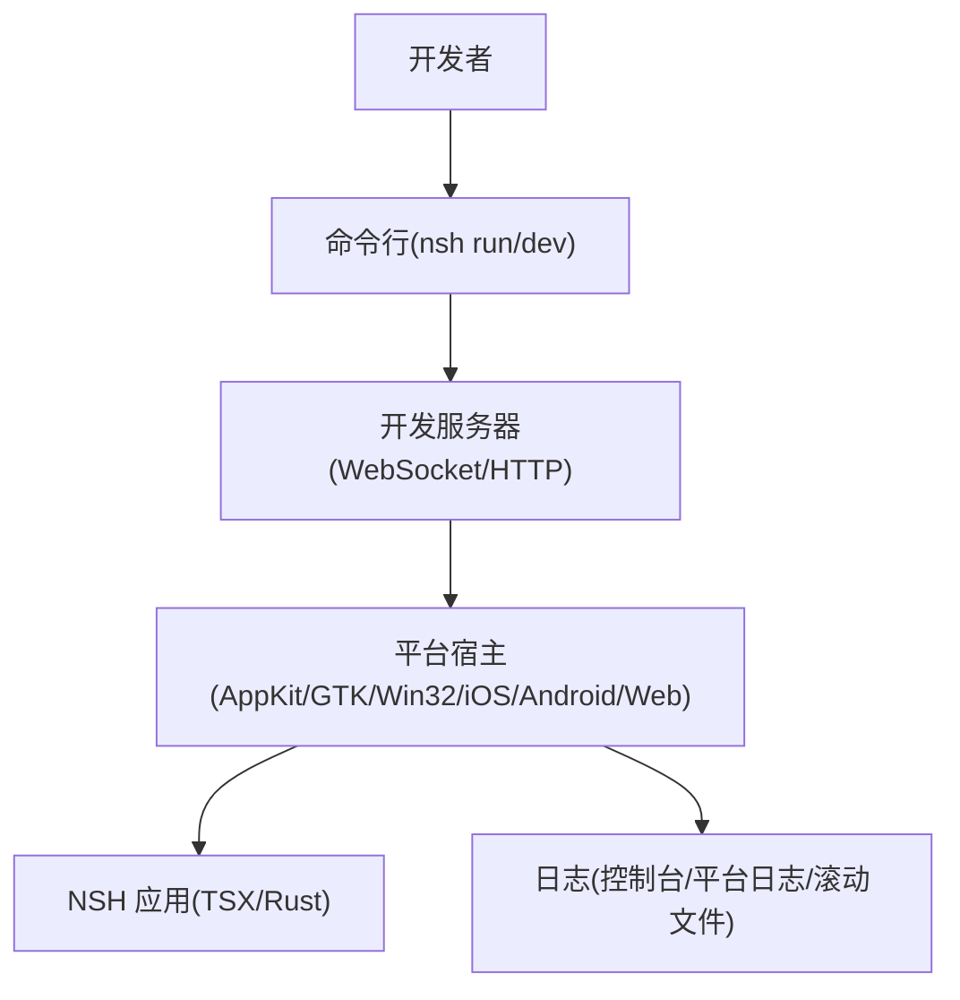
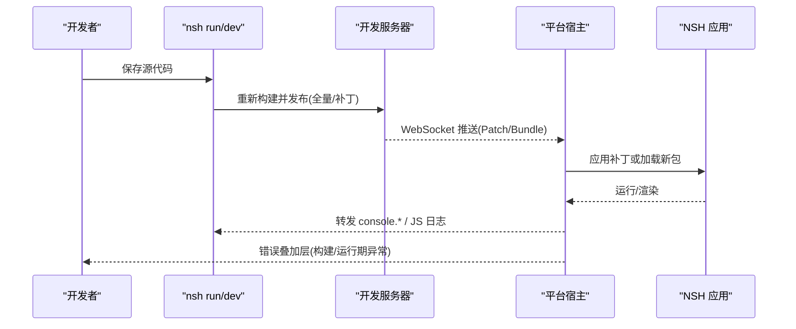
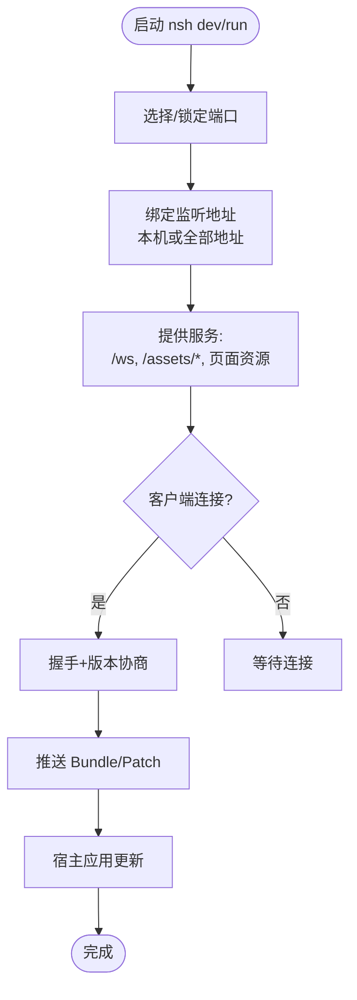
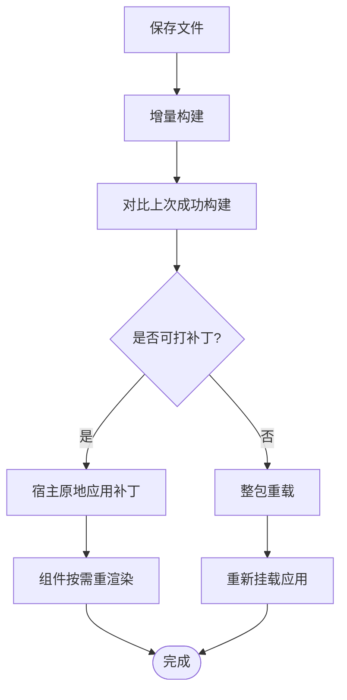
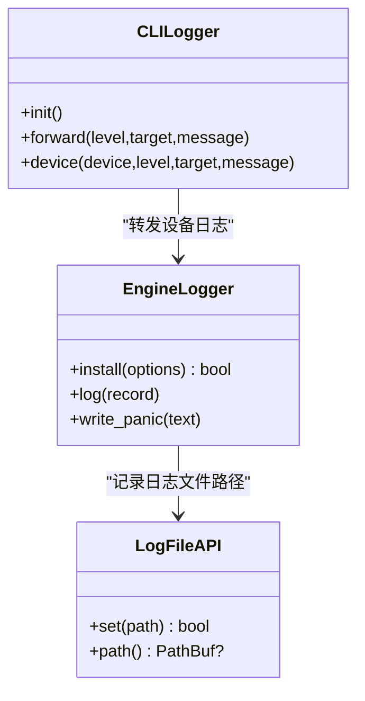
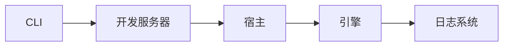

# 调试工具和技巧

<cite>
**本文引用的文件**   
- [工具链文档](file://docs/dev/tooling.md)
- [开发服务器与调试文档](file://website/docs/dev-server-and-debugging.md)
- [CLI 日志实现](file://crates/nsh-cli/src/logger.rs)
- [引擎日志实现](file://crates/nsh-engine/src/logging.rs)
- [日志文件路径接口](file://crates/nsh-core/src/log_file.rs)
</cite>

## 目录
1. [简介](#简介)
2. [项目结构](#项目结构)
3. [核心组件](#核心组件)
4. [架构总览](#架构总览)
5. [详细组件分析](#详细组件分析)
6. [依赖关系分析](#依赖关系分析)
7. [性能考虑](#性能考虑)
8. [故障排查指南](#故障排查指南)
9. [结论](#结论)
10. [附录](#附录)

## 简介
本指南面向 NSH 应用开发者，系统化说明如何高效调试 TSX/Rust 混合应用。内容覆盖：
- 开发服务器使用：热重载、断点调试、性能监控
- Chrome DevTools 集成：网络请求、内存分析、性能分析与 DOM/视图检查
- 日志系统：级别控制、结构化日志、远程日志收集
- 常见问题诊断：运行时错误、性能瓶颈、内存泄漏检测
- 移动端与桌面端特殊调试技巧与工具链配置

## 项目结构
NSH 的调试能力由 CLI、开发服务器、引擎日志与平台宿主共同协作完成：
- CLI 负责构建、启动宿主、转发设备日志、输出步骤化终端信息
- 开发服务器提供 WebSocket 推送、资源服务、协议握手与版本协商
- 引擎日志在桌面发行版中写入滚动日志文件并对接平台日志通道
- 平台宿主（macOS/Linux/Windows/iOS/Android/Web）连接开发服务器，接收补丁或完整包，并在 UI 上展示错误叠加层与日志

图表来源
- [开发服务器与调试文档:10-18](file://website/docs/dev-server-and-debugging.md#L10-L18)
- [工具链文档:122-166](file://docs/dev/tooling.md#L122-L166)

章节来源
- [开发服务器与调试文档:10-18](file://website/docs/dev-server-and-debugging.md#L10-L18)
- [工具链文档:122-166](file://docs/dev/tooling.md#L122-L166)

## 核心组件
- 开发服务器与命令
  - nsh run：构建并启动目标平台宿主；TSX 同时启动开发服务器
  - nsh dev --server-only：仅启动开发服务器，供外部宿主连接
- 热模块替换(HMR)
  - 增量补丁推送，毫秒级应用，保留未变更组件状态
- 日志系统
  - CLI 侧：过滤与格式化终端输出，区分设备日志与性能行
  - 引擎侧：桌面发行版滚动日志文件 + 平台日志通道
- 错误叠加层与源码映射
  - 构建/运行期错误以叠加层显示；堆栈重写为源文件位置
- 测试与追踪
  - nsh test 支持 headless 与真实平台，--trace 输出提交耗时与操作明细

章节来源
- [开发服务器与调试文档:10-18](file://website/docs/dev-server-and-debugging.md#L10-L18)
- [工具链文档:118-159](file://docs/dev/tooling.md#L118-L159)
- [工具链文档:287-329](file://docs/dev/tooling.md#L287-L329)

## 架构总览
下图展示从保存到 UI 更新的端到端流程，包括 HMR 补丁、日志转发与错误叠加层。

图表来源
- [工具链文档:122-166](file://docs/dev/tooling.md#L122-L166)
- [工具链文档:228-260](file://docs/dev/tooling.md#L228-L260)
- [开发服务器与调试文档:161-208](file://website/docs/dev-server-and-debugging.md#L161-L208)

## 详细组件分析

### 开发服务器与热重载
- 端口与会话管理
  - 默认端口 8790；若被占用则取下一个空闲端口；可显式指定 --port
  - 通过缓存目录中的会话锁保证同一端口只有一组“拥有者”
- 监听范围
  - 本机宿主：仅回环地址
  - 移动/Web 目标：绑定所有地址，允许局域网设备连接
- 安全校验
  - WebSocket 对 Origin 与 Host 进行校验，防止 DNS 重绑定等攻击
- 资源服务
  - 提供 /assets/<path> 与应用媒体文件；拒绝敏感路径
- 字节码版本协商
  - 客户端握手携带 BYTECODE_VERSION；不匹配时退回 JS 源码
- 限制与沙箱
  - 可通过 --limits 设置嵌入应用的运行时限制

图表来源
- [工具链文档:122-166](file://docs/dev/tooling.md#L122-L166)

章节来源
- [工具链文档:122-166](file://docs/dev/tooling.md#L122-L166)

### 热模块替换(HMR)机制
- 模块粒度
  - 开发构建按模块拆分，每个模块一个 CommonJS chunk
- 补丁策略
  - 比较上次成功构建，仅发送变更模块的 Patch
- 运行时行为
  - 顶层组件包裹稳定代理，代码变化才触发重渲染
  - 顶层 signal()/createNavStack() 保持值；context() 保持对象身份
  - mount 调用不变时复用挂载树，否则从差异点重建
- 回退策略
  - 首次导入新原生模块、capabilities 变更、无法应用补丁时，执行整包重载

图表来源
- [工具链文档:228-260](file://docs/dev/tooling.md#L228-L260)

章节来源
- [工具链文档:228-260](file://docs/dev/tooling.md#L228-L260)

### 日志系统与远程日志收集
- CLI 日志
  - 默认显示警告/错误、js 目标与性能行；verbose 模式显示全部
  - 多设备连接时，设备名作为前缀区分来源
- 引擎日志（桌面发行版）
  - 滚动日志文件 logs/app.log，超过阈值自动轮转，保留最近若干份
  - 支持 RUST_LOG 环境变量精细控制级别
  - 将 panic 始终写入日志文件，便于崩溃定位
  - 通过 LogOptions.output 对接平台日志（统一日志、stderr、调试器输出）
- 日志文件路径
  - 进程内记录日志文件路径，供应用读取并附加至诊断报告

图表来源
- [CLI 日志实现:1-126](file://crates/nsh-cli/src/logger.rs#L1-L126)
- [引擎日志实现:1-126](file://crates/nsh-engine/src/logging.rs#L1-L126)
- [日志文件路径接口:1-25](file://crates/nsh-core/src/log_file.rs#L1-L25)

章节来源
- [CLI 日志实现:1-126](file://crates/nsh-cli/src/logger.rs#L1-L126)
- [引擎日志实现:1-126](file://crates/nsh-engine/src/logging.rs#L1-L126)
- [日志文件路径接口:1-25](file://crates/nsh-core/src/log_file.rs#L1-L25)

### 错误叠加层与源码映射
- 错误叠加层
  - 构建失败、包评估失败、事件处理/定时器/副作用未捕获异常均显示红色叠加层
  - 点击可关闭，下次成功重载后自动消失
- 源码映射
  - 打包阶段生成隐藏 source map，随 bundle 一起下发
  - 引擎在打印/展示堆栈前重写位置，指向源文件与行列号

章节来源
- [开发服务器与调试文档:287-329](file://website/docs/dev-server-and-debugging.md#L287-L329)
- [工具链文档:259-260](file://docs/dev/tooling.md#L259-L260)

### 性能监控与追踪
- 提交追踪
  - 使用 --trace 输出每次提交的耗时、操作数、挂载项与节点数
- 帧率监控
  - 部分平台支持 --fps 每秒输出性能监视器读数
- 头无头测试
  - nsh test --trace 输出每一步的 native view 操作序列，便于复现与定位性能热点

章节来源
- [开发服务器与调试文档:202-208](file://website/docs/dev-server-and-debugging.md#L202-L208)
- [工具链文档:613-618](file://docs/dev/tooling.md#L613-L618)

### Chrome DevTools 集成（Web 目标）
- 连接方式
  - nsh run --target web 会构建 Web 运行时并打开浏览器页面
  - 开发服务器同时提供页面与资源，浏览器通过同端口 /ws 连接
- 可用能力
  - 网络面板：查看 HTTP/WebSocket 请求
  - 性能面板：录制与分析时间线
  - 内存面板：快照与分配调用栈
  - DOM/元素检查：结合 NSH 的虚拟视图模型进行 UI 检查
- 注意事项
  - 开发服务器对 Host/Origin 有校验，确保同源访问
  - 发布包与嵌入构建默认不显示错误叠加层，需通过日志与宿主错误回调获取

章节来源
- [工具链文档:147-154](file://docs/dev/tooling.md#L147-L154)
- [工具链文档:155-166](file://docs/dev/tooling.md#L155-L166)

### 移动端与桌面端特殊调试技巧
- iOS
  - 安装开发宿主到模拟器，自动 adb reverse 或网络直连
  - 日志接入 Xcode 控制台或统一日志子系统
- Android
  - 使用 adb reverse 将设备 127.0.0.1 转发到宿主机端口
  - 日志通过 logcat 采集
- macOS/Linux/Windows
  - 桌面宿主窗口直接运行；停止 nsh run 即关闭宿主
  - 日志可写至平台日志或标准错误
- TUI 终端宿主
  - nsh run --target tui 在当前终端运行，错误与构建输出重定向到 .nsh/tui.log

章节来源
- [开发服务器与调试文档:46-70](file://website/docs/dev-server-and-debugging.md#L46-L70)
- [工具链文档:183-208](file://docs/dev/tooling.md#L183-L208)

## 依赖关系分析
- CLI 与开发服务器
  - CLI 负责生命周期管理与设备发现；开发服务器负责协议与资源分发
- 宿主与引擎
  - 宿主连接开发服务器，接收 Bundle/Patch；引擎负责执行脚本、维护状态与日志
- 日志链路
  - CLI 日志用于开发与测试输出；引擎日志用于发行版持久化与平台日志对接

图表来源
- [工具链文档:122-166](file://docs/dev/tooling.md#L122-L166)
- [引擎日志实现:1-126](file://crates/nsh-engine/src/logging.rs#L1-L126)

章节来源
- [工具链文档:122-166](file://docs/dev/tooling.md#L122-L166)
- [引擎日志实现:1-126](file://crates/nsh-engine/src/logging.rs#L1-L126)

## 性能考虑
- 优先使用 HMR 减少整包重载
- 使用 --trace 定位慢提交与频繁重渲染
- 避免在顶层信号初始化中执行昂贵逻辑，必要时拆分为惰性计算
- 列表与长文本渲染注意虚拟化与懒加载
- 网络请求合并与缓存，避免重复 I/O
- 在 Web 目标下使用 Chrome DevTools 的性能与内存面板进行采样分析

[本节为通用指导，无需引用具体文件]

## 故障排查指南
- 保存后无更新
  - 检查终端是否有构建错误；宿主上的错误叠加层也会显示
- 应用仍保留旧状态
  - HMR 有意保留未变更组件与顶层信号/导航栈；如需重置，重启 nsh run 或修改初始化逻辑
- 仅在打包/嵌入构建中请求失败
  - 检查 capabilities 与沙箱限制；拒绝日志包含启用键
- 性能问题
  - 使用 nsh test --trace 或 TSX 的 --trace 复现与定位
- 类型错误
  - 使用 nsh check 或编辑器类型检查；.nsh/types 由命令自动生成

章节来源
- [开发服务器与调试文档:331-341](file://website/docs/dev-server-and-debugging.md#L331-L341)
- [工具链文档:287-329](file://docs/dev/tooling.md#L287-L329)

## 结论
NSH 提供了从开发服务器、HMR、日志到错误叠加层与源码映射的一体化调试体验。配合 Chrome DevTools 与平台日志，可在桌面与移动端快速定位问题。建议在日常开发中充分利用 --trace 与 nsh test，结合日志与性能面板形成闭环优化。

[本节为总结性内容，无需引用具体文件]

## 附录
- 常用命令速查
  - nsh run：构建并运行
  - nsh dev --server-only：仅启动开发服务器
  - nsh check：TypeScript 类型检查
  - nsh test：运行测试（headless/真实平台）
  - nsh build --split：生成分块产物

[本节为补充信息，无需引用具体文件]