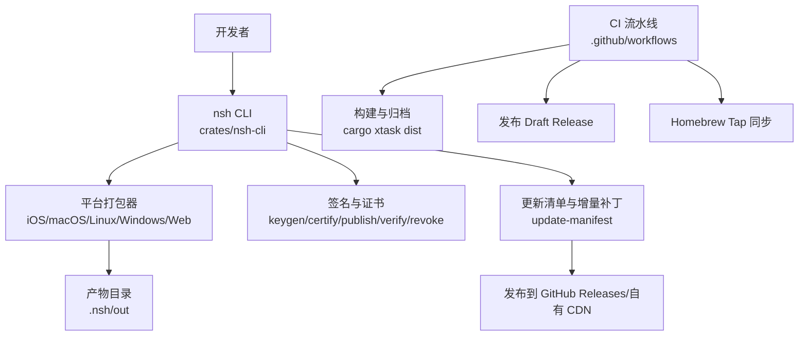
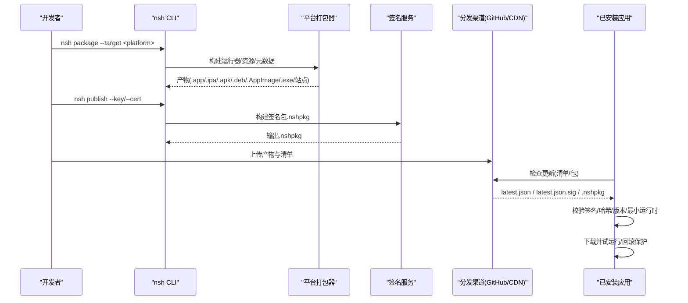
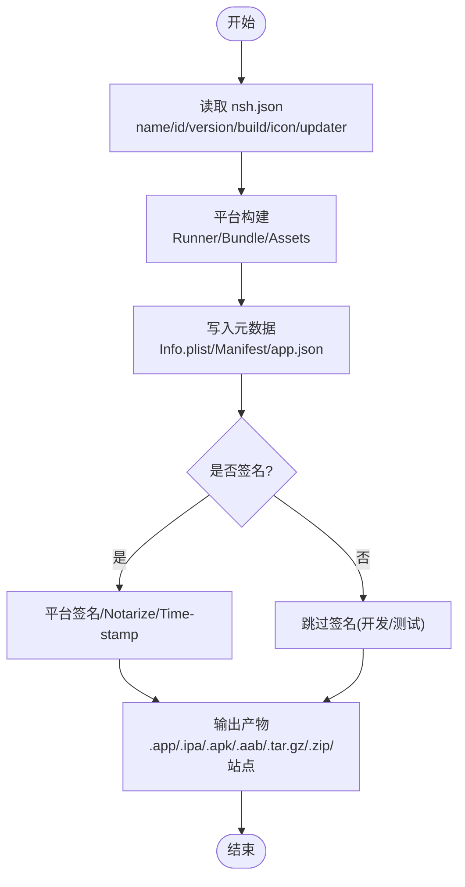
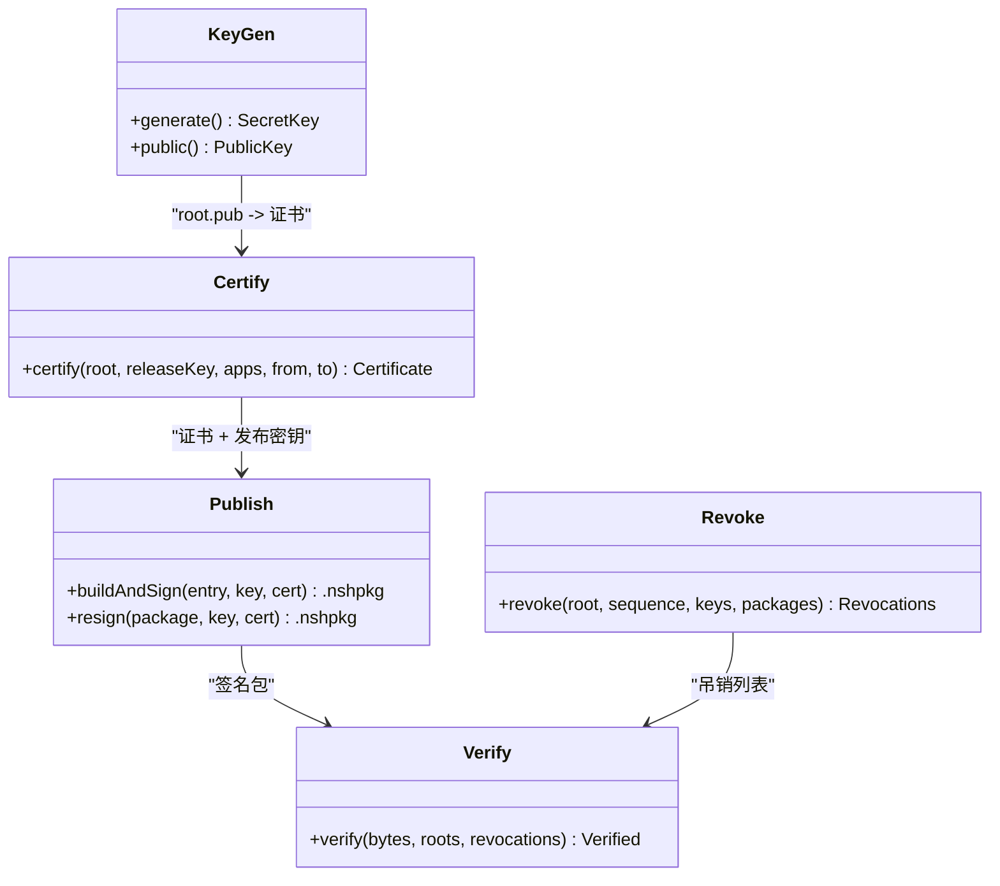
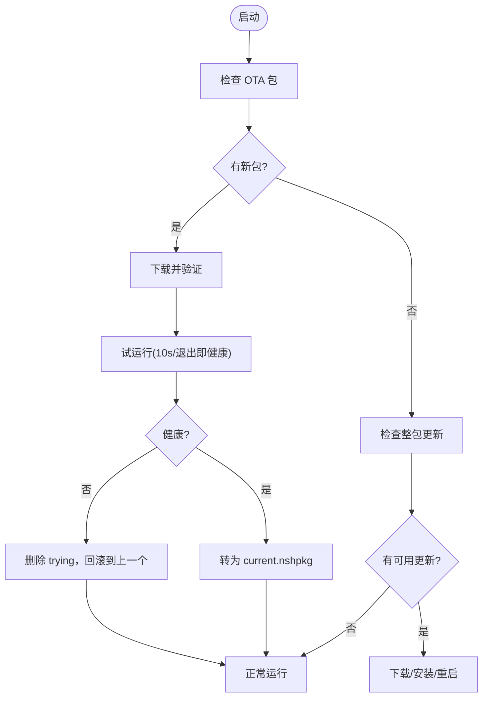
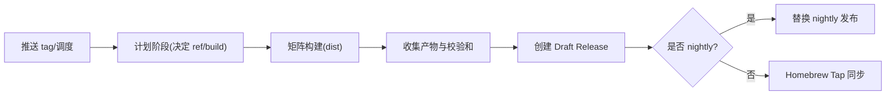
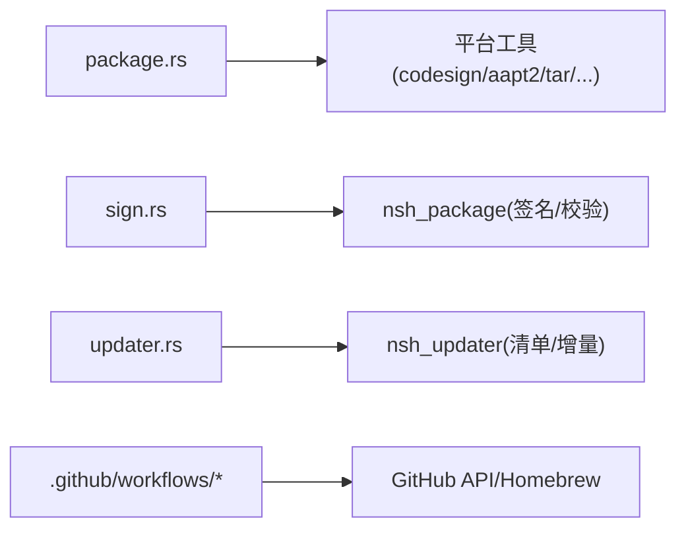

# 部署和打包

<cite>
**本文引用的文件**   
- [README.md](file://README.md)
- [packaging.md](file://website/docs/packaging.md)
- [ota-updates.md](file://website/docs/ota-updates.md)
- [signed-packages.md](file://website/docs/signed-packages.md)
- [app-updates.md](file://website/docs/app-updates.md)
- [packages.yml](file://.github/workflows/packages.yml)
- [release.yml](file://.github/workflows/release.yml)
- [package.rs](file://crates/nsh-cli/src/package.rs)
- [sign.rs](file://crates/nsh-cli/src/sign.rs)
- [updater.rs](file://crates/nsh-cli/src/updater.rs)
</cite>

## 目录
1. [简介](#简介)
2. [项目结构](#项目结构)
3. [核心组件](#核心组件)
4. [架构总览](#架构总览)
5. [详细组件分析](#详细组件分析)
6. [依赖关系分析](#依赖关系分析)
7. [性能与体积优化](#性能与体积优化)
8. [故障排查指南](#故障排查指南)
9. [结论](#结论)
10. [附录：平台打包命令速查](#附录平台打包命令速查)

## 简介
本指南面向 NSH 应用的工程化发布，覆盖多平台打包产物、签名与认证、应用商店提交、版本控制、OTA 更新机制（增量更新、回滚与兼容性）、生产环境部署最佳实践（CDN、缓存与安全加固），以及自动化流水线设计。NSH 提供统一的 CLI 工具链，支持 iOS、Android、macOS、Windows、Linux 与 Web 的构建与分发；同时内置“签名包 + OTA”能力，可在不重新编译原生壳的情况下安全下发 TSX 代码。

## 项目结构
围绕“打包—签名—分发—更新”的主线，仓库关键位置如下：
- 文档层：打包、OTA、签名包、应用更新的权威说明位于 website/docs。
- 工具层：nsh CLI 的实现集中在 crates/nsh-cli，负责解析配置、调用平台工具、生成产物、签名与清单。
- 工作流层：GitHub Actions 定义在 .github/workflows，负责跨平台构建、归档、发布与 Homebrew Tap 同步。

图示来源
- [package.rs:1-54](file://crates/nsh-cli/src/package.rs#L1-L54)
- [sign.rs:1-14](file://crates/nsh-cli/src/sign.rs#L1-L14)
- [updater.rs:1-16](file://crates/nsh-cli/src/updater.rs#L1-L16)
- [packages.yml:1-20](file://.github/workflows/packages.yml#L1-L20)
- [release.yml:1-43](file://.github/workflows/release.yml#L1-L43)

章节来源
- [README.md:1-57](file://README.md#L1-L57)
- [packaging.md:1-42](file://website/docs/packaging.md#L1-L42)

## 核心组件
- nsh package：统一入口，按目标平台产出安装包或静态站点，并写入 app.json、图标、权限等元数据。
- nsh publish / verify / revoke：签名包全生命周期管理（密钥、证书、签名、校验、吊销）。
- nsh update-manifest：为应用更新与 OTA 包生成受信任清单，支持增量补丁与多语言说明。
- CI 工作流：release.yml 负责跨平台构建与发布；packages.yml 负责 Homebrew Tap 公式验证与同步。

章节来源
- [package.rs:1-54](file://crates/nsh-cli/src/package.rs#L1-L54)
- [sign.rs:126-216](file://crates/nsh-cli/src/sign.rs#L126-L216)
- [updater.rs:374-484](file://crates/nsh-cli/src/updater.rs#L374-L484)
- [release.yml:123-396](file://.github/workflows/release.yml#L123-L396)
- [packages.yml:33-99](file://.github/workflows/packages.yml#L33-L99)

## 架构总览
下图展示从源码到可安装产物的端到端流程，以及 OTA 更新的安全链路。

图示来源
- [packaging.md:10-42](file://website/docs/packaging.md#L10-L42)
- [sign.rs:126-216](file://crates/nsh-cli/src/sign.rs#L126-L216)
- [ota-updates.md:1-21](file://website/docs/ota-updates.md#L1-L21)
- [app-updates.md:82-117](file://website/docs/app-updates.md#L82-L117)

## 详细组件分析

### 平台打包流程与产物
- iOS
  - 模拟器：生成 ad hoc 签名的 .app。
  - 真机：生成 .ipa，需签名身份与 Provisioning Profile；支持扩展、框架与隐私清单。
- Android
  - APK/AAB：通过 SDK 工具直接打包，无需 Gradle；支持 ABI 选择、Java 库合并、权限与 manifest 占位符。
- macOS
  - .app：支持 Hardened Runtime、时间戳、扩展与 entitlements；可构建 universal 二进制。
- Linux
  - 目录 + tar.gz；需要 GTK 4/Pango/WebKitGTK；桌面条目与图标由打包器生成。
- Windows
  - 目录 + zip；可选 Inno Setup 生成 per-user 安装器；图标嵌入 exe。
- Web
  - 静态站点，文件名基于内容哈希，便于长期缓存；可通过 --asset-url 指定 CDN。

图示来源
- [packaging.md:43-100](file://website/docs/packaging.md#L43-L100)
- [packaging.md:101-244](file://website/docs/packaging.md#L101-L244)
- [packaging.md:245-455](file://website/docs/packaging.md#L245-L455)
- [packaging.md:456-555](file://website/docs/packaging.md#L456-L555)

章节来源
- [packaging.md:101-244](file://website/docs/packaging.md#L101-L244)
- [packaging.md:245-455](file://website/docs/packaging.md#L245-L455)
- [packaging.md:456-555](file://website/docs/packaging.md#L456-L555)

### 签名与认证流程
- 密钥体系
  - 根密钥 root.secret 离线保管；发布密钥 release.key 用于签名包；更新密钥 update.key 用于签署更新清单。
  - 使用 nsh keygen 生成密钥对，nsh certify 将发布密钥授权给特定 app id 与有效期。
- 签名包
  - nsh publish 构建并发布 .nshpkg，包含源码、字节码、资源与签名；支持再次签名与源映射分离。
  - nsh verify 校验签名、证书链、吊销列表、最小运行时、哈希与构建号。
- 吊销与回滚保护
  - nsh revoke 生成吊销列表，按序列号递增；设备侧拒绝被吊销的密钥或包。
  - 接受过的构建号作为下界，拒绝旧版本回滚。

图示来源
- [sign.rs:39-100](file://crates/nsh-cli/src/sign.rs#L39-L100)
- [sign.rs:126-216](file://crates/nsh-cli/src/sign.rs#L126-L216)
- [sign.rs:228-257](file://crates/nsh-cli/src/sign.rs#L228-L257)
- [sign.rs:294-343](file://crates/nsh-cli/src/sign.rs#L294-L343)
- [sign.rs:345-387](file://crates/nsh-cli/src/sign.rs#L345-L387)

章节来源
- [signed-packages.md:37-85](file://website/docs/signed-packages.md#L37-L85)
- [signed-packages.md:87-138](file://website/docs/signed-packages.md#L87-L138)
- [signed-packages.md:196-257](file://website/docs/signed-packages.md#L196-L257)
- [sign.rs:126-216](file://crates/nsh-cli/src/sign.rs#L126-L216)
- [sign.rs:294-387](file://crates/nsh-cli/src/sign.rs#L294-L387)

### OTA 更新机制（含增量、回滚与兼容性）
- 基本流程
  - 客户端先检查 OTA 包，再检查整包更新；下载后进入“试用”，健康运行一段时间后转正。
  - 若试用失败或崩溃，自动回滚至上一稳定包或内置代码。
- 增量更新
  - 通过 nsh update-manifest 的 --previous 生成 zstd 增量补丁，客户端优先拉取补丁重建新版本。
- 版本与兼容性
  - 包声明 minRuntime；旧运行时拒绝新包。
  - 构建号单调递增，且存在“已接受构建号”的下界，防止回滚。
- 设备端状态
  - next.nshpkg（待运行）、trying.nshpkg（试用中）、current.nshpkg（已证明健康）。

图示来源
- [ota-updates.md:1-21](file://website/docs/ota-updates.md#L1-L21)
- [ota-updates.md:292-341](file://website/docs/ota-updates.md#L292-L341)
- [app-updates.md:106-121](file://website/docs/app-updates.md#L106-L121)

章节来源
- [ota-updates.md:1-21](file://website/docs/ota-updates.md#L1-L21)
- [ota-updates.md:292-341](file://website/docs/ota-updates.md#L292-L341)
- [app-updates.md:106-121](file://website/docs/app-updates.md#L106-L121)

### 应用商店提交与版本控制
- iOS
  - 使用 Distribution 证书与 App Store Provisioning Profile 生成 .ipa；支持扩展与隐私清单。
  - Info.plist 键值与 entitlements 由 nsh.json 注入；最低系统版本可配置。
- Android
  - 发布 AAB 至 Google Play；keystore 与 alias 通过环境变量传入，避免历史泄露。
  - targetSdkVersion 与权限由 nsh.json 控制。
- macOS/Windows/Linux
  - 桌面端通常通过自托管或 GitHub Releases 分发；macOS 建议 Developer ID + Notarization。
- 版本控制
  - nsh.json 的 version/build 驱动所有平台产物命名与比较逻辑；OTA 与整包更新均依赖其单调增长。

章节来源
- [packaging.md:110-244](file://website/docs/packaging.md#L110-L244)
- [packaging.md:456-555](file://website/docs/packaging.md#L456-L555)
- [app-updates.md:82-117](file://website/docs/app-updates.md#L82-L117)

### 生产环境部署最佳实践（CDN、缓存与安全）
- CDN 与缓存
  - Web 产物文件名基于内容哈希，适合设置长期缓存；通过 --asset-url 指向 CDN。
  - 清单与签名文件应最后上传，避免客户端读到未就绪的清单。
- 安全加固
  - 根密钥离线存储；发布密钥与更新密钥仅存在于 CI 或可信构建机。
  - 启用 Hardened Runtime（macOS）、严格签名与时间戳；必要时进行公证。
  - 使用 HTTPS 访问更新源；仅在本地调试允许明文 HTTP。
- 灰度与回滚
  - 利用 channels 区分 beta/stable；结合 OTA 快速修复，整包更新兜底。
  - 吊销列表与构建号下界共同构成回滚防护。

章节来源
- [packaging.md:97-100](file://website/docs/packaging.md#L97-L100)
- [signed-packages.md:63-65](file://website/docs/signed-packages.md#L63-L65)
- [app-updates.md:143-158](file://website/docs/app-updates.md#L143-L158)

### 自动化部署流水线设计与实现
- 构建与发布（release.yml）
  - 触发条件：tag v*、定时 nightly、手动 workflow_dispatch。
  - 矩阵构建：macOS-arm64/x86_64、Linux-x86_64/arm64、Windows-x86_64/arm64。
  - 产物：CLI、各平台运行时、嵌入 SDK、组件压缩包；附带 sha256。
  - 发布：创建 Draft Release；nightly 会替换同名资产。
- Homebrew Tap（packages.yml）
  - 校验生成的 formula，安装并测试；成功后推送至 longbridge/homebrew-tap。
- OTA 发布（示例）
  - 在 CI 中写入密钥，执行 nsh publish 与 nsh update-manifest，然后 gh release create 发布包与清单。

图示来源
- [release.yml:44-79](file://.github/workflows/release.yml#L44-L79)
- [release.yml:123-396](file://.github/workflows/release.yml#L123-L396)
- [release.yml:398-485](file://.github/workflows/release.yml#L398-L485)
- [packages.yml:33-99](file://.github/workflows/packages.yml#L33-L99)
- [packages.yml:101-156](file://.github/workflows/packages.yml#L101-L156)

章节来源
- [release.yml:44-79](file://.github/workflows/release.yml#L44-L79)
- [release.yml:123-396](file://.github/workflows/release.yml#L123-L396)
- [release.yml:398-485](file://.github/workflows/release.yml#L398-L485)
- [packages.yml:33-99](file://.github/workflows/packages.yml#L33-L99)
- [packages.yml:101-156](file://.github/workflows/packages.yml#L101-L156)

## 依赖关系分析
- CLI 内部模块耦合
  - package.rs 负责目标平台枚举、配置解析与产物组织。
  - sign.rs 封装密钥、证书、签名包与吊销操作。
  - updater.rs 负责更新清单生成、增量补丁与平台归档命名。
- 外部依赖
  - 平台工具：codesign、actool、aapt2/apksigner、tar、Inno Setup 等。
  - CI 工具：gh、brew、sdkmanager、javac/d8、clang/llvm。

图示来源
- [package.rs:1-54](file://crates/nsh-cli/src/package.rs#L1-L54)
- [sign.rs:1-14](file://crates/nsh-cli/src/sign.rs#L1-L14)
- [updater.rs:1-16](file://crates/nsh-cli/src/updater.rs#L1-L16)
- [packages.yml:1-20](file://.github/workflows/packages.yml#L1-L20)

章节来源
- [package.rs:1-54](file://crates/nsh-cli/src/package.rs#L1-L54)
- [sign.rs:1-14](file://crates/nsh-cli/src/sign.rs#L1-L14)
- [updater.rs:1-16](file://crates/nsh-cli/src/updater.rs#L1-L16)

## 性能与体积优化
- 字节码与源映射
  - 默认保留行表以便错误定位；可通过 --strip-debug 移除以减小体积。
  - 源映射可选择内嵌或外置（.map），平衡可诊断性与包大小。
- 增量更新
  - 使用 --previous 生成 zstd 补丁，显著降低下载量；客户端优先应用补丁重建。
- Web 缓存
  - 文件名基于内容哈希，配合 CDN 长缓存策略提升加载性能。

章节来源
- [sign.rs:102-124](file://crates/nsh-cli/src/sign.rs#L102-L124)
- [app-updates.md:106-121](file://website/docs/app-updates.md#L106-L121)
- [packaging.md:97-100](file://website/docs/packaging.md#L97-L100)

## 故障排查指南
- OTA 包无法下载或被拒绝
  - 常见原因：清单未签名、包哈希/大小不一致、证书过期或未覆盖 app id、包被吊销、构建号不满足下界、minRuntime 过高。
- 包在下次启动未运行
  - 检查设备日志（macOS/iOS Console、Android logcat），确认 trial 失败原因与回滚行为。
- 清单不可用
  - 确认 latest.json 与 latest.json.sig 已上传且顺序正确；GitHub 草稿/预发行不会被提供。
- 签名问题
  - 使用 nsh verify 校验包；确保根密钥、发布密钥与更新密钥对应且未过期。

章节来源
- [ota-updates.md:343-410](file://website/docs/ota-updates.md#L343-L410)
- [signed-packages.md:196-257](file://website/docs/signed-packages.md#L196-L257)
- [app-updates.md:143-158](file://website/docs/app-updates.md#L143-L158)

## 结论
NSH 提供了从多平台打包、签名认证到 OTA 更新与 CI 发布的完整工具链。通过严格的密钥体系、构建号下界与吊销机制，既保证了分发的安全性，又实现了快速迭代与回滚能力。在生产环境中，建议采用 CDN 长缓存、HTTPS 更新源、Hardened Runtime 与公证，并结合 channels 与增量补丁实现稳健的灰度与回滚策略。

## 附录：平台打包命令速查
- iOS 模拟器：nsh package --target ios-simulator --run
- iOS 真机：nsh package --target ios --sign "<identity>" --profile "<provisioning>"
- Android：nsh package --target android --run；AAB：--format aab
- macOS：nsh package --target macos --run；universal：--arch universal
- Linux：nsh package --target linux --run
- Windows：nsh package --target windows --run；Inno Setup 安装器自动生成
- Web：nsh package --target web --run；--asset-url 指定 CDN

章节来源
- [packaging.md:101-108](file://website/docs/packaging.md#L101-L108)
- [packaging.md:110-141](file://website/docs/packaging.md#L110-L141)
- [packaging.md:245-267](file://website/docs/packaging.md#L245-L267)
- [packaging.md:456-484](file://website/docs/packaging.md#L456-L484)
- [packaging.md:518-555](file://website/docs/packaging.md#L518-L555)