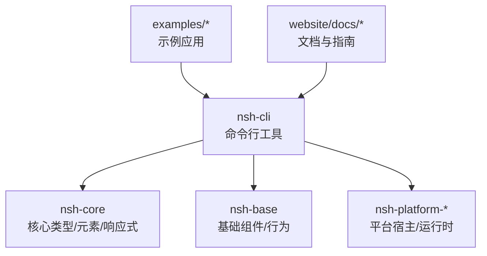
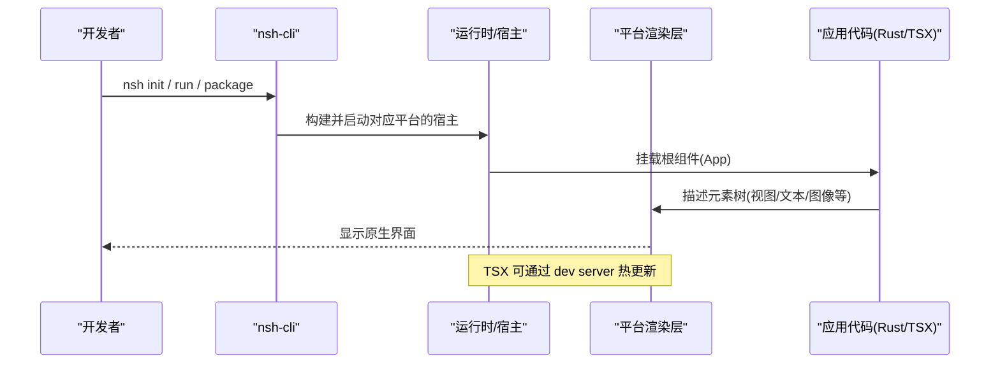
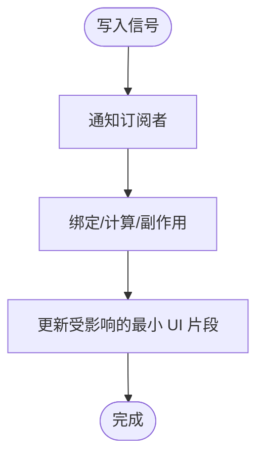
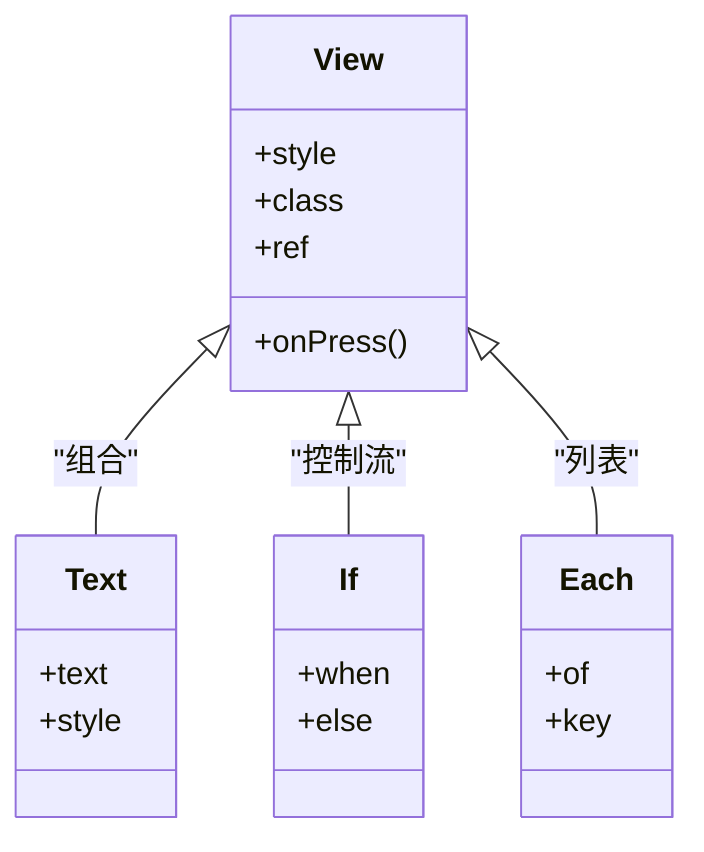
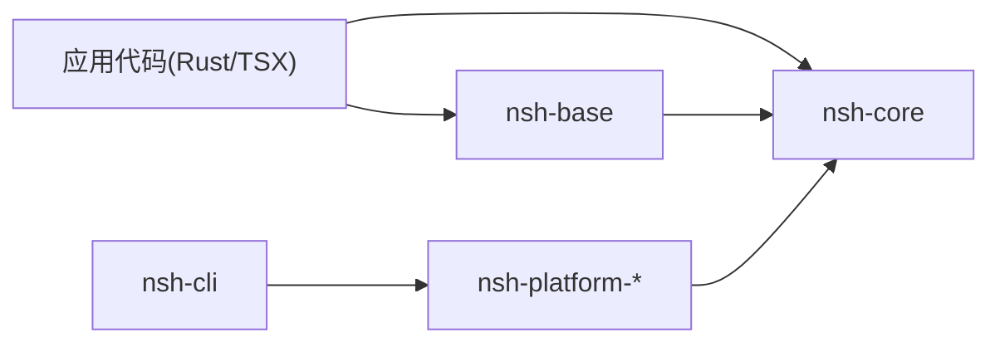

# 快速开始

<cite>
**本文引用的文件**   
- [README.md](file://README.md)
- [website/docs/getting-started.md](file://website/docs/getting-started.md)
- [website/docs/installation.md](file://website/docs/installation.md)
- [website/docs/reactivity.md](file://website/docs/reactivity.md)
- [website/docs/jsx-and-components.md](file://website/docs/jsx-and-components.md)
- [examples/counter/App.tsx](file://examples/counter/App.tsx)
- [examples/tasks/App.tsx](file://examples/tasks/App.tsx)
- [examples/tasks-rs/src/lib.rs](file://examples/tasks-rs/src/lib.rs)
</cite>

## 目录
1. [简介](#简介)
2. [项目结构](#项目结构)
3. [核心组件](#核心组件)
4. [架构总览](#架构总览)
5. [详细组件分析](#详细组件分析)
6. [依赖关系分析](#依赖关系分析)
7. [性能与开发体验](#性能与开发体验)
8. [常见问题与故障排除](#常见问题与故障排除)
9. [结论](#结论)
10. [附录：命令速查](#附录命令速查)

## 简介
NSH（Native Shell）是一个用 Rust 构建的跨平台 UI 框架，目标是“一次编写，原生运行”。它统一了组件、状态、逻辑与 API，支持 iOS、Android、macOS、Windows、Linux 与 Web。应用可以完全使用 Rust 编写，也可以只写 TSX 屏幕，或两者混合：TSX 屏幕导入 Rust 组件与模块。渲染层由平台原生视图承担，桌面端分别使用 AppKit、Win32、GTK 4；Web 端使用 HTML/CSS；GPUI 后端在三个桌面平台上以 GPUI 绘制；终端模式则在字符网格上绘制。

NSH 的核心特性包括：
- 跨平台原生渲染与一致的状态模型
- 响应式编程模型（信号、派生值、副作用、资源加载）
- 组件系统（Rust 与 TSX 两套语法，共享同一渲染引擎）
- Tailwind 风格样式与主题体系
- 热重载与无头测试
- 可嵌入现有原生应用，也可打包为独立应用或静态站点
- 运行时加载已签名 TSX 模块，沙箱化能力控制

支持的运行目标包括：
- iOS（UIKit/CoreText）、Android（Android View/StaticLayout）
- macOS（AppKit/Core Animation/CoreText）、Windows（Win32/Direct2D/DirectWrite）、Linux（GTK 4/Pango）
- GPUI（macOS/Windows/Linux）、Terminal（ratatui）、Web（HTML/CSS）

**章节来源**
- [README.md:1-60](file://README.md#L1-L60)

## 项目结构
仓库采用多 crate 组织，CLI、核心库、平台实现、示例与文档分离：
- `crates/nsh-cli`：命令行工具，负责初始化、构建、运行、打包、签名等
- `crates/nsh-core`：核心类型、元素、布局、样式、响应式、平台抽象等
- `crates/nsh-base`：未样式化的基础组件与行为（导航、对话框、键盘、安全区域等）
- `crates/nsh-platform-*`：各平台宿主与运行时（iOS、Android、macOS、Windows、Linux、Web、GPUI、TUI）
- `examples/*`：示例应用（计数器、任务管理、画廊、嵌入式示例等）
- `website/docs/*`：官方文档与指南

**图示来源**
- [README.md:1-60](file://README.md#L1-L60)
- [website/docs/getting-started.md:1-20](file://website/docs/getting-started.md#L1-L20)

**章节来源**
- [README.md:1-60](file://README.md#L1-L60)
- [website/docs/getting-started.md:1-20](file://website/docs/getting-started.md#L1-L20)

## 核心组件
本节聚焦 NSH 开发者最常接触的概念：响应式模型、组件系统与状态管理。

- 响应式编程模型
  - 信号（signal）：随时间变化的值，读操作订阅依赖，写操作通知订阅者
  - 派生值（computed）：基于信号的缓存计算结果
  - 副作用（effect）：在依赖变化时执行的副作用逻辑
  - 资源（resource）：异步数据加载的生命周期封装
  - 批处理（batch）与无跟踪（untracked）：控制更新粒度与依赖追踪范围
  - 上下文（context）：跨层级共享可变或不可变值
  - 错误边界（ErrorBoundary/catch_error）：隔离局部渲染失败

- 组件系统
  - Rust：`#[component]` 函数 + Props 结构体，返回元素树
  - TSX：函数组件 + JSX，编译器生成直接调用原生渲染器的代码
  - 控制流：`when`/`each`（Rust），`<If>`/`<Each>`（TSX）
  - 引用（ref）：对宿主元素的命令式访问（焦点、滚动、测量等）
  - 属性传播与拆分：Rust 通过 Prop 链式 setter，TSX 通过 spread 与 split

- 状态管理
  - 组件内状态：每个组件创建自己的信号
  - 列表项状态：通过 `<Each>` 的行级信号保持行稳定
  - 全局状态：通过 context 提供，或由 store 模块集中管理（示例中 tasks 使用 store.ts）

这些概念贯穿所有示例与应用。

**章节来源**
- [website/docs/reactivity.md:1-120](file://website/docs/reactivity.md#L1-L120)
- [website/docs/jsx-and-components.md:1-120](file://website/docs/jsx-and-components.md#L1-L120)

## 架构总览
下图展示从 CLI 到平台宿主的整体流程，以及 TSX/Rust 两种开发路径如何汇聚到同一渲染引擎。

**图示来源**
- [website/docs/getting-started.md:195-218](file://website/docs/getting-started.md#L195-L218)
- [website/docs/jsx-and-components.md:430-468](file://website/docs/jsx-and-components.md#L430-L468)

## 详细组件分析

### 安装与环境准备
NSH 的安装方式覆盖脚本、包管理器与源码构建，支持 macOS、Linux、Windows。

- 预发行版安装
  - macOS/Linux：curl 脚本安装，默认安装到 `~/.nsh`，链接到 `~/.local/bin/nsh`
  - Windows：PowerShell 脚本安装到 `%LOCALAPPDATA%\nsh`，并添加到用户 PATH
  - Homebrew：`brew install longbridge/tap/nsh`
  - MacPorts：`sudo port install native-shell`
  - Scoop：通过 JSON 清单安装
  - mise：全局版本管理

- 组件管理
  - 非本机平台的运行时作为“组件”按需下载，例如 android、web、gpui、tui
  - 使用 `nsh component list/add/remove` 管理

- Rust 工具链
  - 通过 rustup 安装 Rust
  - 添加目标三元组（iOS、Android、Web/WASM）
  - 推荐使用 huacnlee/cargo 优化构建产物磁盘占用

- 平台工具
  - iOS/Mac Catalyst：Xcode 与模拟器运行时
  - Android：SDK、JDK、模拟器或设备
  - macOS：Xcode 命令行工具
  - Linux：GTK 4.14+、WebKitGTK、GStreamer（可选）
  - Windows：WebView2 Runtime、VS Build Tools、LLVM

- 夜间构建与更新
  - 通过脚本参数 `--nightly` 安装 nightly
  - `nsh update` 更新当前通道（stable/nightly）

- 编辑器支持
  - Rust：rust-analyzer 自动补全与检查
  - TSX：无需 NPM，`nsh init` 生成 `.nsh/types` 声明，任何 TypeScript 语言服务器可用

**章节来源**
- [website/docs/installation.md:25-90](file://website/docs/installation.md#L25-L90)
- [website/docs/installation.md:91-126](file://website/docs/installation.md#L91-L126)
- [website/docs/installation.md:127-155](file://website/docs/installation.md#L127-L155)
- [website/docs/installation.md:156-185](file://website/docs/installation.md#L156-L185)
- [website/docs/installation.md:186-204](file://website/docs/installation.md#L186-L204)
- [website/docs/installation.md:205-246](file://website/docs/installation.md#L205-L246)
- [website/docs/installation.md:267-276](file://website/docs/installation.md#L267-L276)

### 项目初始化与基本结构
NSH 支持三种模板：Rust、TSX、Mixed（TSX 扩展 Rust）。

- Rust 模板
  - `src/lib.rs`：根组件、状态与处理器
  - `src/main.rs`：桌面端挂载入口
  - `Cargo.toml`：依赖 `nsh-core` 与 `nsh-base`
  - `nsh.json`：应用元信息、crate 与 root 组件名
  - `App.test.tsx`：无头测试入口

- TSX 模板
  - `App.tsx`：入口模块，调用 `mount`
  - `App.test.tsx`：测试入口
  - `nsh.json`：应用元信息
  - `tsconfig.json`：继承 `.nsh/tsconfig.json`，解析 `nsh` 到 `.nsh/types`
  - `.nsh/types/`：生成的 NSH 模块类型声明

- Mixed 模板
  - TSX 应用 + `ext/<name>-native/` 中的 Rust 模块，TSX 可导入 Rust 组件/模块/类

**章节来源**
- [website/docs/getting-started.md:22-73](file://website/docs/getting-started.md#L22-L73)

### 第一个应用：计数器（TSX）
计数器示例展示了最小可用的 NSH 应用：
- 使用 `signal` 维护计数与历史
- 使用 `View`/`Text` 构建界面
- 使用 `mount` 与 `<Window>` 在桌面端声明窗口
- 按钮点击更新状态，列表使用 `<Each>` 渲染历史记录

该示例体现了：
- 响应式状态驱动 UI
- 组件拆分（Button）
- 列表渲染与 key 策略
- 桌面端窗口声明

**章节来源**
- [examples/counter/App.tsx:1-63](file://examples/counter/App.tsx#L1-L63)
- [website/docs/getting-started.md:74-194](file://website/docs/getting-started.md#L74-L194)

### 更复杂的应用：任务管理（TSX 与 Rust）
任务管理示例包含导航栈、页面与存储：
- TSX 版本：`App.tsx` 定义应用壳与导航路由，页面组件位于 `pages/`
- Rust 版本：`lib.rs` 注册 native module，根组件使用 `app_window().id("main").content(...)`

该示例体现：
- 导航与路由（NavStack）
- 页面拆分与参数传递（TaskList/TaskDetail）
- 状态与业务逻辑的组织（store.ts 与 Rust store 模块）
- 桌面端窗口声明与背景色设置

**章节来源**
- [examples/tasks/App.tsx:1-27](file://examples/tasks/App.tsx#L1-L27)
- [examples/tasks-rs/src/lib.rs:1-33](file://examples/tasks-rs/src/lib.rs#L1-L33)
- [website/docs/getting-started.md:74-194](file://website/docs/getting-started.md#L74-L194)

### 开发服务器与热重载
- `nsh run` 会构建应用并启动宿主，编辑后自动重建或热更新
- Rust 应用：修改 Rust 代码会重新构建并重启
- TSX 应用：dev server 提供服务，保存后发送补丁，仅重渲染变更组件
- 错误提示：编译错误输出到终端；TSX 构建错误在设备上以红色覆盖层显示，保留上次成功构建

**章节来源**
- [website/docs/getting-started.md:195-218](file://website/docs/getting-started.md#L195-L218)
- [website/docs/getting-started.md:286-347](file://website/docs/getting-started.md#L286-L347)

### 响应式编程模型详解
- 信号读写：Rust 使用 `get()`/`set()`/`update()`，TSX 使用 `()`/`set()`/`update()`
- 对象与数组：Rust 的 `update` 原地修改并通知；TSX 需创建新对象/数组以避免无效更新
- computed：派生值缓存，避免重复计算
- effect：副作用执行，适合网络请求、定时器、DOM 操作
- resource：异步数据生命周期管理，支持 loading/error/state/refetch/mutate
- cleanup：清理定时器、订阅、任务等
- batch：批量更新，减少多次通知
- untracked：读取但不订阅
- context：跨层级共享值
- 错误边界：隔离渲染失败并提供恢复

**图示来源**
- [website/docs/reactivity.md:23-107](file://website/docs/reactivity.md#L23-L107)
- [website/docs/reactivity.md:496-507](file://website/docs/reactivity.md#L496-L507)

**章节来源**
- [website/docs/reactivity.md:23-107](file://website/docs/reactivity.md#L23-L107)
- [website/docs/reactivity.md:108-187](file://website/docs/reactivity.md#L108-L187)
- [website/docs/reactivity.md:212-273](file://website/docs/reactivity.md#L212-L273)
- [website/docs/reactivity.md:274-331](file://website/docs/reactivity.md#L274-L331)
- [website/docs/reactivity.md:332-378](file://website/docs/reactivity.md#L332-L378)
- [website/docs/reactivity.md:380-456](file://website/docs/reactivity.md#L380-L456)
- [website/docs/reactivity.md:458-507](file://website/docs/reactivity.md#L458-L507)

### 组件系统与 JSX
- 宿主元素：`View`、`Text`、`Image`、`Scroll`、`Input`、`List`、`Canvas`、`WebView`、`Video` 等
- 控制流：`when`/`each`（Rust），`<If>`/`<Each>`（TSX）
- 属性与样式：Rust 使用链式方法，TSX 使用 camelCase props 与 Tailwind class
- 组件定义：Rust 使用 `#[component]`，TSX 使用函数组件
- 子节点与渲染回调：Rust 使用 `.child()`，TSX 使用 `props.children` 或回调
- ref：命令式访问宿主元素（焦点、滚动、测量）
- 属性展开与拆分：TSX 使用 `{...props}` 与 `split`

**图示来源**
- [website/docs/jsx-and-components.md:13-28](file://website/docs/jsx-and-components.md#L13-L28)
- [website/docs/jsx-and-components.md:284-318](file://website/docs/jsx-and-components.md#L284-L318)

**章节来源**
- [website/docs/jsx-and-components.md:13-66](file://website/docs/jsx-and-components.md#L13-L66)
- [website/docs/jsx-and-components.md:67-158](file://website/docs/jsx-and-components.md#L67-L158)
- [website/docs/jsx-and-components.md:159-218](file://website/docs/jsx-and-components.md#L159-L218)
- [website/docs/jsx-and-components.md:219-283](file://website/docs/jsx-and-components.md#L219-L283)
- [website/docs/jsx-and-components.md:284-318](file://website/docs/jsx-and-components.md#L284-L318)
- [website/docs/jsx-and-components.md:319-387](file://website/docs/jsx-and-components.md#L319-L387)
- [website/docs/jsx-and-components.md:388-468](file://website/docs/jsx-and-components.md#L388-L468)

## 依赖关系分析
NSH 的依赖关系遵循分层设计：
- CLI 层：`nsh-cli` 协调构建、运行、打包、签名
- 核心层：`nsh-core` 提供元素、布局、样式、响应式、平台抽象
- 基础层：`nsh-base` 提供未样式化的基础组件与行为
- 平台层：`nsh-platform-*` 实现具体平台宿主与运行时
- 应用层：示例与应用代码（Rust/TSX）

**图示来源**
- [README.md:1-60](file://README.md#L1-L60)
- [website/docs/getting-started.md:1-20](file://website/docs/getting-started.md#L1-L20)

**章节来源**
- [README.md:1-60](file://README.md#L1-L60)
- [website/docs/getting-started.md:1-20](file://website/docs/getting-started.md#L1-L20)

## 性能与开发体验
- 热重载：TSX 应用通过 dev server 进行增量更新，仅重渲染变更组件
- 无头测试：`nsh test` 在无窗口环境下运行应用，打印挂载内容或执行断言
- 构建优化：推荐 huacnlee/cargo 减少构建产物磁盘占用
- 渲染效率：NSH 的响应式图是原生的，Rust 与 TSX 共享同一调度机制，避免虚拟 DOM 开销
- 列表优化：使用 `List`/`virtual_list` 虚拟化长列表，回收行视图

**章节来源**
- [website/docs/getting-started.md:286-347](file://website/docs/getting-started.md#L286-L347)
- [website/docs/getting-started.md:454-468](file://website/docs/getting-started.md#L454-L468)
- [website/docs/installation.md:111-126](file://website/docs/installation.md#L111-L126)
- [website/docs/reactivity.md:496-507](file://website/docs/reactivity.md#L496-L507)
- [website/docs/jsx-and-components.md:314-318](file://website/docs/jsx-and-components.md#L314-L318)

## 常见问题与故障排除
- 文本未显示
  - 在 TSX 中，文本必须放在 `<Text>` 内；直接在 `<View>` 中写字符串不会显示
  - 参考：[website/docs/jsx-and-components.md:64-66](file://website/docs/jsx-and-components.md#L64-L66)

- 属性一次性读取导致不更新
  - 在 TSX 中解构 props 会一次性读取；应直接访问 `props.xxx` 或在 JSX 中使用
  - 参考：[website/docs/jsx-and-components.md:161-218](file://website/docs/jsx-and-components.md#L161-L218)

- 数组/对象原地修改不触发更新（TSX）
  - 应创建新对象/数组或使用 `update`（Rust）
  - 参考：[website/docs/reactivity.md:81-107](file://website/docs/reactivity.md#L81-L107)

- 副作用循环或重复执行
  - 避免在 effect 中同步读写同一信号；使用 computed 派生值
  - 参考：[website/docs/reactivity.md:209-211](file://website/docs/reactivity.md#L209-L211)

- 异步代码未被追踪
  - 仅在 effect/computed 同步执行期间读取的信号会被追踪；先读取信号再发起异步任务
  - 参考：[website/docs/reactivity.md:189-190](file://website/docs/reactivity.md#L189-L190)

- 构建/运行问题
  - 确认平台工具已安装（Xcode、Android SDK、GTK 4.14+、WebView2）
  - 使用 `nsh component list` 检查所需组件是否安装
  - 参考：[website/docs/installation.md:205-246](file://website/docs/installation.md#L205-L246)

**章节来源**
- [website/docs/jsx-and-components.md:64-66](file://website/docs/jsx-and-components.md#L64-L66)
- [website/docs/jsx-and-components.md:161-218](file://website/docs/jsx-and-components.md#L161-L218)
- [website/docs/reactivity.md:81-107](file://website/docs/reactivity.md#L81-L107)
- [website/docs/reactivity.md:189-211](file://website/docs/reactivity.md#L189-L211)
- [website/docs/installation.md:205-246](file://website/docs/installation.md#L205-L246)

## 结论
NSH 提供了统一的跨平台 UI 框架，支持 Rust 与 TSX 两种开发模式，并通过原生渲染与响应式模型保证性能与一致性。通过 CLI 工具链，开发者可以快速初始化项目、运行应用、进行热重载与打包分发。示例应用从简单的计数器到复杂的任务管理，覆盖了常用 UI 模式与状态管理实践。结合文档与社区资源，开发者可以在多个平台上高效构建高质量的原生应用。

## 附录：命令速查
- 安装与更新
  - `curl -fsSL https://nsh.dev/install.sh | sh`（macOS/Linux）
  - `irm https://nsh.dev/install.ps1 | iex`（Windows PowerShell）
  - `brew install longbridge/tap/nsh`（Homebrew）
  - `sudo port install native-shell`（MacPorts）
  - `nsh update`（更新到最新稳定或夜间构建）

- 项目初始化
  - `nsh init my-app --template rust`
  - `nsh init my-app --template ts`
  - `nsh init my-app --template mixed`

- 开发与运行
  - `nsh run my-app`（默认平台）
  - `nsh run my-app --target ios/android/macos/windows/linux/web/gpui/tui`

- 打包与发布
  - `nsh package my-app --target ios/android/macos/windows/linux/web`
  - `nsh keygen keys/root && nsh keygen keys/release`
  - `nsh certify --root keys/root.secret --key keys/release.pub --apps 'com.example.*' -o keys/release.cert`
  - `nsh publish my-app --key keys/release.secret --cert keys/release.cert --build 2`

- 测试
  - `nsh test my-app`（运行测试）
  - `nsh test my-app/nsh.json --trace`（Rust 应用无头测试）
  - `nsh test my-app/App.tsx --trace`（TSX 应用无头测试）

**章节来源**
- [website/docs/installation.md:25-90](file://website/docs/installation.md#L25-L90)
- [website/docs/getting-started.md:22-73](file://website/docs/getting-started.md#L22-L73)
- [website/docs/getting-started.md:195-218](file://website/docs/getting-started.md#L195-L218)
- [website/docs/getting-started.md:414-452](file://website/docs/getting-started.md#L414-L452)
- [website/docs/getting-started.md:454-468](file://website/docs/getting-started.md#L454-L468)