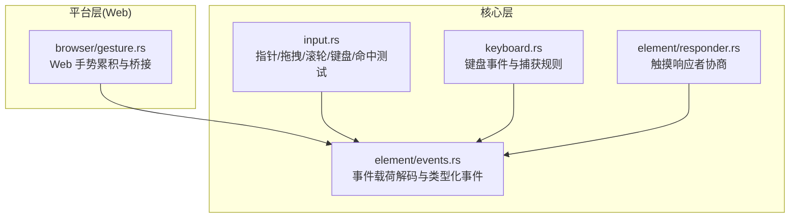
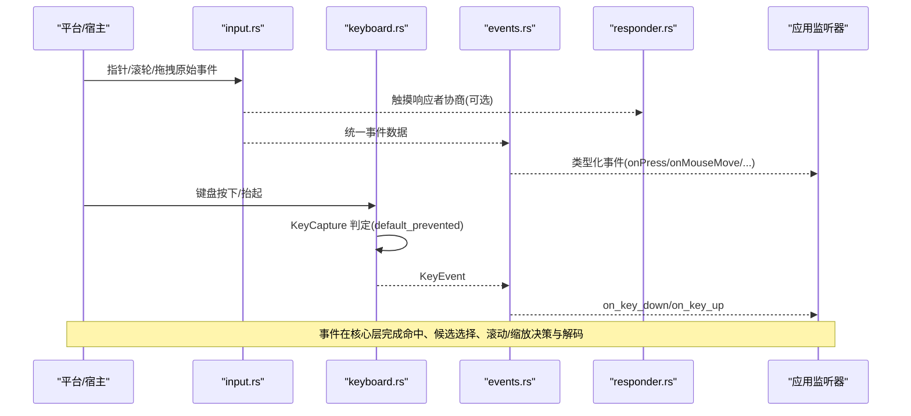
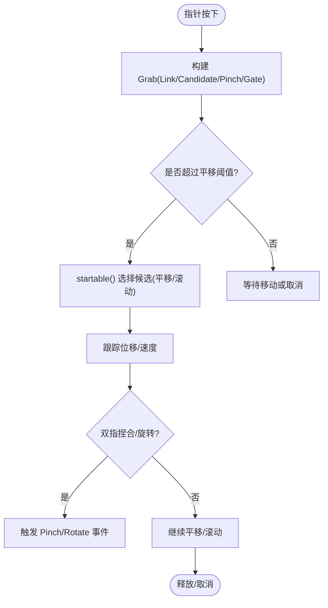
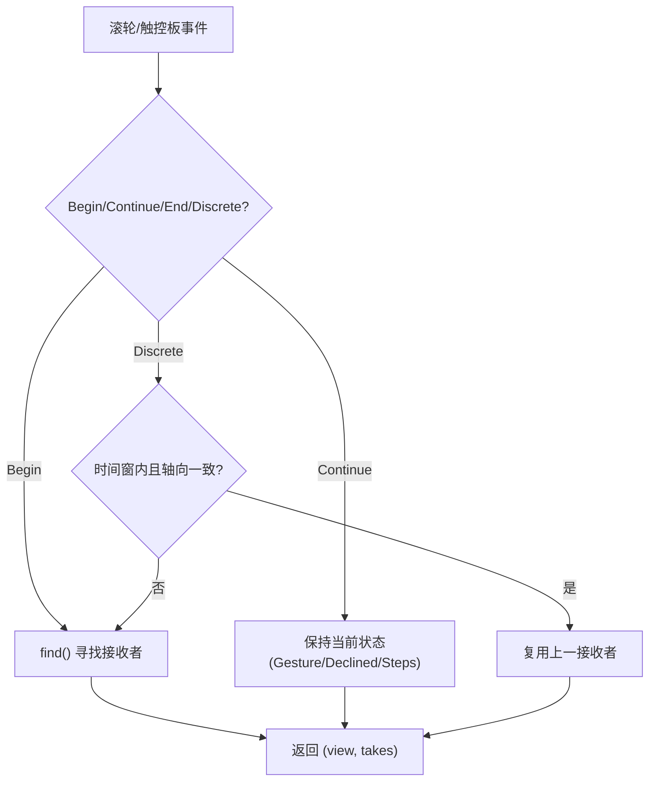
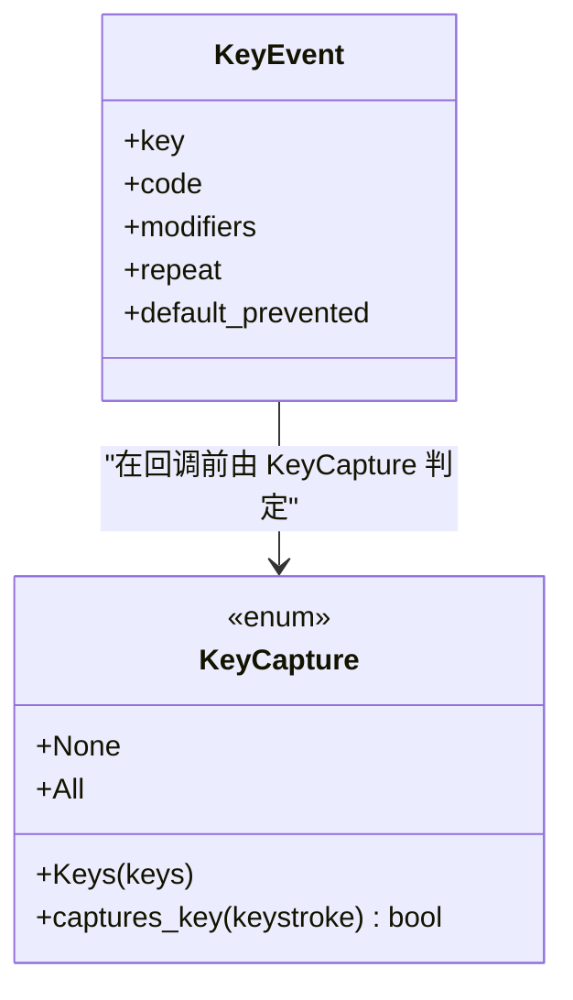
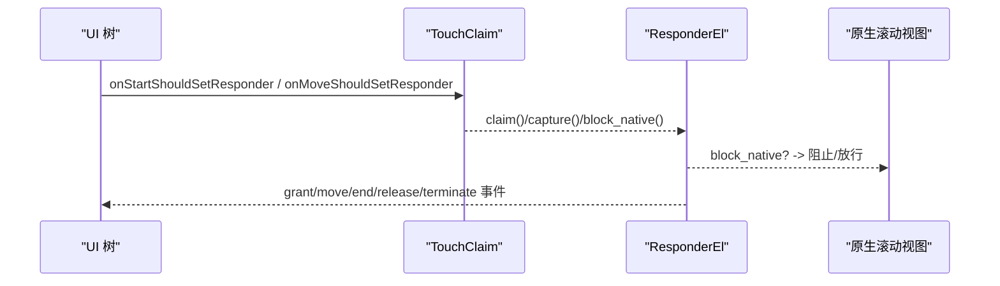
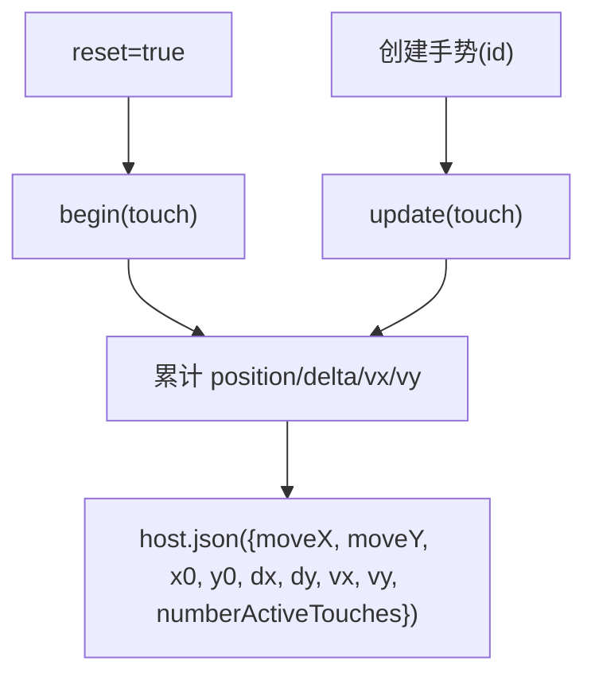
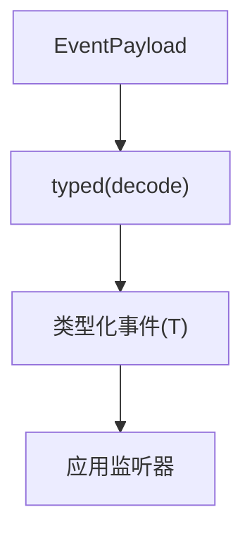
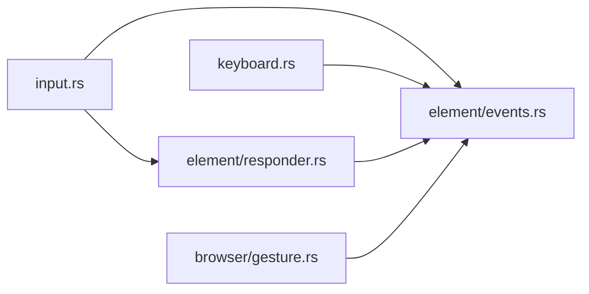

# 事件处理系统

<cite>
**本文引用的文件**   
- [input.rs](file://crates/nsh-core/src/input.rs)
- [keyboard.rs](file://crates/nsh-core/src/keyboard.rs)
- [events.rs](file://crates/nsh-core/src/element/events.rs)
- [responder.rs](file://crates/nsh-core/src/element/responder.rs)
- [gesture.rs](file://crates/nsh-platform-web/src/browser/gesture.rs)
</cite>

## 目录
1. [简介](#简介)
2. [项目结构](#项目结构)
3. [核心组件](#核心组件)
4. [架构总览](#架构总览)
5. [详细组件分析](#详细组件分析)
6. [依赖关系分析](#依赖关系分析)
7. [性能考量](#性能考量)
8. [故障排查指南](#故障排查指南)
9. [结论](#结论)
10. [附录：常见场景与示例路径](#附录常见场景与示例路径)

## 简介
本文件为 NSH 的事件处理系统提供系统化技术文档，聚焦跨平台事件的统一抽象、转换机制与分发流程。内容覆盖触摸、键盘、鼠标、滚轮、拖放等输入类型，解释事件冒泡、捕获、默认行为阻止、手势识别（平移、捏合、旋转）、自定义事件与异步事件处理策略，并给出性能优化与调试建议及常见场景的实现参考路径。

## 项目结构
NSH 的事件体系由核心层与平台层共同构成：
- 核心层负责统一的抽象、状态机、命中测试、手势候选选择、滚动/缩放决策、键盘捕获与 Tab 顺序等。
- 平台层负责将原生事件转换为统一模型，并在 Web 等平台实现手势累积器与桥接逻辑。

图表来源
- [input.rs:1-120](file://crates/nsh-core/src/input.rs#L1-L120)
- [keyboard.rs:1-125](file://crates/nsh-core/src/keyboard.rs#L1-L125)
- [events.rs:1-120](file://crates/nsh-core/src/element/events.rs#L1-L120)
- [responder.rs:1-120](file://crates/nsh-core/src/element/responder.rs#L1-L120)
- [gesture.rs:1-88](file://crates/nsh-platform-web/src/browser/gesture.rs#L1-L88)

章节来源
- [input.rs:1-120](file://crates/nsh-core/src/input.rs#L1-L120)
- [keyboard.rs:1-125](file://crates/nsh-core/src/keyboard.rs#L1-L125)
- [events.rs:1-120](file://crates/nsh-core/src/element/events.rs#L1-L120)
- [responder.rs:1-120](file://crates/nsh-core/src/element/responder.rs#L1-L120)
- [gesture.rs:1-88](file://crates/nsh-platform-web/src/browser/gesture.rs#L1-L88)

## 核心组件
- 指针与拖拽子系统：负责点击、长按、平移、捏合、旋转、滚轮、命中区域、滚动目标选择、速度估算等。
- 键盘子系统：定义 KeyEvent、KeyCapture 规则，决定在回调前是否阻止平台默认行为。
- 事件解码与类型化：将平台 EventPayload 解码为具体事件类型（PressEvent、MouseEvent、PanEvent、GestureEvent 等）。
- 触摸响应者协商：元素可声明对触摸的抢占与保留，控制原生滚动视图是否接管触摸。
- Web 手势累积器：将浏览器触摸事件聚合为 PanGesture，供上层使用。

章节来源
- [input.rs:1-120](file://crates/nsh-core/src/input.rs#L1-L120)
- [keyboard.rs:1-125](file://crates/nsh-core/src/keyboard.rs#L1-L125)
- [events.rs:1-120](file://crates/nsh-core/src/element/events.rs#L1-L120)
- [responder.rs:1-120](file://crates/nsh-core/src/element/responder.rs#L1-L120)
- [gesture.rs:1-88](file://crates/nsh-platform-web/src/browser/gesture.rs#L1-L88)

## 架构总览
下图展示从平台到应用层的典型事件流：平台事件进入后，经核心层统一建模、命中测试、手势候选选择与滚动/缩放决策，再解码为类型化事件派发至监听器；键盘事件在回调前通过 KeyCapture 决定是否阻止平台默认行为；触摸可通过响应者协商让特定元素独占触摸。

图表来源
- [input.rs:250-320](file://crates/nsh-core/src/input.rs#L250-L320)
- [input.rs:819-892](file://crates/nsh-core/src/input.rs#L819-L892)
- [keyboard.rs:28-125](file://crates/nsh-core/src/keyboard.rs#L28-L125)
- [events.rs:442-456](file://crates/nsh-core/src/element/events.rs#L442-L456)
- [responder.rs:154-246](file://crates/nsh-core/src/element/responder.rs#L154-L246)

## 详细组件分析

### 指针、拖拽与手势
- 候选选择与门控：通过 Candidate/Gate 决定平移/滚动何时启动，支持 panActivation 方向性激活与边缘平移。
- 按压与长按：Pick Press 逻辑区分仅长压与短按，维护 pressed/long 状态与生成代际。
- 命中区域：HitArea 考虑 slop、overflow、clipPath 与布局边界。
- 滚轮与触控板：WheelLatch/WheelStep 管理离散滚轮与精确滚动的“粘滞”目标，避免被嵌套滚动劫持。
- 速度与捏合：VelocityTracker 计算最近窗口内速度；Pinch 计算缩放与旋转。

图表来源
- [input.rs:111-170](file://crates/nsh-core/src/input.rs#L111-L170)
- [input.rs:172-248](file://crates/nsh-core/src/input.rs#L172-L248)
- [input.rs:250-320](file://crates/nsh-core/src/input.rs#L250-L320)
- [input.rs:411-482](file://crates/nsh-core/src/input.rs#L411-L482)
- [input.rs:696-769](file://crates/nsh-core/src/input.rs#L696-L769)
- [input.rs:771-817](file://crates/nsh-core/src/input.rs#L771-L817)

章节来源
- [input.rs:111-170](file://crates/nsh-core/src/input.rs#L111-L170)
- [input.rs:172-248](file://crates/nsh-core/src/input.rs#L172-L248)
- [input.rs:250-320](file://crates/nsh-core/src/input.rs#L250-L320)
- [input.rs:411-482](file://crates/nsh-core/src/input.rs#L411-L482)
- [input.rs:696-769](file://crates/nsh-core/src/input.rs#L696-L769)
- [input.rs:771-817](file://crates/nsh-core/src/input.rs#L771-L817)

### 滚轮与触控板
- 目标选择：wheel_listener 根据监听与滚动能力选择接收者，避免被外层滚动劫持。
- 轴向与 Ctrl+滚轮缩放：wheel_along 支持基于 PanActivation 的轴向过滤与缩放。
- 粘滞策略：WheelLatch 保证一次滚动手势期间稳定地交给同一视图，区分 Begin/Continue/End 与 Discrete 步进。

图表来源
- [input.rs:819-892](file://crates/nsh-core/src/input.rs#L819-L892)
- [input.rs:894-1075](file://crates/nsh-core/src/input.rs#L894-L1075)

章节来源
- [input.rs:819-892](file://crates/nsh-core/src/input.rs#L819-L892)
- [input.rs:894-1075](file://crates/nsh-core/src/input.rs#L894-L1075)

### 键盘事件与捕获
- KeyEvent：包含 key/code/modifiers/repeat/default_prevented，其中 default_prevented 表示在回调前已阻止平台默认行为。
- KeyCapture：支持 None/All/Keys 三种捕获模式，Keys 匹配规范化 Keystroke（含修饰键），用于在回调前拦截。
- 焦点与上下文菜单：opens_context_menu、presses_focused_control 等工具函数统一键盘交互语义。

图表来源
- [keyboard.rs:28-125](file://crates/nsh-core/src/keyboard.rs#L28-L125)

章节来源
- [keyboard.rs:28-125](file://crates/nsh-core/src/keyboard.rs#L28-L125)

### 触摸响应者与手势协商
- ResponderEvent/PanGesture：封装触摸位置、页面坐标、时间戳、手势增量与速度。
- TouchClaim：支持 onStartShouldSetResponder/onMoveShouldSetResponder/panActivation/capture/block_native 等语义，允许元素抢占触摸并阻止原生滚动接管。
- 协商流程：从外到内捕获，再从手指所在元素向外询问，首个 claim 成为响应者并可 keep_touches。

图表来源
- [responder.rs:19-124](file://crates/nsh-core/src/element/responder.rs#L19-L124)
- [responder.rs:154-246](file://crates/nsh-core/src/element/responder.rs#L154-L246)

章节来源
- [responder.rs:19-124](file://crates/nsh-core/src/element/responder.rs#L19-L124)
- [responder.rs:154-246](file://crates/nsh-core/src/element/responder.rs#L154-L246)

### Web 手势累积器
- Gestures：维护手势 ID 与 PanGesture 状态，将浏览器 touches 转换为 TouchEvent，调用 begin/update 累计位移与速度，并通过 host.json 回传结果。

图表来源
- [gesture.rs:14-88](file://crates/nsh-platform-web/src/browser/gesture.rs#L14-L88)

章节来源
- [gesture.rs:14-88](file://crates/nsh-platform-web/src/browser/gesture.rs#L14-L88)

### 事件解码与类型化
- typed 包装器：将原始 EventPayload 解码为具体类型（如 PanEvent、GestureEvent、TouchEvent、MouseEvent、PressEvent 等），供监听器消费。
- 各类解码器：pan/pinch/rotation/touch/mouse/wheel/file_drop 等，统一字段映射与默认值处理。

图表来源
- [events.rs:442-456](file://crates/nsh-core/src/element/events.rs#L442-L456)
- [events.rs:629-776](file://crates/nsh-core/src/element/events.rs#L629-L776)

章节来源
- [events.rs:442-456](file://crates/nsh-core/src/element/events.rs#L442-L456)
- [events.rs:629-776](file://crates/nsh-core/src/element/events.rs#L629-L776)

## 依赖关系分析
- input.rs 提供底层指针/拖拽/滚轮/命中测试/Tab 顺序等通用能力，被 platform 后端与上层组件复用。
- keyboard.rs 独立于指针子系统，专注键盘捕获与默认行为控制。
- element/events.rs 作为解码层，解耦平台 EventPayload 与上层类型化事件。
- element/responder.rs 与 input.rs 协作，前者负责元素级触摸抢占，后者负责手势候选与滚动/缩放决策。
- browser/gesture.rs 依赖 core 的 PanGesture/Touchevent 模型，向上层暴露手势累积 API。

图表来源
- [input.rs:1-120](file://crates/nsh-core/src/input.rs#L1-L120)
- [keyboard.rs:1-125](file://crates/nsh-core/src/keyboard.rs#L1-L125)
- [events.rs:1-120](file://crates/nsh-core/src/element/events.rs#L1-L120)
- [responder.rs:1-120](file://crates/nsh-core/src/element/responder.rs#L1-L120)
- [gesture.rs:1-88](file://crates/nsh-platform-web/src/browser/gesture.rs#L1-L88)

章节来源
- [input.rs:1-120](file://crates/nsh-core/src/input.rs#L1-L120)
- [keyboard.rs:1-125](file://crates/nsh-core/src/keyboard.rs#L1-L125)
- [events.rs:1-120](file://crates/nsh-core/src/element/events.rs#L1-L120)
- [responder.rs:1-120](file://crates/nsh-core/src/element/responder.rs#L1-L120)
- [gesture.rs:1-88](file://crates/nsh-platform-web/src/browser/gesture.rs#L1-L88)

## 性能考量
- 命中与候选选择：HitArea 与 startable 采用 O(n) 遍历，但通常节点数有限；避免在高频回调中进行复杂计算。
- 速度估算：VelocityTracker 使用固定长度环形缓冲，O(1) 更新与查询。
- 滚轮粘滞：WheelLatch 减少频繁的目标切换，提升滚动流畅度。
- 手势累积：PanGesture 使用指数平滑速度，降低抖动。
- 事件解码：typed 包装仅在解码失败时跳过，开销极低。

[本节为通用指导，不直接分析具体文件]

## 故障排查指南
- 键盘未触发默认行为：检查 KeyCapture 是否设置为 All 或 Keys 中包含该组合键；确认 default_prevented 是否为真。
- 触摸被原生滚动劫持：确认 TouchClaim.block_native 设置与 panActivation 配置；必要时使用 capture 抢占。
- 滚轮无效或被外层滚动吞掉：检查 wheel_listener 的 listens/scrolls 条件与 WheelLatch 状态；确保控件未处于 scrolling 观察模式。
- 捏合/旋转无响应：确认元素启用了 transforms 或相关事件监听；检查双指点位与角度变化是否有效。

章节来源
- [keyboard.rs:28-125](file://crates/nsh-core/src/keyboard.rs#L28-L125)
- [responder.rs:154-246](file://crates/nsh-core/src/element/responder.rs#L154-L246)
- [input.rs:819-892](file://crates/nsh-core/src/input.rs#L819-L892)
- [input.rs:771-817](file://crates/nsh-core/src/input.rs#L771-L817)

## 结论
NSH 的事件系统通过核心层统一抽象与平台层桥接，实现了跨平台的触摸、键盘、鼠标与滚轮事件的一致体验。其关键设计包括：
- 以 Candidate/Gate 为核心的手势候选与门控机制，精准控制平移/滚动/缩放的启动时机。
- 以 WheelLatch 为核心的滚轮粘滞策略，保障滚动体验一致性。
- 以 KeyCapture 为核心的键盘捕获，支持在回调前阻止平台默认行为。
- 以 TouchClaim 为核心的触摸响应者协商，允许元素独占触摸并抑制原生滚动。
- 以 typed 解码器为核心的事件类型化，屏蔽平台差异，简化上层开发。

[本节为总结，不直接分析具体文件]

## 附录：常见场景与示例路径
- 点击与长按：参考 Press 生命周期与 pick_press 选择逻辑。
  - 参考路径：[input.rs:484-634](file://crates/nsh-core/src/input.rs#L484-L634)
- 平移与捏合/旋转：参考 Candidate/Gate/Pinch 与 events 中的 PanEvent/GestureEvent 解码。
  - 参考路径：[input.rs:111-170](file://crates/nsh-core/src/input.rs#L111-L170), [input.rs:771-817](file://crates/nsh-core/src/input.rs#L771-L817), [events.rs:629-671](file://crates/nsh-core/src/element/events.rs#L629-L671)
- 滚轮与触控板：参考 wheel_listener/WheelLatch/WheelStep。
  - 参考路径：[input.rs:819-892](file://crates/nsh-core/src/input.rs#L819-L892), [input.rs:894-1075](file://crates/nsh-core/src/input.rs#L894-L1075)
- 键盘捕获与默认行为阻止：参考 KeyEvent/KeyCapture。
  - 参考路径：[keyboard.rs:28-125](file://crates/nsh-core/src/keyboard.rs#L28-L125)
- 触摸抢占与原生滚动阻断：参考 TouchClaim/ResponderEl。
  - 参考路径：[responder.rs:154-246](file://crates/nsh-core/src/element/responder.rs#L154-L246)
- Web 手势累积：参考 Gestures 与 PanGesture。
  - 参考路径：[gesture.rs:14-88](file://crates/nsh-platform-web/src/browser/gesture.rs#L14-L88)