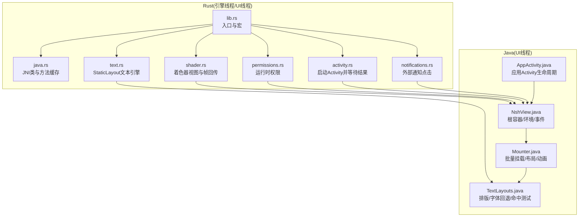
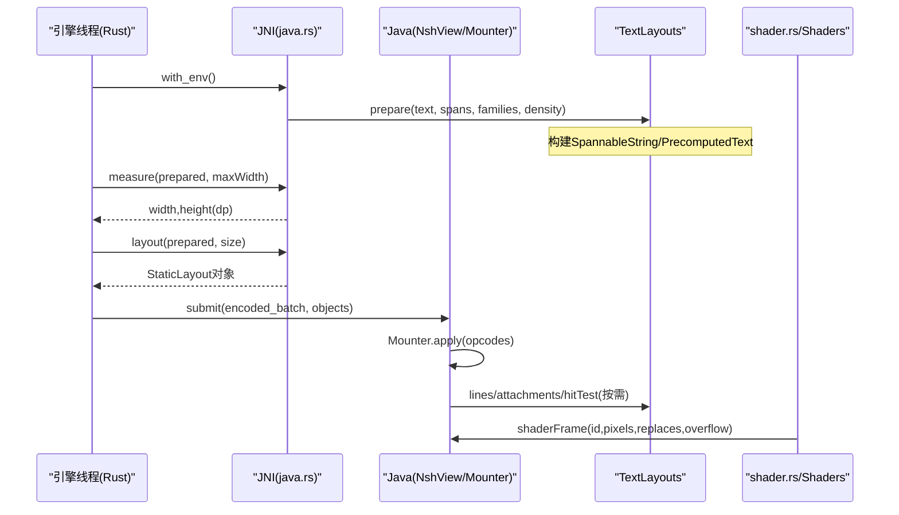
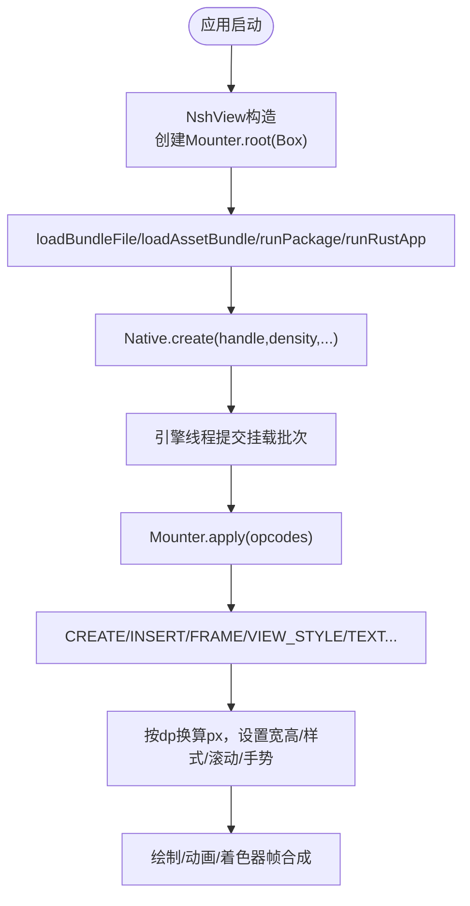
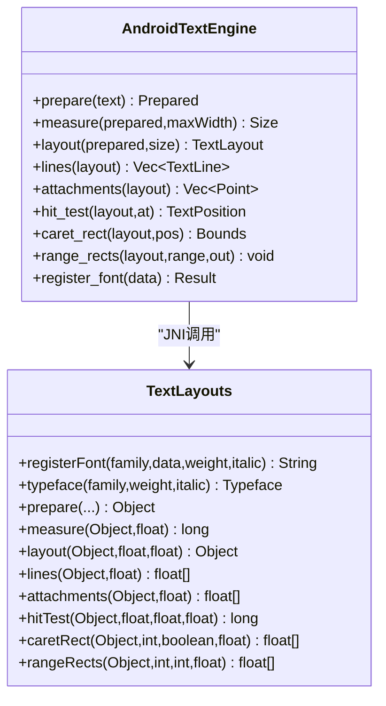
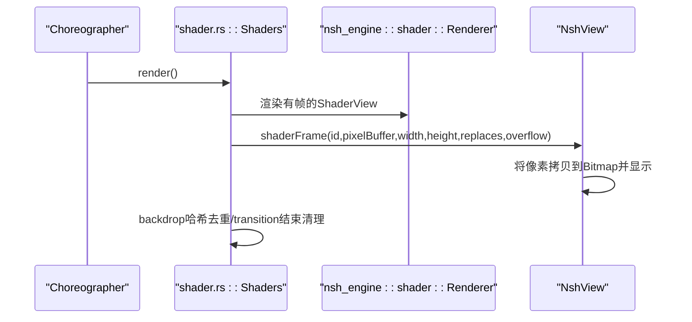
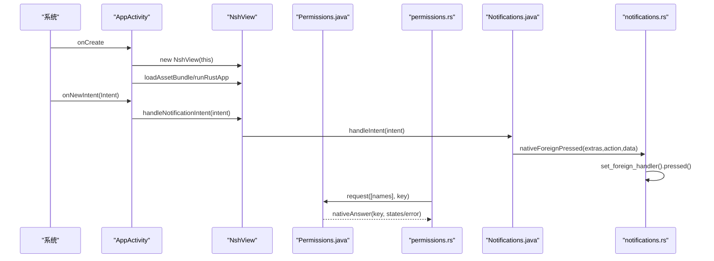
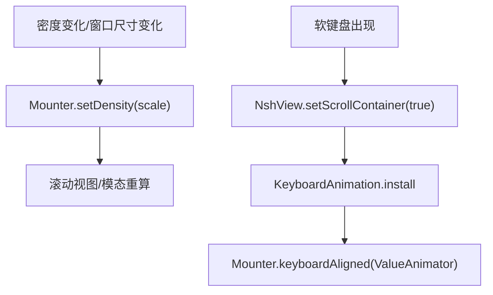
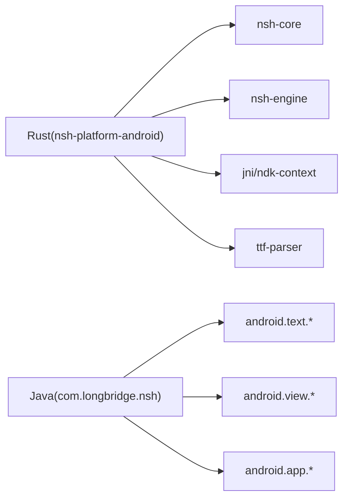

# Android平台适配

<cite>
**本文引用的文件**   
- [lib.rs](file://crates/nsh-platform-android/src/lib.rs)
- [java.rs](file://crates/nsh-platform-android/src/java.rs)
- [text.rs](file://crates/nsh-platform-android/src/text.rs)
- [shader.rs](file://crates/nsh-platform-android/src/shader.rs)
- [permissions.rs](file://crates/nsh-platform-android/src/permissions.rs)
- [activity.rs](file://crates/nsh-platform-android/src/activity.rs)
- [notifications.rs](file://crates/nsh-platform-android/src/notifications.rs)
- [NshView.java](file://crates/nsh-platform-android/java/com/longbridge/nsh/NshView.java)
- [TextLayouts.java](file://crates/nsh-platform-android/java/com/longbridge/nsh/TextLayouts.java)
- [Mounter.java](file://crates/nsh-platform-android/java/com/longbridge/nsh/Mounter.java)
- [AppActivity.java](file://crates/nsh-platform-android/java/com/longbridge/nsh/AppActivity.java)
</cite>

## 目录
1. [简介](#简介)
2. [项目结构](#项目结构)
3. [核心组件](#核心组件)
4. [架构总览](#架构总览)
5. [详细组件分析](#详细组件分析)
6. [依赖关系分析](#依赖关系分析)
7. [性能考量](#性能考量)
8. [故障排查指南](#故障排查指南)
9. [结论](#结论)

## 简介
本文件面向Android平台适配层，系统性说明以下能力：
- 基于Android Views的UI系统实现：从Rust引擎到Java View的挂载、测量与布局流程。
- Pango/StaticLayout文本引擎在Android上的集成：字体注册、回退链、多语言与双向文本、行高与阴影等。
- OpenGL ES Canvas后端（通过nsh-engine）在Android的实现要点：SurfaceView/SurfaceTexture使用、渲染循环优化与帧回传。
- Android系统集成：Activity生命周期、Fragment管理、权限系统与通知机制。
- 屏幕密度适配、输入法处理与软键盘交互。

## 项目结构
Android适配层由Rust侧JNI胶水与Java侧视图体系组成：
- Rust侧负责：JNI初始化、线程绑定、JNI方法缓存、文本排版调用、着色器视图管理、权限/活动/通知桥接。
- Java侧负责：NshView容器、Mounter批量挂载、TextLayouts排版、系统栏/键盘动画、输入与焦点、着色器帧合成。

图表来源
- [lib.rs:1-187](file://crates/nsh-platform-android/src/lib.rs#L1-L187)
- [java.rs:1-245](file://crates/nsh-platform-android/src/java.rs#L1-L245)
- [text.rs:1-553](file://crates/nsh-platform-android/src/text.rs#L1-L553)
- [shader.rs:1-539](file://crates/nsh-platform-android/src/shader.rs#L1-L539)
- [permissions.rs:1-301](file://crates/nsh-platform-android/src/permissions.rs#L1-L301)
- [activity.rs:1-313](file://crates/nsh-platform-android/src/activity.rs#L1-L313)
- [notifications.rs:1-264](file://crates/nsh-platform-android/src/notifications.rs#L1-L264)
- [NshView.java:1-800](file://crates/nsh-platform-android/java/com/longbridge/nsh/NshView.java#L1-L800)
- [TextLayouts.java:1-800](file://crates/nsh-platform-android/java/com/longbridge/nsh/TextLayouts.java#L1-L800)
- [Mounter.java:1-800](file://crates/nsh-platform-android/java/com/longbridge/nsh/Mounter.java#L1-L800)
- [AppActivity.java:1-91](file://crates/nsh-platform-android/java/com/longbridge/nsh/AppActivity.java#L1-L91)

章节来源
- [lib.rs:1-187](file://crates/nsh-platform-android/src/lib.rs#L1-L187)
- [java.rs:1-245](file://crates/nsh-platform-android/src/java.rs#L1-L245)

## 核心组件
- lib.rs：导出库入口、宏（ui_sets/components/root/main）、JNI_OnLoad初始化、with_env封装。
- java.rs：一次性查找并缓存Java类与方法ID，提供with_env/try_with_env统一JNI调用上下文。
- text.rs：AndroidTextEngine实现TextEngine接口，通过JNI调用TextLayouts.prepare/measure/layout/hitTest/caretRect/rangeRects，并提供registerFont。
- shader.rs：Shaders管理ShaderView与导航过渡，Choreographer驱动渲染，将帧回传给NshView.shaderFrame。
- permissions.rs：Permission状态查询与请求，跨配置变更保持请求队列。
- activity.rs：start_for_result启动任意Activity并异步返回结果；can_start检测Intent是否可被处理；output_file创建输出文件URI。
- notifications.rs：外部通知点击回调，支持设置ForeignNotificationHandler，未设置时缓存点击。
- NshView.java：应用容器，负责加载bundle/package/Rust app、设备像素密度、系统栏、键盘动画、URL Scheme与Host消息。
- TextLayouts.java：基于StaticLayout/PrecomputedText的排版引擎，支持字体注册、回退链、对齐/方向/省略号、附件占位、命中测试。
- Mounter.java：解析Rust编码的挂载批次，创建/插入/删除/更新View，处理滚动、手势、Canvas、着色器、导航过渡、输入框与软键盘。
- AppActivity.java：打包应用的Activity入口，处理Intent、分享、后退键、配置变化与资源加载。

章节来源
- [lib.rs:1-187](file://crates/nsh-platform-android/src/lib.rs#L1-L187)
- [java.rs:1-245](file://crates/nsh-platform-android/src/java.rs#L1-L245)
- [text.rs:1-553](file://crates/nsh-platform-android/src/text.rs#L1-L553)
- [shader.rs:1-539](file://crates/nsh-platform-android/src/shader.rs#L1-L539)
- [permissions.rs:1-301](file://crates/nsh-platform-android/src/permissions.rs#L1-L301)
- [activity.rs:1-313](file://crates/nsh-platform-android/src/activity.rs#L1-L313)
- [notifications.rs:1-264](file://crates/nsh-platform-android/src/notifications.rs#L1-L264)
- [NshView.java:1-800](file://crates/nsh-platform-android/java/com/longbridge/nsh/NshView.java#L1-L800)
- [TextLayouts.java:1-800](file://crates/nsh-platform-android/java/com/longbridge/nsh/TextLayouts.java#L1-L800)
- [Mounter.java:1-800](file://crates/nsh-platform-android/java/com/longbridge/nsh/Mounter.java#L1-L800)
- [AppActivity.java:1-91](file://crates/nsh-platform-android/java/com/longbridge/nsh/AppActivity.java#L1-L91)

## 架构总览
整体采用“引擎线程+UI线程”双线程模型：
- 引擎线程：运行JS与布局计算，调用StaticLayout进行文本排版，生成紧凑字节批次。
- UI线程：执行Mounter.apply解码批次，创建/更新Android View；Choreographer驱动着色器渲染；处理触摸、键盘、系统栏与输入法。

图表来源
- [text.rs:92-523](file://crates/nsh-platform-android/src/text.rs#L92-L523)
- [java.rs:83-216](file://crates/nsh-platform-android/src/java.rs#L83-L216)
- [NshView.java:376-796](file://crates/nsh-platform-android/java/com/longbridge/nsh/NshView.java#L376-L796)
- [Mounter.java:376-754](file://crates/nsh-platform-android/java/com/longbridge/nsh/Mounter.java#L376-L754)
- [shader.rs:317-435](file://crates/nsh-platform-android/src/shader.rs#L317-L435)

## 详细组件分析

### 基于Android Views的UI系统：ViewGroup到NSH View的转换与测量布局
- NshView作为根FrameLayout，持有Mounter.root(Box)，并通过addView将其加入层级。
- Mounter解析Rust编码的指令流，按操作码创建/插入/移除/更新View，维护views映射、事件掩码、滚动行为、Canvas绘制、着色器与导航过渡。
- 文本内容通过TextBox承载StaticLayout，链接、选择、复制文本、命中测试均由TextBox与SelectableView协作完成。
- 尺寸与密度：NshView.onSizeChanged将dp尺寸传递给Native.resize；Mounter.setDensity在密度变化时重算滚动视图与模态。

图表来源
- [NshView.java:182-244](file://crates/nsh-platform-android/java/com/longbridge/nsh/NshView.java#L182-L244)
- [NshView.java:788-796](file://crates/nsh-platform-android/java/com/longbridge/nsh/NshView.java#L788-L796)
- [Mounter.java:376-754](file://crates/nsh-platform-android/java/com/longbridge/nsh/Mounter.java#L376-L754)

章节来源
- [NshView.java:182-244](file://crates/nsh-platform-android/java/com/longbridge/nsh/NshView.java#L182-L244)
- [NshView.java:788-796](file://crates/nsh-platform-android/java/com/longbridge/nsh/NshView.java#L788-L796)
- [Mounter.java:376-754](file://crates/nsh-platform-android/java/com/longbridge/nsh/Mounter.java#L376-L754)

### Pango/StaticLayout文本引擎集成：字体回退与多语言支持
- Rust端AndroidTextEngine将AttributedText转换为ints/floats/families数组，调用TextLayouts.prepare构建Prepared对象。
- TextLayouts内部：
  - 字体注册：将TTF/OTF写入缓存目录，构建Typeface，维护FAMILIES与RESOLVED缓存。
  - 字体回退：优先使用已注册的Face，其次查找系统已安装字体，最后回退至默认族；Android 10+使用CustomFallbackBuilder建立回退链。
  - 多语言与双向文本：根据writing_direction与rtl标志设置TextDirectionHeuristic；段落级AlignmentSpan保证左右对齐语义正确。
  - 行高/字距/装饰/背景/阴影：通过AbsoluteSizeSpan、ExactLineHeight、Decoration、Background、ShadowLayer等Span组合实现。
  - 附件占位：Attachment Span记录宽高与基线偏移，layout后通过attachments获取位置。
  - 命中测试：hitTest/caretRect/rangeRects在Layout上计算光标位置与选区矩形，考虑换行与省略号。

图表来源
- [text.rs:92-523](file://crates/nsh-platform-android/src/text.rs#L92-L523)
- [TextLayouts.java:60-322](file://crates/nsh-platform-android/java/com/longbridge/nsh/TextLayouts.java#L60-L322)
- [TextLayouts.java:436-800](file://crates/nsh-platform-android/java/com/longbridge/nsh/TextLayouts.java#L436-L800)

章节来源
- [text.rs:92-523](file://crates/nsh-platform-android/src/text.rs#L92-L523)
- [TextLayouts.java:60-322](file://crates/nsh-platform-android/java/com/longbridge/nsh/TextLayouts.java#L60-L322)
- [TextLayouts.java:436-800](file://crates/nsh-platform-android/java/com/longbridge/nsh/TextLayouts.java#L436-L800)

### OpenGL ES Canvas后端：SurfaceView/SurfaceTexture与渲染循环优化
- 着色器视图由shader.rs中的Shaders管理，首次挂载时打开Renderer（RGBA格式），后续复用。
- Choreographer驱动：当存在需要渲染或采集帧的ShaderView时，每帧render一次，仅对需要更新的视图提交帧。
- 帧回传：deliver通过NshView.shaderFrame将ByteBuffer直接交给Java拷贝到Bitmap，避免额外分配；backdrop图片去重（哈希比较）。
- 导航过渡：NavTransition与页面/对话框栈协同，from/to贴图只上传一次，进度由nsh.progress驱动。

图表来源
- [shader.rs:125-435](file://crates/nsh-platform-android/src/shader.rs#L125-L435)
- [NshView.java:767-796](file://crates/nsh-platform-android/java/com/longbridge/nsh/NshView.java#L767-L796)

章节来源
- [shader.rs:125-435](file://crates/nsh-platform-android/src/shader.rs#L125-L435)

### Android系统集成：Activity生命周期、Fragment管理、权限与通知
- Activity生命周期：AppActivity.onCreate中创建NshView并加载bundle/Rust app；onNewIntent处理分享/URL Scheme/通知；onDestroy销毁NshView。
- Fragment管理：Activities.java通过无头Fragment跨配置变更维持Activity启动请求与结果回调（Rust侧activity.rs通过key映射oneshot通道）。
- 权限系统：Permissions.java在UI线程发起请求，Rust侧permissions.rs维护PENDING队列，nativeAnswer回调恢复Future。
- 通知机制：Notifications.java将非NSH展示的通知点击转发给Rust侧set_foreign_handler；若未设置则缓存直到设置。

图表来源
- [AppActivity.java:16-91](file://crates/nsh-platform-android/java/com/longbridge/nsh/AppActivity.java#L16-L91)
- [NshView.java:648-684](file://crates/nsh-platform-android/java/com/longbridge/nsh/NshView.java#L648-L684)
- [permissions.rs:154-266](file://crates/nsh-platform-android/src/permissions.rs#L154-L266)
- [notifications.rs:95-185](file://crates/nsh-platform-android/src/notifications.rs#L95-L185)

章节来源
- [AppActivity.java:16-91](file://crates/nsh-platform-android/java/com/longbridge/nsh/AppActivity.java#L16-L91)
- [permissions.rs:154-266](file://crates/nsh-platform-android/src/permissions.rs#L154-L266)
- [notifications.rs:95-185](file://crates/nsh-platform-android/src/notifications.rs#L95-L185)

### 屏幕密度适配、输入法与软键盘交互
- 密度适配：NshView构造时读取density；onSizeChanged将dp尺寸传给Native.resize；Mounter.setDensity在密度变化时重算滚动视图与模态。
- 输入法与软键盘：NshView.setScrollContainer(true)使系统调整窗口而非平移；KeyboardAnimation.install为键盘移动提供曲线；Mounter.keyboardMotion/keyboardAligned确保动画与键盘同步。
- 焦点与Tab遍历：KeyDispatch与Focusable配合，保证键盘模式下焦点可见控件行为一致；箭头键在NshView内接管Tab式遍历。

图表来源
- [NshView.java:200-244](file://crates/nsh-platform-android/java/com/longbridge/nsh/NshView.java#L200-L244)
- [NshView.java:788-796](file://crates/nsh-platform-android/java/com/longbridge/nsh/NshView.java#L788-L796)
- [Mounter.java:756-800](file://crates/nsh-platform-android/java/com/longbridge/nsh/Mounter.java#L756-L800)

章节来源
- [NshView.java:200-244](file://crates/nsh-platform-android/java/com/longbridge/nsh/NshView.java#L200-L244)
- [NshView.java:788-796](file://crates/nsh-platform-android/java/com/longbridge/nsh/NshView.java#L788-L796)
- [Mounter.java:756-800](file://crates/nsh-platform-android/java/com/longbridge/nsh/Mounter.java#L756-L800)

## 依赖关系分析
- Rust侧依赖：
  - jni/ndk-context用于JNI环境与VM绑定。
  - nsh-core提供TextEngine、geometry、canvas、animation等抽象。
  - nsh-engine提供Root、shader管线与ShaderView。
  - ttf-parser用于解析字体元数据以提取family/weight/italic。
- Java侧依赖：
  - android.text.*用于StaticLayout/PrecomputedText/Spans。
  - android.view.*用于View/ViewGroup/Choreographer/WindowInsets。
  - android.app.*用于Activity/Dialog/Fragment（Activities.java）。

图表来源
- [Cargo.toml:61-83](file://crates/nsh-platform-android/Cargo.toml#L61-L83)
- [lib.rs:1-187](file://crates/nsh-platform-android/src/lib.rs#L1-L187)
- [java.rs:1-245](file://crates/nsh-platform-android/src/java.rs#L1-L245)

章节来源
- [Cargo.toml:61-83](file://crates/nsh-platform-android/Cargo.toml#L61-L83)
- [lib.rs:1-187](file://crates/nsh-platform-android/src/lib.rs#L1-L187)

## 性能考量
- 文本排版：
  - PrecomputedText缓存度量，减少重复shaping；StaticLayout.Builder重用布局缓存。
  - 负字距补偿negativeSpacing避免最后一行断行异常。
- 渲染循环：
  - Choreographer仅在wants_frame为真时触发；backdrop哈希去重减少GPU上传。
  - 直接ByteBuffer传递像素，避免中间拷贝。
- 挂载批次：
  - 紧凑字节编码+对象数组分离，单次JNI提交；Mounter在UI线程顺序应用，减少重排。
- 密度与布局：
  - dp与px精确转换toPixels，避免半像素误差导致换行抖动。

[本节为通用指导，不直接分析具体文件]

## 故障排查指南
- JNI调用失败：
  - 检查java.rs的with_env/try_with_env是否正确附加线程并清理异常。
  - 确认JNI_OnLoad已完成初始化，类与方法ID已缓存。
- 文本显示异常：
  - 确认TextLayouts.registerFont成功且FAMILIES/RESOLVED缓存有效。
  - 检查fontFamily列表解析与回退链是否包含目标字符集。
- 权限请求无响应：
  - 确认Permissions.java在UI线程发起请求；Rust侧PENDING队列未被提前释放。
- 着色器帧不更新：
  - 检查Shaders.wants_frame与Choreographer是否被持续tick；确认deliver已将replaces标志正确传递。
- 软键盘遮挡：
  - 确认NshView.setScrollContainer(true)生效；KeyboardAnimation已安装；Mounter.keyboardAligned与keyboardInterpolator工作正常。

章节来源
- [java.rs:218-245](file://crates/nsh-platform-android/src/java.rs#L218-L245)
- [TextLayouts.java:60-128](file://crates/nsh-platform-android/java/com/longbridge/nsh/TextLayouts.java#L60-L128)
- [permissions.rs:154-266](file://crates/nsh-platform-android/src/permissions.rs#L154-L266)
- [shader.rs:317-435](file://crates/nsh-platform-android/src/shader.rs#L317-L435)
- [NshView.java:200-244](file://crates/nsh-platform-android/java/com/longbridge/nsh/NshView.java#L200-L244)
- [Mounter.java:756-800](file://crates/nsh-platform-android/java/com/longbridge/nsh/Mounter.java#L756-L800)

## 结论
Android平台适配层通过Rust与Java的双线程协作，实现了高性能的UI挂载、文本排版与着色器渲染。借助StaticLayout与PrecomputedText，系统在多语言、双向文本与字体回退方面具备良好兼容性；通过Choreographer与直接ByteBuffer传输，渲染路径高效稳定。同时，Activity生命周期、Fragment管理、权限与通知机制均得到完整覆盖，密度适配与软键盘交互保证了移动端体验的一致性。