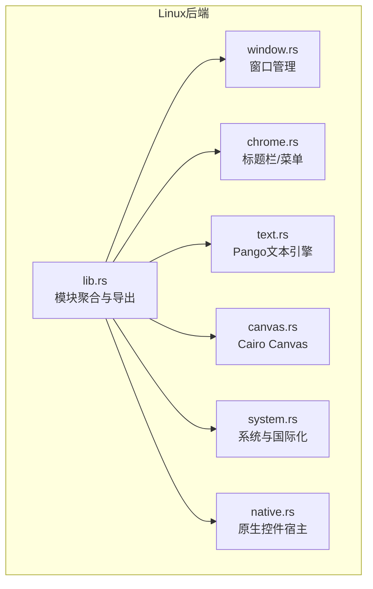
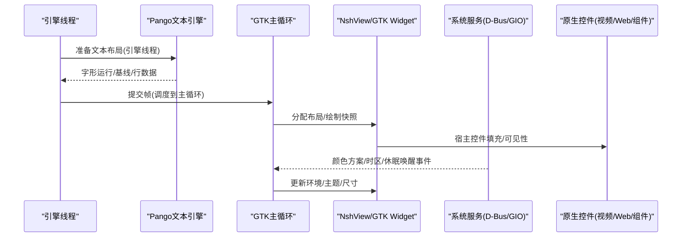
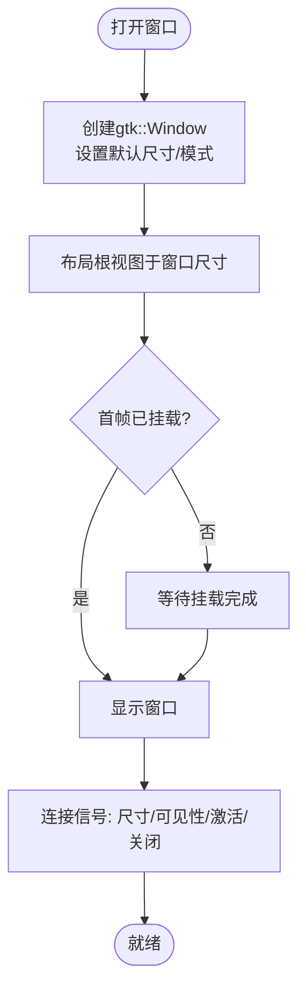
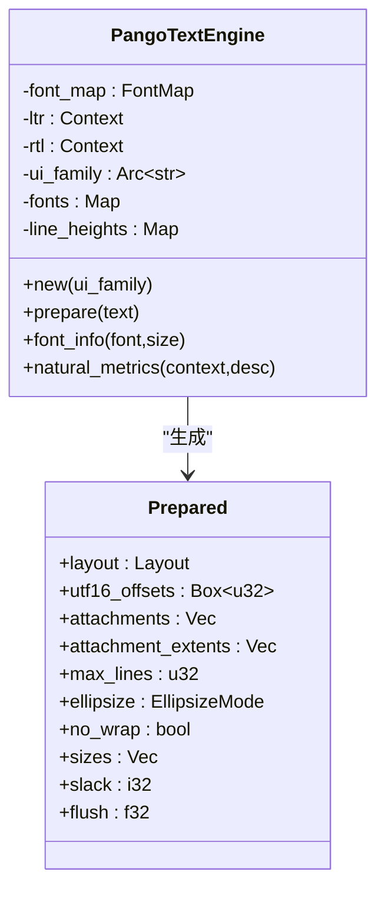
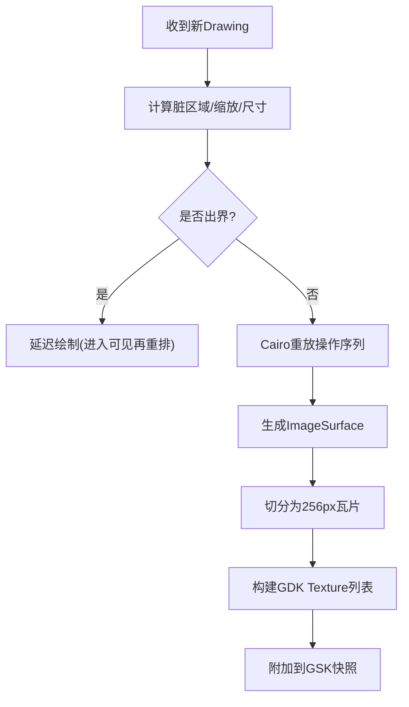
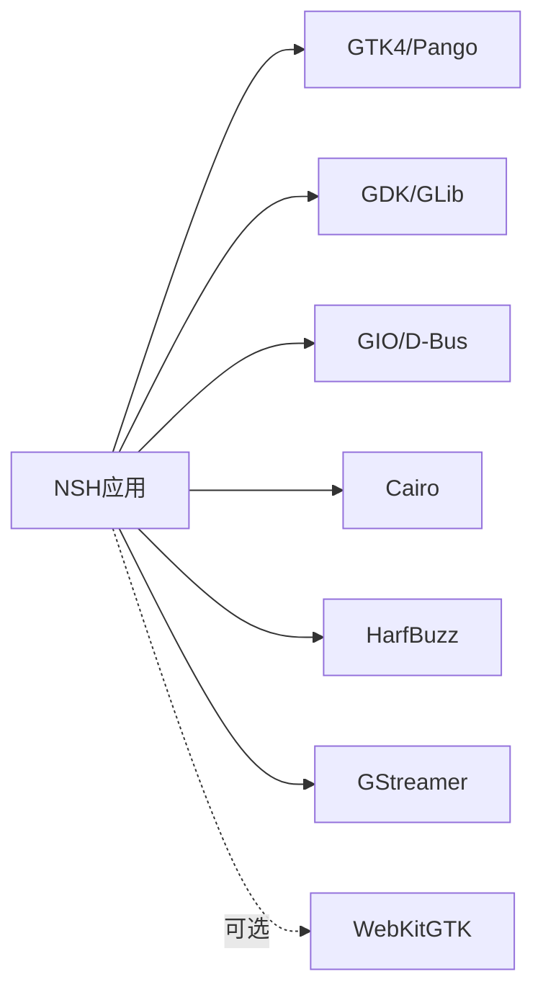

# Linux平台适配

<cite>
**本文引用的文件**   
- [linux.md](file://docs/dev/linux.md)
- [lib.rs](file://crates/nsh-platform-linux/src/lib.rs)
- [window.rs](file://crates/nsh-platform-linux/src/window.rs)
- [text.rs](file://crates/nsh-platform-linux/src/text.rs)
- [canvas.rs](file://crates/nsh-platform-linux/src/canvas.rs)
- [system.rs](file://crates/nsh-platform-linux/src/system.rs)
- [native.rs](file://crates/nsh-platform-linux/src/native.rs)
- [chrome.rs](file://crates/nsh-platform-linux/src/chrome.rs)
</cite>

## 目录
1. [简介](#简介)
2. [项目结构](#项目结构)
3. [核心组件](#核心组件)
4. [架构总览](#架构总览)
5. [详细组件分析](#详细组件分析)
6. [依赖关系分析](#依赖关系分析)
7. [性能考量](#性能考量)
8. [故障排查指南](#故障排查指南)
9. [结论](#结论)
10. [附录](#附录)

## 简介
本文件面向Linux平台的NSH应用适配层，聚焦以下目标：
- 基于GTK4的窗口管理系统实现（GtkWindow集成、信号处理、隐藏标题栏与菜单系统）
- Pango文本引擎在Linux上的实现（字体配置、多语言支持、国际化与渲染策略）
- Canvas后端的Linux实现（Cairo重放、分块纹理、动画增量绘制）
- Linux桌面环境集成（X11/Wayland、窗口管理器交互、系统托盘、剪贴板、通知、会话与会息屏）
- 发行版兼容性与字体回退机制、主题适配（暗色/亮色、无合成器场景）

该后端以“每节点一视图”的方式将NSH布局结果映射到GTK4控件树，文本排版由Pango完成，Canvas通过Cairo重放并切片为GSK纹理。系统环境与桌面协议通过GTK/GDK/GIO/D-Bus暴露的能力进行桥接。

## 项目结构
Linux后端位于 `crates/nsh-platform-linux`，关键模块职责如下：
- lib.rs：模块注册与对外API导出
- window.rs：窗口生命周期、属性与状态同步
- chrome.rs：隐藏标题栏、拖拽区域、菜单栏与上下文菜单
- text.rs：Pango文本引擎（引擎线程排版，主线程绘制）
- canvas.rs：Canvas Cairo重放与分块纹理缓存
- system.rs：系统外观、国际化、时区、会话、剪贴板等环境
- native.rs：原生控件（视频、Web视图、自定义组件）宿主
- 其他：输入、滚动、可访问性、全局快捷键、托盘、会话管理等

图表来源
- [lib.rs:1-86](file://crates/nsh-platform-linux/src/lib.rs#L1-L86)

章节来源
- [lib.rs:1-86](file://crates/nsh-platform-linux/src/lib.rs#L1-L86)

## 核心组件
- 窗口系统：每个 `<Window>` 对应一个独立的 `gtk::Window`，遵循“先布局再显示”的策略，避免空窗；支持对话框、面板、弹出层、全屏、最大化等模式；关闭策略（按钮、Escape、失焦）由应用决定。
- 标题栏与菜单：支持隐藏标题栏并在Overlay中放置窗口控制按钮；菜单栏使用 `gio::Menu` + `gtk::PopoverMenuBar`，快捷键通过 `gtk::ShortcutController` 分发。
- 文本引擎：Pango在引擎线程排版，主线程按字形运行绘制；字体描述与度量在两侧保持一致，避免像素对齐差异。
- Canvas后端：记录Drawing并通过Cairo重放，按显示缩放生成图像表面，切分为256px纹理；支持阴影、渐变、文本、图片与动画值槽位增量绘制。
- 系统与环境：跟随XDG门户的颜色方案、GLib语言名、POSIX区域设置、GNOME时钟格式、timedated时区、logind休眠唤醒；提供剪贴板、通知、托盘、会话状态。
- 原生控件：视频（GStreamer）、Web视图（WebKitGTK，可选特性）、自定义Rust组件（工厂注册）。

章节来源
- [window.rs:1-120](file://crates/nsh-platform-linux/src/window.rs#L1-L120)
- [chrome.rs:1-120](file://crates/nsh-platform-linux/src/chrome.rs#L1-L120)
- [text.rs:1-16](file://crates/nsh-platform-linux/src/text.rs#L1-L16)
- [canvas.rs:1-39](file://crates/nsh-platform-linux/src/canvas.rs#L1-L39)
- [system.rs:1-74](file://crates/nsh-platform-linux/src/system.rs#L1-L74)
- [native.rs:1-28](file://crates/nsh-platform-linux/src/native.rs#L1-L28)

## 架构总览
下图展示Linux后端的关键交互：引擎线程负责布局与文本排版，主线程负责绘制与事件处理；系统服务通过GIO/D-Bus监听桌面环境变化；原生控件作为子视图嵌入NSH视图树。

图表来源
- [text.rs:1-16](file://crates/nsh-platform-linux/src/text.rs#L1-L16)
- [system.rs:256-342](file://crates/nsh-platform-linux/src/system.rs#L256-L342)
- [native.rs:292-325](file://crates/nsh-platform-linux/src/native.rs#L292-L325)

## 详细组件分析

### GTK4窗口管理与信号处理
- 窗口打开流程：创建 `gtk::Window`，设置默认大小、模式（正常/最大化/全屏），将根视图放入Overlay，连接焦点链、快捷键、鼠标后退键、尺寸变化、可见性与激活状态等信号。
- 首次显示：首帧挂载后延时显示，确保不出现空白窗口。
- 关闭策略：根据属性决定忽略、上报或立即关闭；支持Escape与Ctrl+W快捷键。
- 背景运行模式：开发主机支持后台运行，避免抢占用户键盘焦点。

图表来源
- [window.rs:496-574](file://crates/nsh-platform-linux/src/window.rs#L496-L574)
- [window.rs:577-694](file://crates/nsh-platform-linux/src/window.rs#L577-L694)
- [window.rs:696-749](file://crates/nsh-platform-linux/src/window.rs#L696-L749)

章节来源
- [window.rs:496-749](file://crates/nsh-platform-linux/src/window.rs#L496-L749)

### Pango文本引擎（Linux）
- 线程模型：引擎线程使用独立FontMap与Context进行排版，避免与主线程共享Pango对象；主线程仅绘制字形运行。
- 字体配置：从GTK Settings读取UI字体族；CSS通用字体族映射到Fontconfig；支持字重、斜体、绝对字号、字距、行高、OpenType特性。
- 多语言与国际化：自动检测书写方向（LTR/RTL），段落对齐与两端对齐；CJK/Emoji回退字体通过Fontconfig栈选择；cap/x高度从HarfBuzz OS/2表获取。
- 渲染策略：默认轻微hinting、灰度抗锯齿、未hint度量以保证分辨率无关测量；可跟随桌面手动渲染设置。

图表来源
- [text.rs:374-386](file://crates/nsh-platform-linux/src/text.rs#L374-L386)
- [text.rs:343-372](file://crates/nsh-platform-linux/src/text.rs#L343-L372)

章节来源
- [text.rs:1-16](file://crates/nsh-platform-linux/src/text.rs#L1-L16)
- [text.rs:105-176](file://crates/nsh-platform-linux/src/text.rs#L105-L176)
- [text.rs:465-558](file://crates/nsh-platform-linux/src/text.rs#L465-L558)
- [text.rs:570-635](file://crates/nsh-platform-linux/src/text.rs#L570-L635)

### Canvas后端（Cairo重放与分块纹理）
- 重放模型：记录Drawing操作序列，按当前路径与变换状态重放至Cairo ImageSurface；保持Canvas自身状态（填充/描边/阴影/字体等）。
- 分块纹理：将ImageSurface切分为256px瓦片，仅对脏区域重建纹理，其余复用GPU内存中的旧纹理。
- 动画增量绘制：识别首个读取动画槽位的操作，保留其前缀静态像素，仅重绘受影响区域。
- 文本与图片：文本使用Pango布局缓存；图片通过核心加载器解码并按URI缓存。

图表来源
- [canvas.rs:1-39](file://crates/nsh-platform-linux/src/canvas.rs#L1-L39)
- [canvas.rs:346-397](file://crates/nsh-platform-linux/src/canvas.rs#L346-L397)
- [canvas.rs:402-531](file://crates/nsh-platform-linux/src/canvas.rs#L402-L531)

章节来源
- [canvas.rs:1-39](file://crates/nsh-platform-linux/src/canvas.rs#L1-L39)
- [canvas.rs:346-531](file://crates/nsh-platform-linux/src/canvas.rs#L346-L531)

### Linux桌面环境集成（X11/Wayland、窗口管理器、托盘）
- 颜色方案：优先跟随XDG门户 `org.freedesktop.appearance color-scheme`，否则回退到GTK初始设置；应用可强制指定。
- 国际化：POSIX环境变量（LC_ALL/LC_TIME/LC_NUMERIC/LC_MESSAGES/LANG）解析Locale；GLib语言名用于首选语言列表；GNOME clock-format覆盖小时制。
- 时区：进程TZ变量 > timedated系统总线 > /etc/localtime符号链接 > /etc/timezone。
- 会话与会息屏：logind的PrepareForSleep(false)计数唤醒次数；应用生命周期根据GDK toplevel状态与session结束信号切换active/background/inactive。
- 剪贴板：使用GdkClipboard异步读取；hasText仅检查可用格式。
- 托盘：通过系统托盘接口（tray.rs）与启动器条目交互（进度/注意）。

章节来源
- [system.rs:1-74](file://crates/nsh-platform-linux/src/system.rs#L1-L74)
- [system.rs:256-342](file://crates/nsh-platform-linux/src/system.rs#L256-L342)
- [system.rs:575-639](file://crates/nsh-platform-linux/src/system.rs#L575-L639)
- [system.rs:666-754](file://crates/nsh-platform-linux/src/system.rs#L666-L754)

### 标题栏与菜单系统（Chrome）
- 隐藏标题栏：隐藏窗口header，必要时插入空titlebar以切换到客户端装饰；在Overlay中放置左右WindowControls，宽度与高度计入title_bar安全区。
- 拖拽区域：标记windowDrag的视图支持窗口移动；双击行为遵循gtk-titlebar-double-click；右键打开窗口菜单。
- 菜单栏：gio::Menu模型 + gtk::PopoverMenuBar；快捷键通过ShortcutController匹配，支持精确/部分匹配顺序；上下文菜单为嵌套PopoverMenu。

章节来源
- [chrome.rs:1-120](file://crates/nsh-platform-linux/src/chrome.rs#L1-L120)
- [chrome.rs:259-375](file://crates/nsh-platform-linux/src/chrome.rs#L259-L375)
- [chrome.rs:377-429](file://crates/nsh-platform-linux/src/chrome.rs#L377-L429)
- [chrome.rs:431-508](file://crates/nsh-platform-linux/src/chrome.rs#L431-L508)
- [chrome.rs:510-786](file://crates/nsh-platform-linux/src/chrome.rs#L510-L786)

### 原生控件宿主（视频/Web/自定义组件）
- 视频：基于GTK MediaFile（GStreamer），Picture或Video控件；不支持播放速率；循环视频不会触发onEnd；Wayland下早期GTK版本需规避EGL销毁问题。
- Web视图：可选特性webview，使用WebKitGTK 6.0；按需映射、单例网络会话、URL scheme注册、权限策略；不可用时代替为占位符。
- 自定义组件：AppView.register_component注册工厂，组件通过ComponentContext发射事件与报告尺寸。

章节来源
- [native.rs:1-28](file://crates/nsh-platform-linux/src/native.rs#L1-L28)
- [native.rs:292-325](file://crates/nsh-platform-linux/src/native.rs#L292-L325)
- [native.rs:657-800](file://crates/nsh-platform-linux/src/native.rs#L657-L800)

## 依赖关系分析
- GTK4/Pango：窗口、控件、文本排版、样式提供者、菜单与快捷键。
- GDK/GLib：显示后端（X11/Wayland）、事件、主循环、定时器、弱引用。
- GIO/D-Bus：XDG门户、timedated/logind、设置与系统总线通信。
- Cairo：Canvas重放、图像表面、字体选项。
- HarfBuzz：OS/2表度量（cap/x height）。
- GStreamer：媒体播放（视频）。
- WebKitGTK（可选）：Web视图。

图表来源
- [lib.rs:1-86](file://crates/nsh-platform-linux/src/lib.rs#L1-L86)
- [text.rs:67-103](file://crates/nsh-platform-linux/src/text.rs#L67-L103)
- [canvas.rs:40-58](file://crates/nsh-platform-linux/src/canvas.rs#L40-L58)
- [native.rs:53-56](file://crates/nsh-platform-linux/src/native.rs#L53-L56)

章节来源
- [lib.rs:1-86](file://crates/nsh-platform-linux/src/lib.rs#L1-L86)

## 性能考量
- 渲染管线：引擎线程提交帧，主循环在高空闲优先级执行批量绘制；动画在帧时钟驱动，窗口隐藏/最小化时停止。
- Canvas优化：分块纹理、前缀静态像素缓存、动画槽位增量绘制；离屏Canvas暂停绘制直到可见。
- 文本测量：禁用hint度量与圆整字形位置，保证测量与绘制一致；字体度量缓存限制增长。
- 图形后端：GTK默认Vulkan渲染器在某些驱动上CPU占用较高；可通过环境变量选择GL渲染器；Cairo渲染器内存更低但CPU更高。
- 资源预算：图像解码与纹理受进程级图像预算约束；动画值槽位变更仅触发必要重绘。

章节来源
- [linux.md:317-339](file://docs/dev/linux.md#L317-L339)
- [canvas.rs:1-39](file://crates/nsh-platform-linux/src/canvas.rs#L1-L39)
- [text.rs:465-558](file://crates/nsh-platform-linux/src/text.rs#L465-L558)

## 故障排查指南
- 构建与依赖：
  - 需要GTK4开发包、Pango、WebKitGTK 6.0（可选）、GStreamer基础插件；缺少时将编译失败或功能降级。
  - 测试需在虚拟显示（Xvfb）或真实显示器运行，GTK初始化线程要求严格。
- 文本问题：
  - 字体缺失导致回退异常：检查Fontconfig配置与应用字体注册；确认UI字体族与CSS family映射。
  - 多语言换行/对齐异常：确认writing_direction与段落对齐设置；检查Ellipsize与max_lines。
- Canvas问题：
  - 动画卡顿：检查动画槽位变更范围与DamageScan；确认分块纹理重建逻辑。
  - 离屏Canvas不绘制：确认in_sight判断与reveal回调。
- 窗口与标题栏：
  - 隐藏标题栏后按钮错位：检查update_area计算的title_bar安全区与WindowControls测量。
  - 全屏状态下菜单隐藏：确认show_menu_bar条件。
- 系统环境：
  - 颜色方案不同步：检查XDG门户响应与GTK interface-color-scheme属性。
  - 时区不更新：确认timedated D-Bus代理与属性变化监听。
  - 剪贴板读取为空：确认异步读取完成后再消费。
- 原生控件：
  - 视频无法播放：检查GStreamer插件与容器/编解码器支持；Wayland早期GTK版本规避EGL销毁。
  - Web视图不可用：确认启用webview特性；查看占位符日志。

章节来源
- [linux.md:12-49](file://docs/dev/linux.md#L12-L49)
- [linux.md:230-315](file://docs/dev/linux.md#L230-L315)
- [native.rs:672-688](file://crates/nsh-platform-linux/src/native.rs#L672-L688)
- [chrome.rs:377-429](file://crates/nsh-platform-linux/src/chrome.rs#L377-L429)
- [system.rs:666-754](file://crates/nsh-platform-linux/src/system.rs#L666-L754)

## 结论
Linux后端通过GTK4/Pango/Cairo/GIO/D-Bus等生态能力，实现了完整的窗口管理、文本排版、Canvas绘制与桌面集成。其设计强调线程分离（引擎线程排版、主线程绘制）、增量更新（Canvas与动画）、以及与环境的一致性（颜色方案、国际化、时区、会话）。在兼容性方面，针对X11/Wayland、不同发行版与桌面环境提供了稳健的回退与适配策略。未来可继续优化图形后端性能、扩展Web视图能力与提升无障碍体验。

## 附录
- 构建命令参考：见文档中的clippy/test/build示例。
- 调试工具：GTK Inspector、FPS监控面板、dev服务器重载。
- 截图保真：Agent截图基于GtkWidgetPaintable与渲染器类型一致性，避免装饰与光标干扰。

章节来源
- [linux.md:12-49](file://docs/dev/linux.md#L12-L49)
- [linux.md:317-339](file://docs/dev/linux.md#L317-L339)
- [linux.md:384-495](file://docs/dev/linux.md#L384-L495)