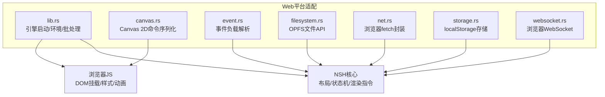
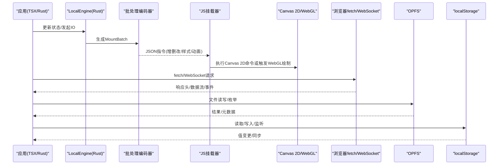
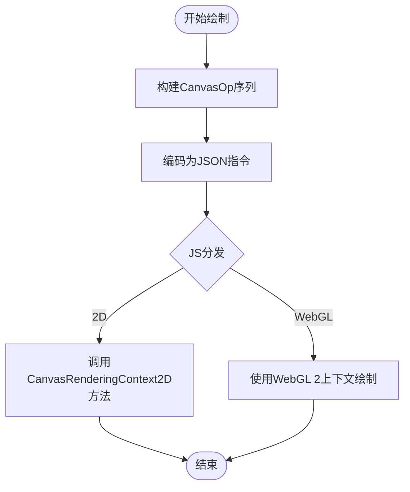
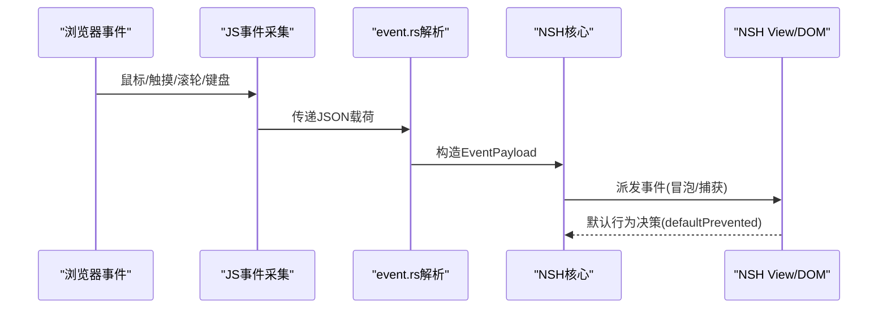
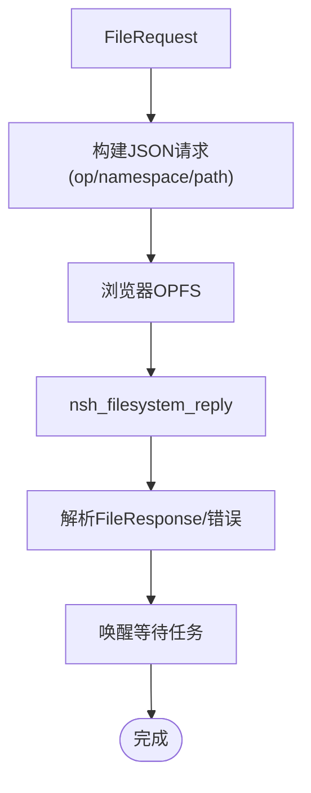
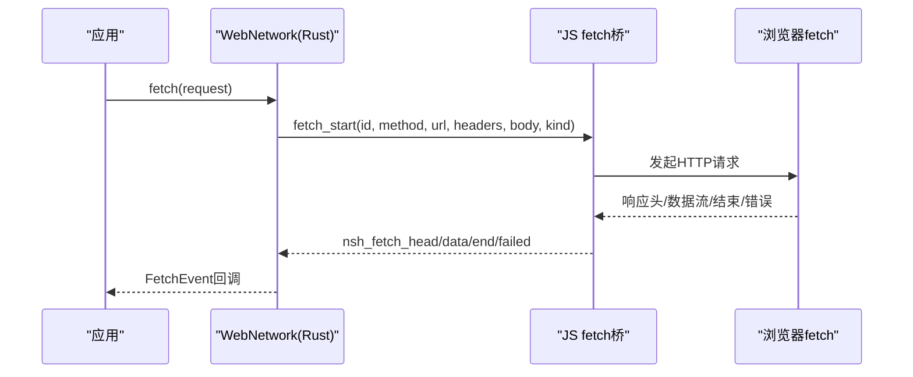
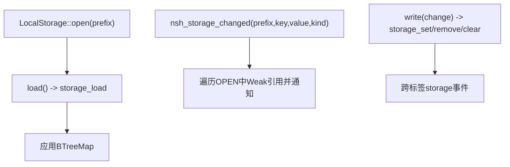
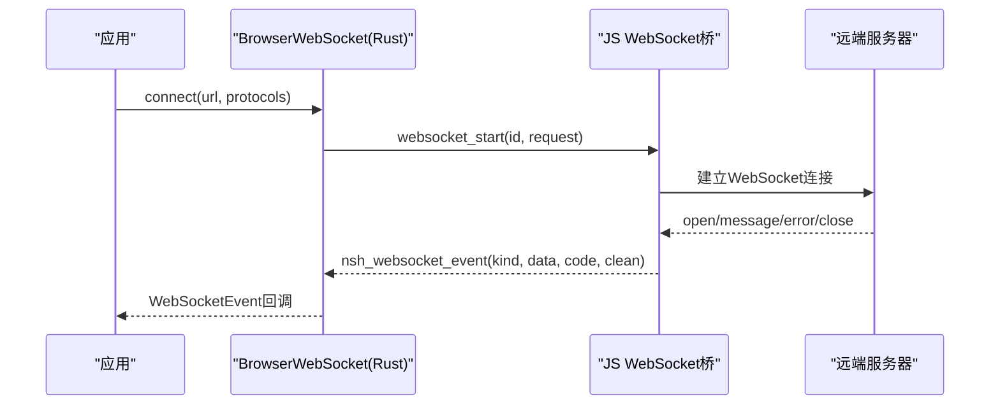
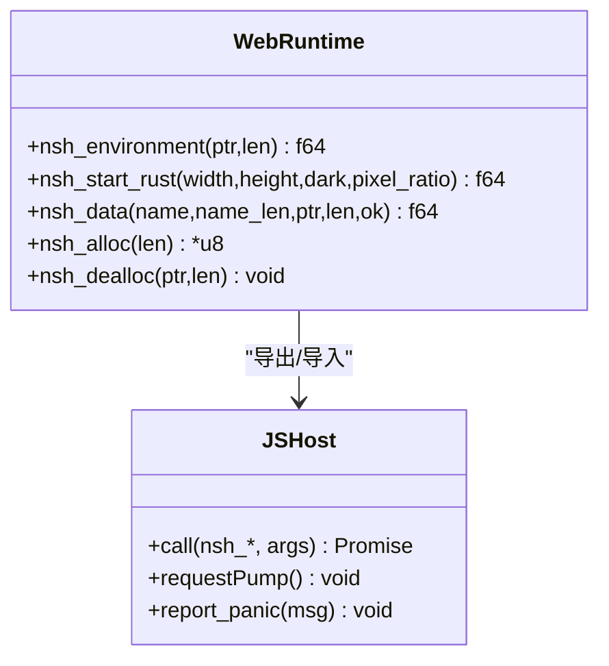
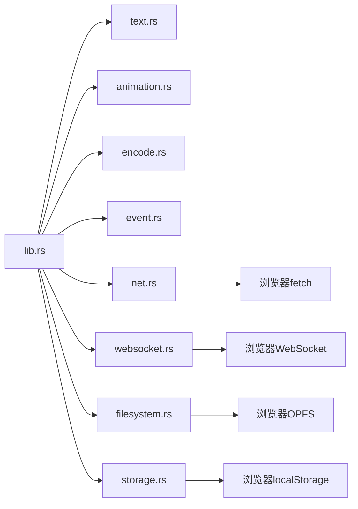

# Web平台适配

<cite>
**本文引用的文件**   
- [lib.rs](file://crates/nsh-platform-web/src/lib.rs)
- [canvas.rs](file://crates/nsh-platform-web/src/canvas.rs)
- [event.rs](file://crates/nsh-platform-web/src/event.rs)
- [filesystem.rs](file://crates/nsh-platform-web/src/filesystem.rs)
- [net.rs](file://crates/nsh-platform-web/src/net.rs)
- [storage.rs](file://crates/nsh-platform-web/src/storage.rs)
- [websocket.rs](file://crates/nsh-platform-web/src/websocket.rs)
- [web.md](file://docs/dev/web.md)
</cite>

## 目录
1. [引言](#引言)
2. [项目结构](#项目结构)
3. [核心组件](#核心组件)
4. [架构总览](#架构总览)
5. [详细组件分析](#详细组件分析)
6. [依赖关系分析](#依赖关系分析)
7. [性能与兼容性](#性能与兼容性)
8. [故障排查指南](#故障排查指南)
9. [结论](#结论)

## 引言
本文件面向Web平台适配层，系统性说明基于HTML5 Canvas和WebGL的渲染系统、DOM元素到NSH View的映射机制、Web特定的文件系统/网络/存储实现、WebAssembly与JavaScript互操作（类型转换与内存管理），以及浏览器特性检测、降级策略与渐进增强方案。文档以仓库中的Web后端实现为依据，重点覆盖以下目标：
- 渲染管线：Canvas 2D命令序列化、WebGL着色器视图、DOM布局与样式类化。
- 事件模型：从浏览器输入到NSH事件负载的统一解析与冒泡语义。
- 数据通道：OPFS文件API、浏览器fetch流式传输、localStorage跨标签同步。
- WASM互操作：nsh_*导出、JS桥接、内存分配与字符串/字节零拷贝路径。
- 兼容性与优化：动画帧调度、减少动效、滚动与指针行为、尺寸预算与构建配置。

## 项目结构
Web平台适配位于 `crates/nsh-platform-web`，按职责拆分为渲染、文本、动画、编码、事件、网络、WebSocket、文件系统、存储等模块；顶层入口负责引擎初始化、环境上报、资产加载与批处理提交。

图表来源
- [lib.rs:1-45](file://crates/nsh-platform-web/src/lib.rs#L1-L45)
- [web.md:1-20](file://docs/dev/web.md#L1-L20)

章节来源
- [lib.rs:1-45](file://crates/nsh-platform-web/src/lib.rs#L1-L45)
- [web.md:1-20](file://docs/dev/web.md#L1-L20)

## 核心组件
- 运行时入口与环境：提供 `nsh_environment`、`nsh_start_rust`、`nsh_data` 等导出，驱动 `LocalEngine`，注入网络、WebSocket、文件系统、存储、字体与资源加载器。
- 渲染与样式：将视图样式转为CSS类，文本在Canvas上测量并绘制，动画通过 `requestAnimationFrame` 与CSS过渡/关键帧组合。
- 事件系统：统一解析鼠标、触摸、滚轮、键盘、媒体等事件为 `EventPayload`，支持修饰键、指针类型与坐标空间。
- 数据通道：
  - 网络：基于浏览器 `fetch`，支持流式响应体、暂停/取消、重定向能力检查。
  - WebSocket：封装连接、发送、关闭、缓冲量与事件回调，内置消息大小限制与背压暂停。
  - 文件系统：基于Origin Private File System（OPFS），异步请求/响应，错误码映射。
  - 存储：基于 `localStorage`，跨标签变更通知与应用命名空间隔离。

章节来源
- [lib.rs:478-655](file://crates/nsh-platform-web/src/lib.rs#L478-L655)
- [lib.rs:714-800](file://crates/nsh-platform-web/src/lib.rs#L714-L800)
- [canvas.rs:1-10](file://crates/nsh-platform-web/src/canvas.rs#L1-L10)
- [event.rs:1-10](file://crates/nsh-platform-web/src/event.rs#L1-L10)
- [net.rs:1-14](file://crates/nsh-platform-web/src/net.rs#L1-L14)
- [websocket.rs:1-5](file://crates/nsh-platform-web/src/websocket.rs#L1-L5)
- [filesystem.rs:1-5](file://crates/nsh-platform-web/src/filesystem.rs#L1-L5)
- [storage.rs:1-18](file://crates/nsh-platform-web/src/storage.rs#L1-L18)

## 架构总览
Web端采用“Rust引擎 + 浏览器JS宿主”的双侧协作模式：
- Rust侧：运行NSH引擎、计算布局、生成批处理指令、维护状态与业务逻辑。
- JS侧：负责DOM挂载、样式类注入、Canvas/WebGL绘制、输入事件采集、网络与存储桥接。

图表来源
- [lib.rs:714-800](file://crates/nsh-platform-web/src/lib.rs#L714-L800)
- [canvas.rs:202-327](file://crates/nsh-platform-web/src/canvas.rs#L202-L327)
- [net.rs:30-55](file://crates/nsh-platform-web/src/net.rs#L30-L55)
- [websocket.rs:28-53](file://crates/nsh-platform-web/src/websocket.rs#L28-L53)
- [filesystem.rs:33-75](file://crates/nsh-platform-web/src/filesystem.rs#L33-L75)
- [storage.rs:117-130](file://crates/nsh-platform-web/src/storage.rs#L117-L130)

## 详细组件分析

### 渲染系统：Canvas 2D与WebGL
- Canvas 2D命令序列化：将绘图操作（路径、填充、描边、变换、阴影、字体、图像绘制等）编码为JSON数组，由JS调用对应Canvas API执行。支持渐变、复合模式、虚线、透明度等属性。
- WebGL着色器视图：着色器视图使用单一WebGL 2上下文；效果与转场通过2D Canvas对DOM截图合成，页面与对话框通过着色器叠加层进出。
- 样式类化：视觉样式以CSS类呈现，避免大量内联样式导致的重复解析；动态样式超过阈值时回退到元素专属规则。

图表来源
- [canvas.rs:202-327](file://crates/nsh-platform-web/src/canvas.rs#L202-L327)
- [web.md:545-547](file://docs/dev/web.md#L545-L547)

章节来源
- [canvas.rs:1-10](file://crates/nsh-platform-web/src/canvas.rs#L1-L10)
- [canvas.rs:202-327](file://crates/nsh-platform-web/src/canvas.rs#L202-L327)
- [web.md:545-547](file://docs/dev/web.md#L545-L547)

### DOM元素到NSH View的映射与事件冒泡
- 映射机制：每个NSH View映射为一个绝对定位的DOM元素；边框通过独立叠加层绘制，不影响内容布局。样式以类名控制，几何位置由帧计算决定。
- 事件冒泡：输入事件经JS采集后转换为统一的 `EventPayload`，包含位置、修饰键、指针类型等；键盘事件遵循焦点捕获、默认行为抑制与冒泡规则，与桌面后端保持一致。
- 样式继承：文本颜色等样式通过元素级属性与运行级类共同作用，保证多色文本与单色切换的一致性。

图表来源
- [event.rs:17-192](file://crates/nsh-platform-web/src/event.rs#L17-L192)
- [web.md:705-792](file://docs/dev/web.md#L705-L792)

章节来源
- [event.rs:17-192](file://crates/nsh-platform-web/src/event.rs#L17-L192)
- [web.md:705-792](file://docs/dev/web.md#L705-L792)

### Web特定文件系统：OPFS
- 实现方式：通过Origin Private File System（OPFS）提供应用私有持久文件；所有操作异步进行，Rust侧以Future/Poll驱动。
- 权限与配额：Rust侧校验文件授权、规范化路径、相对数据目录、配额限制；未知访问/创建时间与模式置零。
- 错误映射：将浏览器返回的错误信息映射为带syscall/path/code的结构化错误。

图表来源
- [filesystem.rs:33-75](file://crates/nsh-platform-web/src/filesystem.rs#L33-L75)
- [filesystem.rs:104-162](file://crates/nsh-platform-web/src/filesystem.rs#L104-L162)

章节来源
- [filesystem.rs:1-5](file://crates/nsh-platform-web/src/filesystem.rs#L1-L5)
- [filesystem.rs:33-75](file://crates/nsh-platform-web/src/filesystem.rs#L33-L75)
- [filesystem.rs:104-162](file://crates/nsh-platform-web/src/filesystem.rs#L104-L162)

### Web特定网络：浏览器fetch
- 封装方式：Rust侧通过 `WebNetwork` 发起请求，JS侧调用浏览器 `fetch`，并通过 `nsh_fetch_*` 导出回调上报响应头、数据块、结束与失败。
- 流式传输：响应体通过ReadableStream读取，支持暂停/恢复；上传体在需要时收集为Blob。
- 安全与策略：CORS、Cookie、禁止请求头由浏览器强制执行；重定向策略受能力检查与浏览器行为约束。

图表来源
- [net.rs:30-55](file://crates/nsh-platform-web/src/net.rs#L30-L55)
- [net.rs:100-176](file://crates/nsh-platform-web/src/net.rs#L100-L176)

章节来源
- [net.rs:1-14](file://crates/nsh-platform-web/src/net.rs#L1-L14)
- [net.rs:30-55](file://crates/nsh-platform-web/src/net.rs#L30-L55)
- [net.rs:100-176](file://crates/nsh-platform-web/src/net.rs#L100-L176)

### Web特定存储：localStorage
- 命名空间：每个应用使用基于app_id与base_url的前缀隔离键空间，避免与其他应用冲突。
- 跨标签同步：其他标签修改同前缀键会触发 `storage` 事件，JS桥接至Rust侧 `nsh_storage_changed`，通知已打开的Storage实例。
- 错误处理：当浏览器拒绝存储（配额/权限）时，写入失败不设置值；读取失败则视为无数据。

图表来源
- [storage.rs:104-114](file://crates/nsh-platform-web/src/storage.rs#L104-L114)
- [storage.rs:64-96](file://crates/nsh-platform-web/src/storage.rs#L64-L96)
- [storage.rs:117-130](file://crates/nsh-platform-web/src/storage.rs#L117-L130)

章节来源
- [storage.rs:1-18](file://crates/nsh-platform-web/src/storage.rs#L1-L18)
- [storage.rs:64-96](file://crates/nsh-platform-web/src/storage.rs#L64-L96)
- [storage.rs:104-130](file://crates/nsh-platform-web/src/storage.rs#L104-L130)

### Web特定WebSocket
- 连接与生命周期：封装connect/send/close/buffered_amount，事件通过 `nsh_websocket_event` 回调上报（open/message/error/close）。
- 背压与限流：浏览器WebSocket无原生流控，JS侧在队列满时暂停事件投递；消息大小上限为8 MiB，超限即报错并关闭连接。
- 自定义头部：不支持握手自定义头部，直接返回错误。

图表来源
- [websocket.rs:28-53](file://crates/nsh-platform-web/src/websocket.rs#L28-L53)
- [websocket.rs:112-164](file://crates/nsh-platform-web/src/websocket.rs#L112-L164)

章节来源
- [websocket.rs:1-5](file://crates/nsh-platform-web/src/websocket.rs#L1-L5)
- [websocket.rs:28-53](file://crates/nsh-platform-web/src/websocket.rs#L28-L53)
- [websocket.rs:112-164](file://crates/nsh-platform-web/src/websocket.rs#L112-L164)

### WebAssembly与JavaScript互操作
- 导出与导入：Rust侧通过 `#[unsafe(no_mangle)] pub extern "C"` 暴露 `nsh_*` 函数；JS侧通过 `Player.call` 路由调用，非重入，必要时延迟调用。
- 内存管理：提供 `nsh_alloc`/`nsh_dealloc` 供JS分配/释放字符串与字节缓冲区；字符串与字节通过零拷贝路径进入Rust，避免额外复制。
- 类型转换：事件与网络/存储/文件系统的载荷均以JSON在JS与Rust间传递，Rust侧解析为强类型结构；数值、布尔、字符串与对象字段逐一映射。
- 生命周期：每次运行拥有独立的iframe realm，保留原生模块身份与循环引用；弱引用追踪回调与负载，外部持有的Rust值保持强引用。

图表来源
- [lib.rs:412-461](file://crates/nsh-platform-web/src/lib.rs#L412-L461)
- [lib.rs:520-655](file://crates/nsh-platform-web/src/lib.rs#L520-L655)
- [web.md:526-536](file://docs/dev/web.md#L526-L536)

章节来源
- [lib.rs:412-461](file://crates/nsh-platform-web/src/lib.rs#L412-L461)
- [lib.rs:520-655](file://crates/nsh-platform-web/src/lib.rs#L520-L655)
- [web.md:526-536](file://docs/dev/web.md#L526-L536)

## 依赖关系分析
- 模块耦合：
  - `lib.rs` 聚合文本、动画、编码、事件、网络、WebSocket、文件系统、存储等子系统，作为运行时入口。
  - `canvas.rs` 仅依赖核心绘图类型与CSS颜色工具，输出JSON指令给JS。
  - `event.rs` 依赖核心事件类型，纯解析逻辑，可脱离浏览器构建测试。
  - `net.rs`、`websocket.rs`、`filesystem.rs`、`storage.rs` 均通过FFI与JS桥接，保持Rust侧类型安全与错误可控。
- 外部依赖：
  - 浏览器API：Canvas 2D、WebGL 2、fetch、WebSocket、localStorage、OPFS、requestAnimationFrame、media queries等。
  - 构建与打包：WASM目标、wasm-bindgen胶水、ES模块与分片加载、压缩与缓存策略。

图表来源
- [lib.rs:31-44](file://crates/nsh-platform-web/src/lib.rs#L31-L44)
- [net.rs:1-14](file://crates/nsh-platform-web/src/net.rs#L1-L14)
- [websocket.rs:1-5](file://crates/nsh-platform-web/src/websocket.rs#L1-L5)
- [filesystem.rs:1-5](file://crates/nsh-platform-web/src/filesystem.rs#L1-L5)
- [storage.rs:1-18](file://crates/nsh-platform-web/src/storage.rs#L1-L18)

章节来源
- [lib.rs:31-44](file://crates/nsh-platform-web/src/lib.rs#L31-L44)
- [net.rs:1-14](file://crates/nsh-platform-web/src/net.rs#L1-L14)
- [websocket.rs:1-5](file://crates/nsh-platform-web/src/websocket.rs#L1-L5)
- [filesystem.rs:1-5](file://crates/nsh-platform-web/src/filesystem.rs#L1-L5)
- [storage.rs:1-18](file://crates/nsh-platform-web/src/storage.rs#L1-L18)

## 性能与兼容性
- 动画与帧调度：
  - 使用 `requestAnimationFrame` 驱动动画，隐藏标签页或iframe中通过定时器兜底确保动画结束时间准确。
  - CSS过渡与关键帧用于样式过渡与轻量动画；布局动画使用Web Animations API，避免替换已有样式。
- 样式优化：
  - 视觉样式以CSS类表示，减少内联样式解析开销；动态样式过多时回退到元素专属规则。
- 输入与滚动：
  - 触摸与滚轮事件智能路由到最内层可滚动视图，保持桌面与移动体验一致；鼠标拖拽不触发滚动。
- 特性检测与降级：
  - 环境信息（设备、语言、区域、暗色模式、像素比、安全区域、键盘高度、网络状态等）由JS上报，Rust侧根据标志位调整行为。
  - WebGL不可用时关闭着色器视图；减少动效模式下禁用布局动画与样式过渡。
- 构建与体积：
  - Web构建针对体积优化（opt-level=z、fat LTO、panic=abort、strip），按需分片加载语法高亮与表情数据。
  - 发布站点启用内容寻址与CDN缓存，严格CSP与资源策略。

章节来源
- [web.md:549-614](file://docs/dev/web.md#L549-L614)
- [web.md:633-673](file://docs/dev/web.md#L633-L673)
- [web.md:493-525](file://docs/dev/web.md#L493-L525)
- [web.md:277-327](file://docs/dev/web.md#L277-L327)

## 故障排查指南
- 引擎陷阱与崩溃：
  - Rust侧panic通过钩子上报，JS侧记录首次报告并提示需刷新页面；避免在批处理回调中重新进入引擎导致借用冲突。
- 网络与WebSocket：
  - CORS、Cookie、禁止请求头由浏览器强制；重定向手动模式返回不透明响应，需在引擎侧检查能力。
  - WebSocket消息超过8 MiB将被拒绝并关闭连接；自定义握手头部不被支持。
- 存储与文件：
  - localStorage被拒绝或配额不足时写入失败；OPFS操作错误携带syscall/path/code便于定位。
- 调试与测试：
  - 开发主机通过DevTools协议驱动headless Chromium，支持热更新、日志回传与测试步骤应答。
  - 浏览器回归测试套件覆盖生命周期、交互与包体积预算。

章节来源
- [web.md:526-536](file://docs/dev/web.md#L526-L536)
- [net.rs:1-14](file://crates/nsh-platform-web/src/net.rs#L1-L14)
- [websocket.rs:112-164](file://crates/nsh-platform-web/src/websocket.rs#L112-L164)
- [filesystem.rs:115-149](file://crates/nsh-platform-web/src/filesystem.rs#L115-L149)
- [web.md:229-238](file://docs/dev/web.md#L229-L238)
- [web.md:65-115](file://docs/dev/web.md#L65-L115)

## 结论
Web平台适配层通过Rust引擎与浏览器JS宿主的紧密协作，实现了高性能、可扩展且跨浏览器的UI渲染与交互能力。其核心优势包括：
- 清晰的渲染管线：Canvas 2D命令序列化与WebGL着色器视图分离，样式类化提升性能。
- 统一的事件模型：从浏览器输入到NSH事件负载的标准化解析，支持丰富的指针与键盘语义。
- 健壮的Web API封装：fetch流式传输、WebSocket背压与限流、OPFS异步文件操作、localStorage跨标签同步。
- 高效的WASM互操作：导出/导入清晰、内存分配与类型转换可控、生命周期管理完善。
- 完善的兼容性与优化：动画帧调度、减少动效、滚动与指针行为调优、构建体积与缓存策略。

在实际工程中，建议优先关注：
- 合理使用Canvas 2D与WebGL，避免过度绘制与频繁样式变更。
- 利用事件系统提供的修饰键与指针类型，提升多设备交互一致性。
- 在网络与WebSocket中使用背压与限流，防止内存溢出与卡顿。
- 在OPFS与localStorage中做好错误处理与容量规划。
- 依据环境信息与特性检测进行渐进增强与降级，确保在不同浏览器与设备上获得稳定体验。