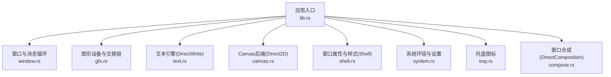
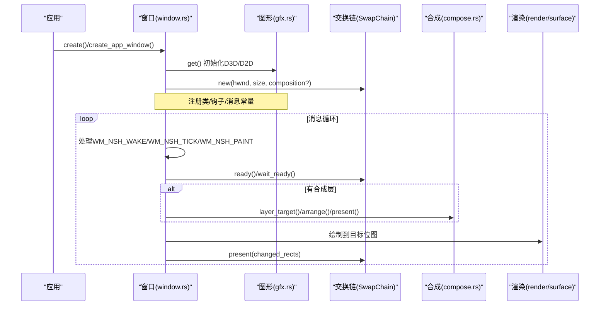
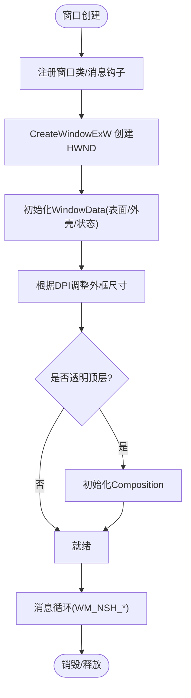
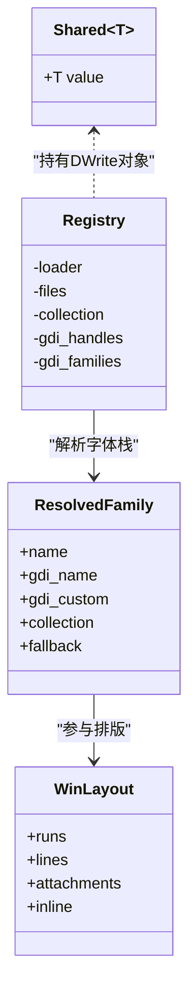
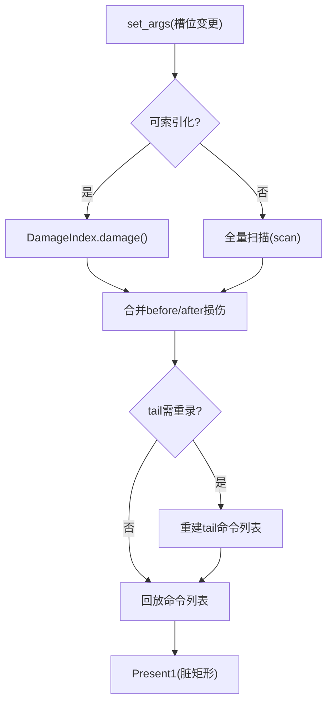
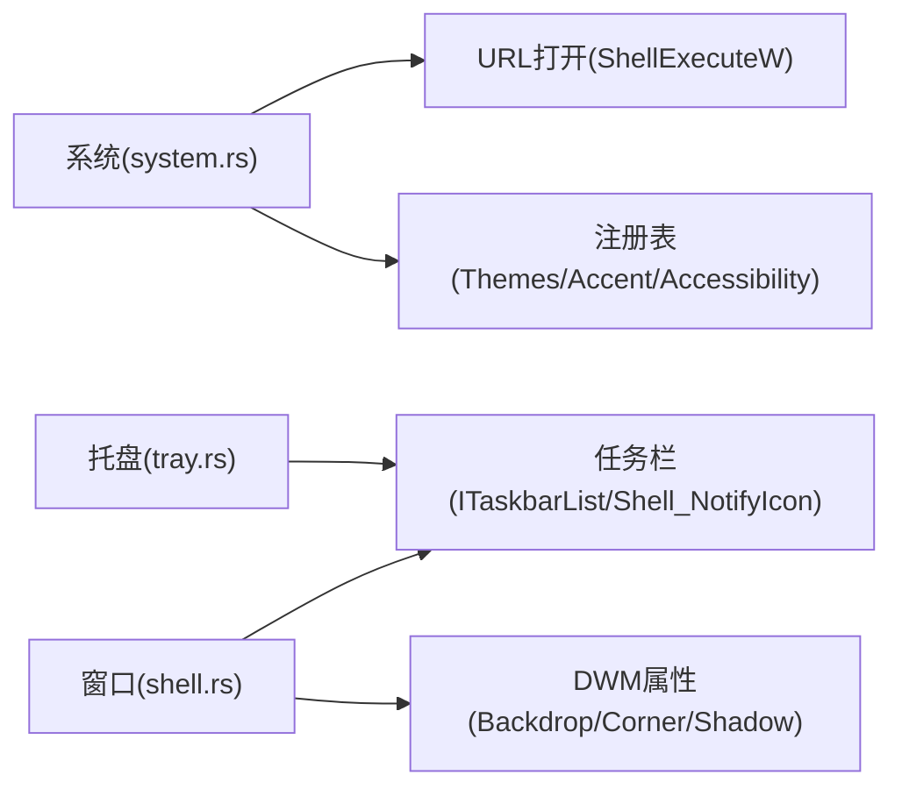
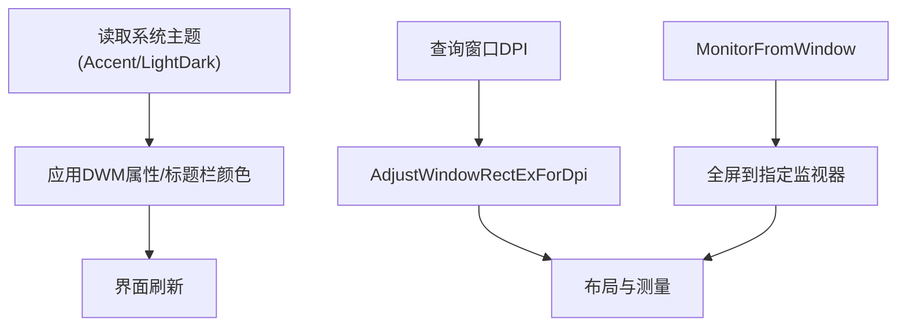
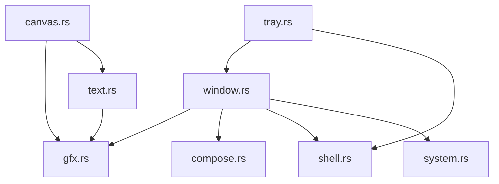

# Windows平台适配

<cite>
**本文引用的文件**   
- [lib.rs](file://crates/nsh-platform-windows/src/lib.rs)
- [window.rs](file://crates/nsh-platform-windows/src/window.rs)
- [gfx.rs](file://crates/nsh-platform-windows/src/gfx.rs)
- [text.rs](file://crates/nsh-platform-windows/src/text.rs)
- [canvas.rs](file://crates/nsh-platform-windows/src/canvas.rs)
- [shell.rs](file://crates/nsh-platform-windows/src/shell.rs)
- [system.rs](file://crates/nsh-platform-windows/src/system.rs)
- [tray.rs](file://crates/nsh-platform-windows/src/tray.rs)
- [compose.rs](file://crates/nsh-platform-windows/src/compose.rs)
</cite>

## 目录
1. [简介](#简介)
2. [项目结构](#项目结构)
3. [核心组件](#核心组件)
4. [架构总览](#架构总览)
5. [详细组件分析](#详细组件分析)
6. [依赖关系分析](#依赖关系分析)
7. [性能考量](#性能考量)
8. [故障排查指南](#故障排查指南)
9. [结论](#结论)

## 简介
本文件面向Windows平台适配层，系统性说明基于Win32 API的窗口管理、消息循环与帧调度；DirectWrite文本引擎集成（字体渲染、度量、高DPI）；Direct2D Canvas后端实现（硬件加速与图形资源管理）；以及Windows系统集成（任务栏、文件关联、注册表访问、Shell扩展）。同时覆盖窗口主题适配、高DPI缩放和多显示器支持。

## 项目结构
Windows平台适配位于 crates/nsh-platform-windows，按职责拆分为窗口/消息、图形设备与交换链、文本布局与绘制、Canvas回放、系统环境与设置、托盘与通知、窗口合成等模块。顶层 lib.rs 声明模块并导出关键类型（如 AppOptions、AppView、run_app、DWriteTextEngine 等），作为对外入口。

**图示来源**
- [lib.rs:1-102](file://crates/nsh-platform-windows/src/lib.rs#L1-L102)

**章节来源**
- [lib.rs:1-102](file://crates/nsh-platform-windows/src/lib.rs#L1-L102)

## 核心组件
- 窗口与消息循环：每个Surface对应一个HWND，维护自定义消息（唤醒、Tick、菜单、关闭、绘制等），线程间通过消息投递与UI线程调度器执行闭包。
- 图形设备：每线程一个Direct3D 11设备与Direct2D设备上下文，窗口拥有flip-model交换链，使用帧延迟等待对象控制一帧飞行，避免垂直同步阻塞。
- 文本引擎：DirectWrite共享工厂跨线程使用；在引擎线程排版，主线程绘制；支持自定义字体注册、回退链、颜色字形与Pango风格行高模型。
- Canvas后端：将Drawing记录为ID2D1CommandList，支持动画槽位增量重绘、阴影/混合效果、圆锥渐变模拟、文本描边与图像缓存。
- Shell（窗口属性）：统一映射WindowKind/Attributes到Win32样式、层级、任务栏按钮进度、Backdrop/Mica/Acrylic、点击穿透、最小/最大尺寸等。
- 系统环境：读取主题、区域语言、字体缩放、减少动效、屏幕阅读器、时区、OS版本等，驱动界面外观与行为。
- 托盘：Shell_NotifyIconW封装，支持模板图标着色、右键菜单、位置坐标、Explorer重启后自动恢复。
- 合成：DirectComposition将WebView或原生组件视觉插入nsh绘制层之间，支持透明窗口背景模糊与多层交换链。

**章节来源**
- [window.rs:1-120](file://crates/nsh-platform-windows/src/window.rs#L1-L120)
- [gfx.rs:1-120](file://crates/nsh-platform-windows/src/gfx.rs#L1-L120)
- [text.rs:1-120](file://crates/nsh-platform-windows/src/text.rs#L1-L120)
- [canvas.rs:1-120](file://crates/nsh-platform-windows/src/canvas.rs#L1-L120)
- [shell.rs:1-120](file://crates/nsh-platform-windows/src/shell.rs#L1-L120)
- [system.rs:1-120](file://crates/nsh-platform-windows/src/system.rs#L1-L120)
- [tray.rs:1-120](file://crates/nsh-platform-windows/src/tray.rs#L1-L120)
- [compose.rs:1-120](file://crates/nsh-platform-windows/src/compose.rs#L1-L120)

## 架构总览
下图展示从应用启动到绘制的一帧流程，包括窗口创建、消息分发、帧节拍、图形设备初始化、交换链准备与呈现。

**图示来源**
- [window.rs:67-105](file://crates/nsh-platform-windows/src/window.rs#L67-L105)
- [gfx.rs:111-145](file://crates/nsh-platform-windows/src/gfx.rs#L111-L145)
- [gfx.rs:439-505](file://crates/nsh-platform-windows/src/gfx.rs#L439-L505)
- [compose.rs:152-177](file://crates/nsh-platform-windows/src/compose.rs#L152-L177)

## 详细组件分析

### 窗口管理与消息循环（Win32 HWND）
- 窗口类与消息常量：定义NshWindow/NshDispatcher类，注册GetMessage钩子以拦截按键；定义WM_NSH_*系列私有消息用于引擎唤醒、帧Tick、菜单、关闭、绘制等。
- 窗口生命周期：create/create_app_window负责样式计算、DPI调整、透明窗口组合体初始化、嵌入根窗口观察、存在性监听。
- 全屏切换：保存/恢复WINDOWPLACEMENT与样式位，结合DWM与任务栏交互。
- 前台/后台模式：支持后台运行，保持键盘焦点逻辑一致。
- DPI与框架尺寸：AdjustWindowRectExForDpi、frame_extents保证内容像素与外部尺寸一致。

**图示来源**
- [window.rs:173-232](file://crates/nsh-platform-windows/src/window.rs#L173-L232)
- [window.rs:238-331](file://crates/nsh-platform-windows/src/window.rs#L238-L331)
- [window.rs:541-635](file://crates/nsh-platform-windows/src/window.rs#L541-L635)

**章节来源**
- [window.rs:1-120](file://crates/nsh-platform-windows/src/window.rs#L1-L120)
- [window.rs:238-331](file://crates/nsh-platform-windows/src/window.rs#L238-L331)
- [window.rs:541-635](file://crates/nsh-platform-windows/src/window.rs#L541-L635)

### DirectWrite文本引擎集成
- 共享工厂与线程安全：DWrite工厂为共享且自由线程，可在引擎线程排版、主线程绘制。
- 字体注册与回退：支持内存字体注册（InMemoryFontFileLoader）、GDI AddFontMemResourceEx暴露给RichEdit；构建FontFallback链以处理CJK/Emoji。
- 度量与行高：采用Pango风格行高模型，固定PITCH布局以满足numberOfLines限制；解析Cap/X高度、Ascent/Descent。
- 颜色字形与录制：Recorder捕获DrawGlyphRun输出，生成Run/Line/Stop数据供主线程绘制与命中测试。
- 高DPI：target_properties设置DPIX/Y，确保位图与缩放一致。

**图示来源**
- [text.rs:121-160](file://crates/nsh-platform-windows/src/text.rs#L121-L160)
- [text.rs:174-256](file://crates/nsh-platform-windows/src/text.rs#L174-L256)
- [text.rs:456-578](file://crates/nsh-platform-windows/src/text.rs#L456-L578)
- [text.rs:719-728](file://crates/nsh-platform-windows/src/text.rs#L719-L728)

**章节来源**
- [text.rs:1-120](file://crates/nsh-platform-windows/src/text.rs#L1-L120)
- [text.rs:174-256](file://crates/nsh-platform-windows/src/text.rs#L174-L256)
- [text.rs:456-578](file://crates/nsh-platform-windows/src/text.rs#L456-L578)
- [text.rs:719-728](file://crates/nsh-platform-windows/src/text.rs#L719-L728)

### Direct2D Canvas后端（硬件加速与资源管理）
- 命令列表回放：Drawing被记录为ID2D1CommandList，按动画槽位拆分head/tail，仅重放变化部分。
- 状态与裁剪：维护当前路径、变换、裁剪几何层；阴影与混合操作通过独立命令列表与Effect组合。
- 文本与图像：文本使用DirectWrite布局缓存；图像通过image管线加载并按设备生成位图。
- 损伤扫描：DamageScan与DamageIndex对动画槽位进行依赖分析，精确计算重绘区域。
- 设备丢失：generation机制使缓存失效并重建。

**图示来源**
- [canvas.rs:196-227](file://crates/nsh-platform-windows/src/canvas.rs#L196-L227)
- [canvas.rs:297-368](file://crates/nsh-platform-windows/src/canvas.rs#L297-L368)
- [canvas.rs:627-786](file://crates/nsh-platform-windows/src/canvas.rs#L627-L786)

**章节来源**
- [canvas.rs:1-120](file://crates/nsh-platform-windows/src/canvas.rs#L1-L120)
- [canvas.rs:196-227](file://crates/nsh-platform-windows/src/canvas.rs#L196-L227)
- [canvas.rs:297-368](file://crates/nsh-platform-windows/src/canvas.rs#L297-L368)
- [canvas.rs:627-786](file://crates/nsh-platform-windows/src/canvas.rs#L627-L786)

### Windows系统集成（任务栏、文件关联、注册表、Shell扩展）
- 任务栏集成：ITaskbarList控制AddTab/DeleteTab/Progress；托盘图标使用Shell_NotifyIconW，支持模板图标着色、右键菜单、位置坐标、Explorer重启恢复。
- 文件关联与URL：open_url通过ShellExecuteW打开协议；文件选择/剪贴板/打开URL等能力由system.rs协调。
- 注册表访问：读取主题、AccentPalette、TextScaleFactor、AppsUseLightTheme等，驱动外观与行为。
- Shell扩展：窗口样式、层级、Backdrop(Mica/Acrylic)、点击穿透、最小/最大尺寸、任务栏按钮进度、标题栏定制等。

**图示来源**
- [tray.rs:236-266](file://crates/nsh-platform-windows/src/tray.rs#L236-L266)
- [tray.rs:318-336](file://crates/nsh-platform-windows/src/tray.rs#L318-L336)
- [system.rs:704-722](file://crates/nsh-platform-windows/src/system.rs#L704-L722)
- [system.rs:200-215](file://crates/nsh-platform-windows/src/system.rs#L200-L215)
- [shell.rs:746-768](file://crates/nsh-platform-windows/src/shell.rs#L746-L768)
- [shell.rs:789-800](file://crates/nsh-platform-windows/src/shell.rs#L789-L800)

**章节来源**
- [tray.rs:1-120](file://crates/nsh-platform-windows/src/tray.rs#L1-L120)
- [tray.rs:236-266](file://crates/nsh-platform-windows/src/tray.rs#L236-L266)
- [tray.rs:318-336](file://crates/nsh-platform-windows/src/tray.rs#L318-L336)
- [system.rs:704-722](file://crates/nsh-platform-windows/src/system.rs#L704-L722)
- [system.rs:200-215](file://crates/nsh-platform-windows/src/system.rs#L200-L215)
- [shell.rs:746-768](file://crates/nsh-platform-windows/src/shell.rs#L746-L768)
- [shell.rs:789-800](file://crates/nsh-platform-windows/src/shell.rs#L789-L800)

### 窗口主题适配、高DPI与多显示器
- 主题与外观：system.rs读取AppsUseLightTheme/SystemUsesLightTheme/AccentPalette，驱动title bar深色模式与根背景色；shell.rs应用DWMWA_SYSTEMBACKDROP_TYPE与圆角/阴影。
- 高DPI：window.rs使用AdjustWindowRectExForDpi与dpi()查询；gfx.rs target_properties设置DPIX/Y；tray.rs按SM_CXSMICON与DPI生成图标。
- 多显示器：shell.rs使用MonitorFromWindow获取监视器信息以全屏；compose.rs与backdrop在窗口移动至不同DPI时重建资源。

**图示来源**
- [system.rs:196-215](file://crates/nsh-platform-windows/src/system.rs#L196-L215)
- [system.rs:664-690](file://crates/nsh-platform-windows/src/system.rs#L664-L690)
- [window.rs:307-327](file://crates/nsh-platform-windows/src/window.rs#L307-L327)
- [gfx.rs:207-223](file://crates/nsh-platform-windows/src/gfx.rs#L207-L223)
- [tray.rs:359-365](file://crates/nsh-platform-windows/src/tray.rs#L359-L365)
- [shell.rs:590-612](file://crates/nsh-platform-windows/src/shell.rs#L590-L612)

**章节来源**
- [system.rs:196-215](file://crates/nsh-platform-windows/src/system.rs#L196-L215)
- [system.rs:664-690](file://crates/nsh-platform-windows/src/system.rs#L664-L690)
- [window.rs:307-327](file://crates/nsh-platform-windows/src/window.rs#L307-L327)
- [gfx.rs:207-223](file://crates/nsh-platform-windows/src/gfx.rs#L207-L223)
- [tray.rs:359-365](file://crates/nsh-platform-windows/src/tray.rs#L359-L365)
- [shell.rs:590-612](file://crates/nsh-platform-windows/src/shell.rs#L590-L612)

## 依赖关系分析
- 模块耦合：window.rs依赖gfx.rs（设备/交换链）、compose.rs（合成）、shell.rs（窗口属性）、system.rs（环境）。
- 图形栈：gfx.rs提供D3D11/D2D/DWrite工厂与SwapChain；compose.rs在其上构建DirectComposition树；canvas.rs在D2D上下文中回放命令列表。
- 文本与Canvas：text.rs与canvas.rs均复用DWrite布局与D2D绘制能力，但职责分离（文本排版 vs 绘图回放）。
- 系统集成：system.rs与shell.rs共同决定外观与行为；tray.rs与shell.rs协作任务栏与托盘。

**图示来源**
- [window.rs:61-65](file://crates/nsh-platform-windows/src/window.rs#L61-L65)
- [gfx.rs:194-205](file://crates/nsh-platform-windows/src/gfx.rs#L194-L205)
- [compose.rs:46-76](file://crates/nsh-platform-windows/src/compose.rs#L46-L76)
- [text.rs:89-93](file://crates/nsh-platform-windows/src/text.rs#L89-L93)
- [canvas.rs:114-120](file://crates/nsh-platform-windows/src/canvas.rs#L114-L120)
- [tray.rs:60-61](file://crates/nsh-platform-windows/src/tray.rs#L60-L61)

**章节来源**
- [window.rs:61-65](file://crates/nsh-platform-windows/src/window.rs#L61-L65)
- [gfx.rs:194-205](file://crates/nsh-platform-windows/src/gfx.rs#L194-L205)
- [compose.rs:46-76](file://crates/nsh-platform-windows/src/compose.rs#L46-L76)
- [text.rs:89-93](file://crates/nsh-platform-windows/src/text.rs#L89-L93)
- [canvas.rs:114-120](file://crates/nsh-platform-windows/src/canvas.rs#L114-L120)
- [tray.rs:60-61](file://crates/nsh-platform-windows/src/tray.rs#L60-L61)

## 性能考量
- 帧 pacing：SwapChain使用帧延迟等待对象，单窗口一帧飞行，避免VBlank阻塞；设备级最大队列设为上限，降低多窗口竞争。
- 增量绘制：Canvas使用DamageScan/Indexed Damage精准重绘；SwapChain.Present1支持脏矩形提交。
- 设备丢失恢复：gfx.generation递增，所有设备相关缓存（位图、命令列表、交换链）失效重建。
- 合成优化：DirectComposition仅在需要时创建Layer与SwapChain，未使用的Layer不呈现；透明窗口底层swap chain复用。
- 文本布局：DirectWrite共享工厂与布局缓存减少重复排版成本；颜色字形与回退链按需构建。

[本节为通用指导，不直接分析具体文件]

## 故障排查指南
- 图形设备丢失：检查gfx.lost日志与generation变化；确认D3D/D2D设备重建成功；若持续失败，尝试WARP回退。
- 窗口无响应/卡顿：确认WM_NSH_TICK与WM_NSH_PAINT是否到达；检查Latency.waitable是否触发；查看DWM是否可见（composed）。
- 文本显示异常：验证字体注册是否成功（REGISTRY/Custom Collection）；检查GDI AddFontMemResourceEx是否安装；确认DPI与target_properties匹配。
- Canvas闪烁/错位：检查DamageIndex是否启用；确认split(head/tail)条件；核对动画槽位依赖与重绘区域。
- 托盘图标不显示：确认TaskbarCreated广播已处理；检查NOTIFYICONDATAW版本与回调消息；确保图标尺寸与DPI正确。
- 主题/颜色不正确：检查注册表键值（AppsUseLightTheme/SystemUsesLightTheme/AccentPalette）；确认system.settings_changed触发刷新。

**章节来源**
- [gfx.rs:97-109](file://crates/nsh-platform-windows/src/gfx.rs#L97-L109)
- [gfx.rs:232-258](file://crates/nsh-platform-windows/src/gfx.rs#L232-L258)
- [text.rs:174-256](file://crates/nsh-platform-windows/src/text.rs#L174-L256)
- [canvas.rs:297-368](file://crates/nsh-platform-windows/src/canvas.rs#L297-L368)
- [tray.rs:318-336](file://crates/nsh-platform-windows/src/tray.rs#L318-L336)
- [system.rs:242-251](file://crates/nsh-platform-windows/src/system.rs#L242-L251)

## 结论
Windows平台适配层以Win32为核心，结合Direct3D 11、Direct2D与DirectWrite，构建了高性能、可扩展的窗口与渲染子系统。通过消息循环与帧调度、交换链与合成、文本与Canvas后端、系统环境与Shell集成，实现了主题适配、高DPI与多显示器支持，并提供稳定的任务栏与托盘体验。整体设计强调设备无关性与资源生命周期管理，具备良好可维护性与扩展性。