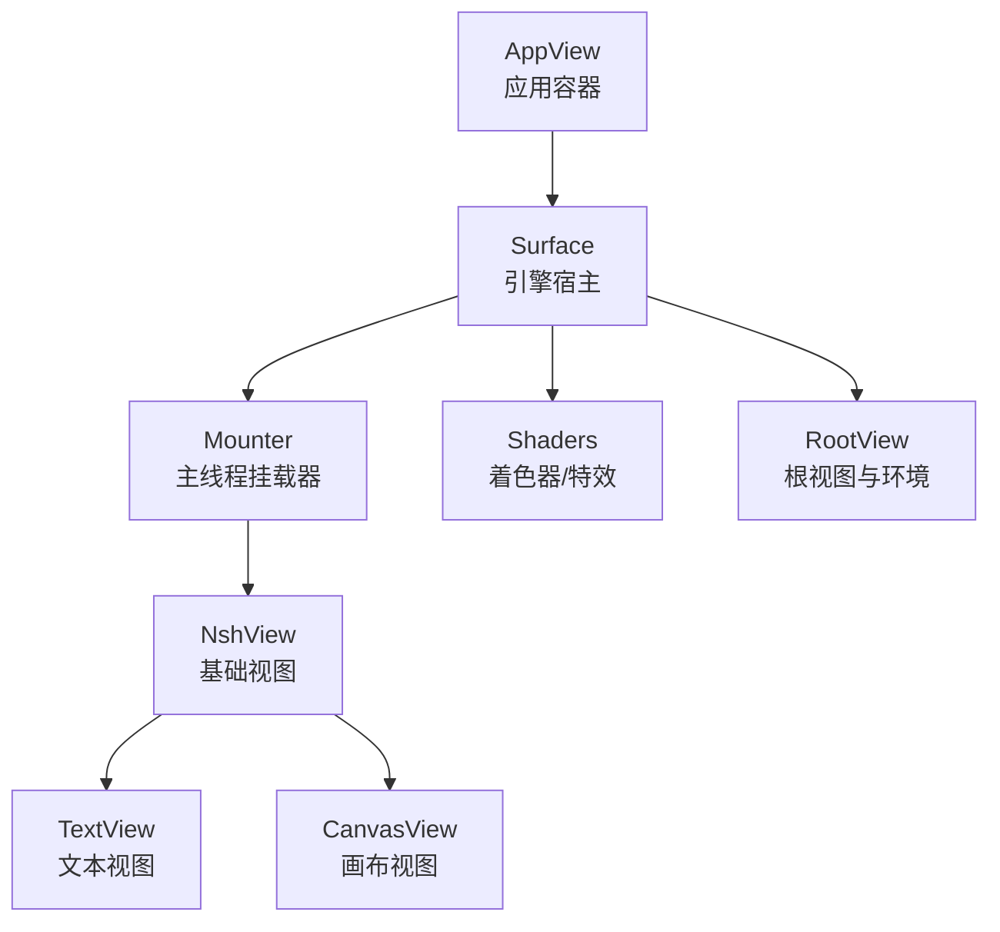
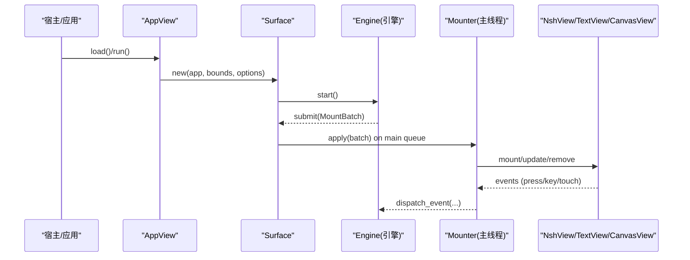
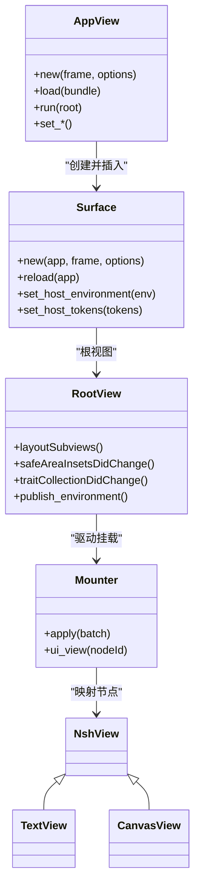
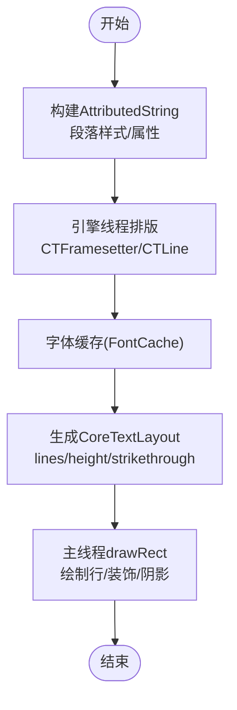
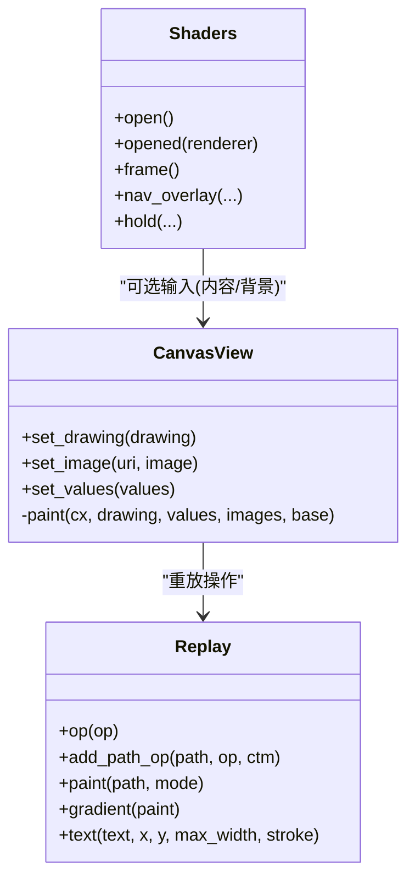
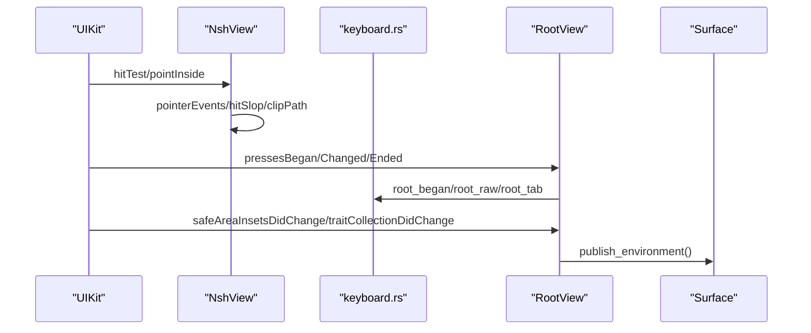
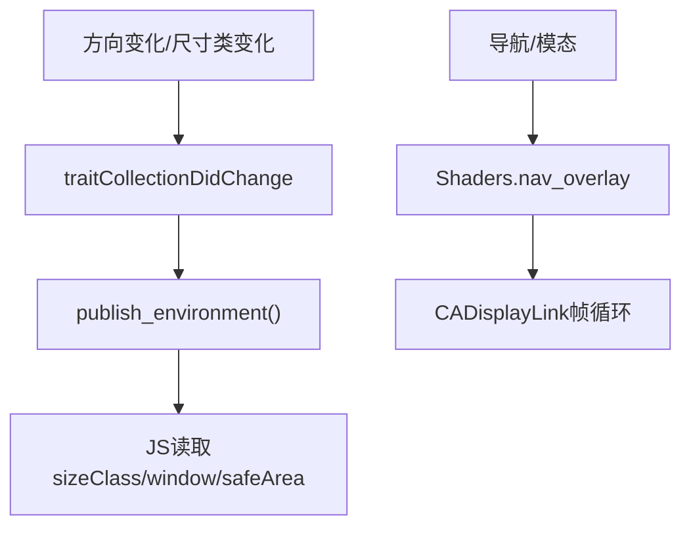
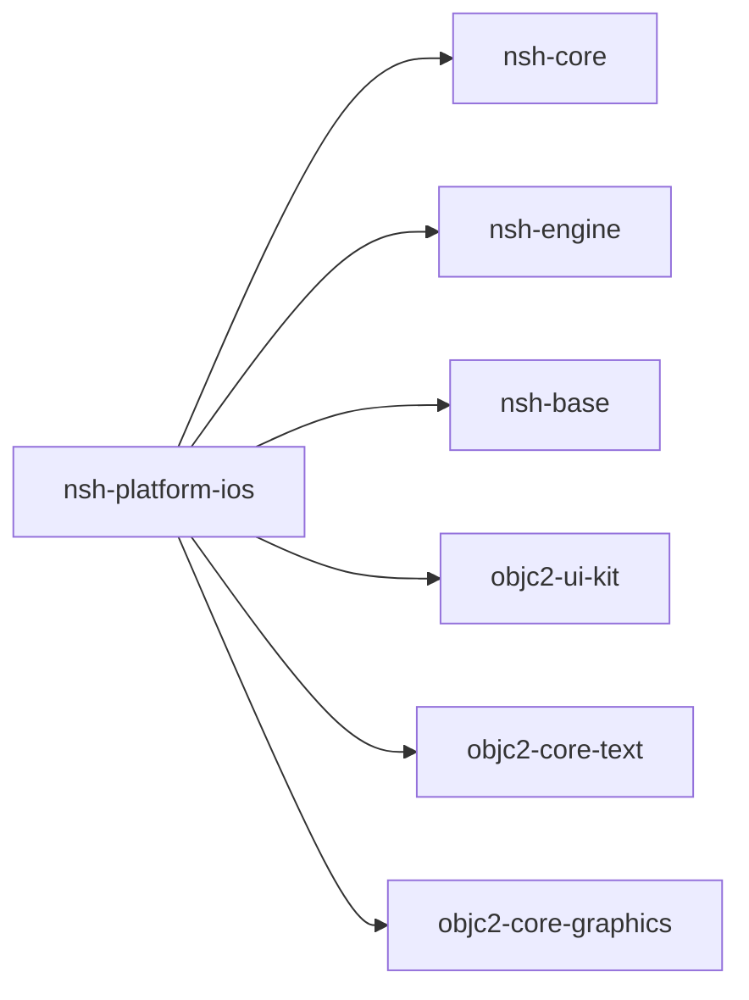

# iOS平台适配

<cite>
**本文引用的文件**   
- [lib.rs](file://crates/nsh-platform-ios/src/lib.rs)
- [view.rs](file://crates/nsh-platform-ios/src/view.rs)
- [native_view.rs](file://crates/nsh-platform-ios/src/native_view.rs)
- [text.rs](file://crates/nsh-platform-ios/src/text.rs)
- [text_view.rs](file://crates/nsh-platform-ios/src/text_view.rs)
- [canvas.rs](file://crates/nsh-platform-ios/src/canvas.rs)
- [surface.rs](file://crates/nsh-platform-ios/src/surface.rs)
- [shader.rs](file://crates/nsh-platform-ios/src/shader.rs)
</cite>

## 目录
1. [简介](#简介)
2. [项目结构](#项目结构)
3. [核心组件](#核心组件)
4. [架构总览](#架构总览)
5. [详细组件分析](#详细组件分析)
6. [依赖关系分析](#依赖关系分析)
7. [性能与优化](#性能与优化)
8. [故障排查指南](#故障排查指南)
9. [结论](#结论)

## 简介
本文件面向iOS平台适配层，系统性说明基于UIKit的视图系统、文本渲染、Canvas/Metal后端以及交互与导航集成。重点包括：
- UIView到NSH View的映射与生命周期管理
- Core Text与StaticLayout在iOS上的差异与优化策略
- Metal Canvas后端的纹理管理与GPU资源优化
- iOS特有的手势识别、触摸事件、键盘适配与安全区域处理
- 导航控制器集成、标签栏管理、模态展示与横竖屏适配

## 项目结构
nsh-platform-ios以Rust为宿主语言，通过objc2桥接UIKit/CoreText/CoreGraphics等原生能力，提供AppView作为应用容器，Surface作为引擎宿主，Mounter负责将引擎生成的挂载批应用到主线程视图树。

**图表来源**
- [view.rs:16-30](file://crates/nsh-platform-ios/src/view.rs#L16-L30)
- [surface.rs:170-176](file://crates/nsh-platform-ios/src/surface.rs#L170-L176)
- [native_view.rs:66-71](file://crates/nsh-platform-ios/src/native_view.rs#L66-L71)
- [text_view.rs:189-195](file://crates/nsh-platform-ios/src/text_view.rs#L189-L195)
- [canvas.rs:63-68](file://crates/nsh-platform-ios/src/canvas.rs#L63-L68)
- [shader.rs:82-99](file://crates/nsh-platform-ios/src/shader.rs#L82-L99)

**章节来源**
- [lib.rs:1-119](file://crates/nsh-platform-ios/src/lib.rs#L1-L119)
- [view.rs:16-30](file://crates/nsh-platform-ios/src/view.rs#L16-L30)
- [surface.rs:170-176](file://crates/nsh-platform-ios/src/surface.rs#L170-L176)

## 核心组件
- AppView：UIKit中的UIView容器，承载一个NSH应用的生命周期（加载JS Bundle或运行Rust根组件），并提供配置接口（字体、主题、缓存、能力、HostChannel等）。
- Surface：引擎宿主，负责启动Engine、将挂载批从引擎线程转发到主线程、订阅系统通知（键盘、时区、网络、生命周期）并推送Environment给引擎。
- Mounter：主线程挂载器，将引擎生成的MountBatch应用到UIView树，维护EventTarget与视图映射。
- NshView：UIView子类，实现pointerEvents、hitSlop、accessibility、焦点与硬件键处理。
- TextView：基于CoreText的只读文本视图，支持选择、链接、装饰线绘制与无障碍。
- CanvasView：重放Drawing到CoreGraphics，支持渐变、阴影、路径、动画槽位增量更新。
- Shaders：Metal/wgpu渲染管线封装，管理IOSurface帧、屏幕级特效与过渡、导航遮罩。

**章节来源**
- [view.rs:16-30](file://crates/nsh-platform-ios/src/view.rs#L16-L30)
- [surface.rs:54-127](file://crates/nsh-platform-ios/src/surface.rs#L54-L127)
- [native_view.rs:66-71](file://crates/nsh-platform-ios/src/native_view.rs#L66-L71)
- [text_view.rs:189-195](file://crates/nsh-platform-ios/src/text_view.rs#L189-L195)
- [canvas.rs:63-68](file://crates/nsh-platform-ios/src/canvas.rs#L63-L68)
- [shader.rs:82-99](file://crates/nsh-platform-ios/src/shader.rs#L82-L99)

## 架构总览
下图展示了从AppView到Surface再到Mounter和具体视图的调用链，以及引擎线程到主线程的事件分发。

**图表来源**
- [view.rs:87-96](file://crates/nsh-platform-ios/src/view.rs#L87-L96)
- [surface.rs:64-127](file://crates/nsh-platform-ios/src/surface.rs#L64-L127)

**章节来源**
- [view.rs:87-96](file://crates/nsh-platform-ios/src/view.rs#L87-L96)
- [surface.rs:64-127](file://crates/nsh-platform-ios/src/surface.rs#L64-L127)

## 详细组件分析

### UIView到NSH View映射与生命周期
- AppView持有UIView容器，创建Surface并插入到容器中；Surface的RootView是节点ID为1的根视图，负责尺寸变化、安全区域、环境发布与系统通知。
- Mounter将引擎生成的节点映射到NshView及其子类（TextView、CanvasView等），并通过EventTarget统一派发事件。
- 生命周期关键点：
  - AppView::load/run替换运行中的应用，重置状态。
  - Surface在首次非空布局后启动Engine，随后响应resize与safeArea变化。
  - RootView监听didMoveToWindow、safeAreaInsetsDidChange、traitCollectionDidChange，并发布Environment。

**图表来源**
- [view.rs:54-96](file://crates/nsh-platform-ios/src/view.rs#L54-L96)
- [surface.rs:170-208](file://crates/nsh-platform-ios/src/surface.rs#L170-L208)
- [native_view.rs:66-71](file://crates/nsh-platform-ios/src/native_view.rs#L66-L71)
- [text_view.rs:189-195](file://crates/nsh-platform-ios/src/text_view.rs#L189-L195)
- [canvas.rs:63-68](file://crates/nsh-platform-ios/src/canvas.rs#L63-L68)

**章节来源**
- [view.rs:54-96](file://crates/nsh-platform-ios/src/view.rs#L54-L96)
- [surface.rs:170-208](file://crates/nsh-platform-ios/src/surface.rs#L170-L208)

### 文本渲染：Core Text与StaticLayout差异及优化
- CoreTextEngine在引擎线程完成排版，生成CTLine/CTFrame等不可变对象，主线程仅进行绘制，避免重复布局。
- FontCache限制最大条目数，避免频繁fontSize动画导致无限增长；支持字体族列表回退与OpenType特性。
- TextView在drawRect中直接绘制已排版的行，支持删除线/下划线自定义绘制、隐藏范围裁剪、颜色过渡与阴影。
- 与StaticLayout的差异：
  - StaticLayout通常由上层计算布局并缓存；CoreTextEngine直接在引擎线程使用CoreText API构建行，减少中间表示。
  - iOS上CoreText对双向文本、附件对齐、行高约束有更细粒度的控制，便于精确命中测试与选择。

**图表来源**
- [text.rs:48-74](file://crates/nsh-platform-ios/src/text.rs#L48-L74)
- [text.rs:757-800](file://crates/nsh-platform-ios/src/text.rs#L757-L800)
- [text_view.rs:313-387](file://crates/nsh-platform-ios/src/text_view.rs#L313-L387)

**章节来源**
- [text.rs:48-74](file://crates/nsh-platform-ios/src/text.rs#L48-L74)
- [text.rs:757-800](file://crates/nsh-platform-ios/src/text.rs#L757-L800)
- [text_view.rs:313-387](file://crates/nsh-platform-ios/src/text_view.rs#L313-L387)

### Metal Canvas后端与纹理/GPU优化
- CanvasView重放Drawing到CoreGraphics上下文，维护当前路径、状态机（填充/描边/渐变/阴影/变换）与图像缓存。
- 动画槽位变更通过DamageScan计算最小脏矩形，仅重绘受影响区域，提升动画性能。
- Shaders模块管理wgpu/Metal渲染设备，首帧异步打开；IOSurface优先显示帧，否则回退到CGImage。
- 屏幕级效果与过渡通过CALayer子层与遮罩控制，避免影响触摸命中；导航遮罩在页面/对话框切换时捕获前后画面。

**图表来源**
- [canvas.rs:94-115](file://crates/nsh-platform-ios/src/canvas.rs#L94-L115)
- [canvas.rs:130-193](file://crates/nsh-platform-ios/src/canvas.rs#L130-L193)
- [shader.rs:178-195](file://crates/nsh-platform-ios/src/shader.rs#L178-L195)
- [shader.rs:515-577](file://crates/nsh-platform-ios/src/shader.rs#L515-L577)

**章节来源**
- [canvas.rs:94-115](file://crates/nsh-platform-ios/src/canvas.rs#L94-L115)
- [canvas.rs:130-193](file://crates/nsh-platform-ios/src/canvas.rs#L130-L193)
- [shader.rs:178-195](file://crates/nsh-platform-ios/src/shader.rs#L178-L195)
- [shader.rs:515-577](file://crates/nsh-platform-ios/src/shader.rs#L515-L577)

### iOS交互模式：手势、触摸、键盘与安全区域
- 触摸与手势：
  - NshView重写hitTest/pointInside，支持pointerEvents、hitSlop、clipPath与溢出区域命中。
  - FocusTap用于focusable但不接收presses的视图，避免抢占touch。
- 键盘与硬件键：
  - RootView与NshView分别接管未消费按键，支持Tab遍历、快捷键绑定、raw key事件与capture规则。
  - 键盘高度与动画时长通过通知收集，推送到Environment供JS读取。
- 安全区域与Trait：
  - RootView监听safeAreaInsetsDidChange与traitCollectionDidChange，发布safe_area与size_class到引擎。
  - iOS 26+针对iPad窗口控制的圆角额外扩展左侧/右侧安全区域。

**图表来源**
- [native_view.rs:82-90](file://crates/nsh-platform-ios/src/native_view.rs#L82-L90)
- [native_view.rs:356-445](file://crates/nsh-platform-ios/src/native_view.rs#L356-L445)
- [surface.rs:262-290](file://crates/nsh-platform-ios/src/surface.rs#L262-L290)
- [surface.rs:727-780](file://crates/nsh-platform-ios/src/surface.rs#L727-L780)

**章节来源**
- [native_view.rs:82-90](file://crates/nsh-platform-ios/src/native_view.rs#L82-L90)
- [native_view.rs:356-445](file://crates/nsh-platform-ios/src/native_view.rs#L356-L445)
- [surface.rs:262-290](file://crates/nsh-platform-ios/src/surface.rs#L262-L290)
- [surface.rs:727-780](file://crates/nsh-platform-ios/src/surface.rs#L727-L780)

### 导航控制器、标签栏、模态与横竖屏适配
- 导航与模态：
  - 通过presenting_controller暴露给上层，结合Shaders的NavOverlay实现页面/对话框的着色器过渡。
  - 无GPU设备时，过渡回退到UIKit自身动画。
- 标签栏：
  - system_tab_bar.rs提供系统标签栏集成（在iOS平台适配层内）。
- 横竖屏与尺寸类：
  - RootView根据traitCollection发布horizontal_size_class/vertical_size_class，供JS侧响应不同布局。
  - Environment包含window大小、safe_area、像素比、色板、键盘高度等。

**图表来源**
- [surface.rs:269-290](file://crates/nsh-platform-ios/src/surface.rs#L269-L290)
- [surface.rs:439-536](file://crates/nsh-platform-ios/src/surface.rs#L439-L536)
- [shader.rs:371-401](file://crates/nsh-platform-ios/src/shader.rs#L371-L401)

**章节来源**
- [surface.rs:269-290](file://crates/nsh-platform-ios/src/surface.rs#L269-L290)
- [surface.rs:439-536](file://crates/nsh-platform-ios/src/surface.rs#L439-L536)
- [shader.rs:371-401](file://crates/nsh-platform-ios/src/shader.rs#L371-L401)

## 依赖关系分析
- nsh-platform-ios依赖nsh-core（元素、几何、文本模型）、nsh-engine（引擎、Shader、Bundle等）、nsh-base（UI组件注册）。
- 通过objc2桥接UIKit/CoreText/CoreGraphics/Foundation，并在iOS目标下启用shader、editor、rich-editor、plot、term等特性。

**图表来源**
- [Cargo.toml:61-89](file://crates/nsh-platform-ios/Cargo.toml#L61-L89)

**章节来源**
- [Cargo.toml:61-89](file://crates/nsh-platform-ios/Cargo.toml#L61-L89)

## 性能与优化
- 文本渲染：
  - 引擎线程排版，主线程仅绘制；FontCache限制容量，避免内存膨胀。
  - 装饰线与隐藏范围裁剪减少无效绘制。
- Canvas：
  - DamageScan增量重绘，避免整图刷新；图像URI缓存复用。
- Shaders：
  - IOSurface优先显示帧，避免CPU拷贝；无GPU时回退CGImage。
  - CADisplayLink仅在需要时运行，空闲自动暂停。
- 环境与通知：
  - 集中订阅系统通知，批量发布Environment，减少抖动。

[本节为通用指导，不直接分析具体文件]

## 故障排查指南
- 引擎启动失败：
  - 检查Surface::new返回错误日志；确认AppView传入的options与bundle有效。
- 热更新失败：
  - 查看hot_update_failed回调，确认mounter可用且renderer已打开。
- 键盘遮挡：
  - 检查keyboard_changed是否正确解析frame/duration/curve；确保Environment.keyboard_height正确传递。
- 安全区域异常：
  - 确认safeAreaInsetsDidChange触发；iOS 26+需考虑窗口控制圆角扩展。
- 着色器无输出：
  - 确认Renderer::open成功；若无GPU设备，检查是否回退到CGImage路径。

**章节来源**
- [surface.rs:64-127](file://crates/nsh-platform-ios/src/surface.rs#L64-L127)
- [surface.rs:782-800](file://crates/nsh-platform-ios/src/surface.rs#L782-L800)
- [shader.rs:178-195](file://crates/nsh-platform-ios/src/shader.rs#L178-L195)

## 结论
iOS平台适配层通过AppView/Surface/Mounter将NSH引擎与UIKit无缝衔接，利用CoreText保证文本排版一致性，借助Canvas与Shaders实现高性能图形与特效。完善的交互与系统事件处理确保在iOS生态中获得一致的用户体验。建议在开发中关注：
- 合理设置SurfaceOptions（缓存、能力、主机环境）
- 使用DamageScan与IOSurface优化Canvas与Shaders性能
- 正确处理键盘与安全区域，保障可访问性与可用性