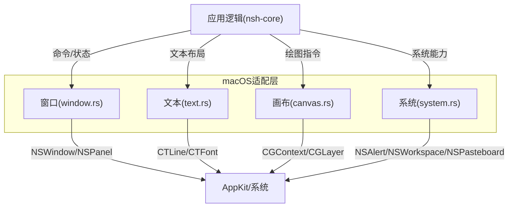
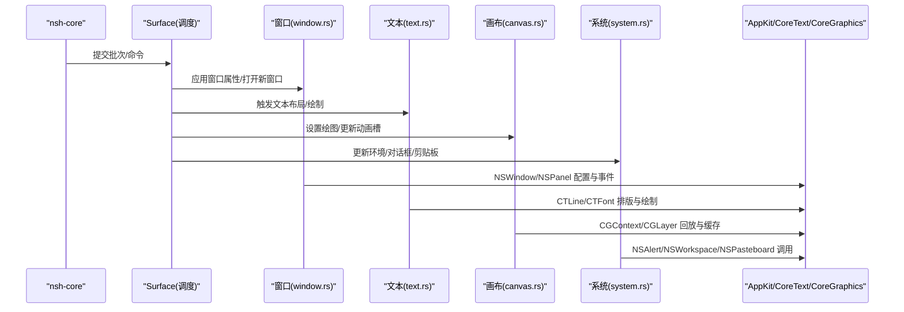
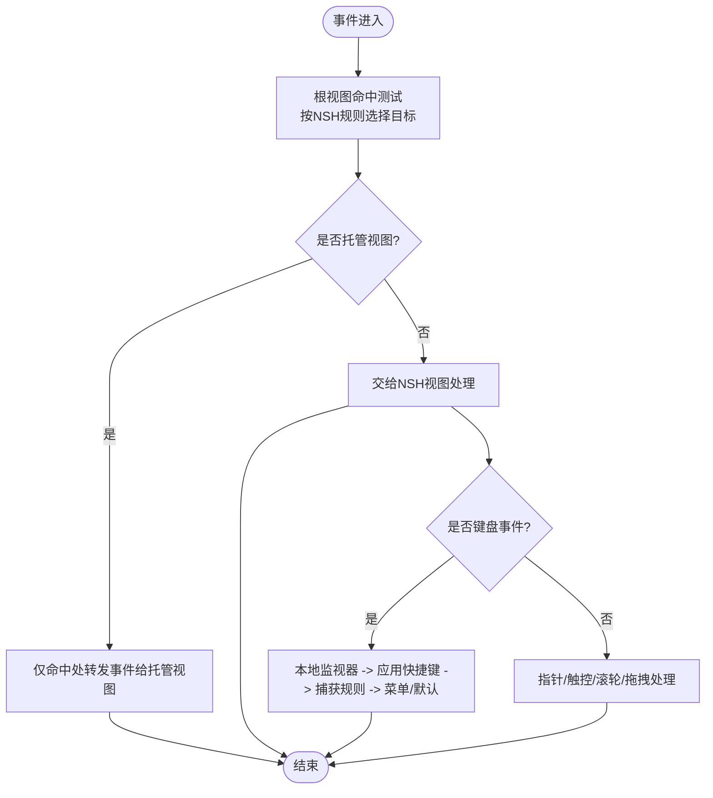
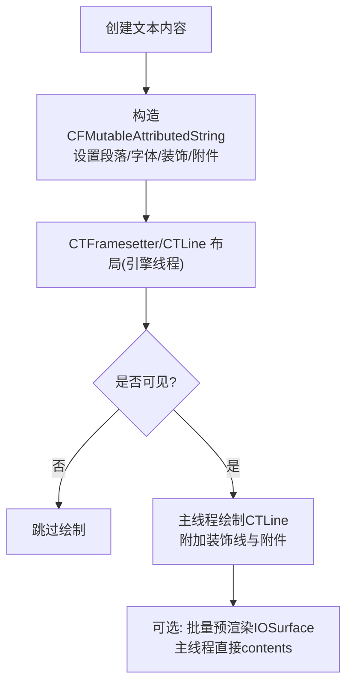
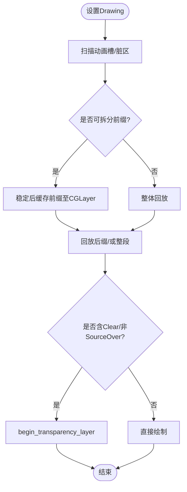
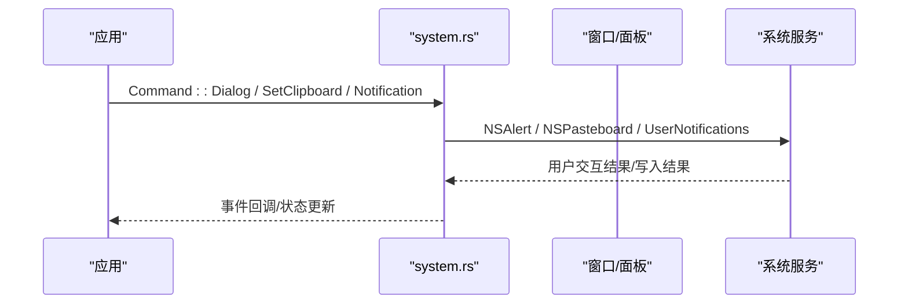
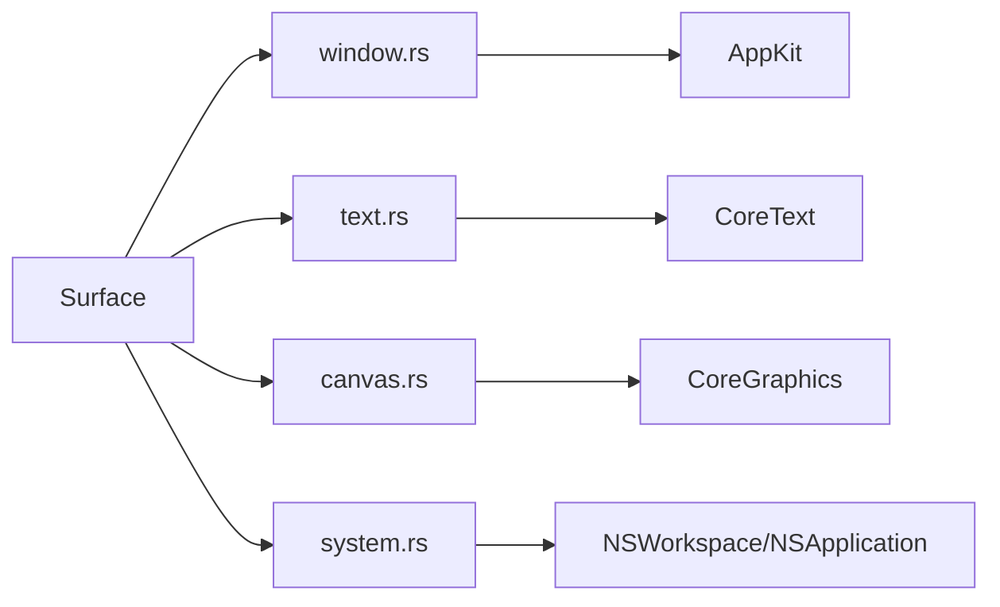

# macOS平台适配

<cite>
**本文引用的文件**   
- [macos.md](file://docs/dev/macos.md)
- [window.rs](file://crates/nsh-platform-macos/src/window.rs)
- [text.rs](file://crates/nsh-platform-macos/src/text.rs)
- [canvas.rs](file://crates/nsh-platform-macos/src/canvas.rs)
- [system.rs](file://crates/nsh-platform-macos/src/system.rs)
</cite>

## 目录
1. [简介](#简介)
2. [项目结构](#项目结构)
3. [核心组件](#核心组件)
4. [架构总览](#架构总览)
5. [详细组件分析](#详细组件分析)
6. [依赖关系分析](#依赖关系分析)
7. [性能考量](#性能考量)
8. [故障排查指南](#故障排查指南)
9. [结论](#结论)

## 简介
本文件面向macOS平台的适配层，聚焦以下方面：
- 基于AppKit的窗口管理系统：NSWindow集成、视图层次映射与事件处理
- CoreText文本引擎：字体管理、文本布局与渲染优化
- Canvas渲染系统：Core Graphics回放、分层缓存与异步绘制策略（Metal后端由系统图形栈提供）
- macOS特有系统集成：菜单栏、Dock、通知中心、Spotlight等能力
- 窗口状态管理、多显示器支持与高分辨率显示适配

## 项目结构
macOS适配层位于 crates/nsh-platform-macos，围绕“表面Surface”组织，将应用UI分解为NSView树，并通过Core Animation进行合成。关键模块职责如下：
- window.rs：窗口生命周期、属性、输入路由、面板/弹窗/覆盖层行为
- text.rs：CoreText排版、字体缓存、行级绘制与光栅化
- canvas.rs：Canvas命令回放、前缀CGLayer缓存、动画槽增量重绘
- system.rs：环境监听（外观、区域设置、网络、屏幕）、对话框、剪贴板、退出流程



图表来源
- [window.rs:1-800](file://crates/nsh-platform-macos/src/window.rs#L1-L800)
- [text.rs:1-800](file://crates/nsh-platform-macos/src/text.rs#L1-L800)
- [canvas.rs:1-800](file://crates/nsh-platform-macos/src/canvas.rs#L1-L800)
- [system.rs:1-800](file://crates/nsh-platform-macos/src/system.rs#L1-L800)

章节来源
- [macos.md:105-329](file://docs/dev/macos.md#L105-L329)

## 核心组件
- 窗口子系统：封装NshWindow/NshPanel，统一窗口属性、模式（普通/面板/弹出/覆盖）、焦点与关闭策略，并负责与Surface和输入系统的交互
- 文本子系统：在引擎线程使用CoreText完成布局，主线程从CTLine绘制；提供字体缓存、段落样式、附件占位与装饰线
- 画布子系统：回放Drawing到CGContext，支持透明层隔离、前缀CGLayer缓存、动画槽增量重绘与异步绘制判定
- 系统子系统：监听系统变化（外观、区域、时区、网络、屏幕），维护对话框队列、剪贴板、退出流程与环境对象

章节来源
- [window.rs:1-800](file://crates/nsh-platform-macos/src/window.rs#L1-L800)
- [text.rs:1-800](file://crates/nsh-platform-macos/src/text.rs#L1-L800)
- [canvas.rs:1-800](file://crates/nsh-platform-macos/src/canvas.rs#L1-L800)
- [system.rs:1-800](file://crates/nsh-platform-macos/src/system.rs#L1-L800)

## 架构总览
下图展示macOS适配层与系统API之间的交互关系，以及Surface作为调度中枢的角色。



图表来源
- [window.rs:1-800](file://crates/nsh-platform-macos/src/window.rs#L1-L800)
- [text.rs:1-800](file://crates/nsh-platform-macos/src/text.rs#L1-L800)
- [canvas.rs:1-800](file://crates/nsh-platform-macos/src/canvas.rs#L1-L800)
- [system.rs:1-800](file://crates/nsh-platform-macos/src/system.rs#L1-L800)

## 详细组件分析

### 窗口管理与NSWindow集成
- 窗口类型与类选择：normal/dialog使用NshWindow；panel/popup/overlay使用NshPanel（非激活、无边框）
- 打开与首次帧：新窗口等待首个布局帧或超时后显示，避免空白闪烁
- 输入路由：每个窗口根作为事件拾取根；模态窗口拦截父窗口输入
- 关闭策略：closeOnPress/closeOnEscape/closeOnBlur在主线程响应，主窗口关闭会等待应用回调
- 状态上报：移动/缩放/全屏/屏幕变更聚合后上报，避免抖动
- 显示链接跟随：根据可见性、是否key、当前跟随窗口动态选择display link根

```mermaid
classDiagram
class NshWindow {
+can_become_key() bool
+can_become_main() bool
+constrain_frame_rect(rect, screen) NSRect
+send_event(event) void
}
class NshPanel {
+can_become_key() bool
+can_become_main() bool
+send_event(event) void
}
class WindowIvars {
+focusable : Cell<bool>
+main : Cell<bool>
+keep_size : Cell<bool>
+background : Cell<bool>
+passed : RefCell<Option<NSView>>
}
class Held {
+close_on_press : Cell<bool>
+close_on_escape : Cell<bool>
+close_on_blur : Cell<bool>
+activate : Cell<bool>
+level : Cell<WindowLevel>
+workspaces : Cell<Workspaces>
+taskbar : Cell<bool>
+maximizable : Cell<bool>
+frame : Cell<WindowFrameStyle>
+resizable : Cell<bool>
+minimizable : Cell<bool>
+closable : Cell<bool>
+transparent : Cell<bool>
+backdrop : RefCell<Option<NSVisualEffectView>>
+title_bar : TitleBar
+pending_close : Cell<Option<(u64,bool)>>
+serial : Cell<u64>
+focused : Cell<bool>
}
NshWindow --> WindowIvars : "持有"
NshPanel --> WindowIvars : "持有"
NshWindow --> Held : "策略与状态"
NshPanel --> Held : "策略与状态"
```

图表来源
- [window.rs:120-264](file://crates/nsh-platform-macos/src/window.rs#L120-L264)
- [window.rs:340-417](file://crates/nsh-platform-macos/src/window.rs#L340-L417)

章节来源
- [window.rs:1-800](file://crates/nsh-platform-macos/src/window.rs#L1-L800)
- [macos.md:299-329](file://docs/dev/macos.md#L299-L329)

### 视图层次结构与事件处理
- 每节点一视图：每个节点对应一个NshView（翻转、layer-backed），布局由核心决定，变换/透明度/可见性映射到CALayer
- 容器与滚动：滚动视图通过sublayerTransform偏移，输入子树滚动时同步bounds origin
- 命中测试：根视图接管鼠标事件，按NSH规则选择目标；托管视图（NSTextField/WKWebView等）仅在命中处接收事件
- 键盘：本地事件监视器优先匹配应用快捷键，再交由原始键捕获与菜单默认行为；IME组合文本走专用路径



图表来源
- [macos.md:117-198](file://docs/dev/macos.md#L117-L198)
- [macos.md:308-329](file://docs/dev/macos.md#L308-L329)

章节来源
- [macos.md:117-198](file://docs/dev/macos.md#L117-L198)
- [macos.md:308-329](file://docs/dev/macos.md#L308-L329)

### CoreText文本引擎
- 字体管理：FontCache以(size, weight, family, italic, variant)为键缓存CTFont；支持通用族映射、OpenType特性、回退字体链
- 布局：Prepared/CTFramesetter构建CTLine；CoreTextLayout惰性计算，避免对不可见文本重复排版
- 绘制：主线程从CTLine绘制，颜色/装饰线按run绘制；附件通过CTRunDelegate预留空间并定位
- 光栅化：批量文本在引擎线程预渲染至IOSurface，主线程直接赋值content layer，减少commit阶段开销



图表来源
- [text.rs:43-180](file://crates/nsh-platform-macos/src/text.rs#L43-L180)
- [text.rs:302-405](file://crates/nsh-platform-macos/src/text.rs#L302-L405)
- [text.rs:515-650](file://crates/nsh-platform-macos/src/text.rs#L515-L650)

章节来源
- [text.rs:1-800](file://crates/nsh-platform-macos/src/text.rs#L1-L800)
- [macos.md:220-230](file://docs/dev/macos.md#L220-L230)

### Canvas渲染系统（Core Graphics回放与GPU加速）
- 回放语义：保持自身状态机，路径在当前transform下构建；stroke/dash随transform缩放；渐变按形状裁剪填充
- 分层与缓存：长静态前缀稳定后缓存至CGLayer；短/频繁变化的部分整体回放；复杂合成/阴影使用透明层隔离
- 增量重绘：动画槽变更通过DamageScan计算脏区，仅重绘受影响操作
- 异步绘制：高频绘制且无前缀缓存时启用drawsAsynchronously，交由Core Animation线程绘制，释放主线程



图表来源
- [canvas.rs:1-800](file://crates/nsh-platform-macos/src/canvas.rs#L1-L800)

章节来源
- [canvas.rs:1-800](file://crates/nsh-platform-macos/src/canvas.rs#L1-L800)

### macOS特有系统集成
- 菜单栏与标题栏：标准菜单项角色映射、自定义标题栏控件、TrafficLights居中与尺寸报告
- Dock集成：任务栏入口、进度条、请求关注（弹跳图标）
- 通知中心：通过Command::Notification驱动
- Spotlight搜索：由系统索引与应用元数据配合（打包应用需签名与公证）
- 剪贴板：NSPasteboard读写字符串/HTML/图片/文件列表
- 对话框：NSAlert作为sheet或独立模态，遵循可见性与激活策略



图表来源
- [system.rs:1-800](file://crates/nsh-platform-macos/src/system.rs#L1-L800)
- [macos.md:315-329](file://docs/dev/macos.md#L315-L329)

章节来源
- [system.rs:1-800](file://crates/nsh-platform-macos/src/system.rs#L1-L800)
- [macos.md:315-329](file://docs/dev/macos.md#L315-L329)

### 窗口状态管理、多显示器与高分辨率适配
- 窗口状态：move/resize/(de)miniaturize/fullScreen/screen变更被聚合后上报，避免抖动
- 多显示器：NSScreen.screens枚举，携带id与切角信息；屏幕参数变化时重新分发displays并刷新窗口状态
- 高分辨率：pixelRatio来自window.backingScaleFactor或主屏scale；图像/文字/画布均按scale分配像素缓冲

章节来源
- [system.rs:412-432](file://crates/nsh-platform-macos/src/system.rs#L412-L432)
- [system.rs:550-558](file://crates/nsh-platform-macos/src/system.rs#L550-L558)
- [macos.md:323-329](file://docs/dev/macos.md#L323-L329)

## 依赖关系分析
- 组件耦合：Surface协调窗口、文本、画布与系统能力；各模块对外暴露最小接口，降低耦合
- 外部依赖：AppKit（窗口/视图/菜单）、CoreText（文本）、CoreGraphics（绘图）、NSWorkspace/NSApplication（系统状态）
- 循环依赖：无直接循环；通过Surface与弱引用解耦



图表来源
- [window.rs:1-800](file://crates/nsh-platform-macos/src/window.rs#L1-L800)
- [text.rs:1-800](file://crates/nsh-platform-macos/src/text.rs#L1-L800)
- [canvas.rs:1-800](file://crates/nsh-platform-macos/src/canvas.rs#L1-L800)
- [system.rs:1-800](file://crates/nsh-platform-macos/src/system.rs#L1-L800)

章节来源
- [window.rs:1-800](file://crates/nsh-platform-macos/src/window.rs#L1-L800)
- [text.rs:1-800](file://crates/nsh-platform-macos/src/text.rs#L1-L800)
- [canvas.rs:1-800](file://crates/nsh-platform-macos/src/canvas.rs#L1-L800)
- [system.rs:1-800](file://crates/nsh-platform-macos/src/system.rs#L1-L800)

## 性能考量
- 文本：引擎线程排版、主线程绘制；批量预渲染IOSurface减少commit压力；只绘制可见文本
- 画布：前缀CGLayer缓存稳定部分；动画槽增量重绘；高频绘制时启用异步绘制
- 窗口：display link跟随可见窗口；resize合并多次布局，避免陈旧内容
- 系统：环境变化批量更新；对话框与面板遵循可见性策略，避免后台阻塞

章节来源
- [macos.md:152-230](file://docs/dev/macos.md#L152-L230)
- [canvas.rs:119-177](file://crates/nsh-platform-macos/src/canvas.rs#L119-L177)
- [text.rs:302-405](file://crates/nsh-platform-macos/src/text.rs#L302-L405)

## 故障排查指南
- 窗口未显示或闪烁：检查首次帧等待与超时逻辑；确认窗口可见性与display link跟随
- 文本错位或附件位置异常：核对段落样式、lineHeight与附件垂直对齐；检查CTRunDelegate宽高
- 画布重绘异常：确认DamageScan计算的脏区；检查透明层隔离与CGLayer缓存失效条件
- 对话框不出现：确认面板放置策略（sheet vs alone）与应用激活状态
- 剪贴板写入失败：检查NSPasteboard写入返回值与类型支持

章节来源
- [window.rs:74-84](file://crates/nsh-platform-macos/src/window.rs#L74-L84)
- [text.rs:415-513](file://crates/nsh-platform-macos/src/text.rs#L415-L513)
- [canvas.rs:386-429](file://crates/nsh-platform-macos/src/canvas.rs#L386-L429)
- [system.rs:654-769](file://crates/nsh-platform-macos/src/system.rs#L654-L769)

## 结论
macOS适配层以Surface为中心，将窗口、文本、画布与系统能力有机整合：
- 窗口层通过NshWindow/NshPanel统一管理生命周期、属性与输入
- 文本层利用CoreText实现高性能排版与绘制，结合IOSurface预渲染
- 画布层通过Core Graphics回放与分层缓存，兼顾灵活性与性能
- 系统层对接AppKit与系统服务，提供对话框、剪贴板、环境与退出流程
该设计在多显示器与高分辨率环境下表现稳健，并为后续扩展（如更多系统能力与渲染优化）留有清晰接口。