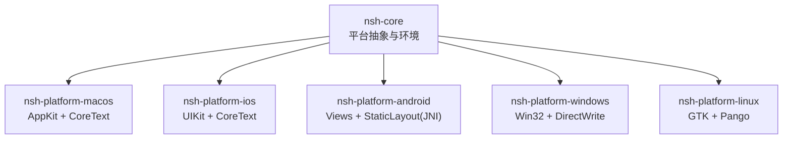
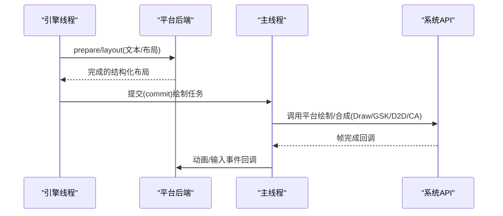
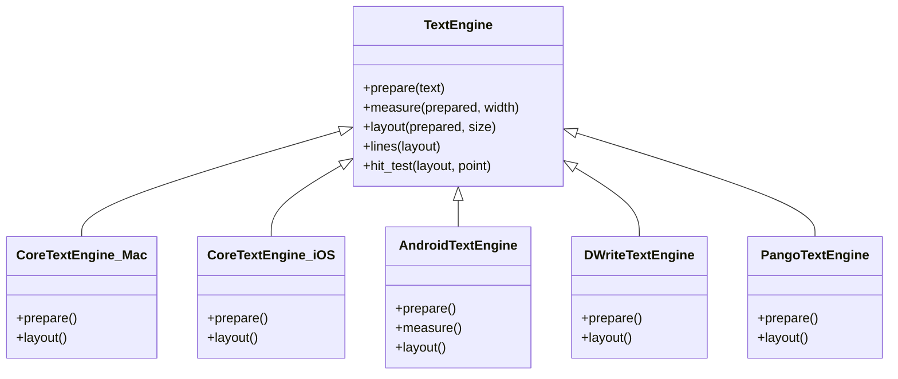
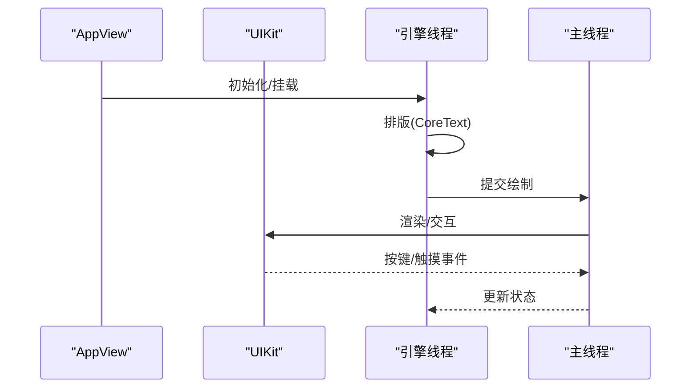
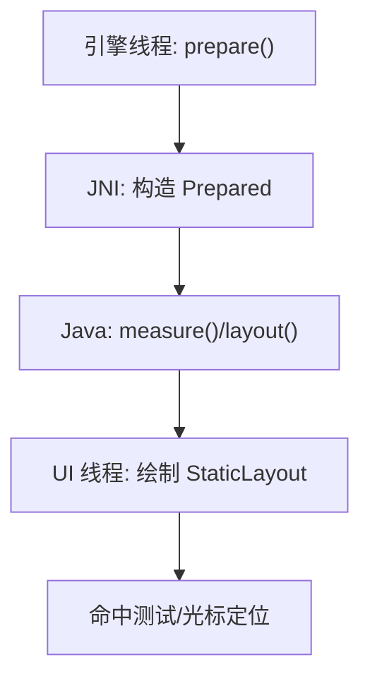
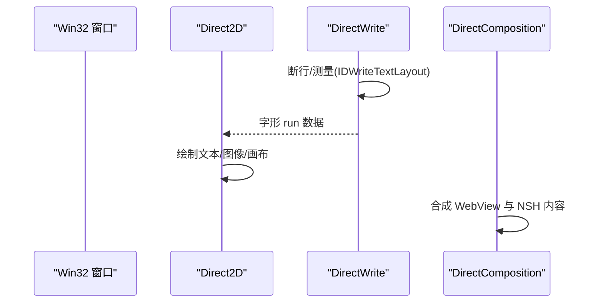
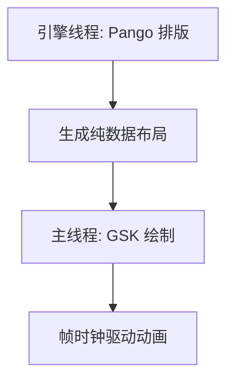
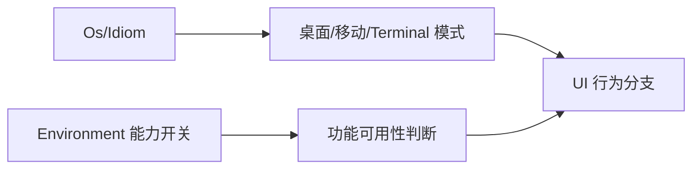

# 平台适配层架构

<cite>
**本文引用的文件**   
- [crates/nsh-core/src/platform.rs](file://crates/nsh-core/src/platform.rs)
- [crates/nsh-platform-macos/src/lib.rs](file://crates/nsh-platform-macos/src/lib.rs)
- [crates/nsh-platform-macos/src/text.rs](file://crates/nsh-platform-macos/src/text.rs)
- [crates/nsh-platform-ios/src/lib.rs](file://crates/nsh-platform-ios/src/lib.rs)
- [crates/nsh-platform-ios/src/text.rs](file://crates/nsh-platform-ios/src/text.rs)
- [crates/nsh-platform-android/src/lib.rs](file://crates/nsh-platform-android/src/lib.rs)
- [crates/nsh-platform-android/src/text.rs](file://crates/nsh-platform-android/src/text.rs)
- [crates/nsh-platform-windows/src/lib.rs](file://crates/nsh-platform-windows/src/lib.rs)
- [crates/nsh-platform-windows/src/text.rs](file://crates/nsh-platform-windows/src/text.rs)
- [crates/nsh-platform-linux/src/lib.rs](file://crates/nsh-platform-linux/src/lib.rs)
- [crates/nsh-platform-linux/src/text.rs](file://crates/nsh-platform-linux/src/text.rs)
</cite>

## 目录
1. [简介](#简介)
2. [项目结构](#项目结构)
3. [核心组件](#核心组件)
4. [架构总览](#架构总览)
5. [详细组件分析](#详细组件分析)
6. [依赖关系分析](#依赖关系分析)
7. [性能考量](#性能考量)
8. [故障排查指南](#故障排查指南)
9. [结论](#结论)

## 简介
本文件为 NSH 平台适配层的架构文档，聚焦统一的平台抽象接口与各平台的具体实现差异。内容覆盖：
- macOS（AppKit）、iOS（UIKit）、Android（Views/StaticLayout）、Windows（Win32/DirectWrite）、Linux（GTK/Pango）的渲染机制与系统集成方式
- 文本引擎的平台差异（CoreText、StaticLayout、Pango、DirectWrite）
- 窗口管理、输入处理、文件系统访问等平台特定功能的统一抽象
- 平台兼容性处理与条件编译策略

## 项目结构
NSH 将“跨平台核心”与“各平台后端”解耦：
- nsh-core 提供平台无关的类型与能力描述（如 Environment、Os、Idiom、Network 等），以及平台能力的布尔开关
- 各平台 crate（nsh-platform-{macos,ios,android,windows,linux}）实现具体平台的窗口、输入、文本、图形、系统服务等
- 每个平台 crate 暴露统一的 AppView/run_app 入口，并导出平台特定的 TextEngine 实现

图表来源
- [crates/nsh-core/src/platform.rs:100-159](file://crates/nsh-core/src/platform.rs#L100-L159)
- [crates/nsh-platform-macos/src/lib.rs:1-22](file://crates/nsh-platform-macos/src/lib.rs#L1-L22)
- [crates/nsh-platform-ios/src/lib.rs:1-37](file://crates/nsh-platform-ios/src/lib.rs#L1-L37)
- [crates/nsh-platform-android/src/lib.rs:1-16](file://crates/nsh-platform-android/src/lib.rs#L1-L16)
- [crates/nsh-platform-windows/src/lib.rs:1-22](file://crates/nsh-platform-windows/src/lib.rs#L1-L22)
- [crates/nsh-platform-linux/src/lib.rs:1-15](file://crates/nsh-platform-linux/src/lib.rs#L1-L15)

章节来源
- [crates/nsh-core/src/platform.rs:100-159](file://crates/nsh-core/src/platform.rs#L100-L159)
- [crates/nsh-platform-macos/src/lib.rs:1-22](file://crates/nsh-platform-macos/src/lib.rs#L1-L22)
- [crates/nsh-platform-ios/src/lib.rs:1-37](file://crates/nsh-platform-ios/src/lib.rs#L1-L37)
- [crates/nsh-platform-android/src/lib.rs:1-16](file://crates/nsh-platform-android/src/lib.rs#L1-L16)
- [crates/nsh-platform-windows/src/lib.rs:1-22](file://crates/nsh-platform-windows/src/lib.rs#L1-L22)
- [crates/nsh-platform-linux/src/lib.rs:1-15](file://crates/nsh-platform-linux/src/lib.rs#L1-L15)

## 核心组件
- 平台环境与环境能力
  - Os/Idiom/Lifecycle/Network 等枚举用于描述操作系统、设备形态、生命周期与网络状态
  - Environment 聚合窗口尺寸、安全区域、键盘高度、像素比、屏幕阅读器、locale、特性开关（如 web_views/shaders/notifications 等）
  - HostEnvironment 允许宿主应用覆盖 locale/font_scale
- 平台后端统一入口
  - 各平台 crate 暴露 AppView/AppOptions/run_app 等入口，供上层启动应用或嵌入视图
  - 通过 set_ui_sets/set_components 注册 UI 集与原生组件

章节来源
- [crates/nsh-core/src/platform.rs:100-159](file://crates/nsh-core/src/platform.rs#L100-L159)
- [crates/nsh-core/src/platform.rs:417-620](file://crates/nsh-core/src/platform.rs#L417-L620)
- [crates/nsh-core/src/platform.rs:716-742](file://crates/nsh-core/src/platform.rs#L716-L742)
- [crates/nsh-platform-macos/src/lib.rs:82-90](file://crates/nsh-platform-macos/src/lib.rs#L82-L90)
- [crates/nsh-platform-ios/src/lib.rs:125-222](file://crates/nsh-platform-ios/src/lib.rs#L125-L222)
- [crates/nsh-platform-android/src/lib.rs:53-117](file://crates/nsh-platform-android/src/lib.rs#L53-L117)
- [crates/nsh-platform-windows/src/lib.rs:89-101](file://crates/nsh-platform-windows/src/lib.rs#L89-L101)
- [crates/nsh-platform-linux/src/lib.rs:80-85](file://crates/nsh-platform-linux/src/lib.rs#L80-L85)

## 架构总览
NSH 采用“引擎线程 + 主线程”的双线程模型：
- 引擎线程：运行 JS/布局/文本排版（平台相关）
- 主线程：绘制、事件分发、动画驱动、系统交互

图表来源
- [crates/nsh-platform-macos/src/lib.rs:9-18](file://crates/nsh-platform-macos/src/lib.rs#L9-L18)
- [crates/nsh-platform-ios/src/lib.rs:7-33](file://crates/nsh-platform-ios/src/lib.rs#L7-L33)
- [crates/nsh-platform-android/src/lib.rs:6-15](file://crates/nsh-platform-android/src/lib.rs#L6-L15)
- [crates/nsh-platform-windows/src/lib.rs:12-18](file://crates/nsh-platform-windows/src/lib.rs#L12-L18)
- [crates/nsh-platform-linux/src/lib.rs:7-11](file://crates/nsh-platform-linux/src/lib.rs#L7-L11)

## 详细组件分析

### 文本引擎对比与实现差异
- macOS/iOS：CoreText
  - 在引擎线程使用 CoreText 进行字形排列与换行，主线程仅绘制已完成的 CTLine
  - iOS/macOS 共享 Apple 平台文本基础设施（字体、属性、装饰线等）
- Android：StaticLayout（JNI）
  - 引擎线程通过 JNI 构建 Prepared，measure/layout 在 Java 侧完成，UI 线程仅绘制
  - 使用静态数组编码 span 样式、颜色、阴影、附件等，减少跨语言开销
- Windows：DirectWrite
  - 引擎线程使用 IDWriteTextLayout 进行断行与测量；主线程用 D2D 绘制
  - 自定义 IDWriteTextRenderer 记录字形 run，最终布局为纯数据，便于命中测试
- Linux：Pango
  - 引擎线程使用独立 FontMap 与 Context 进行排版，主线程从 GTK FontMap 加载相同字体绘制
  - 支持读取桌面字体渲染设置，保持与 GTK 一致的外观

图表来源
- [crates/nsh-platform-macos/src/text.rs:1-12](file://crates/nsh-platform-macos/src/text.rs#L1-L12)
- [crates/nsh-platform-ios/src/text.rs:1-12](file://crates/nsh-platform-ios/src/text.rs#L1-L12)
- [crates/nsh-platform-android/src/text.rs:1-7](file://crates/nsh-platform-android/src/text.rs#L1-L7)
- [crates/nsh-platform-windows/src/text.rs:1-25](file://crates/nsh-platform-windows/src/text.rs#L1-L25)
- [crates/nsh-platform-linux/src/text.rs:1-15](file://crates/nsh-platform-linux/src/text.rs#L1-L15)

章节来源
- [crates/nsh-platform-macos/src/text.rs:1-12](file://crates/nsh-platform-macos/src/text.rs#L1-L12)
- [crates/nsh-platform-ios/src/text.rs:1-12](file://crates/nsh-platform-ios/src/text.rs#L1-L12)
- [crates/nsh-platform-android/src/text.rs:1-7](file://crates/nsh-platform-android/src/text.rs#L1-L7)
- [crates/nsh-platform-windows/src/text.rs:1-25](file://crates/nsh-platform-windows/src/text.rs#L1-L25)
- [crates/nsh-platform-linux/src/text.rs:1-15](file://crates/nsh-platform-linux/src/text.rs#L1-L15)

### macOS（AppKit + CoreText）
- 视图体系：每个节点是 NshView（翻转、layer-backed NSView），背景/边框/阴影/图片由 Core Animation 绘制，文本与 canvas 进入子 content layer
- 文本：CoreTextEngine 在引擎线程排版，主线程绘制
- 输入：根视图接管鼠标/滚轮/触控板/键盘，滚动视图维护自身偏移
- 动画：基于 display link 驱动

```mermaid
flowchart TD
Start(["应用启动"]) --> CreateView["创建 NshView(AppKit)"]
CreateView --> Layout["引擎线程布局/排版(CoreText)"]
Layout --> Commit["提交到主线程"]
Commit --> Draw["主线程绘制(CA/CoreGraphics)"]
Draw --> Input["输入事件分发"]
Input --> Loop{"继续运行?"}
Loop --> |是| Layout
Loop --> |否| End(["退出"])
```

图表来源
- [crates/nsh-platform-macos/src/lib.rs:1-22](file://crates/nsh-platform-macos/src/lib.rs#L1-L22)
- [crates/nsh-platform-macos/src/text.rs:1-12](file://crates/nsh-platform-macos/src/text.rs#L1-L12)

章节来源
- [crates/nsh-platform-macos/src/lib.rs:1-22](file://crates/nsh-platform-macos/src/lib.rs#L1-L22)
- [crates/nsh-platform-macos/src/text.rs:1-12](file://crates/nsh-platform-macos/src/text.rs#L1-L12)

### iOS（UIKit + CoreText）
- 视图体系：AppView 作为 UIView 嵌入 UIKit 层级，run_app 可创建独立窗口
- 文本：CoreTextEngine 同 macOS，保证布局与渲染一致性
- 硬件键盘：focusable 视图成为 first responder，UIKeyCommand 优先级高于默认 Tab 行为
- 动画：主线程驱动

图表来源
- [crates/nsh-platform-ios/src/lib.rs:1-37](file://crates/nsh-platform-ios/src/lib.rs#L1-L37)
- [crates/nsh-platform-ios/src/text.rs:1-12](file://crates/nsh-platform-ios/src/text.rs#L1-L12)

章节来源
- [crates/nsh-platform-ios/src/lib.rs:1-37](file://crates/nsh-platform-ios/src/lib.rs#L1-L37)
- [crates/nsh-platform-ios/src/text.rs:1-12](file://crates/nsh-platform-ios/src/text.rs#L1-L12)

### Android（Views + StaticLayout/JNI）
- 运行时：libnsh.so 被 Java 加载，引擎线程负责 JS/布局，JNI 将布局编码为字节数组传给 UI 线程
- 文本：AndroidTextEngine 通过 JNI 调用 TextLayouts.prepare/measure/layout，UI 线程仅绘制
- 选择与命中：UI 线程维护选择，Rust 侧通过 JNI 查询位置/矩形

图表来源
- [crates/nsh-platform-android/src/lib.rs:1-16](file://crates/nsh-platform-android/src/lib.rs#L1-L16)
- [crates/nsh-platform-android/src/text.rs:1-7](file://crates/nsh-platform-android/src/text.rs#L1-L7)

章节来源
- [crates/nsh-platform-android/src/lib.rs:1-16](file://crates/nsh-platform-android/src/lib.rs#L1-L16)
- [crates/nsh-platform-android/src/text.rs:1-7](file://crates/nsh-platform-android/src/text.rs#L1-L7)

### Windows（Win32 + DirectWrite）
- 视图体系：每表面一个 Win32 窗口，NshView 为保留视图，整棵树由 Direct2D 绘制到交换链
- 文本：DirectWrite 在引擎线程断行/测量，主线程用 D2D 绘制；自定义 IDWriteTextRenderer 记录字形 run
- Web 视图：通过 DirectComposition 与 NSH 内容分层合成

图表来源
- [crates/nsh-platform-windows/src/lib.rs:1-22](file://crates/nsh-platform-windows/src/lib.rs#L1-L22)
- [crates/nsh-platform-windows/src/text.rs:1-25](file://crates/nsh-platform-windows/src/text.rs#L1-L25)

章节来源
- [crates/nsh-platform-windows/src/lib.rs:1-22](file://crates/nsh-platform-windows/src/lib.rs#L1-L22)
- [crates/nsh-platform-windows/src/text.rs:1-25](file://crates/nsh-platform-windows/src/text.rs#L1-L25)

### Linux（GTK + Pango）
- 视图体系：NshView 为 gtk::Widget 子类，GSK render nodes 绘制背景/边框/阴影/文字/图片
- 文本：PangoTextEngine 在引擎线程排版，主线程从 GTK FontMap 加载字体绘制
- 动画：根视图 frame clock 驱动

图表来源
- [crates/nsh-platform-linux/src/lib.rs:1-15](file://crates/nsh-platform-linux/src/lib.rs#L1-L15)
- [crates/nsh-platform-linux/src/text.rs:1-15](file://crates/nsh-platform-linux/src/text.rs#L1-L15)

章节来源
- [crates/nsh-platform-linux/src/lib.rs:1-15](file://crates/nsh-platform-linux/src/lib.rs#L1-L15)
- [crates/nsh-platform-linux/src/text.rs:1-15](file://crates/nsh-platform-linux/src/text.rs#L1-L15)

## 依赖关系分析
- 平台能力开关
  - Environment 中的布尔字段（如 web_views、shaders、notifications、audio、canvas_render 等）决定功能可用性
  - 未实现的能力会返回“不可用”错误，避免上层误判
- 平台检测与分支
  - Os::is_desktop/is_catalyst 与 Idiom::desktop_on/reported_on 决定桌面行为与 idiom 报告值
  - 条件编译：各平台 crate 使用 #[cfg(target_os = "...")] 或 #[cfg(windows)] 控制模块编译

图表来源
- [crates/nsh-core/src/platform.rs:100-159](file://crates/nsh-core/src/platform.rs#L100-L159)
- [crates/nsh-core/src/platform.rs:417-620](file://crates/nsh-core/src/platform.rs#L417-L620)

章节来源
- [crates/nsh-core/src/platform.rs:100-159](file://crates/nsh-core/src/platform.rs#L100-L159)
- [crates/nsh-core/src/platform.rs:417-620](file://crates/nsh-core/src/platform.rs#L417-L620)

## 性能考量
- 文本排版一次化
  - macOS/iOS：CoreText 在引擎线程排版，主线程只绘制，避免重复布局
  - Windows：IDWriteTextLayout 仅断行，最终布局为纯数据，主线程绘制与命中测试分离
  - Linux：Pango 在引擎线程排版，主线程按描述加载字体绘制，度量与绘制解耦
  - Android：JNI 批量传递 Prepared/StaticLayout，减少跨语言开销
- 字体缓存
  - macOS/iOS：FontCache 限制大小，避免频繁创建 CTFont
  - Windows/Linux：按字体族/尺寸缓存 FontInfo/Metrics，限制缓存上限
- 双线程模型
  - 引擎线程专注计算，主线程专注绘制与事件，降低锁竞争与阻塞

章节来源
- [crates/nsh-platform-macos/src/text.rs:43-79](file://crates/nsh-platform-macos/src/text.rs#L43-L79)
- [crates/nsh-platform-ios/src/text.rs:38-74](file://crates/nsh-platform-ios/src/text.rs#L38-L74)
- [crates/nsh-platform-windows/src/text.rs:121-129](file://crates/nsh-platform-windows/src/text.rs#L121-L129)
- [crates/nsh-platform-linux/src/text.rs:637-669](file://crates/nsh-platform-linux/src/text.rs#L637-L669)
- [crates/nsh-platform-android/src/text.rs:92-102](file://crates/nsh-platform-android/src/text.rs#L92-L102)

## 故障排查指南
- 功能不可用
  - 检查 Environment 中对应能力开关（如 web_views、shaders、notifications、audio、canvas_render、share、app_settings、auth_session、scheme_links、file_requests、speech 等）
  - 若未实现，上层 API 会返回“不可用”错误码
- 文本显示异常
  - macOS/iOS：确认字体家族是否可用，回退逻辑是否正确；注意 italic 与 OpenType features
  - Windows：确认 DirectWrite 集合与 GDI 内存字体注册成功；RichEdit 需要 GDI 路径
  - Linux：确认 Pango FontMap 与 GTK Settings 的字体渲染设置一致
  - Android：确认 JNI 方法签名与参数编码正确，density 更新后布局刷新
- 输入与焦点
  - iOS：确认 focusable/capture_keys 配置，Tab 遍历与快捷键优先级
  - macOS/Linux：确认根视图接管输入与滚动视图偏移管理
  - Windows：确认消息循环与输入事件转发

章节来源
- [crates/nsh-core/src/platform.rs:417-620](file://crates/nsh-core/src/platform.rs#L417-L620)
- [crates/nsh-platform-ios/src/lib.rs:11-33](file://crates/nsh-platform-ios/src/lib.rs#L11-L33)
- [crates/nsh-platform-windows/src/text.rs:131-256](file://crates/nsh-platform-windows/src/text.rs#L131-L256)
- [crates/nsh-platform-linux/src/text.rs:498-539](file://crates/nsh-platform-linux/src/text.rs#L498-L539)
- [crates/nsh-platform-android/src/text.rs:480-522](file://crates/nsh-platform-android/src/text.rs#L480-L522)

## 结论
NSH 平台适配层通过统一的 Environment 与能力开关屏蔽平台差异，并以“引擎线程 + 主线程”的双线程模型确保布局与绘制的解耦。各平台分别采用 CoreText、StaticLayout、DirectWrite、Pango 等文本引擎，结合各自 GUI 框架（AppKit、UIKit、Android Views、Win32/D2D、GTK/GSK）实现一致的渲染体验。通过条件编译与能力探测，NSH 在不同平台上提供稳定、可扩展且高性能的统一抽象。