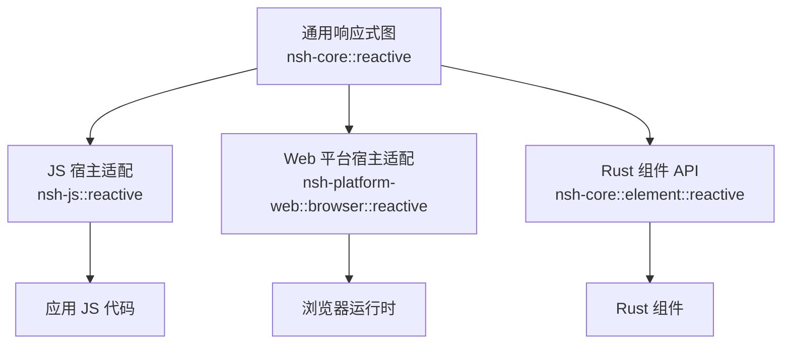
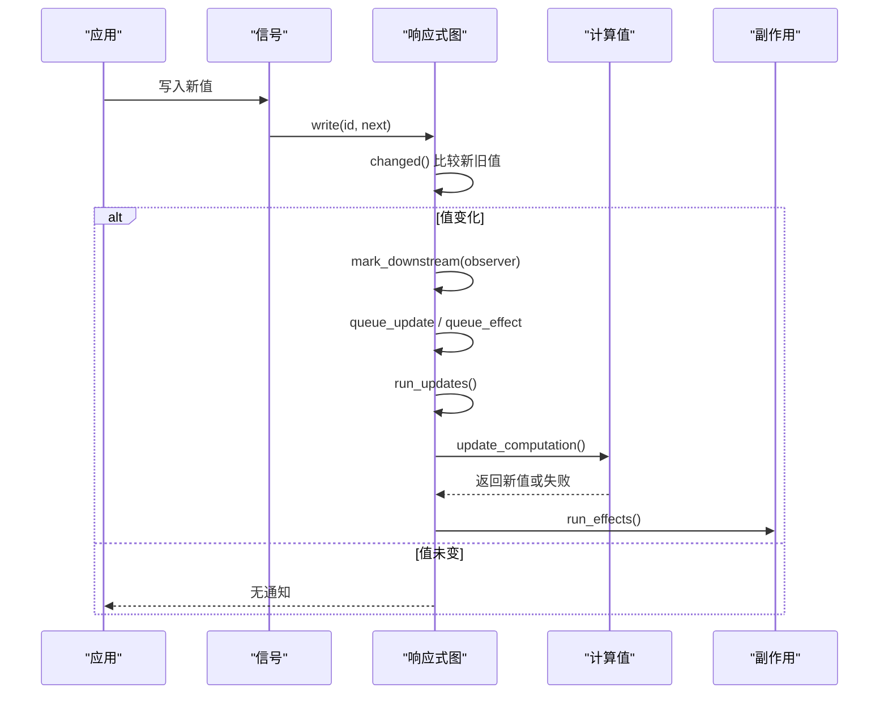
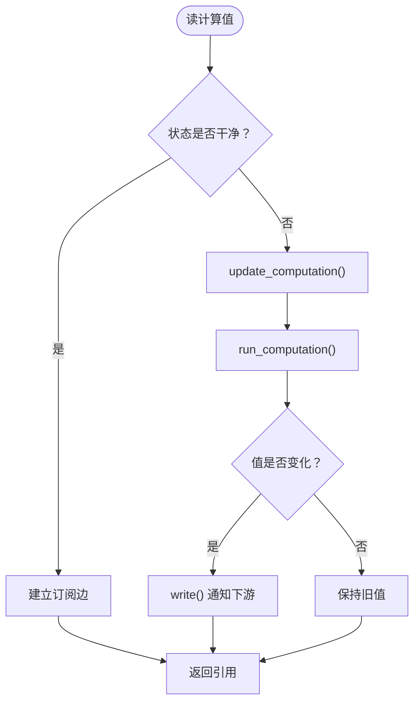
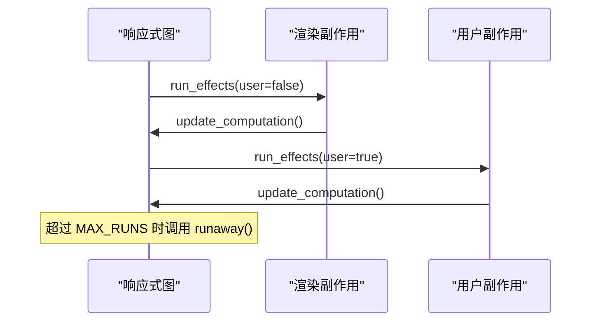
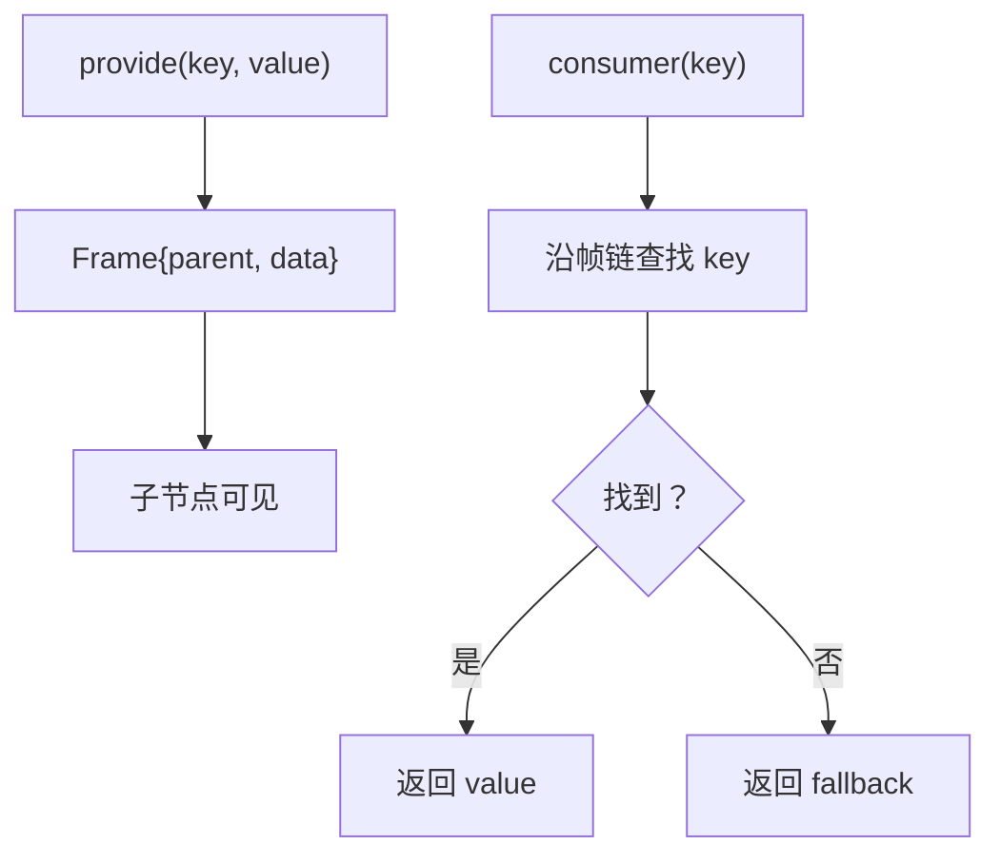

# 数据流系统设计

<cite>
**本文引用的文件**   
- [reactive.rs](file://crates/nsh-core/src/reactive.rs)
- [reactive.rs（JS）](file://crates/nsh-js/src/reactive.rs)
- [reactive.rs（Web）](file://crates/nsh-platform-web/src/browser/reactive.rs)
- [reactive.rs（Rust 组件）](file://crates/nsh-core/src/element/reactive.rs)
</cite>

## 目录
1. [引言](#引言)
2. [项目结构](#项目结构)
3. [核心组件](#核心组件)
4. [架构总览](#架构总览)
5. [详细组件分析](#详细组件分析)
6. [依赖关系分析](#依赖关系分析)
7. [性能与优化](#性能与优化)
8. [调试与监控](#调试与监控)
9. [故障排查](#故障排查)
10. [结论](#结论)

## 引言
本设计文档面向 NSH 的数据流系统，聚焦响应式编程模型在信号、计算值、副作用与上下文中的实现。NSH 的响应式内核基于 Solid 1.9 的调度策略，采用“图 + 队列”的方式管理依赖、更新与副作用执行；同时为 JS 与 Rust 组件提供统一的 Host 抽象，使不同宿主共享同一套算法与保证。

本文重点解释：
- 信号的创建、读取、写入与订阅机制
- 计算值（memo/computed）的缓存与依赖追踪
- 副作用（effect）的执行时机与清理机制
- 上下文（context）在组件树中的传递与消费
- 数据流调试工具、性能监控与优化策略
- 实际代码示例路径与最佳实践

## 项目结构
NSH 的响应式系统由四层组成：
- 通用响应式图：`nsh-core::reactive`
- JS 宿主适配层：`nsh-js::reactive`
- Web 平台宿主适配层：`nsh-platform-web::browser::reactive`
- Rust 组件 API 层：`nsh-core::element::reactive`



**图示来源**
- [reactive.rs:1-17](file://crates/nsh-core/src/reactive.rs#L1-L17)
- [reactive.rs（JS）:1-19](file://crates/nsh-js/src/reactive.rs#L1-L19)
- [reactive.rs（Web）:1-17](file://crates/nsh-platform-web/src/browser/reactive.rs#L1-L17)
- [reactive.rs（Rust 组件）:1-15](file://crates/nsh-core/src/element/reactive.rs#L1-L15)

**章节来源**
- [reactive.rs:1-17](file://crates/nsh-core/src/reactive.rs#L1-L17)
- [reactive.rs（JS）:1-19](file://crates/nsh-js/src/reactive.rs#L1-L19)
- [reactive.rs（Web）:1-17](file://crates/nsh-platform-web/src/browser/reactive.rs#L1-L17)
- [reactive.rs（Rust 组件）:1-15](file://crates/nsh-core/src/element/reactive.rs#L1-L15)

## 核心组件
- 节点与种类：信号、计算值、渲染副作用、用户副作用、所有者根、空闲槽
- 比较策略：默认相等、从不相等、真值性比较、自定义比较
- 调度器：更新队列与副作用队列，按 Solid 1.9 的顺序执行
- 所有者与上下文：节点归属、上下文帧链、提供与查找
- 生命周期：分配、标记脏、清理、释放、压缩回收

关键类型与职责：
- `Kind`：节点种类枚举
- `Equals`：比较策略
- `Graph`：图与调度状态
- `Node`：节点存储与边信息
- `Frame`：上下文帧
- `Host`：宿主抽象接口

**章节来源**
- [reactive.rs:45-73](file://crates/nsh-core/src/reactive.rs#L45-L73)
- [reactive.rs:138-179](file://crates/nsh-core/src/reactive.rs#L138-L179)
- [reactive.rs:241-260](file://crates/nsh-core/src/reactive.rs#L241-L260)
- [reactive.rs:83-136](file://crates/nsh-core/src/reactive.rs#L83-L136)

## 架构总览
响应式图的核心流程如下：
- 写信号时，若值发生变化，则标记下游观察者并进入调度
- 读信号时，若是计算值且非干净，先将其上游带至最新，再建立订阅边
- 副作用分为渲染副作用与用户副作用，分别在不同阶段执行
- 所有计算与副作用运行期间维护当前监听者与所有者，确保依赖追踪正确



**图示来源**
- [reactive.rs:1077-1111](file://crates/nsh-core/src/reactive.rs#L1077-L1111)
- [reactive.rs:1115-1140](file://crates/nsh-core/src/reactive.rs#L1115-L1140)
- [reactive.rs:984-1058](file://crates/nsh-core/src/reactive.rs#L984-L1058)
- [reactive.rs:904-914](file://crates/nsh-core/src/reactive.rs#L904-L914)

## 详细组件分析

### 信号（Signal）
- 创建：支持普通信号与“每写必通知”的信号
- 读取：在计算上下文中自动订阅；提供无订阅读取
- 写入：比较策略决定是否需要通知；批量更新可合并多次写入
- 只读视图：对外暴露 ReadSignal，限制写入能力

典型用法路径：
- Rust 组件侧：`signal(value)`、`signal_with(value, equals)`、`Signal::get/set/update`
- JS 侧：`createSignal(value, options)` 返回 `[read, write]`
- Web 侧：通过操作码 100/101/102 创建、读取、写入

**章节来源**
- [reactive.rs（Rust 组件）:521-532](file://crates/nsh-core/src/element/reactive.rs#L521-L532)
- [reactive.rs（Rust 组件）:684-775](file://crates/nsh-core/src/element/reactive.rs#L684-L775)
- [reactive.rs（JS）:616-631](file://crates/nsh-js/src/reactive.rs#L616-L631)
- [reactive.rs（Web）:217-235](file://crates/nsh-platform-web/src/browser/reactive.rs#L217-L235)

### 计算值（Memo/Computed）
- 创建：`memo(func, value, equals, handle)`
- 缓存：计算结果缓存于节点，仅在依赖变化后重新计算
- 依赖追踪：读信号时建立源到观察者的双向边；重复读去重
- 失效与更新：上游变更触发下游 PENDING/STALE，按拓扑顺序更新



**图示来源**
- [reactive.rs:1115-1140](file://crates/nsh-core/src/reactive.rs#L1115-L1140)
- [reactive.rs:984-1058](file://crates/nsh-core/src/reactive.rs#L984-L1058)
- [reactive.rs:676-702](file://crates/nsh-core/src/reactive.rs#L676-L702)

**章节来源**
- [reactive.rs:1208-1226](file://crates/nsh-core/src/reactive.rs#L1208-L1226)
- [reactive.rs:984-1058](file://crates/nsh-core/src/reactive.rs#L984-L1058)
- [reactive.rs:676-702](file://crates/nsh-core/src/reactive.rs#L676-L702)

### 副作用（Effects）
- 分类：渲染副作用（优先）、用户副作用（延后）
- 执行时机：渲染副作用立即执行；用户副作用在渲染副作用之后
- 清理机制：每个节点持有清理函数列表，在节点清理时依次执行
- 无限循环保护：刷新次数超过阈值触发 runaway 错误



**图示来源**
- [reactive.rs:904-914](file://crates/nsh-core/src/reactive.rs#L904-L914)
- [reactive.rs:1231-1244](file://crates/nsh-core/src/reactive.rs#L1231-L1244)
- [reactive.rs:891-902](file://crates/nsh-core/src/reactive.rs#L891-L902)

**章节来源**
- [reactive.rs:904-914](file://crates/nsh-core/src/reactive.rs#L904-L914)
- [reactive.rs:1231-1244](file://crates/nsh-core/src/reactive.rs#L1231-L1244)
- [reactive.rs:891-902](file://crates/nsh-core/src/reactive.rs#L891-L902)

### 上下文（Context）
- 提供：在当前所有者上设置上下文帧，子节点可见
- 消费：沿帧链向上查找键对应的值
- 作用域：上下文随所有者传播，dispose 时清理



**图示来源**
- [reactive.rs:383-409](file://crates/nsh-core/src/reactive.rs#L383-L409)
- [reactive.rs（Web）:312-333](file://crates/nsh-platform-web/src/browser/reactive.rs#L312-L333)

**章节来源**
- [reactive.rs:383-409](file://crates/nsh-core/src/reactive.rs#L383-L409)
- [reactive.rs（Web）:312-333](file://crates/nsh-platform-web/src/browser/reactive.rs#L312-L333)

### 调度与批处理
- 批处理：`batch(f)` 将多次写入合并为一次更新
- 无订阅读取：`untracked(f)` 在 f 内不建立依赖
- 所有者根：`with_root(f)` 创建独立所有者，便于隔离与销毁

**章节来源**
- [reactive.rs:1246-1270](file://crates/nsh-core/src/reactive.rs#L1246-L1270)
- [reactive.rs:1302-1338](file://crates/nsh-core/src/reactive.rs#L1302-L1338)
- [reactive.rs（JS）:775-798](file://crates/nsh-js/src/reactive.rs#L775-L798)

## 依赖关系分析
- 通用图与宿主解耦：通过 `Host` trait 抽象值、函数、比较、清理等
- JS 宿主：使用 QuickJS 值与函数，集成错误边界与异常捕获
- Web 宿主：封装浏览器回调与 Rust 清理，统一调度
- Rust 组件：以类型安全的 Handle 访问图节点，提供强类型信号 API

```mermaid
classDiagram
class Host {
<<trait>>
+Value
+Func
+Equals
+Cleanup
+Context
+Data
+graph()
+call()
+same()
+truthy()
+custom_changed()
+run_cleanup()
+free_cleanup()
+runaway()
}
class Js {
+Value = JsValue
+Func = JsValue
+Equals = JsValue
+Cleanup = JsValue
+Context = JsFrame
+Data = JsData
}
class WebHost {
+Value = Value
+Func = Value
+Equals = Value
+Cleanup = Cleanup
+Context = (Value, Value)
+Data = Data
}
class Rust {
+Value = Option<Rc<dyn Any>>
+Func = Rc<dyn Compute>
+Equals = Compare
+Cleanup = Box<dyn FnOnce()>
+Context = (TypeId, Rc<dyn Any>)
+Data = RustData
}
Host <|.. Js
Host <|.. WebHost
Host <|.. Rust
```

**图示来源**
- [reactive.rs:83-136](file://crates/nsh-core/src/reactive.rs#L83-L136)
- [reactive.rs（JS）:83-212](file://crates/nsh-js/src/reactive.rs#L83-L212)
- [reactive.rs（Web）:29-106](file://crates/nsh-platform-web/src/browser/reactive.rs#L29-L106)
- [reactive.rs（Rust 组件）:153-261](file://crates/nsh-core/src/element/reactive.rs#L153-L261)

**章节来源**
- [reactive.rs:83-136](file://crates/nsh-core/src/reactive.rs#L83-L136)
- [reactive.rs（JS）:83-212](file://crates/nsh-js/src/reactive.rs#L83-L212)
- [reactive.rs（Web）:29-106](file://crates/nsh-platform-web/src/browser/reactive.rs#L29-L106)
- [reactive.rs（Rust 组件）:153-261](file://crates/nsh-core/src/element/reactive.rs#L153-L261)

## 性能与优化
- 比较策略优化：
  - 默认相等：避免不必要的通知
  - 从不相等：适用于原地修改的值
  - 真值性比较：条件型信号
  - 自定义比较：复杂对象差异判断
- 依赖去重：同一次计算中重复读同一源仅建一条边
- 内存回收：空闲槽复用、arena 压缩、句柄生命周期管理
- 调度优化：PENDING/STALE 状态减少重复计算，按祖先顺序更新

建议：
- 对频繁更新的信号使用合适的比较策略
- 使用 `batch` 合并多次写入
- 避免在副作用中直接修改被其读取的信号，防止无限循环
- 合理使用 `untracked` 避免不必要订阅

**章节来源**
- [reactive.rs:1060-1074](file://crates/nsh-core/src/reactive.rs#L1060-L1074)
- [reactive.rs:676-702](file://crates/nsh-core/src/reactive.rs#L676-L702)
- [reactive.rs:293-315](file://crates/nsh-core/src/reactive.rs#L293-L315)
- [reactive.rs:1267-1270](file://crates/nsh-core/src/reactive.rs#L1267-L1270)

## 调试与监控
- 运行计数与超限保护：超过最大刷新次数触发 runaway
- 错误边界：JS 侧捕获异常并投递给最近的 ErrorBoundary
- 插槽统计：可用 slots 数量用于内存压力评估
- 边缘追踪：Web 侧可导出句柄关联的边信息，辅助可视化依赖

实用方法：
- `reset_runs()`：重置运行计数
- `slots_in_use()`：查看已用插槽数
- `trace_edges()`：导出句柄相关的边信息
- `take_failures()`：获取计算失败的堆栈信息

**章节来源**
- [reactive.rs:891-902](file://crates/nsh-core/src/reactive.rs#L891-L902)
- [reactive.rs（JS）:196-211](file://crates/nsh-js/src/reactive.rs#L196-L211)
- [reactive.rs（Rust 组件）:308-336](file://crates/nsh-core/src/element/reactive.rs#L308-L336)
- [reactive.rs（Web）:196-210](file://crates/nsh-platform-web/src/browser/reactive.rs#L196-L210)

## 故障排查
常见问题与定位：
- 无限循环：检查是否在副作用中直接修改被其读取的信号
- 值未更新：确认比较策略是否正确，必要时使用 `SignalEquals::Never`
- 上下文未生效：检查 provide/consumer 的键是否一致，以及作用域是否正确
- 内存泄漏：检查句柄是否被长期持有，必要时显式 dispose

定位步骤：
- 启用错误边界，捕获 JS 异常
- 使用 `slots_in_use()` 与 `trace_edges()` 评估内存与依赖
- 使用 `take_failures()` 获取 Rust 计算失败信息
- 逐步缩小范围，使用 `untracked` 排除无关订阅

**章节来源**
- [reactive.rs（JS）:297-317](file://crates/nsh-js/src/reactive.rs#L297-L317)
- [reactive.rs（Rust 组件）:308-336](file://crates/nsh-core/src/element/reactive.rs#L308-L336)
- [reactive.rs（Web）:196-210](file://crates/nsh-platform-web/src/browser/reactive.rs#L196-L210)

## 结论
NSH 的数据流系统以通用响应式图为核心，通过 Host 抽象兼容 JS 与 Rust 宿主，提供一致的信号、计算值、副作用与上下文语义。其调度遵循 Solid 1.9 的策略，具备高效的依赖追踪、缓存与清理机制。结合比较策略、批处理与调试工具，开发者可在保证性能的同时构建可维护的响应式界面。