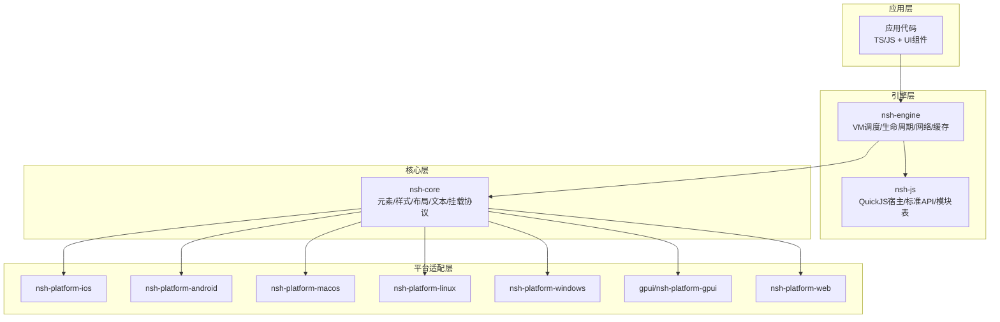
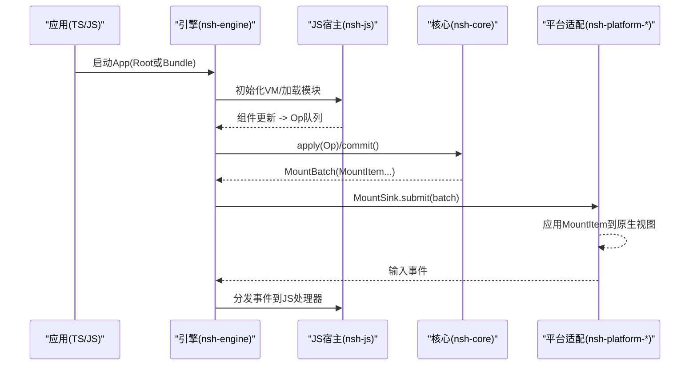

# 整体架构概览

<cite>
**本文引用的文件**   
- [Cargo.toml](file://Cargo.toml)
- [architecture.md](file://docs/dev/architecture.md)
- [nsh-core/lib.rs](file://crates/nsh-core/src/lib.rs)
- [nsh-engine/lib.rs](file://crates/nsh-engine/src/lib.rs)
- [nsh-js/lib.rs](file://crates/nsh-js/src/lib.rs)
- [nsh-engine/script.rs](file://crates/nsh-engine/src/script.rs)
</cite>

## 目录
1. [引言](#引言)
2. [项目结构](#项目结构)
3. [核心组件](#核心组件)
4. [架构总览](#架构总览)
5. [详细组件分析](#详细组件分析)
6. [依赖关系分析](#依赖关系分析)
7. [性能考量](#性能考量)
8. [故障排查指南](#故障排查指南)
9. [结论](#结论)
10. [附录](#附录)

## 引言
本文件面向NSH框架的整体架构，聚焦四层设计：应用层、引擎层、核心层与平台适配层。文档解释各层职责、交互边界、数据流向（从JS组件到原生渲染）、关键设计决策（分层架构、Rust与TypeScript混合开发），并给出系统边界、模块依赖图与扩展点说明，辅以架构图与通信机制详解，帮助读者快速建立全局认知。

## 项目结构
NSH采用多crate的Workspace组织方式，核心由以下层次构成：
- 应用层：用户编写的TS/JS应用与UI组件库（例如examples、website等）。
- 引擎层：负责运行JS VM、调度任务、协调布局与渲染、与平台桥接（nsh-engine）。
- 核心层：跨平台的UI原语、响应式图、样式与布局、文本排版、事件与挂载协议（nsh-core）。
- 平台适配层：针对iOS/Android/macOS/Linux/Windows/GPUI/Web等的具体实现（nsh-platform-*）。



图表来源
- [Cargo.toml:1-10](file://Cargo.toml#L1-L10)
- [architecture.md:91-114](file://docs/dev/architecture.md#L91-L114)

章节来源
- [Cargo.toml:1-10](file://Cargo.toml#L1-L10)
- [architecture.md:91-114](file://docs/dev/architecture.md#L91-L114)

## 核心组件
- nsh-core：提供跨平台UI原语、样式系统、Taffy布局、文本排版接口、响应式图、挂载协议（Op/MountBatch/MountItem）等，是平台无关的核心。
- nsh-js：QuickJS宿主，安装全局对象与Web API，维护模块表，将JS变更转换为Op队列，并将原生事件回派给JS。
- nsh-engine：引擎线程，管理一个Surface对应的App（Rust根组件或JS Bundle），驱动JS执行、收集Op、调用Core.commit、生成MountBatch并通过MountSink提交到平台主线程。
- 平台适配层：实现TextEngine、MountSink、窗口/视图树、输入、网络栈等，将核心层的抽象映射到具体平台能力。

章节来源
- [nsh-core/lib.rs:1-10](file://crates/nsh-core/src/lib.rs#L1-L10)
- [nsh-js/lib.rs:1-10](file://crates/nsh-js/src/lib.rs#L1-L10)
- [nsh-engine/lib.rs:1-10](file://crates/nsh-engine/src/lib.rs#L1-L10)

## 架构总览
NSH遵循GPUI Kit的分层规则：核心层提供原环境与UI原语；基础组件层提供无样式的行为与状态；应用层构建有样式的组件库。引擎层在运行时串联JS与核心层，平台层负责最终绘制与输入。



图表来源
- [nsh-engine/lib.rs:1-10](file://crates/nsh-engine/src/lib.rs#L1-L10)
- [nsh-js/lib.rs:1-10](file://crates/nsh-js/src/lib.rs#L1-L10)
- [nsh-core/lib.rs:1-10](file://crates/nsh-core/src/lib.rs#L1-L10)
- [architecture.md:3-10](file://docs/dev/architecture.md#L3-L10)

## 详细组件分析

### 引擎层（nsh-engine）
- 职责：管理引擎线程、App生命周期、JS VM、网络与缓存、与平台通过MountSink通信。
- 关键点：
  - App枚举支持Rust Root与JS Bundle两种入口。
  - EngineConfig集中配置环境、网络、存储、时钟、UI Sets等。
  - LocalEngine用于非线程场景（如WASM），由宿主事件循环驱动。
  - EngineControl提供跨线程发送输入的能力。

```mermaid
classDiagram
class Engine {
+control : EngineControl
+thread : Option<JoinHandle>
+host : HostChannel
+stop : AtomicBool
+quit_listeners : AtomicBool
+image_cache : Option<DiskCache>
+media_files : MediaFiles
}
class EngineConfig {
+app : App
+viewport : Size
+trace : bool
+content_culling : bool
+network : Option<Network>
+websocket : Option<WebSocketTransport>
+filesystem : Option<FileSystem>
+assets : Option<Assets>
+environment : Environment
+header_heights : (Points, Points)
+limits : Limits
+ui_sets : Vec<Registry>
+runtime : Option<tokio : : Handle>
+support_dir : Option<PathBuf>
+data_dir : Option<PathBuf>
+cache : CacheOptions
+storage : Option<StorageBackend>
+clock : Clock
+context : EngineContext
+pinned : EnvironmentPins
+clipboard : Option<ClipboardBackend>
+host : HostChannel
+picker : Option<PickerBackend>
+speech : Option<SpeechBackend>
+audio : Option<AudioBackend>
+windows : Option<WindowBackend>
+login_item : Option<LoginItemBackend>
}
class LocalEngine {
+driver : Driver
+rx : Receiver<Message>
+control : EngineControl
+wake : Option<Arc<dyn Fn()>>
+pumping : AtomicBool
+quit_started : bool
}
class EngineControl {
+tx : Sender<Message>
+modality : AtomicU8
+downloads : DownloadCleanup
}
Engine --> EngineConfig : "使用"
LocalEngine --> EngineControl : "持有"
```

图表来源
- [nsh-engine/lib.rs:125-136](file://crates/nsh-engine/src/lib.rs#L125-L136)
- [nsh-engine/lib.rs:1147-1259](file://crates/nsh-engine/src/lib.rs#L1147-L1259)
- [nsh-engine/lib.rs:1607-1618](file://crates/nsh-engine/src/lib.rs#L1607-L1618)
- [nsh-engine/lib.rs:2140-2157](file://crates/nsh-engine/src/lib.rs#L2140-L2157)

章节来源
- [nsh-engine/lib.rs:1-10](file://crates/nsh-engine/src/lib.rs#L1-L10)
- [nsh-engine/lib.rs:125-136](file://crates/nsh-engine/src/lib.rs#L125-L136)
- [nsh-engine/lib.rs:1147-1259](file://crates/nsh-engine/src/lib.rs#L1147-L1259)
- [nsh-engine/lib.rs:1607-1618](file://crates/nsh-engine/src/lib.rs#L1607-L1618)
- [nsh-engine/lib.rs:2140-2157](file://crates/nsh-engine/src/lib.rs#L2140-L2157)

### JS运行时（nsh-js）
- 职责：QuickJS宿主，安装全局对象（console、timers、Web APIs），注册NSH原生模块（nsh、nsh:rt、nsh/*），将JS变更转为Op队列，并将原生事件派发回JS。
- 关键点：单线程Host，不Send；与引擎层协作完成模块加载、错误处理、帧调度、网络请求等。

章节来源
- [nsh-js/lib.rs:1-10](file://crates/nsh-js/src/lib.rs#L1-L10)
- [nsh-js/lib.rs:62-86](file://crates/nsh-js/src/lib.rs#L62-L86)

### 核心层（nsh-core）
- 职责：接收JS渲染器产生的Op，维护影子树，转换样式为Taffy布局，合并内联文本，执行布局，输出MountBatch供平台后端应用到原生视图。
- 关键点：单线程、低分配敏感；暴露大量类型（颜色、几何、样式、文本、动画、挂载项等）。

章节来源
- [nsh-core/lib.rs:1-10](file://crates/nsh-core/src/lib.rs#L1-L10)
- [nsh-core/lib.rs:117-175](file://crates/nsh-core/src/lib.rs#L117-L175)

### 平台适配层（nsh-platform-*）
- 职责：实现TextEngine、MountSink、窗口/视图树、输入、网络栈等，将核心层抽象映射到平台能力。
- 关键点：不同平台有不同的文本引擎（CoreText/StaticLayout/Pango/DirectWrite/GPUI），以及不同的绘制与动画机制。

章节来源
- [architecture.md:40-62](file://docs/dev/architecture.md#L40-L62)

## 依赖关系分析
依赖方向严格分层：nsh-core ← nsh-js ← nsh-engine（← nsh-package）← nsh-platform-* ← 各平台宿主/应用；nsh-cli依赖bundler、js、engine；nsh-base仅依赖nsh-core且被bundler、平台与CLI使用；应用自己的UI集仅依赖nsh-core。nsh-core不得依赖任何平台或JS crate。

```mermaid
graph LR
CORE["nsh-core"]
JS["nsh-js"]
ENGINE["nsh-engine"]
PACKAGE["nsh-package"]
BASE["nsh-base"]
CLI["nsh-cli"]
BUNDLER["nsh-bundler"]
PLATFORMS["nsh-platform-*"]
HOSTS["ios/macos/linux/windows/gpui hosts/apps"]
CORE <-- JS
JS <-- ENGINE
ENGINE <-- PACKAGE
PLATFORMS <-- ENGINE
BASE --> CORE
CLI --> BUNDLER
CLI --> JS
CLI --> ENGINE
HOSTS --> PLATFORMS
```

图表来源
- [Cargo.toml:37-56](file://Cargo.toml#L37-L56)
- [architecture.md:108-110](file://docs/dev/architecture.md#L108-L110)

章节来源
- [Cargo.toml:37-56](file://Cargo.toml#L37-L56)
- [architecture.md:108-110](file://docs/dev/architecture.md#L108-L110)

## 性能考量
- 文本排版一次完成：引擎线程准备与测量，主线程只绘制，避免阻塞UI线程。
- 布局缓存：按引擎维度缓存测量结果，颜色变化不触发重排。
- 一帧一提交：每个commit对应一次平台主线程跳转，减少同步等待。
- 计时与时间：Clock可手动推进，测试友好；idle周期进行垃圾回收，避免频繁GC抖动。
- 网络流式：请求头与体分块传输，支持背压与流式写入。

章节来源
- [architecture.md:20-29](file://docs/dev/architecture.md#L20-L29)
- [architecture.md:74-89](file://docs/dev/architecture.md#L74-L89)

## 故障排查指南
- JS异常与未处理拒绝：引擎层捕获并上报，支持源码映射还原堆栈。
- 包验证与信任链：已签名包的加载、资产解压与接受流程，失败时记录警告与错误。
- 热更新失败：当就地更新不可用时，提示重新加载完整bundle。
- 错误报告：统一通过MountSink.report/Error路径上报，便于宿主展示与日志记录。

章节来源
- [nsh-engine/script.rs:136-155](file://crates/nsh-engine/src/script.rs#L136-L155)
- [nsh-engine/script.rs:189-209](file://crates/nsh-engine/src/script.rs#L189-L209)
- [nsh-engine/lib.rs:594-631](file://crates/nsh-engine/src/lib.rs#L594-L631)
- [nsh-engine/lib.rs:753-800](file://crates/nsh-engine/src/lib.rs#L753-L800)

## 结论
NSH通过清晰的分层架构与严格的依赖方向，实现了跨平台的高性能UI框架。引擎层协调JS与核心层，核心层提供稳定抽象，平台层专注本地实现。该设计使Rust与TypeScript混合开发优势互补：Rust保障性能与安全，TypeScript提升开发体验与生态复用。同时，明确的扩展点（TextEngine、MountSink、UI Sets、平台后端）让框架具备良好的可定制性与可嵌入性。

## 附录

### 数据流向与线程模型
- JS在引擎线程执行，组件更新产生Op；Core.commit维护影子树、布局、diff帧，产出MountBatch；平台主线程按序应用MountItem到原生视图。
- 输入从原生手势进入，经EngineControl.dispatch_event回到JS处理器。

章节来源
- [architecture.md:3-10](file://docs/dev/architecture.md#L3-L10)

### 关键设计决策
- 为什么分层：隔离平台差异、降低耦合、提升可测试性与可移植性。
- Rust与TS混合：Rust承担性能敏感与系统级能力，TS承载业务逻辑与UI表达，借助nsh-js桥接。
- 文本一次排版：避免UI线程阻塞，提升滚动与动画流畅度。
- 每Surface一个引擎：支持多实例与嵌入现有应用。

章节来源
- [architecture.md:29-39](file://docs/dev/architecture.md#L29-L39)
- [architecture.md:91-106](file://docs/dev/architecture.md#L91-L106)