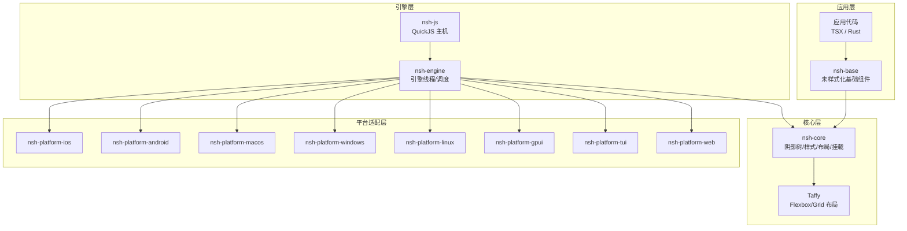
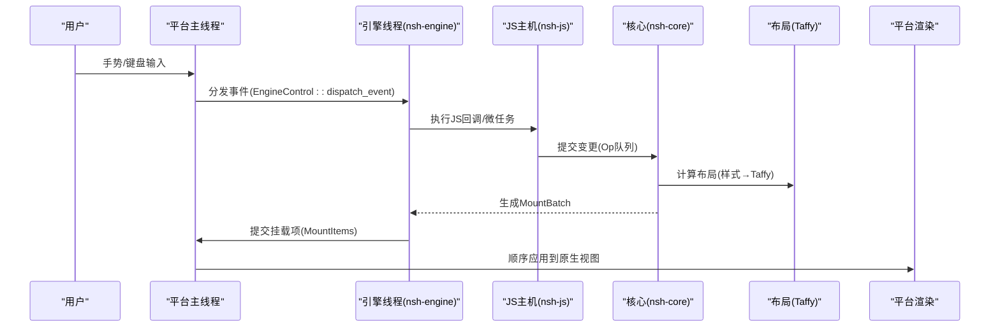
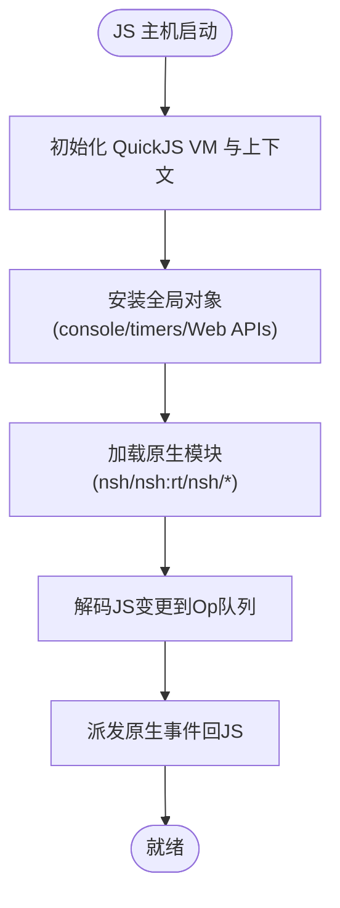
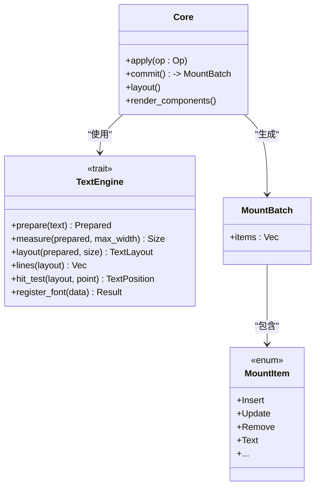
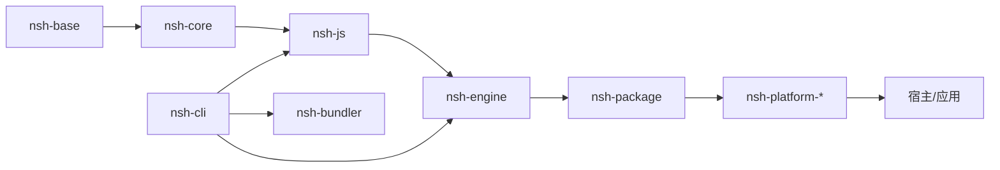

# 架构设计

<cite>
**本文引用的文件**   
- [README.md](file://README.md)
- [Cargo.toml](file://Cargo.toml)
- [架构文档（开发）.md](file://docs/dev/architecture.md)
- [nsh-core/Cargo.toml](file://crates/nsh-core/Cargo.toml)
- [nsh-engine/Cargo.toml](file://crates/nsh-engine/Cargo.toml)
- [nsh-js/Cargo.toml](file://crates/nsh-js/Cargo.toml)
- [nsh-core/src/lib.rs](file://crates/nsh-core/src/lib.rs)
- [nsh-engine/src/lib.rs](file://crates/nsh-engine/src/lib.rs)
- [nsh-js/src/lib.rs](file://crates/nsh-js/src/lib.rs)
</cite>

## 目录
1. [引言](#引言)
2. [项目结构](#项目结构)
3. [核心组件](#核心组件)
4. [架构总览](#架构总览)
5. [详细组件分析](#详细组件分析)
6. [依赖关系分析](#依赖关系分析)
7. [性能考量](#性能考量)
8. [故障排查指南](#故障排查指南)
9. [结论](#结论)
10. [附录](#附录)

## 引言
本架构文档面向 NSH（Native Shell）框架，系统性阐述其分层架构、组件交互、数据流与并发模型，解释关键设计决策与技术选型原因，并给出系统边界、模块依赖图与扩展点设计。NSH 以 Rust 为核心语言，使用 QuickJS 作为 JavaScript 运行时，Taffy 作为布局引擎，提供跨平台原生 UI 能力，支持 iOS、Android、macOS、Windows、Linux、GPUI、终端与 Web 等多目标。

## 项目结构
NSH 采用多 crate 的模块化组织方式，按职责划分为：
- 应用层：由 TSX/Rust 应用代码与 nsh-base 基础组件组成，关注业务逻辑与可复用 UI 行为。
- 引擎层：nsh-engine 负责驱动 JS 主机与核心，编排渲染批次。
- 核心层：nsh-core 提供平台无关的阴影树、样式、布局、挂载指令等。
- 平台适配层：各 nsh-platform-* 实现具体平台的窗口、输入、文本、绘制等。



图表来源
- [架构文档（开发）.md:91-110](file://docs/dev/architecture.md#L91-L110)
- [nsh-core/Cargo.toml:1-25](file://crates/nsh-core/Cargo.toml#L1-L25)
- [nsh-engine/Cargo.toml:1-34](file://crates/nsh-engine/Cargo.toml#L1-L34)
- [nsh-js/Cargo.toml:1-22](file://crates/nsh-js/Cargo.toml#L1-L22)

章节来源
- [README.md:1-59](file://README.md#L1-L59)
- [架构文档（开发）.md:91-110](file://docs/dev/architecture.md#L91-L110)

## 核心组件
- nsh-core：平台无关的核心库，接收来自 JS 渲染器的变更操作，维护阴影树，将样式转换为 Taffy 布局，最终输出挂载批次给平台后端。
- nsh-js：QuickJS 主机，管理运行时上下文、全局 API、原生模块加载，将 JS 变更解码为 nsh-core::Op，并将原生事件回传到 JS。
- nsh-engine：引擎线程，驱动 JS 主机与核心，协调应用生命周期、网络、存储、计时器、动画帧，产出 MountBatch 交给平台。
- Taffy：用于 Flexbox 与 Grid 布局计算，被 nsh-core 在布局阶段调用。
- 平台适配层：各平台实现窗口、输入、文本排版、绘制、动画帧等，遵循核心接口。

章节来源
- [nsh-core/src/lib.rs:1-10](file://crates/nsh-core/src/lib.rs#L1-L10)
- [nsh-js/src/lib.rs:1-10](file://crates/nsh-js/src/lib.rs#L1-L10)
- [nsh-engine/src/lib.rs:1-10](file://crates/nsh-engine/src/lib.rs#L1-L10)
- [nsh-core/Cargo.toml:15-25](file://crates/nsh-core/Cargo.toml#L15-L25)

## 架构总览
NSH 的分层架构强调“一次编写，多端运行”，通过清晰的职责分离与稳定的接口契约，确保平台差异被隔离在适配层。



图表来源
- [架构文档（开发）.md:3-11](file://docs/dev/architecture.md#L3-L11)
- [nsh-engine/src/lib.rs:1-10](file://crates/nsh-engine/src/lib.rs#L1-L10)
- [nsh-js/src/lib.rs:1-10](file://crates/nsh-js/src/lib.rs#L1-L10)
- [nsh-core/src/lib.rs:1-10](file://crates/nsh-core/src/lib.rs#L1-L10)

## 详细组件分析

### 引擎层（nsh-engine）
- 职责：拥有独立线程运行一个 App（Rust 根组件或 JS Bundle），每次唤醒处理输入、定时器、调整大小等事件，执行应用代码，应用 JS 提交的变更，进行布局，并向平台发送 MountBatch。
- 关键类型：
  - Engine：运行中的引擎实例，持有控制句柄、线程、宿主通道、停止信号等。
  - EngineConfig：引擎配置，包含应用、视口、日志、网络、存储、时钟、剪贴板、窗口后端等。
  - EngineControl：轻量可克隆的控制句柄，用于从任意线程向引擎发送消息。
  - LocalEngine：在无线程环境（WebAssembly）中由宿主事件循环驱动的本地引擎。

```mermaid
classDiagram
class Engine {
+control : EngineControl
+thread : Option<JoinHandle>
+host : HostChannel
+stop : Arc<AtomicBool>
+quit_listeners : Arc<AtomicBool>
+image_cache : Option<DiskCache>
+media_files : Arc<MediaFiles>
}
class EngineConfig {
+app : App
+viewport : Size
+trace : bool
+content_culling : bool
+network : Option<Network>
+websocket : Option<WebSocketTransport>
+filesystem : Option<FileSystem>
+assets : Option<Assets>
+environment : Environment
+header_heights : (Points, Points)
+limits : Limits
+ui_sets : Vec<Registry>
+runtime : Option<tokio : : Handle>
+support_dir : Option<PathBuf>
+data_dir : Option<PathBuf>
+cache : CacheOptions
+storage : Option<StorageBackend>
+clock : Clock
+context : EngineContext
+pinned : EnvironmentPins
+clipboard : Option<ClipboardBackend>
+host : HostChannel
+picker : Option<PickerBackend>
+speech : Option<SpeechBackend>
+audio : Option<AudioBackend>
+windows : Option<WindowBackend>
+login_item : Option<LoginItemBackend>
}
class EngineControl {
+tx : Sender<Message>
+modality : Arc<AtomicU8>
+downloads : DownloadCleanup
}
class LocalEngine {
+driver : Driver
+rx : Receiver<Message>
+control : EngineControl
+wake : Option<Arc<dyn Fn()>>
+pumping : Arc<AtomicBool>
+quit_started : bool
}
Engine --> EngineControl : "持有"
Engine --> EngineConfig : "配置"
LocalEngine --> EngineControl : "持有"
```

图表来源
- [nsh-engine/src/lib.rs:1894-1910](file://crates/nsh-engine/src/lib.rs#L1894-L1910)
- [nsh-engine/src/lib.rs:1147-1259](file://crates/nsh-engine/src/lib.rs#L1147-L1259)
- [nsh-engine/src/lib.rs:1607-1618](file://crates/nsh-engine/src/lib.rs#L1607-L1618)
- [nsh-engine/src/lib.rs:2140-2157](file://crates/nsh-engine/src/lib.rs#L2140-L2157)

章节来源
- [nsh-engine/src/lib.rs:1-10](file://crates/nsh-engine/src/lib.rs#L1-L10)
- [nsh-engine/src/lib.rs:1894-1910](file://crates/nsh-engine/src/lib.rs#L1894-L1910)
- [nsh-engine/src/lib.rs:1147-1259](file://crates/nsh-engine/src/lib.rs#L1147-L1259)
- [nsh-engine/src/lib.rs:1607-1618](file://crates/nsh-engine/src/lib.rs#L1607-L1618)
- [nsh-engine/src/lib.rs:2140-2157](file://crates/nsh-engine/src/lib.rs#L2140-L2157)

### JS 主机（nsh-js）
- 职责：管理 QuickJS 运行时与上下文，安装全局对象（console、定时器、Web API 如 fetch），服务 NSH 原生模块（nsh、nsh:rt、nsh/*），将 JS 变更解码为 Op 队列，并将原生事件回传至 JS。
- 关键特性：
  - 单线程主机（!Send），在引擎线程上创建与使用。
  - 标准模块可选启用（zlib、crypto）。
  - 浏览器模式与 WebAssembly 支持。



图表来源
- [nsh-js/src/lib.rs:1-10](file://crates/nsh-js/src/lib.rs#L1-L10)
- [nsh-js/Cargo.toml:1-22](file://crates/nsh-js/Cargo.toml#L1-L22)

章节来源
- [nsh-js/src/lib.rs:1-10](file://crates/nsh-js/src/lib.rs#L1-L10)
- [nsh-js/Cargo.toml:1-22](file://crates/nsh-js/Cargo.toml#L1-L22)

### 核心层（nsh-core）
- 职责：平台无关的核心，接收 Op，维护阴影树，转换样式为 Taffy 布局，合并内联文本，运行布局，输出 MountBatch 给平台后端。
- 关键模块：
  - core：核心状态机与操作应用。
  - ops：操作定义（Op、EventPayload 等）。
  - mount：挂载批次与挂载项（MountBatch/MountItem）。
  - style：样式系统与值类型。
  - text：文本引擎接口与近似引擎。
  - reactive：响应式图（signals/memos/effects/owners/context）。
  - geometry：几何类型（Point/Size/Bounds）。
  - platform：平台抽象与环境信息。



图表来源
- [nsh-core/src/lib.rs:1-10](file://crates/nsh-core/src/lib.rs#L1-L10)
- [nsh-core/Cargo.toml:15-25](file://crates/nsh-core/Cargo.toml#L15-L25)

章节来源
- [nsh-core/src/lib.rs:1-10](file://crates/nsh-core/src/lib.rs#L1-L10)
- [nsh-core/Cargo.toml:15-25](file://crates/nsh-core/Cargo.toml#L15-L25)

### 平台适配层（nsh-platform-*）
- 职责：实现具体平台的窗口、输入、文本排版、绘制、动画帧等，遵循核心接口，将 MountBatch 应用到原生视图。
- 典型实现：
  - macOS：AppKit、Core Animation、CoreText。
  - Windows：Win32、Direct2D、DirectWrite。
  - Linux：GTK 4、Pango。
  - iOS/Android：UIKit/Android Views。
  - GPUI：GPUI Fast。
  - TUI：ratatui 字符网格。
  - Web：HTML/CSS。

章节来源
- [README.md:41-59](file://README.md#L41-L59)
- [架构文档（开发）.md:40-62](file://docs/dev/architecture.md#L40-L62)

## 依赖关系分析
NSH 的依赖方向严格分层，避免反向耦合：
- nsh-core ← nsh-js ← nsh-engine ← nsh-package ← nsh-platform-* ← 宿主/应用
- nsh-cli 依赖 nsh-bundler、nsh-js、nsh-engine
- nsh-base 仅依赖 nsh-core，被打包器、平台与 CLI 使用
- 应用自定义 UI 集仅依赖 nsh-core



图表来源
- [架构文档（开发）.md:108-110](file://docs/dev/architecture.md#L108-L110)
- [Cargo.toml:28-57](file://Cargo.toml#L28-L57)

章节来源
- [架构文档（开发）.md:108-110](file://docs/dev/architecture.md#L108-L110)
- [Cargo.toml:28-57](file://Cargo.toml#L28-L57)

## 性能考量
- 文本排版一次化：文本在引擎线程准备与测量，最终布局后交由主线程仅绘制，避免主线程布局开销。
- 测量缓存：按引擎维度缓存测量结果，颜色变化不触发重排。
- 主线程非阻塞：平台主线程不等待 JS，仅在极少数场景（如 macOS 窗口尺寸变化）有短暂等待。
- 动画帧同步：各平台通过显示链接/帧时钟驱动原生动画，保证流畅性。
- 构建优化：对 QuickJS 与 Taffy 等热点包在 dev 模式下提升优化等级，减少解释与布局成本。

章节来源
- [架构文档（开发）.md:13-28](file://docs/dev/architecture.md#L13-L28)
- [Cargo.toml:620-624](file://Cargo.toml#L620-L624)

## 故障排查指南
- 引擎线程栈溢出：引擎线程栈大小在 Apple 平台调大以避免 QuickJS 递归与深层组件树导致溢出。
- JS 垃圾回收：空闲周期收集避免频繁 GC，同时防止长时间无活动时的内存增长。
- 鼠标移动节流：限制鼠标移动事件频率，避免高频重绘。
- 网络与 WebSocket：默认拒绝连接或需显式启用；TLS 信任链与平台验证器需正确配置。
- 平台特定问题：
  - Android：JNI 文本排版、滚动偏移恢复、模态窗口 dp 尺寸报告。
  - Linux：GTK 主循环唤醒时机、GSK 节点绘制。
  - macOS：Core Animation 装饰、显示链接帧。
  - Windows：Direct2D 翻转交换链、DWM 合成。

章节来源
- [nsh-engine/src/lib.rs:95-124](file://crates/nsh-engine/src/lib.rs#L95-L124)
- [架构文档（开发）.md:40-62](file://docs/dev/architecture.md#L40-L62)

## 结论
NSH 通过清晰的分层架构与严格的依赖方向，实现了跨平台原生 UI 的统一抽象。引擎层协调 JS 运行时与核心，核心层专注阴影树与布局，平台适配层屏蔽差异。技术选型上，Rust 提供安全与性能，QuickJS 提供轻量 JS 运行时，Taffy 提供高效布局。该设计兼顾了可扩展性、可测试性与多端一致性，为未来演进奠定了坚实基础。

## 附录

### 关键设计决策与技术选型原因
- 为什么选择 Rust 作为核心语言：
  - 内存安全与零成本抽象，适合高性能 UI 框架。
  - 跨平台编译与 FFI 友好，便于对接各平台原生 API。
  - 生态成熟（Tokio、wgpu、resvg 等），支撑复杂功能。
- 为什么选择 QuickJS 作为 JavaScript 运行时：
  - 轻量、可嵌入、JIT 可选，适合移动端与嵌入式场景。
  - 与 LLRT 标准库兼容，提供常用 Web API 模拟。
  - 字节码加载与热更新支持良好，利于开发体验。
- 为什么选择 Taffy 作为布局引擎：
  - 纯 Rust 实现，性能优异，支持 Flexbox 与 Grid。
  - 与 NSH 的样式系统无缝集成，支持内容尺寸与块级布局。
  - 可配置特性开关，便于裁剪体积。

章节来源
- [README.md:1-59](file://README.md#L1-L59)
- [nsh-core/Cargo.toml:20-25](file://crates/nsh-core/Cargo.toml#L20-L25)
- [nsh-js/Cargo.toml:34-48](file://crates/nsh-js/Cargo.toml#L34-L48)
- [Cargo.toml:241-253](file://Cargo.toml#L241-L253)