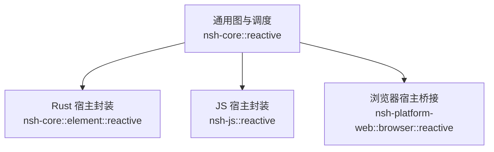
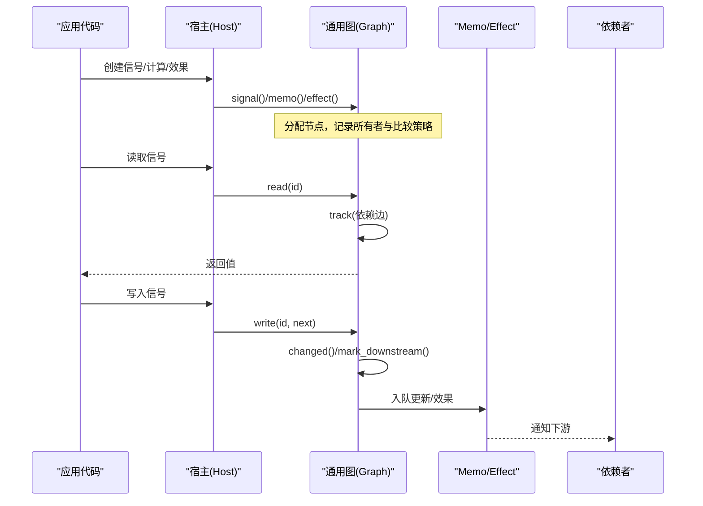
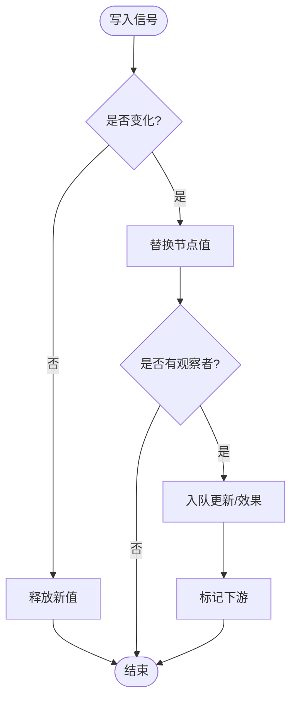
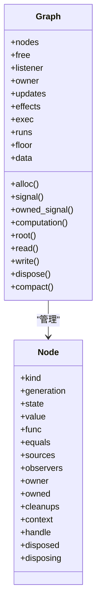
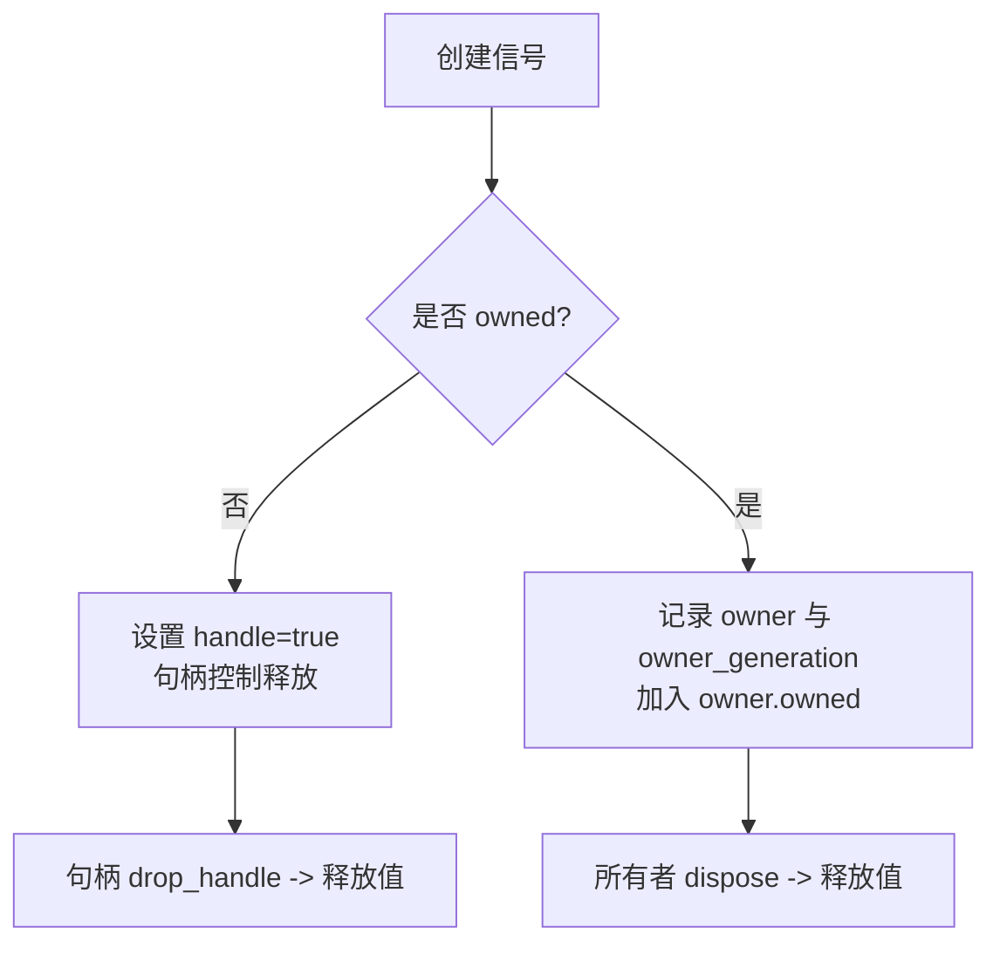
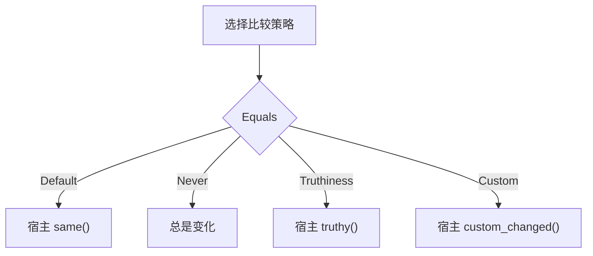
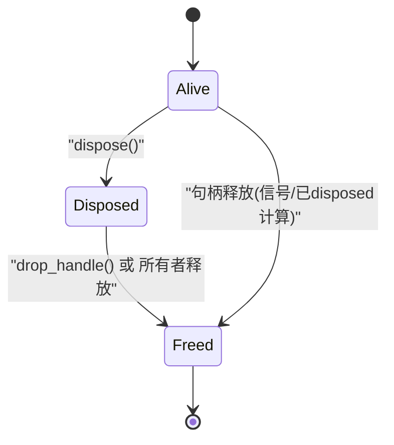
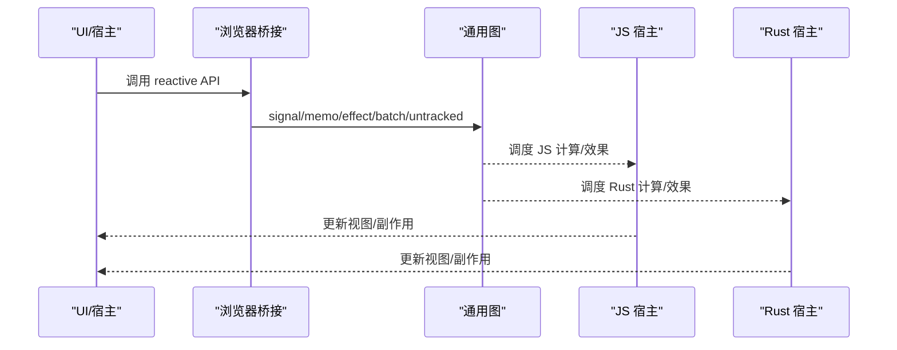
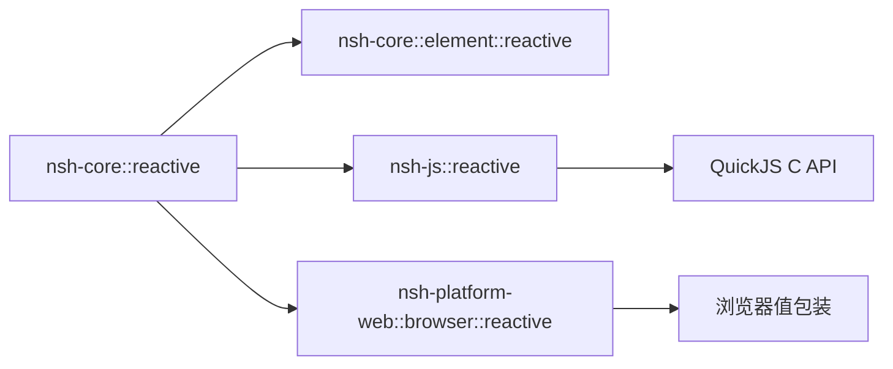

# 信号（Signal）

<cite>
**本文引用的文件**   
- [reactive.rs](file://crates/nsh-core/src/reactive.rs)
- [element/reactive.rs](file://crates/nsh-core/src/element/reactive.rs)
- [nsh-js reactive.rs](file://crates/nsh-js/src/reactive.rs)
- [browser reactive.rs](file://crates/nsh-platform-web/src/browser/reactive.rs)
</cite>

## 目录
1. [引言](#引言)
2. [项目结构](#项目结构)
3. [核心组件](#核心组件)
4. [架构总览](#架构总览)
5. [详细组件分析](#详细组件分析)
6. [依赖关系分析](#依赖关系分析)
7. [性能与优化](#性能与优化)
8. [故障排查指南](#故障排查指南)
9. [结论](#结论)
10. [附录：常用模式与示例路径](#附录常用模式与示例路径)

## 引言
本文件面向 NSH 信号系统，系统性解释其底层实现原理与跨平台响应式绑定机制。重点包括：
- 值的存储、比较策略与依赖追踪
- `signal()` 与 `owned_signal()` 的区别
- `Equals` 枚举的比较策略：Default、Never、Truthiness、Custom
- 生命周期管理：内存分配、释放与垃圾回收
- 宿主环境交互：JS（QuickJS）、Rust 组件、浏览器回调
- 性能优化技巧与常见使用模式

## 项目结构
NSH 的信号系统由三层构成：
- 通用图调度与节点模型：`nsh-core::reactive`
- Rust 组件侧封装：`nsh-core::element::reactive`
- JS 宿主侧封装：`nsh-js::reactive`
- 浏览器宿主侧桥接：`nsh-platform-web::browser::reactive`

**图示来源**
- [reactive.rs:1-17](file://crates/nsh-core/src/reactive.rs#L1-L17)
- [element/reactive.rs:1-15](file://crates/nsh-core/src/element/reactive.rs#L1-L15)
- [nsh-js reactive.rs:1-19](file://crates/nsh-js/src/reactive.rs#L1-L19)
- [browser reactive.rs:1-15](file://crates/nsh-platform-web/src/browser/reactive.rs#L1-L15)

**章节来源**
- [reactive.rs:1-17](file://crates/nsh-core/src/reactive.rs#L1-L17)
- [element/reactive.rs:1-15](file://crates/nsh-core/src/element/reactive.rs#L1-L15)
- [nsh-js reactive.rs:1-19](file://crates/nsh-js/src/reactive.rs#L1-L19)
- [browser reactive.rs:1-15](file://crates/nsh-platform-web/src/browser/reactive.rs#L1-L15)

## 核心组件
- 通用图 `Graph<H>`：以 arena + generation 的槽位管理节点，维护更新队列与效果队列，提供读写、批处理、上下文、清理等能力。
- 节点 `Node<H>`：保存值、函数、比较器、源/观察者边、所有者、清理函数、上下文帧等。
- 宿主接口 `Host`：定义值、函数、比较器、清理、上下文的复制/释放、调用、相等性判断、错误上报等。
- Rust 宿主 `Rust`：将 `Rc<dyn Any>` 作为值，闭包作为计算，类型安全的 PartialEq 比较。
- JS 宿主 `Js`：将 QuickJS 值作为值，JS 函数作为计算，基于 StrictEqual 与自定义函数的比较。
- 浏览器宿主 `Host`：桥接浏览器回调与 Rust 清理，统一调度。

**章节来源**
- [reactive.rs:45-136](file://crates/nsh-core/src/reactive.rs#L45-L136)
- [reactive.rs:146-179](file://crates/nsh-core/src/reactive.rs#L146-L179)
- [element/reactive.rs:153-261](file://crates/nsh-core/src/element/reactive.rs#L153-L261)
- [nsh-js reactive.rs:83-212](file://crates/nsh-js/src/reactive.rs#L83-L212)
- [browser reactive.rs:29-106](file://crates/nsh-platform-web/src/browser/reactive.rs#L29-L106)

## 架构总览
信号系统的核心是“可观察值 + 惰性计算 + 副作用”的有向无环图。写入信号时，仅标记受影响的 memo/effect；读取时按需更新并建立依赖边。调度遵循 Solid 1.9 的更新与效果队列，避免无限循环。

**图示来源**
- [reactive.rs:317-346](file://crates/nsh-core/src/reactive.rs#L317-L346)
- [reactive.rs:1076-1140](file://crates/nsh-core/src/reactive.rs#L1076-L1140)
- [reactive.rs:1167-1201](file://crates/nsh-core/src/reactive.rs#L1167-L1201)
- [reactive.rs:1203-1244](file://crates/nsh-core/src/reactive.rs#L1203-L1244)

## 详细组件分析

### 值的存储与比较机制
- 值存储：每个节点持有 `H::Value`，通过 `H::dup`/`H::free` 管理引用计数或 GC 引用。
- 比较策略 `Equals<C>`：
  - Default：宿主默认比较（JS 为严格相等，Rust 为指针相等）。
  - Never：总是视为变化，触发通知。
  - Truthiness：按真值性比较（如 JS 的布尔语义）。
  - Custom：宿主自定义比较函数。
- 比较流程：`changed()` 根据节点上的 `equals` 选择策略，必要时复制/释放比较器与旧值，避免在比较中持有图锁。

**图示来源**
- [reactive.rs:1060-1111](file://crates/nsh-core/src/reactive.rs#L1060-L1111)

**章节来源**
- [reactive.rs:62-73](file://crates/nsh-core/src/reactive.rs#L62-L73)
- [reactive.rs:1060-1111](file://crates/nsh-core/src/reactive.rs#L1060-L1111)
- [element/reactive.rs:217-239](file://crates/nsh-core/src/element/reactive.rs#L217-L239)
- [nsh-js reactive.rs:157-183](file://crates/nsh-js/src/reactive.rs#L157-L183)
- [browser reactive.rs:70-86](file://crates/nsh-platform-web/src/browser/reactive.rs#L70-L86)

### 依赖追踪与调度
- 读信号时建立依赖边：当前监听者（通常是 memo/effect）与信号之间双向索引，支持 O(1) 解链。
- 写信号时标记下游：对 clean 状态的观察者标记 STALE，并根据类型入队 update 或 effect。
- 调度：`run_updates` 启动一轮更新，先执行 memo 再执行 effect；若嵌套轮次则合并；超过最大运行次数触发 runaway 保护。

**图示来源**
- [reactive.rs:146-179](file://crates/nsh-core/src/reactive.rs#L146-L179)
- [reactive.rs:241-260](file://crates/nsh-core/src/reactive.rs#L241-L260)
- [reactive.rs:279-315](file://crates/nsh-core/src/reactive.rs#L279-L315)
- [reactive.rs:1076-1140](file://crates/nsh-core/src/reactive.rs#L1076-L1140)
- [reactive.rs:1167-1201](file://crates/nsh-core/src/reactive.rs#L1167-L1201)

**章节来源**
- [reactive.rs:676-724](file://crates/nsh-core/src/reactive.rs#L676-L724)
- [reactive.rs:806-902](file://crates/nsh-core/src/reactive.rs#L806-L902)
- [reactive.rs:916-981](file://crates/nsh-core/src/reactive.rs#L916-L981)

### `signal()` 与 `owned_signal()` 的区别
- `signal(value, equals)`：创建一个由外部句柄持有的信号，句柄释放时节点值随之释放。适用于长期存在、独立于所有者的状态。
- `owned_signal(value, equals)`：将信号挂到当前所有者下，随所有者销毁而自动释放；若无所有者，则随图存活。适用于组件/作用域内的局部状态。

**图示来源**
- [reactive.rs:317-346](file://crates/nsh-core/src/reactive.rs#L317-L346)
- [reactive.rs:501-528](file://crates/nsh-core/src/reactive.rs#L501-L528)

**章节来源**
- [reactive.rs:317-346](file://crates/nsh-core/src/reactive.rs#L317-L346)
- [reactive.rs:501-528](file://crates/nsh-core/src/reactive.rs#L501-L528)

### Equals 枚举的比较策略
- Default：
  - JS：严格相等（不执行用户代码）。
  - Rust：指针相等（`Rc::ptr_eq`），None 与 None 视为相等。
- Never：总是视为变化，适合原地可变值或不实现 PartialEq 的类型。
- Truthiness：按真值性比较，适合条件型信号。
- Custom：宿主自定义比较函数，返回“是否相同”，异常视为变化。

**图示来源**
- [reactive.rs:62-73](file://crates/nsh-core/src/reactive.rs#L62-L73)
- [reactive.rs:1060-1074](file://crates/nsh-core/src/reactive.rs#L1060-L1074)
- [element/reactive.rs:217-239](file://crates/nsh-core/src/element/reactive.rs#L217-L239)
- [nsh-js reactive.rs:157-183](file://crates/nsh-js/src/reactive.rs#L157-L183)
- [browser reactive.rs:70-86](file://crates/nsh-platform-web/src/browser/reactive.rs#L70-L86)

**章节来源**
- [reactive.rs:62-73](file://crates/nsh-core/src/reactive.rs#L62-L73)
- [reactive.rs:1060-1074](file://crates/nsh-core/src/reactive.rs#L1060-L1074)
- [element/reactive.rs:217-239](file://crates/nsh-core/src/element/reactive.rs#L217-L239)
- [nsh-js reactive.rs:157-183](file://crates/nsh-js/src/reactive.rs#L157-L183)
- [browser reactive.rs:70-86](file://crates/nsh-platform-web/src/browser/reactive.rs#L70-L86)

### 生命周期管理与垃圾回收
- 分配：arena 复用空闲槽位，带 generation 防止悬空句柄。
- 释放：
  - 句柄释放：`drop_handle` 仅在信号或已 disposed 的计算上释放值。
  - 所有者释放：`dispose` 清理子节点、运行清理函数、解链观察者。
  - 图析构：`free_all` 遍历释放所有值、函数、比较器、清理函数。
- JS GC：对象 finalizer 与 mark 钩子确保信号值与自定义比较器参与 GC，支持循环引用收集。

**图示来源**
- [reactive.rs:726-744](file://crates/nsh-core/src/reactive.rs#L726-L744)
- [reactive.rs:1167-1201](file://crates/nsh-core/src/reactive.rs#L1167-L1201)
- [reactive.rs:766-786](file://crates/nsh-core/src/reactive.rs#L766-L786)
- [nsh-js reactive.rs:518-560](file://crates/nsh-js/src/reactive.rs#L518-L560)

**章节来源**
- [reactive.rs:279-315](file://crates/nsh-core/src/reactive.rs#L279-L315)
- [reactive.rs:726-744](file://crates/nsh-core/src/reactive.rs#L726-L744)
- [reactive.rs:766-786](file://crates/nsh-core/src/reactive.rs#L766-L786)
- [reactive.rs:1167-1201](file://crates/nsh-core/src/reactive.rs#L1167-L1201)
- [nsh-js reactive.rs:518-560](file://crates/nsh-js/src/reactive.rs#L518-L560)

### 宿主环境交互与跨平台响应式绑定
- Rust 组件：通过 `Runtime` 进入线程本地图，使用 `Signal<T>` 暴露 get/set/update 等方法，类型安全且 panic 被捕获并上报。
- JS 宿主：QuickJS 值与函数作为值/计算，提供 `signal()`、`computed()`、`effect()`、`batch()`、`untrack()`、`createRoot()` 等 API，对象方法绑定节点句柄。
- 浏览器宿主：桥接浏览器回调与 Rust 清理，统一调度，支持 owner/context/handle 传递，并在 finish 时抛出轮次内错误。

**图示来源**
- [browser reactive.rs:217-351](file://crates/nsh-platform-web/src/browser/reactive.rs#L217-L351)
- [nsh-js reactive.rs:1054-1064](file://crates/nsh-js/src/reactive.rs#L1054-L1064)
- [element/reactive.rs:521-532](file://crates/nsh-core/src/element/reactive.rs#L521-L532)

**章节来源**
- [element/reactive.rs:153-261](file://crates/nsh-core/src/element/reactive.rs#L153-L261)
- [nsh-js reactive.rs:83-212](file://crates/nsh-js/src/reactive.rs#L83-L212)
- [browser reactive.rs:29-106](file://crates/nsh-platform-web/src/browser/reactive.rs#L29-L106)
- [browser reactive.rs:217-351](file://crates/nsh-platform-web/src/browser/reactive.rs#L217-L351)

## 依赖关系分析
- 耦合与内聚：
  - `Graph` 与 `Node` 高内聚，职责清晰。
  - `Host` 抽象隔离了不同宿主的值/函数/比较/清理语义。
- 直接/间接依赖：
  - Rust 宿主依赖 `std::rc::Rc` 与 `Any` 进行类型擦除与共享。
  - JS 宿主依赖 QuickJS 的 C API 进行值复制/释放与函数调用。
  - 浏览器宿主依赖上层值包装与调用桥接。
- 外部依赖：
  - QuickJS（JS 宿主）
  - 平台相关 UI/事件（浏览器宿主）
- 循环依赖：
  - 通过 generation 与句柄机制避免悬空引用，GC mark/finalize 支持循环值收集。

**图示来源**
- [reactive.rs:1-17](file://crates/nsh-core/src/reactive.rs#L1-L17)
- [nsh-js reactive.rs:1-19](file://crates/nsh-js/src/reactive.rs#L1-L19)
- [browser reactive.rs:1-15](file://crates/nsh-platform-web/src/browser/reactive.rs#L1-L15)

**章节来源**
- [reactive.rs:1-17](file://crates/nsh-core/src/reactive.rs#L1-L17)
- [nsh-js reactive.rs:1-19](file://crates/nsh-js/src/reactive.rs#L1-L19)
- [browser reactive.rs:1-15](file://crates/nsh-platform-web/src/browser/reactive.rs#L1-L15)

## 性能与优化
- 批量更新：使用 `batch` 合并多次写入，减少重复调度。
- 惰性求值：memo 仅在需要时更新，避免无用计算。
- 比较策略优化：
  - 对不可变数据使用 Default（指针相等）。
  - 对原地可变数据使用 Never。
  - 对布尔条件使用 Truthiness。
  - 对复杂对象使用 Custom 比较（例如只比较关键字段）。
- 避免过度订阅：在不需要追踪的地方使用 `untracked`。
- 内存压缩：空闲槽位复用与定期 compact 降低内存碎片。
- 错误保护：runaway 检测避免无限循环导致的栈溢出。

[本节为通用指导，不直接分析具体文件]

## 故障排查指南
- 无限循环：检查 effect 是否在每次运行时都改变其读取的信号，导致反复调度。
- 未触发更新：确认比较策略是否正确（例如对象引用未变但内容变化需使用 Never 或 Custom）。
- 句柄失效：访问已 dispose 的信号会失败，应使用 try_get/try_set 或检查 is_live。
- JS 异常传播：计算或效果抛出的异常会被收集并在轮次结束时抛出，注意边界捕获。
- 清理函数未执行：确认所有者是否正确 dispose，或清理函数注册时机。

**章节来源**
- [reactive.rs:891-902](file://crates/nsh-core/src/reactive.rs#L891-L902)
- [nsh-js reactive.rs:495-516](file://crates/nsh-js/src/reactive.rs#L495-L516)
- [element/reactive.rs:366-375](file://crates/nsh-core/src/element/reactive.rs#L366-L375)

## 结论
NSH 的信号系统以通用图为核心，通过宿主抽象实现了跨平台的响应式数据绑定。它提供了高效的依赖追踪、灵活的比较策略与健壮的生命周期管理，同时兼顾性能与可维护性。理解 `signal()` 与 `owned_signal()` 的差异、合理使用 `Equals` 策略、以及借助 batch/untracked 优化，是构建高性能响应式界面的关键。

[本节为总结，不直接分析具体文件]

## 附录：常用模式与示例路径
- 创建信号与读写：
  - JS：`signal(value, options)`
  - Rust：`signal(value)` / `signal_with(value, SignalEquals::Never)`
- 计算派生值：
  - JS：`computed(fn, options)`
  - Rust：`memo(func, value, equals)`
- 副作用：
  - JS：`effect(fn)` / `createRenderEffect(fn)`
  - Rust：`effect(kind, func, value)`
- 批处理与无追踪：
  - JS：`batch(fn)` / `untrack(fn)`
  - Rust：`batch(f)` / `untracked(f)`
- 所有者与上下文：
  - JS：`createRoot(fn)` / `setContext(key, value)` / `useContext(key)`
  - Rust：`with_root(f)` / `provide(data)` / `context()`

**章节来源**
- [nsh-js reactive.rs:1054-1064](file://crates/nsh-js/src/reactive.rs#L1054-L1064)
- [nsh-js reactive.rs:1221-1231](file://crates/nsh-js/src/reactive.rs#L1221-L1231)
- [nsh-js reactive.rs:1233-1250](file://crates/nsh-js/src/reactive.rs#L1233-L1250)
- [nsh-js reactive.rs:775-798](file://crates/nsh-js/src/reactive.rs#L775-L798)
- [nsh-js reactive.rs:846-897](file://crates/nsh-js/src/reactive.rs#L846-L897)
- [element/reactive.rs:521-532](file://crates/nsh-core/src/element/reactive.rs#L521-L532)
- [element/reactive.rs:665-682](file://crates/nsh-core/src/element/reactive.rs#L665-L682)