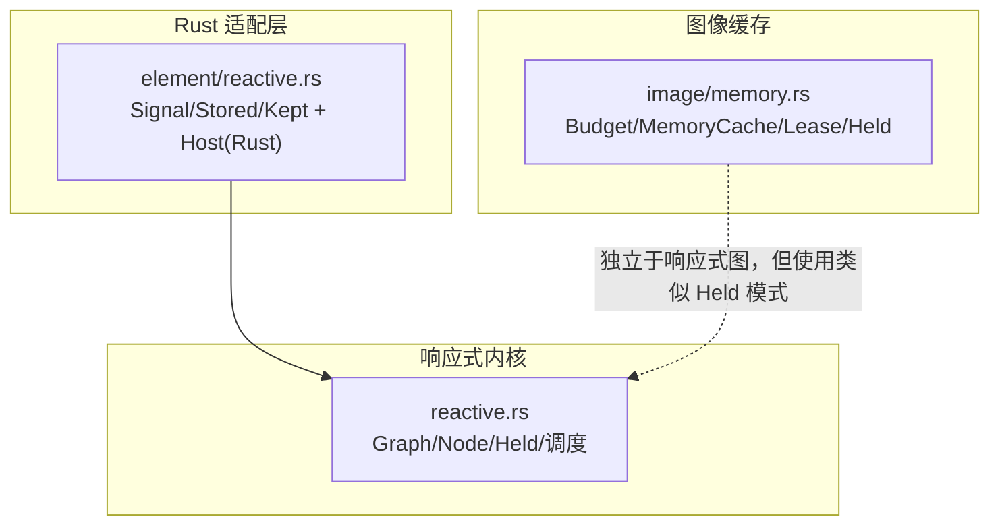
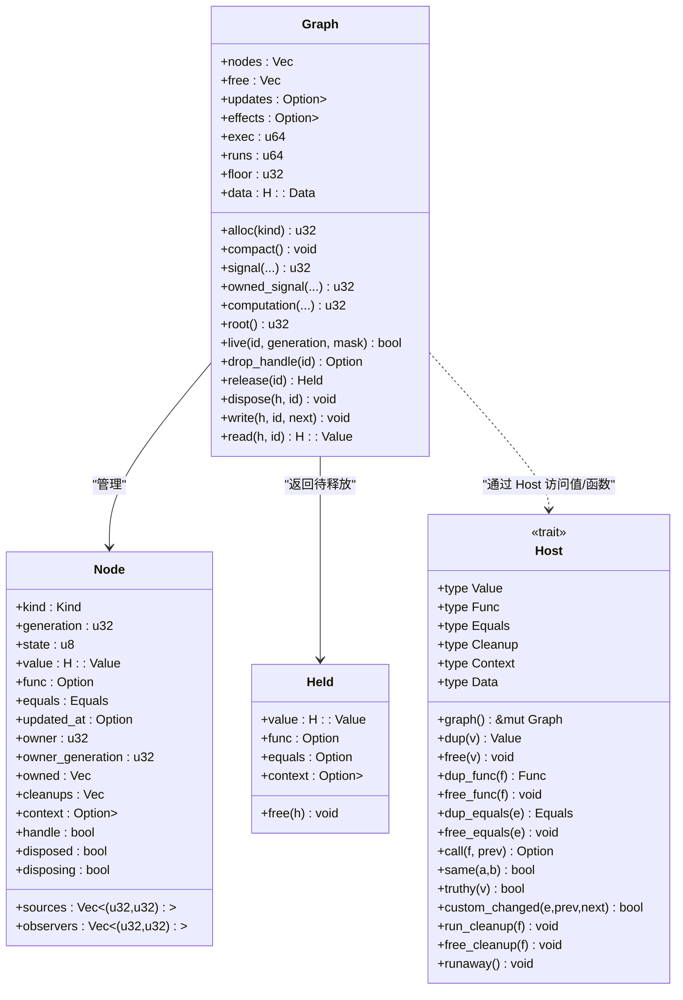
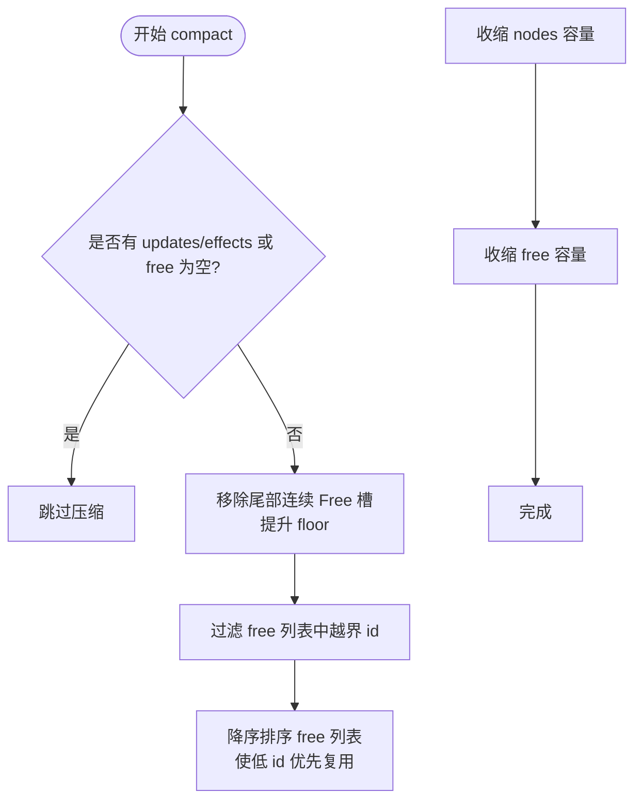
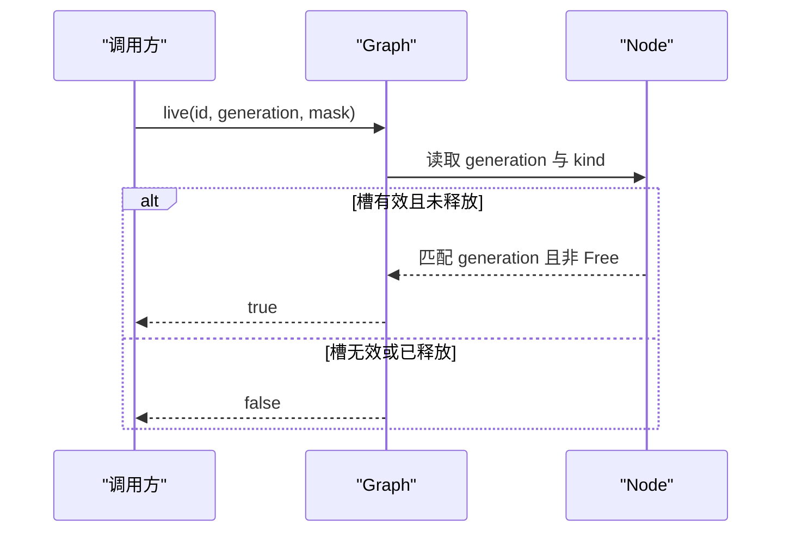
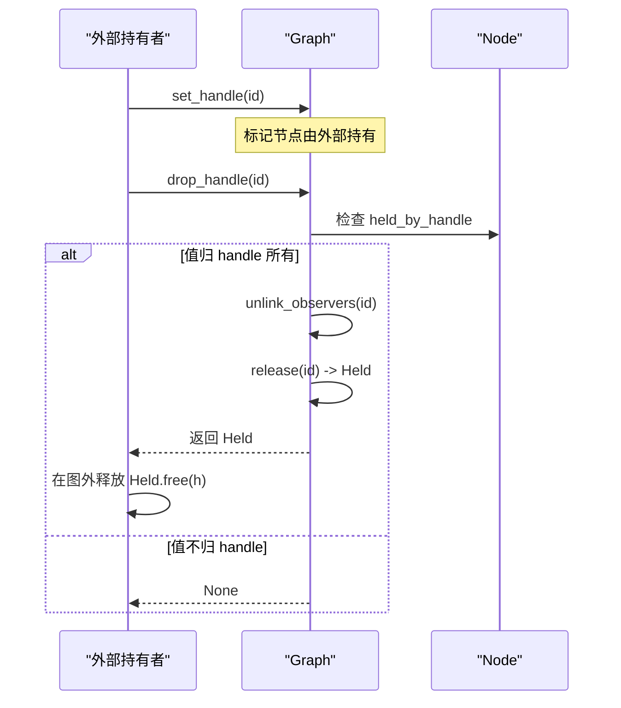
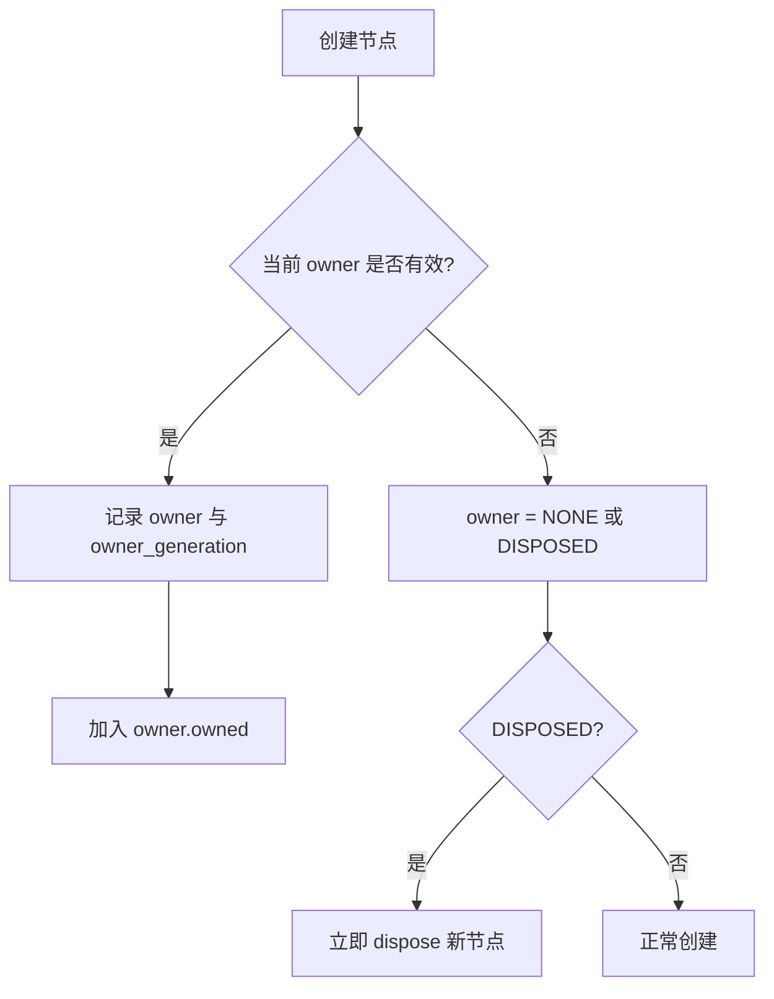
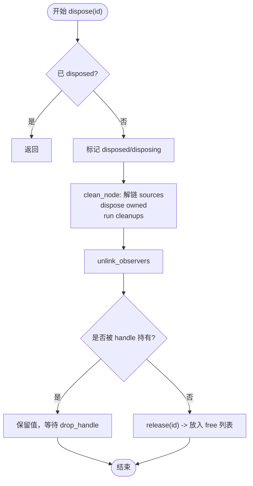
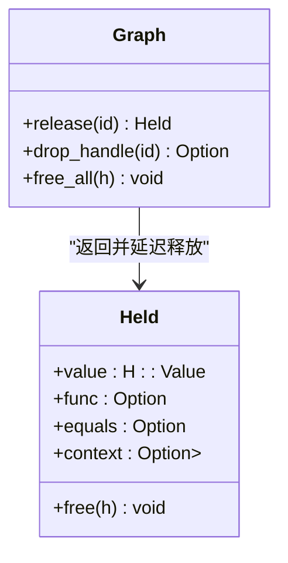
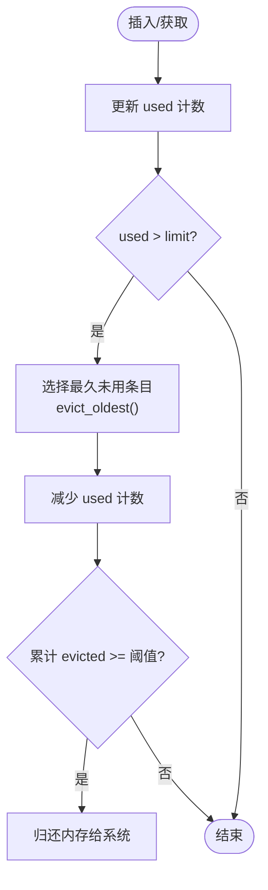
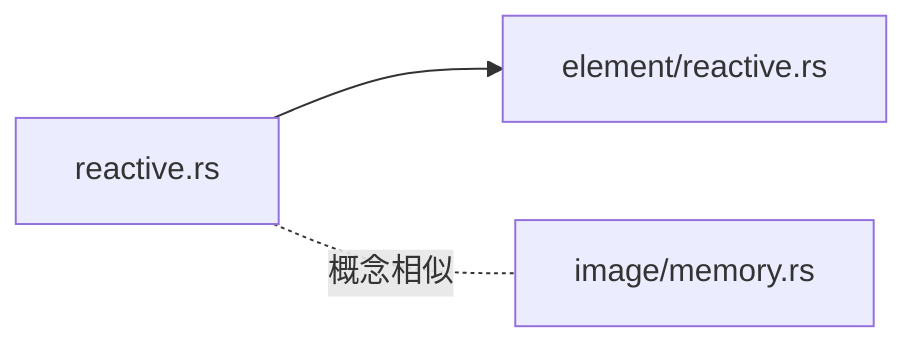

# 内存管理

<cite>
**本文引用的文件**   
- [reactive.rs](file://crates/nsh-core/src/reactive.rs)
- [element/reactive.rs](file://crates/nsh-core/src/element/reactive.rs)
- [image/memory.rs](file://crates/nsh-core/src/image/memory.rs)
</cite>

## 目录
1. [引言](#引言)
2. [项目结构](#项目结构)
3. [核心组件](#核心组件)
4. [架构总览](#架构总览)
5. [详细组件分析](#详细组件分析)
6. [依赖关系分析](#依赖关系分析)
7. [性能考量](#性能考量)
8. [故障排查指南](#故障排查指南)
9. [结论](#结论)
10. [附录：实践与示例路径](#附录实践与示例路径)

## 引言
本技术文档聚焦 NSH 响应式系统的内存管理，围绕以下主题展开：
- 节点池（arena）的实现原理：内存分配、重用与压缩（compact）。
- generation 机制如何防止悬空引用。
- handle 系统的作用与生命周期。
- 所有权模型（owner / owned / context）的关系与语义。
- 垃圾回收策略：free 列表管理与 compact 操作。
- Held 结构体的作用与安全释放资源的方式。
- 内存泄漏检测、性能分析与最佳实践建议。

NSH 的响应式图由信号、计算（memo）、渲染效果与用户效果组成，所有节点驻留在一个 arena 中；边采用双向索引，以便 O(1) 解链。该实现通过 Host trait 将值、函数、比较器、清理回调等宿主相关类型抽象出来，使 JS 与 Rust 共享同一算法与保证。

## 项目结构
与内存管理直接相关的代码主要位于 nsh-core 的三个文件中：
- crates/nsh-core/src/reactive.rs：响应式图的核心实现，包含 Graph、Node、Held、调度与回收逻辑。
- crates/nsh-core/src/element/reactive.rs：Rust 侧对 reactive 的封装，提供 Signal、Stored、Kept 等句柄类型，并实现 Host trait。
- crates/nsh-core/src/image/memory.rs：解码图像缓存与预算控制，展示另一套基于 Lease/Held 的资源管理机制。



图表来源
- [reactive.rs:146-260](file://crates/nsh-core/src/reactive.rs#L146-L260)
- [element/reactive.rs:153-261](file://crates/nsh-core/src/element/reactive.rs#L153-L261)
- [image/memory.rs:216-289](file://crates/nsh-core/src/image/memory.rs#L216-L289)

章节来源
- [reactive.rs:1-17](file://crates/nsh-core/src/reactive.rs#L1-L17)
- [element/reactive.rs:1-15](file://crates/nsh-core/src/element/reactive.rs#L1-L15)
- [image/memory.rs:1-17](file://crates/nsh-core/src/image/memory.rs#L1-L17)

## 核心组件
- Graph：响应式图的容器，持有 nodes、free 列表、调度队列、执行轮次与 floor 等元数据。
- Node：每个槽位上的节点，包含 kind、generation、state、value、func、equals、sources/observers、owner/owned、context、handle/disposed/disposing 等字段。
- Held：从节点取出的“被持有的值”，在图不再借用时统一释放，避免跨借用释放导致的 UB。
- Host trait：抽象值、函数、比较器、清理回调等的复制与释放，以及进入/离开图的方式。
- Rust 适配层：实现 Host，提供 Signal/Stored/Kept 等句柄类型，封装错误边界、事件发射等运行时数据。
- 图像缓存：Budget/MemoryCache/Lease/Held，用于按预算 LRU 淘汰解码图像，支持 on_evict 钩子。

章节来源
- [reactive.rs:146-260](file://crates/nsh-core/src/reactive.rs#L146-L260)
- [reactive.rs:209-231](file://crates/nsh-core/src/reactive.rs#L209-L231)
- [reactive.rs:83-136](file://crates/nsh-core/src/reactive.rs#L83-L136)
- [element/reactive.rs:153-261](file://crates/nsh-core/src/element/reactive.rs#L153-L261)
- [image/memory.rs:32-41](file://crates/nsh-core/src/image/memory.rs#L32-L41)
- [image/memory.rs:216-289](file://crates/nsh-core/src/image/memory.rs#L216-L289)

## 架构总览
下图展示了响应式图的关键对象及其交互：Graph 管理 Node 数组与 free 列表；Host 抽象宿主的值与函数；Rust 适配层实现 Host；图像缓存独立运行，但遵循类似的 Held 释放模式。



图表来源
- [reactive.rs:146-260](file://crates/nsh-core/src/reactive.rs#L146-L260)
- [reactive.rs:209-231](file://crates/nsh-core/src/reactive.rs#L209-L231)
- [reactive.rs:83-136](file://crates/nsh-core/src/reactive.rs#L83-L136)

## 详细组件分析

### 节点池（arena）：分配、重用与压缩
- 分配（alloc）：优先复用 free 列表中的空闲槽；否则在 nodes 末尾追加新槽。每次复用会递增 generation，确保旧 handle 失效。
- 压缩（compact）：仅在无更新/效果队列且存在空闲槽时触发。它会：
  - 移除尾部连续 Free 槽，提升 floor 以覆盖这些 slot 的最大 generation。
  - 过滤 free 列表中越界的 id。
  - 排序 free 列表，使低 id 优先复用。
  - 收缩 Vec 多余容量。
- 安全要点：在 alloc 与 drop_handle 之间，任何可能重入宿主调用（如 free）的代码都通过 short borrow 与 generation 校验来避免悬空引用。



图表来源
- [reactive.rs:298-315](file://crates/nsh-core/src/reactive.rs#L298-L315)

章节来源
- [reactive.rs:279-291](file://crates/nsh-core/src/reactive.rs#L279-L291)
- [reactive.rs:298-315](file://crates/nsh-core/src/reactive.rs#L298-L315)

### generation 机制：防止悬空引用
- 每个 Node 有 generation；当槽被复用时 generation 递增。
- live(id, generation, mask) 检查当前槽是否仍持有同名节点且未被释放。
- owner_of(id) 通过 owner_generation 比对，避免根节点在 owner 被释放后误指向新节点，从而防止所有者链环回。
- left(id, generation) 在 read/write/update 等关键路径上检查节点是否已离开原代。



图表来源
- [reactive.rs:413-417](file://crates/nsh-core/src/reactive.rs#L413-L417)
- [reactive.rs:440-452](file://crates/nsh-core/src/reactive.rs#L440-L452)
- [reactive.rs:472-475](file://crates/nsh-core/src/reactive.rs#L472-L475)

章节来源
- [reactive.rs:413-417](file://crates/nsh-core/src/reactive.rs#L413-L417)
- [reactive.rs:440-452](file://crates/nsh-core/src/reactive.rs#L440-L452)
- [reactive.rs:472-475](file://crates/nsh-core/src/reactive.rs#L472-L475)

### handle 系统：外部命名与延迟释放
- set_handle：标记节点由外部持有（例如 JS 对象或 Rust 句柄）。
- held_by_handle：仅信号与已 disposed 但未 disposing 的计算可被 handle 拥有其值。
- drop_handle：取消标记；若该节点的值归 handle 所有，则立即 unlink_observers 并 release，返回 Held 交由上层在图外释放。
- 这保证了“计算节点本身属于 owner，但其值可由 handle 持有”的语义分离。



图表来源
- [reactive.rs:501-528](file://crates/nsh-core/src/reactive.rs#L501-L528)
- [reactive.rs:728-744](file://crates/nsh-core/src/reactive.rs#L728-L744)

章节来源
- [reactive.rs:501-528](file://crates/nsh-core/src/reactive.rs#L501-L528)
- [reactive.rs:728-744](file://crates/nsh-core/src/reactive.rs#L728-L744)

### 所有权模型：owner / owned / context
- owner：当前创建节点的上下文所有者。根节点（Root）不归属其创建时的 owner，而是作为独立区域。
- owned：每个 owner 维护其创建的子节点 id 列表；dispose(owner) 会递归清理 owned 树。
- context：通过 provide 在当前 owner 上设置上下文帧，子节点可见；with_root 继承父级 context。
- DISPOSED 特殊 owner：当 owner 正在被 dispose 时，后续创建直接归属 DISPOSED，立即清理，避免悬挂到即将释放的 owner。



图表来源
- [reactive.rs:333-346](file://crates/nsh-core/src/reactive.rs#L333-L346)
- [reactive.rs:350-366](file://crates/nsh-core/src/reactive.rs#L350-L366)
- [reactive.rs:370-381](file://crates/nsh-core/src/reactive.rs#L370-L381)
- [reactive.rs:1169-1201](file://crates/nsh-core/src/reactive.rs#L1169-L1201)

章节来源
- [reactive.rs:333-346](file://crates/nsh-core/src/reactive.rs#L333-L346)
- [reactive.rs:350-366](file://crates/nsh-core/src/reactive.rs#L350-L366)
- [reactive.rs:370-381](file://crates/nsh-core/src/reactive.rs#L370-L381)
- [reactive.rs:1169-1201](file://crates/nsh-core/src/reactive.rs#L1169-L1201)

### 垃圾回收策略：free 列表与释放流程
- free 列表：释放节点时将 id 推入 free，并在下次 alloc 时优先复用。
- release：将节点状态置为 Free，清空 value/func/equals/context，并 push free。
- dispose：先 clean_node（unlink_sources、dispose owned、run cleanups），再 unlink_observers；若节点被 handle 持有，则延迟释放值；否则直接 release。
- free_all：在析构时遍历 nodes，释放所有值、函数、自定义 equals、cleanups 与 context，并将节点标记为 Free。



图表来源
- [reactive.rs:1144-1165](file://crates/nsh-core/src/reactive.rs#L1144-L1165)
- [reactive.rs:1169-1201](file://crates/nsh-core/src/reactive.rs#L1169-L1201)
- [reactive.rs:728-744](file://crates/nsh-core/src/reactive.rs#L728-L744)

章节来源
- [reactive.rs:1144-1165](file://crates/nsh-core/src/reactive.rs#L1144-L1165)
- [reactive.rs:1169-1201](file://crates/nsh-core/src/reactive.rs#L1169-L1201)
- [reactive.rs:728-744](file://crates/nsh-core/src/reactive.rs#L728-L744)

### Held 结构体：安全释放资源
- 用途：从节点中提取值、函数、比较器与上下文，在图不再借用时统一释放，避免在图借用期间释放宿主值导致重入问题。
- 行为：Held.free(h) 依次释放 value、func、equals、context。
- 在 drop_handle 与 free_all 中广泛使用，确保资源释放顺序正确且不破坏图不变式。



图表来源
- [reactive.rs:209-231](file://crates/nsh-core/src/reactive.rs#L209-L231)
- [reactive.rs:728-744](file://crates/nsh-core/src/reactive.rs#L728-L744)
- [reactive.rs:768-786](file://crates/nsh-core/src/reactive.rs#L768-L786)

章节来源
- [reactive.rs:209-231](file://crates/nsh-core/src/reactive.rs#L209-L231)
- [reactive.rs:728-744](file://crates/nsh-core/src/reactive.rs#L728-L744)
- [reactive.rs:768-786](file://crates/nsh-core/src/reactive.rs#L768-L786)

### Rust 适配层：Host 实现与句柄类型
- Host(Rust)：将值包装为 Rc<dyn Any>，函数为闭包，比较器为函数指针，清理回调为 Box<dyn FnOnce()>。
- Runtime：线程本地保存当前 Graph，提供 enter/leave 守卫，收集 panic 与事件。
- Signal/Stored/Kept：Copy 句柄，内部持有 (id, generation)，通过 graph.live 判断存活；Signal 读写触发响应式更新；Stored 为非响应式共享状态；Kept 用于 UI 其他句柄（如动画值、元素引用）。

```mermaid
classDiagram
class Rust {
<<Host>>
+type Value = Option<Rc<dyn Any>>
+type Func = Rc<dyn Compute>
+type Equals = fn(&dyn Any,&dyn Any)->bool
+type Cleanup = Box<dyn FnOnce()>
+type Context = (TypeId,Rc<dyn Any>)
+type Data = RustData
}
class Runtime {
+enter() Entered
+take_failures() Vec<(Owner,String)>
+take_emits() Vec<Emitted>
+free_all() void
}
class Signal~T~ {
+get() T
+set(T) void
+try_get() Option<T>
+try_set(T) bool
+update(f) void
}
class Stored~T~ {
+with(f) R
+try_with(f) Option<R>
+replace(T) T
+get() T
}
class Kept~T~ {
+new(Rc<T>) Kept
+with(f) Option<R>
+is_live() bool
+get() Option<Rc<T>>
}
Rust --> Runtime : "由 Runtime 管理"
Signal --> Runtime : "通过 Runtime 进入图"
Stored --> Runtime
Kept --> Runtime
```

图表来源
- [element/reactive.rs:153-261](file://crates/nsh-core/src/element/reactive.rs#L153-L261)
- [element/reactive.rs:270-337](file://crates/nsh-core/src/element/reactive.rs#L270-L337)
- [element/reactive.rs:496-775](file://crates/nsh-core/src/element/reactive.rs#L496-L775)
- [element/reactive.rs:591-663](file://crates/nsh-core/src/element/reactive.rs#L591-L663)

章节来源
- [element/reactive.rs:153-261](file://crates/nsh-core/src/element/reactive.rs#L153-L261)
- [element/reactive.rs:270-337](file://crates/nsh-core/src/element/reactive.rs#L270-L337)
- [element/reactive.rs:496-775](file://crates/nsh-core/src/element/reactive.rs#L496-L775)
- [element/reactive.rs:591-663](file://crates/nsh-core/src/element/reactive.rs#L591-L663)

### 图像缓存：预算与 LRU 淘汰
- Budget：进程级字节预算，维护 limit、used、clock、caches、evicted。
- MemoryCache<K,V>：键值缓存，按 cost 计入预算；通过 Lease 持有条目，leased 条目不被淘汰。
- Evict 接口：oldest/evict_oldest/clear，供 Budget 统一驱逐。
- on_evict：允许在淘汰时执行额外清理（如释放 GPU 纹理）。



图表来源
- [image/memory.rs:180-204](file://crates/nsh-core/src/image/memory.rs#L180-L204)
- [image/memory.rs:314-346](file://crates/nsh-core/src/image/memory.rs#L314-L346)
- [image/memory.rs:425-453](file://crates/nsh-core/src/image/memory.rs#L425-L453)

章节来源
- [image/memory.rs:32-41](file://crates/nsh-core/src/image/memory.rs#L32-L41)
- [image/memory.rs:180-204](file://crates/nsh-core/src/image/memory.rs#L180-L204)
- [image/memory.rs:216-289](file://crates/nsh-core/src/image/memory.rs#L216-L289)
- [image/memory.rs:314-346](file://crates/nsh-core/src/image/memory.rs#L314-L346)
- [image/memory.rs:425-453](file://crates/nsh-core/src/image/memory.rs#L425-L453)

## 依赖关系分析
- reactive.rs 定义核心数据结构与调度；element/reactive.rs 在其之上实现 Host 并提供高层 API；image/memory.rs 独立于响应式图，但遵循类似的 Held 释放模式。
- 耦合点：
  - element/reactive.rs 依赖 reactive.rs 的 Graph、Kind、Equals、NONE/UNOWNED/DISPOSED 等常量。
  - image/memory.rs 不依赖 reactive.rs，但通过 Lease/Held 表达“持有即防淘汰”的语义。



图表来源
- [element/reactive.rs:27-28](file://crates/nsh-core/src/element/reactive.rs#L27-L28)
- [reactive.rs:20-30](file://crates/nsh-core/src/reactive.rs#L20-L30)
- [image/memory.rs:492-559](file://crates/nsh-core/src/image/memory.rs#L492-L559)

章节来源
- [element/reactive.rs:27-28](file://crates/nsh-core/src/element/reactive.rs#L27-L28)
- [reactive.rs:20-30](file://crates/nsh-core/src/reactive.rs#L20-L30)
- [image/memory.rs:492-559](file://crates/nsh-core/src/image/memory.rs#L492-L559)

## 性能考量
- 分配与重用：
  - 优先复用 free 列表，降低 Vec 扩容开销；排序 free 列表使低 id 优先复用，提高局部性。
  - shrink_spare 在容量超过两倍长度且大于小阈值时收缩，保留四分之一余量以应对增长。
- 压缩时机：
  - 仅在 idle 且无更新/效果队列时进行，避免阻塞主循环。
- 调度与刷新：
  - run_updates 合并多次写入，避免重复计算；MAX_RUNS 保护无限循环。
  - mark_downstream 批量标记下游，减少重复入队。
- 图像缓存：
  - 按预算 LRU 淘汰，leased 条目永不淘汰；大条目随最后 lease 释放；累计 evicted 达到阈值后归还内存。

[本节为通用指导，不直接分析具体文件]

## 故障排查指南
- 潜在无限循环：
  - 现象：flush 次数超过 MAX_RUNS，触发 runaway。
  - 定位：检查 effect/memo 是否在读取的信号上持续变化。
  - 参考：[reactive.rs:891-902](file://crates/nsh-core/src/reactive.rs#L891-L902)、[element/reactive.rs:255-260](file://crates/nsh-core/src/element/reactive.rs#L255-L260)
- 悬空引用：
  - 现象：对已 dispose 的 Signal 读取 panic。
  - 定位：使用 try_get 或 is_live 检查；确认 owner 生命周期。
  - 参考：[element/reactive.rs:367-375](file://crates/nsh-core/src/element/reactive.rs#L367-L375)、[element/reactive.rs:720-743](file://crates/nsh-core/src/element/reactive.rs#L720-L743)
- 资源未释放：
  - 现象：内存持续增长，尤其是图像缓存。
  - 定位：检查 Lease 是否正确释放；on_evict 钩子是否执行；Budget.limit 是否合理。
  - 参考：[image/memory.rs:492-559](file://crates/nsh-core/src/image/memory.rs#L492-L559)、[image/memory.rs:180-204](file://crates/nsh-core/src/image/memory.rs#L180-L204)
- 清理回调异常：
  - 现象：cleanup 抛错被捕获并记录。
  - 定位：查看 RustData.failures；确保 cleanup 内不访问已释放资源。
  - 参考：[element/reactive.rs:241-253](file://crates/nsh-core/src/element/reactive.rs#L241-L253)

章节来源
- [reactive.rs:891-902](file://crates/nsh-core/src/reactive.rs#L891-L902)
- [element/reactive.rs:255-260](file://crates/nsh-core/src/element/reactive.rs#L255-L260)
- [element/reactive.rs:367-375](file://crates/nsh-core/src/element/reactive.rs#L367-L375)
- [element/reactive.rs:720-743](file://crates/nsh-core/src/element/reactive.rs#L720-L743)
- [image/memory.rs:492-559](file://crates/nsh-core/src/image/memory.rs#L492-L559)
- [image/memory.rs:180-204](file://crates/nsh-core/src/image/memory.rs#L180-L204)
- [element/reactive.rs:241-253](file://crates/nsh-core/src/element/reactive.rs#L241-L253)

## 结论
NSH 的响应式内存管理通过 arena + generation + handle 的组合，实现了高效、安全的节点生命周期管理。Graph 负责分配、调度与回收；Host 抽象宿主资源；Rust 适配层提供易用的高层 API；图像缓存则展示了独立的预算驱动型内存管理。整体设计强调短借用、代际校验与延迟释放，既保证性能又避免悬空引用与资源泄漏。

[本节为总结，不直接分析具体文件]

## 附录：实践与示例路径
- 节点池与压缩
  - 分配与压缩：[reactive.rs:279-315](file://crates/nsh-core/src/reactive.rs#L279-L315)
- generation 与悬空防护
  - live/owner_of/left：[reactive.rs:413-417](file://crates/nsh-core/src/reactive.rs#L413-L417)、[reactive.rs:440-452](file://crates/nsh-core/src/reactive.rs#L440-L452)、[reactive.rs:472-475](file://crates/nsh-core/src/reactive.rs#L472-L475)
- handle 与延迟释放
  - set_handle/drop_handle/held_by_handle：[reactive.rs:501-528](file://crates/nsh-core/src/reactive.rs#L501-L528)
- 所有权与上下文
  - owned_signal/computation/root/provide：[reactive.rs:333-381](file://crates/nsh-core/src/reactive.rs#L333-L381)
- 释放与回收
  - release/dispose/free_all：[reactive.rs:728-744](file://crates/nsh-core/src/reactive.rs#L728-L744)、[reactive.rs:1169-1201](file://crates/nsh-core/src/reactive.rs#L1169-L1201)、[reactive.rs:768-786](file://crates/nsh-core/src/reactive.rs#L768-L786)
- Rust 适配层
  - Host(Rust)/Runtime/Signal/Stored/Kept：[element/reactive.rs:153-261](file://crates/nsh-core/src/element/reactive.rs#L153-L261)、[element/reactive.rs:270-337](file://crates/nsh-core/src/element/reactive.rs#L270-L337)、[element/reactive.rs:496-775](file://crates/nsh-core/src/element/reactive.rs#L496-L775)、[element/reactive.rs:591-663](file://crates/nsh-core/src/element/reactive.rs#L591-L663)
- 图像缓存与预算
  - Budget/MemoryCache/Lease/Held：[image/memory.rs:32-41](file://crates/nsh-core/src/image/memory.rs#L32-L41)、[image/memory.rs:180-204](file://crates/nsh-core/src/image/memory.rs#L180-L204)、[image/memory.rs:216-289](file://crates/nsh-core/src/image/memory.rs#L216-L289)、[image/memory.rs:314-346](file://crates/nsh-core/src/image/memory.rs#L314-L346)、[image/memory.rs:425-453](file://crates/nsh-core/src/image/memory.rs#L425-L453)、[image/memory.rs:492-559](file://crates/nsh-core/src/image/memory.rs#L492-L559)