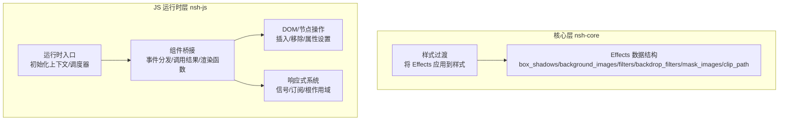
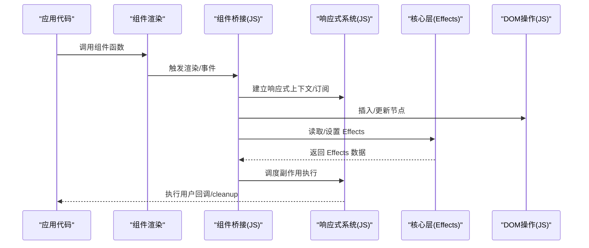
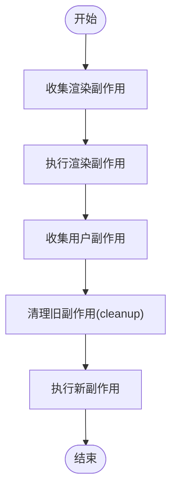
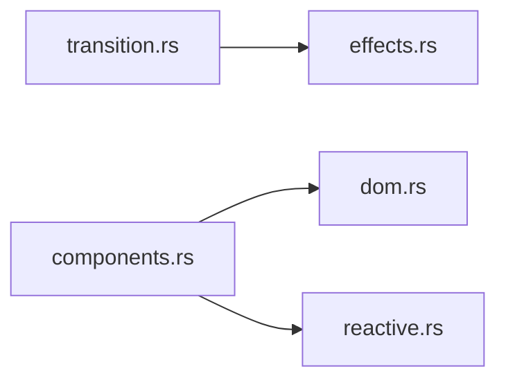

# 副作用（Effects）

<cite>
**本文引用的文件**   
- [effects.rs](file://crates/nsh-core/src/effects.rs)
- [components.rs](file://crates/nsh-js/src/components.rs)
- [reactive.rs](file://crates/nsh-js/src/reactive.rs)
- [dom.rs](file://crates/nsh-js/src/dom.rs)
- [lib.rs](file://crates/nsh-js/src/lib.rs)
- [transition.rs](file://crates/nsh-core/src/transition.rs)
</cite>

## 目录
1. [引言](#引言)
2. [项目结构](#项目结构)
3. [核心组件](#核心组件)
4. [架构总览](#架构总览)
5. [详细组件分析](#详细组件分析)
6. [依赖关系分析](#依赖关系分析)
7. [性能考量](#性能考量)
8. [故障排查指南](#故障排查指南)
9. [结论](#结论)
10. [附录：最佳实践与常见陷阱](#附录最佳实践与常见陷阱)

## 引言
本文件面向 NSH 副作用系统，聚焦以下目标：
- 解释 Effect 与 UserEffect 的区别、执行时机与优先级
- 说明渲染副作用与用户副作用的调度队列机制
- 描述副作用清理机制（cleanup 注册与执行）
- 梳理副作用生命周期（创建、执行、清理、销毁）
- 说明副作用与组件生命周期的集成方式，以及如何避免内存泄漏
- 给出最佳实践、性能优化建议与常见陷阱的代码示例路径

## 项目结构
NSH 的副作用能力由“核心渲染层”和“JS 运行时层”共同实现：
- 核心层（nsh-core）提供渲染相关的 Effects 数据结构与样式组合逻辑
- JS 运行时层（nsh-js）负责在组件渲染过程中收集、调度并执行副作用，包括渲染副作用与用户副作用

图表来源
- [effects.rs:1374-1407](file://crates/nsh-core/src/effects.rs#L1374-L1407)
- [transition.rs:1340-1340](file://crates/nsh-core/src/transition.rs#L1340-L1340)
- [lib.rs](file://crates/nsh-js/src/lib.rs)
- [components.rs:378-469](file://crates/nsh-js/src/components.rs#L378-L469)
- [dom.rs](file://crates/nsh-js/src/dom.rs)
- [reactive.rs](file://crates/nsh-js/src/reactive.rs)

章节来源
- [effects.rs:1374-1407](file://crates/nsh-core/src/effects.rs#L1374-L1407)
- [transition.rs:1340-1340](file://crates/nsh-core/src/transition.rs#L1340-L1340)
- [components.rs:378-469](file://crates/nsh-js/src/components.rs#L378-L469)

## 核心组件
- Effects（核心层）
  - 用于承载视图级别的视觉副作用数据，如阴影、渐变背景、滤镜、遮罩、裁剪路径等
  - 通过 Arc 共享以减少重复分配
- 组件桥接（JS 层）
  - 负责将 JS 侧的组件渲染、事件、异步调用与核心层交互
  - 在渲染流程中触发副作用收集与执行
- 响应式系统（JS 层）
  - 提供信号、订阅、根作用域等能力，支撑副作用的执行与清理
- DOM 操作（JS 层）
  - 负责节点的插入、移除、属性设置等，配合副作用完成 UI 更新

章节来源
- [effects.rs:1374-1407](file://crates/nsh-core/src/effects.rs#L1374-L1407)
- [components.rs:378-469](file://crates/nsh-js/src/components.rs#L378-L469)

## 架构总览
下图展示从组件渲染到副作用执行的端到端流程。注意：该图为概念性流程图，不直接映射具体源码文件，因此不包含图表来源。

## 详细组件分析

### 渲染副作用 vs 用户副作用
- 渲染副作用
  - 由框架内部驱动，用于同步 DOM 状态、样式与 Effects 数据
  - 通常在组件渲染阶段或布局完成后执行，保证 UI 一致性
- 用户副作用
  - 由应用代码定义，用于访问外部资源、订阅事件、启动定时器等
  - 在响应式上下文中执行，可返回 cleanup 函数以释放资源

执行时机与优先级（概念性说明）
- 渲染副作用优先于用户副作用
- 同一轮渲染中，先执行必要的渲染副作用，再执行用户副作用
- 当依赖变化时，旧的用户副作用会先执行 cleanup，再执行新的副作用

章节来源
- [components.rs:378-469](file://crates/nsh-js/src/components.rs#L378-L469)
- [reactive.rs](file://crates/nsh-js/src/reactive.rs)

### 副作用执行队列机制
- 渲染副作用队列
  - 在组件渲染期间收集，按顺序执行，确保 DOM 与样式一致
- 用户副作用队列
  - 在响应式上下文中排队执行，支持依赖追踪与增量更新
- 调度策略
  - 渲染副作用在 DOM 更新前后进行，以保证可见状态正确
  - 用户副作用在渲染副作用之后执行，避免相互干扰

[本图为概念性流程图，不直接映射具体源码文件]

### 清理机制（cleanup 注册与执行）
- 注册
  - 用户副作用返回一个函数作为 cleanup
  - 框架在副作用重新执行前调用上一次注册的 cleanup
- 执行
  - 当依赖变化导致副作用重跑时，先执行旧 cleanup，再执行新副作用
  - 组件卸载时，所有未清理的副作用将被统一清理，防止内存泄漏

章节来源
- [reactive.rs](file://crates/nsh-js/src/reactive.rs)

### 生命周期管理（创建、执行、清理、销毁）
- 创建
  - 组件渲染时创建副作用实例，绑定依赖与回调
- 执行
  - 渲染副作用在渲染阶段执行；用户副作用在响应式调度中执行
- 清理
  - 依赖变化或组件卸载时执行 cleanup
- 销毁
  - 组件销毁时释放副作用占用的资源，断开订阅

章节来源
- [components.rs:378-469](file://crates/nsh-js/src/components.rs#L378-L469)
- [reactive.rs](file://crates/nsh-js/src/reactive.rs)

### 与组件生命周期的集成
- 组件挂载
  - 初始化副作用，注册 cleanup
- 组件更新
  - 根据依赖变化决定是否重新执行副作用
- 组件卸载
  - 执行所有未清理的副作用，确保无残留

章节来源
- [components.rs:378-469](file://crates/nsh-js/src/components.rs#L378-L469)

### 避免内存泄漏
- 始终返回 cleanup 函数以释放定时器、事件监听、网络请求等
- 避免在副作用中持有长生命周期引用（如全局对象、闭包捕获大对象）
- 使用响应式系统的根作用域隔离副作用，避免跨组件泄漏

章节来源
- [reactive.rs](file://crates/nsh-js/src/reactive.rs)

## 依赖关系分析
- 核心层 Effects 数据结构被样式过渡模块使用，用于将视觉效果应用到组件样式
- JS 运行时层通过组件桥接与 DOM/响应式系统协作，完成副作用的收集与执行

图表来源
- [transition.rs:1340-1340](file://crates/nsh-core/src/transition.rs#L1340-L1340)
- [effects.rs:1374-1407](file://crates/nsh-core/src/effects.rs#L1374-L1407)
- [components.rs:378-469](file://crates/nsh-js/src/components.rs#L378-L469)

章节来源
- [transition.rs:1340-1340](file://crates/nsh-core/src/transition.rs#L1340-L1340)
- [effects.rs:1374-1407](file://crates/nsh-core/src/effects.rs#L1374-L1407)
- [components.rs:378-469](file://crates/nsh-js/src/components.rs#L378-L469)

## 性能考量
- 减少不必要的副作用
  - 仅在必要时声明副作用，避免在高频更新的渲染路径中执行昂贵逻辑
- 合并副作用
  - 将多个相关副作用合并为一个，降低调度开销
- 合理使用依赖数组
  - 精确声明依赖，避免过度重跑
- 避免在副作用中进行阻塞操作
  - 使用异步任务或消息通道，保持主线程流畅

[本节为通用指导，不直接分析具体文件]

## 故障排查指南
- 副作用未执行
  - 检查依赖是否发生变化
  - 确认是否在正确的响应式上下文中注册副作用
- 多次执行或循环执行
  - 检查依赖数组是否包含不稳定值
  - 避免在副作用内修改自身依赖
- 内存泄漏
  - 确认 cleanup 是否正确返回并执行
  - 检查是否存在全局引用或闭包捕获的大对象

章节来源
- [components.rs:378-469](file://crates/nsh-js/src/components.rs#L378-L469)
- [reactive.rs](file://crates/nsh-js/src/reactive.rs)

## 结论
NSH 的副作用系统通过核心层 Effects 数据结构与 JS 运行时层的调度机制协同工作，实现了渲染副作用与用户副作用的有序执行与清理。遵循最佳实践与性能优化建议，可以有效避免内存泄漏并提升应用性能。

[本节为总结性内容，不直接分析具体文件]

## 附录：最佳实践与常见陷阱
- 最佳实践
  - 在副作用中只处理与外部世界交互的逻辑
  - 始终返回 cleanup 函数，确保资源释放
  - 使用最小依赖集合，避免不必要重跑
- 常见陷阱
  - 忘记返回 cleanup 导致内存泄漏
  - 在副作用中直接修改响应式状态造成无限循环
  - 依赖数组遗漏或不稳定导致副作用行为异常

[本节为通用指导，不直接分析具体文件]