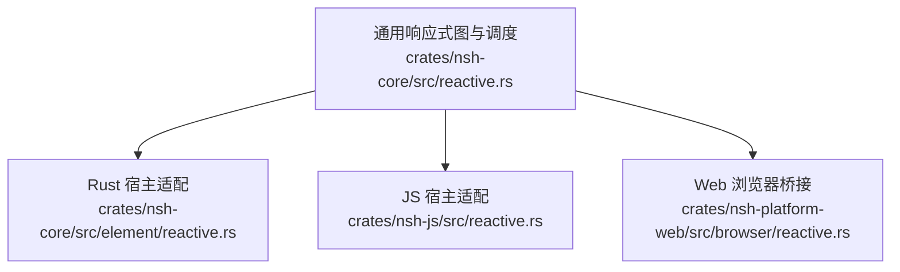
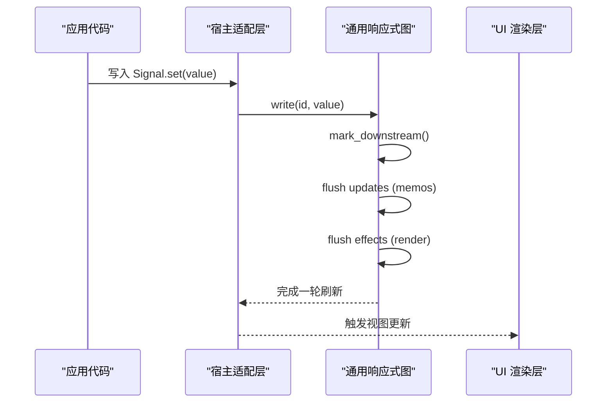
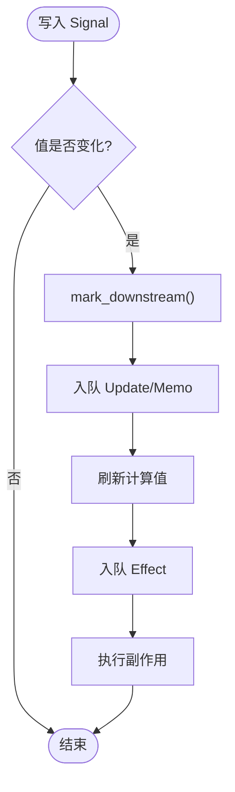
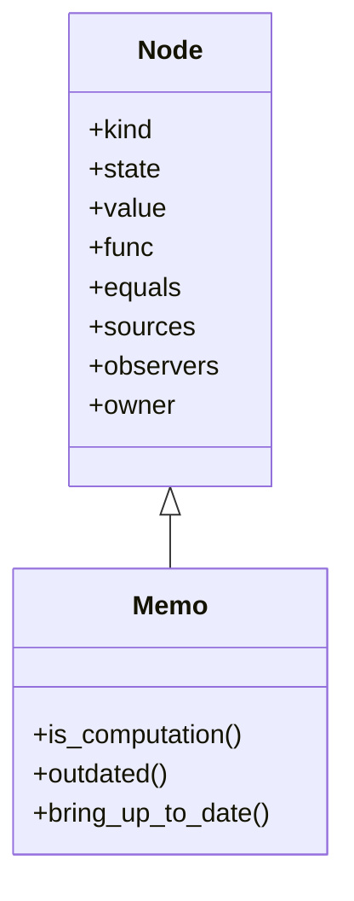
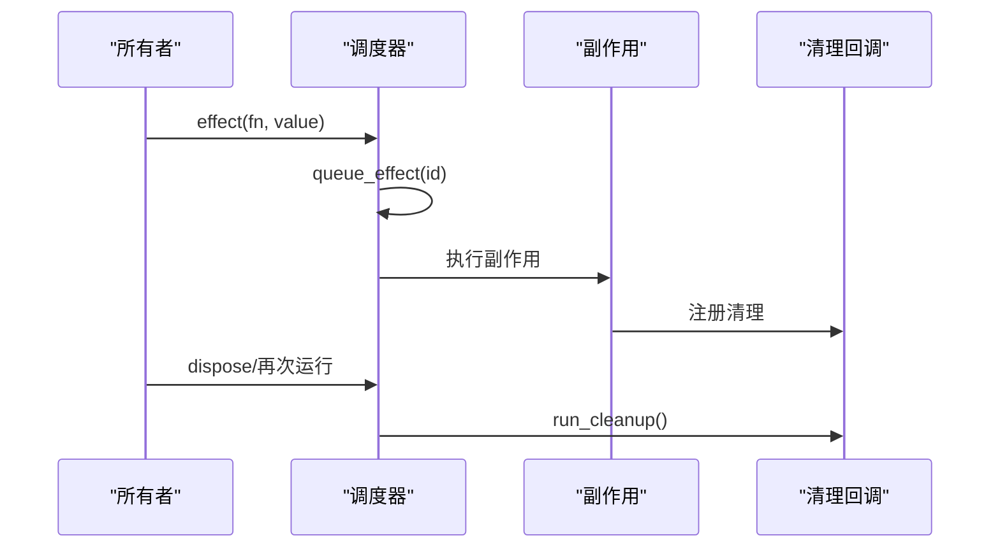
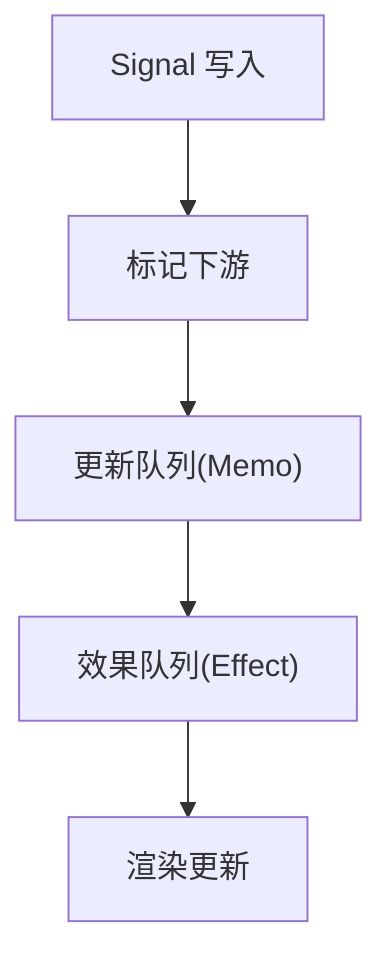
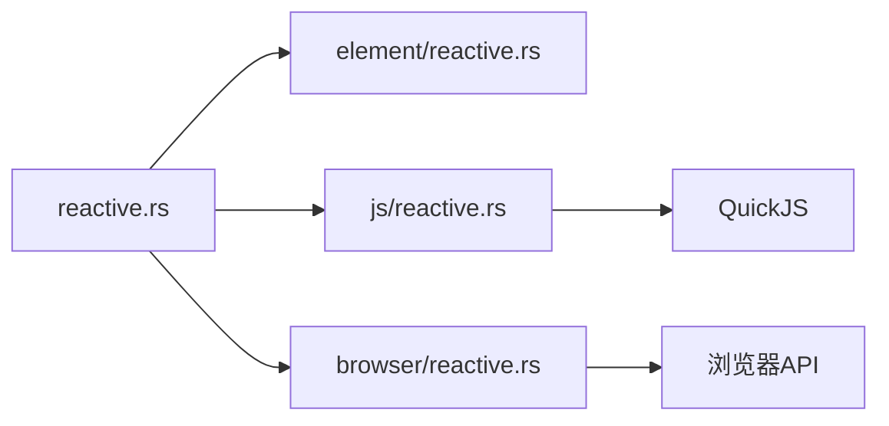

# 响应式系统

<cite>
**本文引用的文件**   
- [reactive.rs](file://crates/nsh-core/src/reactive.rs)
- [element/reactive.rs](file://crates/nsh-core/src/element/reactive.rs)
- [js/reactive.rs](file://crates/nsh-js/src/reactive.rs)
- [browser/reactive.rs](file://crates/nsh-platform-web/src/browser/reactive.rs)
</cite>

## 目录
1. [引言](#引言)
2. [项目结构](#项目结构)
3. [核心组件](#核心组件)
4. [架构总览](#架构总览)
5. [详细组件分析](#详细组件分析)
6. [依赖关系分析](#依赖关系分析)
7. [性能与优化](#性能与优化)
8. [故障排查](#故障排查)
9. [结论](#结论)

## 引言
本文件面向 NSH 的响应式系统，系统性解释信号（Signal）、计算值（Memo）、副作用（Effect）的实现原理与调度机制，说明依赖追踪、脏标记与惰性求值如何协作驱动 UI 更新；同时给出与 Solid.js 调度模型的一致性说明、跨平台（Rust 组件与 JS/Web）集成方式，以及性能优化技巧与常见陷阱。

## 项目结构
NSH 的响应式系统由四层组成：
- 通用图与调度内核：实现信号、计算、副作用、所有者、上下文与 Solid 风格的调度队列。
- Rust 宿主适配层：为 Rust 组件提供 Copy 句柄、类型安全读写、错误边界与清理回调。
- JS 宿主适配层：将 QuickJS 值与函数接入同一内核，暴露 createSignal/createMemo/createEffect 等 API。
- Web 浏览器运行时桥接：在浏览器线程上复用同一调度器，并桥接浏览器侧清理与上下文。

图表来源
- [reactive.rs:1-16](file://crates/nsh-core/src/reactive.rs#L1-L16)
- [element/reactive.rs:1-15](file://crates/nsh-core/src/element/reactive.rs#L1-L15)
- [js/reactive.rs:1-19](file://crates/nsh-js/src/reactive.rs#L1-L19)
- [browser/reactive.rs:1-15](file://crates/nsh-platform-web/src/browser/reactive.rs#L1-L15)

章节来源
- [reactive.rs:1-16](file://crates/nsh-core/src/reactive.rs#L1-L16)
- [element/reactive.rs:1-15](file://crates/nsh-core/src/element/reactive.rs#L1-L15)
- [js/reactive.rs:1-19](file://crates/nsh-js/src/reactive.rs#L1-L19)
- [browser/reactive.rs:1-15](file://crates/nsh-platform-web/src/browser/reactive.rs#L1-L15)

## 核心组件
- 节点与种类：信号（Signal）、计算（Memo）、渲染副作用（Effect）、用户副作用（UserEffect）、根所有者（Root）。
- 状态机：CLEAN/STALE/PENDING 三态表示是否已计算或待更新。
- 调度器：Solid 风格的 Updates 与 Effects 双队列，先更新计算再执行副作用，检测无限循环。
- 依赖图：双向边（sources/observers），支持 O(1) 解链与增量传播。
- 所有者与上下文：节点归属所有者，支持 provide/context 作用域传递。
- 比较策略：默认严格相等、总是通知、真值变化、自定义比较函数。

章节来源
- [reactive.rs:45-73](file://crates/nsh-core/src/reactive.rs#L45-L73)
- [reactive.rs:146-179](file://crates/nsh-core/src/reactive.rs#L146-L179)
- [reactive.rs:242-260](file://crates/nsh-core/src/reactive.rs#L242-L260)
- [reactive.rs:676-724](file://crates/nsh-core/src/reactive.rs#L676-L724)

## 架构总览
下图展示从“写信号”到“UI 更新”的完整路径：Rust/JS 调用写入信号 → 内核标记下游 → 批量刷新计算 → 执行渲染副作用 → 触发 UI 更新。

图表来源
- [reactive.rs:746-764](file://crates/nsh-core/src/reactive.rs#L746-L764)
- [element/reactive.rs:728-743](file://crates/nsh-core/src/element/reactive.rs#L728-L743)
- [js/reactive.rs:459-493](file://crates/nsh-js/src/reactive.rs#L459-L493)

## 详细组件分析

### 信号（Signal）与依赖追踪
- 创建：Rust 侧通过 `signal`/`signal_with` 创建带类型安全的信号；JS 侧通过 `createSignal` 暴露给脚本。
- 读取：在计算或副作用中读取会建立依赖边（track），记录当前监听者到源节点的观察者列表。
- 写入：比较新旧值后决定是否通知；若不同则标记下游为 PENDING/STALE，并加入对应队列。
- 惰性求值：计算值（Memo）仅在需要时重新运行，且仅当输入发生变化才更新。

图表来源
- [reactive.rs:746-764](file://crates/nsh-core/src/reactive.rs#L746-L764)
- [reactive.rs:669-674](file://crates/nsh-core/src/reactive.rs#L669-L674)
- [element/reactive.rs:728-743](file://crates/nsh-core/src/element/reactive.rs#L728-L743)

章节来源
- [element/reactive.rs:496-532](file://crates/nsh-core/src/element/reactive.rs#L496-L532)
- [element/reactive.rs:684-775](file://crates/nsh-core/src/element/reactive.rs#L684-L775)
- [js/reactive.rs:609-631](file://crates/nsh-js/src/reactive.rs#L609-L631)
- [reactive.rs:317-346](file://crates/nsh-core/src/reactive.rs#L317-L346)

### 计算值（Memo）与惰性求值
- 惰性：首次访问前未运行；之后仅在依赖变化且被请求时重算。
- 脏标记：依赖变化时上游标记下游为 STALE/PENDING，刷新阶段按拓扑顺序重算。
- 比较策略：可配置默认严格相等、总是通知、真值变化或自定义比较函数。

图表来源
- [reactive.rs:146-179](file://crates/nsh-core/src/reactive.rs#L146-L179)
- [reactive.rs:464-468](file://crates/nsh-core/src/reactive.rs#L464-L468)
- [element/reactive.rs:401-414](file://crates/nsh-core/src/element/reactive.rs#L401-L414)

章节来源
- [reactive.rs:348-366](file://crates/nsh-core/src/reactive.rs#L348-L366)
- [reactive.rs:464-468](file://crates/nsh-core/src/reactive.rs#L464-L468)
- [element/reactive.rs:401-414](file://crates/nsh-core/src/element/reactive.rs#L401-L414)

### 副作用（Effect）的执行时机与清理
- 两类副作用：渲染副作用（Effect）优先执行，用户副作用（UserEffect）随后执行。
- 生命周期：副作用在所属所有者再次运行或被释放时执行清理回调。
- 清理机制：宿主适配层统一封装 run_cleanup/free_cleanup，确保异常不破坏调度。

图表来源
- [reactive.rs:661-667](file://crates/nsh-core/src/reactive.rs#L661-L667)
- [reactive.rs:614-637](file://crates/nsh-core/src/reactive.rs#L614-L637)
- [js/reactive.rs:653-683](file://crates/nsh-js/src/reactive.rs#L653-L683)

章节来源
- [reactive.rs:45-60](file://crates/nsh-core/src/reactive.rs#L45-L60)
- [reactive.rs:614-637](file://crates/nsh-core/src/reactive.rs#L614-L637)
- [js/reactive.rs:653-683](file://crates/nsh-js/src/reactive.rs#L653-L683)

### watch 监听模式
- 在 Rust 组件侧，通常通过 computed 派生派生值并在 UI 绑定处订阅，或使用 effect 观察信号变化以执行副作用。
- 在 JS/Web 侧，可通过 createEffect 或 createRenderEffect 实现“监听”语义；结合 untracked/batch 控制依赖与批处理。
- 浏览器桥接提供 onCleanup 与 withOwner 能力，便于事件监听与异步回调的生命周期管理。

章节来源
- [js/reactive.rs:653-683](file://crates/nsh-js/src/reactive.rs#L653-L683)
- [browser/reactive.rs:123-149](file://crates/nsh-platform-web/src/browser/reactive.rs#L123-L149)
- [browser/reactive.rs:294-311](file://crates/nsh-platform-web/src/browser/reactive.rs#L294-L311)

### 响应式数据流驱动 UI 更新
- 状态变更传播路径：Signal.write → mark_downstream → Updates 队列（Memo）→ Effects 队列（渲染）→ UI 更新。
- 渲染优化策略：
  - 惰性求值：Memo 按需计算，避免无谓重算。
  - 脏标记与去抖：PENDING/STALE 状态避免重复计算。
  - 批处理：batch 合并多次写入，减少中间刷新。
  - 比较策略：默认严格相等或自定义比较，减少不必要的通知。

图表来源
- [reactive.rs:746-764](file://crates/nsh-core/src/reactive.rs#L746-L764)
- [element/reactive.rs:728-743](file://crates/nsh-core/src/element/reactive.rs#L728-L743)

章节来源
- [reactive.rs:746-764](file://crates/nsh-core/src/reactive.rs#L746-L764)
- [element/reactive.rs:728-743](file://crates/nsh-core/src/element/reactive.rs#L728-L743)

### 与 Solid.js 的集成方式
- 调度模型一致：采用 Solid 1.9 的 runUpdates、Updates 与 Effects 双队列，保证先更新计算再执行副作用。
- 宿主抽象：通过 Host trait 将 JS 值/函数与 Rust 闭包统一接入同一内核，共享算法与保证。
- API 映射：JS 侧 expose createSignal/createMemo/createEffect，Rust 侧暴露 signal/computed/effect 等。

章节来源
- [reactive.rs:1-9](file://crates/nsh-core/src/reactive.rs#L1-L9)
- [js/reactive.rs:1-9](file://crates/nsh-js/src/reactive.rs#L1-L9)
- [js/reactive.rs:609-683](file://crates/nsh-js/src/reactive.rs#L609-L683)

### 跨平台的响应式编程模型
- Rust 组件：使用 Copy 句柄（Signal/ReadSignal/Stored/Kept），在引擎线程进入运行时后操作图。
- JS/Web：QuickJS 值与函数作为计算与比较，浏览器桥接提供 onCleanup/withOwner 等能力。
- 统一图：Rust 与 JS 共享同一 Graph 实现，保证行为一致性与可移植性。

章节来源
- [element/reactive.rs:1-15](file://crates/nsh-core/src/element/reactive.rs#L1-L15)
- [js/reactive.rs:1-19](file://crates/nsh-js/src/reactive.rs#L1-L19)
- [browser/reactive.rs:1-15](file://crates/nsh-platform-web/src/browser/reactive.rs#L1-L15)

## 依赖关系分析
- 耦合与内聚：
  - 通用图（reactive.rs）高度内聚，定义节点、调度与比较策略。
  - 宿主适配层（element/reactive.rs、js/reactive.rs、browser/reactive.rs）低耦合地实现 Host trait，屏蔽平台差异。
- 直接/间接依赖：
  - Rust/JS/Web 均依赖 reactive.rs 提供的 Graph 与 Host。
  - JS/Web 还依赖 QuickJS 与浏览器运行时进行值与函数调用。
- 外部依赖点：
  - JS 宿主通过 QuickJS 调用用户函数与比较函数。
  - Web 宿主通过浏览器 API 执行清理回调。

图表来源
- [reactive.rs:1-16](file://crates/nsh-core/src/reactive.rs#L1-L16)
- [js/reactive.rs:1-19](file://crates/nsh-js/src/reactive.rs#L1-L19)
- [browser/reactive.rs:1-15](file://crates/nsh-platform-web/src/browser/reactive.rs#L1-L15)

章节来源
- [reactive.rs:1-16](file://crates/nsh-core/src/reactive.rs#L1-L16)
- [js/reactive.rs:1-19](file://crates/nsh-js/src/reactive.rs#L1-L19)
- [browser/reactive.rs:1-15](file://crates/nsh-platform-web/src/browser/reactive.rs#L1-L15)

## 性能与优化
- 惰性求值：Memo 按需计算，避免多余开销。
- 脏标记与去抖：PENDING/STALE 状态避免重复计算。
- 批处理：batch 合并多次写入，减少中间刷新。
- 比较策略：默认严格相等或自定义比较，减少不必要通知。
- 内存回收：compact 定期压缩空闲槽位，降低内存占用。
- 无限循环保护：MAX_RUNS 限制刷新轮次，防止副作用自激。

章节来源
- [reactive.rs:42-43](file://crates/nsh-core/src/reactive.rs#L42-L43)
- [reactive.rs:298-315](file://crates/nsh-core/src/reactive.rs#L298-L315)
- [reactive.rs:645-667](file://crates/nsh-core/src/reactive.rs#L645-L667)

## 故障排查
- 无限循环：副作用不断改变其读到的信号，触发 runaway 保护。
- 异常处理：计算或清理中的异常被捕获并延迟抛出，避免中断调度。
- 错误边界：JS 侧 ErrorBoundary 收集异常并在计算结束后设置边界信号以触发回退渲染。
- 句柄失效：对已释放的所有者或节点进行操作会返回错误或空值，需检查 is_live/try_get。

章节来源
- [reactive.rs:746-764](file://crates/nsh-core/src/reactive.rs#L746-L764)
- [js/reactive.rs:132-155](file://crates/nsh-js/src/reactive.rs#L132-L155)
- [js/reactive.rs:185-212](file://crates/nsh-js/src/reactive.rs#L185-L212)
- [js/reactive.rs:297-317](file://crates/nsh-js/src/reactive.rs#L297-L317)
- [element/reactive.rs:715-743](file://crates/nsh-core/src/element/reactive.rs#L715-L743)

## 结论
NSH 的响应式系统以通用图为核心，通过 Host 抽象统一 Rust 与 JS/Web 宿主，复用 Solid 风格的调度模型，实现高效的依赖追踪、脏标记与惰性求值。借助批处理、比较策略与内存压缩，系统在复杂 UI 场景下保持良好性能与稳定性。理解 Signal/Memo/Effect 的生命周期与传播路径，有助于编写高性能、可维护的响应式应用。