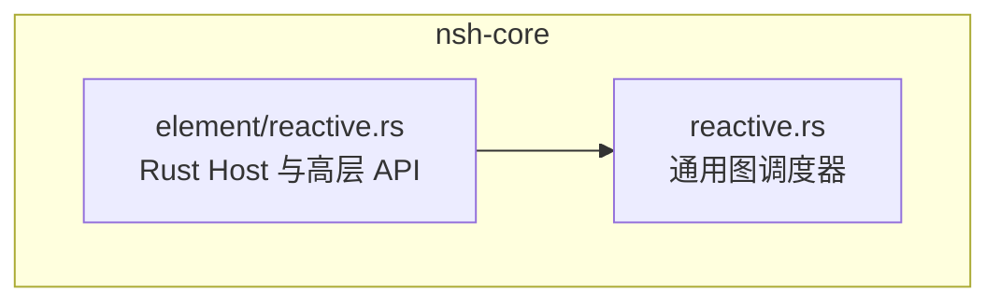
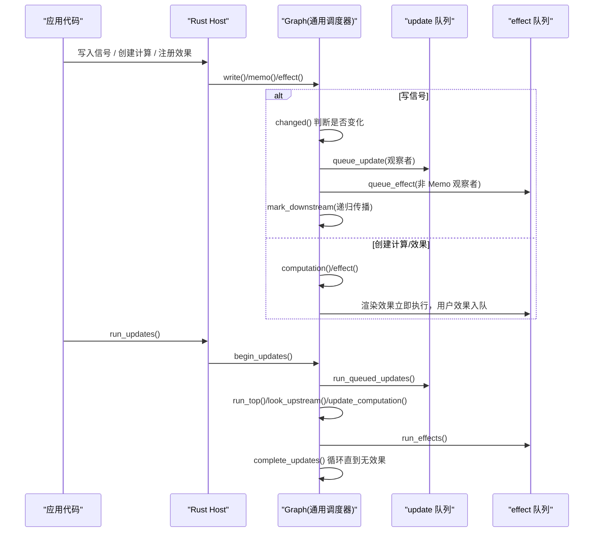
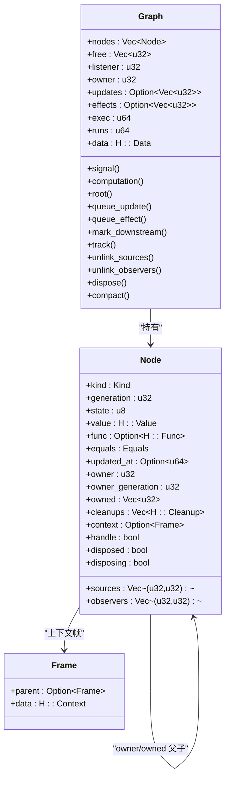
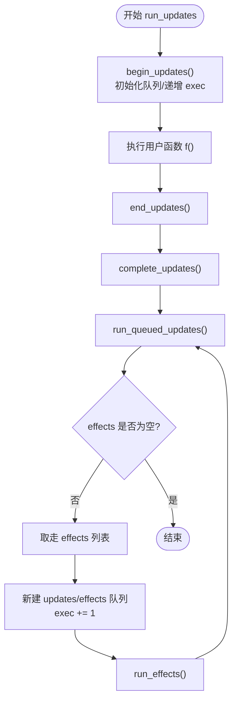
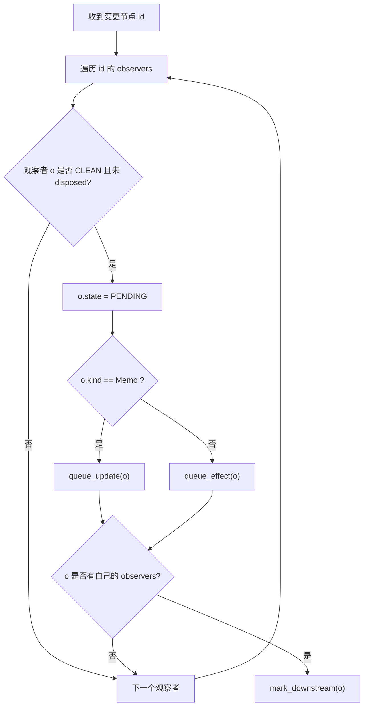
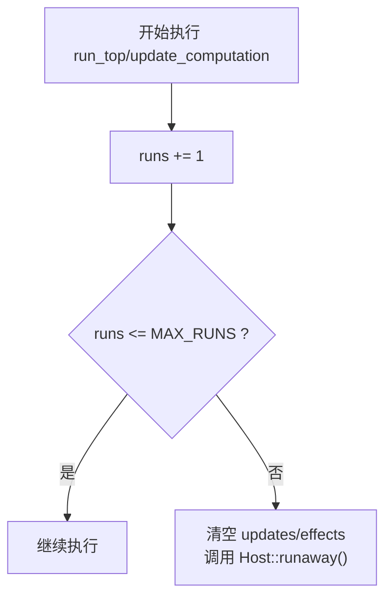
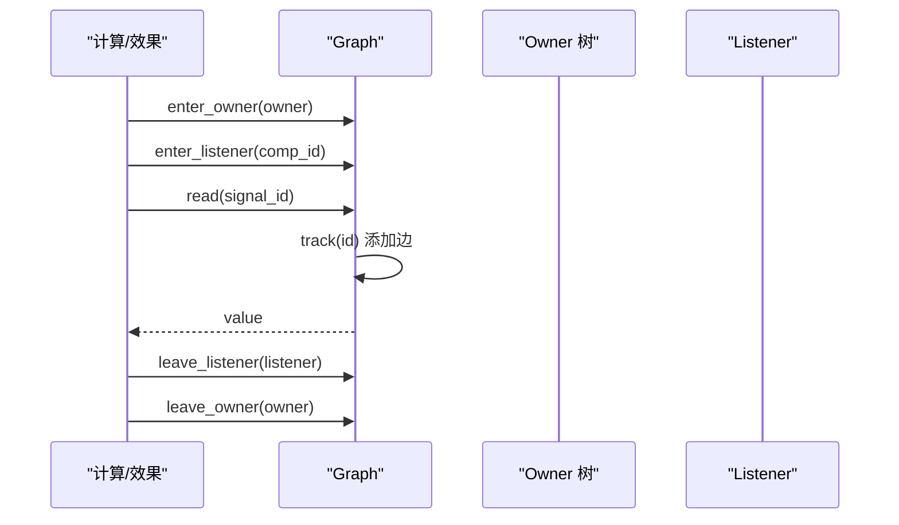
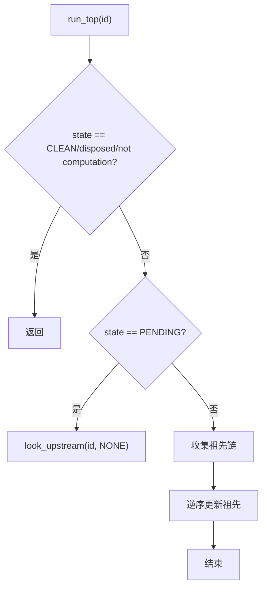
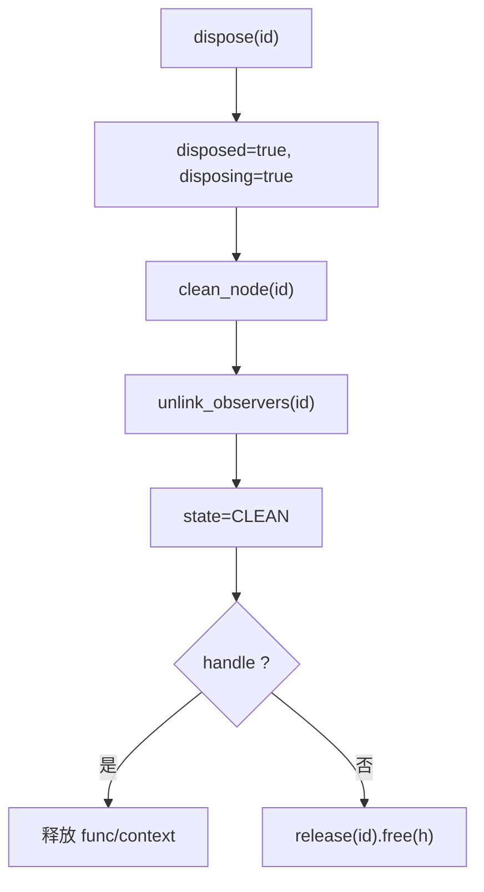
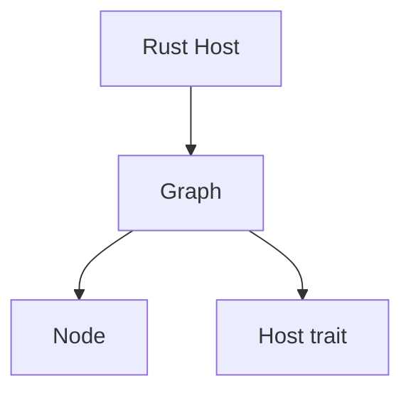

# 图调度器

<cite>
**本文引用的文件**   
- [reactive.rs](file://crates/nsh-core/src/reactive.rs)
- [element/reactive.rs](file://crates/nsh-core/src/element/reactive.rs)
</cite>

## 目录
1. [引言](#引言)
2. [项目结构](#项目结构)
3. [核心组件](#核心组件)
4. [架构总览](#架构总览)
5. [详细组件分析](#详细组件分析)
6. [依赖关系分析](#依赖关系分析)
7. [性能考量](#性能考量)
8. [故障排查指南](#故障排查指南)
9. [结论](#结论)

## 引言
本文件为 NSH 响应式图调度器的技术文档，聚焦以下目标：
- 图的拓扑结构与节点关系管理，包括源节点与观察者的双向链接。
- 调度算法实现，重点解释 update 队列与 effect 队列的处理逻辑。
- 脏标记传播机制，特别是 mark_downstream 的工作原理。
- 执行轮次（exec round）管理与防止无限循环的保护机制。
- 所有者（owner）与监听者（listener）的概念及其在依赖追踪中的作用。
- 调度器的性能优化策略与调试方法。

该调度器基于 Solid 的更新模型，采用“计算优先、效果后置”的两阶段调度，并通过“所有者树 + 双向边 + 脏标记”的组合，保证最小化重算与副作用触发。

## 项目结构
NSH 的响应式图调度核心位于 nsh-core 包中：
- crates/nsh-core/src/reactive.rs：通用图调度器 Graph、Host trait、调度流程、拓扑维护等。
- crates/nsh-core/src/element/reactive.rs：Rust 侧 Host 实现与高层 API（Signal/Memo/Effect 等），将 Rust 值与闭包适配到通用调度器。

**图表来源**
- [reactive.rs:1-10](file://crates/nsh-core/src/reactive.rs#L1-L10)
- [element/reactive.rs:1-15](file://crates/nsh-core/src/element/reactive.rs#L1-L15)

**章节来源**
- [reactive.rs:1-10](file://crates/nsh-core/src/reactive.rs#L1-L10)
- [element/reactive.rs:1-15](file://crates/nsh-core/src/element/reactive.rs#L1-L15)

## 核心组件
- Host trait：定义图调度器对宿主环境的抽象，包括值的创建/释放、函数调用、比较、清理回调、以及“运行失控”上报。
- Graph：图的核心数据结构，包含节点数组、空闲槽位、当前 listener/owner、update/effect 队列、exec/runs 计数等。
- Node：具体节点，区分 Signal/Memo/Effect/UserEffect/Root/Free，维护状态、值、函数、比较器、sources/observers 双向边、owner/owned 父子关系、上下文帧、清理回调等。
- Rust Host：将 Rust 的 Rc<dyn Any> 值、闭包、类型擦除比较、panic 捕获等接入通用调度器。

关键职责划分：
- reactive.rs：调度算法、拓扑维护、生命周期管理。
- element/reactive.rs：Rust 语义封装（Signal/Memo/Effect）、错误边界、事件发射、运行时入口。

**章节来源**
- [reactive.rs:45-179](file://crates/nsh-core/src/reactive.rs#L45-L179)
- [reactive.rs:241-260](file://crates/nsh-core/src/reactive.rs#L241-L260)
- [element/reactive.rs:153-261](file://crates/nsh-core/src/element/reactive.rs#L153-L261)

## 架构总览
下图展示调度器整体交互：上层通过 Rust Host 暴露 API，底层由 Graph 维护拓扑与队列；write 触发脏标记传播，run_updates 驱动 update 与 effect 两阶段执行。

**图表来源**
- [reactive.rs:810-876](file://crates/nsh-core/src/reactive.rs#L810-L876)
- [reactive.rs:878-914](file://crates/nsh-core/src/reactive.rs#L878-L914)
- [reactive.rs:1077-1111](file://crates/nsh-core/src/reactive.rs#L1077-L1111)

## 详细组件分析

### 图的拓扑结构与节点关系管理
- 节点类型：Signal、Memo、Effect、UserEffect、Root、Free。
- 双向边：每个节点维护 sources（上游源）和 observers（下游观察者），以 (id, slot) 元组记录索引，支持 O(1) 删除（swap-remove）。
- 父子关系：owner/owned 表示所有者树，用于按所有者顺序清理与调度。
- 上下文帧：Frame 链提供 Provider/Consumer 语义，随 owner 传递。

**图表来源**
- [reactive.rs:146-179](file://crates/nsh-core/src/reactive.rs#L146-L179)
- [reactive.rs:241-260](file://crates/nsh-core/src/reactive.rs#L241-L260)
- [reactive.rs:138-144](file://crates/nsh-core/src/reactive.rs#L138-L144)

**章节来源**
- [reactive.rs:146-179](file://crates/nsh-core/src/reactive.rs#L146-L179)
- [reactive.rs:241-260](file://crates/nsh-core/src/reactive.rs#L241-L260)
- [reactive.rs:138-144](file://crates/nsh-core/src/reactive.rs#L138-L144)

### 调度算法：update 队列与 effect 队列
- run_updates：启动一轮更新，begin_updates 初始化 updates/effects 队列并递增 exec；end_updates 完成本轮并重置 runs。
- run_queued_updates：遍历 updates 队列，逐个 run_top；结束后清空 updates。
- run_effects：先执行渲染效果（Kind::Effect），再执行用户效果（Kind::UserEffect），每批效果后再次处理 queued updates，形成“效果可能产生新的更新”的迭代。
- complete_updates：当 effects 非空时，循环取走 effects 并执行，然后再次 run_queued_updates，直到 effects 为空。

**图表来源**
- [reactive.rs:810-876](file://crates/nsh-core/src/reactive.rs#L810-L876)
- [reactive.rs:878-914](file://crates/nsh-core/src/reactive.rs#L878-L914)

**章节来源**
- [reactive.rs:810-876](file://crates/nsh-core/src/reactive.rs#L810-L876)
- [reactive.rs:878-914](file://crates/nsh-core/src/reactive.rs#L878-L914)

### 脏标记传播：mark_downstream 工作原理
- 当某个节点的观察者被标记为 CLEAN 且未 disposed，将其状态置为 PENDING。
- 若观察者是 Memo，则入队 update；否则入队 effect。
- 如果该观察者还有自己的观察者，递归调用 mark_downstream，继续向下传播。
- write 路径中，对每个 CLEAN 的观察者设置 STALE，并在必要时触发 mark_downstream。

**图表来源**
- [reactive.rs:747-764](file://crates/nsh-core/src/reactive.rs#L747-L764)
- [reactive.rs:1089-1111](file://crates/nsh-core/src/reactive.rs#L1089-L1111)

**章节来源**
- [reactive.rs:747-764](file://crates/nsh-core/src/reactive.rs#L747-L764)
- [reactive.rs:1089-1111](file://crates/nsh-core/src/reactive.rs#L1089-L1111)

### 执行轮次（exec round）与防无限循环保护
- exec：每轮更新递增，用于标记节点在本轮是否已更新（updated_at >= exec）。
- runs：累计本轮内执行的次数，超过 MAX_RUNS 即判定为潜在无限循环，清空队列并上报 runaway。
- count_run：每次执行前计数，超限则中断并调用 Host::runaway。
- complete_updates 循环确保效果与更新的稳定收敛，避免栈溢出。

**图表来源**
- [reactive.rs:43-43](file://crates/nsh-core/src/reactive.rs#L43-L43)
- [reactive.rs:891-902](file://crates/nsh-core/src/reactive.rs#L891-L902)

**章节来源**
- [reactive.rs:43-43](file://crates/nsh-core/src/reactive.rs#L43-L43)
- [reactive.rs:891-902](file://crates/nsh-core/src/reactive.rs#L891-L902)

### 所有者（owner）与监听者（listener）
- owner：创建节点时的上下文所有者，决定节点归属与清理顺序；根节点可跨所有者存活。
- listener：当前读取操作的订阅者，read 时会将当前节点加入 listener.sources，建立依赖边。
- enter_owner/leave_owner 与 enter_listener/leave_listener：在执行计算或读取时切换上下文，并在异常或 dispose 情况下安全恢复。
- owner_of：沿 owner 链向上查找，使用 generation 校验避免引用失效导致的环。

**图表来源**
- [reactive.rs:530-602](file://crates/nsh-core/src/reactive.rs#L530-L602)
- [reactive.rs:676-702](file://crates/nsh-core/src/reactive.rs#L676-L702)
- [reactive.rs:436-452](file://crates/nsh-core/src/reactive.rs#L436-L452)

**章节来源**
- [reactive.rs:530-602](file://crates/nsh-core/src/reactive.rs#L530-L602)
- [reactive.rs:676-702](file://crates/nsh-core/src/reactive.rs#L676-L702)
- [reactive.rs:436-452](file://crates/nsh-core/src/reactive.rs#L436-L452)

### 计算执行与依赖更新：run_top、look_upstream、update_computation
- run_top：若节点 stale/pending 且未 disposed，先收集需要更新的祖先（按 owner 链），再依次更新。
- look_upstream：将节点读到的上游 memo 提升到当前 exec 时间，必要时递归更新上游。
- update_computation：清理节点（clean_node），重新执行函数（run_computation），根据结果决定是否通知下游。

**图表来源**
- [reactive.rs:916-952](file://crates/nsh-core/src/reactive.rs#L916-L952)
- [reactive.rs:954-981](file://crates/nsh-core/src/reactive.rs#L954-L981)
- [reactive.rs:983-997](file://crates/nsh-core/src/reactive.rs#L983-L997)

**章节来源**
- [reactive.rs:916-952](file://crates/nsh-core/src/reactive.rs#L916-L952)
- [reactive.rs:954-981](file://crates/nsh-core/src/reactive.rs#L954-L981)
- [reactive.rs:983-997](file://crates/nsh-core/src/reactive.rs#L983-L997)

### 生命周期管理：clean_node、dispose、release
- clean_node：断开 sources，按 owned 顺序 dispose 子节点，执行 cleanups，最后 state=CLEAN。
- dispose：标记 disposed/disposing，切换到 DISPOSED owner，clean_node，断开 observers，释放资源。
- release：将节点置为 Free，放入 free 池，返回 Held 以便外部释放值/函数/比较器等。

**图表来源**
- [reactive.rs:1142-1165](file://crates/nsh-core/src/reactive.rs#L1142-L1165)
- [reactive.rs:1167-1201](file://crates/nsh-core/src/reactive.rs#L1167-L1201)
- [reactive.rs:726-744](file://crates/nsh-core/src/reactive.rs#L726-L744)

**章节来源**
- [reactive.rs:1142-1165](file://crates/nsh-core/src/reactive.rs#L1142-L1165)
- [reactive.rs:1167-1201](file://crates/nsh-core/src/reactive.rs#L1167-L1201)
- [reactive.rs:726-744](file://crates/nsh-core/src/reactive.rs#L726-L744)

## 依赖关系分析
- Graph 与 Node：Graph 管理 Node 的生命周期与拓扑；Node 维护自身状态与边。
- Host 与 Graph：Host 提供值/函数/比较/清理等能力，Graph 仅通过 Host 接口访问宿主资源。
- Rust Host 与 Graph：Rust Host 将 Rust 类型与闭包适配到通用调度器，同时收集 panic 与事件。

**图表来源**
- [reactive.rs:75-136](file://crates/nsh-core/src/reactive.rs#L75-L136)
- [element/reactive.rs:153-261](file://crates/nsh-core/src/element/reactive.rs#L153-L261)

**章节来源**
- [reactive.rs:75-136](file://crates/nsh-core/src/reactive.rs#L75-L136)
- [element/reactive.rs:153-261](file://crates/nsh-core/src/element/reactive.rs#L153-L261)

## 性能考量
- 双向边 swap-remove：unlink_sources/unlink_observers 使用尾部交换删除，O(1) 移除边，避免线性扫描。
- 内存回收：compact 在空闲时收缩 arena，降低内存占用；free 池复用节点槽位。
- 比较优化：Equals 支持 Default/Never/Truthiness/Custom，减少不必要的通知。
- 批量更新：batch/run_updates 合并多次写入，减少重复调度。
- 执行轮次保护：MAX_RUNS 防止无限循环导致栈溢出。

[本节为通用指导，不直接分析具体文件]

## 故障排查指南
- 潜在无限循环：当 runs > MAX_RUNS 时，调度器会清空队列并调用 Host::runaway 上报错误。检查是否存在效果持续改变其读取的信号。
- 节点泄漏：检查 handle 与 disposed 状态，确认 drop_handle 是否正确释放信号或已 disposed 的计算。
- 依赖缺失：确认 read 是否在有效的 listener 上下文中进行；untracked 读取不会建立依赖。
- 清理回调未执行：检查 clean_node 与 dispose 的执行路径，确保 owner 正确清理。

**章节来源**
- [reactive.rs:891-902](file://crates/nsh-core/src/reactive.rs#L891-L902)
- [reactive.rs:1167-1201](file://crates/nsh-core/src/reactive.rs#L1167-L1201)
- [element/reactive.rs:255-261](file://crates/nsh-core/src/element/reactive.rs#L255-L261)

## 结论
NSH 的响应式图调度器通过“所有者树 + 双向边 + 脏标记 + 两阶段队列”的设计，实现了高效、安全的依赖追踪与副作用调度。其核心优势在于：
- 精确的最小化重算与副作用触发。
- 稳健的生命周期管理与内存回收。
- 明确的执行轮次与防无限循环保护。
- 可扩展的 Host 抽象，支持 Rust 与 JS 宿主环境。

在实际使用中，建议：
- 合理使用 batch 合并写入，减少调度开销。
- 谨慎使用 untracked，避免遗漏依赖。
- 关注效果中的副作用，避免造成无限循环。
- 利用调试工具（如 slots_in_use、failures）定位问题。

[本节为总结性内容，不直接分析具体文件]