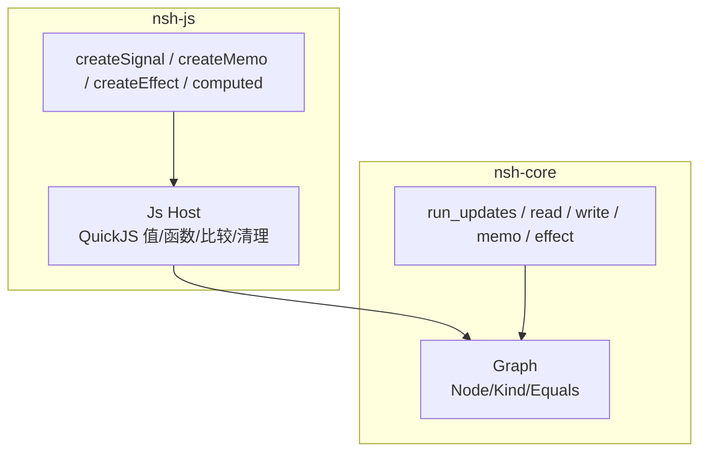
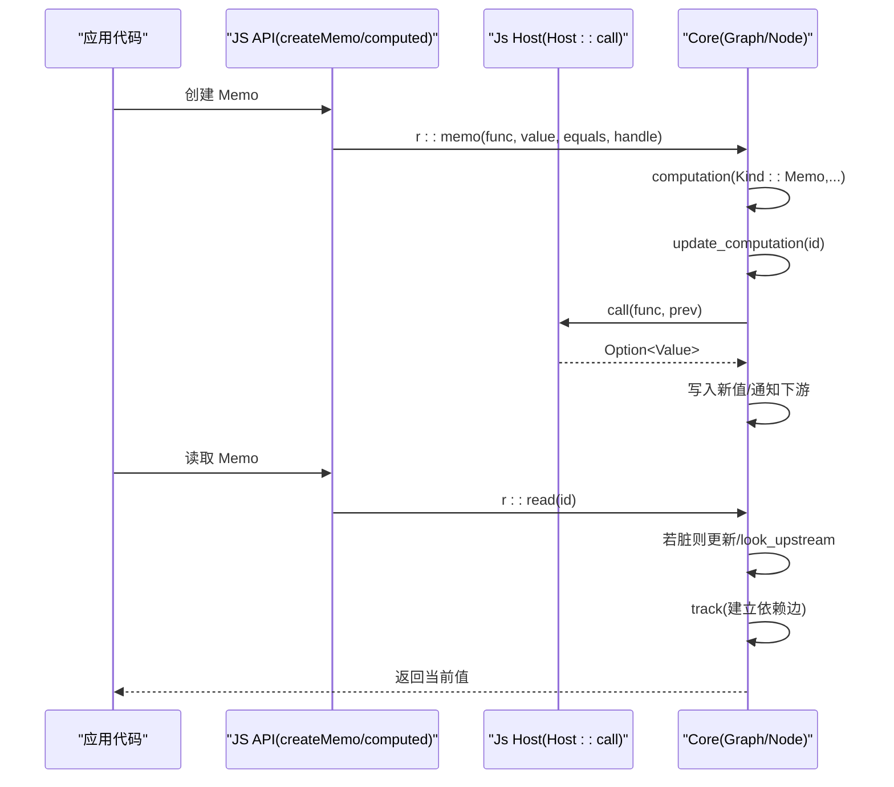
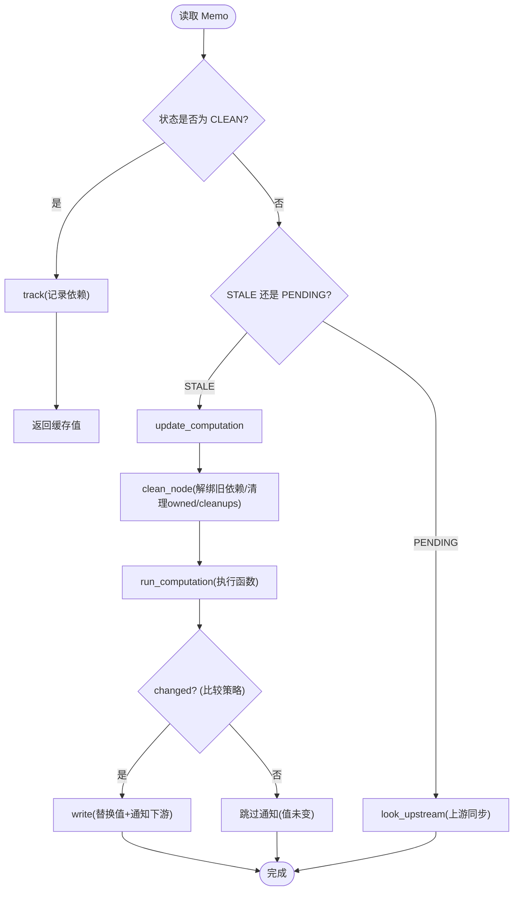
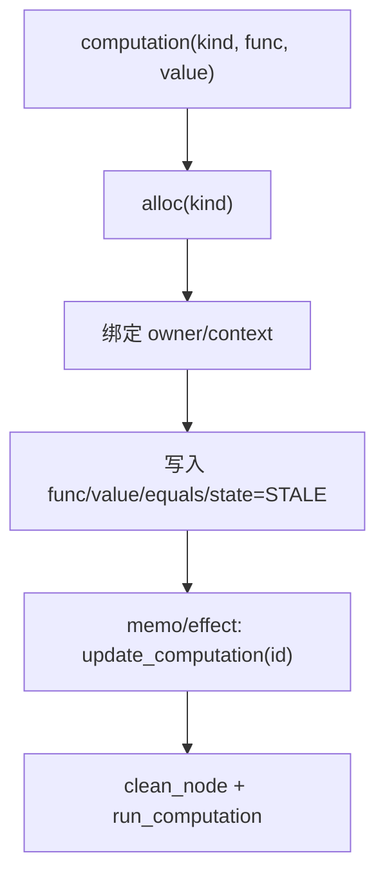
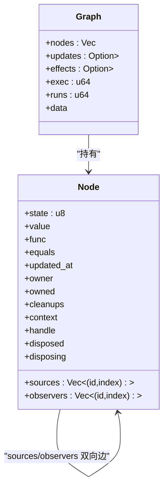
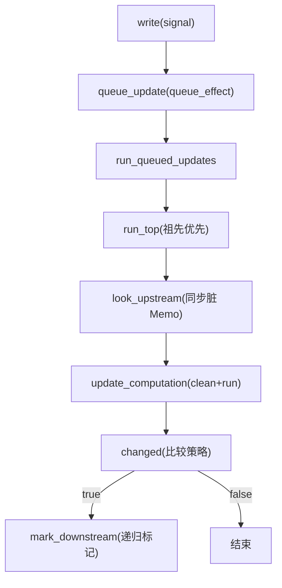
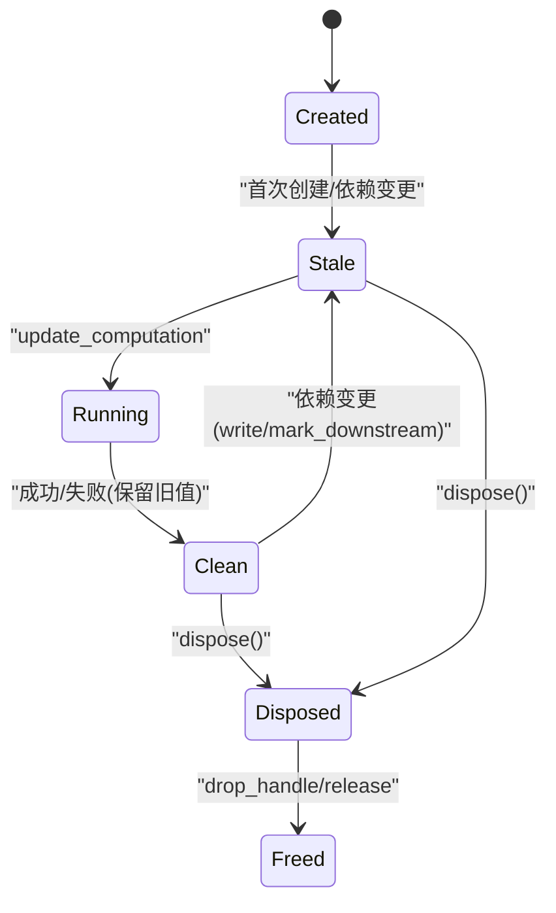
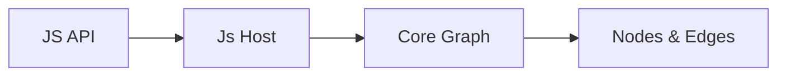

# 计算值（Computations）

<cite>
**本文引用的文件**   
- [reactive.rs](file://crates/nsh-core/src/reactive.rs)
- [reactive.rs](file://crates/nsh-js/src/reactive.rs)
</cite>

## 目录
1. [引言](#引言)
2. [项目结构](#项目结构)
3. [核心组件](#核心组件)
4. [架构总览](#架构总览)
5. [详细组件分析](#详细组件分析)
6. [依赖关系分析](#依赖关系分析)
7. [性能考虑](#性能考虑)
8. [故障排查指南](#故障排查指南)
9. [结论](#结论)
10. [附录：使用模式与调试技巧](#附录使用模式与调试技巧)

## 引言
本文件面向 NSH 计算值系统，聚焦 Memo 节点的实现原理与执行流程。内容涵盖惰性求值、缓存机制、脏标记更新、computation() 的执行路径、依赖收集、结果缓存与失效重算、计算值的生命周期管理、信号到 Memo 的依赖图构建、循环依赖防护，以及使用模式、性能优化与调试技巧。读者无需深入 Rust/QuickJS 细节即可理解整体行为；同时为需要源码级定位的工程师提供精确的文件与行号引用。

## 项目结构
NSH 的计算值系统由两层组成：
- 通用响应式图实现：位于 nsh-core 的 reactive 模块，定义节点、调度、依赖追踪、清理与生命周期等核心算法。
- JS 宿主适配层：位于 nsh-js 的 reactive 模块，将 QuickJS 的值、函数、比较器与清理回调接入通用图，并暴露 createSignal/createMemo/createEffect 等 API。

图表来源
- [reactive.rs:242-260](file://crates/nsh-core/src/reactive.rs#L242-L260)
- [reactive.rs:806-876](file://crates/nsh-core/src/reactive.rs#L806-L876)
- [reactive.rs:1208-1244](file://crates/nsh-core/src/reactive.rs#L1208-L1244)
- [reactive.rs:1077-1140](file://crates/nsh-core/src/reactive.rs#L1077-L1140)
- [reactive.rs:83-136](file://crates/nsh-js/src/reactive.rs#L83-L136)
- [reactive.rs:633-651](file://crates/nsh-js/src/reactive.rs#L633-L651)
- [reactive.rs:1221-1231](file://crates/nsh-js/src/reactive.rs#L1221-L1231)

章节来源
- [reactive.rs:1-17](file://crates/nsh-core/src/reactive.rs#L1-L17)
- [reactive.rs:1-19](file://crates/nsh-js/src/reactive.rs#L1-L19)

## 核心组件
- Graph：节点池、所有者/监听者上下文、更新与效果队列、执行轮次计数、内存回收策略。
- Node：统一存储 Signal/Memo/Effect/UserEffect/Root/Free 节点，维护状态位、值、函数、比较器、源/观察者边、所有者、清理回调、上下文帧、句柄与销毁标志。
- Kind：节点类型枚举，区分信号、Memo、渲染 Effect、用户 Effect、Root、已释放槽。
- Equals：比较策略，支持默认严格相等、从不相等、真值性比较、自定义比较。
- Host：宿主抽象，封装 QuickJS 值/函数/比较/清理的生命周期与调用。
- JS Host：QuickJS 适配，实现 Host trait，桥接 JS 对象、闭包、异常与错误边界。

章节来源
- [reactive.rs:45-73](file://crates/nsh-core/src/reactive.rs#L45-L73)
- [reactive.rs:146-179](file://crates/nsh-core/src/reactive.rs#L146-L179)
- [reactive.rs:83-136](file://crates/nsh-js/src/reactive.rs#L83-L136)

## 架构总览
下图展示从 JS API 到通用图的调用链，以及读/写触发依赖更新的时序。

图表来源
- [reactive.rs:633-651](file://crates/nsh-js/src/reactive.rs#L633-L651)
- [reactive.rs:1208-1226](file://crates/nsh-core/src/reactive.rs#L1208-L1226)
- [reactive.rs:984-1058](file://crates/nsh-core/src/reactive.rs#L984-L1058)
- [reactive.rs:1115-1140](file://crates/nsh-core/src/reactive.rs#L1115-L1140)
- [reactive.rs:132-155](file://crates/nsh-js/src/reactive.rs#L132-L155)

## 详细组件分析

### Memo 节点与惰性求值
- 惰性求值：Memo 在首次读取或显式更新时执行函数；中间结果被缓存，直到依赖变化才重新计算。
- 脏标记：节点状态 CLEAN/STALE/PENDING 控制是否重算与传播顺序。
- 缓存机制：每次成功运行后更新 updated_at 时间戳与 value；比较策略决定是否需要通知下游。
- 失败处理：若计算抛出异常，Memo 保留上次有效值并保持 CLEAN，避免“永远脏”；其子依赖仍会被正确标记。

关键流程要点：
- 创建：computation(Kind::Memo, func, value) 分配节点、设置初始 STALE 状态、绑定所有者与上下文。
- 首次执行：update_computation -> clean_node -> run_computation -> changed -> write/mark_downstream。
- 读取：read 先检查状态，必要时走 look_upstream 或 update_computation，再 track 依赖边。

图表来源
- [reactive.rs:1115-1140](file://crates/nsh-core/src/reactive.rs#L1115-L1140)
- [reactive.rs:984-1058](file://crates/nsh-core/src/reactive.rs#L984-L1058)
- [reactive.rs:1061-1074](file://crates/nsh-core/src/reactive.rs#L1061-L1074)
- [reactive.rs:1142-1165](file://crates/nsh-core/src/reactive.rs#L1142-L1165)

章节来源
- [reactive.rs:350-366](file://crates/nsh-core/src/reactive.rs#L350-L366)
- [reactive.rs:984-1058](file://crates/nsh-core/src/reactive.rs#L984-L1058)
- [reactive.rs:1115-1140](file://crates/nsh-core/src/reactive.rs#L1115-L1140)
- [reactive.rs:1208-1226](file://crates/nsh-core/src/reactive.rs#L1208-L1226)

### computation() 执行流程
- 分配节点：alloc(kind) 复用空闲槽或扩展数组，设置 generation。
- 绑定所有者：owner_of/current owner 关联，context_of 继承上下文。
- 初始化状态：func/value/equals 写入，state=STALE，handle 标记。
- 立即执行：memo/effect 在创建后调用 update_computation 以尽快获得初始值。

图表来源
- [reactive.rs:350-366](file://crates/nsh-core/src/reactive.rs#L350-L366)
- [reactive.rs:984-1058](file://crates/nsh-core/src/reactive.rs#L984-L1058)

章节来源
- [reactive.rs:350-366](file://crates/nsh-core/src/reactive.rs#L350-L366)
- [reactive.rs:1208-1244](file://crates/nsh-core/src/reactive.rs#L1208-L1244)

### 依赖收集与依赖图构建
- 读取追踪：read 中调用 track，将当前 listener（Memo/Effect）与 source（Signal/Memo）建立双向边。
- 去重：同一轮内重复读取同一 source 只建一条边。
- 解绑：clean_node 中 unlink_sources 移除所有入边；dispose 中 unlink_observers 移除所有出边。
- 传播：write 遍历 observers，将 Memo 加入 updates 队列，Effect 加入 effects 队列，并递归 mark_downstream。

图表来源
- [reactive.rs:146-179](file://crates/nsh-core/src/reactive.rs#L146-L179)
- [reactive.rs:242-260](file://crates/nsh-core/src/reactive.rs#L242-L260)
- [reactive.rs:676-724](file://crates/nsh-core/src/reactive.rs#L676-L724)
- [reactive.rs:1077-1111](file://crates/nsh-core/src/reactive.rs#L1077-L1111)

章节来源
- [reactive.rs:676-724](file://crates/nsh-core/src/reactive.rs#L676-L724)
- [reactive.rs:1077-1111](file://crates/nsh-core/src/reactive.rs#L1077-L1111)

### 脏标记更新与调度
- 状态机：CLEAN/STALE/PENDING 三态，确保按拓扑序更新，避免抖动。
- 调度：run_updates 启动一轮，run_queued_updates 消费 updates 队列，run_effects 分两轮执行渲染 Effect 与用户 Effect。
- 防无限刷新：MAX_RUNS 限制单轮最大运行次数，超限触发 runaway 错误。

图表来源
- [reactive.rs:806-876](file://crates/nsh-core/src/reactive.rs#L806-L876)
- [reactive.rs:879-914](file://crates/nsh-core/src/reactive.rs#L879-L914)
- [reactive.rs:917-981](file://crates/nsh-core/src/reactive.rs#L917-L981)
- [reactive.rs:1077-1111](file://crates/nsh-core/src/reactive.rs#L1077-L1111)

章节来源
- [reactive.rs:806-876](file://crates/nsh-core/src/reactive.rs#L806-L876)
- [reactive.rs:879-914](file://crates/nsh-core/src/reactive.rs#L879-L914)
- [reactive.rs:917-981](file://crates/nsh-core/src/reactive.rs#L917-L981)

### 计算值生命周期管理
- 创建：computation/memo/effect 分配节点、绑定所有者、设置初始状态。
- 执行：update_computation -> clean_node -> run_computation -> changed -> write/mark_downstream。
- 缓存：updated_at 与 value 保存最新结果；比较策略决定是否通知下游。
- 销毁：dispose 清理 owned/cleanups、unlink_observers、释放值/函数/比较器；句柄语义下，Signal 或已 disposed 的 Memo 值随外部句柄释放。

图表来源
- [reactive.rs:350-366](file://crates/nsh-core/src/reactive.rs#L350-L366)
- [reactive.rs:984-1058](file://crates/nsh-core/src/reactive.rs#L984-L1058)
- [reactive.rs:1167-1201](file://crates/nsh-core/src/reactive.rs#L1167-L1201)
- [reactive.rs:501-528](file://crates/nsh-core/src/reactive.rs#L501-L528)

章节来源
- [reactive.rs:1167-1201](file://crates/nsh-core/src/reactive.rs#L1167-L1201)
- [reactive.rs:501-528](file://crates/nsh-core/src/reactive.rs#L501-L528)

### 与信号的依赖关系与循环依赖防护
- 依赖方向：Signal/Memo 作为 source，Memo/Effect 作为 observer。
- 去环策略：
  - 拓扑序更新：run_top 先更新祖先，避免子依赖先于父依赖导致不一致。
  - look_upstream：遇到 PENDING 的上游 Memo 直接回溯同步，避免重复入队。
  - MAX_RUNS：单轮运行上限，防止 Effect 持续改变读取值导致的无限刷新。
- 句柄与代际：generation 与 live 检测避免重用槽导致的悬垂引用。

章节来源
- [reactive.rs:917-981](file://crates/nsh-core/src/reactive.rs#L917-L981)
- [reactive.rs:891-902](file://crates/nsh-core/src/reactive.rs#L891-L902)
- [reactive.rs:411-417](file://crates/nsh-core/src/reactive.rs#L411-L417)

## 依赖关系分析
- 耦合度：JS API 仅通过 Js Host 与 Core Graph 交互，Host 抽象隔离了 QuickJS 细节。
- 内聚性：Graph/Node 集中管理节点与调度逻辑；Host 负责资源管理。
- 外部依赖：QuickJS 运行时（值/函数/GC/异常）。
- 接口契约：Host trait 保证短借用、无跨调用持有图引用，避免重入风险。

图表来源
- [reactive.rs:83-136](file://crates/nsh-js/src/reactive.rs#L83-L136)
- [reactive.rs:242-260](file://crates/nsh-core/src/reactive.rs#L242-L260)

章节来源
- [reactive.rs:83-136](file://crates/nsh-js/src/reactive.rs#L83-L136)
- [reactive.rs:242-260](file://crates/nsh-core/src/reactive.rs#L242-L260)

## 性能考虑
- 惰性求值与缓存：仅在读取或依赖变化时计算，减少无用工作。
- 比较策略：
  - Default：严格相等，零开销判断。
  - Never：强制通知，适合频繁变化的容器。
  - Truthiness：布尔化比较，适合条件型计算值。
  - Custom：自定义比较，注意比较函数开销。
- 批量更新：batch 合并多次写入，减少多轮调度。
- 内存回收：compact 定期收缩空闲槽，降低内存占用。
- 副作用分离：渲染 Effect 先于用户 Effect，避免 UI 抖动。

[本节为通用指导，不直接分析具体文件]

## 故障排查指南
- 无限刷新：检查是否存在 Effect 在运行中不断改变其读取的信号；系统会在超过 MAX_RUNS 后抛出潜在死循环错误。
- 计算值抛错：Memo 抛错会保留上次值并保持 CLEAN；确认下游是否因“从未脏”而停止订阅。
- 依赖未更新：确认是否在 untracked 块内读取，或未处于有效的 listener 上下文。
- 句柄泄漏：外部句柄持有 Signal 或已 disposed 的 Memo 值，需显式 drop_handle 释放。
- 比较器异常：custom_changed 抛错视为变化；检查比较函数健壮性。

章节来源
- [reactive.rs:891-902](file://crates/nsh-core/src/reactive.rs#L891-L902)
- [reactive.rs:1024-1038](file://crates/nsh-core/src/reactive.rs#L1024-L1038)
- [reactive.rs:1061-1074](file://crates/nsh-core/src/reactive.rs#L1061-L1074)
- [reactive.rs:174-183](file://crates/nsh-js/src/reactive.rs#L174-L183)

## 结论
NSH 的计算值系统通过通用响应式图与 JS 宿主适配层实现了高效、可组合的惰性计算。Memo 节点以脏标记和拓扑序调度为核心，结合比较策略与句柄语义，提供了稳定且高性能的依赖驱动计算能力。开发者应善用 batch、untracked 与合适的比较策略，以获得最佳性能与可维护性。

[本节为总结性内容，不直接分析具体文件]

## 附录：使用模式与调试技巧
- 基本用法
  - 创建信号与 Memo：通过 JS API 创建信号与 Memo，Memo 自动追踪依赖并在变化时重算。
  - 批量更新：使用 batch 包裹多次写入，减少中间刷新。
  - 非追踪读取：在 untracked 块内读取信号，避免建立依赖。
- 性能优化
  - 选择合适比较策略：对对象使用 custom_equals 进行浅比较，避免不必要的下游更新。
  - 拆分计算值：将复杂计算拆分为多个小 Memo，提升局部更新效率。
  - 延迟副作用：使用用户 Effect 放置昂贵副作用，避免阻塞渲染。
- 调试技巧
  - 观察日志：在 Effect 中打印依赖变化，确认更新顺序是否符合预期。
  - 捕获异常：利用错误边界捕获计算值抛错，避免中断整个更新轮。
  - 监控运行次数：关注 runaway 错误，排查可能导致无限刷新的逻辑。

章节来源
- [reactive.rs:633-651](file://crates/nsh-js/src/reactive.rs#L633-L651)
- [reactive.rs:1221-1231](file://crates/nsh-js/src/reactive.rs#L1221-L1231)
- [reactive.rs:1356-1365](file://crates/nsh-js/src/reactive.rs#L1356-L1365)
- [reactive.rs:1447-1464](file://crates/nsh-js/src/reactive.rs#L1447-L1464)