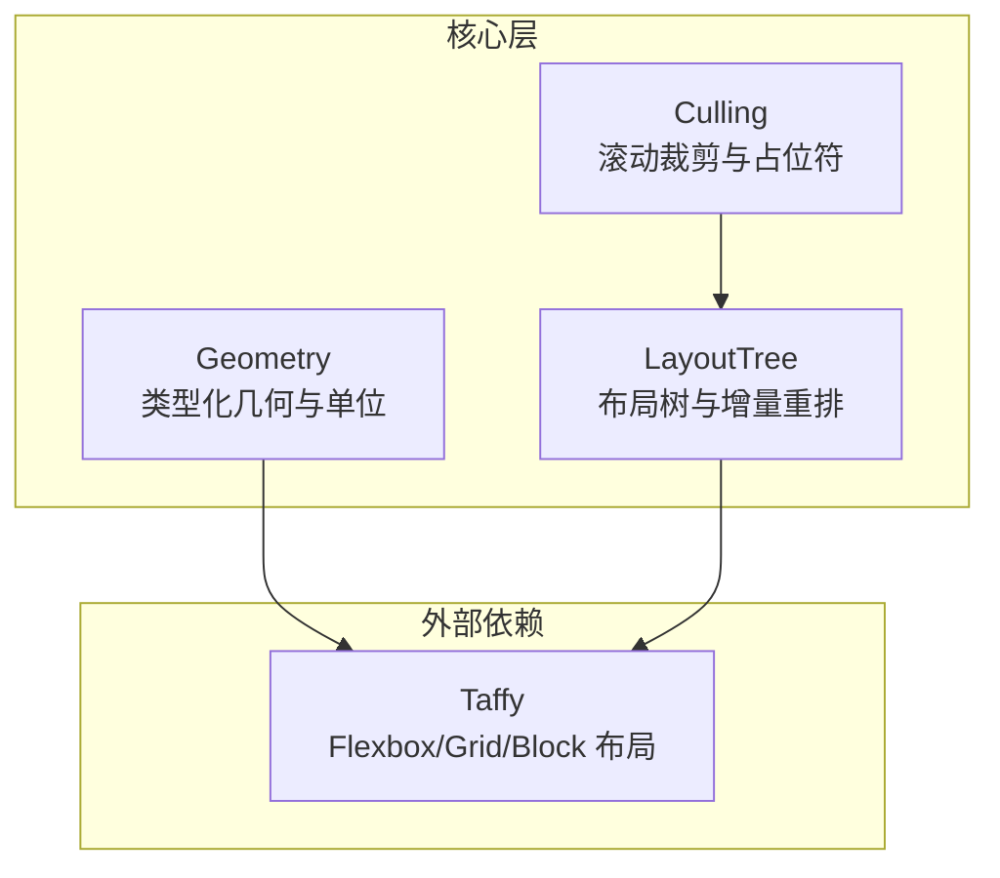
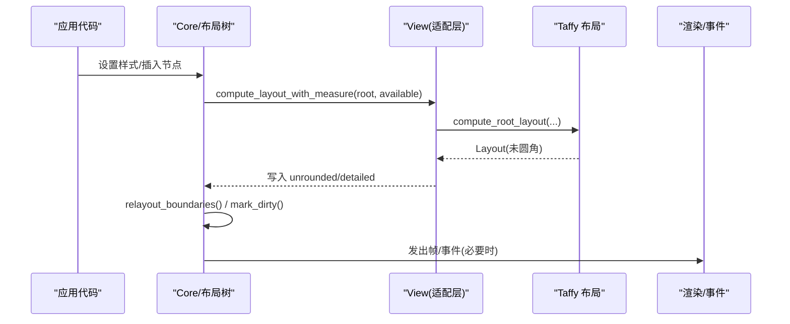
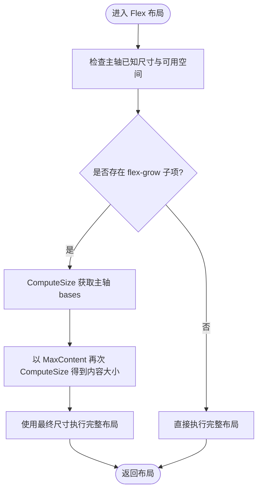
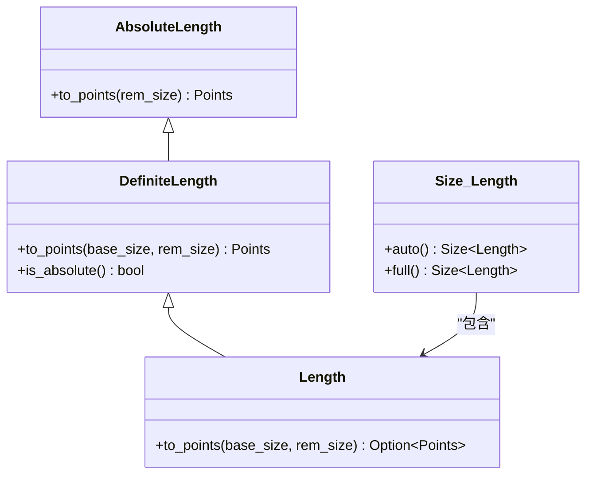
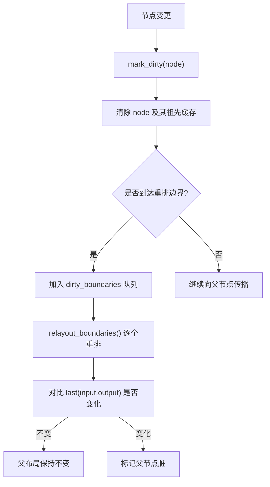
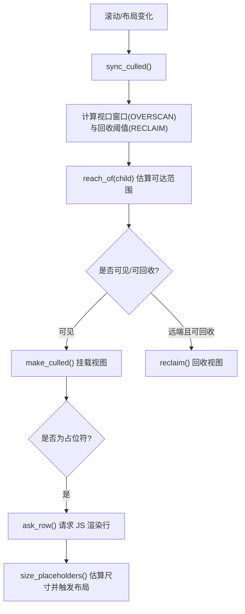
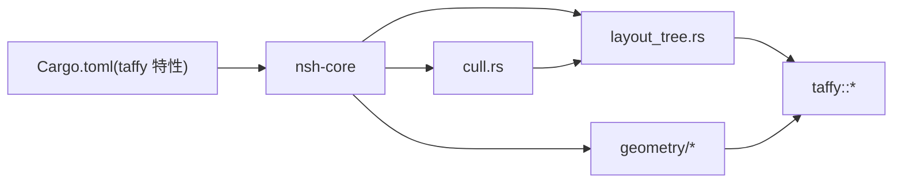

# 布局引擎

<cite>
**本文引用的文件**   
- [Cargo.toml](file://Cargo.toml)
- [layout_tree.rs](file://crates/nsh-core/src/core/layout_tree.rs)
- [cull.rs](file://crates/nsh-core/src/core/cull.rs)
- [geometry/mod.rs](file://crates/nsh-core/src/geometry/mod.rs)
- [geometry/length.rs](file://crates/nsh-core/src/geometry/length.rs)
- [geometry/taffy.rs](file://crates/nsh-core/src/geometry/taffy.rs)
</cite>

## 目录
1. [简介](#简介)
2. [项目结构](#项目结构)
3. [核心组件](#核心组件)
4. [架构总览](#架构总览)
5. [详细组件分析](#详细组件分析)
6. [依赖关系分析](#依赖关系分析)
7. [性能考量](#性能考量)
8. [故障排查指南](#故障排查指南)
9. [结论](#结论)

## 简介
本技术文档聚焦 NSH 的布局引擎，重点说明：
- Taffy 布局引擎的集成方式与 Flexbox/Grid 算法在核心中的适配。
- 几何系统的类型安全设计（长度单位、尺寸计算、坐标变换）。
- 布局树管理机制（布局计算、重排边界、增量更新策略）。
- 不同平台下的布局差异处理与一致性保障。
- 布局性能优化手段与调试工具使用方法。

## 项目结构
NSH 将布局相关能力集中在 nsh-core 中，并通过 geometry 子系统提供类型安全的几何抽象；Taffy 作为底层布局库被引入并封装为“核心布局树”。

图表来源
- [layout_tree.rs:1-50](file://crates/nsh-core/src/core/layout_tree.rs#L1-L50)
- [geometry/mod.rs:1-20](file://crates/nsh-core/src/geometry/mod.rs#L1-L20)
- [cull.rs:1-20](file://crates/nsh-core/src/core/cull.rs#L1-L20)

章节来源
- [Cargo.toml:241-241](file://Cargo.toml#L241-L241)
- [layout_tree.rs:1-50](file://crates/nsh-core/src/core/layout_tree.rs#L1-L50)
- [geometry/mod.rs:1-20](file://crates/nsh-core/src/geometry/mod.rs#L1-L20)
- [cull.rs:1-20](file://crates/nsh-core/src/core/cull.rs#L1-L20)

## 核心组件
- 布局树 LayoutTree：封装 Taffy 的低层接口，实现脏标记、重排边界、测量缓存、无圆角布局输出等。
- 几何系统 Geometry：定义 Points/Rems/Percentage/AbsoluteLength/DefiniteLength/Length 等类型，并在 taffy.rs 中完成与 Taffy 的零开销转换。
- 裁剪与占位符 Culling：基于滚动视口与变换可达范围进行视图挂载/回收，配合占位符估算行高。

章节来源
- [layout_tree.rs:55-153](file://crates/nsh-core/src/core/layout_tree.rs#L55-L153)
- [geometry/mod.rs:1-32](file://crates/nsh-core/src/geometry/mod.rs#L1-L32)
- [cull.rs:1-34](file://crates/nsh-core/src/core/cull.rs#L1-L34)

## 架构总览
NSH 的布局管线由“样式 → 几何 → Taffy 布局 → 核心布局树 → 渲染/事件”构成。核心通过自定义 View 适配器调用 Taffy 的计算函数，同时维护自身的缓存与增量更新策略。

图表来源
- [layout_tree.rs:723-739](file://crates/nsh-core/src/core/layout_tree.rs#L723-L739)
- [layout_tree.rs:627-660](file://crates/nsh-core/src/core/layout_tree.rs#L627-L660)

## 详细组件分析

### Taffy 集成与 Flexbox/Grid 算法
- 集成点：通过 Taffy 的 LayoutPartialTree/TraverseTree 等 trait 实现自定义 View，调用 compute_flexbox_layout/compute_grid_layout/compute_block_layout/compute_hidden_layout/compute_oof_layout 等算法。
- Flexbox 修正：当容器主轴空间确定且存在 flex-grow 子项时，先以“收缩拟合”语义计算主轴内容大小，再按可用空间重新布局，避免 CSS 语义偏差。
- Grid/Block：直接委托给 Taffy 对应计算函数，核心负责将结果写回自身布局缓存。

图表来源
- [layout_tree.rs:742-800](file://crates/nsh-core/src/core/layout_tree.rs#L742-L800)

章节来源
- [layout_tree.rs:1-50](file://crates/nsh-core/src/core/layout_tree.rs#L1-L50)
- [layout_tree.rs:742-800](file://crates/nsh-core/src/core/layout_tree.rs#L742-L800)

### 几何系统的类型安全设计
- 类型分层：AbsoluteLength(Rem/Points) → DefiniteLength(Absolute/Fraction) → Length(Definite/Auto)。所有长度在样式侧保持类型安全，仅在跨边界处转换为 Taffy 的 f32/百分比。
- 转换边界：geometry/taffy.rs 集中实现 From 转换，确保 rem 在统一 REM_SIZE 下解析，百分比原样传递。
- 形状与坐标：Point/Size/Bounds/Edges/Corners 均以 Points/Radians/Percentage 等类型参数化，保证运算与比较的类型正确性。

图表来源
- [geometry/length.rs:14-160](file://crates/nsh-core/src/geometry/length.rs#L14-L160)
- [geometry/length.rs:239-249](file://crates/nsh-core/src/geometry/length.rs#L239-L249)

章节来源
- [geometry/mod.rs:1-32](file://crates/nsh-core/src/geometry/mod.rs#L1-L32)
- [geometry/length.rs:14-160](file://crates/nsh-core/src/geometry/length.rs#L14-L160)
- [geometry/taffy.rs:1-154](file://crates/nsh-core/src/geometry/taffy.rs#L1-L154)

### 布局树管理与增量更新
- 脏标记与边界：mark_dirty 沿父链向上清除缓存，遇到“重排边界”即停止并排队单独重排；边界判定考虑绝对定位+固定尺寸、Flex 容器中固定尺寸且不收缩/非基线对齐等条件。
- 测量缓存：measured_as_before 记录叶子节点的多次测量输入-输出对，若全部一致则上层布局无需重算。
- 无圆角布局：unrounded_layout 暴露算法原始结果，供裁剪与坐标变换使用；圆角在需要时另行计算。
- 持有者穿透：holder 节点在不带样式且仅含一个子节点时“穿透”，使子节点直接在父容器中布局，保持 flex/grid 行为一致。

图表来源
- [layout_tree.rs:457-477](file://crates/nsh-core/src/core/layout_tree.rs#L457-L477)
- [layout_tree.rs:526-558](file://crates/nsh-core/src/core/layout_tree.rs#L526-L558)
- [layout_tree.rs:589-607](file://crates/nsh-core/src/core/layout_tree.rs#L589-L607)
- [layout_tree.rs:627-660](file://crates/nsh-core/src/core/layout_tree.rs#L627-L660)

章节来源
- [layout_tree.rs:55-153](file://crates/nsh-core/src/core/layout_tree.rs#L55-L153)
- [layout_tree.rs:457-477](file://crates/nsh-core/src/core/layout_tree.rs#L457-L477)
- [layout_tree.rs:526-558](file://crates/nsh-core/src/core/layout_tree.rs#L526-L558)
- [layout_tree.rs:589-607](file://crates/nsh-core/src/core/layout_tree.rs#L589-L607)
- [layout_tree.rs:627-660](file://crates/nsh-core/src/core/layout_tree.rs#L627-L660)

### 滚动裁剪与占位符
- 可达范围 reach_of：根据变换序列与动画可达区间估算视图可能偏移的最大距离，用于扩大裁剪窗口。
- 视口与回收：基于 OVERSCAN/RECLAIM 阈值决定何时挂载或回收视图；不可回收的条件包括焦点、选择、覆盖层、交互状态等。
- 占位符 placeholder：列表行在未渲染前以固定高度占位，随后根据相邻已渲染行的平均尺寸估算真实尺寸并触发增量布局。

图表来源
- [cull.rs:86-127](file://crates/nsh-core/src/core/cull.rs#L86-L127)
- [cull.rs:276-319](file://crates/nsh-core/src/core/cull.rs#L276-L319)
- [cull.rs:321-419](file://crates/nsh-core/src/core/cull.rs#L321-L419)
- [cull.rs:584-664](file://crates/nsh-core/src/core/cull.rs#L584-L664)

章节来源
- [cull.rs:1-34](file://crates/nsh-core/src/core/cull.rs#L1-L34)
- [cull.rs:86-127](file://crates/nsh-core/src/core/cull.rs#L86-L127)
- [cull.rs:276-319](file://crates/nsh-core/src/core/cull.rs#L276-L319)
- [cull.rs:321-419](file://crates/nsh-core/src/core/cull.rs#L321-L419)
- [cull.rs:584-664](file://crates/nsh-core/src/core/cull.rs#L584-L664)

### 平台差异与一致性
- 终端模式：当处于终端布局（grid 模式）时，布局走 Cells 路径，边框/内边距与 left_out 规则由 terminal_layout 控制；此时禁用某些优化（如重排边界判断）。
- 平台像素：几何系统在 geometry/mod.rs 明确区分 Points 与 DevicePixels/ScaledPixels，转换发生在平台绘制或 JS 解码边界，保证核心内部布局一致性。
- 方向与 RTL：在 cull.rs 中对水平滚动且父级 RTL 的情况做额外坐标修正，保证多平台表现一致。

章节来源
- [layout_tree.rs:219-233](file://crates/nsh-core/src/core/layout_tree.rs#L219-L233)
- [layout_tree.rs:526-558](file://crates/nsh-core/src/core/layout_tree.rs#L526-L558)
- [geometry/mod.rs:1-20](file://crates/nsh-core/src/geometry/mod.rs#L1-L20)
- [cull.rs:178-206](file://crates/nsh-core/src/core/cull.rs#L178-L206)

## 依赖关系分析
- 外部依赖：Taffy 通过 Cargo.toml 启用 std/flexbox/grid/block_layout/content_size 特性。
- 内部耦合：LayoutTree 依赖 geometry 的长度类型与 Taffy 的 Style/Layout 数据结构；Culling 依赖 LayoutTree 提供的 style/unrounded_layout/displays_none 等查询。

图表来源
- [Cargo.toml:241-241](file://Cargo.toml#L241-L241)
- [layout_tree.rs:44-51](file://crates/nsh-core/src/core/layout_tree.rs#L44-L51)
- [geometry/taffy.rs:1-10](file://crates/nsh-core/src/geometry/taffy.rs#L1-L10)

章节来源
- [Cargo.toml:241-241](file://Cargo.toml#L241-L241)
- [layout_tree.rs:44-51](file://crates/nsh-core/src/core/layout_tree.rs#L44-L51)
- [geometry/taffy.rs:1-10](file://crates/nsh-core/src/geometry/taffy.rs#L1-L10)

## 性能考量
- 重排边界隔离：将频繁变化的子树隔离为边界，避免整页重排。
- 测量缓存复用：叶子节点多次测量结果一致时跳过上层重排。
- 样式共享：最近设置的相同样式对象被共享引用，减少内存占用与比较成本。
- 滚动裁剪：按需挂载/回收视图，结合占位符估算减少首屏与滚动时的布局抖动。
- 零开销几何：类型包装与 repr(C)/transparent 新类型在热路径上无额外分配。

[本节为通用指导，不直接分析具体文件]

## 故障排查指南
- 布局未更新
  - 检查是否命中 is_boundary 导致父布局未被标记脏。
  - 确认 measure 回调的输入-输出是否与历史缓存一致，从而被 measures_as_before 短路。
- 滚动错位
  - 检查 reach_of 是否能估算变换可达范围；若无法估算，视图将被保守保留。
  - 确认 RTL 场景下水平滚动坐标修正逻辑是否生效。
- 占位符尺寸异常
  - 观察 size_placeholders 是否成功统计到相邻行尺寸；若未统计，可能因父节点尚未布局或节点被当作 overlay/root 排除。

章节来源
- [layout_tree.rs:526-558](file://crates/nsh-core/src/core/layout_tree.rs#L526-L558)
- [layout_tree.rs:589-607](file://crates/nsh-core/src/core/layout_tree.rs#L589-L607)
- [cull.rs:86-127](file://crates/nsh-core/src/core/cull.rs#L86-L127)
- [cull.rs:609-664](file://crates/nsh-core/src/core/cull.rs#L609-L664)

## 结论
NSH 的布局引擎在 Taffy 之上构建了类型安全、可增量更新的布局体系：通过几何类型约束保证数据一致性，通过重排边界与测量缓存提升性能，通过滚动裁剪与占位符优化大列表体验，并在终端/RTL 等平台差异处提供一致的布局语义。该设计兼顾了灵活性与高性能，适用于跨平台的 UI 构建。